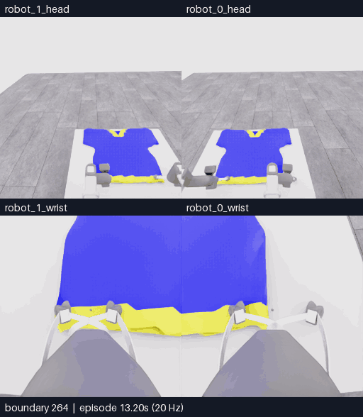
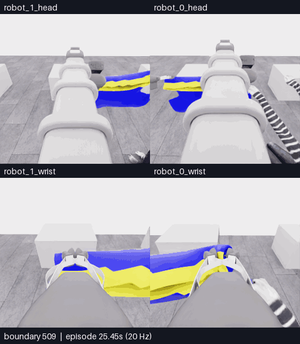
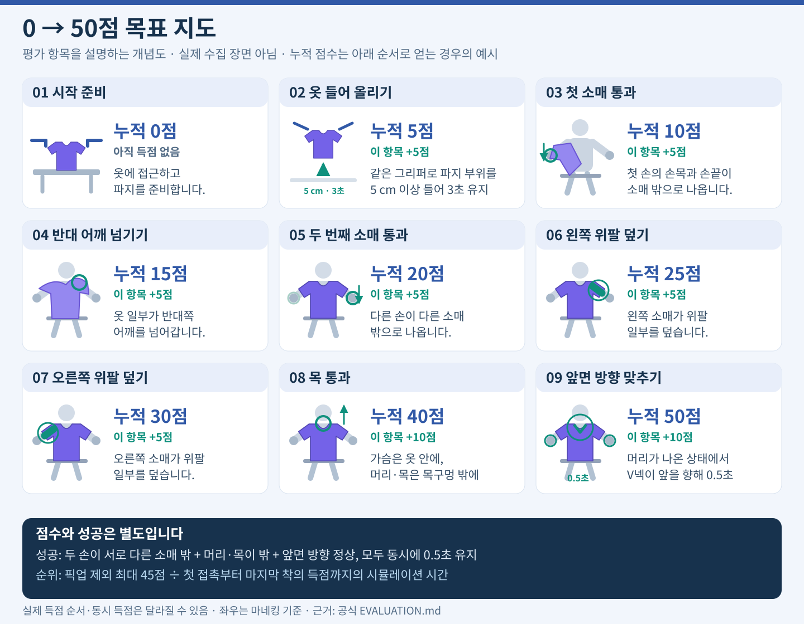

<!-- TEMP_PERFORMANCE_BEGIN: user requested temporary top-of-README note; move/remove after review -->
## 임시 성능 메모 · 확인 후 이동/삭제 예정

| CPU 평균 · 대기 / 동작 | GPU 평균 · 대기 / 동작 | RAM 사용 | VRAM 사용 | 수집 1회 |
|:---:|:---:|:---:|:---:|:---:|
| **2.08% / 19.14%** | **0% / 49.63%** | **약 16% / 70.76GiB** | **9.06 / 44.99GiB** | **약 31분** |

E13의 4분·121표본. 처리량은 별도 E12에서 **동작 중 1.15전이/초**, 모델 대기 포함 **0.395전이/초**였습니다. 렌더 FPS는 미계측입니다. 수집 시간은 E10~E13 평균이며 최신 E15는 **28분 30초**입니다.

측정 조건·최대 사용률·호출 시간·기술적 속도 개선

### 측정 조건과 세부 수치

**2026-11-06 10:57:41–11:01:41 UTC, E13 실행 중4분 실측.** 2초 간격121표본. 모델 대기104개·동작 실행8개를 비교하며 초기1개·단계 전환8개는 분리했습니다. 수집 중단·GPU 부하 시험 없이 측정했습니다. Chrome·WebRTC OFF.

| 자원 | 모델 요청·응답 대기 | 물리 동작 실행 |
|---|---:|---:|
| CPU 전체 평균 / 최대 | **2.08% /4.9%** | **19.14% /20.4%** |
| 표본별 최다사용 코어 평균 / 최대 | 8.41% /11.1% | 34.60% /58.3% |
| GPU 사용률 평균 / 최대 | **0% /0%** | **49.63% /67%** |
| GPU 전력 평균 | 81.01W | 131.91W |

**자원 여유:** Xeon Platinum8462Y+의 노출 vCPU12개(VM) · RAM70.76GiB 중 available59.25–59.41GiB(사용 약16.0–16.3%, total−available) · L40S VRAM **9,274 /46,068MiB (20.1%)** 고정 · GPU36–40°C · swap 약1MiB 고정 · 디스크 여유 약486GiB. 현재 표본에서 메모리 부족·지속적인 전체 CPU/GPU 포화 증거는 없습니다. 짧은 병목이나 코어 사이를 이동하는 단일 스레드 병목까지 배제하지는 않습니다.

| 처리 속도·시간 | 완료된 E12 전체 실측 |
|---|---|
| 전체 기록 | **781전이·39.05 simulation초 /32분55.68초 실제 경과** |
| 모델 호출 경로 | 12회 ·합계20분44.48초 (**63.0%**) ·호출당 평균103.71초 |
| 환경 요청·응답 | 합계11분19.75초 (**34.4%**) ·나머지51.44초는 기타 처리 |
| 동작 실행 구간 처리량 | **1.15 제어 프레임/초** ·실시간 비율0.0574× (모델 대기 제외, 요청·기록 포함) |
| 전체 실효 처리량 | **0.395 제어 프레임/초** ·실시간 비율0.0198× (모델 대기 포함) |
| 1전이 내부 계측 | 환경 adapter 평균764.95ms ·데이터 기록 평균51.93ms |

여기서 제어 프레임은20Hz로 기록하는 RGB5장·depth·로봇 상태 묶음의 전이입니다. **그래픽 렌더 FPS는 별도 미계측**이며 영상 재생5fps와도 다릅니다. 물리240Hz·내부 로봇 제어60Hz·정책/관측20Hz는 simulation 시간 기준입니다. 모델 호출 경로에는 CLI·네트워크·서비스 대기·생성이 포함되며 내부 추론시간만 분리한 수치가 아닙니다. 모델 대기 중에는 물리가 정지합니다. 자원 표본은 E13, 전체 시간·처리량은 완료된 E12로 구분합니다.

[측정 방법·한계와 해석](docs/project/performance/20261106-performance-review.ko.md) · [구간별 사용률](docs/project/performance/20261106-resource-summary.json) · [121개 표본 CSV](docs/project/performance/20261106-resource-samples.csv) · [처리량 계산 근거](docs/project/performance/20261106-timing-summary.json) · [E13 측정 당시 영상](docs/gallery/20261106-astra-hem-depth-001.ko.md)

**기술적 속도 개선 조사:** E13 입력 준비는 호출 경로의0.13%, 입력 캐시 비율90.1%였습니다. E14·E15에 제어기 중립 대기와 단계 계측을 추가했습니다. E15는 capture174.22ms·그 외 observe11.19ms·observe 바깥 step581.06ms/전이였으며, 실제 가속 효과는 아직 검증하지 않았습니다. [근거·우선순위·한계](docs/project/performance/20261106-speedup-plan.ko.md).

**최근 실험 소요:** E10~E13은 평균31분02초(27분09초~33분30초, 초기화·재실행 포함)였습니다. 종료 기준·호출 수가 달라 속도 비교용 벤치마크는 아닙니다. 짧은 E14 진단13분57초는 이 평균에서 제외했습니다.

<!-- TEMP_PERFORMANCE_END -->

# PhyRC 2027 · 두 로봇의 협력 착의

**오늘은 E15까지 마감했습니다. 최고 5/50점 · 첫 소매 통과 0점 · 착의 성공 없음.** 10점 목표는 일시 중지했고 E16·E17은 실행하지 않았습니다. 다음 클린 서버에서 분석을 검토한 뒤 수집 방향을 정합니다.

| 먼저 볼 곳 | 내용 |
|---|---|
| **[영상으로 비교하기](docs/gallery/README.ko.md)** | 큰 화면을 스크롤하며 E15와 이전 시도 비교 |
| **[오늘의 결론·다음 전략](docs/project/SESSION_WRAPUP_20261106.ko.md)** | 확인한 사실, 남은 가설, 다음 실험 선택 기준 |
| **[클린 서버에서 다시 시작](docs/project/START_HERE.ko.md)** | 고정 원본·해시·복원·검사·미적용 후보 |

## E15 · 먼저 들고 펼친 뒤 손 근처로 이동

**① 준비 · 경계 264–325 · 12.4초 반복.** 천의 층 분리가 보인 뒤 함께 들었습니다. 양쪽을 동시에 움직여 각 파지가 독립적으로 지지하는지는 확인하지 못했습니다. [MP4](docs/gallery/assets/20261106-e15-preparation/event.mp4)

**② 손 근처 · 경계 509–611 · 20.6초 반복.** 손–천 경계가 가려지고 한쪽 손가락 간격이 커졌습니다. 이후 모델이 그쪽을 열고 철수했습니다. 소매 통과는 확인되지 않았습니다. [MP4](docs/gallery/assets/20261106-e15-hand-recovery/event.mp4) · **[운반 포함 세 단계 전체](docs/gallery/20261106-astra-opening264-001.ko.md)** · [근거 분석](docs/collection/reviews/20261106-astra-opening264-001.ko.md)

영상은 위쪽 양쪽 머리·아래쪽 양쪽 손목의 동일 시각입니다. **4배 느리게, 모델 대기 제외**. 원본 카메라 256×256이므로 확대가 세부 정보를 추가하지 않습니다. 각 선택 구간 내 프레임 생략은 없습니다.

## 무엇을 바꾸어 보았나

| 시도 | 변경한 접근 | 결과 |
|---|---|---|
| [E10](docs/gallery/20261106-astra-sleeve-branch700-003.ko.md) | 운반 뒤 소매 식별·정렬 | 5점 · 소매 식별 불확실 |
| [E11](docs/gallery/20261106-astra-sleeve-history-001.ko.md) | 초기 옷 모습의 과거 RGB 추가 | 5점 · 손 통과 미확인 |
| [E12](docs/gallery/20261106-astra-hem-route-001.ko.md) | 몸통 밑단 입구 경로 | 5점 · 가림·복구 반복 |
| [E13](docs/gallery/20261106-astra-hem-depth-001.ko.md) | 현재 손목 depth 패널 추가 | 5점 · 모델 자율 종료 |
| [E14](docs/gallery/20261106-astra-hem-settle-001.ko.md) | 움직임 뒤 중립 6전이 | 5점 · 짧은 진단 후 중단 · 효과 미확정 |
| **[E15](docs/gallery/20261106-astra-opening264-001.ko.md)** | **더 이른 경계에서 파지·펼침 준비** | **5점 · 한쪽 열기·철수 뒤 자율 종료** |

점수는 오르지 않았습니다. 대신 **함께 이동한 베이스**, **가려진 손–천 경계**, **후반 한쪽 손가락의 변화**를 구분할 근거가 생겼습니다. 시작·예산·종료 조건이 달라 위 표를 성공률 순위로 해석하지 않습니다.

과제·기존 5점 장면·공식 시연

두 대의 Stretch 4가 마네킹에 티셔츠를 입힙니다. 픽업 5점 다음 목표는 첫 손의 소매 출구 통과로 얻는 추가 5점입니다. 50점과 착의 success는 별도 판정입니다.

https://github.com/user-attachments/assets/d2f347fe-712b-42f3-bdee-69d3fee2a47c

공식 참고 시연 · 35.8초 · 원 사이트 표기 8배속. [공식 원본](https://emprise.cs.cornell.edu/phyrc/assets/c27/media/teleop-overhead.mp4) · [E05 한 로봇 픽업](docs/gallery/20261106-astra-pickup-hold5-001.ko.md) · [E07 공동 운반](docs/gallery/20261106-astra-coordinated-fresh-001.ko.md) · [기존 사람 부분 시연](docs/project/DEMO_20261026.ko.md)

코드·상세 기록·연구

[현재 상태](docs/project/STATUS.md) · [수집 자료 목차](docs/collection/README.ko.md) · [오늘의 실행 기록](docs/project/sessions/20261106-resume10.ko.md) · [Stretch 4·Georgia Tech Astra 연구](docs/collection/research/2026-11-06-stretch4-astra-directions.ko.md) · [픽셀 depth 후보](docs/collection/research/2026-11-06-pixel-depth-query.ko.md) · [OpenWAM 분석 전용](docs/collection/research/openwam-feasibility.ko.md)

실행 모델은 `gpt-6-astra` / `ultra`, CLI 0.166.0 / `exec`입니다. E15는 현재 RGB 5장·손목 depth 패널·공개 로봇 상태·depth 요약을 사용했습니다. 공식 점수·audit·숨은 천 상태는 행동 입력에서 분리합니다. Chrome·WebRTC는 끕니다.

[공식 원본 README](README.upstream.md) · [설치](docs/competition/SETUP.md) · [규칙](docs/competition/RULES.md) · [평가](docs/competition/EVALUATION.md) · [데이터](docs/competition/DATA.md) · [LICENSE](LICENSE) · [NOTICE](NOTICE) · [THIRD_PARTY](THIRD_PARTY.md)

