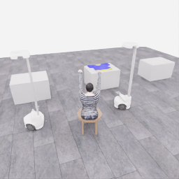

# PhyRC 2027 Phase 1

[](README.upstream.md)

**Cooperative robot dressing with RGB-D observation processing and VLA adaptation.**

Leonard Yoon, Ph.D. | Independent research project  
[한국어](README.ko.md) / [Current status](docs/project/STATUS.md) / [Clean-server start](docs/project/START_HERE.ko.md) / [Engineering sprint](docs/project/ENGINEERING_SPRINT.ko.md) / [Evidence map](docs/project/EVIDENCE_MAP.md)

This participant fork develops a reproducible workflow for two Stretch 4 robots in the official PhyRC Isaac Sim environment: collect demonstrations, validate observations and actions, adapt π₀.₅, evaluate policy execution, and preserve the submission artifacts.

> **October 23 execution stopped:** tests ended at the owner's request for review before another clean server. Clean-server restore, official smoke, Chrome keyboard/robot movement and a minimal human-motion data format sample were verified. **No full 900-second pass, Codabench submission or dressing success.** Task demonstrations and new SFT are deferred.

## October 23 clean-server results and handoff

[Detailed session report](docs/project/sessions/20261023-clean-start.md) · [Status](docs/project/STATUS.md) · [Next clean-server entry](docs/project/START_HERE.ko.md). The Korean README contains the full operational handoff; this section records the same measured scope.

| Item | Measured result |
|---|---|
| Host | L40S 46,068 MiB, Xeon Platinum 8452Y 12 vCPU, ~70 GiB RAM, Ubuntu 22.04.5, driver 580.126.09 |
| Source | Session start `5a2ab4ec2b47d907198a171da35c17364e8a185c`; official upstream `4dbbebcf93a06c1bfe12136eadc2e580f30125d6` |
| Restore | Pinned dataset, full model/train-state files and release ZIP downloaded and checksums passed; no optimizer continuation or new training |
| Official environment | Build 218.53 s; prepare 9.14 s; smoke 367.80 s, actual `PHYRC-SMOKE-PASS` and exit 0 |
| Policy runtime | Additive image build 68.40 s; short offline run 91.11 s, one action/0.05 simulated seconds, 0 points/no_contact |
| Setup wall time | Approximately 10 minutes for the core environment, 14–15 minutes through policy and Chrome readiness. Started ~04:04 UTC, smoke done 04:16, Chrome ready 04:18. Downloads/build partly overlapped |
| Chrome | Owner confirmed keyboard/robot movement. Compact bottom-right 13 px action/key guide, held keys, server-receipt/latency and focus-release feedback implemented; full reconnect/gripper checklist not established |
| Human capture | ESC completed 2,419 transitions/120.95 simulated seconds, 1,172.86 s collection wall, raw complete=true |
| Derived motion sample | Three contiguous clips from the rendered prefix, 12 transitions/0.6 s, with nonzero movement input and public joint/base change; not an exhaustive extract of all 314 commanded-motion transitions |
| Data checks | Original public state/action equality, five-camera RGB-D validity, obs/action/next_obs continuity, 20 Hz timing and official PolicyDataset load passed |
| Full export | Intentionally interrupted after a rendered prefix of 364 transitions; original retained, full dataset stays incomplete; only the independently validated derived sample is complete |
| Full 900-second check | Owner-interrupted at **1,460 actions/73.0 simulated seconds**, total **1,814.08 s wall**. No valid final score or full pass |
| End state | Evaluation GPU process and viewer server stopped; GPU 0 MiB confirmed. Server power/deletion not performed |

Human sample labels are `source=human`, `purpose=teleoperation_format_test`, `review=format_only_not_for_sft`. It is genuine human interface testing, not a garment expert demonstration or approved training data. No new SFT or task-performance comparison was performed. Audit/raw privileged state is not a policy input.

### Runtime and rules findings

The official clocks are policy 20 Hz, control 60 Hz and physics 240 Hz **in simulation time**: one action advances 0.05 s through 12 physics steps. The episode budget adds simulation time and policy-call wall time; environment physics/rendering wall time is outside that accumulator. A slow real-time display is not by itself a clock violation. [Official policy/time contract](https://github.com/rirolab/PhyRC_2027_Challenge/blob/4dbbebcf93a06c1bfe12136eadc2e580f30125d6/docs/competition/POLICY.md).

Observed points: 19.85 simulated seconds in 379.6 s evaluation wall; later 54.85 s in 993.5 s wall, approximately 18–19 wall minutes per simulated minute including first policy compilation. Cumulative inference time was not logged, so the exact 900-budget consumption at interruption is unknown. The historical ~3-hour estimate and later conservative ~4h15 extrapolation were not completed-run timings or reliable next-server ETAs.

A 10 s/20 Hz py-spy snapshot (199 main-thread samples) attributed approximately 41.2% to official evaluation/contact checks, 39.2% to physics/control, 16.1% to camera capture and 3.5% to inference. These are short-window stack shares, not exact component timers. Per-physics-step evaluation, GPU-to-CPU state copies and synchronous five-camera rendering are plausible contributors; a pure GPU or CPU hardware bottleneck was not established.

Hardware pressure checks: GPU ~39%, 17,446 MiB, 38 C, P0, no active thermal/power slowdown; ~49 GiB available RAM; no active swap/I/O wait/CPU steal; no container CPU/RAM quota, throttling or OOM. A 2 s process sample used ~2.19 of 12 vCPUs. Total VRAM includes simulator and policy: **policy-alone 12 GB compliance and RTX 3090 execution remain unverified**.

### Next clean-server priorities

1. Read this README, today's report, AGENTS, STATUS and [recovery commands](docs/project/RECOVERY.ko.md). Current owner scope supersedes the earlier sprint: format/submission verification only; do not start task demonstrations or new SFT automatically.
2. Restore pinned artifacts, pass smoke and a short offline check. Reconfigure streaming addresses only if needed; keep connection details private.
3. Before another long run, prepare a separate fixed 100–200-step warm diagnostic. Log simulation time, policy-call time, environment wall time, compile/startup, total wall and memory separately; this diagnostic is not the official self-check.
4. Benchmark thread count/CPU affinity/NUMA and cache reuse only as controlled candidates. None was applied or proven beneficial. Do not change official physics, solver, geometry, evaluator or sensor alignment to speed up a check. No evidence currently justifies buying more GPU/RAM/cores.
5. Reserve a separate full-check slot with explicit source/base commit, ZIP and image. Today's helper deliberately selected historical simulator **`9d97807`**, not current main. A current-main package check needs an explicit helper source-selection change and verification.
6. Codabench was unreachable from server and owner's Mac; further access checking is deferred by request. Local pass, portal acceptance and organizer score are separate states.

```bash
hf download leonayoon/phyrc-2027-phase1-data --type dataset \
  --revision c31241f626c4cbf02c2bd69a10f70a3841fa58a3 \
  --include 'samples/20261023-human-motion-format-test/*' --local-dir output/recovered-human-sample
.venv/bin/python participant/ops/artifacts.py verify \
  output/recovered-human-sample/samples/20261023-human-motion-format-test
```

[Verified E0 evidence](https://huggingface.co/datasets/leonayoon/phyrc-2027-phase1-data/tree/2234dfd306df355bf8a9f879b6b3aaae4c3b56f8/sessions/20261023-clean-start-e0) · [Verified human motion sample](https://huggingface.co/datasets/leonayoon/phyrc-2027-phase1-data/tree/c31241f626c4cbf02c2bd69a10f70a3841fa58a3/samples/20261023-human-motion-format-test). Final raw-source/interrupted-run preservation revisions and restore instructions are in the [session report](docs/project/sessions/20261023-clean-start.md).

Final preservation: [human raw capture/interrupted render archive](https://huggingface.co/datasets/leonayoon/phyrc-2027-phase1-data/tree/32fc6d21c5d358caefd17c6aadfc4f25a843e368/captures/20261023-human-source) · [interrupted 900-second run, profiles and source snapshot](https://huggingface.co/datasets/leonayoon/phyrc-2027-phase1-data/tree/93753f568811c5cfcd0235f5d8cb9940c5ce6a23/sessions/20261023-final-evidence). Archive SHA256: `94dfa0238bfab003c255ea6d48f64e7b4b15e9e0e92293e5a360210514a47bd1`. Only connection metadata was redacted in the preserved manifest; chunk/scene/event bytes were retained. See the session report for round-trip restore checks and exact commands.

The raw archive also passed HF re-download, restore into a new directory and CPU sample re-derivation: **all 171 public HDF5 datasets matched exactly**. This is same-server remote round-trip recovery, not another clean-server GPU test.

## Start here on a clean server

Read `AGENTS.md`, [STATUS](docs/project/STATUS.md), [START_HERE](docs/project/START_HERE.ko.md), and the [engineering sprint](docs/project/ENGINEERING_SPRINT.ko.md). The start guide contains a paste-ready Codex handoff, existing commands, and the first session's completion criteria.

```bash
git clone https://github.com/leonyoon-3dai/PhyRC_2027_phase1.git
cd PhyRC_2027_phase1
git status --short
git rev-parse HEAD
# Read the documents above before installing or starting GPU work.
participant/ops/bootstrap.sh --check
```

Next session: inspect the new server, restore pinned artifacts, pass official smoke, rerun the policy briefly and measure a fixed-step warm diagnostic. Task demonstrations and new training stay deferred until the owner is ready. Run collection, training, and GPU evaluation sequentially. Historical recovery commits describe previous runs; read the latest handoff before checking out an old snapshot.

## Verified baseline

Measured on October 22 on one L40S, 12 vCPU, and approximately 70 GiB RAM. Source: [session report](docs/project/sessions/20261022-bootstrap.md).

| Item | Verified scope |
|---|---|
| Official environment | Build, prepare, and actual `PHYRC-SMOKE-PASS` |
| Synchronized recording | 3 scripted episodes, 63 transitions, 5 RGB-D cameras; schema and continuity checks |
| π₀.₅ training | JAX LoRA configuration, 30 updates / 0.476 effective epochs; overfitting not established |
| Offline execution | Official-image load and debug policy execution; **0 points / no_contact** |
| Preservation | HF data, full model/training state, ZIP and evidence; download checksums and CPU state restore at step 30 |
| Submission path | ZIP unpack/build and 259 actions in a fresh clone; **full 900-second check incomplete, not submitted** |

The recorded data is a **Codex-authored bounded script**, labeled `integration_test`. It is neither human demonstration nor live GPT operation. No dressing success or policy improvement is claimed. The upstream freeze filter also leaves some vision/projection parameters trainable; the run is not described as training only small LoRA matrices.



[Three-camera test video](https://huggingface.co/datasets/leonayoon/phyrc-2027-phase1-data/resolve/da172805036d5e53daf1834f32baf367820f9183/derived/20261022T0409Z-integration/integration-public-cameras.mp4) / [Data](https://huggingface.co/datasets/leonayoon/phyrc-2027-phase1-data) / [Model and training state](https://huggingface.co/leonayoon/phyrc-2027-phase1-pi05) / [Exact recovery revisions](docs/project/RECOVERY.ko.md)

## Evidence sprint: October 23–28

Complete one small **human collection → dataset QC → π₀.₅ SFT → matched rollout** loop before expanding the system. Dates and counts below are targets, not results. D0 is the day the owner actually starts the next clean server; no server is assumed to have started on October 23.

| Evidence | Scope | Gate |
|---|---|---|
| E0 · Restore | Pinned artifacts, official smoke, bounded offline execution | New-server logs, checksums and measured recovery times |
| E1 · Human collection | Validate Chrome input/export; target 3–5 useful short demonstrations and 1–2 failures | Genuine human source, READY/complete, reviewed dataset |
| E2 · Data and geometry | 20 Hz alignment, units, valid depth, camera-local surface points | QC report and 2–3 reviewed RGB-D examples |
| E3 · Adapt and compare | Small human-data overfit, one SFT configuration, base vs adapted policy | Reloaded checkpoint and same three practice seeds, including failures |

| Target dates | Priority |
|---|---|
| Oct 23–24, if a server is ready | E0 and the first valid human recording |
| Oct 25 | Data QC and a small camera-local RGB-D diagnostic |
| Oct 26–27 | Human-data SFT and short paired evaluation; stop adding features |
| Oct 28 | Freeze evidence, a 60–90 second video, limitations and recovery instructions |
| Oct 29 onward | Full 900-second check, submission and dressing-performance work |

Budget **12–18 focused hours plus measured download/build/compile/export/GPU waits**. Reduce scope if the server opens later. Cap initial Chrome debugging at two focused hours, then document the blocker and consider another remote desktop path. SAM 2, automatic GPT collection, and FK/IK extensions are optional.

Before human SFT, explicitly support reviewed human episodes in the loader and configure an appropriate short-run learning-rate schedule. Start the new human-data run from `pi05_base`; preserve the old integration checkpoint. The self-check helper's historical base commit must also be distinguished from the selected source for a new package. These are planned code changes, not fixes made by this documentation update.

RGB-D is initially an **offline diagnostic**. The current policy consumes three RGB views and robot state; depth diagnostics alone do not demonstrate a policy gain. The initial manipulation segment is approach, grasp and briefly lift while retaining both robots' interface. Full dressing and positive official points/s remain later goals.

Details: [engineering sprint](docs/project/ENGINEERING_SPRINT.ko.md) · [evidence and claim map](docs/project/EVIDENCE_MAP.md). The previous [two-week plan](docs/project/RGBD_TWO_WEEK_PLAN.ko.md) is archived; its dates and 60–70 hour scope no longer govern execution.

## Observation and policy contract

| Interface | Current implementation |
|---|---|
| Available cameras | Overview, robot_0/robot_1 wrist, robot_0/robot_1 head; native 256×256 RGB-D |
| Depth | Optical-axis Z in metres; invalid=0 with `depth_valid=false` |
| Current policy images | Overview + each robot's wrist RGB; depth and head images unused |
| Policy state | 32D: 26 joint positions + 2 fingertip distances + 2 gripper intents + 2 previous grip commands |
| Action | 18 normalized values, padded to 32 for the model and restored to `float32 (2,9)` |
| Timing | 20 Hz policy, 60 Hz control, 240 Hz physics; one action spans 0.05 simulated seconds |

The 32D representation is not a robot DoF count. Gripper zero preserves intent. Camera-local geometry is the first RGB-D target; robot/world transforms require validated FK and static calibration from permitted data. Audit camera matrices, cloth ground truth, object poses, seeds, and raw simulator state are not policy inputs.

Sources: [DATA](docs/competition/DATA.md), [RULES](docs/competition/RULES.md), [interface configuration](config/policy_interface.json), [shared preprocessing](participant/pi05/preprocessing.py).

## Execution and evaluation limits

- Preserve the official physics, action limits, reset rules, and evaluator. Keep SAM 2 analysis, JAX training, and the official simulator environments separate.
- Preserve the base policy and compare on matched seeds, controller, action rate, adapter, normalization, and horizon. Loss, segment completion, raw points, points/s, and full-dressing success are separate metrics.
- Pickup alone can yield zero dressing points/s. Retain failed rollouts and report the small evaluation sample size.
- The full official check has a 900-second simulation-plus-inference budget. At the earlier observed speed, approximately three hours of wall time was estimated; reserve a separate slot and remeasure.
- L40S execution does not verify the judging RTX 3090 24GB or the policy's 12GB budget. The package must load offline with weights, tokenizer, normalization, and code.
- Restricted Codex/GPT collection remains an optional research path. No extra billed API usage is planned, and no organizer approval of that interpretation is claimed.
- Preserve pinned artifacts before ending a disposable session. Do not provision additional compute or stop/delete a server without the owner's request.

After this evidence sprint, continue the same data and experiment workflow toward repeatable dressing progress before the November 17 checkpoint, with an internal submission target of November 16. These remain planned milestones.

## Read and continue

| Document | Purpose |
|---|---|
| [START_HERE](docs/project/START_HERE.ko.md) | Current clean-server entry point and Codex prompt |
| [Engineering sprint](docs/project/ENGINEERING_SPRINT.ko.md) | Active priorities, daily gates, scope limits and evaluation |
| [Evidence map](docs/project/EVIDENCE_MAP.md) | Engineering competencies, verified claims and portfolio updates |
| [Previous two-week plan](docs/project/RGBD_TWO_WEEK_PLAN.ko.md) | Archived schedule; superseded by the active sprint |
| [STATUS](docs/project/STATUS.md) | Measured state and unresolved items |
| [RECOVERY](docs/project/RECOVERY.ko.md) / [TODO](docs/project/TODO.ko.md) | Pinned HF revisions, actual commands, remaining work |
| [TELEOP](docs/project/TELEOP.ko.md) | Human and restricted AI collection design |
| [Experiment register](experiments/README.md) | Session/experiment templates and run index |
| [Initial plan archive](docs/project/PLAN.ko.md) | Original pre-implementation design, retained for history |
| [Sources](docs/project/SOURCES.md) | Reviewed official references and revisions |

## Task and attribution

<details>
<summary>Organizers' cooperative dressing demonstration</summary>


Official upstream demonstration at 32× speed, showing two Stretch 4 robots dressing a seated manikin. This is not a learned-policy result from this fork.

</details>

This is Leonard Yoon's participant project, not an organizer repository. [README.upstream.md](README.upstream.md) preserves the reviewed guide at upstream `4dbbebcf93a06c1bfe12136eadc2e580f30125d6`. Official simulation, assets, evaluation, and demonstrations retain their attribution. See [LICENSE](LICENSE), [NOTICE](NOTICE), and [THIRD_PARTY.md](THIRD_PARTY.md).

Official challenge: https://emprise.cs.cornell.edu/phyrc/challenge-2027/  
Official code: https://github.com/rirolab/PhyRC_2027_Challenge  
Codabench: https://www.codabench.org/competitions/18366/  
Previous BEHAVIOR project: https://github.com/leonyoon-3dai/behavior-submission-2026

<details>
<summary>Original guide compatibility anchors</summary>

<a id="1-install-and-run"></a>
[Install and run](README.upstream.md#1-install-and-run)

<a id="2-teleop-controls"></a>
[Teleop controls](README.upstream.md#2-teleop-controls)

<a id="3-collect-training-data"></a>
[Collect training data](README.upstream.md#3-collect-training-data)

<a id="4-observations"></a>
[Observations](README.upstream.md#4-observations)

<a id="5-actions"></a>
[Actions](README.upstream.md#5-actions)

<a id="6-train-and-run-a-policy"></a>
[Train and run a policy](README.upstream.md#6-train-and-run-a-policy)

<a id="7-scoring-and-pointss"></a>
[Scoring and points/s](README.upstream.md#7-scoring-and-pointss)

<a id="8-allowed-information-and-fair-play"></a>
[Allowed information and fair play](README.upstream.md#8-allowed-information-and-fair-play)

</details>
