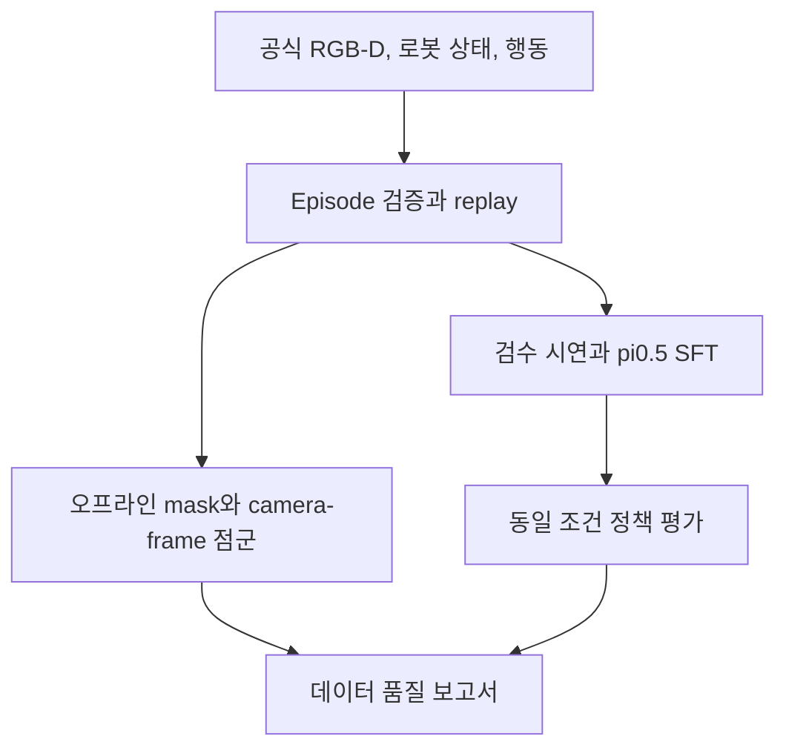

# PhyRC 2027 Phase 1

[](README.upstream.md)

**RGB-D 관측 처리와 VLA 적응을 활용한 두 Stretch 4의 협동 착의 연구.**

Leonard Yoon, Ph.D. | 윤영호 | 독립 연구 프로젝트  
[English](README.md) / [현재 상태](docs/project/STATUS.md) / [클린 서버 시작](docs/project/START_HERE.ko.md) / [2주 계획](docs/project/RGBD_TWO_WEEK_PLAN.ko.md)

공식 PhyRC Isaac Sim 환경에서 시연 수집, 관측과 행동 검증, π₀.₅ 적응, 정책 평가와 제출 자료 보존을 연결합니다. 저장소만으로 작업의 상태와 근거를 확인하고 새 서버에서 이어갈 수 있도록 기록합니다.

> **2026-10-22 문서 업데이트.** 오늘은 문서만 정리했습니다. 다음 클린 서버 작업은 **10월 23일 시작 예정**입니다. 아래의 기존 실측 결과는 그대로이며, 사람 시연, 전체 900초 검사, Codabench 제출, 별도 클린 서버 복원은 아직 미검증입니다.

## 내일 클린 서버에서 시작하는 순서

`AGENTS.md`, [STATUS](docs/project/STATUS.md), [START_HERE](docs/project/START_HERE.ko.md), [2주 실행 계획](docs/project/RGBD_TWO_WEEK_PLAN.ko.md)을 먼저 읽습니다. 시작 가이드에 실제 존재하는 명령, 첫 세션의 완료 기준, **Codex에 붙여넣을 인계문**이 있습니다.

```bash
git clone https://github.com/leonyoon-3dai/PhyRC_2027_phase1.git
cd PhyRC_2027_phase1
git status --short
git rev-parse HEAD
# 위 문서를 읽고 서버 상태를 확인한 뒤:
participant/ops/bootstrap.sh --check
```

첫 세션은 새 서버 점검, 고정 자료 복원, 공식 smoke, 기존 정책의 짧은 실행, Chrome을 통한 **유효한 사람 시연 1개 확보**에 집중합니다. 수집, 학습, GPU 평가는 순차 실행합니다. 복원 문서의 과거 commit으로 이동하기 전에 최신 인계 문서를 읽고 실행 revision을 기록합니다.

## 현재 확인한 결과

2026-10-22, L40S 1대, 12 vCPU, 약 70 GiB RAM에서 측정했습니다. 근거: [첫 세션 기록](docs/project/sessions/20261022-bootstrap.md).

| 항목 | 검증 범위 |
|---|---|
| 공식 환경 | build, prepare, 실제 `PHYRC-SMOKE-PASS` |
| 동기화 기록 | scripted 3 episode / 63 transition / 5 RGB-D 카메라, schema와 연속성 검사 |
| π₀.₅ 학습 | JAX LoRA 설정, 30 update / 0.476 effective epochs. 과적합 미확인 |
| 오프라인 실행 | 공식 이미지에서 로딩과 debug 실행, **0점 / no_contact** |
| 보존과 복원 | HF 데이터, 전체 모델/학습 상태, ZIP와 근거 보존. 재다운로드 checksum, CPU step 30 복원 |
| 제출 경로 | 새 clone에 ZIP을 풀어 build와 259 action 실행. **전체 900초 검사 미완료, 미제출** |

데이터는 추가 API 과금 없이 **Codex가 작성한 제한된 고정 명령**으로 수집했고 `integration_test`로 표시했습니다. 사람 또는 live GPT 시연이 아닙니다. 착의 성공이나 정책 성능 향상을 확인한 결과로 쓰지 않습니다. 현재 freeze filter에는 vision/projection 학습 대상도 포함되므로 작은 LoRA 행렬만 학습했다고 표현하지 않습니다.


[실제 3시점 시험 영상](https://huggingface.co/datasets/leonayoon/phyrc-2027-phase1-data/resolve/da172805036d5e53daf1834f32baf367820f9183/derived/20261022T0409Z-integration/integration-public-cameras.mp4) / [데이터](https://huggingface.co/datasets/leonayoon/phyrc-2027-phase1-data) / [모델과 학습 상태](https://huggingface.co/leonayoon/phyrc-2027-phase1-pi05) / [고정 복원 자료](docs/project/RECOVERY.ko.md)

## 다음 2주: 10월 23일 - 11월 5일

아래 날짜와 수량은 **목표이며 실적이 아닙니다.** 먼저 접근, 의복 집기, 짧게 들어 올리기를 대상으로 두 로봇의 역할을 단순하게 고정합니다. 전체 착의와 양수 points/s는 이후 성능 목표입니다.

| 작업 | 추가할 내용 | 남길 근거 |
|---|---|---|
| 시연 품질 | 사람 조작, replay, 시간/행동 검증, episode 단위 분할 | 유효 export, manifest, QC 보고서와 제외 사유 |
| RGB-D 분석 | prompt 기반 의복 mask, 유효 depth, camera-frame 점군 | 수동 검수 표본, 정상/가림 비교, 품질 지표 |
| VLA 적응 | 단일 π₀.₅ LoRA SFT 설정, checkpoint 재로딩 | 학습 대상 parameter, 데이터 노출량, 행동 출력 |
| 비교 평가 | base와 적응 정책을 같은 조건에서 비교 | 같은 seed 3개부터, 가능하면 5개. 영상, 점수, 실행 비용 |
| 재현과 제출 | 전체 self-check, 복원, 가능한 경우 Codabench | 버전, checksum, 결과 JSON, 실제 제출 상태 |



RGB-D 모듈은 먼저 **오프라인 진단**에 사용합니다. 현재 정책 입력은 RGB 3개와 로봇 상태입니다. Depth 분석 도구를 추가한 것만으로 정책 성능이 개선되었다고 주장하지 않습니다.

| 기간 | 중심 작업 | 완료 기준 |
|---|---|---|
| D1-2, 10/23-24 | 복원, smoke, 짧은 실행, Chrome 조작 | 유효한 사람 시연 1개 또는 구체적 blocker |
| D3-4, 10/25-26 | 동기화 replay, RGB-D 검사 | QC 보고서와 viewer |
| D5-6, 10/27-28 | 의복 mask와 가시 표면 점군 | 정상/가림 사례 검수 화면 |
| D7-8, 10/29-30 | 수집, 검수, 분할 | 고정 manifest와 train-only 정규화 |
| D9-10, 10/31-11/1 | 작은 overfit, LoRA 학습 | 재로딩한 checkpoint와 유효 행동 |
| D11-12, 11/2-3 | 같은 seed 비교와 profiling | 원본 결과, 영상, 지연과 메모리 |
| D13-14, 11/4-5 | 전체 검사, 복원, 결과 정리 | 검증 패키지, 보고서, 짧은 시연 영상 |

집중 작업 약 60-70시간에 GPU/export 대기를 별도로 잡습니다. 짧은 사람 시연 8-12개와 실패 사례 3-5개를 목표로 합니다. 조작 경로가 막히면 기존 63 transition의 학습량을 늘리기보다 정상 기록과 검수부터 해결합니다. 상세 구현 범위와 막혔을 때의 순서는 [2주 계획](docs/project/RGBD_TWO_WEEK_PLAN.ko.md)에 정리했습니다.

## 데이터와 정책의 현재 형식

| 구분 | 현재 구현 |
|---|---|
| 공식 영상 | overview, robot_0/robot_1 wrist, robot_0/robot_1 head. 원본 256×256 RGB-D |
| Depth | 광축 Z 방향 거리(m), invalid=0과 `depth_valid=false` |
| 정책 영상 | overview와 각 로봇 wrist RGB 3개. depth와 head는 미사용 |
| 정책 상태 | 32D: joint 위치 26 + 손끝 거리 2 + gripper intent 2 + 이전 grip 명령 2 |
| 행동 | 18개 정규화 명령을 모델용 32D로 padding 후 `float32 (2,9)` 복원 |
| 시간 | policy 20Hz, control 60Hz, physics 240Hz. 행동 하나는 simulation 0.05초 |

32D는 로봇 자유도 수가 아닙니다. 그리퍼 0은 이전 의도 유지입니다. RGB-D 분석은 camera-local에서 시작하며, robot/world 변환은 공개 상태의 FK와 static calibration을 검증한 뒤 확장합니다. audit camera matrix, cloth 정답, 물체 pose, seed와 내부 상태를 정책 입력에 사용하지 않습니다.

근거: [DATA](docs/competition/DATA.md), [RULES](docs/competition/RULES.md), [interface 설정](config/policy_interface.json), [공통 전처리](participant/pi05/preprocessing.py).

## 실행과 평가 원칙

- 공식 물리, 행동 제한, reset, evaluator를 유지합니다. SAM 2 분석, JAX 학습, 공식 simulator 환경을 분리합니다.
- base 모델을 보존하고 seed, controller, action rate, adapter, 정규화와 horizon을 맞춰 비교합니다. loss, 구간 성공, raw points, points/s, 전체 착의 성공을 구분합니다.
- 집기에 성공해도 dressing points/s는 0일 수 있습니다. 실패 rollout을 포함하고 평가 표본 수를 함께 적습니다.
- 전체 900초 검사는 simulation+inference 예산입니다. 이전 관측 속도에서는 실제 약 3시간을 예상했으며 새 서버에서 다시 측정합니다.
- L40S 실행은 심사 RTX 3090 24GB와 정책 12GB 예산의 검증을 대신하지 않습니다. 모델, tokenizer, 정규화, 코드를 포함해 offline으로 로드해야 합니다.
- 제한된 Codex/GPT 자동 수집은 선택 확장으로 보존합니다. 추가 과금 API를 계획하지 않으며 주최 측 승인으로 표현하지 않습니다.
- 서버 종료 전 원격 산출물을 검증합니다. 추가 서버 개설과 서버 종료/삭제는 별도 사용자 요청 없이 수행하지 않습니다.

2주 기준선을 확보한 뒤 첫 소매 삽입 등 반복 가능한 착의 진행을 목표로 합니다. 기존 내부 제출 목표 11월 16일, 첫 checkpoint 11월 17일은 향후 일정으로 유지합니다.

## 문서 안내

| 문서 | 내용 |
|---|---|
| [START_HERE](docs/project/START_HERE.ko.md) | 현재 클린 서버 진입점과 Codex 인계문 |
| [2주 실행 계획](docs/project/RGBD_TWO_WEEK_PLAN.ko.md) | 구현 범위, 일별 기준, 평가와 결과 자료 |
| [STATUS](docs/project/STATUS.md) | 실제 검증과 미해결 항목 |
| [RECOVERY](docs/project/RECOVERY.ko.md) / [TODO](docs/project/TODO.ko.md) | 고정 HF revision, 실제 명령, 남은 작업 |
| [TELEOP](docs/project/TELEOP.ko.md) | 사람 조작과 제한된 AI 수집 설계 |
| [실험 기록](experiments/README.md) | 세션/실험 템플릿과 run 인덱스 |
| [초기 계획 보존본](docs/project/PLAN.ko.md) | 첫 구현 이전의 설계 이력 |
| [출처와 버전](docs/project/SOURCES.md) | 검토한 공식 자료와 revision |

## 과제와 원본 기여

<details>
<summary>주최 측 협동 착의 시연</summary>


두 Stretch 4가 앉은 마네킹에 티셔츠를 입히는 공식 시연이며 32배속입니다. 본 저장소에서 학습한 정책의 결과가 아닙니다.

</details>

이 저장소는 Leonard Yoon의 개인 참가 프로젝트이며 주최 측 공식 저장소가 아닙니다. [원본 README](README.upstream.md)는 upstream `4dbbebcf93a06c1bfe12136eadc2e580f30125d6`의 가이드를 보존합니다. 공식 시뮬레이터, 자산, 평가와 시연의 기여는 원저자에게 있습니다. [LICENSE](LICENSE), [NOTICE](NOTICE), [THIRD_PARTY.md](THIRD_PARTY.md)를 따릅니다.

공식 챌린지: https://emprise.cs.cornell.edu/phyrc/challenge-2027/  
공식 코드: https://github.com/rirolab/PhyRC_2027_Challenge  
Codabench: https://www.codabench.org/competitions/18366/  
기존 BEHAVIOR 프로젝트: https://github.com/leonyoon-3dai/behavior-submission-2026
