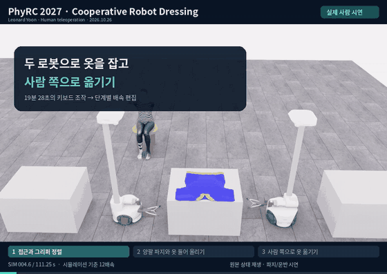
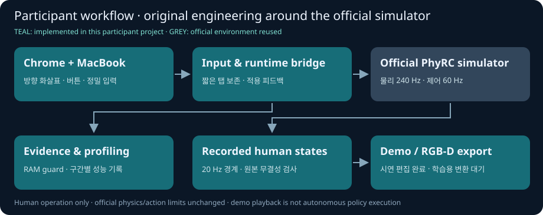
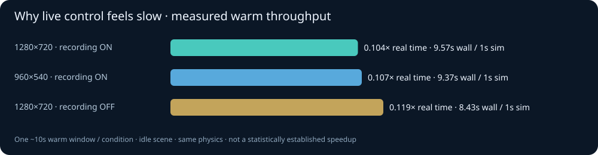

# PhyRC 2027 Challenge · Phase 1

**Cooperative Robot Dressing · Human Demonstration & Data Engineering**
Leonard Yoon, Ph.D. · [공식 대회](https://emprise.cs.cornell.edu/phyrc/challenge-2027/) · [공식 시뮬레이터](https://github.com/rirolab/PhyRC_2027_Challenge)

맥북 크롬에서 두 로봇을 직접 조작하고, 시연·데이터·실행 성능을 기록하는 참가 연구 프로젝트입니다.

### 직접 수행한 시연 · 양팔 파지와 운반

**옷 양옆 접근 → 두 로봇으로 파지·들기 → 사람 쪽으로 운반.**
[자막 영상 · 33초](docs/videos/20261026-human-pickup-transport.mp4) · [과정·배속·원본 설명](docs/project/DEMO_20261026.ko.md)

| 직접 수집한 근거 | 확인한 범위 |
|---|---|
| 실제 조작 **19분 28초** → 원본 **2,225개 전이 / 111.25초** | 정상 저장·원본 해시 검사·기록 상태 영상 재생 |
| 두 로봇의 옷 파지·들기·사람 쪽 이동 | **부분 과제 완료**. 전체 착의 성공·자율 정책 결과는 아직 없음 |
| 시연 중 RAM 약 **8.4–8.7GiB** | 첫 OOM 실패도 보존. RGB-D 변환·학습 적합성 검수는 대기 |

     

### 앞으로 할 작업

1. 로봇 방향 화살표·화면 버튼·정밀 모드로 조작을 개선하고 반복 연습합니다.
2. 옷 운반에서 **소매 진입·착의**로 이어지는 시연과 실패 사례를 모읍니다.
3. 수집 후 RGB-D 변환·시간 정렬·데이터 검수를 마치고, 같은 조건에서 실행 속도를 계속 비교합니다.

### 그동안 한 작업 · 이 프로젝트의 구현

- **조작:** 크롬 스트리밍, 맥북 키 매핑, 로봇 방향에 붙는 화살표, 화면 조작 버튼·정밀 입력, 키 수신/적용 피드백.
- **데이터:** 공식 기록기를 연결한 수집·무결성 검사·변환 대기열과 실제 사람 시연의 단계별 편집 영상.
- **실행 진단:** RAM 감시·종료 보호, 제어·물리 주변·기록 비용 분리 계측, 해상도/기록 조건 비교.

공식 시뮬레이터·물리·행동 규격·평가기는 재사용하며, 위 참가자 도구와 구분합니다. [구현과 결과 상세](docs/project/RESULTS.ko.md)

왜 실제 조작이 약 10배 느린가 · 실측 그래프

짧은 동일 배치 검사에서 기록 ON은 약 **0.104배속**이었습니다. 물리 전후 이벤트 구간이 wall time의 약 60%를 차지했고, 해상도를 낮춰도 큰 변화는 없었습니다. 정책 추론은 실행하지 않았습니다. [구간별 수치·한계·다음 개선](docs/project/PERFORMANCE.ko.md)

### 클린 서버에서 이어가기

[시작 안내](docs/project/START_HERE.ko.md) → [크롬 조작·변환 명령](docs/project/LIVE.ko.md) → [현재 상태](docs/project/STATUS.md). 소스는 이 저장소에, 큰 원본은 저장 위치·해시와 함께 별도로 보존합니다. 오늘 원본의 원격 업로드는 아직입니다.

공식 데모·관측 예시·이전 기록

공식 제공 데모이며 이 프로젝트의 성공 결과가 아닙니다.

[공식 참가 안내 원문](README.upstream.md) · [대회 규칙](docs/competition/RULES.md) · [이전 전체 설명](README.history.ko.md) · [출처·라이선스](THIRD_PARTY.md)

