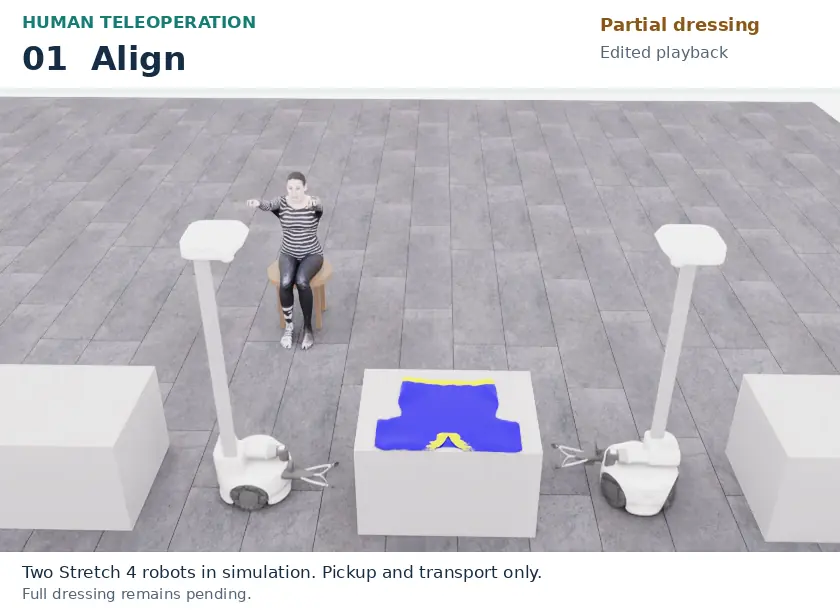

# PhyRC 2027 · 두 로봇 협동 착의

**Leonard Yoon, Ph.D.** · [English](README.md) · [공식 대회](https://emprise.cs.cornell.edu/phyrc/challenge-2027/) · [공식 시뮬레이터](https://github.com/rirolab/PhyRC_2027_Challenge)

맥북 Chrome에서 Isaac Sim의 두 Stretch 4 로봇을 직접 조작하고, 시연과 실행 성능을 기록하는 프로젝트입니다.

**현재 목표:** 기존 버튼·방향 화살표·키보드 UI를 사용합니다. **텍스트 입력은 다음 테스트에서 사용하지 않습니다.** 0점 시작 상태부터 **첫 50점 달성**을 목표로 단계별로 진행하고, 목표 달성마다 데이터를 저장하며 재시작·복원을 시험합니다. **50점·전체 착의는 아직 달성 또는 검증하지 않았습니다.**

[오늘 종료·내일 인계](docs/project/END_20261103.ko.md) · [새 서버 시작](docs/project/START_HERE.ko.md) · [현재 상태](docs/project/STATUS.md)

## 11월 3일 확인한 결과

- 공식 고정 버전 환경 build·prepare·GPU smoke 통과. 두 로봇 이동, 그리퍼 전환, 의복 유효값과 저장/불러오기 좌표 오차 0 확인.
- Brev CLI로 TCP·UDP 포트를 자동 등록한 뒤 **맥북 Chrome 영상·조작 성공**. 이 서버에서는 외부 조회한 송신 IP만으로 접속할 수 없었습니다.
- 사용자 평가: **텍스트 입력보다 기존 UI가 더 좋음**. 기존 UI의 사용성 테스트를 이어갑니다.
- 마지막 수집 **966전이·12,561개 원본 상태**, 정상 종료·원본 chunk/event/scene 해시 확인. RGB-D 변환·학습 적합성 검수는 미실행. 과거 데이터 복원은 내일 테스트의 선행 조건이 아닙니다.
- 사용자 요청으로 시뮬레이터·뷰어·속도 감시 종료. GPU 사용률 0%, 잔여 1MiB, 시연 listener 종료 확인. 서버 전원 종료·삭제는 수행하지 않았습니다.

### 속도와 비용

실제 사양: **L40S 48GB급, RAM 144GiB, 물리 4코어/8 vCPU**. 1280×720·기록 ON·고정 garment-side 연습 배치이며 공식 물리·행동 한계는 변경하지 않았습니다.

| 측정 | simulation / wall | 시뮬레이션 1초에 필요한 실제 시간 |
|---|---:|---:|
| 이전 L40S 짧은 표본 | 0.10448배 | 9.57초 |
| 현재 짧은 중립 진단 | 0.11321배 | 8.83초 |
| 현재 라이브 세션 누적 표본 약 411초 | 0.11492배 | 8.70초 |

라이브 세션 누적은 **약 10% 빠름**입니다. 초기 연결 전·유휴 구간도 포함하며, 겹치는 60초 이동 구간은 **7.4~11.6% 향상**으로 변동해 **항상 8% 이상 빠르지는 않았습니다.** RAM은 약 8.1GiB였습니다. 이전 표본이 짧고 당시 CPU 영상 편집이 병행되어 엄밀한 하드웨어 인과 비교는 아니며, 입력 지연을 측정한 수치도 아닙니다.

사용자 제공 요금은 이전 **$1.06/시간**, 현재 **$1.77/시간**. 라이브 실측 속도 기준 같은 시뮬레이션 분량의 비용은 약 **52% 증가**합니다. 약 10%의 속도를 위해 더 높은 비용을 선택할지는 내일 결정합니다. [수치 근거](docs/project/sessions/20261103-runtime-summary.json)

## 내일: 현재 UI로 0 → 50점 단계별 테스트

1. L40S 서버 선택 후 기존 UI를 복원하고 짧은 이동·정상 저장부터 확인합니다.
2. 시작 상태와 실제 점수 확인 방법을 정합니다. 중간 동작에 임의로 10·20·30점 등을 붙이지 않고 **실제 확인한 점수**를 기록합니다.
3. 접근·정렬 → 파지·들기 → 운반 → 착의 단계로 진행하며, 단계 달성마다 시도/구간 기록과 메모를 저장합니다.
4. 먼저 초기 상태 재시작을 확인하고, 이후 중간 상태 저장·복원·계속 조작을 시험합니다. **데이터 저장과 시뮬레이터 복원은 다릅니다.** 현재 브라우저 브리지에는 F1~F5 전달이 없어 UI 중간 복원은 추가 연결·검증이 필요합니다.
5. 의복·접촉·그리퍼·제어 상태와 점수 처리까지 확인한 뒤 단계 재개를 신뢰합니다. 정확한 되감기·충돌 후 복구·최종 50점은 아직 미검증입니다.

새 학습·긴 평가·과거 전체 자료 다운로드·텍스트 제어 개발은 선행하지 않습니다. 고정 연습 배치는 공식 무작위 평가 배치와 구분합니다. 자동 조작과 학습 입력은 [공개 관측·행동 규칙](docs/competition/RULES.md)을 따릅니다.

## 이전 부분 시연

[실제 파지·운반 33초 영상](docs/videos/20261026-human-pickup-transport.mp4) · [출처·원본 설명](docs/project/DEMO_20261026.ko.md). 이전의 부분 인간 시연이며 전체 착의나 자율 성공 결과가 아닙니다.

[UI 코드](participant/streaming/) · [데이터 형식](docs/competition/DATA.md) · [정책 규격](docs/competition/POLICY.md) · [기존 결과](docs/project/RESULTS.ko.md) · [기록](README.history.ko.md) · [공식 원본 README](README.upstream.md) · [출처·라이선스](THIRD_PARTY.md)
