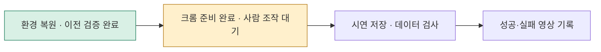

# PhyRC 2027 Challenge · Phase 1

**Cooperative Robot Dressing · Participant Research Project**

Leonard Yoon, Ph.D. · [공식 대회](https://emprise.cs.cornell.edu/phyrc/challenge-2027/) · [공식 저장소](https://github.com/rirolab/PhyRC_2027_Challenge)

두 대의 로봇을 크롬에서 직접 조작해 시연을 수집하고, 착의 정책을 연구합니다.

     

공식 대회 제공 데모 · 32배속 · 이 참가 프로젝트의 성공 결과가 아닙니다.

### 시연 결과

**착의 성공 시연은 아직 없습니다.** 검증된 영상과 데이터가 확보되면 이곳에 대표 장면·결과를 먼저 기록합니다. 성공과 실패를 구분해 보존합니다. [시연 기록 보기](docs/project/RESULTS.ko.md)

### 앞으로 할 작업

1. **오늘 먼저:** 최소 환경 점검 후 맥북 크롬으로 연결하고 두 로봇 조작을 연습합니다.
2. 짧은 시연부터 정상 저장을 확인하고, 접근·집기·착의를 시도합니다.
3. 확보한 데이터에 따라 성공·실패 영상과 데이터 검사 결과를 기록합니다.

환경 점검 · 측정 그래프

오늘 공식 점검 통과: 두 로봇 이동·그리퍼·저장/복원 확인. 위 그래프는 최초 설치 시간이며 실시간 시뮬레이션·추론 속도가 아닙니다. [성능 측정 계획·결과](docs/project/PERFORMANCE.ko.md)

### 그동안 한 작업

- 새 서버 복원과 공식 환경 점검을 통과했습니다. 크롬에서 사람의 키보드 조작과 로봇 이동을 확인했습니다.
- 사람 조작 원본 2,419개 전이를 기록했고, 별도 추출한 3개 구간·12개 전이의 데이터 형식을 검증했습니다.
- 이 자료는 **조작·포맷 시험**입니다. 착의 성공이나 학습 성능 향상 결과는 아닙니다. 전체 제출 검사는 미완료입니다.

[지난 세션 상세](docs/project/sessions/20261023-clean-start.md) · [이전 전체 설명](README.history.ko.md)

관측 이미지 보기 · 공식 데이터 예시

공식 저장소의 관측 형식 예시입니다. 직접 수집한 데이터와 검수 결과는 시연 결과에 별도로 기록합니다.

### 클린 서버에서 이어가기

[새 서버 시작 안내](docs/project/START_HERE.ko.md)에서 복제·환경 준비·크롬 연결·저장 확인 순서로 진행합니다. 큰 모델 복원과 긴 정책 평가는 오늘 수집 준비의 선행 조건이 아닙니다.

**공식 변경 확인:** 2026년 10월 26일 확인한 최신 버전은 기존 반영 버전과 같습니다. [확인 기록](docs/project/sessions/20261026-live.md)

[현재 상태](docs/project/STATUS.md) · [공식 참가 안내 원문](README.upstream.md) · [대회 규칙](docs/competition/RULES.md) · [출처·라이선스](THIRD_PARTY.md)
