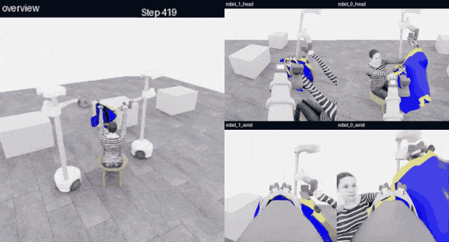
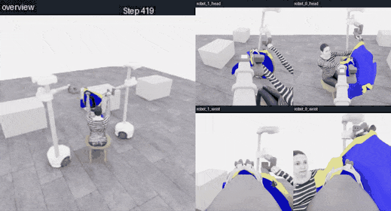
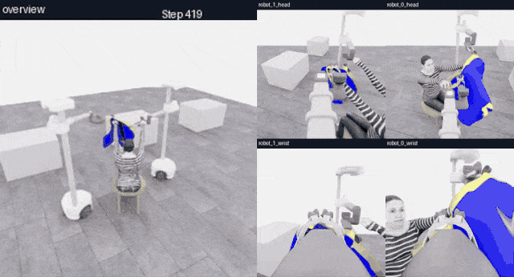
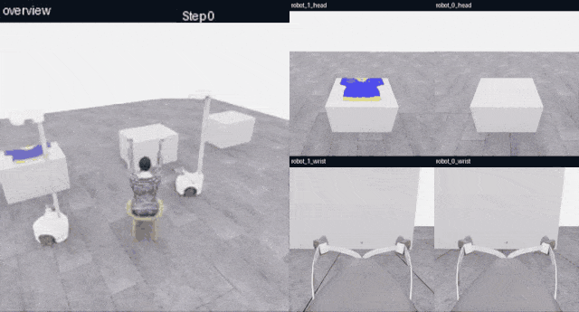
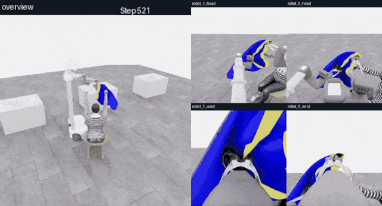
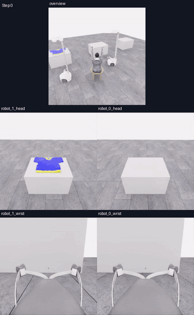
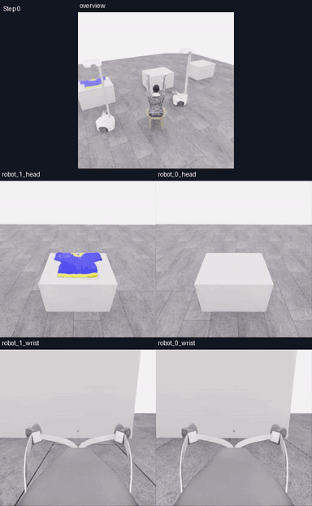
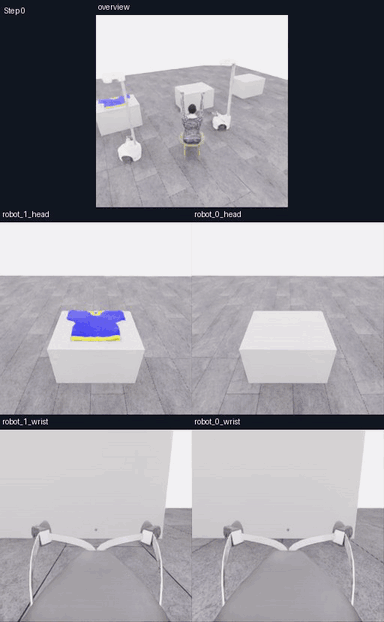
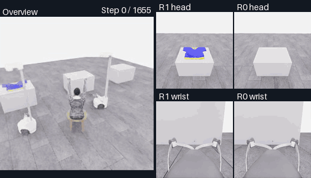

# PhyRC 2027 · 두 로봇의 티셔츠 착의

## 시연 14 실험 계획 · R0 지지를 유지하며 오른손목 넣기

**시작 예정.** 클린 서버의 새 실행에서 0전이부터 시작합니다. 시연 13과 모델을 맞추기 위해 **GPT‑6.2 Sol Ultra와 카메라 설명**을 사용합니다. 초기화 직후 시드 43, 세 번째 테이블(+X, 인덱스 2), 셔츠–마네킹 마찰 0.35를 확인합니다. [새 서버 준비](docs/active/start.md) · [수집 절차](docs/active/collection.md)

**검증할 가설.** 시연 13에서 R0가 다시 잡은 아랫단은 오른주먹 아래까지 왔고, 종료 장면에서 오른손가락은 밑단 밖에 남았습니다. 시연 14에서는 **오른손 진입 구간에 R0가 아랫단 파지와 위치를 유지하고 R1만 윗단을 움직이면**, 이미 걸친 쪽을 살리면서 오른손도 손목까지 넣을 수 있는지 확인합니다. [시연 13 관측](docs/active/20261124-demo7-13-closeout.ko.md#영상에서-확인한-차이)

| 구간 | 조작과 확인 기준 |
|---|---|
| **1. 두 테두리 확보** | 옷을 들어 손 앞으로 옮깁니다. R0가 노란 아랫단 끝을 받치고 R1이 윗단을 잡습니다. 헤드와 손목 영상에서 오른주먹 앞에 두 테두리가 위아래로 벌어진 상태와 왼손 쪽 천의 지지를 확인합니다. |
| **2. R0 지지 유지, R1로 오른손 진입** | R0의 이동 채널과 그리퍼 명령을 중립으로 두어 기존 파지를 유지합니다. R1만 윗단을 한 번에 **2–4전이**씩 조정합니다. 매번 R0 집게의 실제 변위와 아랫단의 미끄러짐을 확인하고, 오른손끝과 마디가 같은 두 테두리 사이를 지나 손목까지 들어갔는지 봅니다. R0가 밀리거나 왼쪽 걸침이 풀리거나 가려지면 그 장면에서 동작을 멈추고 지지와 시야부터 복구합니다. |
| **3. 양손목 확인 후 목 쪽으로** | 두 손을 각각 따라가며 두 시점과 두 카메라에서 양쪽 걸침이 유지되는지 확인합니다. 확인되면 천에 여유를 남기고 팔을 따라 어깨·목 쪽으로 조금씩 당깁니다. 각 동작 뒤 양쪽을 다시 보고, 실제 V넥 테두리가 머리 위로 이동하는지 확인합니다. |

검토 화면에는 **R0 명령과 실제 집게 변위, 양손끝·마디와 밑단의 관계, 당긴 뒤 양쪽 걸침이 유지됐는지**를 남깁니다. 양손목이 밑단 안에 들어간 장면을 중간 목표로 삼고, 첫 소매와 목 통과는 공식 평가 항목으로 확인합니다. [공식 채점 기준](docs/competition/EVALUATION.md#score-items)

---

시연 13부터 1까지 최신순으로 볼 수 있습니다. **최고 공식 원점수는 시연 2의 20/50점**입니다. 왼손이 소매 밖으로 나왔고 반대 어깨와 왼쪽 위팔까지 득점했습니다. 시연 7–13에서는 모두 픽업 5점을 얻었습니다. 두 손목이 밑단 안에 함께 유지된 장면과 공식 착의 성공은 확인하지 못했습니다. [시연 1–3 분석](docs/active/20261123-demonstrations.ko.md) · [시연 4–6 기록](docs/active/20261124-series-results.json) · [시연 7–13 최종 분석과 다음 작업](docs/active/20261124-demo7-13-closeout.ko.md)

| 시연 | 시도 | 시작점 | 종료 전이 / 영상 구간 | 공식 원점수 |
|---|---|---|---:|---:|
| 13 | 노란 밑단의 바깥 끝에 다시 파지 | 시연 10 시작점 419전이 | 689 / 44 | 5/50 |
| 12 | 전진을 줄이고 윗단을 살짝 들어 조정 | 시연 10 시작점 419전이 | 524 / 32 | 5/50 |
| 11 | 오른손 앞에서 입구를 먼저 벌린 뒤 당김 | 시연 9 `hold-0026` 끝 419전이 | 512 / 27 | 5/50 |
| 10 | 다른 손 쪽을 받치고 오른손 앞으로 당김 | 시연 9 `hold-0026` 끝 419전이 | 494 / 26 | 5/50 |
| 9 | 새 장면에서 양쪽 밑단 파지와 양손 접근 | 0전이 | 907 / 68 | 5/50 |
| 8 | 윗단을 받치며 아랫단을 반대 손끝으로 옮김 | 시연 7 `hold-0033` 끝 521전이 | 532 / 2 | 5/50 |
| 7 | Sol Ultra로 양손 앞까지 셔츠 옮기기 | 0전이 | 988 / 81 | 5/50 |
| 6 | 중앙을 살짝 들어 첫 손목에 얕게 걸치기 | 0전이 | 608 / 62 | 5/50 |
| 5 | 카메라 설명을 추가한 양손목 접근 | 0전이 | 487 / 24 | 5/50 |
| 4 | 한쪽을 받치면서 반대 손목 다시 걸기 | 0전이 | 1,023 / 80 | 5/50 |
| 3 | 양쪽 전완에 옷을 먼저 걸치기 | 0전이 | 608 / 30 | 5/50 |
| 2 | 한 팔을 먼저 입히고 반대 어깨로 운반 | 0전이 | 2,195 / 110 | **20/50** |
| 1 | 사용자 피드백으로 양쪽 밑단 파지 | 0전이 | 1,655 / 77 | 5/50 |

시연 7–13 표는 GPT‑6.2 Sol Ultra의 본 실행 7개를 집계했습니다. 기록 4,646전이 가운데 2,197전이는 분기점까지 이전 행동을 재실행한 구간입니다. 새로 수행한 전이는 2,449개이며 검토 영상은 280구간입니다. 시연 7의 별도 Sol Max 예비 시험은 14전이, 4구간, 0/50점입니다. 분기 영상은 각 회차의 새 동작이 시작된 지점부터 보여 줍니다. 같은 행동을 재생해도 분기점의 천 모양과 가림이 달라질 수 있습니다. [집계와 비교 조건](docs/active/20261124-demo7-13-closeout.ko.md)

## 시연 13 · 밑단의 바깥 끝을 다시 잡기

**419–689전이.** 다른 쪽에서 천을 받친 채 아랫단의 노란 끝을 다시 잡았습니다. 496전이(`hold-0014`)에 밑단 끝이 R0의 집게를 따라왔고, 이후 오른손 쪽으로 옮겼습니다. 마지막 구간에서 아랫단이 오른주먹 아래로 왔고 윗단은 주먹 옆에 남았습니다. 오른손가락은 드러나 있고 왼손목 덮임은 가려져 있습니다.

## 시연 12 · 앞 이동을 줄이고 윗단을 들어 조정하기

**419–524전이.** 아랫단을 받치면서 윗단을 위로 올렸습니다. 조작 후에도 오른손 마디가 노란 테두리 밖에 보였습니다. 왼팔 끝에 천이 남았고 손목 전체의 덮임은 가려졌습니다.

## 시연 11 · 오른손 앞으로 입구를 넓혀 당기기

**419–512전이.** 오른손 끝 앞에서 입구를 먼저 벌리고 당겼습니다. 마지막 구간에서 윗단과 아랫단 사이로 오른주먹이 보였고, 아랫단은 손 마디 아래에 남았습니다.

## 시연 10 · 다른 손 쪽을 받치며 오른손 덮기

**419–494전이.** R0가 아랫단을 받치고 R1이 윗단을 오른손 끝 쪽으로 옮겼습니다. 끝 장면에서 윗단은 오른손 옆에 머물고 손 마디가 보였습니다.

## 시연 9 · 새 장면에서 양쪽 밑단 파지

**0–907전이 전체.** 419전이에서 노란 두 테두리 사이의 파란 천이 보였고 먼손 끝은 밑단 밖에 있었습니다. 시연 10–13은 이 지점을 기준으로 오른손 접근 방식을 바꿨습니다. 마지막에는 가까운 주먹이 밑단 밖에 보였습니다.

## 시연 8 · 한쪽 밑단을 받치며 반대 손에 맞추기

**521–532전이.** 시연 7의 521전이를 재실행한 장면부터 새 동작을 적용했습니다. R0는 윗단을 받치고 R1은 아랫단을 낮은 손끝 쪽으로 옮겼습니다. 자유 가장자리와 손끝이 일부 가려져 두 손목의 진입 깊이는 확인되지 않았습니다.

## 시연 7 · Sol Ultra로 양손에 밑단 옮기기

**0–988전이 전체.** 521전이의 R1 손목 영상에서 가까운 손목이 노란 두 가장자리 사이로 보였습니다. 낮은 손은 밑단 밖에 남았고 가까운 팔이 옷을 받치고 있는지는 확인하지 못했습니다. 이 장면이 시연 8의 분기점입니다.

## 시연 6 · 밑단을 벌려 첫 손목에 얕게 걸치기

**0–608전이 전체 · 5/50점.** 205–213전이에 벌어진 노란 테두리 사이로 파란 안쪽 면이 보였습니다. 한 손목 아래의 밑단은 가려졌고 다른 손은 몸판 바깥에 남았습니다. [시연 6의 구간 기록](docs/active/20261124-series-results.json)

## 시연 5 · 카메라 설명을 추가한 양손목 접근

**0–487전이 전체 · 5/50점.** 두 로봇이 옷을 들어 양손 앞으로 옮겼습니다. 감속을 지시한 뒤에도 R1 집게가 전진했고 마지막에는 두 손끝이 천 밖에 보였습니다. [시연 5의 구간 기록](docs/active/20261124-series-results.json)

## 시연 4 · 한쪽을 받치며 반대 손목 다시 걸기

**0–1,023전이 전체 · 5/50점.** 712–728전이에 먼손의 손가락이 노란 밑단 밖으로 드러났고 가까운 손끝은 파란 천에 가려졌습니다. 이후 한쪽 지지를 유지하며 놓친 쪽을 다시 맞췄습니다. [시연 4의 구간 기록](docs/active/20261124-series-results.json)

## 시연 3 · GPT 단독으로 양팔 먼저 걸치기

**0–608전이 전체 · 5/50점.** 301전이에 옷이 양쪽 전완에 걸쳐 보였지만 한쪽 손목은 가려져 있었습니다. 어깨 쪽으로 더 이동하자 손목이 천 위로 다시 드러났고, 첫 소매와 목은 0점이었습니다. 종료할 때 R1은 밑단을 지지하고 R0은 접힌 천을 풀었습니다. [실패·복구 구간 비교](docs/active/20261123-recovery-review.ko.md)

## 시연 2 · GPT 단독으로 한 팔 먼저 입히기

**0–2,195전이 전체 · 20/50점.** 왼팔의 첫 소매와 반대쪽 어깨, 왼쪽 위팔까지 득점했습니다. 옷이 정수리까지 올라간 뒤 반대팔을 시도했고, 목과 두 번째 소매는 각각 0점이었습니다. [시연 2 점수와 장면별 분석](docs/active/20261123-demonstrations.ko.md)

## 시연 1 · 사용자 피드백으로 밑단 파지

**0–1,655전이 전체 · 5/50점.** 두 로봇이 사용자 피드백을 받아 옷을 집고 손 앞까지 옮겼습니다. 630전이에 픽업을 인정받았고, 첫 소매 통과는 0점이었습니다. [시연 1 분석](docs/active/guided-retrospective.json)

각 GIF에는 전체와 양쪽 머리·손목 카메라가 들어 있습니다. 시연 7–13의 가로 영상은 왼쪽에 전체 장면, 오른쪽에 R1과 R0의 머리·손목 카메라를 배치합니다. 시연 7·9는 약 4배속으로, 분기 영상은 시뮬레이션 속도로 재생합니다. 전이는 정책 실행 횟수이며 20전이가 시뮬레이션 1초입니다.

## 다음 작업

1. **입구 확인.** 한 손을 이동시키기 전에 두 노란 테두리가 손끝 앞에서 벌어져 있고 집게 몸체가 통로를 가리지 않는지 머리와 손목 카메라에서 확인합니다.
2. **한 손씩 추적.** 한쪽을 받친 채 반대 테두리를 짧게 움직입니다. 동작 전후에 손끝과 마디가 같은 입구를 지났는지, 다른 쪽 손목의 걸침이 유지됐는지 비교합니다. 가려지면 미확인으로 기록하고 카메라 각도나 파지점을 바꿉니다.
3. **양쪽 유지 후 목둘레 이동.** 두 손목이 짧은 조정 뒤에도 유지되는 것을 확인하고 어깨·목으로 진행합니다. 시연 2의 661전이처럼 소매 밖에 나온 손·손목은 공식 소매 통과와 대조합니다. 목을 넘길 때는 추적할 V넥 테두리를 먼저 정합니다. [시연 2의 득점 구간](docs/active/20261123-demonstrations.ko.md) · [공식 배점](docs/competition/EVALUATION.md)

바뀐 파지점, 손과 밑단의 상대 위치, 반대쪽 걸침, 공식 평가 점수를 구간 ID와 전이 범위에 연결합니다. 다음 서버에서는 보존한 영상을 먼저 확인하고 사용자 지시가 있을 때 새 run ID로 수집합니다. [시연 7–13 최종 분석과 재개 가이드](docs/active/20261124-demo7-13-closeout.ko.md) · [검토 화면과 기록 절차](docs/active/collection.md) · [시연 1–13 비공개 백업 확인서](docs/active/20261124-demo1-13-private-backup.json) · [새 서버에서 복원하기](docs/active/start.md)

---

