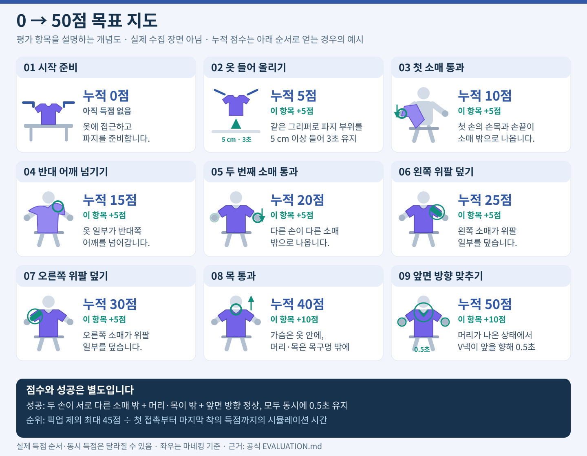
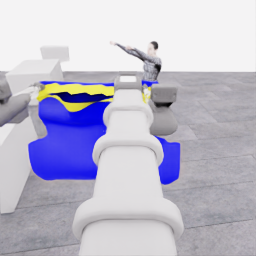
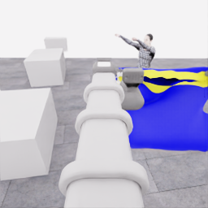
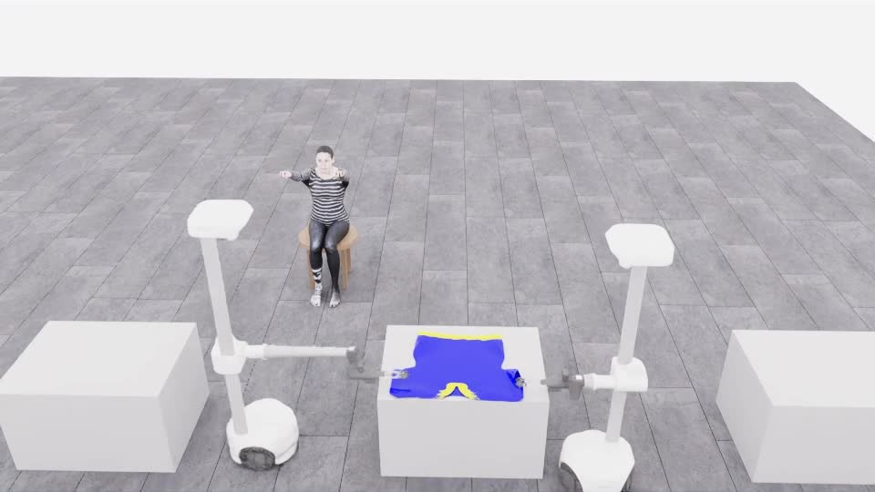
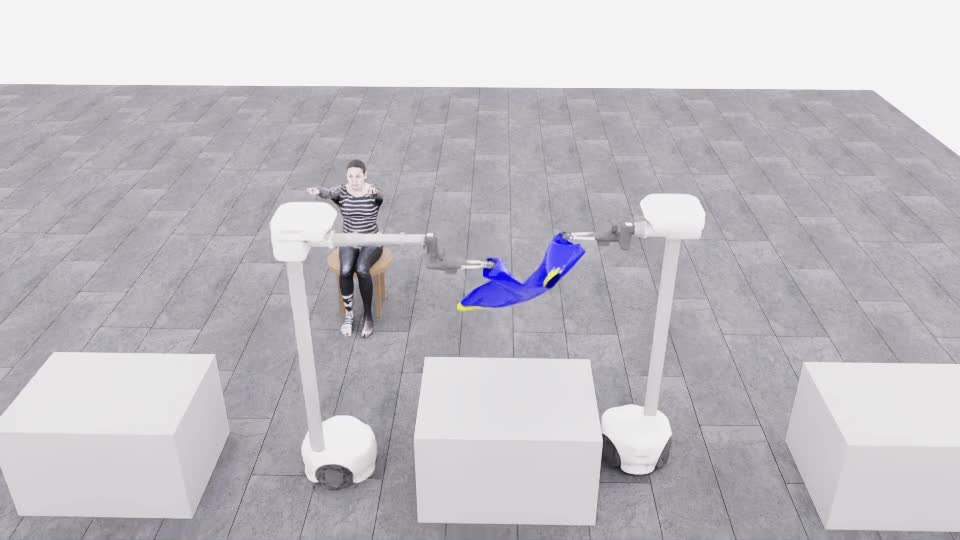
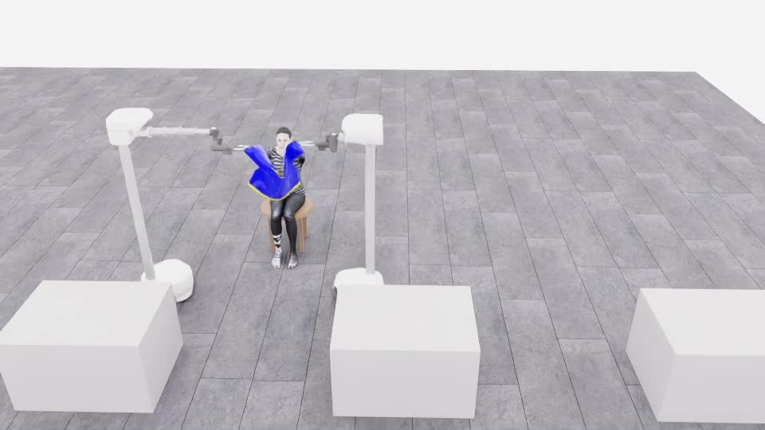

<!-- TEMP_PERFORMANCE_BEGIN: user requested temporary top-of-README note; move/remove after review -->
## 임시 성능 메모 · 확인 후 이동/삭제 예정

**2026-11-06 10:57:41–11:01:41 UTC, E13 실행 중4분 실측.** 2초 간격121표본. 모델 대기104개·동작 실행8개를 비교하며 초기1개·단계 전환8개는 분리했습니다. 수집 중단·GPU 부하 시험 없이 측정했습니다. Chrome·WebRTC OFF.

| 자원 | 모델 요청·응답 대기 | 물리 동작 실행 |
|---|---:|---:|
| CPU 전체 평균 / 최대 | **2.08% /4.9%** | **19.14% /20.4%** |
| 표본별 최다사용 코어 평균 / 최대 | 8.41% /11.1% | 34.60% /58.3% |
| GPU 사용률 평균 / 최대 | **0% /0%** | **49.63% /67%** |
| GPU 전력 평균 | 81.01W | 131.91W |

**자원 여유:** Xeon Platinum8462Y+의 노출 vCPU12개(VM) · RAM70.76GiB 중 available59.25–59.41GiB(사용 약16.0–16.3%, total−available) · L40S VRAM **9,274 /46,068MiB (20.1%)** 고정 · GPU36–40°C · swap 약1MiB 고정 · 디스크 여유 약486GiB. 현재 표본에서 메모리 부족·지속적인 전체 CPU/GPU 포화 증거는 없습니다. 짧은 병목이나 코어 사이를 이동하는 단일 스레드 병목까지 배제하지는 않습니다.

| 처리 속도·시간 | 완료된 E12 전체 실측 |
|---|---|
| 전체 기록 | **781전이·39.05 simulation초 /32분55.68초 실제 경과** |
| 모델 호출 경로 | 12회 ·합계20분44.48초 (**63.0%**) ·호출당 평균103.71초 |
| 환경 요청·응답 | 합계11분19.75초 (**34.4%**) ·나머지51.44초는 기타 처리 |
| 동작 실행 구간 처리량 | **1.15 제어 프레임/초** ·실시간 비율0.0574× (모델 대기 제외, 요청·기록 포함) |
| 전체 실효 처리량 | **0.395 제어 프레임/초** ·실시간 비율0.0198× (모델 대기 포함) |
| 1전이 내부 계측 | 환경 adapter 평균764.95ms ·데이터 기록 평균51.93ms |

여기서 제어 프레임은20Hz로 기록하는 RGB5장·depth·로봇 상태 묶음의 전이입니다. **그래픽 렌더 FPS는 별도 미계측**이며 영상 재생5fps와도 다릅니다. 물리240Hz·제어20Hz는 simulation 시간 기준입니다. 모델 호출 경로에는 CLI·네트워크·서비스 대기·생성이 포함되며 내부 추론시간만 분리한 수치가 아닙니다. 모델 대기 중에는 물리가 정지합니다. 자원 표본은 E13, 전체 시간·처리량은 완료된 E12로 구분합니다.

[측정 방법·한계와 해석](docs/project/performance/20261106-performance-review.ko.md) · [구간별 사용률](docs/project/performance/20261106-resource-summary.json) · [121개 표본 CSV](docs/project/performance/20261106-resource-samples.csv) · [처리량 계산 근거](docs/project/performance/20261106-timing-summary.json) · [최신 E13 영상](docs/gallery/20261106-astra-hem-depth-001.ko.md)

<!-- TEMP_PERFORMANCE_END -->

---

# PhyRC 2027: 두 로봇의 협력 착의 챌린지

[오늘의 정리·다음 서버 인계](docs/project/SESSION_WRAPUP_20261106.ko.md) · [공개 시연 갤러리](docs/gallery/README.ko.md) · [수집 과정·일지](docs/collection/README.ko.md) · [공식 원본 안내](README.upstream.md) · [새 서버 준비](docs/project/START_HERE.ko.md) · [다음 작업 상태](docs/project/STATUS.md) · [공식 대회](https://emprise.cs.cornell.edu/phyrc/challenge-2027/)

사용 가능성 분석 · 현재 수집에는 적용하지 않음

두 대의 Stretch 4가 앉아 있는 마네킹에 티셔츠를 입히는 시뮬레이션 과제입니다. 이 저장소는 공식 시뮬레이터에 시연 수집, 브라우저 조작, 데이터 검수, π₀.₅ 학습 및 제출 도구를 추가한 참가자 저장소입니다.

**2026-11-06 재개 · 최고 5/50, 목표 10점:** 새 서버 복원과 종료 오류 수정을 마치고 E10~E13을 비교했습니다. 과거 RGB, 몸통 입구 경로, 현재 손목 depth를 차례로 시험했으나 첫 소매는 아직 통과하지 못했습니다. **최신 E13은 모델 자율 종료·810/810전이 검사·원본 원격 백업 검증 완료**입니다. [E13 새 구간 전체·E12 비교 영상](docs/gallery/20261106-astra-hem-depth-001.ko.md)을 공개합니다. 다음에는 짧은 이동 뒤 중립 시간을 두어 관절 목표 추종 지연을 비교하고, [Stretch 4·Georgia Tech Astra 연구](docs/collection/research/2026-11-06-stretch4-astra-directions.ko.md)에서 깊이 조회·미세 제어·초기 파지 개선을 병행 검토합니다. Chrome·WebRTC는 사용하지 않습니다. [이번 재개 기록](docs/project/sessions/20261106-resume10.ko.md)이 이전 인계의 중지 상태를 대체합니다.

## 챌린지 한눈에 보기 · 0 → 50점

https://github.com/user-attachments/assets/d2f347fe-712b-42f3-bdee-69d3fee2a47c

**공식 착의 시연 · 35.8초 · 사이트 표기 8배속** — 위 플레이어에서 바로 재생할 수 있습니다. [공식 원본 영상](https://emprise.cs.cornell.edu/phyrc/assets/c27/media/teleop-overhead.mp4) · [공식 대회](https://emprise.cs.cornell.edu/phyrc/challenge-2027/)

두 로봇이 옷을 함께 잡아 들어 올리고, 마네킹의 두 손·머리를 서로 맞는 옷 구멍으로 통과시켜 앞뒤 방향까지 맞추는 과제입니다. 아래는 **평가 항목을 설명하는 지도**이며 실제 완주 기록이 아닙니다.

| 과정 | 추가 점수 | 누적 예시 | 현재 확인한 근거 |
|---|---:|---:|---|
| 두 로봇 접근·양쪽 파지 준비 | 0 | 0 | E07 새 시작·공동 접근 기록 보존 |
| 잡은 부분을 5cm 이상 올려 3초 유지 | +5 | 5 | E05 한 로봇 픽업 5점 보존 · **E07 새 시도에서도 5점**, 공동 지지·이동 관측 |
| 첫 손이 소매 밖으로 통과 | +5 | 10 | 미획득 |
| 옷이 반대쪽 어깨를 넘어감 | +5 | 15 | 미획득 |
| 다른 손이 나머지 소매 밖으로 통과 | +5 | 20 | 미획득 |
| 왼쪽 위팔 일부를 소매가 덮음 | +5 | 25 | 미획득 |
| 오른쪽 위팔 일부를 소매가 덮음 | +5 | 30 | 미획득 |
| 머리·목이 목 구멍으로 제대로 통과 | +10 | 40 | 미획득 |
| 머리가 나온 상태에서 옷 앞면 방향을 0.5초 유지 | +10 | 50 | 미획득 |

누적 예시는 그림 순서대로 얻을 때의 값입니다. 실제 순서는 달라지거나 여러 항목이 함께 인정될 수 있습니다. **50점과 착의 성공은 별도**이며 성공은 두 손·머리·앞면 조건의 동시 0.5초 유지를 확인합니다. [공식 평가 정의](docs/competition/EVALUATION.md)

**E07: 0점 → 원점수 5점 → 공동 운반·마네킹 접근. 첫 소매 통과는 아직 미획득입니다.** 1,067전이 수집·전수 검사를 마쳤고, 착의 `success=false`·최종 점수율 0입니다. **아래 E07은 재개 전 기준 기록이며, 현재 후속 시도는 상단 E10~E13 기록을 따릅니다.** E09는 중단 중 응답 정합성 오류가 발생해 불완전 기록으로 보존했습니다. [종료 결과·전체 영상](docs/collection/reviews/20261106-astra-coordinated-fresh-001.ko.md) · [356·700전이 정확 장면](docs/collection/milestones/20261106-astra-coordinated-fresh-001/README.ko.md) · [현재 진행](docs/project/STATUS.md)

| E07 · 함께 이동한 뒤 로봇 0의 시점 | 같은 시각 · 로봇 1의 시점 |
|:---:|:---:|
|  |  |

## 두 로봇의 접근·들기·운반 · 기존 사람 부분 시연

[공개 시연 갤러리](docs/gallery/README.ko.md)에서 영상과 원본 장면을 볼 수 있습니다.

사람이 두 로봇을 직접 조작한 **접근 → 파지·들기 → 마네킹 쪽 운반** 장면입니다. 실제 기록을 재생해 렌더링한 부분 시연입니다.

| ① 옷에 접근·정렬 | ② 양쪽 파지 후 들어 올리기 | ③ 마네킹 쪽으로 운반 |
|:---:|:---:|:---:|
|  |  |  |

**[▶ 33초 편집 시연 영상 보기](docs/videos/20261026-human-pickup-transport.mp4)** · [기록과 화면의 출처](docs/project/DEMO_20261026.ko.md)

고정 연습 배치에서 수집한 부분 시연입니다. **이 시연의 공식 점수, 소매·목 통과와 전체 착의 성공은 확인하지 않았습니다.** 화면의 각 단계에 임의의 점수를 붙이지 않습니다.

## 기록된 장면 · 한 로봇 픽업 부분 점수 5점

**E05는 로봇 0만 옷을 든 부분 점수 5/50점입니다. 두 로봇의 협력 들기 성공 시연이 아니며, 전체 착의 success=false입니다.**

E06을 중단·보존한 뒤 **E07을 0점의 새 에피소드에서 시작했습니다(04:40:12 UTC).** E07에서도 별도의 원점수 5점을 획득했고 두 로봇의 공동 지지·이동 장면을 보존했습니다. 아래 GIF와 시간 표는 원래 E05의 한 로봇 픽업 기록입니다.

| 물리 진행 | 실제 소요 시간 | 공식 유지 | 기록 검사 |
|---|---|---|---|
| 12.65초 | 13분 48.3초 | 3.35초 | 253/253 전이 통과 |

GIF는 전체 253프레임을 4배 느리게 반복 재생합니다(약 4.08MB). 5초는 행동 목표였으며 실제 유지 완료 시간은 3.35초입니다.

[**영상·짧은 과정**](docs/gallery/20261106-astra-pickup-hold5-001.ko.md) · [**점수·종료 검토**](docs/collection/reviews/20261106-astra-pickup-hold5-001.ko.md) · [**시간순 일지**](docs/collection/sessions/2026-11-06.md) · [**수집 구조·전체 자료**](docs/collection/README.ko.md)

현재 기술 상태

## 현재 기술 상태

**2026-11-06: E05는 한 로봇 픽업 원점수 5점·253전이, E07은 협력 시도 원점수 5점·1,067전이 전수 검사를 통과했습니다.** E07은 결정 예산으로 종료됐고 첫 소매 통과·전체 착의 성공은 미획득입니다. E08 초기화 실패와 E09 중단 중 종료 오류를 별도로 보존했습니다. 현재 재개 상태는 상단과 [최신 실행 기록](docs/project/sessions/20261106-resume10.ko.md)을 따릅니다. [이전 시도와 결과](docs/collection/experiments/2026-11-06-method-comparison.ko.md)

| 확인한 것 | 결과와 한계 |
|---|---|
| 공식 환경 | build·prepare·smoke 통과, 맥북 Chrome 실시간 영상 확인 |
| Codex CLI | 0.166.0, Astra `ultra`, 실제 이미지 2턴·JSON·동일 UUID 재개 통과 |
| 실제 로봇 wiring | 3개 모델 결정·3전이·0.15 simulation초, 정상 종료·전체 전이 검사 통과 |
| wiring 공식 평가 | 유효 평가 0점·success=false·no_contact. 성공 시연으로 집계하지 않음 |
| 기술 검사 | 계측·계획 실행·공개 패키지 도구를 포함해 CPU 110개 통과. 과제 시연 승인과 구분 |
| 행동 입력·격리 | 공개 RGB 5장·전체 공개 로봇 상태·16×16 depth 요약. 저장소·평가·audit·원시 상태와 actor의 파일·네트워크 경계를 분리 |
| 관찰·개입 | 자동 수집 WebRTC는 관찰 전용. 사람과 모델의 제어권 전환은 미구현 |
| 실제 착의 시도 | `20261106-astra-dressing-001`: 15개 완료 결정·167전이·8.35 simulation초, SIGTERM 중단 후 정상 파일 마감. 점수0·success=false |
| 한 로봇 픽업 부분 점수 5점 | [E05 영상·행동·점수 기록](docs/collection/attempts/20261106-astra-pickup-hold5-001/README.ko.md): 18개 결정, 253전이·12.65초 검사 통과, `review_ready`. 5점·success=false. 협력 들기 성공 시연으로 분류하지 않음. E07 공동 운반은 별도 갤러리·검토에 보존 |

수집 과정을 자세히 읽기

## 수집 과정을 자세히 읽기

**[시연 데이터 수집 과정 목차](docs/collection/README.ko.md)**에서 폴더 구조·네이밍·공개/비공개 자료·프롬프트·최종 행동·이미지·영상·점수·시간·피드백 기준을 확인할 수 있습니다.

**[2026-11-06 수집 일지](docs/collection/sessions/2026-11-06.md)**에는 환경 복원부터 실제 모델 호출, 실패 원인 분리, r1~r5 재시도, 정상 wiring과 첫 착의 시도까지의 과정·명령·측정 근거를 기록합니다. 성공·부분 성공·실패·중단을 모두 보존하고, 같은 physics tick의 점수 획득은 동시 batch로 다룹니다. 수집 중 피드백과 반영 내용도 이 일지에 갱신합니다.

[실제 wiring 이미지·영상·프롬프트·행동 기록 보기](docs/collection/attempts/20261106-codex-robot-wiring-r5/README.ko.md)

[첫 착의 시도 전체 기록·33.4초 관측 영상](docs/collection/attempts/20261106-astra-dressing-001/README.ko.md) · [종료·검수 결과](docs/collection/reviews/20261106-astra-dressing-001.ko.md) · [토큰 집계 정정](docs/collection/corrections/20261106-token-accounting.ko.md)

[첫 착의 시도의 속도·난도 분석](docs/collection/sessions/2026-11-06-initial-review.md)은 완료된 첫 10개 판단만 고정해 검토한 중간 기록입니다.

**[5점 수집을 위한 호출 지연 개선 가이드](docs/collection/guides/call-latency-options.ko.md)**는 조건부 계획·로컬 피드백·상주 프로세스 등의 비교 근거입니다. 계측 수정·상주 호출·다중 행동과 픽업 재시도의 실제 결과는 [방법별 비교](docs/collection/experiments/2026-11-06-method-comparison.ko.md)에 기록합니다.

메인 README는 기술 상태와 문서 입구를 유지합니다. 상세 개발·수집 과정은 별도 페이지에 한국어로 기록하고, 인증·개인 접속 주소·내부 상태·숨겨진 모델 추론은 게시하지 않습니다.

코드 길잡이

## 코드 길잡이

| 경로 | 역할 |
|---|---|
| [`codex_actor.py`](participant/collection/codex_actor.py) | 별도 Docker에서 CLI·공개 이미지·구조화 응답·명시적 세션 재개·timeout 처리 |
| [`codex_client.py`](participant/collection/codex_client.py) | 관측 전달·행동 검사·실행, 단계·재시도·시간·출처 기록 |
| [`collect_operator.py`](scripts/collect_operator.py), [`boundary.py`](participant/collection/boundary.py) | 공식 행동 경계와 실제 20 Hz 관측·행동·다음 관측 저장 |
| [`evaluation.py`](participant/collection/evaluation.py) | 같은 시도의 공식 점수·획득 이벤트·success를 행동 문맥 밖에 저장 |
| [`validate_capture.py`](participant/collection/validate_capture.py) | 파일 해시·전체 전이·시간·연속성·평가 라벨 검사. 학습 승인은 별도 |
| [`collector_stream.py`](participant/streaming/collector_stream.py) | 물리 시간을 진행하지 않는 관찰용 WebRTC 렌더링 |
| [`participant/pi05/`](participant/pi05/), [`policy.py`](participant/policy.py) | 후속 π₀.₅ 학습·로컬 정책 실행. 실제 승인 시연으로 새 학습을 수행한 상태는 아님 |

기존 [`gpt_client.py`](participant/collection/gpt_client.py)는 별도 Responses API의 작은 시험 코드이며 현재 Codex CLI 경로를 대신하지 않습니다. API나 다른 모델로 자동 전환하지 않습니다.

## 재현과 다음 작업

[새 서버 준비](docs/project/START_HERE.ko.md)에 고정 CLI·actor 이미지, 공식 환경, WebRTC와 `--mode wiring` 실행·검사 명령을 정리했습니다. [현재 상태](docs/project/STATUS.md)에서 이어갈 한 가지 작업을 확인합니다. 실패 run ID와 완료 파일을 덮어쓰지 않습니다.

**원본 11.78GB는 비공개 백업·재다운로드 해시·별도 폴더 복원을 검증했습니다.** [작업 정리와 보존 결과](docs/project/SESSION_WRAPUP_20261106.ko.md)

현재는 **휴식 후 클린 서버에서 첫 소매 통과를 재시도할 수 있도록 인계하는 단계**입니다. 다음 재개 후보는 검사를 통과한 E07의 원본 행동 700전이입니다. E09 종료 응답 정합성 문제를 먼저 수정·검증한 뒤, 새 환경에서 행동을 재실행하고 현재 공개 관측으로 파지·옷 방향을 다시 확인합니다. 정확한 물리 상태 복원을 뜻하지 않으며, 같은 출처 그룹으로 묶어 재실행 구간을 독립 신규 데이터로 세지 않습니다. [재실행·분기 구조](docs/collection/guides/continuation-and-branches.ko.md) · [공식 참고 영상 분석](docs/collection/experiments/2026-11-06-official-demo-strategy.ko.md) · [관찰 송출 실측](docs/collection/experiments/2026-11-06-streaming-benchmark-result.ko.md). 기존 성공·실패·중단 기록은 유지하고, VLA·RL·world model 학습은 아직 실행하지 않았습니다.

참고 문서

## 참고 문서

- [공식 공개 관측 규칙](docs/competition/RULES.md), [데이터 구조](docs/competition/DATA.md), [정책 연결](docs/competition/POLICY.md), [공식 평가](docs/competition/EVALUATION.md)
- [기술 배경과 후속 실험 검토](docs/project/CODEX_CONTEXT.ko.md), [Stretch 4·Astra 조사](docs/project/research/STRETCH4_VLA_REVIEW.ko.md): 과거 계획보다 현재 README·수집 일지의 실행 상태를 우선합니다.
- [이전 세션 기록](docs/project/sessions/), [이전 결과](docs/project/RESULTS.ko.md), [이전 README](README.history.ko.md)
- [공식 시뮬레이터](https://github.com/rirolab/PhyRC_2027_Challenge), [원본 안내](README.upstream.md), [출처와 라이선스](THIRD_PARTY.md)

