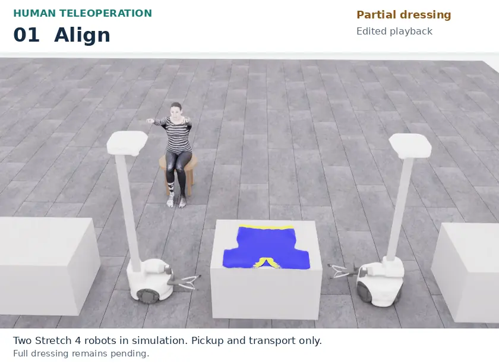

# PhyRC 2027 · Cooperative Robot Dressing

**Leonard Yoon, Ph.D.** · [한국어](README.ko.md) · [Challenge](https://emprise.cs.cornell.edu/phyrc/challenge-2027/) · [Official simulator](https://github.com/rirolab/PhyRC_2027_Challenge)

Human demonstration collection with two Stretch 4 robots in Isaac Sim, operated from MacBook Chrome.

**Current direction:** use the existing buttons, direction arrows and keyboard UI. Text commands are not part of the next test. Work toward a first verified **50-point attempt**, saving each achieved stage and testing restart/recovery before relying on it. **50 points and full dressing have not been achieved or verified.**

[Next-session handoff](docs/project/END_20261103.ko.md) · [Clean-server setup](docs/project/START_HERE.ko.md) · [Status](docs/project/STATUS.md)

## November 3: setup and live UI test completed

- Official pinned build, asset preparation and GPU smoke passed. Both robots moved; gripper toggle, finite cloth and save/load position error 0 were checked.
- Chrome video and controls worked after automatic Brev CLI TCP/UDP port registration. An egress IP alone was not a usable connection address on this host.
- The owner prefers the existing UI over text input. The UI remains subject to further usability testing.
- Capture closed normally: **966 transitions / 12,561 raw states**, with chunk, event and scene hashes verified. RGB-D export and training review were deferred. Prior datasets are not required for tomorrow's test.
- Simulator, viewer and speed monitors stopped at the owner's request. GPU usage 0%, 1 MiB resident; streaming listeners closed. Server power/deletion was not performed.

### Speed and cost

Measured host: **L40S 48 GB class, 144 GiB RAM, 4 CPU cores / 8 vCPUs**. Same 1280×720 viewport, recording ON and fixed garment-side practice layout; official physics/actions unchanged.

| Measurement | Simulation seconds / wall second | Wall seconds per simulation second |
|---|---:|---:|
| Previous L40S short sample | 0.10448× | 9.57 s |
| Current short neutral test | 0.11321× | 8.83 s |
| Current live-session cumulative sample (~411 s) | 0.11492× | 8.70 s |

The live-session sample, including startup-adjacent and idle periods, averaged **about 10% faster**. Overlapping 60-second windows ranged **7.4–11.6% faster**; a sustained +8% minimum was **not** established. RAM stayed near 8.1 GiB. The historical sample was short and had concurrent CPU video encoding; this is not a controlled hardware comparison or an input-latency measurement.

Owner-supplied rates: previous **$1.06/h**, current **$1.77/h**. At the measured live rate, equal simulation time costs about **52% more**. The owner will decide next session whether the modest speed gain is worth the higher rate. [Measurements](docs/project/sessions/20261103-runtime-summary.json)

## Next test: existing UI, stage by stage toward 50

1. Select the L40S server, restore the UI and verify short movement plus normal capture closure.
2. Establish the starting state and actual scoring procedure. Log **observed scores**, without inventing scores for intermediate milestones.
3. Attempt approach/alignment → grasp/lift → transport → dressing stages using the existing UI. Save a separate capture/segment and notes at each achieved stage.
4. Verify episode restart first, then saved-state restore **and continued manipulation**. A saved recording is not a simulator checkpoint. Browser F1–F5 forwarding is currently absent and must be addressed before promising UI checkpoint recovery.
5. Resume from a stage only after checking cloth/contact, grasp/controller state and score handling. Exact rewind, crash recovery and a full 50-point run remain unverified.

No new SFT, long evaluation, full historical-data download or text-controller work is a prerequisite. The fixed garment-side layout is for practice, not the official randomized evaluation layout. Automated operators and training inputs must respect the [public observation/action rules](docs/competition/RULES.md).

## Research reference: Stretch 4 policies and Astra (November 4)

[Detailed technical review and implementation plan (Korean)](docs/project/research/STRETCH4_VLA_REVIEW.ko.md)

- **Verified source:** [Hello Robot's official integration](https://github.com/hello-robot/stretch4_lerobot) reports real Stretch 4 tests with **π0.5 LoRA, ACT and Diffusion**. Its documentation provides a training/deployment pipeline; a task-trained Stretch 4 checkpoint was not identified in the reviewed guides. This is not evidence of two-robot dressing success.
- **Compatibility matters:** the real-robot adapter uses base velocities, arm/wrist positions and gripper opening. PhyRC uses normalized velocities and gripper intent, **`float32 (2,9)`**. Do not copy the real-robot relative-action transformation into our velocity labels. Our current training stack is **OpenPI/JAX**, while the reference uses **LeRobot/PyTorch**.
- **Reuse first:** preserve camera/action schemas and preprocessing, check synchronization and normalization, verify trained weights after reloading, and compare short action-execution chunks. Human-demo SFT also needs an explicit review state in the current loader. Automatic held-joint processing must not erase rare dressing actions.
- **Later option:** [Georgia Tech's Astra study](https://www.gt-rail.com/blog/astra-beyond-tabletop/) motivates a bounded automated collector using only public observations. It studies one real robot; its quantitative ablation is one household task with five trials per setting, not a PhyRC benchmark. The existing GPT code is a wiring-test scaffold, not a dressing policy.

**Next sequence remains:** existing Chrome UI → raw preservation → public RGB-D export/QC → reviewed demonstrations → current baseline fine-tuning and short local comparisons. LeRobot migration and GPT control remain separate future experiments. This update is documentation-only; no new GPU run, training, autonomous success or submission is claimed.

## Earlier demonstration

[33-second recorded pickup/transport video](docs/videos/20261026-human-pickup-transport.mp4) · [Provenance](docs/project/DEMO_20261026.ko.md). This is an earlier partial human demonstration, not a full dressing or autonomous success.

[Controls](participant/streaming/) · [Data format](docs/competition/DATA.md) · [Policy contract](docs/competition/POLICY.md) · [Prior results](docs/project/RESULTS.ko.md) · [History](README.history.en.md) · [Upstream README](README.upstream.md) · [Sources and licenses](THIRD_PARTY.md)
