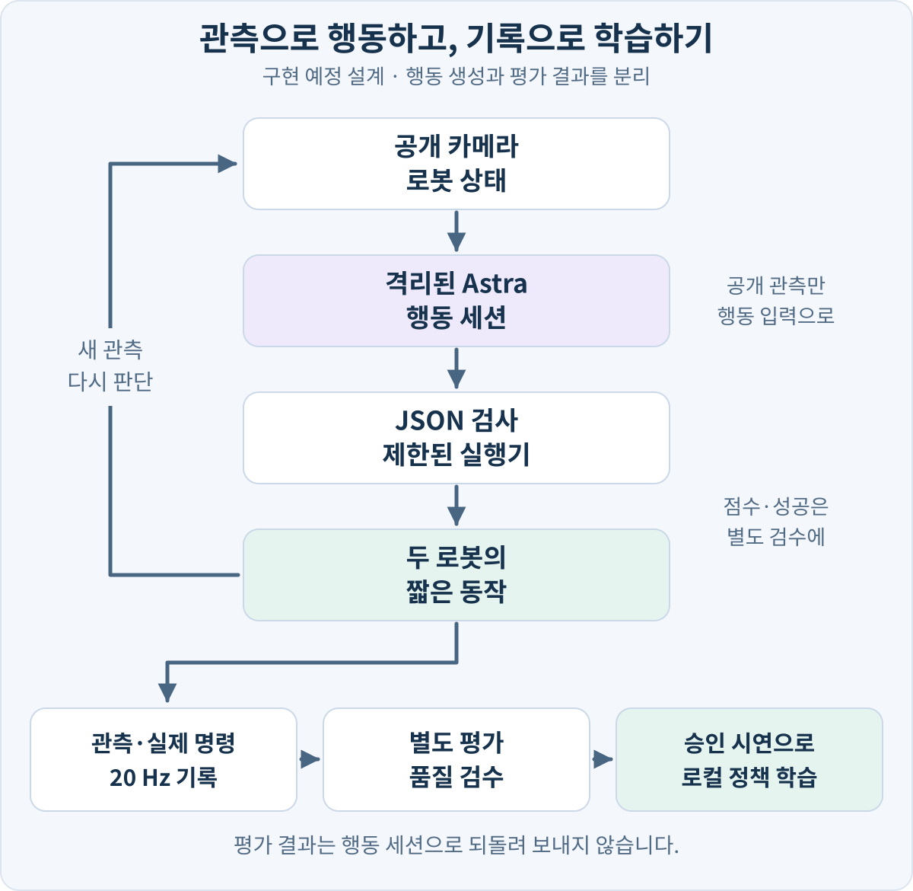

# PhyRC 2027: 두 로봇의 협력 착의 챌린지

[공식 원본 안내](README.upstream.md) · [새 서버 준비](docs/project/START_HERE.ko.md) · [다음 작업 상태](docs/project/STATUS.md) · [공식 대회](https://emprise.cs.cornell.edu/phyrc/challenge-2027/)

두 대의 Stretch 4가 앉아 있는 마네킹에 티셔츠를 입히는 시뮬레이션 과제입니다. 이 저장소는 공식 시뮬레이터에 시연 수집, 브라우저 조작, 데이터 검수, π₀.₅ 학습 및 제출 도구를 추가한 참가자 저장소입니다.

## 직접 수집한 시연 화면

맥북 Chrome에서 두 로봇을 직접 조작한 **접근 → 파지·들기 → 마네킹 쪽 운반** 장면입니다. 아래 화면은 실제 기록을 재생해 렌더링한 것으로, AI로 합성한 성공 장면이 아닙니다.

| ① 옷에 접근·정렬 | ② 양쪽 파지 후 들어 올리기 | ③ 마네킹 쪽으로 운반 |
|:---:|:---:|:---:|
| [](docs/project/assets/visual-20261027/human-demo-t08.jpg) | [](docs/project/assets/visual-20261027/human-demo-t20.jpg) | [](docs/project/assets/visual-20261027/human-demo-t29.jpg) |

**[▶ 33초 편집 시연 영상 보기](docs/videos/20261026-human-pickup-transport.mp4)** · [기록과 화면의 출처](docs/project/DEMO_20261026.ko.md)

고정 연습 배치에서 수집한 부분 시연입니다. **이 시연의 공식 점수, 소매·목 통과와 전체 착의 성공은 확인하지 않았습니다.** 화면의 각 단계에 임의의 점수를 붙이지 않습니다.

## 0점에서 50점까지의 목표 과정

아래 그림은 앞으로 수집할 시연의 목표와 공식 평가 항목을 연결한 **설명용 점수 지도**입니다. 직접 달성한 점수 기록이나 성공 시뮬레이션 화면이 아닙니다.

[](docs/project/assets/score-roadmap-20261104/score-roadmap.ko.svg)

**각 항목을 그림 순서로 획득할 때의 누적 예시**이며 실제로는 순서가 달라지거나 여러 항목이 함께 인정될 수 있습니다. 누적 점수는 유지되므로 **50점과 성공 판정은 별도**입니다. 성공은 두 손·머리·옷 앞면 조건을 동시에 0.5초 유지했는지 확인합니다. [공식 평가 정의](docs/competition/EVALUATION.md)

다음 수집에서는 먼저 **접근·파지·들기의 반복 가능한 시연**을 확보하고, 실제 점수를 확인하면서 소매·어깨·목·방향 단계로 확장합니다.

**현재 목표는 Codex CLI의 Astra를 시연 생성기로 연결하여, 사람이 두 로봇을 계속 직접 조작해야 하는 부담을 줄이는 것입니다.** 공개 영상과 로봇 상태로 짧게 행동하고 다시 관찰하며, 검수한 시연으로 로컬 정책을 학습합니다. Chrome 조작은 관찰·직접 시연·사람의 수정 수단으로 유지합니다.

**2026-11-06 현재 상태:** 기존 L40S 구성에서 공식 환경 복원과 smoke를 완료했습니다. 기존 수집 경계와 기록 코드는 있지만, **Codex CLI 자동 시연 연결은 아직 구현되지 않았습니다.** 짧은 기록 연결 시험은 완료했으며, 실제 과제 시연 수집·학습·평가는 아직 진행 전입니다. 운영 문서는 한국어를 기준으로 관리합니다.

## 현재 개발 목표와 진행 기록

현재 목표는 **Codex CLI의 `gpt-6-astra`를 이용해 한 번의 유효한 연속 시도에서 공식 누적 50점과 착의 `success=true`를 확인하는 시연을 수집하는 것**입니다. 짧은 동작·정지·저장 검증을 거쳐 단계별 시도로 확장합니다. 최대 추론 설정은 설치된 CLI와 해당 모델에서 실제 지원·적용되는 값을 확인한 뒤 명시하며, 아직 모델 접근이나 설정을 검증한 상태는 아닙니다.

성공 여부와 관계없이 시도 전 과정을 기록합니다. 실패 후 재시도, 부분 성공과 복구 구간도 원본을 보존하고, **단계별 도달률·소요 시간·유효 데이터 수집 효율**을 분석합니다. 검수한 시연을 이용한 π₀.₅ 학습과 후속 정책 개선은 이 수집 결과를 바탕으로 진행합니다.

### 기록 원칙

- 환경 준비 → 구현 → 검증 → 수집 → 분석 → 보존의 모든 수행 단계를 이 README에 한국어로 갱신합니다. 상세 근거가 길면 연결된 세션 문서에 두고, 이곳에 명령·결과·한계·다음 작업을 요약합니다.
- 공개 문서는 기술적 목표, 구현, 실험 조건, 측정과 재현 근거만 다룹니다. 개인적 배경이나 기술 개발 외의 활용 목적은 포함하지 않습니다.
- 계획, 실제 실행, 검증 통과와 미검증 상태를 구분합니다. 측정하지 않은 수치는 추정으로 채우지 않습니다.
- 원본은 보존하고 라벨과 승인 구간은 별도 메타데이터로 관리합니다. 인증 정보와 개인 접속 주소는 공개 기록에 포함하지 않습니다.

### 2026-11-06 · 환경 준비

시뮬레이션이 약 10% 빨랐던 이전 비교 서버 대신, 장시간 수집의 비용을 고려해 기존 L40S 구성을 선택했습니다. 과거 속도 비교는 [11월 3일 측정 기록](docs/project/END_20261103.ko.md)에 있으며, 현재 서버의 속도는 아직 측정하지 않았습니다.

| 항목 | 확인한 상태 |
|---|---|
| 소스 기준 | `8537ccc7a21c017f107d8f52992c626af882c21b` 복제, 문서 수정 전 작업 트리 깨끗함 |
| GPU·드라이버 | NVIDIA L40S, 46,068 MiB, 드라이버 `580.126.09` |
| CPU | Intel Xeon Platinum 8452Y, 12 vCPU |
| RAM·디스크 | RAM 약 70 GiB, 작업 파일시스템 여유 약 569 GB (`free -h`, `df -h` 표시 기준) |
| 호스트 사전 점검 | `participant/ops/bootstrap.sh --check` 종료 코드 0, Docker `29.1.5` |
| Hugging Face CLI | 저장소 지정 버전 `huggingface_hub==2.2.0` 설치, `hf version`과 로그인 도움말 확인 |
| HF 인증 | 별도 터미널에서 진행할 단계. 로그인 완료 여부는 아직 확인하지 않음 |
| 공식 실행 환경 | build 186.18초, prepare 8.41초, smoke 355.67초. 종료 코드 0과 `PHYRC-SMOKE-PASS` 확인 |
| Astra 수집 | CLI `0.166.0`, 로컬 모델 목록의 `gpt-6-astra`·`ultra`·이미지 입력 지원 확인. 실제 호출과 실행기 연결은 검증 전 |
| 데이터·점수 | 연결 시험 3개 에피소드·63전이 저장 및 정합성 검사 통과. 과제 채점 없음, 50점과 착의 성공은 목표 상태 |

### 환경·기록·관찰 검증 결과

[실행 시간과 검증 요약 JSON](docs/project/sessions/20261106-l40s-restore.json)

- 공식 smoke: 37 control frames에서 두 로봇의 관절 이동, 그리퍼 전환과 유한한 의복 좌표를 확인했습니다. 저장·불러오기 위치 최대 오차는 0 m이며, 파지 유지나 전체 착의 성공을 검증한 결과는 아닙니다.
- 기록 연결 시험: `integration_test` 출처로 3개 에피소드, 총 63전이·3.15 simulation초를 저장했습니다. 프로세스 전체 113.64초, 수집 루프 81.62초이며 초기화·종료와 재설정 비용을 포함하는 범위가 다릅니다. 기존 서버 속도 비교와 같은 조건의 벤치마크는 아닙니다.
- 저장 검증: SHA256, 파일·에피소드 완료 상태, 모든 전이의 행동 형식·범위, `next_obs.previous_action`, 관측 연속성, 0.05초 간격과 12 physics ticks 검사를 통과했습니다. 공식 점수와 착의 성공은 평가하지 않았습니다. 원본은 `output/collections/20261106-jupyter-live-integration/`에 있으며 원격 보존은 아직 수행하지 않았습니다.
- CPU 검사 15개 통과. Jupyter 관찰 경로는 Chromium에서 합성 3프레임 갱신, HTTP 200과 종료 후 갱신 중지를 확인했고, 맥북 Chrome에서도 실제 카메라 이미지 표시를 확인했습니다. `/files` HTML 자체 새로고침은 403으로 실패해, 기존 JupyterLab의 신뢰된 출력에서 이미지를 읽는 방식으로 검증했습니다.
- 현재 연결 목표는 **기존 WebRTC의 실시간 영상과 조작 UI**입니다. 고정 버전 뷰어 빌드는 완료했습니다. Brev CLI 인증 후 현재 클라이언트 IPv4만 허용하여 TCP 8210·8211·49100, UDP 47998 포트를 등록했습니다. 실제 외부 매핑과 IPv4 HTTP 주소로 연결했으며 맥북 Chrome에서 실시간 영상 표시를 확인했습니다. 접속 주소·인증 정보는 공개 문서에 저장하지 않습니다. 서로 다른 중계 경로의 실제 패킷을 확인해 허용 주소를 보완했고, HTTPS 요청이 HTTP 뷰어에 도착하는 오류는 IPv4 HTTP 주소와 입력 origin을 일치시켜 해결했습니다. 첫 연결 진단의 1,101전이·14,316 raw states는 정상 저장했으며 성공 시연 수량에 포함하지 않습니다.

실행한 연결 시험 명령:

```bash
participant/ops/bootstrap.sh --install
PYTHONPATH=.:src/PhyRC_Sim .venv/bin/python -m unittest discover -s tests -v
.venv/bin/python participant/ops/run.py --id 20261106-jupyter-live-integration -- \
  ./run.sh python /scripts/collect_integration.py \
  --output /output/collections/20261106-jupyter-live-integration \
  --preview /output/live/collection.html
python3 participant/streaming/prepare_viewer.py
```

<details>
<summary>실행한 준비·확인 명령</summary>

```bash
git clone https://github.com/leonyoon-3dai/PhyRC_2027_phase1.git /home/shadeform/workspace/PhyRC_2027_phase1
cd /home/shadeform/workspace/PhyRC_2027_phase1
git status --short
git rev-parse HEAD
nvidia-smi --query-gpu=name,memory.total,driver_version --format=csv,noheader
lscpu
free -h
df -h /home/shadeform/workspace
participant/ops/bootstrap.sh --check
uv tool install huggingface_hub==2.2.0
hf version
hf auth login --help
```

설치된 실행 파일은 `~/.local/bin/hf`이며 새 Bash 터미널의 PATH에서 찾을 수 있음을 확인했습니다. 준비 작업의 단계별 소요 시간은 별도 측정하지 않았습니다. 다음 인증 명령은 사용자 터미널에서 실행할 안내이며, 완료한 실행으로 집계하지 않습니다.

```bash
hf auth login
hf auth whoami
```

</details>

### 다음 수집에서 남길 구조화 기록

아래는 구현할 기록 계약입니다. 자동 생성이나 수집이 완료됐다는 뜻은 아닙니다.

| 기록 단위 | 필수 내용 |
|---|---|
| 실행 | 코드·환경 버전, CLI·모델·추론 설정, 프롬프트 해시, 공개 관측 구성 |
| 시도·재시도 | run/episode ID, 부모 시도와 재시도 이유, 시작·종료 조건, 데이터 출처, 사람 개입 |
| 단계·구간 | segment ID와 시작/끝 step, 목표 단계, 관찰 결과, 실패·복구 유형, 검수·승인 상태 |
| 공식 평가 | 평가 유효성, 항목별 점수와 획득 시각, 누적 점수, 착의 success, 중단 이유 |
| 시간·효율 | 실제 경과 시간, 시뮬레이션 시간, 모델 호출 수·추론 시간, 환경·센서·기록 시간, 검수 통과 전이 수 |
| 보존 | 파일 완료 상태, SHA256, 저장 위치, 원격 고정 리비전과 재다운로드 검증 |

단계별 도달률은 전체 시도 수와 해당 단계의 시도 수를 함께 제시합니다. 실패·중단·평가 무효 시도도 목록에 남기며, 누락된 평가를 성공이나 0점으로 임의 변환하지 않습니다. 공식 평가의 실패 집계는 [평가 정의](docs/competition/EVALUATION.md)를 따릅니다. 물리 상태 복원은 별도 검증하며, 재시작한 구간을 이어 붙여 하나의 연속 완주로 표시하지 않습니다. 평가 결과는 검수 영역에 보관하고 행동 세션의 다음 입력으로 전달하지 않습니다.

**다음 작업:** 격리된 Codex CLI 행동 세션과 기존 실행기, 기록·공식 평가 경로를 연결합니다. 현재 WebRTC는 사람 조작용 세션이며 자동 정책 추론은 아직 실행하지 않았습니다. UI 추가 기능은 사용 피드백 이후 진행합니다.

## 1. 먼저 이해할 작업 흐름

| 단계 | 무엇을 하는가 | 다음 단계로 넘어가는 기준 |
|---|---|---|
| 환경 준비 | L40S 서버에서 공식 Docker 환경과 센서를 확인 | 공식 smoke 통과, 공개 관측 수신 |
| 자동 수집 연결 | Codex CLI의 이미지 입력·JSON 출력을 기존 수집기에 연결 | 짧은 동작과 정상 종료, 관측·행동 기록 확인 |
| 짧은 시연 | 접근·파지·들기를 시도하고 필요할 때 사람이 수정 | 사용할 수 있는 구간과 개입 내역 확보 |
| 검수 | 기술적 유효성, 공식 점수, 시각적 의견을 각각 기록 | 승인된 시연 목록과 분리된 검증 자료 확보 |
| 기본 정책 학습 | 승인된 데이터로 π₀.₅를 모방학습 | 새 시작 배치에서 실제 행동 개선 확인 |
| 후속 개선 | 실패 구간 추가 수집, 필요하면 강화학습 | 같은 조건의 로컬 비교에서 개선 확인 |

50점 성공 시연을 향한 첫 검증 단계는 **자동 수집이 유효한 학습 데이터를 만드는지 확인하는 것**입니다. 이전 모델이나 과거 데이터 전체를 내려받을 필요는 없습니다. 학습·장시간 평가·공식 제출은 수집 연결의 선행 조건이 아닙니다.

## 2. 현재 코드 구조

### 환경과 조작

| 경로 | 현재 역할 |
|---|---|
| [`run.sh`](run.sh), [`Dockerfile`](Dockerfile) | 공식 환경의 진입점과 컨테이너 구성 |
| [`config/policy_interface.json`](config/policy_interface.json) | 공개 관측, 로봇별 행동 순서, 제어 주기 |
| [`src/PhyRC_Sim/Env_StandAlone/Teleop_TShirt_Stretch4_Env.py`](src/PhyRC_Sim/Env_StandAlone/Teleop_TShirt_Stretch4_Env.py) | 두 로봇·옷·마네킹 장면과 사람 조작 환경 |
| [`src/PhyRC_Sim/Policy/environment.py`](src/PhyRC_Sim/Policy/environment.py) | 공개 관측을 제공하고 정해진 행동을 적용하는 `DressingEnv` |
| [`participant/streaming/`](participant/streaming/) | Chrome 영상, 키보드·버튼 전달, 뷰어 준비 및 방화벽 보조 도구 |
| [`participant/ops/bootstrap.sh`](participant/ops/bootstrap.sh) | 호스트 확인, 보조 Python 환경, 공식 build·prepare·smoke |
| [`participant/ops/run.py`](participant/ops/run.py) | 실행 명령·코드 버전·소요 시간·CPU/RAM/GPU 사용 기록 |

### 자동 수집과 데이터

| 경로 | 현재 역할과 한계 |
|---|---|
| [`participant/collection/boundary.py`](participant/collection/boundary.py) | 공개 관측 목록, 행동 검사, `observe`·`act`·`stop`·`finish_episode`. 운영체제의 접근 격리까지 제공하지는 않음 |
| [`scripts/collect_operator.py`](scripts/collect_operator.py) | JSON Lines 표준입출력으로 수집기를 구동. 시뮬레이터 로그는 별도 stderr로 분리 |
| [`participant/collection/gpt_client.py`](participant/collection/gpt_client.py) | **Responses API와 `OPENAI_API_KEY`를 사용하는 작은 동작 연결 시험**. Codex CLI 클라이언트나 착의 정책이 아님 |
| [`scripts/collect_integration.py`](scripts/collect_integration.py) | 정해진 작은 동작으로 기록 경로를 확인하는 시험. 성공 시연 데이터가 아님 |
| [`src/PhyRC_Sim/Policy/training_dataset.py`](src/PhyRC_Sim/Policy/training_dataset.py) | 공개 관측·실제 적용 행동·다음 관측을 HDF5에 저장 |
| [`scripts/inspect_policy_dataset.py`](scripts/inspect_policy_dataset.py) | 데이터 로딩과 첫 샘플의 형식 확인. 전수 품질 검수는 아님 |
| [`scripts/check_deferred_dataset.py`](scripts/check_deferred_dataset.py) | 사람 조작 원본과 지연 변환 결과를 비교. 원본 없는 자동 수집에는 그대로 적용할 수 없음 |
| [`tests/test_collection.py`](tests/test_collection.py) | 가짜 환경에서 정보 경계와 행동·기록 계약 검사. 실제 GPU 조작 검증과 구분 |

### 학습과 배포

| 경로 | 현재 역할과 한계 |
|---|---|
| [`participant/pi05/preprocessing.py`](participant/pi05/preprocessing.py) | RGB 3장과 32차원 상태 입력, 행동 18차원을 모델 폭 32에 맞추는 변환 |
| [`participant/pi05/data.py`](participant/pi05/data.py) | 해시·에피소드·자료 출처 그룹 검사. 현재 `approved_pipeline_test`만 허용하므로 실제 시연용 승인 상태 추가 필요 |
| [`participant/pi05/config.py`](participant/pi05/config.py), [`train.py`](participant/pi05/train.py) | OpenPI/JAX LoRA 학습. 실제 시연에는 학습률·warmup·학습량을 다시 정해야 함 |
| [`participant/policy.py`](participant/policy.py) | 로컬 모델 묶음을 읽어 행동 청크를 실행. `bundle.json`과 모델 자산이 필요하며 파일 하나만으로 실행되지 않음 |
| [`participant/ops/package.py`](participant/ops/package.py), [`selfcheck.sh`](participant/ops/selfcheck.sh) | 제출 묶음과 검사 도구. 현재 selfcheck는 과거 커밋을 고정하므로 최신 제출 전 기준 버전 재검토 필요 |
| [`participant/ops/artifacts.py`](participant/ops/artifacts.py) | 지정 폴더의 SHA256 목록 생성·검사·압축·복원. 업로드는 별도 |

## 3. 클린 서버에서 빠르게 시작하기

L40S 한 대를 기준으로 시작합니다. 먼저 수집에 필요한 환경만 준비하고, 학습 환경과 큰 모델 다운로드는 뒤로 미룹니다. 서버 사양만으로 속도를 보장하지 않으며 실제 시뮬레이션 진행 속도를 짧게 측정합니다.

다음 명령은 **드라이버, Docker와 NVIDIA Container Toolkit, `git`·`python3`·`curl`·`flock`·`xauth`·`uv`가 준비된 서버**에서 실행합니다. `bootstrap.sh`가 이 호스트 구성 요소를 대신 설치하지 않습니다. 누락 항목과 GPU 호환성은 [공식 설치 안내](docs/competition/SETUP.md)를 먼저 확인합니다.

```bash
git clone https://github.com/leonyoon-3dai/PhyRC_2027_phase1.git
cd PhyRC_2027_phase1
git status --short
git rev-parse HEAD
participant/ops/bootstrap.sh --check
participant/ops/bootstrap.sh --install
```

기존 작업 폴더라면 변경 사항부터 확인하고 덮어쓰지 않습니다. `--install`은 호스트 보조 환경을 만든 뒤 공식 `doctor → build → prepare → smoke`를 실행합니다. 로그는 `output/sessions/`와 `output/runs/`에 저장됩니다. **종료 코드와 `PHYRC-SMOKE-PASS`를 함께 확인합니다.**

설치가 끝나면 GPU를 사용하지 않는 기존 코드 검사부터 실행합니다.

```bash
PYTHONPATH=.:src/PhyRC_Sim .venv/bin/python -m unittest discover -s tests -v
```

Chrome 연결에 필요한 Node/npm, 실제 주소·포트 매핑, 로그 확인과 정상 종료 방법은 [새 서버 준비 문서](docs/project/START_HERE.ko.md)에 정리했습니다. 브라우저 연결은 사람의 개입 수단이며, 자동 수집의 관측은 공개 카메라 데이터에서 직접 가져옵니다.

### Codex CLI 준비

설치되지 않은 경우 [공식 CLI 안내](https://learn.chatgpt.com/docs/codex/cli)의 설치 방법을 사용합니다. 아래는 문서 확인 시점의 Linux 설치·로그인 명령입니다. 이미 설치되어 있으면 먼저 버전을 확인하고, 실험 도중 자동으로 버전을 바꾸지 않습니다.

```bash
curl -fsSL https://chatgpt.com/codex/install.sh | sh
codex --version
codex login --device-auth
codex login status
codex exec --help
```

설치 후 명령이 잡히지 않으면 설치기가 안내한 경로를 적용하거나 SSH 터미널을 다시 엽니다. 원격 로그인 방법은 [공식 인증 안내](https://learn.chatgpt.com/docs/auth)를 따릅니다. 로그인 성공과 특정 모델 이용 가능 여부는 별개이므로 서버에서 `gpt-6-astra` 접근을 확인합니다. 이용 한도나 추가 과금 가능성을 무제한·무료로 가정하지 않습니다.

아래 명령은 **개발·환경 점검용 세션**을 여는 예시입니다. 이것만 실행해 로봇 시연이 자동 수집되는 것은 아닙니다.

```bash
codex --model gpt-6-astra -c 'model_reasoning_effort="high"'
```

실제 행동을 결정하는 세션은 저장소 전체를 읽는 개발 세션과 분리합니다. 기존 `gpt_client.py`를 실행하거나 모델명만 바꾸는 방식은 Codex CLI 연결을 대신하지 않습니다. API 기반 수집으로 자동 전환하지 않습니다.

## 4. Codex CLI 시연 수집 설계

이 절은 **앞으로 구현할 설계**입니다. 참고한 [Astra 실험](https://www.gt-rail.com/blog/astra-beyond-tabletop/)은 한 대의 실제 로봇에서 상대 이동량을 실행한 사례입니다. PhyRC의 두 로봇 착의 성공을 입증한 사례가 아니며, 실기의 cm·deg·그리퍼 벌림 명령을 그대로 복사하지 않습니다.

[](docs/project/assets/collection-flow-20261104/collection-flow.ko.svg)

[그림 크게 보기](docs/project/assets/collection-flow-20261104/collection-flow.ko.svg) · [PNG로 보기](docs/project/assets/collection-flow-20261104/collection-flow.ko.png)

<details>
<summary>그림의 흐름을 텍스트로 보기</summary>

1. **관측 → 판단:** 공개 카메라와 로봇 상태를 격리된 Astra 행동 세션에 전달합니다.
2. **검사 → 실행 → 재관측:** 행동 JSON을 검사하고, 제한된 실행기가 두 로봇을 짧게 움직입니다. 새 관측을 받아 다음 행동을 판단합니다.
3. **기록 → 검수 → 학습:** 관측과 실제 적용 명령을 20 Hz로 기록하고, 별도 평가·품질 검수를 거쳐 승인한 시연으로 로컬 정책을 학습합니다.

점수·성공 여부는 별도 검수에 사용하며, 행동 세션으로 되돌려 보내지 않습니다.

</details>

### 제어와 기록 계약

- 공개 관측은 20 Hz 기준으로 받고, 실행기는 매 단계 `float32 (2,9)` 행동을 적용합니다. 행 0은 `robot_0`, 행 1은 `robot_1`입니다.
- 각 행은 `전후, 좌우, 회전, lift, arm, wrist yaw, wrist pitch, wrist roll, gripper` 순서입니다. 앞 8개는 `[-1,1]` 속도 비율이며, gripper는 `>0.5` 닫기, `<-0.5` 열기, 그 사이는 기존 의도 유지입니다.
- Astra는 매 0.05초마다 호출하지 않습니다. 짧은 동작을 계획하고 실행이 끝난 후 새 관측으로 다시 판단합니다. 기존 `act(action, steps)`는 최대 20단계, 즉 시뮬레이션 1초를 허용합니다. 첫 시험은 1~10단계 이내에서 시작하고 접촉 부근은 더 짧게 설정합니다.
- 기록기는 `관측 → 실제 적용 행동 → 다음 관측`을 0.05초 간격으로 저장합니다. 한 번에 여러 단계를 요청해도 각 전이를 따로 기록합니다. Astra의 설명이나 목표 이동량을 행동 정답으로 저장하지 않습니다.
- 실행기에서 속도 제한·중단 등으로 명령을 바꿨다면, 바뀐 **실제 명령**을 저장합니다. 요청값과 적용값은 추적 기록에서 구분합니다.
- CLI 추론 대기 중 시뮬레이션이 진행하는지, 마지막 명령이 남는지, timeout 이후 정지가 동작하는지를 실제 런타임에서 확인합니다. 물리 시간 간격이나 공식 환경을 바꿔 속도를 높이지 않습니다.

### 처음 맞출 관측

현재 π₀.₅ 입력과 맞춰 `overview`, `robot_0_wrist`, `robot_1_wrist` RGB 3장과 같은 공개 상태를 우선 사용합니다. 상태 32차원은 관절 위치 26개, 손끝 원점 거리 2개, 닫기 의도 2개, 직전 gripper 행동 2개입니다. 닫기 의도는 실제 파지 성공 신호가 아닙니다.

Astra가 에피소드 안에서 이전 영상·행동을 기억하도록 연결하되, 새 에피소드에서는 문맥을 초기화합니다. 모델의 문맥 길이 제한과 요약 여부도 기록합니다. 교사가 과거 영상에 의존하는데 학생은 현재 영상만 보는 차이는 남으므로, 시연 검수 시 이를 확인하고 필요하면 학생의 시간 문맥도 확장합니다. 추가 카메라·깊이는 기본 연결 확인 후 비교합니다. PhyRC 깊이는 **광학축 Z 거리·미터**로, 참고 실험의 카메라 원점 거리·센티미터와 다릅니다.

### 구현할 구성 요소

| 순서 | 구현 대상 | 완료 확인 |
|---|---|---|
| 1 | 별도 Codex CLI 클라이언트와 공개 관측 전달 | 실제 이미지 첨부, 모델명·추론 설정·세션 ID 기록 |
| 2 | 행동 JSON 형식, 응답 파서, 호출 제한 | 오류·NaN·범위 초과·timeout에서 잘못된 명령이 실행되지 않음 |
| 3 | 에피소드별 문맥과 제한된 실행기 연결 | 이전 행동 결과 반영, 새 에피소드 문맥 초기화 |
| 4 | 공식 평가 결과의 별도 저장 | 동일 시도의 점수·success가 기록되고 행동 세션에는 전달되지 않음 |
| 5 | 전수 데이터 검사와 시연 승인 목록 | 실제 시연 출처·수정 구간·승인 상태를 구분 |

CLI 연결은 [비대화형 실행 문서](https://learn.chatgpt.com/docs/non-interactive-mode)의 `codex exec`, 이미지 첨부, 구조화된 최종 응답, 세션 재개 기능을 검토해 구현합니다. `--json`의 이벤트 로그 전체를 행동 JSON으로 해석하지 않습니다. 실행 서버의 `--help`에서 지원 옵션을 확인하고, 해당 에피소드의 명시적 세션 ID를 사용합니다. 현재 저장소에는 이 전체 흐름을 한 번에 실행하는 명령이 없습니다.

## 5. 행동 생성과 검수는 분리하기

| 구분 | 허용할 정보 | 결과 |
|---|---|---|
| 행동 세션 | 지정 카메라, 공개 로봇 상태, 공개 행동 실행 기록 | 다음 행동 |
| 기술 검사 | 저장된 관측·행동·시간·파일 완료 상태 | 형식·연속성·누락 검사 |
| 공식 평가 | 공식 평가기가 사용하는 내부 상태 | 점수와 착의 성공 판정 |
| 시각적 검수 | 공개 영상과 실행 기록 | 헛동작·가림·복구·학습 가치에 대한 의견 |

**행동 세션에 평가 JSON, audit, 원시 상태, 옷·마네킹 정답 좌표, 자유 시점 화면, spawn seed를 제공하지 않습니다.** `boundary.py`의 목록 필터만으로는 Codex의 파일 접근까지 차단되지 않습니다. 행동 세션은 별도 작업 공간과 제한된 도구로 구성하고, 시뮬레이터 파일·로그·개발 세션 문맥에 접근할 수 없는지 확인합니다. 읽기 전용 설정만으로 모든 정보 유출 경로가 막혔다고 간주하지 않습니다.

점수·성공 신호는 시연 선택과 허용된 학습 보상에 사용합니다. 같은 정보를 행동 세션에 다시 넣어 다음 명령을 만들지는 않습니다. 자동 수집은 [공식 규칙](docs/competition/RULES.md)의 공개 관측 원칙에 맞추는 설계이며, 이 특정 구현에 대한 주최 측의 별도 승인을 받았다는 뜻은 아닙니다.

## 6. 수집 파일과 품질 기준

사람 조작과 자동 수집은 현재 저장 경로가 다릅니다.

| 경로 | 현재 저장 방식 | 주의점 |
|---|---|---|
| Chrome 사람 조작 | 원시 기록을 보존하고 공개 RGB-D를 나중에 변환하는 경로 | 변환 대기와 완성된 학습 파일을 구분 |
| `collect_operator.py` | 센서를 읽으며 `policy.hdf5`, `audit.hdf5`, `capture.json`, `operator.jsonl` 저장 | `raw_archive=false`. 원시 기록 재생·지연 변환 검증 경로가 아님 |

자동 수집기는 학습 파일용으로 5개 공개 카메라의 RGB-D를 매 단계 기록합니다. Astra에 RGB 3장만 보내더라도 센서 생성 비용이 자동으로 줄어들지는 않으므로 CLI 추론 시간과 센서·기록 시간을 따로 측정합니다.

현재 자동 수집기의 기본 `--max-steps 400`은 시뮬레이션 20초입니다. 호출 수나 실제 소요 시간과 다른 제한입니다. 또한 공식 성공 평가가 기본 연결되어 있지 않으므로, **별도 평가 파일 저장을 추가해야 합니다.** 신뢰할 수 있는 수집기 측에서 공식 평가기를 연결하고, 결과를 별도 검수 영역에 저장합니다. 영상만 보고 공식 점수를 재구성하지 않습니다.

| 검사 | 통과 기준 |
|---|---|
| 파일 | 정상 종료, 해시 일치, 데이터·에피소드 완료 상태 |
| 행동 | float32, 실행 시 `(2,9)`, HDF5에서 `(T,18)`, 유한값, 범위 준수 |
| 시간 | 인접 관측 0.05초, 12 physics ticks, 에피소드 경계 혼합 없음 |
| 동기화 | `next_obs.previous_action`과 실제 행동 일치, 관측 연속성 |
| 영상 | 지정 카메라 순서, 유효 프레임, 반복·누락 구간 확인 |
| 작업 품질 | 공식 단계 점수·success와 시각적 검수 의견을 별도 보존 |

`complete`는 기록 완료, `done`은 에피소드 종료입니다. 둘 다 착의 성공이 아닙니다. `rewards`의 기본 0도 착의 보상이 아닙니다. 누적 50점과 `success`는 따로 확인합니다. 첫 형식 확인은 아래 도구로 하되, 전수 검수는 별도 구현·실행합니다.

```bash
# 자동 수집이 완료된 실제 폴더명을 사용합니다.
./run.sh cpu /scripts/inspect_policy_dataset.py "/output/collections/<수집-ID>/policy.hdf5"
```

## 7. 첫 세션에서 할 실험

1. 공식 환경 확인 후 공개 관측 한 묶음을 읽고, 수집기를 정상 종료해 파일을 확인합니다.
2. Codex CLI 연결을 구현하고 작은 이동·정지·그리퍼 명령을 확인합니다. 이 구간은 연결 시험으로 분류합니다.
3. 접근·파지·들기를 목표로 짧은 시도 10회를 계획합니다. 이는 학습에 충분한 수량이라는 뜻이 아니라 자동 수집의 유용성을 판단하는 표본입니다.
4. Astra 단독 시도와 사람이 수정한 시도를 구분합니다. 사람 개입은 CLI 자연어 보정 또는 별도 수동 제어로 설계하고, 두 제어원이 동시에 명령을 보내지 않게 합니다. 기존 Chrome 제어와 자동 수집기 사이의 제어권 전환은 추가 구현·검증 대상입니다.
5. 시도별 공식 단계 점수, 개입 횟수, 유효 전이 수, 무동작 비율, CLI 호출 수, 추론 시간, 시뮬레이션 시간, 전체 실제 시간을 기록합니다.
6. 검수 통과한 시연 분량을 서버 사용 시간으로 나누어 수집 효율을 판단합니다. 자동화가 오히려 비효율적이면 입력·짧은 동작·사람 보정 방식을 먼저 개선합니다.

전체 착의, 픽업만 성공, 실패 후 유용한 복구 구간을 같은 성공 라벨로 묶지 않습니다. 시도 10회를 마쳤다는 이유만으로 학습이나 RL을 자동 시작하지 않습니다.

## 8. 모방학습과 강화학습으로 연결하기

시연을 확보한 뒤 `participant/pi05/data.py`에 실제 사람·AI·사람 수정 시연의 검수 상태를 추가합니다. 새 시연을 `approved_pipeline_test`로 이름만 바꾸지 않습니다. 출처 종류와 품질 승인 여부는 별도 필드로 관리하고, 같은 시도·복원 출처 그룹이 학습과 검증에 동시에 들어가지 않게 합니다.

현재 모델은 행동 18개에 14개를 덧붙여 32차원으로 학습하고, 추론 후 앞 18개를 두 로봇 명령으로 복원합니다. 이 14개는 추가 관절이 아닙니다. 입력 전처리와 정규화는 학습·추론에서 공유하고 정규화 통계는 학습 자료로만 계산합니다. 짧은 학습에 맞는 설정과 저장·재로드 결과를 확인한 후, 다른 시작 배치에서 실제로 행동을 실행해 비교합니다.

**RL은 그 다음 선택지입니다.** 기본 정책이 반복적으로 유용한 단계에 도달한 뒤 공식 성공·단계 점수 등의 허용된 보상을 사용합니다. 내부 상태는 actor·critic·추론 모델 입력이나 행동 정답으로 전달하지 않습니다. 기본 모방학습 정책을 보존하고 같은 로컬 평가 조건에서 개선 여부를 판단합니다. 공식 제출 전에는 별도로 최신 제출 규격·메모리·오프라인 실행·전체 평가 검사를 확인합니다.

## 9. 서버를 교체해도 이어갈 수 있도록 남길 것

| 보관 위치 | 남길 내용 |
|---|---|
| GitHub | 코드, 의존성·실행 명령, 프롬프트와 행동 형식, 작은 검수 요약, 다음 작업 |
| Hugging Face 등 별도 자료 저장소 | HDF5, 필요 원본, 영상, 모델·학습 상태, SHA256 목록과 고정 리비전 |
| 서버 로컬 | 작업 중 임시 파일과 캐시. 원격 보존을 확인하기 전 유일한 원본으로 취급 |

매 시도에 코드 커밋, 컨테이너 식별자, 자산 잠금 파일, CLI 버전, 모델명·추론 설정, 프롬프트 해시, 관측 구성, 실제 명령, 데이터 출처, 사람 개입, 시간 정보를 연결합니다. 공개할 추적 기록에서 인증 정보와 개인 접속 주소는 제외합니다.

종료 시 파일을 정상 닫고 해시를 확인한 뒤, 필요한 자료를 업로드하고 실제로 다시 내려받아 검사합니다. 다음 시작은 해당 코드·자료 리비전으로 복원합니다. **데이터 보존은 실행 중 물리 상태 복원과 다릅니다.** 중간 상태의 정확한 재개가 검증되지 않았다면 새 에피소드에서 시작합니다. 서버 요금 종료는 프로그램 종료와 별개로 확인합니다.

## 10. 새 서버의 개발용 Codex에 전달할 시작 요청

아래 문장은 **사용자가 서버를 열고 작업을 재개할 때** 붙여 넣는 개발 지시입니다. 행동 모델의 시스템 프롬프트로 사용하지 않습니다.

> 이 저장소의 README.md, AGENTS.md, docs/project/START_HERE.ko.md, docs/project/CODEX_CONTEXT.ko.md를 읽고 현재 코드와 계획을 구분해 작업을 이어가세요. 우선 서버와 공식 환경을 확인하고, 기존 boundary.py와 collect_operator.py를 재사용해 Codex CLI의 gpt-6-astra를 연결하는 짧은 자동 시연 수집 경로를 구현하세요. 개발용 세션과 행동용 세션을 분리하고 행동용 세션에는 공개 관측과 제한된 제어 도구만 제공하세요. 실제 적용된 20 Hz 행동을 저장하며, 공식 평가 결과와 품질 검수는 행동 문맥 밖에서 관리하세요. 작은 동작·정지·정상 저장을 먼저 검증한 뒤 접근·파지·들기와 이후 착의 단계로 확장하세요. 목표는 한 번의 유효한 연속 시도에서 50점과 success를 확인하는 시연 수집입니다. 실패·재시도·부분 성공도 시간·출처·구간 라벨과 함께 보존하세요. API 방식으로 자동 전환하지 말고, 모델 접근이나 격리·기록 문제가 있으면 그 문제부터 보고하세요. 대규모 자료 복원·학습·RL·장시간 평가를 수집 연결보다 먼저 실행하지 마세요. 모든 수행 단계의 명령, 결과, 자료 위치와 검증 상태, 다음 작업을 README에 한국어로 기록하세요.

### 필요할 때 펼쳐 읽는 기술 컨텍스트

[](docs/project/CODEX_CONTEXT.ko.md)

[문서로 바로 열기](docs/project/CODEX_CONTEXT.ko.md)

최근 정리한 기술 내용을 별도 문서에 모았습니다. **현재 구현, 미검증 항목, 후속 실험**을 구분하며, 새 서버의 개발용 Codex는 위 시작 요청과 함께 읽습니다.

- 자연어 시연 수집, 사람 개입, 단계 저장과 복원, 공개 관측 및 점수의 경계
- 실제 데이터와 action 계약, π₀.₅의 flow matching, LoRA, 정규화와 실행 청크
- 5 RGB와 depth 확장, 정책 비교, 비동기 실행 및 강화학습의 적용 조건

## 참고 문서

- [공식 공개 관측 규칙](docs/competition/RULES.md), [데이터 구조](docs/competition/DATA.md), [정책 연결](docs/competition/POLICY.md), [평가 정의](docs/competition/EVALUATION.md)
- [Stretch 4 정책·Astra 기술 검토](docs/project/research/STRETCH4_VLA_REVIEW.ko.md): 조사 자료이며, 그 안의 과거 실행 우선순위보다 이 README의 현재 계획을 우선합니다.
- [과거 세션 기록](docs/project/sessions/), [이전 결과](docs/project/RESULTS.ko.md), [이전 한글 README](README.history.ko.md): 문제 재현이 필요할 때 참고합니다.
- [공식 시뮬레이터](https://github.com/rirolab/PhyRC_2027_Challenge), [출처와 라이선스](THIRD_PARTY.md). 공식 원본과 라이선스 문서는 원문으로 보존합니다.

