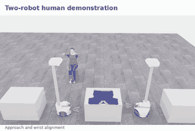
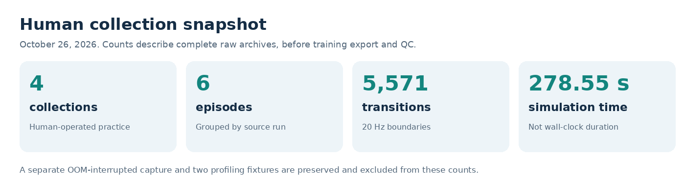
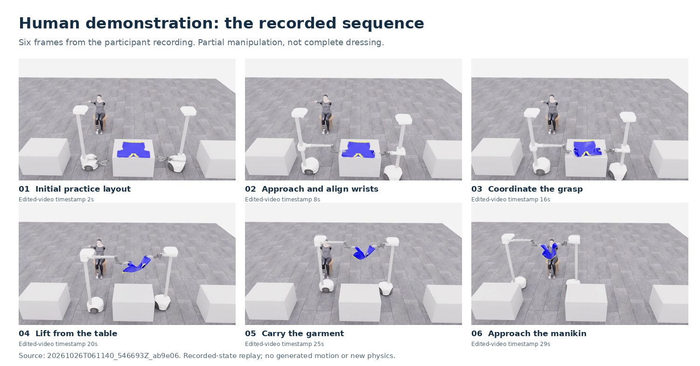
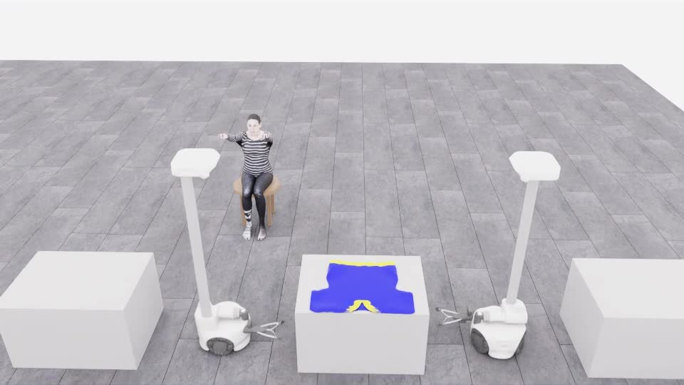
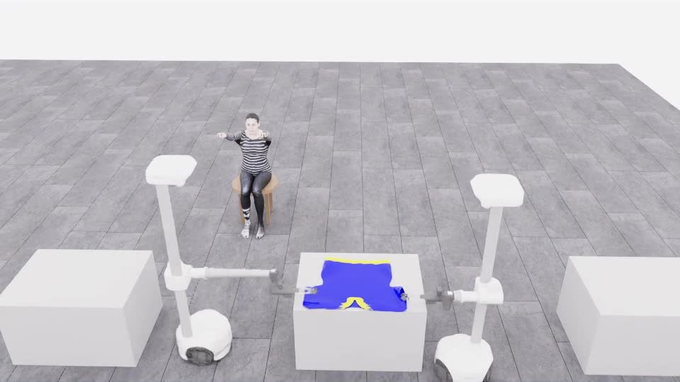
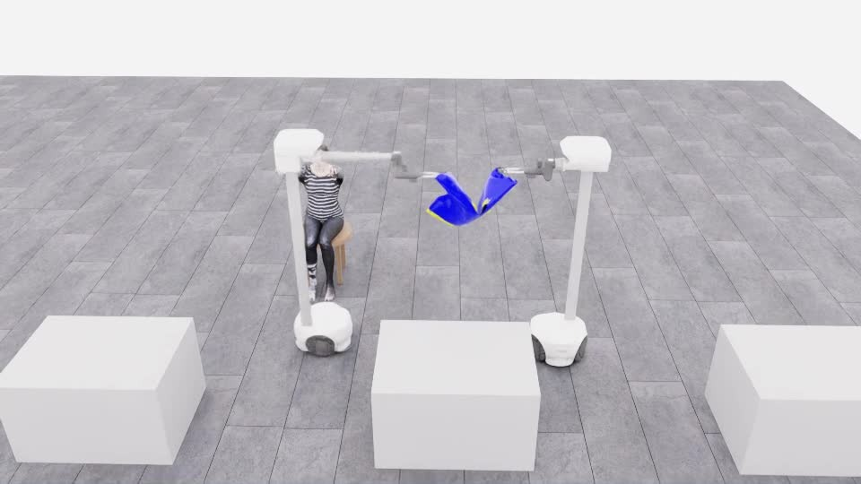

# PhyRC 2027 Phase 1

## Cooperative Robot Dressing

**Human demonstrations, robot-learning data and simulation engineering**

Leonard Yoon, Ph.D.  
[Challenge website](https://emprise.cs.cornell.edu/phyrc/challenge-2027/) · [Official simulator](https://github.com/rirolab/PhyRC_2027_Challenge) · [한국어](README.ko.md)

Two Stretch 4 robots learn to put a T-shirt on a seated manikin in Isaac Sim. This participant project develops the browser teleoperation, recording, policy-adaptation and evaluation workflow around the official environment.

### A human-recorded manipulation sequence

**Approach the garment. Coordinate the grasp. Lift and carry it toward the manikin.**

The preview is an English-captioned excerpt from my October 26 recording. It shows **human teleoperation and partial manipulation**, not an autonomous policy or complete dressing. The practice starts with the robots beside the garment table; this is different from the default randomized evaluation layout.

[Full 33-second edit](docs/videos/20261026-human-pickup-transport.mp4) · [Original recording and edit provenance](docs/project/DEMO_20261026.ko.md) · [Visual source manifest](docs/project/assets/visual-20261027/provenance.json)

**Latest runtime evidence: October 26, 2026.** The raw recordings are preserved and their remote copies passed SHA256 verification. Human RGB-D training export/QC, human-data SFT, full dressing and an official score remain pending. The simulator and viewer were stopped at the owner's request; the next session begins with a short clean-server UI retry.

[Current status](docs/project/STATUS.md) · [Clean-server start](docs/project/START_HERE.ko.md) · [Capture and controls](docs/project/LIVE.ko.md) · [Preservation and recovery](docs/project/END_20261026.ko.md)

## The demonstration, frame by frame

| Original source | Verified scope |
|---|---|
| Run `20261026T061140_546693Z_ab9e06` | Leonard Yoon directly operated both robots using MacBook Chrome |
| 2,225 transitions at 20 Hz | 111.25 simulated seconds, collected over 1,168.119 wall-clock seconds |
| Complete raw archive and recorded-state replay | Grasping on both sides, lifting from the table and transport toward the manikin |
| 33.08-second presentation edit | Variable playback speed with title holds; no new physics or generated intermediate motion |
| Remaining task | Sleeve entry, neck passage and full dressing are not established by this recording |

The stills are extracted from the existing recorded-state video. Their timestamps refer to the **edited video**, not simulation time. Recorded grasp state was used only for retrospective analysis, never as a policy input or action generator.

Open the individual recording frames

| Initial practice layout | Wrist alignment |
|---|---|
|  |  |
| **Coordinating the grasp** | **Lifting the garment** |
|  |  |
| **Carrying toward the manikin** | **End of the demonstrated segment** |
|  |  |

## What I implemented

- **Teleoperation interface:** Chrome streaming, MacBook key mapping, robot-relative directional arrows, on-screen controls, precision input and received/applied input feedback.
- **Input handling:** short-tap preservation across slow simulation updates, key release on blur/watchdog and separate treatment of one-shot commands.
- **Data engineering:** integration with the official recorder, complete/incomplete archive separation, hash checks, export queues and recorded-state video inspection.
- **Runtime diagnostics:** passive timing counters, RAM monitoring and graceful-stop guards; comparisons of resolution and recording conditions.
- **Policy integration:** public-observation preprocessing, action mapping, a small JAX π₀.₅ LoRA integration run and offline execution in the official image.

The official robots, garment simulation, physics, action limits and evaluator come from the upstream project. The participant workflow is separate from those components. The UI still needs user-feedback-driven improvements.

[Implementation and results](docs/project/RESULTS.ko.md) · [Streaming implementation](participant/streaming/) · [Collection code](participant/collection/) · [π₀.₅ adapter](participant/pi05/)

## Observations, actions and learning

| Interface | Meaning |
|---|---|
| Five designated RGB-D cameras | Overview, two wrists and two heads; public sensor contract |
| 20 Hz action boundary | Observation, applied action and next observation must remain aligned |
| `float32 (2, 9)` action | Two robots with base, lift, arm, wrist and gripper commands; normalized to `[-1, 1]` |
| Gripper command | Below −0.5 opens, above 0.5 closes, otherwise retains the previous intent |
| Current policy input | Three RGB views plus a constructed 32D robot state; depth is not consumed |
| Simulation timing | 20 Hz policy, 60 Hz control, 240 Hz physics; wall time is measured separately |

The 32D state is an input representation, not a degree-of-freedom count. Hidden cloth geometry, object poses, grasp attachments and audit camera matrices are excluded from policy inputs and automated action generation.

[Official interface schema](config/policy_interface.json) · [Policy contract](docs/competition/POLICY.md) · [Competition rules](docs/competition/RULES.md)

### Two different data stages

| Stage | Completed evidence | Boundary |
|---|---|---|
| October 22 integration fixture | 3 scripted episodes, 63 transitions, schema/continuity checks and 30 JAX LoRA updates | This validates the learning/execution path. It is not human-data training or a successful dressing policy |
| October 23 format sample | 3 short human-motion clips, 12 transitions; public dataset and restore/re-derivation checks | Format validation only, not approved task-learning data |
| October 26 human practice | 4 complete collections, 6 episodes, 5,571 transitions; pickup/transport video and verified remote preservation | Human RGB-D training export and dataset QC are pending |
| Next learning comparison | Review human data, define episode-level splits and normalization, train, then compare base/adapted policies | Planned, not a measured policy improvement |

The historical policy package ran offline and through partial official checks. The full 900-second check was interrupted, so there is **no full-check pass, Codabench submission or organizer score** in the current record.

## Measured runtime and preserved failures

These measurements help separate slow robot movement from input transport:

- With 1280×720 rendering and recording on, the short warm sample ran at **0.104× real time**.
- The physics-event interval occupied about **59.9% of host wall time**. It includes synchronization and dispatch; it is not an isolated GPU-kernel measurement.
- Each condition has one roughly 10-second warm window. Concurrent CPU video encoding and limited repetition prevent a causal speedup claim.
- No learned policy ran in these teleoperation diagnostics. Policy inference latency is a separate measurement.

[Raw timing JSON](docs/project/sessions/20261026-runtime-components.json) · [Measurement procedure and limitations](docs/project/PERFORMANCE.ko.md)

Preserved OOM failure and the recovery boundary

The first capture ended in a kernel OOM. System RAM rose toward 66 GiB while GPU memory was about 8.3 GiB. The growth cause is unresolved. Its original archive remains `complete=false` and is excluded from the complete-human-recording counts.

A RAM guard and passive resource logging were added. Later long human collection held process RSS around 8.4–8.7 GiB, but this does not establish the OOM root cause or prove a general memory fix.

[OOM measurements](docs/project/sessions/20261026-oom-metrics.json) · [Performance record](docs/project/PERFORMANCE.ko.md)

## Reproducibility and continuation

Code, small reports and presentation media live in this repository. Large raw recordings and evidence are preserved on Hugging Face at an immutable revision:

[October 26 artifact snapshot](https://huggingface.co/datasets/leonayoon/phyrc-2027-phase1-data/tree/a1ff58063799279af1a80226a77330063dc0d4d8/sessions/20261026-final)

The roughly 12 GB snapshot includes four complete human collections, one incomplete human capture, two profiling fixtures, the code bundle, selected diagnostics and the video edit. Full re-download and SHA256 verification passed. This is artifact-recovery evidence, not a replay test on another clean server.

[Preservation verification JSON](docs/project/sessions/20261026-final-preservation.json) · [Exact recovery commands](docs/project/END_20261026.ko.md) · [Earlier model/train-state recovery](docs/project/RECOVERY.ko.md)

### Next experiments

1. Restore the existing Chrome controls on a clean server and collect short, specific usability feedback.
2. Improve approach and transport repeatability, then extend human practice to sleeve entry while preserving failures.
3. Export synchronized RGB-D data, inspect depth validity and action alignment, and review episodes before training.
4. Run human-data SFT and a matched base/adapted comparison with fixed observations, action mapping and evaluation budget.
5. Complete the official self-check before any submission claim.

These are next steps. No new GPU experiment was run for this visual documentation update.

Official examples and original documentation

The animation above is supplied by the official project. It is **not this participant's result**.

[Original upstream README](README.upstream.md) · [Setup guide](docs/competition/SETUP.md) · [Competition rules](docs/competition/RULES.md) · [Earlier project overview](README.history.ko.md) · [Sources and licenses](THIRD_PARTY.md)

