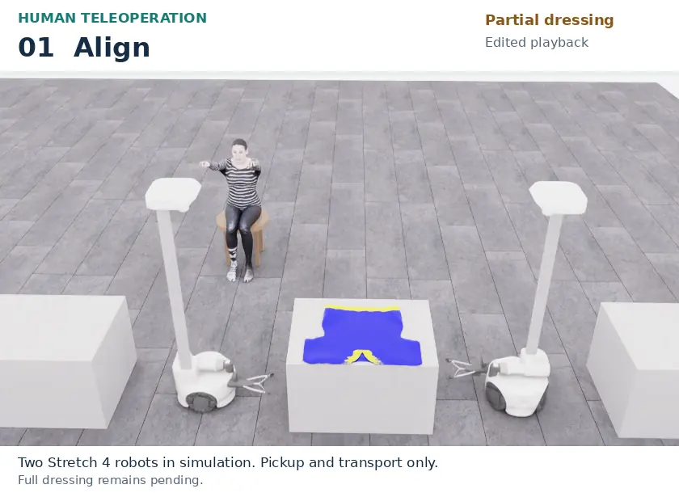
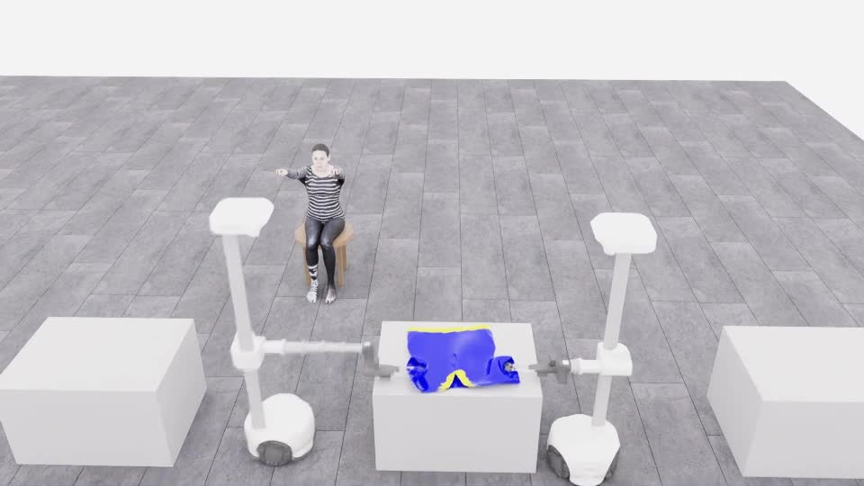
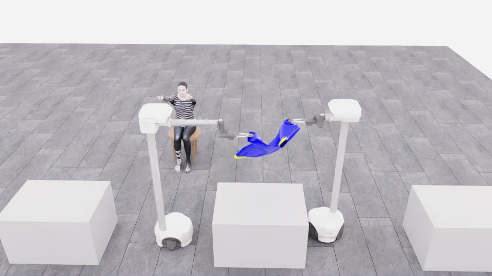
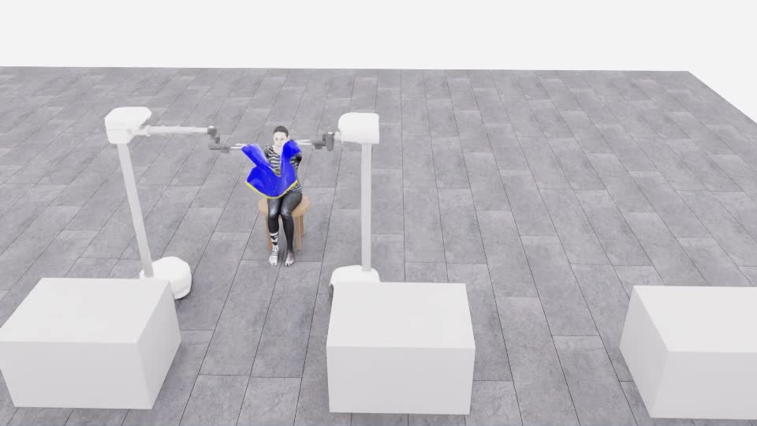
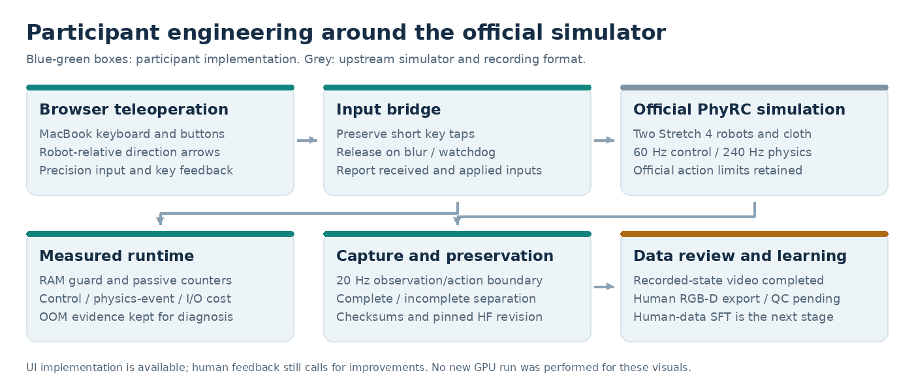
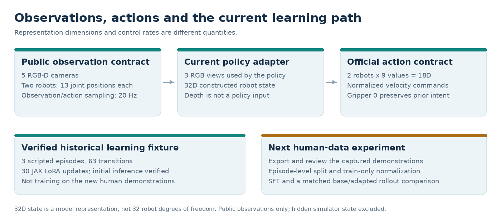
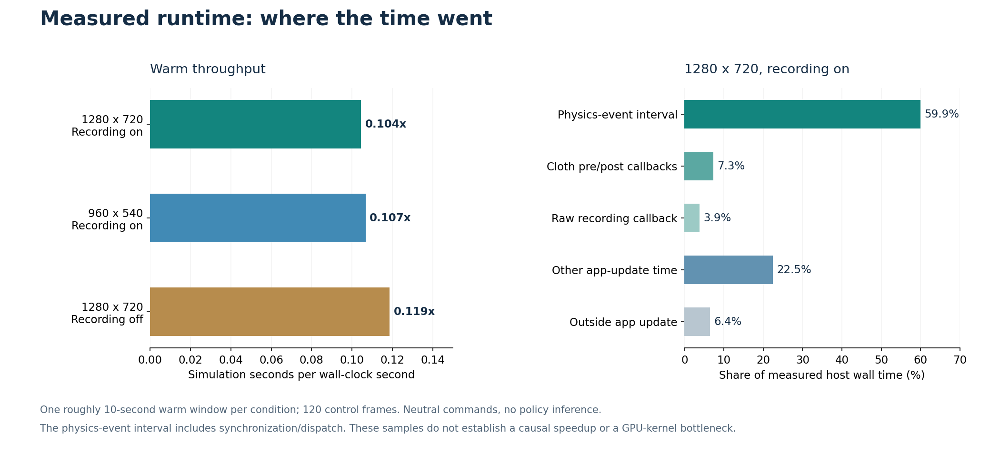

# PhyRC 2027: Cooperative Robot Dressing

**Leonard Yoon, Ph.D.** | [Challenge](https://emprise.cs.cornell.edu/phyrc/challenge-2027/) | [Official simulator](https://github.com/rirolab/PhyRC_2027_Challenge) | [한국어](README.ko.md)

Human demonstration collection and robot-learning infrastructure for two Stretch 4 robots in Isaac Sim.

**Align the grippers. Grasp and lift. Carry toward the manikin.**

Human-operated practice in a fixed layout. Pickup and transport are demonstrated; autonomous dressing and full task completion remain unverified.

[**Watch the full 33-second video**](docs/videos/20261026-human-pickup-transport.mp4) | [Recording details](docs/project/DEMO_20261026.ko.md)

| Complete collections | Episodes | Recorded transitions |
|:---:|:---:|:---:|
| **4** | **6** | **5,571** |

Raw archives preserved and verified. Human-data training export, quality checks and SFT are next.

## The demonstration, frame by frame

Open three large keyframes

**1. Coordinate the grasp**

**2. Lift from the table**

**3. Carry toward the manikin**

Recorded-state replay from run `20261026T061140_546693Z_ab9e06`. Playback is edited; no generated motion or new simulation.

[Six-frame storyboard](docs/project/assets/visual-20261027/human-storyboard.jpg) | [Media provenance](docs/project/assets/demo-focus-20261027/provenance.json)

## What I implemented

- **Teleoperation:** browser controls, short-tap handling and received/applied input feedback.
- **Data:** recorder integration, archive validation and recorded-state replay.
- **Systems:** runtime profiling, memory monitoring and a public-observation policy adapter.

Robots, cloth physics and evaluation are provided by the official simulator.

[Code and results](docs/project/RESULTS.ko.md) | [Controls](participant/streaming/) | [Collection](participant/collection/) | [Policy adapter](participant/pi05/)

## Observations, actions and learning

| Current adapter input | Robot commands |
|---|---|
| **3 RGB views + 32D state** | **18D actions across two robots** |

The environment exposes five RGB-D cameras; the current policy does not use depth.

Data contract and training status

| Data stage | Verified scope |
|---|---|
| Scripted integration fixture | 3 episodes, 63 transitions, 30 JAX LoRA updates; execution-path validation only |
| Human practice | 4 collections, 6 episodes, 5,571 transitions; training export/QC and SFT pending |

32D describes the state representation, not robot degrees of freedom. Hidden simulator state is excluded from policy inputs. No completed full self-check, Codabench submission or organizer score is claimed.

[Policy contract](docs/competition/POLICY.md) | [Rules](docs/competition/RULES.md) | [Interface schema](config/policy_interface.json)

## Measured runtime and preserved failures

**0.104× real time** with recording on in one short warm sample. These diagnostics contain no policy inference and do not establish a speedup.

[Timing data](docs/project/sessions/20261026-runtime-components.json) | [Profiling and OOM analysis](docs/project/PERFORMANCE.ko.md)

## Reproducibility and continuation

Recordings and checksums are preserved in an [immutable data snapshot](https://huggingface.co/datasets/leonayoon/phyrc-2027-phase1-data/tree/a1ff58063799279af1a80226a77330063dc0d4d8/sessions/20261026-final). Re-download verification passed; clean-server replay remains to be tested.

### Next experiments

1. Improve human approach, transport and sleeve-entry demonstrations.
2. Export and review synchronized RGB-D, state and action data.
3. Train on reviewed demonstrations, compare policies and complete the official self-check.

[**Current status**](docs/project/STATUS.md) | [**Start here**](docs/project/START_HERE.ko.md) | [Recovery](docs/project/END_20261026.ko.md) | [Evidence map](docs/project/EVIDENCE_MAP.md)

Official examples and project history

[Official successful dressing demo](docs/videos/Back_Front_32x.gif) | [Official camera example](docs/examples/teleop/preview_rgb.png)

These are upstream examples, not participant results.

[Upstream README](README.upstream.md) | [Setup](docs/competition/SETUP.md) | [Earlier overview](README.history.ko.md) | [Sources and licenses](THIRD_PARTY.md)

