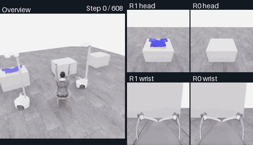

# PhyRC 2027 · 두 로봇의 티셔츠 착의

## 시연 1 · 사용자 피드백으로 밑단 파지

**0–1,655전이 전체 · 5/50점.** 두 로봇이 사용자 피드백을 받아 옷을 집고 손 앞까지 옮겼습니다. 630전이에 픽업을 인정받았고, 첫 소매 통과는 0점이었습니다. [시연 1 분석](docs/active/guided-retrospective.json)

## 시연 2 · GPT 단독으로 한 팔 먼저 입히기

**0–2,195전이 전체 · 20/50점.** 왼팔의 첫 소매와 반대쪽 어깨, 왼쪽 위팔까지 득점했습니다. 옷이 정수리까지 올라간 뒤 반대팔을 시도했고, 목과 두 번째 소매는 각각 0점이었습니다. [시연 2 점수와 장면별 분석](docs/active/20261123-demonstrations.ko.md)

## 시연 3 · GPT 단독으로 양팔 먼저 걸치기

<!-- demonstration-3-status -->
**진행 중 · 0–157전이 수록.** 양팔에 옷을 먼저 걸치고 목둘레를 넘긴 뒤, 양손을 각각의 소매로 빼고 몸통까지 내리는 순서를 시험합니다. [최신 구간 갤러리](https://jupyter-fjy7731zk.gobrev.dev/view/PhyRC-review.html)
<!-- /demonstration-3-status -->

GIF는 전체 화면과 양쪽 로봇의 머리·손목 카메라를 함께 보여 준다. 물리 시간 기준 약 6배속이며, 마지막 장면에서 잠시 멈춘 뒤 처음부터 반복한다.

세 회차 모두 같은 연습 배치에서 출발한다. 점수는 각 실행의 로컬 공식 평가기 원점수이며, 덮인 부위는 영상만으로 통과 판정을 내리기 어렵다. [공식 영상 비교·3회차 조작 지침](docs/active/autonomous.md) · [검토 화면과 실행 방법](docs/active/collection.md) · [새 서버에서 시작](docs/active/start.md)

## 세 번째 시연에서 확인할 장면

| 순서 | 조작 | 영상에서 확인할 것 |
|---|---|---|
| 픽업과 운반 | 테이블에서 양끝 파지를 따로 시험하고 양손을 향해 밑단을 연다. | 각 집게를 들면 해당 테두리가 따라오고, 두 겹 사이로 손이 들어갈 공간이 보인다. |
| 양팔에 먼저 걸치기 | 몸판 입구를 두 손 앞으로 가져간다. 마네킹의 각 손·팔뚝에 같은 쪽 천을 하나씩 걸친다. | 첫 팔을 지지한 상태에서 반대팔도 걸렸는지 위치를 바꾼 뒤 두 시점으로 확인한다. |
| 목둘레 넘기기 | 양팔의 지지를 유지하면서 목둘레를 정수리 너머로 넘긴다. | 얼굴이 목둘레 밖으로 드러나고 목둘레가 목 주변에 내려온다. |
| 양쪽 소매와 몸통 정리 | 양쪽 팔을 다시 따라가 각 손을 해당 소매로 빼고, 소매를 위팔에 자리잡게 한다. | 각 손목과 손끝이 서로 다른 소매 밖으로 나오고, 얼굴이 드러난 채 앞면과 밑단이 몸통에 놓인다. |

## 구간 검토와 데이터 수집

1. **재생** — 방금 끝난 구간의 5카메라 영상과 실제 사용한 지시를 봅니다. 왼쪽은 robot_1, 오른쪽은 robot_0입니다.
2. **판단** — Astra가 구간에서 표본으로 읽은 프레임을 근거로 의도와 실제 변화, 가려진 부분, 다음에 바꿀 한 가지를 제시합니다. 화면에서 구간의 성공·부분 진행·실패·불확실과 감독 평가 점수를 따로 읽습니다.
3. **피드백** — GPT 단독 모드는 구간 영상을 게시하고 다음 동작을 스스로 결정합니다. 문제가 보이면 개입해 진행을 멈추고 교정할 수 있습니다. 사용자 피드백 모드에서는 구간마다 다음 동작을 승인합니다.
4. **기록** — 실행·구간 ID와 전이 범위로 영상, 지시, 분석, 다음 제안, 실제 채택된 피드백을 원본 행동 데이터에 연결합니다. 지난 구간은 필요할 때만 열고 회차별 JSONL을 내려받습니다. [실행 명령과 데이터 형식](docs/active/collection.md)

## 새 서버의 Codex에 전달할 첫 지시

> README.md와 AGENTS.md를 읽고 현재 연속 실행을 확인하고, 새 회차를 요청받으면 양팔 먼저 걸치기 지침으로 GPT 단독 시연을 시작해 주세요. 세 번째 테이블, 마찰 0.35와 0전이를 확인하고 구간별 영상을 갤러리에 남겨 주세요. GPT가 실패를 교정하고, 사용자가 개입할 때 진행을 멈추세요.

---

