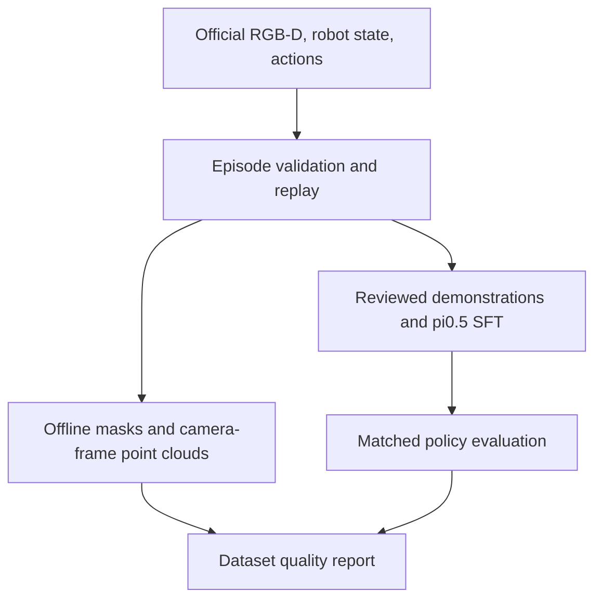

# PhyRC 2027 Phase 1

[](README.upstream.md)

**Cooperative robot dressing with RGB-D observation processing and VLA adaptation.**

Leonard Yoon, Ph.D. | Independent research project  
[한국어](README.ko.md) / [Current status](docs/project/STATUS.md) / [Clean-server start](docs/project/START_HERE.ko.md) / [Two-week plan](docs/project/RGBD_TWO_WEEK_PLAN.ko.md)

This participant fork develops a reproducible workflow for two Stretch 4 robots in the official PhyRC Isaac Sim environment: collect demonstrations, validate observations and actions, adapt π₀.₅, evaluate policy execution, and preserve the submission artifacts.

> **Documentation update: October 22, 2026.** The next clean-server session is planned for **October 23**. Today's update changes documentation only. The measured baseline below is unchanged. Human demonstrations, full 900-second validation, Codabench submission, and recovery on a separate clean server remain unverified.

## Start here on a clean server

Read `AGENTS.md`, [STATUS](docs/project/STATUS.md), [START_HERE](docs/project/START_HERE.ko.md), and the [two-week execution plan](docs/project/RGBD_TWO_WEEK_PLAN.ko.md). The start guide contains a paste-ready Codex handoff, existing commands, and the first session's completion criteria.

```bash
git clone https://github.com/leonyoon-3dai/PhyRC_2027_phase1.git
cd PhyRC_2027_phase1
git status --short
git rev-parse HEAD
# Read the documents above before installing or starting GPU work.
participant/ops/bootstrap.sh --check
```

First session: inspect the new server, restore pinned artifacts, pass the official smoke test, rerun the existing policy briefly, and obtain **one valid human-recorded episode** through Chrome. Run collection, training, and GPU evaluation sequentially. Historical recovery commits describe previous runs; read the latest handoff before checking out an old snapshot.

## Verified baseline

Measured on October 22 on one L40S, 12 vCPU, and approximately 70 GiB RAM. Source: [session report](docs/project/sessions/20261022-bootstrap.md).

| Item | Verified scope |
|---|---|
| Official environment | Build, prepare, and actual `PHYRC-SMOKE-PASS` |
| Synchronized recording | 3 scripted episodes, 63 transitions, 5 RGB-D cameras; schema and continuity checks |
| π₀.₅ training | JAX LoRA configuration, 30 updates / 0.476 effective epochs; overfitting not established |
| Offline execution | Official-image load and debug policy execution; **0 points / no_contact** |
| Preservation | HF data, full model/training state, ZIP and evidence; download checksums and CPU state restore at step 30 |
| Submission path | ZIP unpack/build and 259 actions in a fresh clone; **full 900-second check incomplete, not submitted** |

The recorded data is a **Codex-authored bounded script**, labeled `integration_test`. It is neither human demonstration nor live GPT operation. No dressing success or policy improvement is claimed. The upstream freeze filter also leaves some vision/projection parameters trainable; the run is not described as training only small LoRA matrices.


[Three-camera test video](https://huggingface.co/datasets/leonayoon/phyrc-2027-phase1-data/resolve/da172805036d5e53daf1834f32baf367820f9183/derived/20261022T0409Z-integration/integration-public-cameras.mp4) / [Data](https://huggingface.co/datasets/leonayoon/phyrc-2027-phase1-data) / [Model and training state](https://huggingface.co/leonayoon/phyrc-2027-phase1-pi05) / [Exact recovery revisions](docs/project/RECOVERY.ko.md)

## Next two weeks: October 23 - November 5

The dates and counts are **targets, not results**. The initial task segment is approach, grasp, and briefly lift the garment, while retaining the two-robot interface. Full dressing and positive official points/s are later performance goals.

| Workstream | Planned implementation | Evidence to retain |
|---|---|---|
| Demonstration quality | Human teleoperation, replay, timestamp/action validation, episode-level split | Valid exports, dataset manifest, QC report, exclusion reasons |
| RGB-D analysis | Prompted offline garment masks, valid depth, camera-frame surface point clouds | Reviewed frames, mask/depth metrics, normal/occluded examples |
| VLA adaptation | One π₀.₅ LoRA SFT configuration and checkpoint reload | Trainable parameters, exposure, checkpoint, policy outputs |
| Matched evaluation | Base and adapted policy under fixed conditions | 3 seeds initially, up to 5 if feasible; videos, scores, runtime |
| Reproducibility | Full self-check, artifact restoration, submission when available | Code/config/revisions, checksums, result JSON and submission status |



RGB-D analysis is initially an **offline diagnostic path**. The current policy uses three RGB views and robot state; adding depth diagnostics alone does not establish a policy-performance gain.

| Days | Focus | Gate |
|---|---|---|
| D1-2, Oct 23-24 | Restore, smoke, short replay, Chrome control | One valid human episode or a documented blocker |
| D3-4, Oct 25-26 | Synchronized replay and RGB-D checks | QC report and viewer |
| D5-6, Oct 27-28 | Garment masks and local point clouds | Reviewed visibility/occlusion examples |
| D7-8, Oct 29-30 | Collect, review, split | Frozen dataset manifest and train-only normalization |
| D9-10, Oct 31-Nov 1 | Small overfit test and LoRA SFT | Reloaded checkpoint with valid actions |
| D11-12, Nov 2-3 | Paired evaluation and profiling | Original results, videos, latency and memory |
| D13-14, Nov 4-5 | Full self-check, recovery, evidence | Validated package, report, short demonstration video |

Plan for roughly 60-70 focused hours plus GPU and export waits. The data target is 8-12 useful short human demonstrations and 3-5 failure examples. If teleoperation is blocked, prioritize recording and validation rather than expanding training on the 63-transition integration fixture. Details, fallback decisions, and metrics: [two-week plan](docs/project/RGBD_TWO_WEEK_PLAN.ko.md).

## Observation and policy contract

| Interface | Current implementation |
|---|---|
| Available cameras | Overview, robot_0/robot_1 wrist, robot_0/robot_1 head; native 256×256 RGB-D |
| Depth | Optical-axis Z in metres; invalid=0 with `depth_valid=false` |
| Current policy images | Overview + each robot's wrist RGB; depth and head images unused |
| Policy state | 32D: 26 joint positions + 2 fingertip distances + 2 gripper intents + 2 previous grip commands |
| Action | 18 normalized values, padded to 32 for the model and restored to `float32 (2,9)` |
| Timing | 20 Hz policy, 60 Hz control, 240 Hz physics; one action spans 0.05 simulated seconds |

The 32D representation is not a robot DoF count. Gripper zero preserves intent. Camera-local geometry is the first RGB-D target; robot/world transforms require validated FK and static calibration from permitted data. Audit camera matrices, cloth ground truth, object poses, seeds, and raw simulator state are not policy inputs.

Sources: [DATA](docs/competition/DATA.md), [RULES](docs/competition/RULES.md), [interface configuration](config/policy_interface.json), [shared preprocessing](participant/pi05/preprocessing.py).

## Execution and evaluation limits

- Preserve the official physics, action limits, reset rules, and evaluator. Keep SAM 2 analysis, JAX training, and the official simulator environments separate.
- Preserve the base policy and compare on matched seeds, controller, action rate, adapter, normalization, and horizon. Loss, segment completion, raw points, points/s, and full-dressing success are separate metrics.
- Pickup alone can yield zero dressing points/s. Retain failed rollouts and report the small evaluation sample size.
- The full official check has a 900-second simulation-plus-inference budget. At the earlier observed speed, approximately three hours of wall time was estimated; reserve a separate slot and remeasure.
- L40S execution does not verify the judging RTX 3090 24GB or the policy's 12GB budget. The package must load offline with weights, tokenizer, normalization, and code.
- Restricted Codex/GPT collection remains an optional research path. No extra billed API usage is planned, and no organizer approval of that interpretation is claimed.
- Preserve pinned artifacts before ending a disposable session. Do not provision additional compute or stop/delete a server without the owner's request.

After the two-week baseline, the broader target remains repeatable dressing progress before the November 17 checkpoint, with an internal submission target of November 16. These remain planned milestones.

## Read and continue

| Document | Purpose |
|---|---|
| [START_HERE](docs/project/START_HERE.ko.md) | Current clean-server entry point and Codex prompt |
| [Two-week plan](docs/project/RGBD_TWO_WEEK_PLAN.ko.md) | Implementation scope, daily gates, evaluation and evidence |
| [STATUS](docs/project/STATUS.md) | Measured state and unresolved items |
| [RECOVERY](docs/project/RECOVERY.ko.md) / [TODO](docs/project/TODO.ko.md) | Pinned HF revisions, actual commands, remaining work |
| [TELEOP](docs/project/TELEOP.ko.md) | Human and restricted AI collection design |
| [Experiment register](experiments/README.md) | Session/experiment templates and run index |
| [Initial plan archive](docs/project/PLAN.ko.md) | Original pre-implementation design, retained for history |
| [Sources](docs/project/SOURCES.md) | Reviewed official references and revisions |

## Task and attribution

<details>
<summary>Organizers' cooperative dressing demonstration</summary>


Official upstream demonstration at 32× speed, showing two Stretch 4 robots dressing a seated manikin. This is not a learned-policy result from this fork.

</details>

This is Leonard Yoon's participant project, not an organizer repository. [README.upstream.md](README.upstream.md) preserves the reviewed guide at upstream `4dbbebcf93a06c1bfe12136eadc2e580f30125d6`. Official simulation, assets, evaluation, and demonstrations retain their attribution. See [LICENSE](LICENSE), [NOTICE](NOTICE), and [THIRD_PARTY.md](THIRD_PARTY.md).

Official challenge: https://emprise.cs.cornell.edu/phyrc/challenge-2027/  
Official code: https://github.com/rirolab/PhyRC_2027_Challenge  
Codabench: https://www.codabench.org/competitions/18366/  
Previous BEHAVIOR project: https://github.com/leonyoon-3dai/behavior-submission-2026

<details>
<summary>Original guide compatibility anchors</summary>

<a id="1-install-and-run"></a>
[Install and run](README.upstream.md#1-install-and-run)

<a id="2-teleop-controls"></a>
[Teleop controls](README.upstream.md#2-teleop-controls)

<a id="3-collect-training-data"></a>
[Collect training data](README.upstream.md#3-collect-training-data)

<a id="4-observations"></a>
[Observations](README.upstream.md#4-observations)

<a id="5-actions"></a>
[Actions](README.upstream.md#5-actions)

<a id="6-train-and-run-a-policy"></a>
[Train and run a policy](README.upstream.md#6-train-and-run-a-policy)

<a id="7-scoring-and-pointss"></a>
[Scoring and points/s](README.upstream.md#7-scoring-and-pointss)

<a id="8-allowed-information-and-fair-play"></a>
[Allowed information and fair play](README.upstream.md#8-allowed-information-and-fair-play)

</details>
