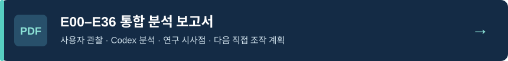
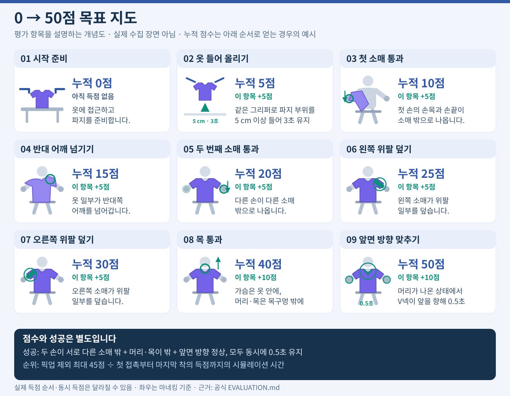
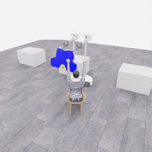

# PhyRC 2027

> **2026-11-16 연구 방향 재정비 · 기존 계획 HOLD**
>
> 지금은 분석하면서 근거와 미결 사항을 계속 기록하는 단계입니다. **checkpoint로 유용한 중간 상태를 복원하는 방법**과 **명령 실행 후 실제 변화를 확인하고 다음 행동을 바꾸는 방법**을 우선 검토합니다. 기존 시연 재개·구현·학습 계획은 보류하며, 분석 정리가 끝난 뒤 사용자가 클린 서버에서 반영합니다. 현재 최신 실제 시연은 종료된 E36입니다.
>
> **[최신 착의 연구·데모·평가 코드 조사](docs/collection/research/2026-11-16-recent-dressing-resources.ko.md)** · **[현재 연구 방향과 누적 분석 기록](docs/collection/research/2026-11-16-checkpoint-effect-feedback.ko.md)** · [보류 상태와 현재 계획](docs/COLLECTION_PLAN.md) · [나중에 적용할 클린 서버 안내](docs/OPERATIONS.md)

[18장 슬라이드 PDF](docs/reports/20261114-e36-integrated-review/phyrc-e36-integrated-review.ko.pdf) · [텍스트·출처·검증](docs/reports/20261114-e36-integrated-review/README.ko.md)

**[E36 이후: 종료·득점 분석과 여러 방법을 지원하는 후속 시스템 설계](docs/collection/research/2026-11-15-e36-continuation-options.ko.md)** · [HolidayFactory 논문 적용 검토](docs/collection/research/2026-11-15-holidayfactory-phyrc.ko.md)

**2026-11-15 선행 검토:** 사람 직접 조작, Astra, 사용자 개입, 복구 감독, 후속 학습은 가능한 선택지로 보존합니다. 이들의 기존 실행 계획은 현재 HOLD이며, 최신 우선 검토 대상은 위의 checkpoint와 실행 효과 피드백입니다. 한 방법을 영구적인 정답으로 고정하지 않습니다. [현재 계획](docs/COLLECTION_PLAN.md)

**[전체 경험과 연구에 기반한 수집 시스템 재정비 계획](docs/collection/research/2026-11-14-collection-system-redesign.ko.md)** · [이전 E28–E32 영상·실패 분석](docs/collection/reviews/20261114-session-review.ko.md)

## 공식 착의 데모

https://github.com/user-attachments/assets/d2f347fe-712b-42f3-bdee-69d3fee2a47c

**주최 측이 제공한 착의 시연 · 35.8초 · 공식 사이트 표기 8배속**

[공식 원본 영상](https://emprise.cs.cornell.edu/phyrc/assets/c27/media/teleop-overhead.mp4) · [챌린지 안내](https://emprise.cs.cornell.edu/phyrc/challenge-2027/) · [영상 출처](docs/collection/assets/20261106-official-demo-inline/provenance.json)

## 0–50점 득점 과정

**픽업 5점 + 착의 45점 = 최대 50점**. 그림을 누르면 원본 크기로 볼 수 있습니다.

[항목별 점수와 성공 조건](docs/project/CHALLENGE_GUIDE.ko.md#2-50점은-어떻게-쌓이는가) · [공식 평가 정의](docs/competition/EVALUATION.md)

그림은 득점 과정을 설명하는 누적 예시이며, 실제 득점 순서는 달라질 수 있습니다. 누적 50점과 착의 성공 판정은 별도입니다. 이 저장소의 현재 성과는 아래에 구분해 표시합니다.

두 대의 **Stretch 4**로 마네킹에 티셔츠를 입히는 시뮬레이션 연구. 사람의 직접 조작과 **GPT Astra**로 시연을 수집하고, 관측과 행동을 검토해 다음 조작을 개선합니다.

| [**시연 영상**](docs/EPISODES.md) | [**후속 분석·설계**](docs/COLLECTION_PLAN.md) | [**Astra 코드·Hz**](docs/ASTRA.md) | [**클린 서버 시작**](docs/OPERATIONS.md) |
|:---:|:---:|:---:|:---:|
| E00–E36 기록과 상태 | 기존 계획 HOLD·두 연구 축 | 관측부터 HDF5까지 | 분석 후 적용할 재현 절차 |

**E36이11결정·933전이로 정상 마감해 QC933/933을 통과했고, 당시 수집 배치를 종료했습니다. E37–E39는 실행하지 않았습니다.** 로컬5/50은 replay 구간의 픽업5점이며 새 착의 득점0·success=false입니다. [현재 상태와 고정 백업 검증](docs/project/STATUS.md) / [최신 후속 계획](docs/COLLECTION_PLAN.md). 새 시스템이나 자동 학습을 구현했다는 의미는 아닙니다.

## 최근 시연 · E36

**E34의 손목 근처 형상을 출발점으로, 같은 손목·연결 전완 방향에 맞춰 몸쪽으로 접근하는 조작을 시험했습니다.** 10 act 뒤 모델이 종료를 요청해 총11결정·12모델 호출로 마감했으며 새 구간은98전이·4.9시뮬레이션초입니다. 픽업5점은 새 조작 전 replay에서 얻었고, 새 착의 득점은 없습니다.

[E36 GIF 페이지](docs/gallery/20261114-e36-overview/README.ko.md) / [전체 MP4](docs/collection/attempts/20261114-astra-wrist-body835-001/overview.mp4) / [E36 실행 기록](docs/collection/attempts/20261114-astra-wrist-body835-001/README.ko.md) / [이전 E35 GIF](docs/gallery/20261114-e35-overview/README.ko.md) / [E34 GIF](docs/gallery/20261114-e34-overview/README.ko.md)

실제 원본 영상 GIF · 전체0–46.65초 · 원본256×256 · 20fps에서2프레임마다1장을 샘플링한467프레임. 기본10fps이며 마지막 프레임만50ms로 유지해 원본 재생 길이를 보존합니다. 원본 MP4는933프레임이며 모델 대기는 제외합니다. 앞835전이는 E34 행동 prefix의 새 환경 재실행으로, 정확한 천 checkpoint나 독립 성공 시연이 아닙니다. <a href="docs/gallery/20261114-e36-overview/provenance.json">GIF 변환·검증</a> · <a href="docs/collection/attempts/20261114-astra-wrist-body835-001/manifest.json">영상·원본 근거</a>.

## 수집 시스템 재정비

**기존 계획은 HOLD하고 checkpoint 복원과 실행 효과 피드백을 우선 분석합니다.** 상태 복원 전후와 다음 행동의 재현성을 어떻게 확인할지, 의도와 실제 운동·천의 변화가 다를 때 다음 행동을 어떻게 바꿀지 기록합니다. [현재 누적 분석](docs/collection/research/2026-11-16-checkpoint-effect-feedback.ko.md)은 계속 갱신할 연구 기록이며 실제 적용은 분석 정리 후 클린 서버에서 진행합니다. E36 종료·득점 분석, 직접 조작, HolidayFactory 등 선행 검토도 보존합니다. 기존 수집 [배치](docs/project/sessions/20261114-wide-hem-five-attempt-batch.ko.md)는 E36에서 종료했고 이번 갱신은 문서화입니다.

[E36 후속 분석·선택지](docs/collection/research/2026-11-15-e36-continuation-options.ko.md) · [현재 계획](docs/COLLECTION_PLAN.md) · [선행 재정비 설계](docs/collection/research/2026-11-14-collection-system-redesign.ko.md)

## 수집한 과정

<table>
<tr>
<td width="33%" valign="top"><strong>사람 직접 조작</strong>  집기·들기·운반의 부분 시연</td>
<td width="33%" valign="top"><strong>E07 협력 운반</strong>  Astra 공동 조작과 후속 분기의 원본</td>
<td width="33%" valign="top"><strong>E25 새 파지</strong>  파지 위치를 바꾸고 천의 동행 확인</td>
</tr>
</table>

각 이미지를 누르면 영상이 열립니다. **[전체 시연 목록](docs/EPISODES.md)**에서 E00–E36 기록의 영상, 관측 이미지, 원본 manifest와 직접 부모를 한 번에 찾을 수 있습니다.

## 코드와 재현

| 확인할 것 | 바로 가기 |
|---|---|
| 공개 RGB-D → Astra JSON → 두 로봇 명령 → 데이터 | [실제 함수와 행동 예제](docs/ASTRA.md) |
| 20 Hz 기록 / 60 Hz 제어 / 240 Hz 물리 | [주기와 실행 길이](docs/ASTRA.md#4-시간과-실행-길이) |
| 새 서버에서 저장소만 읽고 시작 | [준비물부터 복원·검증까지](docs/OPERATIONS.md), [Codex 작업 지침](AGENTS.md) |

GitHub에는 코드와 선별 영상이 있습니다. 전체 시연 HDF5와 필수 자산 복원에는 **접근 권한이 있는 비공개 백업**이 필요합니다. 새 서버 가이드에 고정 revision과 해시 검증 절차를 함께 남깁니다.

[공식 챌린지](https://emprise.cs.cornell.edu/phyrc/challenge-2027/) / [점수·규칙](docs/project/CHALLENGE_GUIDE.ko.md) / [현재 상태](docs/project/STATUS.md) / [기록 보관함](docs/ARCHIVE.md) / [주최 측 README](README.upstream.md) / [LICENSE](LICENSE) / [NOTICE](NOTICE) / [THIRD_PARTY](THIRD_PARTY.md)

