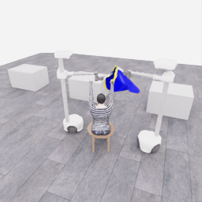

# PhyRC 2027

**[전체 경험과 연구에 기반한 수집 시스템 재정비 계획](docs/collection/research/2026-11-14-collection-system-redesign.ko.md)** · [이전 E28–E32 영상·실패 분석](docs/collection/reviews/20261114-session-review.ko.md)

## 공식 착의 데모

https://github.com/user-attachments/assets/d2f347fe-712b-42f3-bdee-69d3fee2a47c

**주최 측이 제공한 착의 시연 · 35.8초 · 공식 사이트 표기 8배속**

[공식 원본 영상](https://emprise.cs.cornell.edu/phyrc/assets/c27/media/teleop-overhead.mp4) · [챌린지 안내](https://emprise.cs.cornell.edu/phyrc/challenge-2027/) · [영상 출처](docs/collection/assets/20261106-official-demo-inline/provenance.json)

## 0–50점 득점 과정

**픽업 5점 + 착의 45점 = 최대 50점**. 그림을 누르면 원본 크기로 볼 수 있습니다.

[항목별 점수와 성공 조건](docs/project/CHALLENGE_GUIDE.ko.md#2-50점은-어떻게-쌓이는가) · [공식 평가 정의](docs/competition/EVALUATION.md)

그림은 득점 과정을 설명하는 누적 예시이며, 실제 득점 순서는 달라질 수 있습니다. 누적 50점과 착의 성공 판정은 별도입니다. 이 저장소의 현재 성과는 아래에 구분해 표시합니다.

두 대의 **Stretch 4**로 마네킹에 티셔츠를 입히는 시뮬레이션 연구. 사람의 직접 조작과 **GPT Astra**로 시연을 수집하고, 관측과 행동을 검토해 다음 조작을 개선합니다.

| [**시연 영상**](docs/EPISODES.md) | [**마감·재정비 계획**](docs/COLLECTION_PLAN.md) | [**Astra 코드·Hz**](docs/ASTRA.md) | [**클린 서버 시작**](docs/OPERATIONS.md) |
|:---:|:---:|:---:|:---:|
| E00–E34 기록과 상태 | E34 이후 중지·연구 제안 | 관측부터 HDF5까지 | 설치·복원·검증·Codex CLI |

**E34는20결정·836전이로 정상 마감해 QC836/836을 통과했습니다. 이후 수집은 중지하며 E35는 취소했습니다.** 로컬5/50은 픽업5점이며 착의 득점0·success=false입니다. [현재 상태와 고정 백업 검증](docs/project/STATUS.md) / [재정비 계획](docs/collection/research/2026-11-14-collection-system-redesign.ko.md). 재정비안은 제안 단계이며 새 시스템이나 자동 학습을 구현하지 않았습니다.

## 최근 시연 · E34

**E33에서 바꾼 파지를 유지해 들기·운반·같은 손 근처의 짧은 하강까지 시험했습니다.** E33의 준비 단계보다 진행했지만 손목에 걸침·소매 통과는 확인하지 못했습니다.20 act·24모델 호출 뒤 결정 예산으로 마감했으며 새 구간은366전이·18.3시뮬레이션초입니다.

[전체 MP4](docs/collection/attempts/20261114-astra-middle-grip470-retain-001/overview.mp4) / [E34 리뷰](docs/collection/reviews/20261114-astra-middle-grip470-retain-001.ko.md) / [E33 준비 리뷰](docs/collection/reviews/20261114-astra-middle-grip264-001.ko.md) / [이전 E31 접근 비교](docs/gallery/20261113-e31-diagonal-682-830/event.mp4)

지정 overview 카메라의836프레임 전체를20fps·41.8초로 재생하며 모델 대기는 제외합니다. 앞470전이는 E33 행동 prefix를 새 환경에서 재실행한 구간입니다. 정확한 천 checkpoint나 독립 성공 시연이 아닙니다. <a href="docs/collection/attempts/20261114-astra-middle-grip470-retain-001/manifest.json">영상·원본 근거</a>.

## 수집 시스템 재정비

**다음 시연을 자동으로 늘리기보다, 실제 실행 이력·불확실한 관측 가설·효과를 확인할 예산·구간별 학습 승인을 분리하는 계획을 제안합니다.** E33/E34에서 검토한 가운데 파지와 손 위 하강 목표, E00 이후의 반복·복구·종료 실패를 함께 분석했습니다. 구현과 후속 수집은 아직 시작하지 않습니다.

[전체 근거·설계·검증 순서](docs/collection/research/2026-11-14-collection-system-redesign.ko.md) · [마감 범위와 과거 조작 계획](docs/COLLECTION_PLAN.md)

## 수집한 과정

<table>
<tr>
<td width="33%" valign="top"><strong>사람 직접 조작</strong>  집기·들기·운반의 부분 시연</td>
<td width="33%" valign="top"><strong>E07 협력 운반</strong>  Astra 공동 조작과 후속 분기의 원본</td>
<td width="33%" valign="top"><strong>E25 새 파지</strong>  파지 위치를 바꾸고 천의 동행 확인</td>
</tr>
</table>

각 이미지를 누르면 영상이 열립니다. **[전체 시연 목록](docs/EPISODES.md)**에서 E00–E34 기록의 영상, 관측 이미지, 원본 manifest와 직접 부모를 한 번에 찾을 수 있습니다.

## 코드와 재현

| 확인할 것 | 바로 가기 |
|---|---|
| 공개 RGB-D → Astra JSON → 두 로봇 명령 → 데이터 | [실제 함수와 행동 예제](docs/ASTRA.md) |
| 20 Hz 기록 / 60 Hz 제어 / 240 Hz 물리 | [주기와 실행 길이](docs/ASTRA.md#4-시간과-실행-길이) |
| 새 서버에서 저장소만 읽고 시작 | [준비물부터 복원·검증까지](docs/OPERATIONS.md), [Codex 작업 지침](AGENTS.md) |

GitHub에는 코드와 선별 영상이 있습니다. 전체 시연 HDF5와 필수 자산 복원에는 **접근 권한이 있는 비공개 백업**이 필요합니다. 새 서버 가이드에 고정 revision과 해시 검증 절차를 함께 남깁니다.

[공식 챌린지](https://emprise.cs.cornell.edu/phyrc/challenge-2027/) / [점수·규칙](docs/project/CHALLENGE_GUIDE.ko.md) / [현재 상태](docs/project/STATUS.md) / [기록 보관함](docs/ARCHIVE.md) / [주최 측 README](README.upstream.md) / [LICENSE](LICENSE) / [NOTICE](NOTICE) / [THIRD_PARTY](THIRD_PARTY.md)

