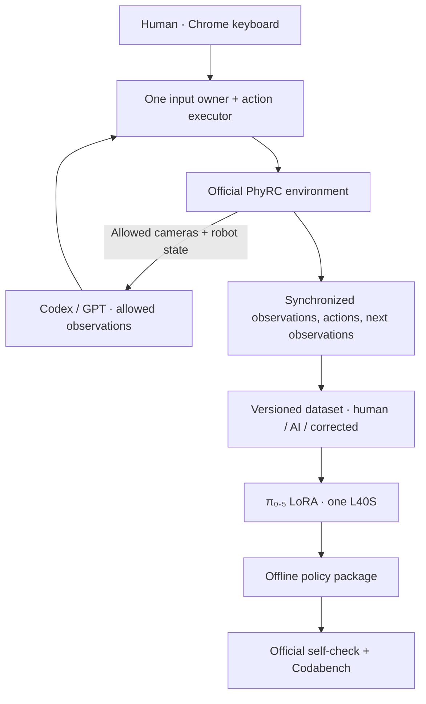

# PhyRC 2027 · Phase 1

**Two Stretch 4 robots, one T-shirt, and a reproducible path from demonstration to policy submission.**

Leonard Yoon, Ph.D. · Independent research project  
[한국어](README.ko.md) · [Current status](docs/project/STATUS.md) · [First server session](docs/project/START_HERE.ko.md) · [Challenge](https://emprise.cs.cornell.edu/phyrc/challenge-2027/) · [Codabench](https://www.codabench.org/competitions/18366/)

This public participant fork documents my work on robot-assisted dressing in PhyRC 2027. The initial experiment will collect demonstrations remotely, adapt π₀.₅ on one NVIDIA L40S, run the learned policy in the official simulator, and submit an offline package to Codabench. Each session should be recoverable on a new clean server.

> **Status · 2026-10-22:** implementation has begun on an L40S. Official smoke passed; 3 real-sensor scripted test episodes were recorded, a 30-step π₀.₅ JAX LoRA checkpoint was trained, and its first official-environment debug action ran (0 points). Fresh-clone 900-second validation is running. Chrome human control, Codabench acceptance, dressing performance and clean-server recovery remain unverified. [Session evidence](docs/project/sessions/20261022-bootstrap.md).

## The task

Two Hello Robot Stretch 4 mobile manipulators put a T-shirt on a seated manikin in the official Isaac Sim 6.0.1 environment. Both robots are controlled together through 18 normalized action values.

See the organizers' task demonstration

This is the **organizers' successful teleoperation demonstration**, inherited from the upstream repository, shown at 32× speed. It is not my policy or an experimental result from this fork. See the [original guide](README.upstream.md) and [upstream source](https://github.com/rirolab/PhyRC_2027_Challenge).

## First milestone: complete the pipeline

The first run validates the full process with a small dataset. It does not require complete dressing or a positive leaderboard score.

| Stage | Evidence required | Current state |
|---|---|---|
| Official environment | Pinned versions and `PHYRC-SMOKE-PASS` | Passed on L40S |
| Human collection | Chrome keyboard control and a complete recorded episode | Pending |
| Automatic collection | Public observation → bounded action → recorded transition | 3 scripted test episodes verified |
| π₀.₅ baseline | Small-data SFT, checkpoint, and closed-loop rollout | 30-step wiring test; one-action debug passed, 0 points |
| Submission | Offline official self-check and Codabench accepted ID | Pending |
| Fresh-server recovery | Verified artifacts and a successful rerun after restore | Pending |

After this path works, the performance target is repeatable dressing progress, starting with the first sleeve, before the November 17 checkpoint. An internal submission target of **November 16, 2026** leaves time to inspect acceptance. This is a target, not a reported result.

## Planned approach

| Decision | Initial choice | Reason |
|---|---|---|
| Compute | One L40S; collect, train, and evaluate sequentially | Measure CPU, rendering, I/O, and GPU costs before scaling |
| Baseline | π₀.₅ base model, JAX LoRA through openpi | Establish an SFT baseline before adding RL or action editing |
| Coordination | One policy predicts both robots' actions | Learn the coupled 18-dimensional action together |
| Initial images | Allowed overview + two wrist RGB views | Map to openpi's three image slots with shared preprocessing |
| Human input | Chrome WebRTC keyboard teleop | Remote demonstrations with explicit key and focus tests |
| AI input | Restricted observation/action tools | Avoid free-viewport screenshots and simulator ground truth |
| Persistence | GitHub for source and reports; Hugging Face for large artifacts | Rebuild on disposable servers with immutable revisions |

Participant collection, shared preprocessing, JAX LoRA training, offline adapter, ZIP packaging and recovery helpers are implemented. Their verified scope and remaining gaps are recorded in the [session report](docs/project/sessions/20261022-bootstrap.md). Chrome integration is under test; no remote human demonstration is claimed.

## Constraints that shape the experiment

- The official action is `float32 (2,9)` in `[-1,1]`, at 20 Hz of simulation time. Gripper `0` preserves the previous intent; it does not mean open.
- The official evaluation uses a **24 GB RTX 3090**; the policy should stay within **12 GB** alongside the simulator. L40S success alone does not verify that target.
- The submission must run offline with all weights, tokenizer assets, normalization statistics, and code included. The official image's existing package versions must remain intact.
- Only designated cameras and public robot observations may drive training and control. The AI bridge must not expose the environment's privileged `info` fields.
- GPT-generated demonstrations based on allowed observations are a **rules-based interpretation**, not explicit organizer approval. The implementation and data provenance must be auditable.
- Pickup alone gives **0 points/s**. Raw points, dressing points/s, and full-dressing success are separate results.

Sources: [Rules](docs/competition/RULES.md), [Policy and submission](docs/competition/POLICY.md), [Scoring](docs/competition/EVALUATION.md), [openpi](https://github.com/Physical-Intelligence/openpi).

## Read and continue

| Document | Purpose |
|---|---|
| [Current status](docs/project/STATUS.md) | Completed work, open questions, and next actions |
| [Initial plan · 한국어](docs/project/PLAN.ko.md) | First-run gates and November target |
| [Two collection modes · 한국어](docs/project/TELEOP.ko.md) | Chrome keyboard and Codex/GPT design |
| [First server session · 한국어](docs/project/START_HERE.ko.md) | Clone, inspect, establish the official environment |
| [Recovery and evidence · 한국어](docs/project/REPRODUCIBILITY.ko.md) | Save, restore, measure time, and publish evidence |
| [Research notes](docs/project/RESEARCH.md) | Verified references and limits of existing Stretch 4 resources |
| [Experiment register](experiments/README.md) | Run IDs, templates, metrics, and comparison rules |
| [Source snapshot](docs/project/SOURCES.md) | Reviewed revisions and official references |

## Public research record

I will publish implementation decisions, failed attempts, measured results, videos, and recovery records as work progresses. Each result should link its code commit, dataset revision, checkpoint, evaluation settings, and original evidence. Planned, implemented, locally measured, submitted, and organizer-scored are distinct states.

The [session report](docs/project/sessions/20261022-bootstrap.md) separates implementation and measurements. Original [test data](https://huggingface.co/datasets/leonayoon/phyrc-2027-phase1-data) and the full [training checkpoint](https://huggingface.co/leonayoon/phyrc-2027-phase1-pi05) are preserved on Hugging Face with checksums. These are pipeline tests, not dressing success results.

The workflow carries forward lessons from my [BEHAVIOR 2026 project](https://github.com/leonyoon-3dai/behavior-submission-2026): profile CPU and I/O before adding GPUs; preserve an unmodified baseline for matched comparisons; track data exposure as datasets grow; and distinguish submission acceptance from verified performance.

## Upstream and attribution

Forked from [RIRO Lab's PhyRC 2027 Challenge](https://github.com/rirolab/PhyRC_2027_Challenge). This participant project is maintained by Leonard Yoon and is not an official organizer repository. The original simulator, competition documents, assets, and organizer demonstrations retain their attribution.

[README.upstream.md](README.upstream.md) preserves the original participant guide at [`4dbbebc`](https://github.com/rirolab/PhyRC_2027_Challenge/commit/4dbbebcf93a06c1bfe12136eadc2e580f30125d6). Project documentation is under `docs/project/`; upstream competition documentation remains under `docs/competition/`. See [LICENSE](LICENSE), [NOTICE](NOTICE), and [THIRD_PARTY.md](THIRD_PARTY.md) for component-specific terms.

Original guide shortcuts and compatibility anchors

[1. Install and run](README.upstream.md#1-install-and-run)

[2. Teleop controls](README.upstream.md#2-teleop-controls)

[3. Collect training data](README.upstream.md#3-collect-training-data)

[4. Observations](README.upstream.md#4-observations)

[5. Actions](README.upstream.md#5-actions)

[6. Train and run a policy](README.upstream.md#6-train-and-run-a-policy)

[7. Scoring and points/s](README.upstream.md#7-scoring-and-pointss)

[8. Allowed information and fair play](README.upstream.md#8-allowed-information-and-fair-play)

