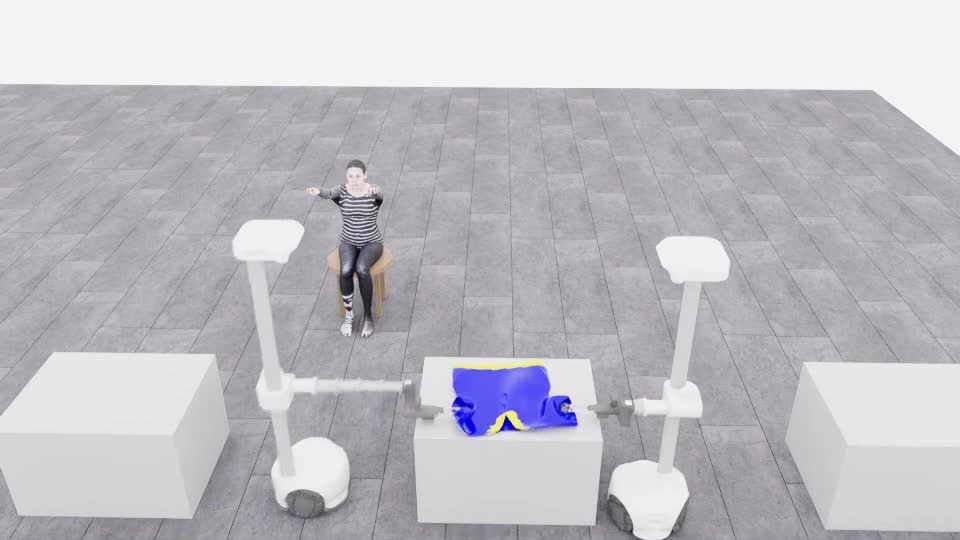
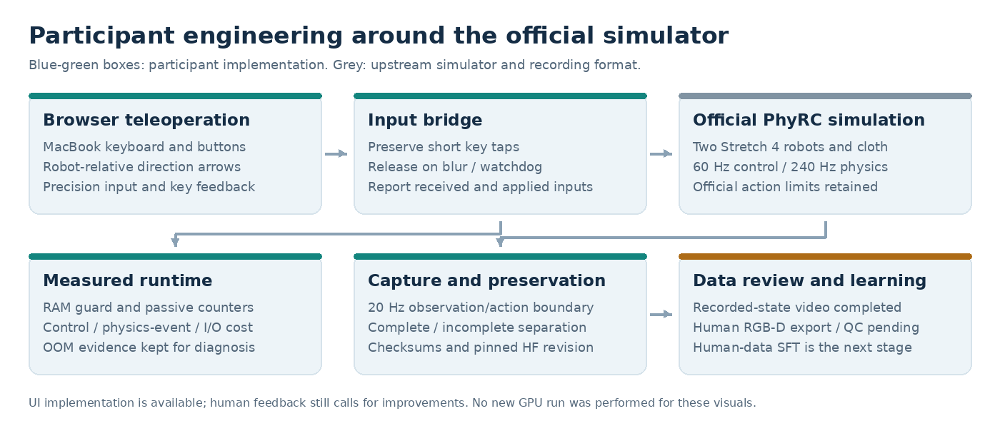
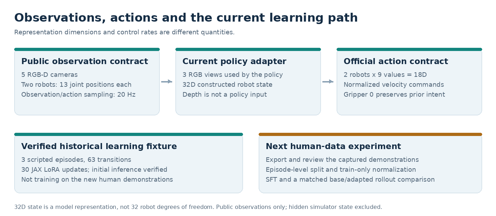
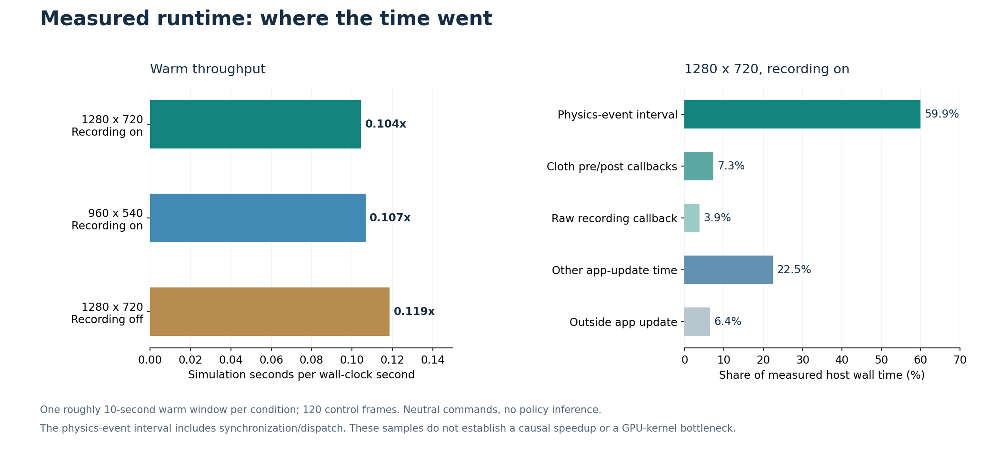

# PhyRC 2027: Cooperative Robot Dressing

**Leonard Yoon, Ph.D.** | [Challenge](https://emprise.cs.cornell.edu/phyrc/challenge-2027/) | [Official simulator](https://github.com/rirolab/PhyRC_2027_Challenge) | [한국어](README.ko.md)

Human demonstration collection and robot-learning infrastructure for two Stretch 4 robots in Isaac Sim.

<a href="docs/videos/20261026-human-pickup-transport.mp4"></a>

**Align the grippers. Grasp and lift. Carry toward the manikin.**

Human-operated practice in a fixed layout. Pickup and transport are demonstrated; autonomous dressing and full task completion remain unverified.

[**Watch the full 33-second video**](docs/videos/20261026-human-pickup-transport.mp4) | [Recording details](docs/project/DEMO_20261026.ko.md)

| Complete collections | Episodes | Recorded transitions |
|:---:|:---:|:---:|
| **4** | **6** | **5,571** |

Raw archives preserved and verified. Human-data training export, quality checks and SFT are next.\n\n[**Next: interactive text-guided collection**](#next-interactive-text-guided-collection)

## The demonstration, frame by frame

<details>
<summary>Open three large keyframes</summary>

**1. Coordinate the grasp**



**2. Lift from the table**


**3. Carry toward the manikin**


Recorded-state replay from run `20261026T061140_546693Z_ab9e06`. Playback is edited; no generated motion or new simulation.

[Six-frame storyboard](docs/project/assets/visual-20261027/human-storyboard.jpg) | [Media provenance](docs/project/assets/demo-focus-20261027/provenance.json)

</details>

## What I implemented

- **Teleoperation:** browser controls, short-tap handling and received/applied input feedback.
- **Data:** recorder integration, archive validation and recorded-state replay.
- **Systems:** runtime profiling, memory monitoring and a public-observation policy adapter.



Robots, cloth physics and evaluation are provided by the official simulator.

[Code and results](docs/project/RESULTS.ko.md) | [Controls](participant/streaming/) | [Collection](participant/collection/) | [Policy adapter](participant/pi05/)

## Observations, actions and learning

| Current adapter input | Robot commands |
|---|---|
| **3 RGB views + 32D state** | **18D actions across two robots** |

The environment exposes five RGB-D cameras; the current policy does not use depth.

<details>
<summary>Data contract and training status</summary>



| Data stage | Verified scope |
|---|---|
| Scripted integration fixture | 3 episodes, 63 transitions, 30 JAX LoRA updates; execution-path validation only |
| Human practice | 4 collections, 6 episodes, 5,571 transitions; training export/QC and SFT pending |

32D describes the state representation, not robot degrees of freedom. Hidden simulator state is excluded from policy inputs. No completed full self-check, Codabench submission or organizer score is claimed.

[Policy contract](docs/competition/POLICY.md) | [Rules](docs/competition/RULES.md) | [Interface schema](config/policy_interface.json)

</details>

## Measured runtime and preserved failures



**0.104× real time** with recording on in one short warm sample. These diagnostics contain no policy inference and do not establish a speedup.

[Timing data](docs/project/sessions/20261026-runtime-components.json) | [Profiling and OOM analysis](docs/project/PERFORMANCE.ko.md)

## Reproducibility and continuation

Recordings and checksums are preserved in an [immutable data snapshot](https://huggingface.co/datasets/leonayoon/phyrc-2027-phase1-data/tree/a1ff58063799279af1a80226a77330063dc0d4d8/sessions/20261026-final). Re-download verification passed; clean-server replay remains to be tested.

### Next: interactive text-guided collection

**Goal:** with the operator in the loop, progress from the initial scene through a first verified full dressing attempt. A 50-point result is a target, not a result claimed here.

**Status:** the existing browser teleoperation, recording and practice footage are real; the text-command controller, stage bookmarking, crash recovery and simulator rollback below are **planned and not yet runtime-verified**. Start with a short movement and a save/recovery test, then attempt dressing.

<details>
<summary><strong>Clean-server handoff: architecture, collection and recovery plan</strong></summary>

### 1. Start on the new Brev A10 server

**Next server selection (2026-11-03):** Begin on a Lambda A10 instance advertised with 24 GB VRAM, 30 CPUs and 200 GiB RAM. These are selection details, not verified runtime results. Before streaming, verify that the fixed-port setup supports viewer and keyboard TCP, signaling TCP and media UDP; check the actual addresses and accessible ports. Measure the short-run simulation rate and control responsiveness under comparable recording and resolution settings, then compare with the previous L40S observation (~0.104× in one short warm sample). Different GPUs and CPUs prevent attributing any difference to one component without further testing.

The latest user request authorizes resuming interactive collection and implementing this plan. The October 26 handoff remains evidence of an earlier stopped session; its instruction to wait for feedback before adding features is superseded by this request. Read the current rules, `AGENTS.md`, [historical server setup](docs/project/START_HERE.ko.md), and [data guide](docs/competition/DATA.md) first. Check the checkout and dirty files before changes.

```bash
git clone https://github.com/leonyoon-3dai/PhyRC_2027_phase1.git
cd PhyRC_2027_phase1
git status --short
git rev-parse HEAD
participant/ops/bootstrap.sh --check
```

Inspect the check results and [setup](docs/competition/SETUP.md) before using the existing `participant/ops/bootstrap.sh --install`; it builds/prepares the environment and may take time and disk. Reuse the participant viewer and recorder rather than replacing them. Discover the new server and client addresses at runtime; use the restricted firewall/secure access setup from the handoff. Do not publish addresses, keys, tokens or private logs. The previous garment-side fixed layout is **practice only**, not the official evaluation layout. Preserve memory guard, performance logging and deferred export. A short smoke and actual data recovery check precede a long attempt. No full-dataset download, SFT or long evaluation is a prerequisite.

### 2. Operator interface and command loop — planned

The initial interface is **typed text**, not speech recognition. The operator sees the five designated camera feeds, robot selection, current base direction, joint and gripper state, end-effector pose and reference frames; it should remain usable from a 2017 MacBook. The existing viewer's free camera is for debugging only, not an observation used to generate a competition training demonstration.

```text
Typed instruction + allowed camera/state
  → validated command plan → preview → bounded (2, 9) actions
  → 20 Hz simulator steps → live feedback + append-only recording
  → operator stop, bookmark, retry or next instruction
```

- Example intent: “move both robots closer to the manikin”, “raise robot 0's arm a little”, “open robot 1's gripper”, “stop here and save this segment”. These are **examples, not supported commands yet**. Map informal directions to explicitly displayed robot/frame and bounded steps. A manikin-relative move requires permitted camera-based estimation or incremental operator guidance; do not read its ground-truth pose.
- Begin with a deterministic command grammar and existing controls. Ambiguous commands ask for clarification or show an editable preview; they do not silently choose a frame or distance. A model-backed interpreter is optional later and any extra billed API requires a separate request.
- A structured plan should record instruction, target robot(s), selected component, frame, signed direction, magnitude/rate, max simulation steps, permitted completion condition, timeout and operator override. Reject unsupported actions, NaN, invalid shapes and out-of-range values. Use one authoritative action writer; two-robot commands must define both action rows and be tested with small bounded movements.
- Support interruption while actions are running: stop, pause, single-step, save/bookmark, discard-as-training-data while retaining evidence, restart episode and resume when safe. User-defined stop conditions may use allowed robot state, bounded duration or explicit human input; perception-based conditions require separate validation. On disconnect, stale input or parser failure, send zero motion. In this interface gripper command 0 **holds the previous intent**; it does not open the gripper.
- Actions follow the official normalized `float32 (2, 9)` interface at 20 Hz simulation time; each action corresponds to three 60 Hz control and twelve 240 Hz physics steps. Preview FPS and network wall-clock latency are different. Display joint angles/units and end-effector pose without calling 9 commands per robot “9 physical DoF”.

### 3. Preserve every attempt — planned, verify before relying on it

The intent is durable, versioned collection, but **lossless recovery and arbitrary rewind are not yet demonstrated**. Test recovery under process failure before relying on the system for a valuable attempt.

- Assign each session, episode, segment, command and bookmark a unique ID. Journal operator text, normalized requested/applied action, public observation references, simulation tick/time, manual labels, camera/frame selection and provenance. Persist incrementally with bounded queues; atomic write/rename, flush policy, checksums and storage-pressure alerts must be implemented and fault-tested. Record any interruption or gap explicitly.
- Keep official raw captures immutable, versioned and separate from reviewed `policy.hdf5` exports, evaluation/audit files and derived clips. Raw archives can contain privileged cloth state: they are for preservation/debugging only, **never policy inputs, teachers or action-label generation**. Review exported alignment `obs[t], action[t], next_obs[t]` and mark incomplete data as incomplete.
- Bookmark segment start/end, parent episode, exact tick range, annotations, source hashes and review status. Build derived datasets as non-destructive manifests. Segments from unrelated physical states must not be silently concatenated into a continuous trajectory; preserve separate episodes unless continuity and controller/cloth state are actually verified. Split train/validation by episode or source layout.
- **Bookmark ≠ simulator checkpoint.** Exact rewind needs an explicitly tested snapshot/restore mechanism for robot and deformable cloth state, velocities, grasp attachments, controller targets, evaluator state, RNG and clocks. First run restore-and-continue comparisons including contacts and scores; do not assume deterministic cloth replay. Until verified, offer episode restart and visually guided re-execution as a fallback, keeping original attempts.
- Replicate completed captures and manifests to a user-authorized durable destination, verify checksums after re-download and record the immutable revision. Local-only files do not survive server loss. Define the maximum data-loss window from measured flush/backup intervals; do not claim zero-loss until fault tests pass. Do not shut down or delete the server without verified preservation and authorization.

### 4. Competition boundary

All automated operators, human-generated training demonstrations and learned policies must follow [competition rules](docs/competition/RULES.md): use only designated cameras and public robot state for decisions and action labels. Do not feed privileged cloth, manikin or chair state, camera world matrices, raw/audit data, free-viewport imagery or evaluator internals into an operator/model or use them to create action targets. Never modify physics, geometry, action limits or evaluation to improve the result.

Score/success may be used for permitted reporting, data selection and training rewards, but not as policy inputs or to automatically generate action targets. Keep score monitoring independent of the controller. Whether live score-guided human data collection or automated stage triggers are allowed should be confirmed with the organizers before treating them as competition-compliant. Simulator state resets used during training do not authorize state injection or state replay during evaluation.

### 5. First-session acceptance sequence

1. **Restore and smoke:** check GPU, disk and container, current revision, secure viewer access, designated cameras and existing recorder. Record run configuration. Do not claim a clean-server reproduction before testing it.
2. **Prove safety and storage:** move one joint briefly, issue stop and disconnect; check zero motion with gripper intent preserved. Record one short episode, finish/export it using the actual active path, inspect fields, then copy and checksum-verify it on a second storage location. Exercise an interrupted capture and report what is recoverable.
3. **Build the smallest typed-command loop:** one robot, one explicit joint/direction, fixed step limit and live operator stop. Then test both robots, one at a time and simultaneously, before free-form requests. Build incrementally atop the actual existing control path; do not invent a working script or endpoint.
4. **Attempt the task:** operator-guided approach, grasp, transport and dressing using permitted observations. Save evidence and useful failed attempts. Check the official evaluator separately; record raw milestone points, completion and points-per-second as distinct quantities. A 50-point claim requires recorded evaluator evidence.
5. **After a reliable capture:** export and QC public observations/actions, construct reviewable episode/segment manifests, then select a small imitation-learning baseline and matched rollouts. Compare models and data choices only after a valid baseline exists.

**Existing recording distinction:** the official GUI guide uses `./run.sh gui --training-record 1 --evaluate 1`; ESC starts export and the operator waits for `[Dataset export] READY` and `capture.json` with `status=ready` and `complete=true`. The participant streaming handoff sets `STRETCH4_DEFER_EXPORT=1`: confirm the actual run's export request and perform the deferred export separately; ESC alone does **not** establish that `policy.hdf5` is ready. The official `P` reset creates a new episode, not a rewind. See [DATA.md](docs/competition/DATA.md) and the [end-of-session guide](docs/project/END_20261026.ko.md) for actual recovery commands.

### 6. Paste into Codex on the new server

```text
Read README.md's “Next: interactive text-guided collection”, AGENTS.md,
docs/competition/RULES.md, POLICY.md, DATA.md and the October 26 handoff.
The current user request supersedes the older wait-for-feedback instruction.
Inspect current code, git status, server resources and existing viewer/recorder.
Preserve existing data and do not claim implementation or success before testing.

Start with secure viewer and recorder smoke, then implement a small typed-command
controller using only permitted cameras and robot state, official bounded (2,9)
actions and an operator stop. Explain ambiguities rather than guessing. Test
both robots incrementally. Add an append-only command/segment manifest and
verify capture, interrupted-run recovery and remote checksum-backed storage.
Treat exact simulator rewind as an experiment, not a guarantee. First aim for
a recorded 50-point dressing attempt; score monitoring must remain separate
from controller inputs and organizer clarification is needed for ambiguous use.
Record measured outcomes and remaining gaps in the session documents.
```

</details>


[**Current status**](docs/project/STATUS.md) | [**Start here**](docs/project/START_HERE.ko.md) | [Recovery](docs/project/END_20261026.ko.md) | [Evidence map](docs/project/EVIDENCE_MAP.md)

<details>
<summary>Official examples and project history</summary>

[Official successful dressing demo](docs/videos/Back_Front_32x.gif) | [Official camera example](docs/examples/teleop/preview_rgb.png)

These are upstream examples, not participant results.

[Upstream README](README.upstream.md) | [Setup](docs/competition/SETUP.md) | [Earlier overview](README.history.ko.md) | [Sources and licenses](THIRD_PARTY.md)

</details>
