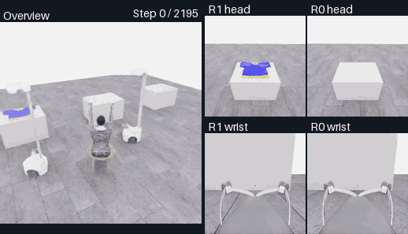

# PhyRC 2027 · 두 로봇의 티셔츠 착의

## 11월 22–24일 시연 1–6 · 시연 2의 20점은 어디에서 나왔나

**여섯 회차 중 첫 소매 통과가 공식 인정된 회차는 시연 2뿐입니다.** 마네킹의 왼손과 손목이 소매 출구 밖으로 나왔습니다. 픽업에 첫 소매, 반대 어깨, 왼쪽 위팔 점수가 더해져 20/50점이 됐습니다. 이후 네 회차도 모두 셔츠를 집어 올렸지만 첫 소매는 0점이었습니다. 시연 6에서는 손 가까이에서 집게의 이동 폭을 줄이는 데까지는 성공했습니다. 마지막 영상에서도 첫 손목 아래에 노란 밑단이 남아 있는지는 가려져 있었고, 다른 손은 밑단 밖에 보였습니다. [시연 2의 득점 기록](docs/active/20261123-demonstrations.ko.md) · [시연 4–6의 평가값과 영상 구간 번호](docs/active/20261124-series-results.json)

| 시연 | 무엇을 시험했나 | 종료 전이 / 영상 구간 수 | 공식 원점수 | 어디까지 확인했나 |
|---|---|---:|---:|---|
| 6 | 좌우에서 접근해 중앙을 살짝 들고, 첫 손목부터 얕게 걸치기 | 608 / 62 | 5/50 | 280전이 픽업. 노란 위·아래 테두리를 벌렸고 첫 손 앞까지 옮겼습니다. 두 손목을 모두 걸친 장면은 확보하지 못했습니다. |
| 5 | 같은 조작 지시에 카메라 설명 추가 | 487 / 24 | 5/50 | 252전이 픽업. 감속 뒤에도 집게가 전진했고, 종료 때 두 손끝이 천 밖에 보였습니다. |
| 4 | 한쪽을 받치면서 반대 손목 다시 걸기 | 1,023 / 80 | 5/50 | 196전이 픽업. 먼손과 밑단이 겹쳤다가 728전이에 맨손가락이 테두리 밖에 보였습니다. |
| 3 | 양쪽 전완에 옷을 먼저 걸치기 | 608 / 30 | 5/50 | 202전이 픽업. 301전이에 먼 손목이 가려졌고 313전이에 한 주먹이 겉감 위로 드러났습니다. |
| 2 | 한 팔을 먼저 입히고 반대 어깨로 운반 | 2,195 / 110 | **20/50** | 161전이 픽업, 661전이 첫 소매·반대 어깨, 698전이 왼쪽 위팔. 이후 추가 득점이 없었습니다. |
| 1 | 사용자 피드백으로 양쪽 밑단 파지 | 1,655 / 77 | 5/50 | 630전이에 픽업. 손 앞으로 옮겼지만 첫 소매 통과는 확인하지 못했습니다. |

여섯 회차는 시드 43, 테이블 인덱스 2, 셔츠–마네킹 마찰 0.35의 새 장면 0전이에서 시작했습니다. 합계 **6,576전이와 영상 383구간**이며, 여섯 번 모두 공식 착의 성공은 `false`입니다. 같은 배치를 반복했고 사용자 종료 시점도 달랐습니다. 특히 시연 3·5·6은 시연 2의 첫 소매가 인정된 661전이보다 먼저 마쳤으므로, 최종 점수만으로 조작 방식의 일반적인 성공률을 비교하기는 어렵습니다. [1–3회 기록](docs/active/20261123-demonstrations.ko.md) · [4–6회 기록](docs/active/20261124-series-results.json)

### 시연 2가 달성한 것과 끝내 남은 30점

661전이에서 왼손이 소매를 통과할 때 옷이 반대 어깨 너머까지 올라가 두 항목이 함께 인정됐습니다. 37전이 뒤에는 왼쪽 위팔까지 소매가 덮였습니다. 이 회차에서 다시 살려야 할 동작은 **한 손이 실제 소매 밖으로 나온 상태로 어깨를 넘어 천을 운반한 구간**입니다. 종료 자세에서는 왼쪽 위팔의 걸침도 풀려 있었습니다. 공식 평가기는 회차 중 한 번 달성한 항목의 점수를 유지합니다. [시연 2 전체 영상](docs/gallery/20261123-end-to-end/demonstration-2.gif) · [득점 전이와 최종 자세](docs/active/20261123-demonstrations.ko.md)

남은 항목은 두 번째 소매 5점, 오른쪽 위팔 5점, 목 10점, 앞면 10점입니다. 1,922–1,943전이에는 파란 천이 반대 손을 덮었지만 손끝이 해당 소매 밖으로 나오는 모습은 확인되지 않았습니다. 2,111–2,138전이에는 R1 집게가 약 5.3cm 올라가면서 파란 주름이 펴졌고, 정수리 근처의 목둘레는 거의 움직이지 않았습니다. 다음 목 시도에서는 **당기기 전에 V넥에서 추적할 테두리를 하나 고르고**, 동작 직후 그 테두리가 정수리에 대해 실제로 옮겨졌는지 봐야 합니다. [두 번째 손과 목둘레의 실패 장면](docs/active/20261123-recovery-review.ko.md)

### 시연 3–6은 각각 어디에서 막혔나

- **시연 3·4에서 가장 큰 불확실성은 가려진 손이 밑단 안에 남아 있는지였습니다.** 시연 3에서 양쪽 전완에 천이 걸쳐 보인 뒤 양 집게가 어깨 쪽으로 약 17–18cm 이동하자 주먹 하나가 겉감 위에 나타났습니다. 시연 4에서는 712–728전이(`hold-0054`)에 두 헤드 영상에서 먼손이 노란 밑단 밖으로 드러났고 가까운 손끝은 파란 접힘에 가려졌습니다. 한쪽 팔만 깊어지면서 반대쪽을 놓쳤다는 운영자의 설명은 이 장면과 양립합니다. 가려진 팔의 삽입 깊이나, 처음부터 밖에 있었는지 도중에 빠졌는지까지는 판별할 수 없습니다. [시연 3의 전후 장면](docs/active/20261123-recovery-review.ko.md) · [시연 4의 구간 색인](docs/active/20261124-series-results.json)
- **시연 5에서는 카메라를 구분하는 것과 집게를 제때 멈추는 것이 별개의 문제였습니다.** 시연 4와 같은 기본 조작 지시·손목 깊이 패널을 쓰고, 첫 관측에 카메라 설명을 추가했습니다. 전체 카메라는 고정이고 두 헤드 카메라는 각 로봇의 머리, 두 손목 카메라는 각 집게를 따라갑니다. 분할 화면의 왼쪽은 R1, 오른쪽은 R0이며 마네킹 손의 좌우는 팔을 따라 확인합니다. 368–382전이에 양 집게가 같은 축으로 약 30.6cm 이동했고, 403–407전이에는 감속 명령 후에도 R1이 약 8.8cm 더 전진했습니다. 종료 직전 R0이 올라갈 때 가까운 노란 단은 따라오지 않았습니다. 사용자는 마네킹과의 강한 충돌을 우려해 종료했습니다. 공식 첫 접촉 이벤트가 기록하는 대상은 천과 마네킹이며, 그 로그로 로봇의 충격력을 산출할 수는 없습니다. [시연 5의 접근·종료 구간 색인](docs/active/20261124-series-results.json)
- **시연 6에서는 접근 폭이 줄었고, 첫 손목이 밑단을 지지하는지 확인하는 문제가 남았습니다.** 두 로봇이 옆으로 접근해 노란 밑단 중앙 양옆을 잡고 살짝 들도록 했습니다. 205–213전이에 R1 손목 영상에서 두 테두리 사이의 파란 안쪽 면이 보였습니다. 488전이 이후 실제 동작 40회에서 한 동작 전후 집게 위치의 최대 변화는 13.7mm였습니다. 실행한 166개 명령은 모두 설정 범위 안에 있어 제어기가 속도나 길이를 줄인 횟수는 0회였습니다. 604–608전이(`hold-0062`)에도 손등만 보이고 손목 아래 테두리는 집게에 가려져 있었습니다. 다른 손은 몸판 밖에 남았습니다. 이 회차의 양손목 유지 시험과 목둘레 시험은 **미도달**입니다. [시연 6의 동작 범위·마지막 구간](docs/active/20261124-series-results.json) · [사용한 조작 지시](participant/collection/prompts/gentle_wrist_dressing.txt)

### 재개할 때 가장 먼저 판정할 장면

한쪽 손목 주름에 밑단이 얕게 걸린 장면을 먼저 찾습니다. 그쪽 로봇이 여유를 두고 받친 채 다른 로봇만 반대 손끝 앞의 노란 밑단을 2–4전이 옮깁니다. **조정 전후 두 손을 각각 추적해 ‘양쪽 유지’, ‘한쪽 이상 이탈’, ‘가림으로 미확인’을 구간 ID와 함께 기록합니다.** 시험 동작에 이르지 못하면 ‘미도달’로 남깁니다. 손끝이 가려지면 반대 헤드나 손목 시점에서 다시 보고, 먼저 건 쪽을 팔꿈치까지 밀기 전에 접근각이나 파지점을 바꿉니다. 양쪽 유지가 확인된 다음에 어깨·목으로 진행합니다. 몸판 밑단으로 두 손이 들어가는 중간 관찰과 각 손이 서로 다른 소매 출구로 나오는 공식 득점을 따로 기록합니다. [실험 판정 기준](docs/active/experiment.md) · [공식 배점](docs/competition/EVALUATION.md)

깊이 조회는 두 표면이 보이면서 겹쳐 보이는 경우에 비교할 만합니다. 시연 4의 728전이를 사후 조회했을 때 R1 헤드 카메라에서 고른 노란 밑단 두 점의 광축 거리는 0.574–0.580m, 옆 손등의 두 점은 0.645–0.648m였습니다. 이 값은 해당 카메라 방향에서 보이는 두 표면의 앞뒤를 설명합니다. 천 뒤에 가려진 손목의 삽입 길이는 다른 시점에서 확인해야 합니다. 시연 4–6은 손목 깊이 패널을 사용했고, 실행 중 선택 픽셀 조회는 꺼 두었습니다. [728전이 조회 표본](docs/active/20261124-series-results.json) · [깊이 조회 구현](participant/collection/depth_query.py)

## 시연 6 · 밑단을 벌려 첫 손목에 얕게 걸치기

**0–608전이 전체 · 5/50점.** 205–213전이에 벌어진 노란 테두리 사이로 파란 안쪽 면이 보였습니다. 한 손목 아래의 밑단은 가려졌고 다른 손은 몸판 바깥에 남았습니다. [시연 6의 구간 기록](docs/active/20261124-series-results.json)

## 시연 5 · 카메라 설명을 추가한 양손목 접근

**0–487전이 전체 · 5/50점.** 두 로봇이 옷을 들어 양손 앞으로 옮겼습니다. 감속을 지시한 뒤에도 R1 집게가 전진했고 마지막에는 두 손끝이 천 밖에 보였습니다. [시연 5의 구간 기록](docs/active/20261124-series-results.json)

## 시연 4 · 한쪽을 받치며 반대 손목 다시 걸기

**0–1,023전이 전체 · 5/50점.** 712–728전이에 먼손의 손가락이 노란 밑단 밖으로 드러났고 가까운 손끝은 파란 천에 가려졌습니다. 이후 한쪽 지지를 유지하며 놓친 쪽을 다시 맞췄습니다. [시연 4의 구간 기록](docs/active/20261124-series-results.json)

## 시연 3 · GPT 단독으로 양팔 먼저 걸치기

**0–608전이 전체 · 5/50점.** 301전이에 옷이 양쪽 전완에 걸쳐 보였지만 한쪽 손목은 가려져 있었습니다. 어깨 쪽으로 더 이동하자 손목이 천 위로 다시 드러났고, 첫 소매와 목은 0점이었습니다. 종료할 때 R1은 밑단을 지지하고 R0은 접힌 천을 풀었습니다. [실패·복구 구간 비교](docs/active/20261123-recovery-review.ko.md)

## 시연 2 · GPT 단독으로 한 팔 먼저 입히기

**0–2,195전이 전체 · 20/50점.** 왼팔의 첫 소매와 반대쪽 어깨, 왼쪽 위팔까지 득점했습니다. 옷이 정수리까지 올라간 뒤 반대팔을 시도했고, 목과 두 번째 소매는 각각 0점이었습니다. [시연 2 점수와 장면별 분석](docs/active/20261123-demonstrations.ko.md)

## 시연 1 · 사용자 피드백으로 밑단 파지

**0–1,655전이 전체 · 5/50점.** 두 로봇이 사용자 피드백을 받아 옷을 집고 손 앞까지 옮겼습니다. 630전이에 픽업을 인정받았고, 첫 소매 통과는 0점이었습니다. [시연 1 분석](docs/active/guided-retrospective.json)

GIF는 전체 화면과 양쪽 로봇의 머리·손목 카메라를 함께 보여 줍니다. 물리 시간 기준 약 6배속이며, 마지막 장면에서 잠시 멈춘 뒤 처음부터 반복합니다. 점수는 각 실행의 로컬 공식 평가기 원점수입니다. [공식 영상 비교와 다음 조작 지침](docs/active/autonomous.md) · [검토 화면과 실행 방법](docs/active/collection.md) · [새 서버에서 시작](docs/active/start.md)

## 구간 검토와 데이터 수집

1. **재생** — 방금 끝난 구간의 5카메라 영상과 실제 사용한 지시를 봅니다. 왼쪽은 robot_1, 오른쪽은 robot_0입니다.
2. **판단** — Astra가 구간에서 표본으로 읽은 프레임을 근거로 의도와 실제 변화, 가려진 부분, 다음에 바꿀 한 가지를 제시합니다. 화면에서 구간의 성공·부분 진행·실패·불확실과 감독 평가 점수를 따로 읽습니다.
3. **피드백** — GPT 단독 모드는 구간 영상을 게시하고 다음 동작을 스스로 결정합니다. 시연 4–6에서는 개입 후 보류하면 같은 장면에서 기다리고, 피드백을 제출하면 해당 행동 경계에서 회차를 마칩니다. 사용자 피드백 모드에서는 구간마다 다음 동작을 승인합니다.
4. **기록** — 실행·구간 ID와 전이 범위로 영상, 지시, 분석, 다음 제안, 실제 채택된 피드백을 원본 행동 데이터에 연결합니다. 지난 구간은 필요할 때만 열고 회차별 JSONL을 내려받습니다. [실행 명령과 데이터 형식](docs/active/collection.md)

## 서버 리뷰와 다음 재개

현재 여섯 회차의 수집을 마쳤습니다. 각 회차의 HDF5 전이를 전수 검증했고, 원본·공식 평가·행동 기록과 구간 영상을 비공개 데이터셋에 보존했습니다. 복원한 갤러리에서 위 표의 시연과 `hold` 번호를 선택하면 같은 장면을 열 수 있습니다. 다음 서버에서는 이 기록을 먼저 검토하고 사용자가 새 실행을 요청할 때 새 ID로 시작합니다. [6회차 백업 확인서](docs/active/20261124-private-backup.json) · [새 서버에서 복원하기](docs/active/start.md)

---

