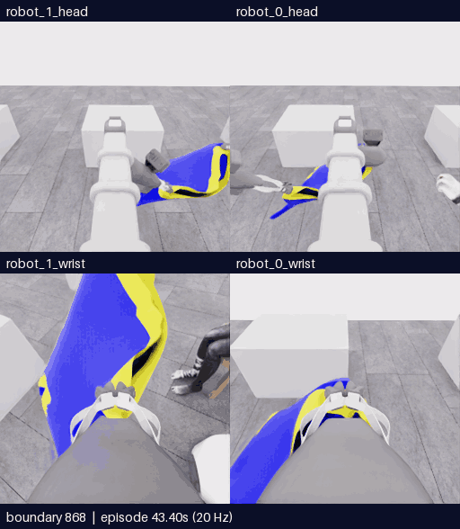
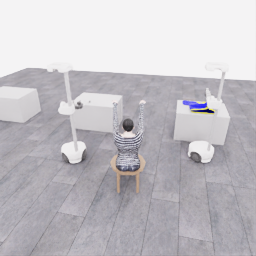
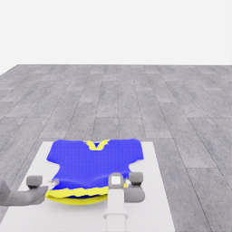
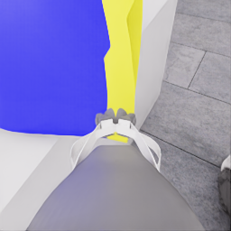
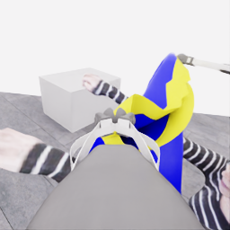

# PhyRC 2027 · 두 로봇의 협력 착의

두 대의 **Stretch 4**가 공개 RGB-D 카메라와 로봇 상태를 보고, 앉은 마네킹에 티셔츠를 입히는 시뮬레이션 챌린지입니다. 이 저장소는 **사람의 직접 조작에서 Codex CLI의 `gpt-6-astra` 자동 시연으로 수집 방법을 확장한 과정**과 실제 데이터·실패·복구를 기록합니다.

[**시간순 시연 갤러리**](docs/gallery/README.ko.md) · [**Astra 수집 전체 과정**](docs/collection/guides/astra-end-to-end.ko.md) · [**기술 발표 가이드**](docs/project/PRESENTATION.ko.md) · [**전체 문서 지도**](docs/README.ko.md) · [**원본 참가 안내**](README.upstream.md)

> **현재:** E27까지 수집을 마감하고 오프라인 검토 중입니다. 최고 **로컬 공식 평가기 원점수5/50**, 착의 득점 **0**, `success=false`입니다. E28은 준비한 후보로 **미실행**입니다. 새 시연으로 정책을 학습한 결과나 Codabench 점수로 소개하지 않습니다. [현재 상태](docs/project/STATUS.md)

## 먼저 볼 장면 · 새 파지로 운반하고 팔에 접근한 E27

[**MP4 크게 보기**](docs/gallery/assets/20261107-e27-arm-approach/event.mp4) · [**들기부터 전체 영상**](docs/gallery/20261107-astra-regrasp698-progress-named-001.ko.md) · [**장면별 분석**](docs/collection/reviews/20261107-astra-regrasp698-progress-named-001.ko.md) · [**피드백 남기기**](https://github.com/leonyoon-3dai/PhyRC_2027_phase1/issues/new?title=%5BE27%20%ED%94%BC%EB%93%9C%EB%B0%B1%5D)

**확인한 것:** E25에서 바꾼 파지로 들기·테이블 이탈·운반·팔 접근을 이어갔고, 후반에는 관절 목표 오차와 시야가 일부 회복됐습니다. **아직 모르는 것:** 보이는 틈의 정확한 입구 정체와 같은 손의 연속 소매 통과입니다. 추가 득점은 없었습니다.

위쪽은 두 머리, 아래쪽은 두 손목 카메라입니다. 경계868–968의20Hz 기록을5fps로 보여 **4배 느리게** 재생하며 모델 대기는 제외했습니다. [프레임·시간·해시 출처](docs/gallery/assets/20261107-e27-arm-approach/provenance.json)

## 1. 시간의 흐름으로 보는 시연 수집

아래는 **수집 방법이 바뀐 대표 순간**입니다. 독립 성공 시연6개나0→50점 달성 기록이 아닙니다. 날짜는 한국 시간 기준이며 여러 날의 실험 묶음은 범위로 표시합니다.

<table>
<tr>
<td width="33%" valign="top">
<strong>① 10월26일 · 사람이 직접 조작</strong> 
 
집기·들기·운반 일부를 직접 수행했습니다. 조작키와 느린 피드백이 어려웠고 공식 점수는 미확인입니다.
</td>
<td width="33%" valign="top">
<strong>② 11월6일 · Astra 첫 픽업5</strong> 
 
들고 유지하는 시간을 보정했습니다. 한 로봇 중심으로 픽업 조건을 충족했지만 착의 득점은0입니다.
</td>
<td width="33%" valign="top">
<strong>③ 11월6일 · 두 로봇 협력 E07</strong> 
 
두 로봇의 공동 들기·운반을 수행했습니다. 이후 실험은 이 기록의 여러 경계에서 행동을 재실행해 분기했습니다.
</td>
</tr>
<tr>
<td valign="top">
<strong>④ 11월6–7일 · 관측·지지·명령 개선</strong> 
 
과거 RGB·손목 depth·중립 대기·순차 지지·픽셀 질의·이름 기반 행동을 비교했습니다.
</td>
<td valign="top">
<strong>⑤ 11월7일 · 실제 새 파지 E25</strong> 
 
열기→새 위치→닫기→한쪽 들기를 수행했습니다. 국소 천 동행은 보였지만 원하는 입구인지는 미확인입니다.
</td>
<td valign="top">
<strong>⑥ 11월7일 · 새 파지의 운반 E27</strong> 
 
E25 행동을 새 환경에서 재실행해 운반·팔 접근까지 시험했습니다. 가림·목표 전환·부분 복구를 기록했습니다.
</td>
</tr>
</table>

[**모든 장면을 시간순으로 보기**](docs/gallery/README.ko.md) · [**날짜별·실험별 이력**](docs/project/HISTORY.ko.md) · [**출발점 화면 비교**](docs/gallery/20261107-support-startpoints.ko.md) · [**출발점·방법·결과 목록**](docs/collection/catalog/README.ko.md)

## 2. 어떤 점수를 목표로 하나

| 준비·착의 항목 | 점수 | 현재 확인 |
|---|---:|---|
| 같은 그리퍼로 잡은 영역을5cm 이상 올려3초 유지 | 5 | 로컬 공식 평가기로 획득 |
| 첫 소매 / 반대 어깨 / 둘째 소매 / 왼 위팔 / 오른 위팔 | 각각5 | 아직 미획득 |
| 목 / 앞면 방향 | 각각10 | 아직 미획득 |
| 합계 | **50** | **최고5, 전체 성공 미달** |

순위는 **픽업을 제외한 착의 점수 ÷ 첫 접촉부터 마지막 착의 득점까지의 로봇 시간**입니다. 픽업5만으로는 양의 순위 점수가 생기지 않습니다. 누적50점과 현재 자세의 전체 착의 성공도 별도로 확인합니다. 다음 목표는 **픽업을 유지하며 착의 항목을 하나 더 얻고, 전후 관측·행동을 검증하는 것**입니다.

[챌린지·점수·시간](docs/project/CHALLENGE_GUIDE.ko.md) · [공식 평가 정의](docs/competition/EVALUATION.md) · [대회 웹사이트](https://emprise.cs.cornell.edu/phyrc/challenge-2027/)

## 3. 직접 조작과 Astra 자동 수집

| 구분 | 사람이 직접 조작 | `gpt-6-astra`가 조작 |
|---|---|---|
| 판단 | 사람이 Chrome 화면을 보고 키 입력 | 격리된 Codex CLI가 지정 공개 RGB-D·로봇 상태를 읽음 |
| 명령 | 키 입력을 공식 명령으로 변환 | 구조화된 JSON을 검증해 공식 `float32 (2,9)`로 변환 |
| 기록 | 기본 deferred export: 종료 뒤 이미지·학습 파일 생성 | 즉시 센서 기록: 실행 중 `obs/action/next_obs` 저장 |
| 대표 자료 | 10월26일 부분 시연:2,225전이·111.25로봇초 | E05 첫5점, E07 협력, E16–E27 방법 비교 |
| 현재 | 보존한 수집 경로 | 최근 실제 경로. Chrome·WebRTC OFF |

두 경로 사이의 **실시간 제어권 인계는 구현 완료 기능이 아닙니다.** Astra의 행동 판단과 개발자의 사후 점수·audit 검토도 분리합니다.

[사람 시연 장면](docs/gallery/20261026-human-pickup-transport.ko.md) · [공식 데이터 수집 안내](docs/competition/DATA.md) · [**Astra 전체 기술 설명**](docs/collection/guides/astra-end-to-end.ko.md)

## 4. Astra 시연은 관측에서 검수까지 연결됩니다

1. **관측 준비:** 공개 카메라5개와 로봇 상태를 모으고, 평가·audit·내부 천 기하는 actor에서 분리합니다.
2. **모델 판단:** 고정 Codex CLI에서 `gpt-6-astra`가 짧은 행동 JSON을 반환합니다. 필요하면 같은 관측의 픽셀 depth를 질의합니다.
3. **검증·실행:** 행동 이름·값·범위·길이를 검사해 두 로봇에 적용합니다. 모델 판단 한 번은 여러20Hz 전이를 만들 수 있습니다.
4. **동기 기록:** 실제 관측·명령·다음 관측을 저장하고 재실행·새 모델 행동·정착·정리를 구분합니다.
5. **마감·검수:** 파일 완료, 기술 검사, 공식 점수, 시각 검토, 학습 승인을 각각 기록하고 원본을 백업합니다.

[**전체 단계와 함수·파일 보기**](docs/collection/guides/astra-end-to-end.ko.md) · [코드 지도](docs/project/CODE_MAP.ko.md) · [수집·검수 안내](docs/collection/README.ko.md)

## 5. 현재 결과와 다음 질문

| 확인된 것 | 아직 확인하지 못한 것 |
|---|---|
| 픽업5, 협력 운반, 실제 재파지, 부분 시야 복구 | 같은 손의 연속 소매 통과와 추가 착의 득점 |
| 이름 기반 행동·공개 픽셀 depth 질의의 실제 실행 | 표현·거리 정보의 추가가 착의 성능을 개선했는지 |
| E27 전이1,159/1,159 기술 검사 통과 | 새 시연의 학습 승인과 새 baseline 성능 |
| 고정 백업의 재다운로드·해시 검증 | 새 환경의 동일 천 상태·동일 결과 보장 |

E27 전체는 **1,159전이·57.95로봇초**, 새 후속 기록은 **461전이·23.05초**, 실제 경과는 **40분50.624초**였습니다. 구성은 `698재실행 + 334모델 행동 + 126정착 + 1예산 정리`입니다. 독립 성공 시연 수로 세지 않습니다.

**현재 수집은 중지 상태입니다.** E27/928에서 같은 팔의 목표 연속성을 비교하는 E28은 준비한 후보이며 미실행·미예약입니다. 과거 π0.5의63전이·30회 갱신은 학습 연결 시험으로, 최신 시연 학습 결과가 아닙니다.

[현재 상태](docs/project/STATUS.md) · [최신 마감·전략 검토](docs/project/SESSION_WRAPUP_20261107.ko.md) · [E28 후보의 범위](docs/collection/research/2026-11-07-e27-single-arm-continuation.ko.md) · [원본 백업 검증](docs/project/sessions/20261107-e27-backup-verification.json)

## 6. 목적에 맞게 이어서 읽기

| 목적 | 문서 |
|---|---|
| 그림으로 처음부터 흐름 파악 | [시간순 갤러리](docs/gallery/README.ko.md) |
| 지금까지 한 일을 발표로 설명 | [5분·15분 기술 발표 가이드](docs/project/PRESENTATION.ko.md) |
| 코드와 데이터 흐름을 자세히 설명 | [Astra 전체 과정](docs/collection/guides/astra-end-to-end.ko.md), [코드 지도](docs/project/CODE_MAP.ko.md) |
| 날짜·방법·실패 찾기 | [개발 이력](docs/project/HISTORY.ko.md), [실행·출발점 목록](docs/collection/catalog/README.ko.md) |
| 새 서버에서 준비 | [현재 상태](docs/project/STATUS.md)를 읽은 뒤 [복원 안내](docs/project/START_HERE.ko.md) |
| 연구·정책 학습 후보 검토 | [연구 로드맵](docs/project/RESEARCH_ROADMAP.ko.md), [검수·승인](docs/collection/README.ko.md) |

[전체 문서 지도](docs/README.ko.md) · [이전 README·성능 메모](README.before-reorganization-20261106.ko.md) · [LICENSE](LICENSE) · [NOTICE](NOTICE) · [THIRD_PARTY](THIRD_PARTY.md)
