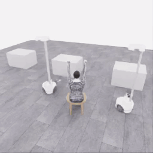

# PhyRC 2027

## 다음 서버 실험 · GPT‑6.2 Astra Ultra × GPT‑6.2 Sol Ultra

**목표는 사람의 턴별 방향 지시 없이, 직전 행동의 실제 효과를 반영해 첫 소매를 통과하고 한 실행에서 공식 평가 원점수 10/50을 얻는 것입니다.** 두 모델 모두 `ultra`로 실행합니다. 이번 업데이트는 실험 계획이며, 모델 연결·자동 피드백·착의 실험은 다음 서버에서 검증합니다.

| 시험 | 출발과 성공 기준 |
|---|---|
| 손목 접근·교정 | **B/HOLD1·110전이** 저장 슬롯을 복원하고 정착 전후를 저장 당시 5개 카메라와 공개 로봇 상태로 대조합니다. 슬롯은 저장·해시 확인을 마쳤고 복원은 미검증입니다. 두 로봇이 마네킹의 해부학적 왼손 쪽으로 함께 이동한 뒤 양손과 천의 관계를 보고, **공식 `first_sleeve` 새 5점**을 확인합니다. [복원 절차와 시작 관측](docs/COLLECTION_PLAN.md#1-다음-출발-후보와-검증) |
| 원점수 10점 | 공식 초기 상태에서 시작한 **한 실행**에서 `pickup=5`와 `first_sleeve=5`를 모두 획득하고 `raw_points ≥ 10`을 확인합니다. 슬롯 복원은 새 평가이므로 과거 픽업 점수는 이월되지 않습니다. 손목과 손끝이 소매 밖으로 나오는 기준은 공식 평가로 확인합니다. [점수 정의](docs/competition/EVALUATION.md#score-items) |

**턴마다 쓰는 피드백**은 `의도·명령 → 짧은 실행 → 직후·정착 후 관측 → 실제 효과 → 다음 행동 수정` 순서입니다. 감독 코드가 공개 로봇 상태로 **두 그리퍼의 실제 변위**를 계산하고, 지정 5개 RGB-D로 확인할 **같은 손·천의 자유 경계·파지 유지·그리퍼 본체 여유**를 전후 관측과 함께 다음 모델 호출에 전달합니다. 예를 들어 베이스를 움직여도 정착 후에도 천 입구가 손에 가까워지지 않았다면, 그 근거를 보고 한 번 더 전진할 근거가 있는지 확인하고, 필요하면 접근 방향이나 높이 한 가지를 바꿉니다. 가려진 관계는 `unknown`으로 남깁니다. [실행 효과 설계](docs/COLLECTION_PLAN.md#resume-effect-feedback) · [RAIL의 직전 명령 결과 전달](https://www.gt-rail.com/blog/astra-beyond-tabletop/#system-prompt)

- **공통 조작 판단.** 가까이에서는 2–4전이의 짧은 교정부터 시작하고, 두 파지점의 실제 이동과 천이 따라오는지를 따로 봅니다. 손 위 자유 경계와 그리퍼 본체 여유가 확인되면 작은 하강으로 걸쳐 보고, 반복해도 진행이 없으면 시야나 접근 방향을 바꿉니다. 재파지는 현재 공개 관측에서 한쪽 지지가 확인될 때만 공통 조건으로 시험합니다. [실측·GIF](docs/collection/reviews/20261116-user-guided-movement-ledger.ko.md) · [파지·접근 연구](docs/collection/research/2026-11-18-dexgarmentlab-phyrc.ko.md)
- **모델과 피드백 효과 비교.** `gpt-6.2-astra`와 `gpt-6.2-sol`이 같은 격리 Codex 실행 경로에서 실제로 `ultra`로 동작하는지 작은 연결 시험으로 확인합니다. 지원 여부를 확인할 수 없는 조건은 보류 사유를 기록합니다. 모델별 새 세션에서 출발 상태·프롬프트·행동/정착·호출/전이 예산을 맞춥니다. 두 모델 비교 뒤, 같은 모델에서 효과 요약을 켠 경우와 끈 경우를 짝지어 피드백이 만든 차이를 봅니다. 원점수·항목별 점수, 확인된 착의 단계, 반복 정체 후 복구, 파지 손실, 모델 호출 시간과 실제 경과를 기록합니다. [Codex 모델·추론 설정](https://learn.chatgpt.com/docs/models) · [격리 실행·복원](docs/OPERATIONS.md)
- **자동 교정과 중단 경계.** 기존 사용자 검토 수집기는 첫 소매 득점이나 모델 종료 제안에서 HOLD합니다. 본 실험 전, 일반 교정은 모델이 직전 효과로 판단하고 첫 소매는 감독 로그에 중간 단계로 남겨 정해진 예산 안에서 목표를 계속 검증할 수 있도록 제어 경로를 준비합니다. 안전 판단에 필요한 관측이 부족하거나, 파지를 유지하며 시도할 교정을 소진하거나, 계약 위반·장애·예산 한계가 생기면 추가 움직임 없이 HOLD 또는 정상 마감합니다. 공식 점수와 내부 상태는 감독 영역에서만 다룹니다. [현재 사용자 검토 경로](docs/collection/GUIDED_RUNTIME.ko.md) · [관측·행동 규정](docs/competition/RULES.md)

**자기교정과 재귀적 개선.** 첫 실험은 한 run 안에서 직전 결과를 근거로 행동을 고치는 능력을 봅니다. 후속 실험에서는 모델이 공개 관측과 행동·효과 기록에서 판단 규칙이나 프롬프트 변경을 제안하고, 같은 출발과 별도 시작 상태에서 재현된 변경만 다음 버전에 반영하는 과정을 검증합니다. 비교 중에는 모델 가중치와 프롬프트 버전을 고정합니다.

## 선행 실험 계획과 연구 · DexGarmentLab

**파지 위치와 손목 접근 경로를 따로 판단합니다.** 기존 사용자 검토 계획에서는 **B/HOLD1·110전이** 슬롯의 복원·정착 상태를 이전 5카메라와 비교합니다. 슬롯은 저장과 해시 확인을 마쳤으며 실제 복원은 확인 전입니다.

두 로봇을 마네킹의 **해부학적 왼손 쪽으로 함께 이동**시킨 뒤, **양쪽 파지점·천의 자유 경계·양손·그리퍼 본체**를 확인합니다. 손 위에 자유 경계가 놓이고 여유가 보이면 짧게 내려 걸쳐 봅니다. 가림이 계속되거나 그리퍼 본체 쪽으로 천이 따라오면 HOLD에서 영상을 검토하고, 필요하면 한쪽 지지를 유지한 가운데 쪽 재파지를 사용자에게 제안합니다.

**[논문에서 가져올 판단 기준과 다음 시연 예시](docs/collection/research/2026-11-18-dexgarmentlab-phyrc.ko.md)** · [기존 사용자 검토 계획과 복원 기준](docs/COLLECTION_PLAN.md) · [클린 서버 복원](docs/OPERATIONS.md)

**[실행 효과 피드백 비교](docs/COLLECTION_PLAN.md#resume-effect-feedback)** · 짧게 움직인 뒤 실제 두 그리퍼 변위와 손·천 관계를 다음 Astra 결정에 전달하는 방식을 기존 Astra+HOLD와 비교합니다. 새 Ultra 실험의 피드백 설계 참고로 남깁니다.

### Embodied First Exam · 손목 통과 직전 비교

논문의 정밀 단계 실패 91건을 다시 시험했을 때 성공 신호를 가린 비교 실행은 19%, 정확한 물체 상태 조회 추가는 21%, 리셋·저장 복원 추가는 36%를 해결했습니다. 로프 통과 사례에서는 Astra가 세 개 개구부를 지난 뒤 다음 링에 그리퍼 손가락이 걸리고 줄을 놓쳤습니다. PhyRC에서는 이 결과를 **통과 직전 비교 실험과 실패 단계 기록**의 근거로 사용합니다. [논문 §3.2·부록 H.6](https://arxiv.org/pdf/2611.12177) · [47종 로봇의 공식 과제 메타데이터](https://www.embodied-first-exam.ai/data/tasks.json)

1. **같은 출발에서 비교합니다.** B/HOLD1·110전이를 복원하고 정착 후 양손·천 입구·양쪽 파지를 저장 당시 5카메라와 대조합니다. 출발 상태가 비교 가능하면 기존 Astra+HOLD와 조작 직후 효과 요약을 다음 Astra 결정에 전달하는 방식을 같은 접근 계획과 예산으로 비교합니다.
2. **짧은 조작의 효과를 다음 결정에 씁니다.** 지정 5개 RGB-D와 공개 로봇 상태에서 양쪽 그리퍼 실측 변위, 같은 손과 천 입구의 상대 변화, 그리퍼 본체의 여유와 파지 유지를 확인합니다. 예를 들어 그리퍼는 움직였지만 입구가 손에 대해 전진하지 않았다면 접근을 수정할지 HOLD에서 검토합니다. 가려진 관계는 `unknown`으로 기록합니다.
3. **어디까지 진행했는지 확인합니다.** 입구 정렬, 손 진입, 소매 출구 통과, 정착 후 유지 중 마지막으로 확인된 단계와 막힌 근거를 남깁니다. 착의 득점은 감독 영역의 공식 `first_sleeve` 새 5점과 재현 여부로 확인합니다.

**이전의 미실행 비교 설계입니다.** [실행 순서와 비교 기준](docs/COLLECTION_PLAN.md#resume-effect-feedback)

<!-- PHYRC_USER_REVIEW:START -->
> **이번 시연 종료 · 각 움직임 기록과 다음 전략 정리**
>
> 사용자 종료 지시에 따라 마지막 **135전이에서 추가 움직임 없이 정상 마감**했습니다. 아래는 마지막 기록 영상이며 live HOLD가 아닙니다.
>
> **다음 시도 계획:** 마지막 R0 단독 접근 **전** 상태로 돌아가, 두 로봇을 **마네킹의 왼손 쪽으로 함께 이동**시킨 뒤 공식 데모를 참고해 **옷을 양손에 모두 걸치는 방향**을 시험합니다. 이번에는 실행하지 않았습니다.
>
> 오른손 쪽은 R0, 왼손 쪽은 R1입니다. 마지막 구간에서 R0만 명령했지만 실제 파지점 XY 순변위는 **R0 41.57mm / R1 12.66mm**였습니다. 줄무늬 목표 도달·실제 충돌·소매 통과는 확정하지 못했습니다.

**[이번의 모든 움직임: 사용자 지시·명령·실제 이동·구간 GIF](docs/collection/reviews/20261116-user-guided-movement-ledger.ko.md)** · [다음 전략과 출발점](docs/COLLECTION_PLAN.md) · [마감·QC·백업 상태](docs/project/STATUS.md)

Run `20261116-astra-right-hand-hold10-001` · 마지막 hold-0002 · 관측 `48101e32d536f9ce` · 135전이 = 110 replay + 새25전이. 실제20Hz 기록의110–135 경계26장, 중간은4배 느리게 재생하고 시작·끝에 정지가 있습니다.

마감 직전 같은 관측의5카메라와 원본 보기

[overview](docs/collection/user-reviews/20261116-astra-right-hand-hold10-001/hold-0002/overview.png) · [robot_1_head](docs/collection/user-reviews/20261116-astra-right-hand-hold10-001/hold-0002/robot_1_head.png) · [robot_0_head](docs/collection/user-reviews/20261116-astra-right-hand-hold10-001/hold-0002/robot_0_head.png) · [robot_1_wrist](docs/collection/user-reviews/20261116-astra-right-hand-hold10-001/hold-0002/robot_1_wrist.png) · [robot_0_wrist](docs/collection/user-reviews/20261116-astra-right-hand-hold10-001/hold-0002/robot_0_wrist.png)

[첫 시연의 구간별 GIF](docs/gallery/20261116-m1-guided-segments/README.ko.md) · [복귀·R0 접근 GIF](docs/gallery/20261116-right-hand-hold10/README.ko.md) · [복귀 비교·R1 실제 움직임](docs/collection/reviews/20261116-right-hand-hold10-branch.ko.md) · [최종 실행 마감 기록](docs/collection/attempts/20261116-astra-right-hand-hold10-001/README.ko.md)
<!-- PHYRC_USER_REVIEW:END -->

[18장 슬라이드 PDF](docs/reports/20261114-e36-integrated-review/phyrc-e36-integrated-review.ko.pdf) · [텍스트·출처·검증](docs/reports/20261114-e36-integrated-review/README.ko.md)

## 현재 전략과 판단 근거

두 대의 **Stretch 4**로 티셔츠를 입히는 연구입니다. 이번 사용자 교정 시연은 마감했습니다. 다음 서버에서는 **GPT‑6.2 Astra와 GPT‑6.2 Sol을 모두 Ultra로 비교**합니다. R0 단독 접근 전 상태의 손목 접근 시험과 공식 초기 상태의 원점수 10점 도전을 구분합니다.

| 지금 필요한 정보 | 문서 |
|---|---|
| 신규 비교 조건과 기존 사용자 검토 절차 | [다음 서버 실험](#next-ultra-experiment) · [기존 실행·복원 계획](docs/COLLECTION_PLAN.md) |
| 명령이 어떻게 천과 착의 상태를 바꾸는가 | [기전·관측·판별 실험](docs/MECHANISMS.ko.md) |
| 완료된 사실과 아직 확인할 것 | [현재 상태](docs/project/STATUS.md) |
| 지난 시도에서 남긴 결론과 근거 | [과거 결과 요약](docs/HISTORY_SUMMARY.ko.md) · [원본 보관함](docs/ARCHIVE.md) |
| 최신 연구와 이번 전략의 연결 | [착의 연구 분석](docs/collection/research/2026-11-16-recent-dressing-resources.ko.md) · [checkpoint·실행 효과](docs/collection/research/2026-11-16-checkpoint-effect-feedback.ko.md) |

현재까지 정상 평가의 최고 원점수는 **5/50, 착의 득점0**입니다. 파일 QC, 파지 성공, 손 근접과 첫 소매 통과를 구분합니다. 과거의 시간순 작업 기록은 보관함에서 찾고, 여기서는 현재 선택과 그 근거를 관리합니다.

## 공식 착의 데모

https://github.com/user-attachments/assets/d2f347fe-712b-42f3-bdee-69d3fee2a47c

**주최 측이 제공한 착의 시연 · 35.8초 · 공식 사이트 표기 8배속**

[공식 원본 영상](https://emprise.cs.cornell.edu/phyrc/assets/c27/media/teleop-overhead.mp4) · [챌린지 안내](https://emprise.cs.cornell.edu/phyrc/challenge-2027/) · [영상 출처](docs/collection/assets/20261106-official-demo-inline/provenance.json)

## 0–50점 득점 과정

**픽업 5점 + 착의 45점 = 최대 50점**. 그림을 누르면 원본 크기로 볼 수 있습니다.

[항목별 점수와 성공 조건](docs/project/CHALLENGE_GUIDE.ko.md#2-50점은-어떻게-쌓이는가) · [공식 평가 정의](docs/competition/EVALUATION.md)

그림은 득점 과정을 설명하는 누적 예시이며, 실제 득점 순서는 달라질 수 있습니다. 누적 50점과 착의 성공 판정은 별도입니다. 이 저장소의 현재 성과는 아래에 구분해 표시합니다.

두 대의 **Stretch 4**로 마네킹에 티셔츠를 입히는 시뮬레이션 연구. 사람의 직접 조작과 **GPT Astra**로 시연을 수집하고, 관측과 행동을 검토해 다음 조작을 개선합니다.

| [**시연 영상**](docs/EPISODES.md) | [**후속 분석·설계**](docs/COLLECTION_PLAN.md) | [**Astra 코드·Hz**](docs/ASTRA.md) | [**클린 서버 시작**](docs/OPERATIONS.md) |
|:---:|:---:|:---:|:---:|
| E00–E36·사용자 교정 기록 | 양손 걸침 계획·사용자 HOLD | 관측부터 HDF5까지 | 복원·검증·새 시연 |

**E36이11결정·933전이로 정상 마감해 QC933/933을 통과했고, 당시 수집 배치를 종료했습니다. E37–E39는 실행하지 않았습니다.** 로컬5/50은 replay 구간의 픽업5점이며 새 착의 득점0·success=false입니다. [현재 상태와 고정 백업 검증](docs/project/STATUS.md) / [최신 후속 계획](docs/COLLECTION_PLAN.md). 새 시스템이나 자동 학습을 구현했다는 의미는 아닙니다.

## 앞선 기준 시연 · E36

**E34의 손목 근처 형상을 출발점으로, 같은 손목·연결 전완 방향에 맞춰 몸쪽으로 접근하는 조작을 시험했습니다.** 10 act 뒤 모델이 종료를 요청해 총11결정·12모델 호출로 마감했으며 새 구간은98전이·4.9시뮬레이션초입니다. 픽업5점은 새 조작 전 replay에서 얻었고, 새 착의 득점은 없습니다.

[E36 GIF 페이지](docs/gallery/20261114-e36-overview/README.ko.md) / [전체 MP4](docs/collection/attempts/20261114-astra-wrist-body835-001/overview.mp4) / [E36 실행 기록](docs/collection/attempts/20261114-astra-wrist-body835-001/README.ko.md) / [이전 E35 GIF](docs/gallery/20261114-e35-overview/README.ko.md) / [E34 GIF](docs/gallery/20261114-e34-overview/README.ko.md)

실제 원본 영상 GIF · 전체0–46.65초 · 원본256×256 · 20fps에서2프레임마다1장을 샘플링한467프레임. 기본10fps이며 마지막 프레임만50ms로 유지해 원본 재생 길이를 보존합니다. 원본 MP4는933프레임이며 모델 대기는 제외합니다. 앞835전이는 E34 행동 prefix의 새 환경 재실행으로, 정확한 천 checkpoint나 독립 성공 시연이 아닙니다. <a href="docs/gallery/20261114-e36-overview/provenance.json">GIF 변환·검증</a> · <a href="docs/collection/attempts/20261114-astra-wrist-body835-001/manifest.json">영상·원본 근거</a>.

## 사용자 판단으로 이어가는 시연

모델의 종료 제안·정체·구간 예산·목표 득점에서는 물리와 기록기를 유지한 HOLD로 전환합니다. 같은 관측의 공개5카메라를 이 페이지 맨 위에 게시하고, 사용자가 계속·방향/방법 변경·다른 checkpoint·종료를 결정합니다. 무응답 동안은 대기를 유지합니다.

[실행 인계서](docs/collection/research/2026-11-16-user-guided-resume.ko.md) · [환경 복원](docs/OPERATIONS.md) · [Astra 관측·행동 경로](docs/ASTRA.md)

## 수집한 과정

<table>
<tr>
<td width="33%" valign="top"><strong>사람 직접 조작</strong>  집기·들기·운반의 부분 시연</td>
<td width="33%" valign="top"><strong>E07 협력 운반</strong>  Astra 공동 조작과 후속 분기의 원본</td>
<td width="33%" valign="top"><strong>E25 새 파지</strong>  파지 위치를 바꾸고 천의 동행 확인</td>
</tr>
</table>

각 이미지를 누르면 영상이 열립니다. **[전체 시연 목록](docs/EPISODES.md)**에서 E00–E36 기록의 영상, 관측 이미지, 원본 manifest와 직접 부모를 한 번에 찾을 수 있습니다.

## 코드와 재현

| 확인할 것 | 바로 가기 |
|---|---|
| 공개 RGB-D → Astra JSON → 두 로봇 명령 → 데이터 | [실제 함수와 행동 예제](docs/ASTRA.md) |
| 20 Hz 기록 / 60 Hz 제어 / 240 Hz 물리 | [주기와 실행 길이](docs/ASTRA.md#4-시간과-실행-길이) |
| 새 서버에서 저장소만 읽고 시작 | [준비물부터 복원·검증까지](docs/OPERATIONS.md), [Codex 작업 지침](AGENTS.md) |

GitHub에는 코드와 선별 영상이 있습니다. 전체 시연 HDF5와 필수 자산 복원에는 **접근 권한이 있는 비공개 백업**이 필요합니다. 새 서버 가이드에 고정 revision과 해시 검증 절차를 함께 남깁니다.

[공식 챌린지](https://emprise.cs.cornell.edu/phyrc/challenge-2027/) / [점수·규칙](docs/project/CHALLENGE_GUIDE.ko.md) / [현재 상태](docs/project/STATUS.md) / [기록 보관함](docs/ARCHIVE.md) / [주최 측 README](README.upstream.md) / [LICENSE](LICENSE) / [NOTICE](NOTICE) / [THIRD_PARTY](THIRD_PARTY.md)
