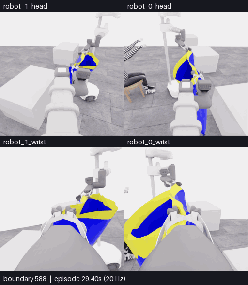

# PhyRC 2027

## 공식 착의 데모

https://github.com/user-attachments/assets/d2f347fe-712b-42f3-bdee-69d3fee2a47c

**주최 측이 제공한 착의 시연 · 35.8초 · 공식 사이트 표기 8배속**

[공식 원본 영상](https://emprise.cs.cornell.edu/phyrc/assets/c27/media/teleop-overhead.mp4) · [챌린지 안내](https://emprise.cs.cornell.edu/phyrc/challenge-2027/) · [영상 출처](docs/collection/assets/20261106-official-demo-inline/provenance.json)

## 0–50점 득점 과정

**픽업 5점 + 착의 45점 = 최대 50점**. 그림을 누르면 원본 크기로 볼 수 있습니다.

[항목별 점수와 성공 조건](docs/project/CHALLENGE_GUIDE.ko.md#2-50점은-어떻게-쌓이는가) · [공식 평가 정의](docs/competition/EVALUATION.md)

그림은 득점 과정을 설명하는 누적 예시이며, 실제 득점 순서는 달라질 수 있습니다. 누적 50점과 착의 성공 판정은 별도입니다. 이 저장소의 현재 성과는 아래에 구분해 표시합니다.

두 대의 **Stretch 4**로 마네킹에 티셔츠를 입히는 시뮬레이션 연구. 사람의 직접 조작과 **GPT Astra**로 시연을 수집하고, 관측과 행동을 검토해 다음 조작을 개선합니다.

| [**시연 영상**](docs/EPISODES.md) | [**E28 이후 계획**](docs/COLLECTION_PLAN.md) | [**Astra 코드·Hz**](docs/ASTRA.md) | [**클린 서버 시작**](docs/OPERATIONS.md) |
|:---:|:---:|:---:|:---:|
| E00–E28 전체 자료 | 옆에서 파지하고 입구 펼치기 | 관측부터 HDF5까지 | 설치·복원·검증·Codex CLI |

**현재(2026-11-13): 사용자 요청에 따라 E29 후반 +20결정 수집을 시작했습니다.** `20261113-astra-side-hem738-continue20-001`은 E28/738 행동 prefix를 재실행한 뒤 같은 손목 접근을 이어가는 실행이며 최종 결과는 아직 없습니다. **마지막 마감 시연은 E28(739전이)입니다.** 새 환경에서 파지·들기·운반과 손 접근을 수행했고 전수 QC를 통과했습니다. 로컬 공식 평가기는 **5/50점**, 픽업 5점·착의 **0점**, `success=false`입니다. 소매 통과와 50점 목표는 미달입니다. E29는 보존된 E28/738에서 분기합니다. [E28 영상](docs/collection/attempts/20261113-astra-side-hem-fresh-001/overview.mp4) / [장면 리뷰](docs/collection/reviews/20261113-astra-side-hem-fresh-001.ko.md) / [현재 상태·보존](docs/project/STATUS.md)

## 최근 시연

**E28 — 파지·운반 뒤 손과 입구 관계를 조정.** 픽업5점이며 손목·소매 통과는 확인되지 않았습니다.

[손 접근 MP4](docs/gallery/20261113-e28-hand-588-738/event.mp4) / [파지·펼침 MP4](docs/gallery/20261113-e28-opening-264-380/event.mp4) / [전체 overview](docs/collection/attempts/20261113-astra-side-hem-fresh-001/overview.mp4) / [장면 리뷰](docs/collection/reviews/20261113-astra-side-hem-fresh-001.ko.md)

왼쪽 robot_1, 오른쪽 robot_0, 위 head / 아래 wrist. 경계588–738의 20 Hz 기록을5 fps로 재생해4배 느리며 모델 대기는 제외합니다. <a href="docs/gallery/20261113-e28-hand-588-738/provenance.json">영상 출처</a>. E27과 이전 시연은 <a href="docs/EPISODES.md">전체 목록</a>에 보존합니다.

## 다음 수집

**E28에서 얻은 파지·운반 구간을 보존하고 손목 진입을 개선합니다.** E29는 E28/738부터 같은 첫 손목과 입구 관계를 이어가는 후반20결정 시도이며, E28/682는 미실행 비교 후보입니다. 아래 입구 펼침은 E28/380, 닫기 전 준비는 E28/264에서 따로 비교할 수 있습니다. 이전 `E27/928 same-arm` 후보는 과거 미실행 계획입니다.

[단계별 관측 기준과 새 시작점 선택](docs/COLLECTION_PLAN.md)

## 수집한 과정

<table>
<tr>
<td width="33%" valign="top"><strong>사람 직접 조작</strong>  집기·들기·운반의 부분 시연</td>
<td width="33%" valign="top"><strong>E07 협력 운반</strong>  Astra 공동 조작과 후속 분기의 원본</td>
<td width="33%" valign="top"><strong>E25 새 파지</strong>  파지 위치를 바꾸고 천의 동행 확인</td>
</tr>
</table>

각 이미지를 누르면 영상이 열립니다. **[전체 시연 목록](docs/EPISODES.md)**에서 E00–E27 영상, 관측 이미지, 원본 manifest와 직접 부모를 한 번에 찾을 수 있습니다.

## 코드와 재현

| 확인할 것 | 바로 가기 |
|---|---|
| 공개 RGB-D → Astra JSON → 두 로봇 명령 → 데이터 | [실제 함수와 행동 예제](docs/ASTRA.md) |
| 20 Hz 기록 / 60 Hz 제어 / 240 Hz 물리 | [주기와 실행 길이](docs/ASTRA.md#4-시간과-실행-길이) |
| 새 서버에서 저장소만 읽고 시작 | [준비물부터 복원·검증까지](docs/OPERATIONS.md), [Codex 작업 지침](AGENTS.md) |

GitHub에는 코드와 선별 영상이 있습니다. 전체 시연 HDF5와 필수 자산 복원에는 **접근 권한이 있는 비공개 백업**이 필요합니다. 새 서버 가이드에 고정 revision과 해시 검증 절차를 함께 남깁니다.

[공식 챌린지](https://emprise.cs.cornell.edu/phyrc/challenge-2027/) / [점수·규칙](docs/project/CHALLENGE_GUIDE.ko.md) / [현재 상태](docs/project/STATUS.md) / [기록 보관함](docs/ARCHIVE.md) / [주최 측 README](README.upstream.md) / [LICENSE](LICENSE) / [NOTICE](NOTICE) / [THIRD_PARTY](THIRD_PARTY.md)
