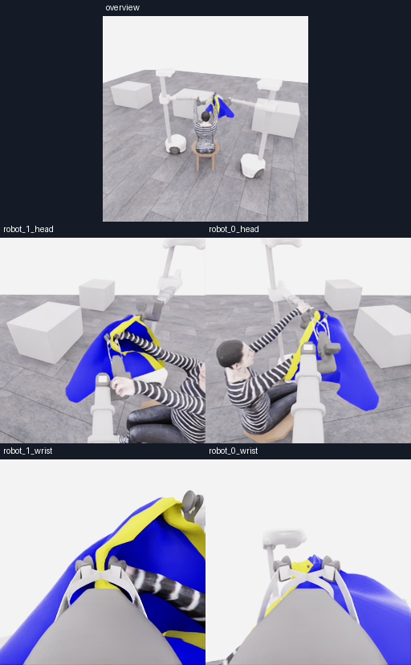
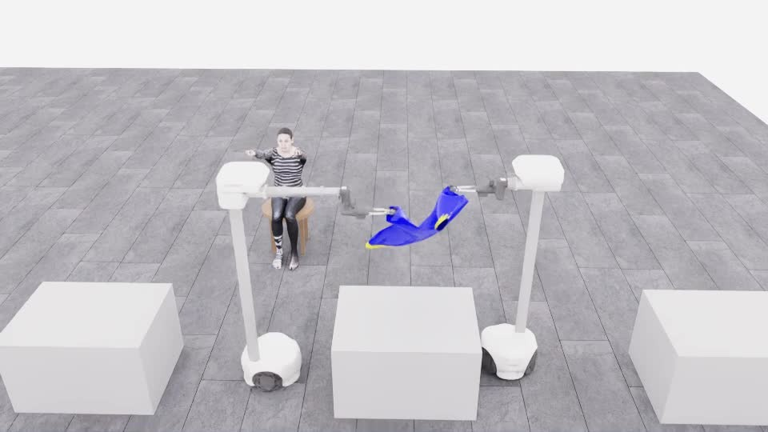
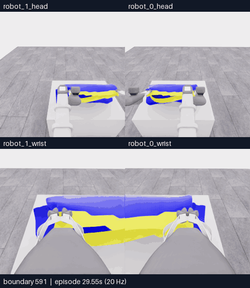

# PhyRC 2027

<!-- PHYRC_USER_REVIEW:START -->
> **이번 시연 종료 · 각 움직임 기록과 다음 전략 정리**
>
> 사용자 종료 지시에 따라 마지막 **135전이에서 추가 움직임 없이 정상 마감**했습니다. 아래는 마지막 기록 영상이며 live HOLD가 아닙니다.
>
> **다음 시도 계획:** 마지막 R0 단독 접근 **전** 상태로 돌아가, 두 로봇을 **마네킹의 왼손 쪽으로 함께 이동**시킨 뒤 공식 데모를 참고해 **옷을 양손에 모두 걸치는 방향**을 시험합니다. 이번에는 실행하지 않았습니다.
>
> 오른손 쪽은 R0, 왼손 쪽은 R1입니다. 마지막 구간에서 R0만 명령했지만 실제 파지점 XY 순변위는 **R0 41.57mm / R1 12.66mm**였습니다. 줄무늬 목표 도달·실제 충돌·소매 통과는 확정하지 못했습니다.

**[이번의 모든 움직임: 사용자 지시·명령·실제 이동·구간 GIF](docs/collection/reviews/20261116-user-guided-movement-ledger.ko.md)** · [다음 전략과 출발점](docs/COLLECTION_PLAN.md) · [마감·QC·백업 상태](docs/project/STATUS.md)

Run `20261116-astra-right-hand-hold10-001` · 마지막 hold-0002 · 관측 `48101e32d536f9ce` · 135전이 = 110 replay + 새25전이. 실제20Hz 기록의110–135 경계26장, 중간은4배 느리게 재생하고 시작·끝에 정지가 있습니다.

마감 직전 같은 관측의5카메라와 원본 보기

[overview](docs/collection/user-reviews/20261116-astra-right-hand-hold10-001/hold-0002/overview.png) · [robot_1_head](docs/collection/user-reviews/20261116-astra-right-hand-hold10-001/hold-0002/robot_1_head.png) · [robot_0_head](docs/collection/user-reviews/20261116-astra-right-hand-hold10-001/hold-0002/robot_0_head.png) · [robot_1_wrist](docs/collection/user-reviews/20261116-astra-right-hand-hold10-001/hold-0002/robot_1_wrist.png) · [robot_0_wrist](docs/collection/user-reviews/20261116-astra-right-hand-hold10-001/hold-0002/robot_0_wrist.png)

[첫 시연의 구간별 GIF](docs/gallery/20261116-m1-guided-segments/README.ko.md) · [복귀·R0 접근 GIF](docs/gallery/20261116-right-hand-hold10/README.ko.md) · [복귀 비교·R1 실제 움직임](docs/collection/reviews/20261116-right-hand-hold10-branch.ko.md) · [최종 실행 마감 기록](docs/collection/attempts/20261116-astra-right-hand-hold10-001/README.ko.md)
<!-- PHYRC_USER_REVIEW:END -->

[18장 슬라이드 PDF](docs/reports/20261114-e36-integrated-review/phyrc-e36-integrated-review.ko.pdf) · [텍스트·출처·검증](docs/reports/20261114-e36-integrated-review/README.ko.md)

## 현재 전략과 판단 근거

두 대의 **Stretch 4**로 티셔츠를 입히는 연구입니다. 이번 사용자 교정 시연은 마감했습니다. 다음 방향은 **R0 단독 접근 전 상태에서 두 로봇을 왼손 쪽으로 함께 옮겨 양손에 옷을 걸치기**입니다. 짧은 구간마다 실제 로봇 운동·천의 동행·양손과 자유 경계 관계를 확인할 계획이며, 소매 통과와 공식 득점은 별도로 검증합니다.

| 지금 필요한 정보 | 문서 |
|---|---|
| 실행할 방법·구간 예산·사용자 판단 | [현재 계획](docs/COLLECTION_PLAN.md) |
| 명령이 어떻게 천과 착의 상태를 바꾸는가 | [기전·관측·판별 실험](docs/MECHANISMS.ko.md) |
| 완료된 사실과 아직 확인할 것 | [현재 상태](docs/project/STATUS.md) |
| 지난 시도에서 남긴 결론과 근거 | [과거 결과 요약](docs/HISTORY_SUMMARY.ko.md) · [원본 보관함](docs/ARCHIVE.md) |
| 최신 연구와 이번 전략의 연결 | [착의 연구 분석](docs/collection/research/2026-11-16-recent-dressing-resources.ko.md) · [checkpoint·실행 효과](docs/collection/research/2026-11-16-checkpoint-effect-feedback.ko.md) |

현재까지 정상 평가의 최고 원점수는 **5/50, 착의 득점0**입니다. 파일 QC, 파지 성공, 손 근접과 첫 소매 통과를 구분합니다. 과거의 시간순 작업 기록은 보관함에서 찾고, 여기서는 현재 선택과 그 근거를 관리합니다.

## 공식 착의 데모

https://github.com/user-attachments/assets/d2f347fe-712b-42f3-bdee-69d3fee2a47c

**주최 측이 제공한 착의 시연 · 35.8초 · 공식 사이트 표기 8배속**

[공식 원본 영상](https://emprise.cs.cornell.edu/phyrc/assets/c27/media/teleop-overhead.mp4) · [챌린지 안내](https://emprise.cs.cornell.edu/phyrc/challenge-2027/) · [영상 출처](docs/collection/assets/20261106-official-demo-inline/provenance.json)

## 0–50점 득점 과정

**픽업 5점 + 착의 45점 = 최대 50점**. 그림을 누르면 원본 크기로 볼 수 있습니다.

[항목별 점수와 성공 조건](docs/project/CHALLENGE_GUIDE.ko.md#2-50점은-어떻게-쌓이는가) · [공식 평가 정의](docs/competition/EVALUATION.md)

그림은 득점 과정을 설명하는 누적 예시이며, 실제 득점 순서는 달라질 수 있습니다. 누적 50점과 착의 성공 판정은 별도입니다. 이 저장소의 현재 성과는 아래에 구분해 표시합니다.

두 대의 **Stretch 4**로 마네킹에 티셔츠를 입히는 시뮬레이션 연구. 사람의 직접 조작과 **GPT Astra**로 시연을 수집하고, 관측과 행동을 검토해 다음 조작을 개선합니다.

| [**시연 영상**](docs/EPISODES.md) | [**후속 분석·설계**](docs/COLLECTION_PLAN.md) | [**Astra 코드·Hz**](docs/ASTRA.md) | [**클린 서버 시작**](docs/OPERATIONS.md) |
|:---:|:---:|:---:|:---:|
| E00–E36·사용자 교정 기록 | 양손 걸침 계획·사용자 HOLD | 관측부터 HDF5까지 | 복원·검증·새 시연 |

**E36이11결정·933전이로 정상 마감해 QC933/933을 통과했고, 당시 수집 배치를 종료했습니다. E37–E39는 실행하지 않았습니다.** 로컬5/50은 replay 구간의 픽업5점이며 새 착의 득점0·success=false입니다. [현재 상태와 고정 백업 검증](docs/project/STATUS.md) / [최신 후속 계획](docs/COLLECTION_PLAN.md). 새 시스템이나 자동 학습을 구현했다는 의미는 아닙니다.

## 앞선 기준 시연 · E36

**E34의 손목 근처 형상을 출발점으로, 같은 손목·연결 전완 방향에 맞춰 몸쪽으로 접근하는 조작을 시험했습니다.** 10 act 뒤 모델이 종료를 요청해 총11결정·12모델 호출로 마감했으며 새 구간은98전이·4.9시뮬레이션초입니다. 픽업5점은 새 조작 전 replay에서 얻었고, 새 착의 득점은 없습니다.

[E36 GIF 페이지](docs/gallery/20261114-e36-overview/README.ko.md) / [전체 MP4](docs/collection/attempts/20261114-astra-wrist-body835-001/overview.mp4) / [E36 실행 기록](docs/collection/attempts/20261114-astra-wrist-body835-001/README.ko.md) / [이전 E35 GIF](docs/gallery/20261114-e35-overview/README.ko.md) / [E34 GIF](docs/gallery/20261114-e34-overview/README.ko.md)

실제 원본 영상 GIF · 전체0–46.65초 · 원본256×256 · 20fps에서2프레임마다1장을 샘플링한467프레임. 기본10fps이며 마지막 프레임만50ms로 유지해 원본 재생 길이를 보존합니다. 원본 MP4는933프레임이며 모델 대기는 제외합니다. 앞835전이는 E34 행동 prefix의 새 환경 재실행으로, 정확한 천 checkpoint나 독립 성공 시연이 아닙니다. <a href="docs/gallery/20261114-e36-overview/provenance.json">GIF 변환·검증</a> · <a href="docs/collection/attempts/20261114-astra-wrist-body835-001/manifest.json">영상·원본 근거</a>.

## 사용자 판단으로 이어가는 시연

모델의 종료 제안·정체·구간 예산·목표 득점에서는 물리와 기록기를 유지한 HOLD로 전환합니다. 같은 관측의 공개5카메라를 이 페이지 맨 위에 게시하고, 사용자가 계속·방향/방법 변경·다른 checkpoint·종료를 결정합니다. 무응답 동안은 대기를 유지합니다.

[실행 인계서](docs/collection/research/2026-11-16-user-guided-resume.ko.md) · [환경 복원](docs/OPERATIONS.md) · [Astra 관측·행동 경로](docs/ASTRA.md)

## 수집한 과정

<table>
<tr>
<td width="33%" valign="top"><strong>사람 직접 조작</strong>  집기·들기·운반의 부분 시연</td>
<td width="33%" valign="top"><strong>E07 협력 운반</strong>  Astra 공동 조작과 후속 분기의 원본</td>
<td width="33%" valign="top"><strong>E25 새 파지</strong>  파지 위치를 바꾸고 천의 동행 확인</td>
</tr>
</table>

각 이미지를 누르면 영상이 열립니다. **[전체 시연 목록](docs/EPISODES.md)**에서 E00–E36 기록의 영상, 관측 이미지, 원본 manifest와 직접 부모를 한 번에 찾을 수 있습니다.

## 코드와 재현

| 확인할 것 | 바로 가기 |
|---|---|
| 공개 RGB-D → Astra JSON → 두 로봇 명령 → 데이터 | [실제 함수와 행동 예제](docs/ASTRA.md) |
| 20 Hz 기록 / 60 Hz 제어 / 240 Hz 물리 | [주기와 실행 길이](docs/ASTRA.md#4-시간과-실행-길이) |
| 새 서버에서 저장소만 읽고 시작 | [준비물부터 복원·검증까지](docs/OPERATIONS.md), [Codex 작업 지침](AGENTS.md) |

GitHub에는 코드와 선별 영상이 있습니다. 전체 시연 HDF5와 필수 자산 복원에는 **접근 권한이 있는 비공개 백업**이 필요합니다. 새 서버 가이드에 고정 revision과 해시 검증 절차를 함께 남깁니다.

[공식 챌린지](https://emprise.cs.cornell.edu/phyrc/challenge-2027/) / [점수·규칙](docs/project/CHALLENGE_GUIDE.ko.md) / [현재 상태](docs/project/STATUS.md) / [기록 보관함](docs/ARCHIVE.md) / [주최 측 README](README.upstream.md) / [LICENSE](LICENSE) / [NOTICE](NOTICE) / [THIRD_PARTY](THIRD_PARTY.md)
