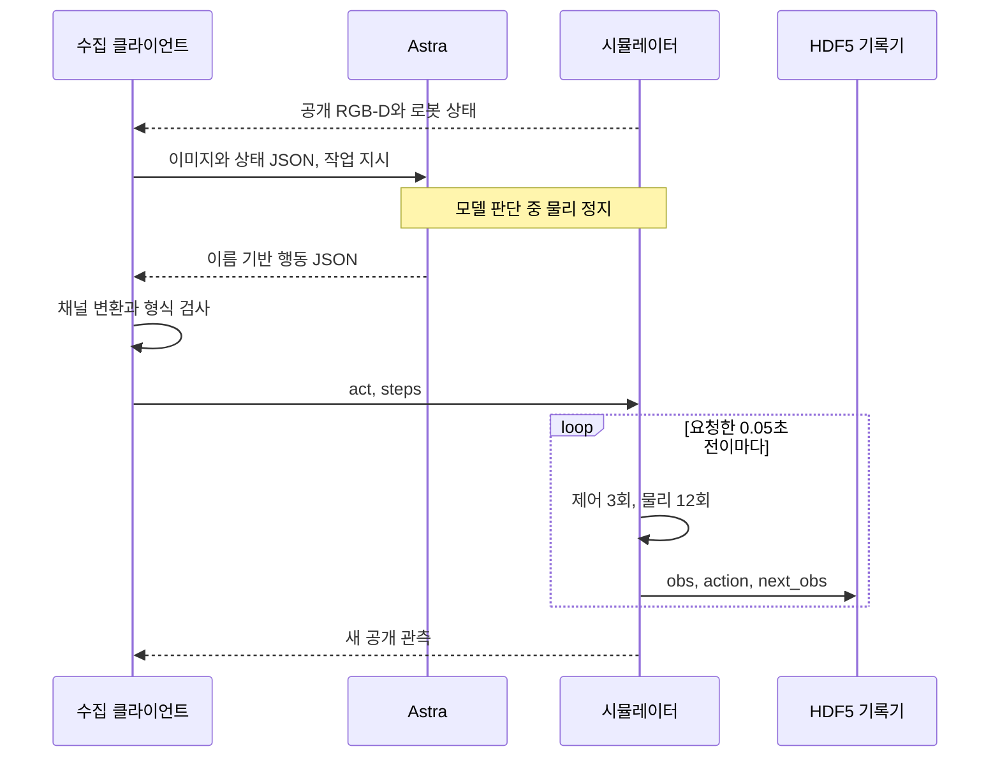

# Astra 수집 코드

[메인](../README.md) | [시연 목록](EPISODES.md) | [다음 수집](COLLECTION_PLAN.md) | [Astra 코드](ASTRA.md) | [클린 서버](OPERATIONS.md)

`gpt-6-astra`는 공개 카메라와 로봇 상태를 읽고 짧은 행동을 제안합니다. 수집기가 응답을 검사하고 두 로봇에 적용한 뒤, 실제 관측과 행동을 HDF5에 기록합니다. **모델은 20 Hz로 호출되지 않습니다.** E27까지 사용한 수집 경로를 유지하며, 2026-11-13에는 별도 `coordinated-side-hem-wrists` 전략으로 E28 `20261113-astra-side-hem-fresh-001`을 새 reset에서 수집했습니다. E28은 40결정·739전이로 마감해 전수 QC 739/739를 통과했으며 pickup 5점·착의 0점, `success=false`입니다. [환경·연결 검사](project/sessions/20261113-environment-setup.ko.md) / [전략 검토](collection/research/2026-11-13-side-hem-wrists.ko.md) / [E28 결과](collection/attempts/20261113-astra-side-hem-fresh-001/manifest.json)

**E29 `20261113-astra-side-hem738-continue20-001`은 2026-11-13 22:07:44 UTC에 마감했습니다.** clean source `2baebcc`에서 E28/738 prefix와 새 history682/714 뒤 최대20결정을 허용했지만,10 act 뒤11번째 결정에서 `finish_episode`를 선택했습니다.12호출(질의 후속1회),834전이=738 replay+42 model+54 settle이며 종료 중립은0입니다. 전수 QC834/834 통과, raw5·새 구간 득점0·착의0·success=false입니다. 예산 소진이 아닌 actor의 국소 판단이며 새 실행은 시작하지 않았습니다. [현재 상태](project/STATUS.md) / [추가 구간 리뷰](collection/reviews/20261113-astra-side-hem738-continue20-001.ko.md) / [다음 비교](COLLECTION_PLAN.md)

## 1. 관측부터 기록까지



| 단계 | 실제 코드 | 하는 일 |
|---|---|---|
| 관측 준비 | [`prepare_observation()`](../participant/collection/codex_client.py#L397) | 허용된 상태를 JSON으로 만들고 RGB 5장과 depth 요약을 준비 |
| 모델 호출 | [`Actor.invoke()`](../participant/collection/codex_actor.py#L305) | 격리된 Codex CLI에 이미지, 프롬프트, 응답 스키마 전달 |
| 행동 변환 | [`named_actions.pack()`](../participant/collection/named_actions.py#L49) | 채널 이름을 고정 순서의 `(2,9)` 배열로 변환 |
| 응답 검사 | [`validate_decision()`](../participant/collection/codex_client.py#L362), [`validate_action()`](../participant/collection/boundary.py#L20) | 필드, 숫자, 유한값, 범위, 실행 길이 검사 |
| 실행 요청 | [`Simulator.dispatch()`](../participant/collection/codex_client.py#L532), [`parse_request()`](../scripts/collect_operator.py#L56) | 별도 수집 프로세스에 JSON Lines 요청, 중복 요청과 오래된 관측 경계 검사 |
| 동기 실행 | [`Operator.act()`](../participant/collection/boundary.py#L62), [`DressingEnv.step()`](../src/PhyRC_Sim/Policy/environment.py#L268) | 두 로봇을 함께 실행하고 전이마다 관측과 실제 행동 기록 |
| 마감 검사 | [`validate_capture()`](../participant/collection/validate_capture.py#L169) | 닫힌 파일의 전체 전이, 시간, 해시, 완료 표식 검사 |

## 2. 모델 입력

기준은 [`policy_interface.json`](../config/policy_interface.json)의 공개 관측 목록입니다. `prepare_observation()`은 이 목록의 필드만 읽습니다.

| 입력 | 런타임 형태 | Astra에 전달하는 표현 |
|---|---|---|
| RGB | `(5,256,256,3)` | PNG 5장 |
| Depth와 valid mask | 각각 `(5,256,256,1)` | 카메라별 16×16 깊이 격자, 선택적 손목 depth 패널 |
| 관절 위치와 속도 | 각각 `(2,13)` | 로봇별 상태 JSON |
| Base와 grasp pose | 각각 `(2,7)` | 위치와 quaternion, grasp는 로봇 base 기준 |
| 제어기 목표와 직전 행동 | 각각 `(2,9)` | 목표와 실제 움직임을 비교할 상태 |
| 기타 공개 상태 | 계약에 정의 | Base 속도, 손끝 상태, 그리퍼 의도, 시뮬레이션 시각 |

카메라 배열은 `overview`, `robot_0_wrist`, `robot_1_wrist`, `robot_0_head`, `robot_1_head` 순서입니다. 갤러리는 **왼쪽 robot_1, 오른쪽 robot_0**으로 보여 줍니다. 표시 순서만 바꾸며 센서 픽셀과 행동 행 번호는 바꾸지 않습니다.

깊이 격자의 한 값은 해당 16×16 픽셀 타일의 유효한 광축 깊이 Z 중앙값입니다. 선택적 [`depth_query`](../participant/collection/depth_query.py#L57)는 **현재 한 카메라의 최대 8개 픽셀**을 조회합니다. 질의 중 물리는 진행하지 않고, 같은 관측으로 행동 응답을 한 번 더 받습니다. 보이지 않는 천 내부, 입구 정체, 접촉이나 소매 통과를 알려 주는 기능은 아닙니다.

## 3. 행동 계약

행동은 **`float32 (2,9)`**, 값의 범위는 **`[-1,1]`**입니다. 행 0은 `robot_0`, 행 1은 `robot_1`이며 같은 전이에서 함께 실행합니다.

| 열 | 이름 | 의미 |
|---|---|---|
| 0–2 | `base_forward`, `base_left`, `base_CCW_yaw` | 로봇 기준 전진, 왼쪽 이동, 반시계 회전 속도 |
| 3–4 | `lift`, `arm_extension` | 리프트와 팔 연장 속도 |
| 5–7 | `wrist_yaw`, `wrist_pitch`, `wrist_roll` | 손목 회전 속도 |
| 8 | `gripper` | `>0.5` 닫기, `<-0.5` 열기, 그 사이는 이전 의도 유지 |

앞의 8개 값은 **정규화된 속도 비율**입니다. 위치, 이동 거리, 각도 차이가 아닙니다. [`pack()`](../participant/collection/named_actions.py#L49)은 값을 재배열할 뿐 clipping, 속도 보정, IK 또는 의도 추측을 하지 않습니다. 물리 단위와 backend 방향 변환은 환경의 [`decode_action()`](../src/PhyRC_Sim/Policy/contract.py#L56)이 담당합니다.

다음은 **스키마 설명용 예시**이며 실제 시연의 정답 행동이 아닙니다. 양쪽 리프트에 작은 양의 속도 명령을 4전이, 즉 0.2초 동안 요청합니다. `gripper: 0`은 현재 그리퍼 의도를 유지합니다.

```json
{
  "tool": "act",
  "action": {
    "robot_0": {
      "base_forward": 0, "base_left": 0, "base_CCW_yaw": 0,
      "lift": 0.03, "arm_extension": 0,
      "wrist_yaw": 0, "wrist_pitch": 0, "wrist_roll": 0,
      "gripper": 0
    },
    "robot_1": {
      "base_forward": 0, "base_left": 0, "base_CCW_yaw": 0,
      "lift": 0.03, "arm_extension": 0,
      "wrist_yaw": 0, "wrist_pitch": 0, "wrist_roll": 0,
      "gripper": 0
    }
  },
  "steps": 4,
  "stage": "lift",
  "visual_assessment": "uncertain",
  "reason": "Apply a short lift command, then inspect whether the cloth follows."
}
```

이 예시는 [`response_schema(SCHEMA)`](../participant/collection/named_actions.py#L30)의 이름 기반 응답입니다. Pixel query를 켠 첫 응답에는 추가로 `depth_query`가 필요하며, 바로 행동할 때는 `null`입니다. 질의 후 응답은 위의 원래 행동 스키마로 돌아옵니다. `stage`와 `visual_assessment`는 모델의 의도와 시각적 판단이며 공식 득점이 아닙니다.

[`stop`](../participant/collection/boundary.py#L82)은 중립 명령 1전이를 실행하고, `finish_episode`는 추가 물리 진행 없이 기록을 마감합니다. 두 응답 모두 행동값은 전부 0, `steps=1`이어야 합니다.

## 4. 시간과 실행 길이

| 단위 | 실제 의미 | 코드 |
|---|---|---|
| Astra 호출 | 관측 한 번을 판단하는 실제 경과 시간. 기다리는 동안 물리는 정지 | [`Actor.invoke()`](../participant/collection/codex_actor.py#L305) |
| 행동 결정 | 같은 명령을 1–20전이 실행. 최대 1초의 시뮬레이션 시간 | [`validate_action()`](../participant/collection/boundary.py#L20) |
| 20 Hz 전이 | `obs → action → next_obs` 한 묶음, 0.05초 | [`Operator.act()`](../participant/collection/boundary.py#L62) |
| 60 Hz 제어 | 전이당 제어기 3회 실행 | [`DressingEnv.step()`](../src/PhyRC_Sim/Policy/environment.py#L268) |
| 240 Hz 물리 | 전이당 물리 12회 진행 | [`_tick()`](../src/PhyRC_Sim/Policy/environment.py#L118) |

현재 이름 기반 행동과 pixel query 경로는 `exec`, `plan-size=1`을 요구합니다. 일반 [`plan-size>1`](../participant/collection/plans.py)은 최대 3개 행동 구간을 미리 정하는 별도 기능이며 구간 사이에 모델이 새 관측으로 판단하지 않습니다. [`post_action_settle_steps`](../participant/collection/codex_client.py#L1241)는 움직임 뒤 중립 전이를 별도 기록합니다. 0 명령에서도 기존 제어기 목표를 따라 관절이나 천이 계속 움직일 수 있습니다.

**수집 시간과 대회 평가 시간은 다릅니다.** 수집은 모델 호출 경과와 시뮬레이션 시간을 나눠 기록합니다. [대회 정책 평가](competition/POLICY.md#2-inference-adapter-connecting-your-model-to-the-simulator)의 시간 예산에는 시뮬레이션 시간과 정책 추론 시간이 함께 포함됩니다. 호출 경과는 Docker와 CLI 준비, 통신, 서비스 대기, 생성 등을 포함하며 순수 모델 추론 시간으로 해석하지 않습니다.

## 5. 기록과 재실행

[`DatasetWriter.append()`](../src/PhyRC_Sim/Policy/training_dataset.py#L87)는 인접 tick, 0.05초 간격, 배열 형식, `next_obs.previous_action`과 실제 행동의 일치를 검사한 뒤 저장하고 flush합니다.

| 저장 위치 | 내용 |
|---|---|
| `policy.hdf5 / data/demo_0/obs`, `next_obs` | 카메라별 공개 RGB-D와 로봇 상태 |
| `policy.hdf5 / data/demo_0/actions` | 실제 적용한 `(N,18)` 행동. 런타임의 `(2,9)`를 펼친 형태 |
| `audit.hdf5`, 평가 파일 | 시간 경계와 별도 점수 검수. Actor 입력에서 제외 |
| `capture.json`, `validation.json` | 완료 여부, 파일 해시, 전수 검사 결과 |

기본 `reward=0`, 마지막 `done`, `capture complete`는 착의 성공을 뜻하지 않습니다. 파일 검사 통과와 학습 승인은 별도이며 `validate_capture()`의 `training_approval`은 `unreviewed`로 시작합니다.

[`load_replay_prefix()`](../participant/collection/continuation.py#L129)는 마감과 전수 검사가 끝난 원본의 해시를 확인하고 행동 prefix를 읽습니다. 새 환경에서 같은 행동을 다시 실행해 **새 관측을 기록**하며, 동일한 천 상태를 복원하는 checkpoint가 아닙니다. 새 actor의 첫 입력에 넣는 과거 이미지는 [새 재실행 중 얻은 공개 관측](../participant/collection/codex_client.py#L448)입니다. 원본 actor 세션을 복사하지 않습니다.

재실행, 새 모델 행동, 제어기 정착, 중단 정리는 서로 구분합니다. 같은 prefix를 공유하는 분기를 독립 성공 시연이나 별도 검증 출처로 세지 않습니다.

## 6. 모델과 검수의 분리

실제 수집 경로는 **Codex CLI 0.166.0의 `exec`, `gpt-6-astra`, `ultra`**입니다. [`Actor._provision()`](../participant/collection/codex_actor.py#L240)은 별도 Docker 파일시스템과 내부망, 제한된 송신 proxy를 구성합니다. 저장소, 평가 자료, simulator handle을 actor에 마운트하지 않습니다.

[`Actor._cli()`](../participant/collection/codex_actor.py#L265)는 웹 검색과 개발 도구 기능을 비활성화하고, [`_read_result()`](../participant/collection/codex_actor.py#L87)는 도구 실행 이벤트가 섞인 응답을 거부합니다. 같은 episode는 CLI `resume`으로 이어가며, 실패한 호출 뒤 자동으로 행동 이력을 이어 붙이지 않습니다. 공개 이미지도 픽셀로 다시 저장해 원래 파일명과 메타데이터를 제거합니다.

점수와 내부 기하는 별도 검수에만 사용합니다. 공개 자료에는 선별한 입력과 최종 행동, 결과 요약만 남기며 인증 정보, 원시 추론, 이벤트 로그, 세션 DB는 게시하지 않습니다. [수집 계획](COLLECTION_PLAN.md)의 E28 전략은 **마감됐으며 착의 추가 득점은 0점**입니다. [마감 결과와 다음 방향](collection/research/2026-11-13-e28-outcome-e29-direction.ko.md)을 보존하며, 구현·연결 검사·기술 QC 통과를 착의 완료 실적으로 포함하지 않습니다.
