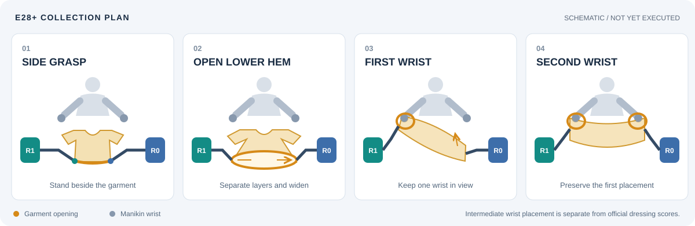
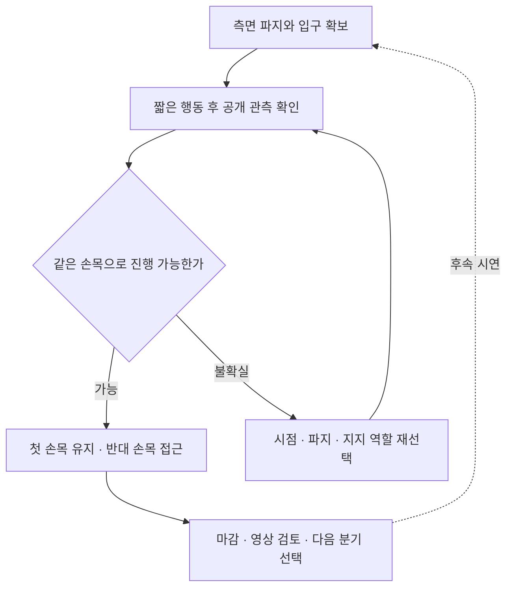

# 다음 수집

[메인](../README.md) | [시연 목록](EPISODES.md) | [다음 수집](COLLECTION_PLAN.md) | [Astra 코드](ASTRA.md) | [클린 서버](OPERATIONS.md)

**현재: E30을 2026-11-13 23:02:50 UTC에 마감했고 E31은 준비 단계입니다.** E30은 E28/738에서 같은 손의 낮춤 → 대각선 방향 변경 → 조건부 올림을 분리해 시험했습니다.18 act 뒤19번째 결정에서 `finish_episode`,20호출·915전이 전수 QC 통과, 로컬5/50·새 구간 득점0·착의0·success=false이며 고정 원본 백업 재다운로드·227개 member 검증을 마쳤습니다. [E30 마감](project/sessions/20261113-e30-close.ko.md) / [공개 리뷰](collection/reviews/20261113-astra-diagonal738-001.ko.md) / [결정·시간 분석](collection/reviews/20261113-decision-budget/E30/README.ko.md)

| E31 계획 조건 — 아직 시작하지 않음 | 값 |
|---|---|
| 고유 run / 직접 parent·source group | `20261113-astra-diagonal682-001` / 둘 다 `20261113-astra-side-hem-fresh-001` (E28) |
| 바꿀 요소 | 출발 경계738→682. 늦은 접힘 이전의 손·입구 관계 비교 |
| prefix / history |682 / 새 replay 관측632·668 |
| 유지 전략 | `coordinated-diagonal-entry`; 같은 손·유용한 지지를 유지하며 조건부 낮춤·한 축 방향 변경·올림을 따로 관측 |
| 예산 / 검토 | 최대20개 새 결정, 총1,400전이, review10. 최악 설계 `682 +20×(20+6)+1=1,203` |
| 모델·입력 | Codex CLI0.166.0 / exec / gpt-6-astra / ultra, named actions·pixel depth query·wrist depth panel·plan1 |
| 유지 설정 | motion-only settle6, 모델 호출 제한180초, 단계별 시간 계측 |
| 제외 | 미적용 피드백 큐 패치 활성화·실시간 사람 지시 주입·동시 두 번째 simulator |

[E31 분기 계획과 검수 기준](project/sessions/20261113-e31-plan.ko.md) / [전체 원본 해시·QC를 검사한 CPU retry-plan](collection/retry-plans/20261113-e31-e28-682-diagonal-entry.json). 실제 실행 source·시작 시각은 시작 후 attempt에서 별도로 기록합니다.

**사용자가 당분간 시연→분석→시연을 자동으로 이어가도록 승인했습니다.** E30 이후에도 매 시도마다 확인을 요청하지 않고, 단일 수집 마감 → 전수 QC·고정 원본 백업 검증 → 공개 관측·별도 점수와 시간 분석 → 다음 방법·유효 출발점 선택 순서로 진행합니다. 기본 한도는 새 결정20개로 유지해 비교하고, 정체 시 같은 예산만 늘리기보다 접근이나 출발점을 바꿉니다. 최대20개는 의무 실행 수가 아니며 `finish_episode`와 기존 종료 조건은 유지합니다. 주요 결과와 변경 이유를 보고하고, 사용자의 모아진 피드백은 다음 시도에 반영합니다. 사용자가 중지하거나 방향을 바꾸면 그 지시를 우선합니다. 미적용 피드백 큐 패치는 이 자동 반복에 포함하지 않습니다.

**마지막 마감 시연은 E30입니다.** 실행 source는 `7eaae3e6b56ce938237b873bcb1540470a449b79`, 시작 시 clean입니다.738 replay +87 model +90 settle =915전이이며 새177전이·8.85시뮬레이션초입니다. 최대20결정 중19개를 사용했고 남은1개는 새 run에 합산하지 않습니다. 종료는 D18 `finish_episode`이며 예산 소진·10점 도달·timeout 종료가 아닙니다. 픽업5점은 재실행 중371에서 얻었고 새 구간 득점은0입니다.

**다음 E31은 예산을 늘리기보다 출발점만 바꾸어 비교합니다.** E30에서 분리한 낮춤·회전·올림은 같은 손의 천 관계를 바꾸었지만 통과와 새 득점은 확인되지 않았습니다. E28/682에서 같은 전략·20결정을 사용해 늦게 접힌 접근 이전의 관계를 비교합니다. E30/886·915는 진단 자료이며 최신이라는 이유로 우선 출발점으로 삼지 않습니다. E28/738과 E29/784는 과거 비교점으로 보존합니다. actor의 국소 종료 판단은 과제 불가능성의 증거가 아닙니다.

사용자가 제안한 **노란 경계 후보를 마네킹 손목 아래로 낮추기 → 대각선 방향으로 회전하기 → 조건이 맞으면 올리기**는 [후속 비교 가설](collection/research/2026-11-13-user-diagonal-entry-feedback.ko.md)로 보존했습니다. E29 actor에는 전달하지 않았습니다. 비슷한 개별 행동이 있었다고 제안 전체가 실행·검증됐다고 보지 않으며 마감 리뷰에서 실제 순서·관측과 비교합니다. 원래 E28은 source `9f79772`의 새 reset, E29는 clean source `2baebcc381d707fd5aca5f69ea7518d326e8a80a`에서 시작한 같은 E28 계보입니다.



## 조작 목표

| 단계 | 행동 방향 | 다음 단계 전 확인 |
|---|---|---|
| 측면 파지 | 두 로봇이 옷의 앞이 아닌 양옆으로 이동해 아래쪽 경계를 잡기 | 그리퍼 이동에 천이 함께 움직이는지, 서로 다른 경계를 잡았는지 |
| 아래 입구 펼치기 | 작은 높이 차·손목 방향 변화로 두 경계를 분리한 뒤 옆 간격 조절 | 실제 입구가 넓어지는지, 같은 바깥 천만 팽팽해지는지 |
| 한쪽 손목 | 관측이 좋은 손목 하나를 목표로 정하고 펼친 입구를 먼저 걸치기 | 같은 손목과 입구의 관계가 이어지는지, 파지가 미끄러지지 않는지 |
| 양쪽 손목 | 첫 손목의 걸림을 유지하면서 반대쪽 높이·방향·파지를 조절하기 | 첫 접촉을 잃지 않고 반대 손목까지 연결되는지 |

여기서 **손목은 마네킹의 손목**입니다. 펼침 폭은 공개 영상과 깊이에서 확인하며, 과도하게 당기는 것을 목표로 삼지 않습니다. 손목에 걸치는 중간 목표와 [공식 소매 통과·착의 득점](competition/EVALUATION.md)은 별도입니다.

## 출발점

| 출발점 후보 | 비교할 부분 | 제한 |
|---|---|---|
| **E28/738 — 이전 방법 비교 기준** | 종료 중립739 직전. E29의 추가 보정 전부터 진입 방법 변경 | 양측 국소 천 동행과 접근은 관측했으나 입구 정체·손 통과 미확인. 새로운 replay에서 재확인 |
| **E28/682 — E31 선택** | 더 이른 손·입구 관계에서 높이·방향·시점을 한 요소씩 변경 | 최종 상태가 더 좋거나 더 나쁘다고 점수만으로 판정하지 않음 |
| **E28/380 — 펼침 비교** | 들어 올린 경계·입구 후보를 유지하며 차등 높이·손목 방향 비교 | 픽업 5점이 열린 통로·반대 밑단 층의 증거는 아님 |
| **E28/264 — 닫기 전 준비** | 그리퍼 배치와 명시적 닫힘 대기의 별도 비교 | 당시 0점. E28의 파지가 실패했다는 전제로 사용하지 않음 |
| **E29/784 — 선택적 방향 비교** | 추가 손목 방향·높이 변화가 남은 중간 상태 | 지지와 입구 정체는 불확실. 마지막834보다 성공적이라는 뜻은 아님 |

[E29 고정 백업](project/sessions/20261113-e29-backup-verification.json)의 재다운로드·155개 member 검증도 완료했습니다. E29/784는 기술적 재실행 준비 조건을 만족하지만 지지·통과·학습 승인을 뜻하지 않습니다.

**E28은 parent와 replay prefix가 없는 새 reset**이며 source group은 `20261113-astra-side-hem-fresh-001`입니다. E28의 네 경계, E29/784와 후속 replay 분기는 같은 E28 계보입니다. 과거 E07/264·E16/470·E25 파지·E27 접근 자료는 비교 이력으로 보존하며 E28의 직접 부모로 바꾸지 않습니다.

닫힌 원본의 해시·전체 QC·source group을 검사한 CPU 분기 계획은 다음에 저장했습니다. 두 계획 모두 **시뮬레이터를 실행하지 않았으며 정확한 천 상태 checkpoint가 아닙니다.** [고정 백업의 재다운로드·402개 member 검증](project/sessions/20261113-e28-backup-verification.json)을 완료했습니다. 새 run ID·전략·예산으로 실행해야 하며 아래 계획 파일 생성 자체는 실행이 아닙니다.

```text
output/retry-plans/20261113-e28-738-first-wrist.json
output/retry-plans/20261113-e28-682-entry-comparison.json
```

[738 공개 계획](collection/retry-plans/20261113-e28-738-first-wrist.json) / [682 공개 계획](collection/retry-plans/20261113-e28-682-entry-comparison.json). 공개 계획도 actor 입력이 아닌 개발용 분기 기록입니다.

같은 검사를 새 계획 이름으로 수행하는 예시입니다. 기존 계획 파일은 덮어쓰지 않습니다.

```bash
PYTHONPATH=.:src/PhyRC_Sim .venv/bin/python -m participant.collection.retry_plan \
  --run-id 20261113-astra-side-hem-fresh-001 --steps 738 \
  --reason 'Preserve E28 support and approach; continue the same first wrist relation' \
  --plan-id UNIQUE_REVIEW_PLAN
```

`--replay-prefix-steps N`은 `[0,N)`을 재실행하고 원본 경계는 `next_obs[N-1]`입니다. 738 후보의 과거 관측은682·714, 682 후보는632·668을 새 replay 중 다시 기록해 사용할 수 있습니다. 과거 원본 이미지를 현재 관측처럼 제공하지 않습니다. `max-steps`는 prefix·새 행동·정착·종료를 모두 포함해야 하며 검토 점수 기준은 재실행 구간의 5점보다 높게 둡니다.

## E28에서 사용한 구현과 실행 조건

[`coordinated-side-hem-wrists`](../participant/collection/codex_client.py)는 기존 same-arm 전략의 재파지 금지를 가져오지 않는 별도 프롬프트 경로입니다. `exec`, `plan-size=1`을 요구하며 공식 행동 범위·물리·채점은 바꾸지 않습니다. 단계 판단과 파지 성공은 모델의 시각 가설이며 런타임이 접촉을 인증하는 기능은 아닙니다.

처음 테이블에서 준비할 때는 로봇별 파지 변경을 한 번으로 제한해 같은 실패를 반복하지 않습니다. 빈 그리퍼의 최초 파지 획득은 이 재파지 횟수에 포함하지 않습니다. 이후 **새로운 착의 진행**에 필요한 파지 변경은 허용합니다. 한 번에 한쪽만 열고, 유지할 손목/팔 관계를 지탱하는 다른 지지를 먼저 확인하며, 최대 두 번의 짧은 배치 보정 뒤 다시 관측합니다. 실패한 준비 구간의 이름만 바꿔 재시도 횟수를 초기화하지 않습니다.

| 항목 | E28 시작 시 적용한 값 |
|---|---|
| 모델 경로 | Codex CLI 0.166.0 / exec / gpt-6-astra / ultra |
| 입력·행동 | named actions, pixel depth query, wrist depth panel, plan-size 1 |
| 작은 배치 | 40판단, 총 1,400전이 한도, 동작 후 중립 정착 최대 6전이, 호출 제한 180초 |
| 시간 계측 | 단계별 wall 시간 profile 활성화. 물리·렌더·기록 조건은 유지 |
| 첫 득점 검토 | `review-points=10`: 기존 픽업 5점을 넘어서는 착의 득점 확인 후 마감·검수 |
| 이후 | 검증된 중간 경계에서 한 요소씩 바꿔 분기. 보존된 prefix 점수보다 높은 다음 검토 기준을 선택하고 50점·success를 따로 확인 |

E28은 실제로 **739전이 = 516 모델 행동 + 222 정착 + 1 종료 중립**을 기록했습니다. 40판단·46호출에는6회의 물리 진행 없는 depth 질의가 포함됩니다. 10점 기준에 도달하기 전에 결정 예산으로 마감했으며 전이 예산이나 모델 호출 수를 점수로 해석하지 않습니다. 후속 실행에서는50점 목표와 별도로 raw 점수·착의 점수·success를 기록합니다.

## E30 결과와 다음 예산 판단

E30은 최대20결정 중19결정(18 act + D18 finish)·20호출로 마감했습니다. 총1,850.453초(약30.84분)는 초기화·738 replay를 포함합니다. 환경 경로764.021초는 replay617.940초와 새 구간146.081초로 나뉘며 actor 경로는1,035.999초입니다. actor+새 구간 환경은1,182.081초(약19.70분)로,19결정당 약62.2초입니다. 초기화와 전체 orchestration을 제외한 분석 합계이며 전체 수집 시간과 구분합니다. 낮춤/roll/올림 및 낮춤/pitch/올림을 관측했지만 추가 득점·확인된 손목 통과가 없으므로 득점당 효율을 산출하지 않습니다. **남은1결정을 더 주거나 같은 경계에서 한도를 늘리기보다 더 이른682의 손·경계 관계를 비교합니다.** [세부 수치와 구간별 근거](collection/reviews/20261113-decision-budget/E30/README.ko.md)

## E28 종료 조건과 추가 시간

E28은 **40개 결정 예산을 소진해 종료**했습니다. 실제 종료 사건은 `supervisor_stop`, 이유는 `decision_budget`, 중립 정리1전이입니다. 기록739전이는 총 한도1,400보다 작았고, `review-points=10`은 도달하지 않았으며 호출당180초 timeout도 이번 종료 원인이 아닙니다. 모델이 `finish_episode`로 착의를 완료했다고 판단한 종료가 아닙니다.

첫 손 근처의 미세 접근은 마지막 **D35–D39**에 집중됐습니다. 해당682→738 구간은 정착을 포함해 **총56전이·시뮬레이션2.8초**입니다. 따라서 더 많은 새 행동·관측 기회를 주는 비교는 의미가 있지만, 추가 시간만으로 손목 통과나 점수 상승을 보장하지는 않습니다. 모델 응답을 기다리는 실제 시간에는 물리가 진행하지 않으므로 기다리기만 해서는 천이 더 정착하거나 착의가 진행되지 않습니다.

**E29는20결정 예산을 소진하지 않았습니다.** 11번째 결정(D10)의 `finish_episode`로 종료했습니다. 새 구간은10 act의42전이와9회 정착의54전이, 합계96전이·4.8시뮬레이션초입니다. 좁고 접힌 경계, 미해결 손 통과, 현재 지지에서의 재파지 어려움을 actor가 종료 이유로 제시했으며, 이는 제한된 공개 관측의 국소 판단입니다. 총834전이는1,400 한도보다 작고10점 검토 기준에도 도달하지 않았으며 timeout 종료도 아닙니다.

E29의 총 실제 경과는1,571.539초(약26.19분)로 초기화·738전이 replay까지 포함합니다. actor 경로775.837초(약12.93분), 환경 요청·응답747.066초이며, actor 경로는11결정당 약70.5초·12호출당 약64.7초입니다. 전체26.19분을 새 행동만의 시간으로 해석하지 않습니다. 새 구간은 방향·높이 변화의 관측 자료를 추가했으나 득점과 확인된 통과는0이어서 득점당 효율은 산출하지 않습니다. **추가 결정은 비교 자료를 얻는 데 유용했지만, 이번 결과는 같은 방식의 단순 예산 증액보다 진입 방법을 바꿀 근거를 줍니다.**

**사용자는 시간 비용을 감수하되, 매 새 시연마다 추가 결정이 유용할지 분석과 의견을 요청했습니다.** 각 마감 리뷰에 새 구간의 점수 변화, 공개 관측에서 확인한 진행·지지 유지·반복 정체, 그 진행에 사용한 결정·모델 호출·실제 시간을 함께 기록합니다. 이를 근거로 같은 경계에서 결정을 더 주는 것과 접근·시점·입구 방향을 바꾸는 것 중 어느 쪽을 권하는지 설명합니다. 유효한 진행이 없으면 효율 수치를 억지로 만들지 않고 반복 구간과 불확실성을 표시합니다. **승인된 반복은 새 run으로 진행하며 E29의 남은 결정을 합산하지 않습니다. 기본20개 한도를 유지하고, 각 결과를 근거로 다음 방법·출발점을 정합니다. 매 시도 승인 대기는 해제됐습니다.** [E29 시작과 사용자 지침](project/sessions/20261113-e29-start.ko.md)

| 후속 예산과 실행 상태 | 총 전이 한도 | 최악의 전이 계산 | 점수 검토 기준 |
|---|---:|---|---|
| **E29 마감:최대20개 중11결정 사용** | **1,400** | 설계 상한 `738 + 20 × (20 + 6) + 1 = 1,259`; 실제834 | **10점**, 미달 |
| 과거 예산 예시·미실행:40개 추가 결정 | 2,400 | `738 + 40 × (20 + 6) + 1 = 1,779` | 10점 |

`decisions`는 새 actor의 행동 결정 예산이고 replay는 이 결정을 소모하지 않습니다. 질의 후속 모델 호출 수는 결정 수와 별개입니다. 실제 행동은20전이보다 짧을 수 있고 정착은 이동 채널이 비영인 행동 뒤에만 붙으므로 위 값은 예산 설계 상한입니다. 향후 `finish_episode`, 점수 검토 기준, 총 전이 예산, 오류·timeout 또는 감독 중단은 별도 종료 사유로 기록하며, 성공확률이나 추가 득점을 미리 추정하지 않습니다.

`finish_episode`는 기록을 마감하지만 actor의 `stop`은 중립1전이를 적용할 뿐 자동 종료 명령이 아닙니다. 호출 프로세스180초 timeout과 다음 요청 대기480초 제한은 오류 종료 조건이며 E28·E29·E30의 종료 원인이 아니었습니다.

**이 수집 예산은 공식 제출 정책의 평가 예산과 다릅니다.** 공식 [정책 평가](competition/POLICY.md#2-inference-adapter-connecting-your-model-to-the-simulator)는 시뮬레이션 시간과 정책 추론 시간을 합쳐 기본900초 예산을 적용합니다. E28의 약45.98분과 E29의 약26.19분·E30의 약30.84분은 시연 수집 시간이며 이 공식900초 준수나 Codabench 제출 성과를 뜻하지 않습니다. 위5/50은 별도 로컬 공식 평가기의 원점수입니다.

E29의 상세 비교는 [추가 결정 예산 리뷰](collection/research/2026-11-13-e29-budget-review.ko.md)에 남겼습니다. 사용자 요청으로 [미래 시연용 피드백 큐 패치](collection/research/candidates/20261113-actor-feedback/README.ko.md)를 별도 작업 공간에서 준비·검토했습니다. **main 실행 코드와 E29·E30에는 적용하지 않았고 실제 모델·GPU 연결은 미검증입니다.** 현재 실행 경로에 실시간 피드백을 주입할 수 있다는 뜻이 아닙니다. 이후 적용·활성화도 별도 판단입니다.

## 수정과 분기



접촉 부근은 짧게 적용하고 다시 관측합니다. 같은 가림이나 접힘이 반복되면 미세 보정만 이어가지 않고 파지 위치, 입구 방향 또는 지지 역할을 바꿉니다. 첫 손목을 유지한 채 반대쪽을 움직였는지 매번 비교합니다. 사람의 피드백은 해당 run ID·관측 경계·화면에서 확인한 현상과 함께 기록하고 다음 시도의 가설·출발점에 반영합니다. **실시간 사람–Astra 제어권 인계는 현재 구현된 기능이 아닙니다.**

개발용 지시 예시:

```text
E28/682의 현재 replay 관측에서 유용한 파지와 같은 첫 손목 관계를 재확인한다.
입구가 유지되는지 확인하고, 필요하면 지지 역할·높이·방향을 한 요소씩 조절한다.
마네킹의 한쪽 손목에 먼저 걸친 뒤 그 관계를 유지하며 반대 손목으로 진행한다.
입구나 파지가 불확실하면 성공으로 가정하지 말고 짧게 움직여 다시 관측한다.
```

위 내용은 구현된 프롬프트의 요약이며 행동 좌표나 성공 판정이 아닙니다. [2026-11-13 연구 기록](collection/research/2026-11-13-side-hem-wrists.ko.md)에 변경 이유·CPU 검증 범위·첫 시연 검토 기준을 남겼습니다.

## 남길 자료

| 구간 | 최소 기록 |
|---|---|
| 시작 | source commit, 새 run ID, 직접 parent, source group, prefix 길이, 입력·프롬프트 |
| 네 단계 | 대표 공개 관측, 실제 행동, 전이 번호, 진행·불확실·실패 표시 |
| 분기 | 바꾼 요소 하나와 이유, 재실행 구간과 새 행동 구간 |
| 마감 | 파일 완료, 전수 QC, 별도 공식 평가, 영상, 학습 승인, 고정 백업 receipt |

파일 QC 통과만으로 학습에 넣지 않습니다. 같은 prefix를 공유한 시도는 같은 source group으로 다루고, 검토한 구간을 골라 정책 학습과 별도 rollout 비교로 이어갑니다. 이 반복을 향후 RSI 연구로 확장하되 **현재 자동 재학습·자동 성능 개선이 완성됐다는 뜻은 아닙니다.**

옷 펼침·첫 손목 유지 등 유용한 경계를 찾으면 전이 번호와 대표 관측을 검수 자료에 기록합니다. 파일을 정상 마감하고 전수 QC를 통과한 원본에서만 후속 분기를 만듭니다. 앞 구간은 새 환경에서 기록 행동으로 재실행하므로 모델의 앞 구간 판단을 재사용하지 않아도 되지만, **정확한 천 상태 저장·복원은 아닙니다.** 재실행 후 현재 지지·입구를 다시 확인하고, 기존 점수를 복사하지 않고 새 시도 전체를 평가합니다.

새 시연마다 실제 관측, 별도 평가 결과, 실패 가설, 다음에 바꿀 요소 한 가지를 [`collection/reviews/`](collection/reviews/)의 해당 실행 기록에 남깁니다. 마감 후 시연 목록·STATUS·catalog·비공개 백업 receipt를 갱신합니다. 이 문서는 최신 방향을 유지하고 날짜별 판단 근거는 연구·세션 기록으로 보존합니다.

실행 준비는 [클린 서버 가이드](OPERATIONS.md)를 따릅니다. 이전 E27/928 same-arm 후보의 코드와 검증 기록은 [과거 연구안](collection/research/2026-11-07-e27-single-arm-continuation.ko.md)으로 보존하며 현재 계획을 대신하지 않습니다.
