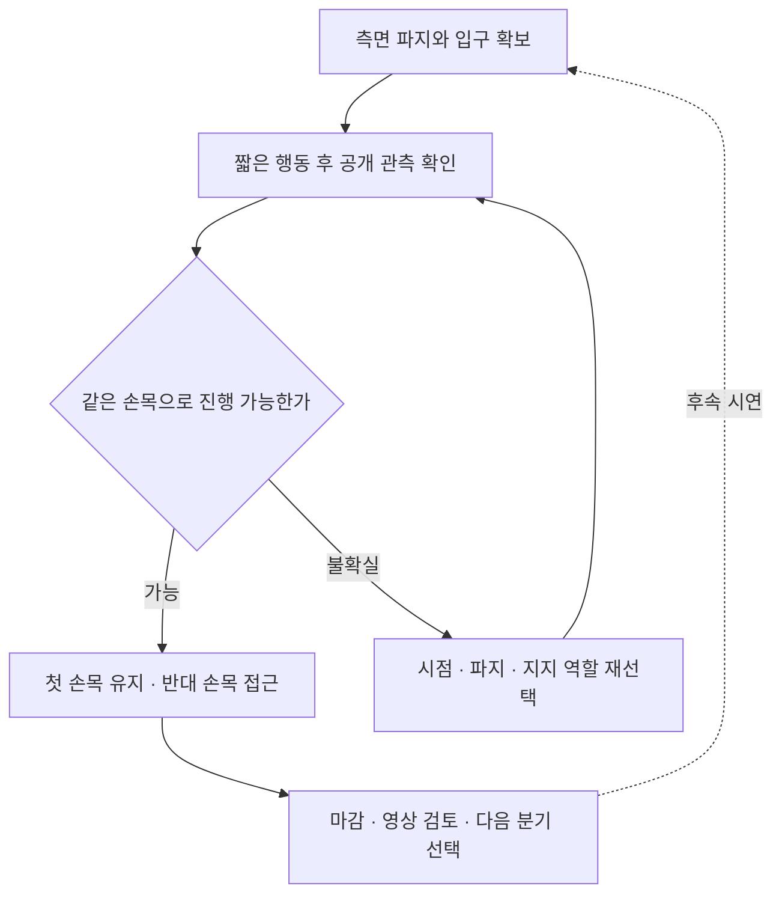

# 다음 수집

[메인](../README.md) | [시연 목록](EPISODES.md) | [다음 수집](COLLECTION_PLAN.md) | [Astra 코드](ASTRA.md) | [클린 서버](OPERATIONS.md)

**2026-11-13: E28 `20261113-astra-side-hem-fresh-001` 수집 진행 중입니다.** `coordinated-side-hem-wrists`를 소스 `9f79772`의 새 reset에서 20:43:30 UTC에 시작했습니다. [환경·연결 검사](project/sessions/20261113-environment-setup.ko.md)를 통과했으며 최종 점수·종료·전수 QC는 아직 미확정입니다. 완료된 시도의 최고 기록은 E27까지의 **5/50점, 착의 0, success=false**입니다. 기존 자료를 보존하고 옷의 양옆에서 시작하는 조작을 우선합니다.


## 조작 목표

| 단계 | 행동 방향 | 다음 단계 전 확인 |
|---|---|---|
| 측면 파지 | 두 로봇이 옷의 앞이 아닌 양옆으로 이동해 아래쪽 경계를 잡기 | 그리퍼 이동에 천이 함께 움직이는지, 서로 다른 경계를 잡았는지 |
| 아래 입구 펼치기 | 작은 높이 차·손목 방향 변화로 두 경계를 분리한 뒤 옆 간격 조절 | 실제 입구가 넓어지는지, 같은 바깥 천만 팽팽해지는지 |
| 한쪽 손목 | 관측이 좋은 손목 하나를 목표로 정하고 펼친 입구를 먼저 걸치기 | 같은 손목과 입구의 관계가 이어지는지, 파지가 미끄러지지 않는지 |
| 양쪽 손목 | 첫 손목의 걸림을 유지하면서 반대쪽 높이·방향·파지를 조절하기 | 첫 접촉을 잃지 않고 반대 손목까지 연결되는지 |

여기서 **손목은 마네킹의 손목**입니다. 펼침 폭은 공개 영상과 깊이에서 확인하며, 과도하게 당기는 것을 목표로 삼지 않습니다. 손목에 걸치는 중간 목표와 [공식 소매 통과·착의 득점](competition/EVALUATION.md)은 별도입니다.

## 출발점

| 자료 | 활용 | 제한 |
|---|---|---|
| [E07 / 264, E16 / 470 등](gallery/20261107-support-startpoints.ko.md) | 측면으로 이동하고 아래 입구를 준비할 여유가 있는지 비교 | 기존 prefix가 새 전략에 적합한지는 미확인 |
| [E25 새 파지](gallery/20261107-astra-opposing563-named-001.ko.md) | 열기·옮기기·닫기 후 천 동행을 확인한 조작 참고 | 이 파지가 목표 밑단이라는 증거는 아님 |
| [E27 팔 접근](gallery/20261107-astra-regrasp698-progress-named-001.ko.md) | 가림과 목표 손 전환이 생기는 장면 검토 | 이후 상태를 그대로 새 전략의 시작점으로 고정하지 않음 |

**E28은 새 reset을 선택했습니다.** 직접 parent와 replay prefix가 없으며 source group은 `20261113-astra-side-hem-fresh-001`입니다. 과거 정면 파지를 그대로 가져오지 않고 초기 측면 접근부터 시도합니다. E07/264 등은 후속 비교 후보로 남기며 E28의 실제 출발점과 혼동하지 않습니다. 향후 분기도 시각 검토와 원본 QC를 거쳐 선택하고 고유 run ID를 부여합니다.

## 구현과 첫 시험

[`coordinated-side-hem-wrists`](../participant/collection/codex_client.py)는 기존 same-arm 전략의 재파지 금지를 가져오지 않는 별도 프롬프트 경로입니다. `exec`, `plan-size=1`을 요구하며 공식 행동 범위·물리·채점은 바꾸지 않습니다. 단계 판단과 파지 성공은 모델의 시각 가설이며 런타임이 접촉을 인증하는 기능은 아닙니다.

처음 테이블에서 준비할 때는 로봇별 파지 변경을 한 번으로 제한해 같은 실패를 반복하지 않습니다. 빈 그리퍼의 최초 파지 획득은 이 재파지 횟수에 포함하지 않습니다. 이후 **새로운 착의 진행**에 필요한 파지 변경은 허용합니다. 한 번에 한쪽만 열고, 유지할 손목/팔 관계를 지탱하는 다른 지지를 먼저 확인하며, 최대 두 번의 짧은 배치 보정 뒤 다시 관측합니다. 실패한 준비 구간의 이름만 바꿔 재시도 횟수를 초기화하지 않습니다.

| 항목 | E28 시작 시 적용한 값 |
|---|---|
| 모델 경로 | Codex CLI 0.166.0 / exec / gpt-6-astra / ultra |
| 입력·행동 | named actions, pixel depth query, wrist depth panel, plan-size 1 |
| 작은 배치 | 40판단, 총 1,400전이 한도, 동작 후 중립 정착 최대 6전이, 호출 제한 180초 |
| 시간 계측 | 단계별 wall 시간 profile 활성화. 물리·렌더·기록 조건은 유지 |
| 첫 득점 검토 | `review-points=10`: 기존 픽업 5점을 넘어서는 착의 득점 확인 후 마감·검수 |
| 이후 | 검증된 중간 경계에서 한 요소씩 바꿔 분기. 보존된 prefix 점수보다 높은 다음 검토 기준을 선택하고 50점·success를 따로 확인 |

새 reset의 E28에는 replay 전이가 없습니다. 1,400전이는 `40 × (20 + 6) + 1 = 1,041`전이를 수용하는 상한이며, 실제 행동 길이·질의·종료에 따라 사용량은 달라집니다. 전이 예산은 모델 호출 시간 예산과 별도입니다. **10점은 달성 기록이 아니라 첫 종료·검토 기준**이며, 낮은 기준으로 멈춘 시도를 50점 시연으로 표시하지 않습니다.

## 수정과 분기



접촉 부근은 짧게 적용하고 다시 관측합니다. 같은 가림이나 접힘이 반복되면 미세 보정만 이어가지 않고 파지 위치, 입구 방향 또는 지지 역할을 바꿉니다. 첫 손목을 유지한 채 반대쪽을 움직였는지 매번 비교합니다. 사람의 피드백은 해당 run ID·관측 경계·화면에서 확인한 현상과 함께 기록하고 다음 시도의 가설·출발점에 반영합니다. **실시간 사람–Astra 제어권 인계는 현재 구현된 기능이 아닙니다.**

개발용 지시 예시:

```text
E28 이후의 목표는 측면 파지와 밑단 펼침이다.
두 로봇을 옷의 양옆에 배치하고, 아래 입구를 확보한다.
마네킹의 한쪽 손목에 먼저 걸친 뒤 그 관계를 유지하며 반대 손목으로 진행한다.
입구나 파지가 불확실하면 성공으로 가정하지 말고 짧게 움직여 다시 관측한다.
```

위 내용은 구현된 프롬프트의 요약이며 행동 좌표나 성공 판정이 아닙니다. [2026-11-13 연구 기록](collection/research/2026-11-13-side-hem-wrists.ko.md)에 변경 이유·CPU 검증 범위·첫 시연 검토 기준을 남겼습니다.

## 남길 자료

| 구간 | 최소 기록 |
|---|---|
| 시작 | source commit, 새 run ID, 직접 parent, source group, prefix 길이, 입력·프롬프트 |
| 네 단계 | 대표 공개 관측, 실제 행동, 전이 번호, 진행·불확실·실패 표시 |
| 분기 | 바꾼 요소 하나와 이유, 재실행 구간과 새 행동 구간 |
| 마감 | 파일 완료, 전수 QC, 별도 공식 평가, 영상, 학습 승인, 고정 백업 receipt |

파일 QC 통과만으로 학습에 넣지 않습니다. 같은 prefix를 공유한 시도는 같은 source group으로 다루고, 검토한 구간을 골라 정책 학습과 별도 rollout 비교로 이어갑니다. 이 반복을 향후 RSI 연구로 확장하되 **현재 자동 재학습·자동 성능 개선이 완성됐다는 뜻은 아닙니다.**

옷 펼침·첫 손목 유지 등 유용한 경계를 찾으면 전이 번호와 대표 관측을 검수 자료에 기록합니다. 파일을 정상 마감하고 전수 QC를 통과한 원본에서만 후속 분기를 만듭니다. 앞 구간은 새 환경에서 기록 행동으로 재실행하므로 모델의 앞 구간 판단을 재사용하지 않아도 되지만, **정확한 천 상태 저장·복원은 아닙니다.** 재실행 후 현재 지지·입구를 다시 확인하고, 기존 점수를 복사하지 않고 새 시도 전체를 평가합니다.

새 시연마다 실제 관측, 별도 평가 결과, 실패 가설, 다음에 바꿀 요소 한 가지를 [`collection/reviews/`](collection/reviews/)의 해당 실행 기록에 남깁니다. 마감 후 시연 목록·STATUS·catalog·비공개 백업 receipt를 갱신합니다. 이 문서는 최신 방향을 유지하고 날짜별 판단 근거는 연구·세션 기록으로 보존합니다.

실행 준비는 [클린 서버 가이드](OPERATIONS.md)를 따릅니다. 이전 E27/928 same-arm 후보의 코드와 검증 기록은 [과거 연구안](collection/research/2026-11-07-e27-single-arm-continuation.ko.md)으로 보존하며 현재 계획을 대신하지 않습니다.
