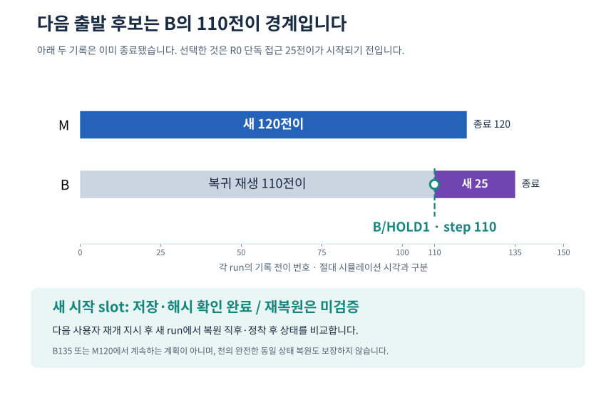
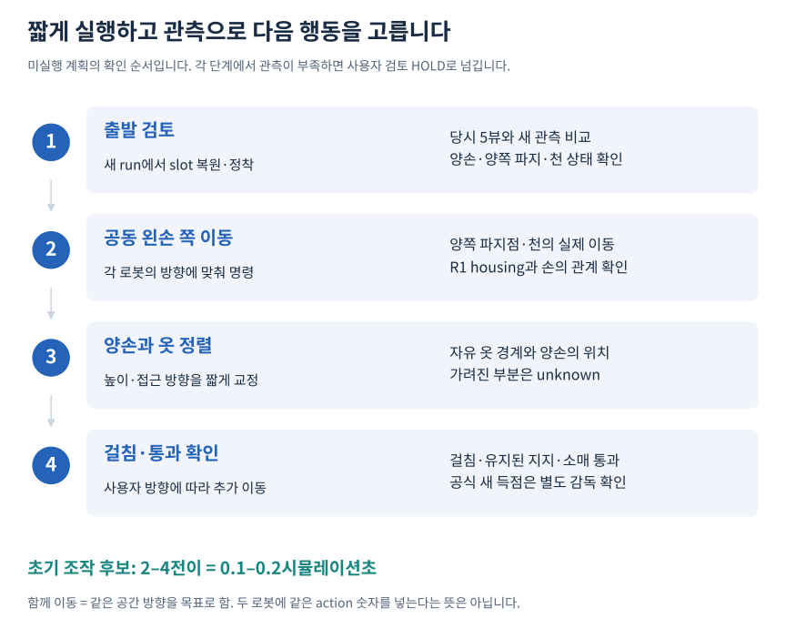
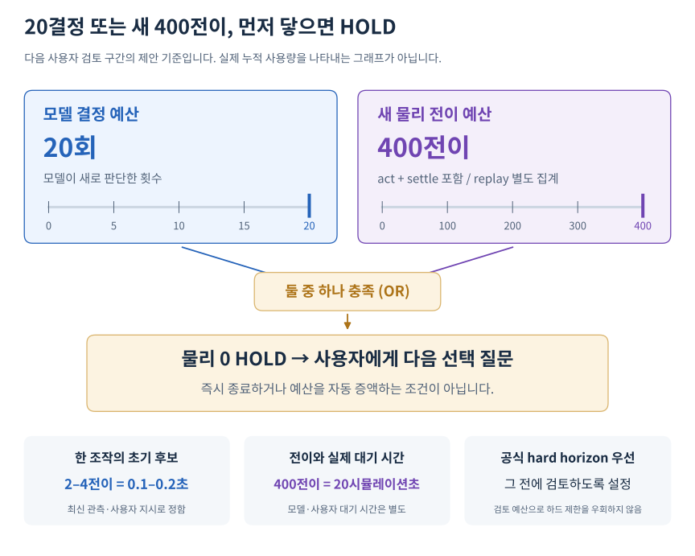
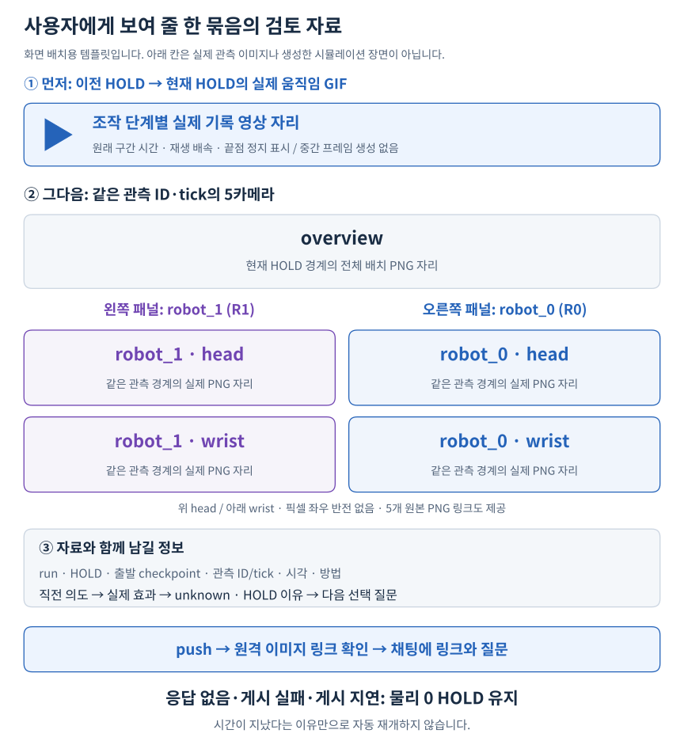
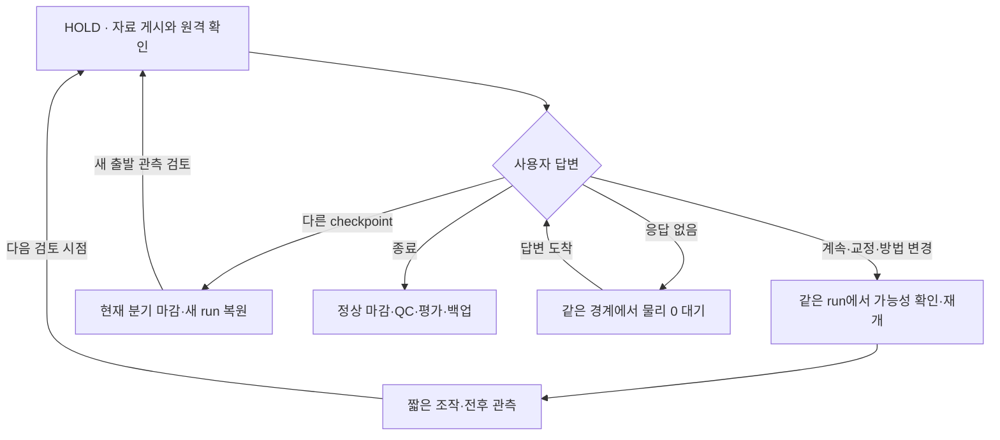

# 다음 시연 계획: 두 로봇을 왼손 쪽으로 함께 이동한 뒤 양손에 옷 걸치기

**2026-11-16 사용자 결정: 이번 시연은 여기서 종료한다.** M1 120전이와 R0 단독 접근 분기135전이는 정상 마감했다. 아래는 다음 세션의 방향이며 이번에는 실행하지 않았다. 현재 live HOLD나 자동 재개할 행동은 없다.

> “마지막 R0 움직임 전에 두 로봇 모두 왼손쪽으로 함께 이동후에 공식 데모 영상처럼 옷을 양손에 모두 걸치는 방향으로 시도해보려고 합니다.”

“마지막 R0 움직임 전”은 **마지막 R0 단독 접근 구간110→135가 시작되기 전**, 새 분기의 **hold-0001·110전이**로 기록한다. 마감 직전135전이에서 이어 밀거나 마지막2전이만 되돌리는 계획이 아니다. 양쪽을 왼손 쪽으로 함께 옮겨 옷과 양손의 관계를 다시 만든 뒤 접근을 판단한다.

[각 움직임의 명령·실제 효과·GIF](collection/reviews/20261116-user-guided-movement-ledger.ko.md) · [기전·판단 기준](MECHANISMS.ko.md) · [마감·QC·백업](project/STATUS.md) · [메인](../README.md) · [실행 인계서](collection/research/2026-11-16-user-guided-resume.ko.md)

## 한눈에 보는 다음 세션

| 질문 | 이번 계획의 답 |
|---|---|
| 어디서 시작하나? | **B/HOLD1·110전이**, 마지막 R0 단독 접근 전. 새 시작 slot의 복원 검증부터 수행 |
| 무엇을 시도하나? | 두 로봇을 **마네킹의 해부학적 왼손 쪽으로 함께 이동**한 뒤 양손과 옷을 정렬하고 걸침·통과를 확인 |
| 언제 사용자에게 묻나? | 종료 제안·관측 부족·예산 도달·공식 첫 소매 새 5점 등 판단 지점에서 **물리 0 HOLD** |
| 무엇을 보여 주나? | 구간별 **실제 GIF + 같은 경계의 5카메라 + 의도·실제 효과·unknown** |
| 답변 뒤에는? | 계속·교정은 현재 상태에서, 다른 checkpoint는 분기를 마감하고 새 run으로, 종료는 QC·백업까지 |

그림은 **계획 설명과 과거 기록의 구분을 돕는 도식**이다. 실제 새 시연 화면이나 실행 결과가 아니며, 이 문서 갱신으로 복원·조작·학습을 진행하지 않았다. 현재 기전과 실측 분석은 [MECHANISMS](MECHANISMS.ko.md), 실행·백업 상태는 [STATUS](project/STATUS.md)를 함께 본다.

[① 출발점](#1-다음-출발-후보와-검증) · [② 조작 단계](#2-두-로봇-공동-이동--양손-걸침) · [③ HOLD·예산](#3-종료-제안예산-도달은-사용자-검토-hold로-바꾼다) · [④ 검토 화면](#4-사용자에게-보여-줄-화면과-질문) · [⑤ 답변 후 분기](#5-사용자-답변-이후) · [⑥ 클린 서버 실행 순서](#6-다음-세션의-실행-순서와-완료-기준)

## 1. 다음 출발 후보와 검증



**위 그림의 초록 표시가 다음에 비교할 출발 후보**다. M은 기존 실행, B는 별도 오른손 분기다. B는 같은 초기 slot에서 M의 앞 110전이를 재생한 뒤 R0 접근 25전이를 더 진행했다. 다음에는 그 25전이 **전의 상태에서 저장한 slot**을 새 run에 불러오려는 것이다.

| 확인 단계 | 현재 상태 | 다음에 볼 것 |
|---|---|---|
| B/HOLD1의 시작 slot 저장 | **완료** — 추가 물리 0, 파일·해시 확인 | 아래 식별자와 고정 백업이 일치하는지 확인 |
| 그 slot을 새 환경에 복원 | **미검증** | 복원 직후의 5카메라·로봇 상태 |
| 기본 정착 뒤 출발 적합성 | **다음 확인 사항** | 저장 당시와 비교해 양쪽 파지·양손·천 형상이 얼마나 달라졌는지 확인 |

저장 → 복원 직후 → 정착 후를 나누어 본다. **정착은 물리가 진행되는 구간이고 HOLD는 물리 0 대기**다. 파일 해시가 같다는 것과 실제 복원 후 형상이 같다는 것은 서로 다른 검사다.

<details>
<summary><strong>복원 식별자·전체 SHA·파일 경로 펼치기 — 클린 서버용</strong></summary>

| 항목 | 다음에 사용할 기준 |
|---|---|
| 우선 출발 후보 | `20261116-astra-right-hand-hold10-001`의 **hold-0001·110전이**, R0 단독 접근 직전. [당시5카메라](collection/user-reviews/20261116-astra-right-hand-hold10-001/hold-0001/README.ko.md) |
| 저장한 slot | `20261116-astra-right-hand-hold10-001-start`, SHA256 `c26cc58caf6176ce2b1120a9ea1e68d0a7e0f4f88c0e46978c4aa3de3f0b05e6`. 저장·해시 확인 완료, **복원 미검증**. [공개 receipt](gallery/20261116-right-hand-hold10/start-checkpoint-verification.json) |
| 정확한 경계 | 관측 `a22ece51b72d78fe73354dc26f67df987c662b81904bdec91347ec0a71cc2ac3`, tick1320, 시뮬레이션7.008334s. slot 경로는 아래에 기록 |
| 복원 성격 | 근사 상태slot이다. 복원 시 속도·명령 이력·접촉 cache 등이 초기화되고90 control ticks/1.5s 정착이 있다. 저장 상태 그대로의 FEM 물리 되감기를 보장하지 않는다. 새5카메라·로봇 상태를 기준 이미지와 비교해야 한다. |
| 기존 M1 HOLD10과 관계 | 같은 초기slot+기존 앞110전이를 새 환경에서 재생해 얻었다. 당시 파지점 차이는 R0 1.86mm/R1 0.63mm였고 천 주름도 완전 동일하지 않았다. [복귀 비교](collection/reviews/20261116-right-hand-hold10-branch.ko.md) |
| slot 복원이 부적합한 경우 | 원래 초기slot+마감 M1의앞110전이 재생은 이미 실행한 대안이다. 새 run에서 재현하고 차이를 게시한다. 조용히135전이나 다른 출발점으로 바꾸지 않는다. |
| 평가 | checkpoint reset은 새 평가다. 과거 pickup5점·시간을 이월하지 않는다. 양손 걸침 외관, 실제 소매 통과, 공식 `first_sleeve` 새5점은 구분한다. |

컨테이너 기준 slot 경로:

```text
/output/collections/20261116-astra-right-hand-hold10-001/checkpoints/20261116-astra-right-hand-hold10-001-start/slot_20261116-astra-right-hand-hold10-001-start.npz
```

실제 slot 검증 receipt는 위 slot과 같은 폴더의 `receipt.json`이다(SHA256 `bb53e3914ec7479a01944df8b1dd8e7758f5206905f4418ed0d15dcdbc7f5872`). `output/operator-traces/20261116-astra-right-hand-hold10-001/start-checkpoint.json`은 당시 저장 응답과 checkpoint를 감싼 기록이며 receipt 자체와 구분한다. 고정 비공개 백업의 파일·SHA를 검증해 복원한다. 현재 세션에서는 복원 시험을 추가로 실행하지 않았다.

</details>

## 2. 두 로봇 공동 이동 → 양손 걸침

**다음 사용자 재개 지시 후 새 run에서 시험할 방향이다.** 사용자께서 참고한 [공식 데모와 출처](../README.md#공식-착의-데모)는 목표 형상의 참고이며, 현재 파지·천 상태에서 같은 결과를 보장하는 근거는 아니다.




**그림의 네 단계는 관측으로 판단할 순서**다. 한 번씩 기계적으로 실행하는 고정 경로가 아니다. 각 짧은 조작 뒤에 두 로봇·천·손의 실제 변화를 보고 다음 방향을 고르며, 가림이나 새로운 비대칭이 생기면 사용자 검토로 연결한다.

| 단계 | 조작·관측 계획 | 다음 판단 기준 |
|---|---|---|
| 출발 검토 | 저장한110전이 후보를 복원하고 정착을 별도로 기록한다. 당시5카메라와 새 관측에서 양손, 양쪽 파지, 옷의 처짐·펼침을 비교한다. | 차이가 있으면 먼저 게시한다. 복원 검증 없이 과거 화면을 현재 화면으로 쓰지 않는다. |
| 공동 왼손 쪽 이동 | **마네킹의 해부학적 왼손 쪽으로 두 로봇을 함께 이동**시킨다. 양쪽 파지 의도를 유지하고 실제 관측에 맞춰 각 로봇의 명령을 정한다. | 두 파지점과 천이 함께 이동하는지, 왼손 쪽 R1의 housing과 손이 가까워지는지, 양손이 옷의 자유 구간에 대해 어디에 놓이는지 확인한다. |
| 양손과 옷 정렬 | 옷이 양손에 걸칠 수 있는 상대 위치와 펼침을 확인한 뒤 높이·접근 방향을 짧게 조정한다. 이전 오른손 접근 벡터·줄무늬 거리·고정 mm를 그대로 복사하지 않는다. | 양손과 가시 옷 경계가 함께 보이는 구간 GIF·5카메라를 게시하고 사용자 판단을 받는다. 가려져 있으면 unknown으로 남긴다. |
| 걸침·통과 확인 | 사용자 방향에 따라 작은 추가 이동을 시험한다. 천 경계의 이동, 양손의 진입·지지, 손끝/손목과 소매 출구를 분리해 확인한다. | 외관상 걸침을 소매 통과로 기록하지 않는다. 공식 점수는 별도 감독 영역에서 검사한다. |

R0는 마네킹 **오른손 쪽**, R1은 **왼손 쪽**이다. 뒤쪽 overview의 어깨→팔꿈치→손 연결로 식별했으며 화면 좌우나 카메라 이름과 혼동하지 않는다. “두 로봇을 함께”는 동일한 숫자의 action을 주는 뜻이 아니다. 베이스의 방향이 다르므로 로봇별 실제 변위를 확인한다. 해부학적 왼손 방향을 고정 world X/Y 부호로 미리 단정하지 않는다.

실행 초기 단위는 **2–4전이(0.1–0.2 시뮬레이션초)**를 후보로 두되, 최신 관측·사용자 지시에 따라 정한다. 중립 명령도 실제 운동을 허용하므로 HOLD와 구분한다. 마지막 분기의 R1은 명령0에서도 파지점 XY가12.66mm 움직였고 후반에도 운동이 이어졌다. 단순한 초기 잔류 운동이나 접촉 때문이라고 단정할 근거는 없다.

기존 M1 국소 교정, M2 베이스 방향·측면 접근, M3 한쪽 지지 재파지는 **이전 탐색 방법**으로 보존한다. 다음 기본 방향은 위 공동 이동·양손 걸침이다. 재파지가 필요해지면 기존 지지와 입구 관계를 먼저 보여 주고 사용자 교정을 받으며, 세 방법을 자동 연속 실행하지 않는다. [이전 세 방법의 고정본](https://github.com/leonyoon-3dai/PhyRC_2027_phase1/blob/0113366e5ce2a810567d7f672bce6dba3e22eb94/docs/COLLECTION_PLAN.md#2-가장-효과적일-것으로-판단한-세-방법)

## 3. 종료 제안·예산 도달은 사용자 검토 HOLD로 바꾼다

**예산은 “여기까지 무조건 움직여라”가 아니라 “이 지점까지는 다시 물어라”라는 검토 기준이다.** 가림·지지 상실·모델 종료 제안·목표 득점 같은 사건이 먼저 발생하면 예산을 다 쓰기 전에도 HOLD한다.



두 카운터의 단위가 다르다. **20결정은 판단 횟수**, **400전이는 act와 별도 settle을 합한 새 물리 진행량**이다. 400전이는 20시뮬레이션초지만, 20결정이 20초라는 뜻은 아니다. 복귀 재생은 별도로 기록한다.

예를 들어 **20번의 결정이 모두 2–4전이 act이고 별도 settle이 없다고 가정하면**, 새 실행은 40–80전이·2–4시뮬레이션초다. 이때는 400전이를 채우지 않아도 결정 예산 때문에 먼저 HOLD한다. 이 계산은 설명용 예시이며 실제 새 시연 결과가 아니다.

| 사건 | 새로운 처리 |
|---|---|
| 모델 `stop` / `finish_episode`, 정체·불확실성에 따른 자동 종료 제안 | simulator에 종료 도구를 전달하기 전에 HOLD로 전환한다. |
| 결정·전이·호출·시간 등 관리 예산 도달 | 추가 행동 전에 HOLD한다. 예산을 없애거나 자동 증액하지 않는다. |
| 첫 소매 새5점 확인 | 득점 검토 HOLD로 전환하고 사용자에게 다음 진행/종료를 묻는다. 점수는 별도 감독 영역에서 확인한다. |
| 새 출발 상태 부적합·지지 상실·다음 조작이 불명확 | 스크린샷과 확인 불가 항목을 제시하고 HOLD한다. |
| 사용자 “종료” | 정상 마감·QC·백업으로 이동한다. |
| 실제 환경 종료·프로세스 장애·기록 손상 | 살아 있는 HOLD라고 주장하지 않는다. 마지막 확정 경계와 실패 원본을 보존하고 복원 선택을 사용자에게 묻는다. 공식 하드 제한을 우회하지 않는다. |

기존 raw 점수 `review_points` 게이트는 새 모드의 목표 판정에서 `first_sleeve` 새0→5 사건으로 대체한다. 별도 raw 검토 게이트를 유지한다면 복원 직후 기준값과 목적을 명시하고, pickup·초기 상태 재판정을 목표 득점으로 세지 않는다.

**HOLD는 물리를 멈추는 것이며 중립 action을 반복하는 것이 아니다.** 새 action·settle·stop·finish·close를 보내지 않는다. 마지막 완료 ACK의 관측 ID/tick을 고정하고 simulator·기록기·제어 세션을 유지한다. 현재 `stop()`은 실제1전이를 만들므로 HOLD로 사용할 수 없다.

초기 사용자 검토 구간의 제안 예산은 **20결정 또는 새 물리400전이 중 먼저 도달하는 조건**이다. replay는 별도 집계하고 새 전이에는 act와 settle을 모두 포함한다. 이 값은 종료 한도가 아니라 질문할 시점이다. 모델 timeout·통신 timeout도 무제한 재시도하지 않고 상태를 확인해 사용자 검토로 넘긴다.

사용자가 “계속”이라고 답하면 같은 크기의 다음 구간을 승인한 것으로 처리하고 적용 범위를 짧게 알린다. 사용자가 다른 길이를 지정하면 그 값을 따른다. run 전체의 결정·전이·호출·시간 누적값은 초기화하지 않는다. 공식 환경의 하드 horizon보다 먼저 검토가 일어나도록 구현한다.

## 4. 사용자에게 보여 줄 화면과 질문



**움직임 GIF는 “어떻게 바뀌었나”, 5카메라 정지 화면은 “지금 어떤 상태인가”를 보여 준다.** 두 자료를 같은 구간·관측 ID로 연결한다. 위 칸들은 화면 배치용 템플릿이며 실제 시연 프레임이 아니다.

**최신 사용자 요청에 따라 구간별 실제 움직임 GIF를 먼저 제공한다.** 마지막 정지 화면만으로 판단을 요구하지 않는다. 이전 HOLD부터 현재 HOLD까지 실제 기록을 조작 단계별로 나누고, 같은5카메라를 시간에 맞춰 배치한다. 원래 구간 시간과 배속·끝점 정지를 명시한다. 현재는 실제20Hz의 모든 경계를4배 느리게 보여 주며 중간 프레임을 생성하지 않는다. 열린 원본은 닫지 않고, HOLD에서 원본 해시·경계를 복사 전후 확인한 고정 사본을 읽는다. [이번 구간별 이동 장부·GIF](collection/reviews/20261116-user-guided-movement-ledger.ko.md)

HOLD마다 **같은 관측 경계**의 아래5장을 공개한다.

- overview
- robot_1 head / robot_0 head
- robot_1 wrist / robot_0 wrist

README 상단에는 overview와 2×2 로봇 패널을 표시하고 5개 원본 PNG 링크를 함께 둔다. **왼쪽 robot_1, 오른쪽 robot_0**, 위 head·아래 wrist이며 픽셀을 좌우 반전하지 않는다. 해당 경계의 depth·valid mask도 보존하고 필요하면 별도 링크한다. 자유 viewport는 이 피드백의 입력으로 사용하지 않는다.

게시물에는 run ID, HOLD ID, checkpoint 출처, 관측 ID/tick, 시각, 방법, 직전 의도·실제 효과, unknown, HOLD 이유를 적는다. push와 원격 이미지 링크를 확인한 뒤 채팅에 게시 링크와 질문을 보낸다. 게시에 실패하면 HOLD를 유지하고 실패와 대체 확인 경로를 알린다. 무응답·게시 지연·사용자 대기시간은 자동 재개의 근거가 아니다.

질문의 예:

> 두 로봇을 왼손 쪽으로 옮긴 구간에서 HOLD했습니다. 양쪽 파지점과 옷의 실제 변화는 위 GIF에 기록했고 양손 걸침·소매 통과는 아직 확정하지 못했습니다. GIF와5카메라를 보고 다음 방향 교정이나 종료를 알려주세요.

현재 장면에 맞게 짧게 쓰며 선택지 외의 자유 텍스트도 받는다. 사용자가 방향을 주면 변경할 요소·유지할 지지를 해석해 기록하고 다음 짧은 조작에 반영한다. 모호해서 행동이 달라질 때만 추가 질문하며 물리는 계속 HOLD한다.

## 5. 사용자 답변 이후

**계속하기와 다른 checkpoint로 돌아가기는 실행 방식이 다르다.** 계속·교정은 살아 있는 같은 run의 현재 경계에서 이어가고, checkpoint 변경은 현재 분기를 마감한 뒤 고유 새 run에서 복원·출발 검토를 한다.



이 도식은 정상적인 live 세션의 처리 관계다. 지금은 두 시연이 종료된 상태이므로 먼저 새 run과 출발 검토가 필요하다. 공식 하드 종료·장애로 이미 끝난 환경을 같은 HOLD로 재개하는 흐름은 아니다.

| 사용자 답변 | 처리 |
|---|---|
| 계속 / 구체적인 방향 | 같은 live 경계에서 최신 관측을 확인하고 새 구간을 진행한다. 오래된 pending action은 버린다. |
| 다른 방법 | 현재 상태에서 가능한지 확인하고 선택한 방법·방향과 조건을 기록한다. 자동으로 checkpoint를 바꾸지 않는다. |
| 다른 checkpoint | 현재 분기를 명시적으로 마감·보존하고 고유 새 run으로 선택한 checkpoint를 복원한다. 과거 점수·시간을 이월하지 않는다. |
| 종료 | 정상 마감, 전수 QC, 별도 평가, 검토, 고정 백업 검증을 수행한다. 클라우드 서버 종료는 별도 요청 사항이다. |
| 응답 없음 | 동일 상태 HOLD. 모델 호출·물리·자동 재시도·자동 종료를 진행하지 않는다. |

사용자 피드백은 run/HOLD/관측 ID와 연결하고 중복 답변·다른 run의 오래된 답변은 적용하지 않는다. actor에는 공개 관측과 허용된 작업 지시만 전달한다. 내부 천 기하·평가 정답·자유 viewport로 만든 행동 정답은 전달하지 않는다. GitHub 게시와 평가 조회는 격리 actor 밖의 감독 프로세스가 수행한다.

## 6. 다음 세션의 실행 순서와 완료 기준

**클린 서버에서는 [GUIDED_RUNTIME](collection/GUIDED_RUNTIME.ko.md)과 [OPERATIONS](OPERATIONS.md)로 환경을 복구한 뒤 아래 순서로 진행한다.** 기존 checkpoint·HOLD·게시·재개 기능과 새 시작 slot의 검증 상태를 구별한다.

| 확인 지점 | 완료했다고 볼 근거 |
|---|---|
| 환경·파일 복구 | 고정 코드·자산·slot·receipt의 출처와 해시 확인 |
| 새 출발 상태 확인 | 새 run ID, 복원 직후·정착 후 관측, 저장 당시 5뷰와의 비교 |
| 짧은 실험과 사용자 검토 | 요청 명령·실제 양쪽 운동·천–손 관계, GIF·5카메라의 원격 게시 확인 |
| 사용자 종료 후 보존 | 정상 마감·전수 QC·별도 평가·고정 백업 재검증과 관련 문서 갱신 |

아래는 구현·운영 세부 순서다. **선택한 출발 방식의 실제 관측 검증이 끝나기 전에는 출발 준비 완료로 표시하지 않는다.**

1. 사용자 재개 지시를 확인하고 [STATUS](project/STATUS.md)의 고정 백업에서 선택한 출발slot·receipt·원본·코드를 검증해 복원한다. 격리 CLI0.166.0 / gpt-6-astra / ultra와 단일 GPU 제어원을 유지한다.
2. 이미 구현·검증한 checkpoint·물리0 HOLD·5카메라/GIF 게시·텍스트 재개 경로를 사용한다. 새 출발slot의 복원과 정착 차이는 별도 검증하며 구현이 미완료인 것처럼 처음부터 다시 만들지 않는다.
3. 새 run ID로 출발 후보를 재현하고5카메라 비교를 게시한다. 적합한 출발에서 위 공동 이동·양손 걸침 방향을 짧게 시험한다.
4. 각 구간의 명령·실제 양쪽 로봇 이동·천의 변화·불확실성을 기록하고, 판단 지점에 GIF와 같은 경계의5카메라를 게시한다. 관리 예산·모델 종료 제안에서는 물리0 HOLD를 유지한다.
5. 종료 지시 후 정상 마감·전수 QC·비공개 고정 백업 재검증과 STATUS·EPISODES·catalog·이동 장부를 갱신한다. 새 학습이나 자동 반복 실험은 포함하지 않는다.

<a id="resume-effect-feedback"></a>

### 재개 참고 · 짧은 조작 후 실행 효과를 다음 결정에 전달

**2026-11-18 비교 제안 · 미구현·미실행.** 기존 HOLD 검토에서는 사용자가 실제 효과를 확인한다. 이번 제안은 평상시에도 짧은 조작 전후의 변화를 요약해 **바로 다음 Astra 결정**에 전달하는 것이다. M1에서는 두 그리퍼가 평면상 각각 약 31–32mm 움직였고, 손이 천 경계를 넘었는지는 확인되지 않았다. 실제 운동과 손·천 관계를 따로 읽는 이유다. [M1 이동 기록](collection/reviews/20261116-m1-bodyward-33mm-completion.ko.md)

| 단계 | 다음 서버에서 확인할 내용 |
|---|---|
| 출발 확인 | **B/HOLD1·110전이** 슬롯의 복원 직후와 정착 후를 저장 당시 5뷰와 대조한다. 파지·천 형상·손 위치에 설명할 수 없는 차이가 있으면 HOLD에서 검토하고 비교 시작 조건을 다시 정한다. |
| 짧은 조작과 효과 확인 | 공동 왼손 쪽 접근 중 요청 명령, 두 그리퍼의 실제 변위, 같은 손과 천의 자유 경계·지지 관계를 전후 공개 관측으로 확인한다. 조작 직후와 정착 후 차이를 구분하고, 가려진 관계는 `unknown`으로 남긴다. |
| 다음 행동 선택 | 요약을 보고 짧게 계속할지, 접근 방향을 바꿀지, HOLD에서 사용자에게 물을지 정한다. 현재 파지에서 정렬과 짧은 하강을 확인한 뒤에도 열린 구간이 부족하면, 별도 복원 분기에서 사용자 동의를 받아 한쪽 지지를 유지하며 파지 위치 한 가지를 바꿔 비교한다. |
| 비교와 판정 | 같은 복원 조건·왼손 접근 계획·조작 예산에서 **기존 Astra+HOLD**와 **다음 결정에 효과 요약을 제공하는 Astra+HOLD**를 비교한다. 반복 정체, 지지 손실, 후속 프레임의 걸침 유지 여부를 기록한다. 착의 효과는 별도 공식 평가의 `first_sleeve` 새 5점과 재현 여부로 판단한다. |

효과 요약에는 지정 5개 RGB-D 카메라와 공개 로봇 상태에서 확인한 근거를 쓴다. 공식 점수는 감독 영역에서 기록한다. 복원·정착에 사용한 전이는 새 조작과 구분한다. 재실행에서 효과가 확인된 교정부터 재사용 후보로 남기고, VLA·RL은 재현 가능한 통과나 복구 시연이 쌓인 뒤에 검토한다.

참고 [워크숍 적용 검토](collection/research/2026-11-14-agentic-robotics-workshop.ko.md#methods) · [RoboMME 실행 후 확인](https://arxiv.org/abs/2611.06184) · [SimEX 시뮬레이션 실험](https://arxiv.org/abs/2609.38982) · [ASPIRE 교정 후 재검증](https://research.nvidia.com/labs/gear/aspire/)

## 7. 근거와 이전 계획

[E36 실제 리뷰](collection/reviews/20261114-astra-wrist-body835-001.ko.md) · [Astra 실행 설명](ASTRA.md) · [checkpoint·효과 분석](collection/research/2026-11-16-checkpoint-effect-feedback.ko.md) · [최신 착의 연구 조사](collection/research/2026-11-16-recent-dressing-resources.ko.md) · [이전 분석 단계 계획 고정본](https://github.com/leonyoon-3dai/PhyRC_2027_phase1/blob/e63b3f6d0ed069eef004bd09b04ba99d130192b6/docs/COLLECTION_PLAN.md)

선행 논문·PPT와 당시 HOLD 문구는 연구 이력으로 보존한다. 현재 실행 방향은 이 문서가 정본이다. 새 분석은 시간순 기록을 늘리기보다 기전별 질문·관측 근거·가설·다음 판별로 정리하고, 상세 실행 시각과 해시는 재현용 기록으로 연결한다.

[그림 추가 전 계획의 고정본](https://github.com/leonyoon-3dai/PhyRC_2027_phase1/blob/009d6e83be6c1b9912b4c60e3ba2cc6e64557cf2/docs/COLLECTION_PLAN.md). 이번 개편은 설명과 표시를 개선한 것이며 새 시연 실행이나 기존 계획의 자동 재개를 뜻하지 않는다.
