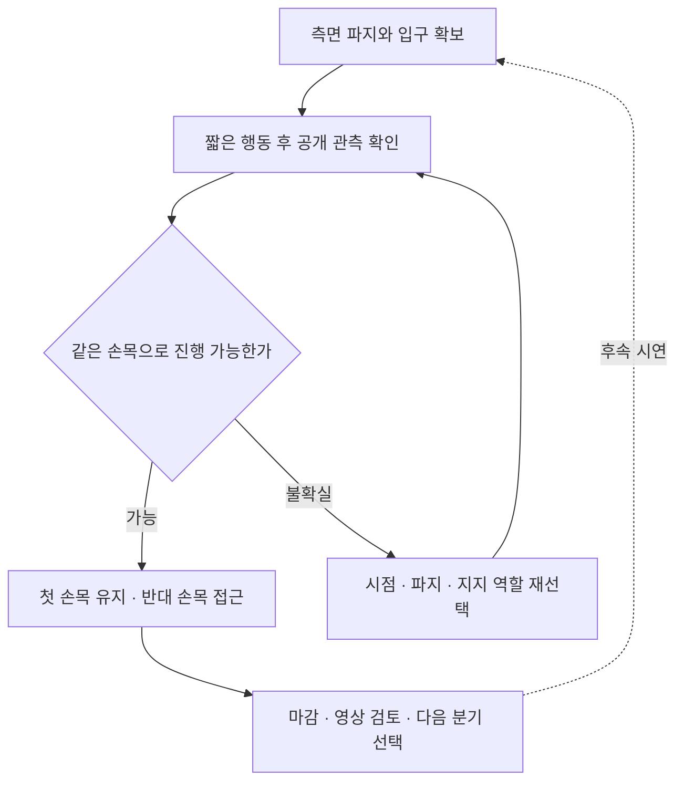

# 다음 수집

[메인](../README.md) | [시연 목록](EPISODES.md) | [다음 수집](COLLECTION_PLAN.md) | [Astra 코드](ASTRA.md) | [클린 서버](OPERATIONS.md)

**E28 이후의 새 계획입니다. 아직 실행하지 않았습니다.** 기존 자료는 E27까지 보존하고, 다음 시연은 옷의 양옆에서 시작하는 조작을 우선합니다.


## 조작 목표

| 단계 | 행동 방향 | 다음 단계 전 확인 |
|---|---|---|
| 측면 파지 | 두 로봇이 옷의 앞이 아닌 양옆으로 이동해 아래쪽 경계를 잡기 | 그리퍼 이동에 천이 함께 움직이는지, 서로 다른 경계를 잡았는지 |
| 아래 입구 펼치기 | 지지를 유지하며 간격과 손목 방향을 조절해 밑단을 최대한 넓히기 | 두 겹의 천 사이로 실제 통로가 보이는지, 단순히 바깥 천을 당기고 있지 않은지 |
| 한쪽 손목 | 관측이 좋은 손목 하나를 목표로 정하고 펼친 입구를 먼저 걸치기 | 같은 손목과 입구의 관계가 이어지는지, 파지가 미끄러지지 않는지 |
| 양쪽 손목 | 첫 손목의 걸림을 유지하면서 반대쪽 높이·방향·파지를 조절하기 | 첫 접촉을 잃지 않고 반대 손목까지 연결되는지 |

여기서 **손목은 마네킹의 손목**입니다. 펼침 폭은 공개 영상과 깊이에서 확인하며, 과도하게 당기는 것을 목표로 삼지 않습니다. 손목에 걸치는 중간 목표와 [공식 소매 통과·착의 득점](competition/EVALUATION.md)은 별도입니다.

## 출발점

| 자료 | 활용 | 제한 |
|---|---|---|
| [E07 / 264, E16 / 470 등](gallery/20261107-support-startpoints.ko.md) | 측면으로 이동하고 아래 입구를 준비할 여유가 있는지 비교 | 기존 prefix가 새 전략에 적합한지는 미확인 |
| [E25 새 파지](gallery/20261107-astra-opposing563-named-001.ko.md) | 열기·옮기기·닫기 후 천 동행을 확인한 조작 참고 | 이 파지가 목표 밑단이라는 증거는 아님 |
| [E27 팔 접근](gallery/20261107-astra-regrasp698-progress-named-001.ko.md) | 가림과 목표 손 전환이 생기는 장면 검토 | 이후 상태를 그대로 새 전략의 시작점으로 고정하지 않음 |

새 환경 또는 검증된 prefix 중에서 측면 배치가 가능한 출발점을 선택합니다. **E28이라는 번호만으로 parent나 replay 경계를 정하지 않습니다.** 실제 출발점과 프롬프트를 확정한 후 새 run ID를 부여합니다.

## 수정과 분기



동작은 짧게 적용하고 다시 관측합니다. 같은 가림이나 접힘이 반복되면 미세 보정만 이어가지 않고 파지 위치, 입구 방향 또는 지지 역할을 바꿉니다. 사람의 피드백은 다음 시도의 목표와 출발점 선택에 반영합니다. **실시간 사람–Astra 제어권 인계는 현재 구현된 기능이 아닙니다.**

개발용 지시 예시:

```text
E28 이후의 목표는 측면 파지와 밑단 펼침이다.
두 로봇을 옷의 양옆에 배치하고, 아래 입구를 확보한다.
마네킹의 한쪽 손목에 먼저 걸친 뒤 그 관계를 유지하며 반대 손목으로 진행한다.
입구나 파지가 불확실하면 성공으로 가정하지 말고 짧게 움직여 다시 관측한다.
```

이는 **전략 요약**이며 바로 실행할 CLI 명령이나 완료된 새 전략 구현이 아닙니다. 현재 [`--strategy` 선택지](../participant/collection/codex_client.py#L585)와 [task 프롬프트 조립](../participant/collection/codex_client.py#L708)를 확인해 새 목표를 반영해야 합니다. 과거 `coordinated-single-arm-progress`를 이름만 바꿔 사용하지 않습니다.

## 남길 자료

| 구간 | 최소 기록 |
|---|---|
| 시작 | source commit, 새 run ID, 직접 parent, source group, prefix 길이, 입력·프롬프트 |
| 네 단계 | 대표 공개 관측, 실제 행동, 전이 번호, 진행·불확실·실패 표시 |
| 분기 | 바꾼 요소 하나와 이유, 재실행 구간과 새 행동 구간 |
| 마감 | 파일 완료, 전수 QC, 별도 공식 평가, 영상, 학습 승인, 고정 백업 receipt |

파일 QC 통과만으로 학습에 넣지 않습니다. 같은 prefix를 공유한 시도는 같은 source group으로 다루고, 검토한 구간을 골라 정책 학습과 별도 rollout 비교로 이어갑니다. 이 반복을 향후 RSI 연구로 확장하되 **현재 자동 재학습·자동 성능 개선이 완성됐다는 뜻은 아닙니다.**

실행 준비는 [클린 서버 가이드](OPERATIONS.md)를 따릅니다. 이전 E27/928 same-arm 후보의 코드와 검증 기록은 [과거 연구안](collection/research/2026-11-07-e27-single-arm-continuation.ko.md)으로 보존하며 현재 계획을 대신하지 않습니다.
