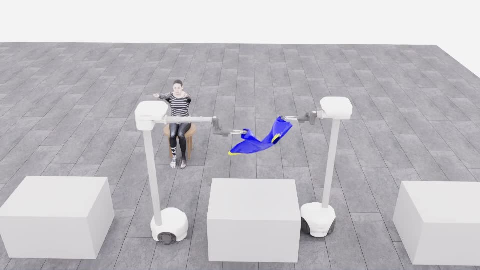
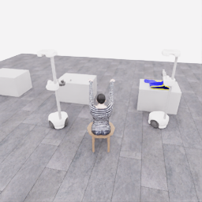
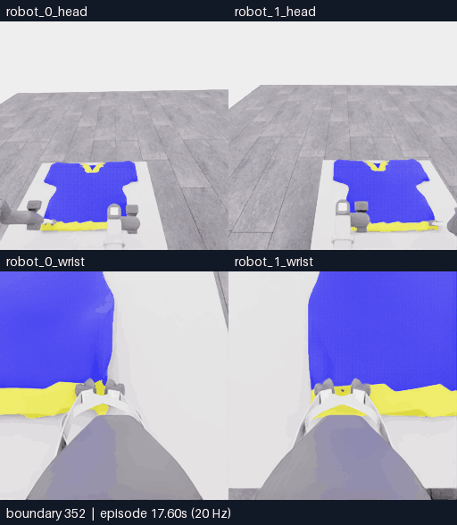
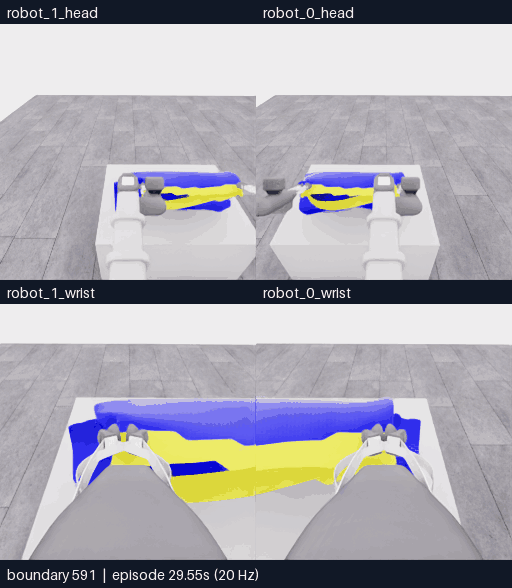
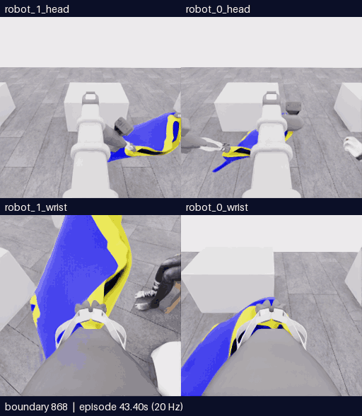

# 시연 목록

[메인](../README.md) | [시연 목록](EPISODES.md) | [다음 수집](COLLECTION_PLAN.md) | [Astra 코드](ASTRA.md) | [클린 서버](OPERATIONS.md)

**2026-11-13: E27까지 마감했고 E28은 수집 진행 중입니다.** E28 `20261113-astra-side-hem-fresh-001`은 새 reset에서 측면 파지·밑단 펼침을 시도하며 최종 결과는 아직 없습니다. 아래 표는 마감한 E00–E27 자료를 유지합니다. 완료된 시도의 최고 로컬 공식 평가기 원점수는 **5/50**, 착의 득점은 **0**, 전체 착의 성공은 미달입니다. E번호에는 연결 시험과 실패도 포함되며 독립 성공 시연 수가 아닙니다. [환경·연결 검사](project/sessions/20261113-environment-setup.ko.md) / [E28 전략 검토](collection/research/2026-11-13-side-hem-wrists.ko.md)

## 대표 장면

사진을 누르면 해당 MP4가 열립니다. 전체 overview 영상과 원본 기록은 아래 표에서 바로 확인할 수 있습니다.

<table>
<tr>
<td width="33%" valign="top"><strong>사람 직접 조작</strong> 
 
집기·들기·운반 일부 <a href="videos/20261026-human-pickup-transport.mp4">MP4</a> / <a href="gallery/20261026-human-pickup-transport.ko.md">장면 분석</a></td>
<td width="33%" valign="top"><strong>E05 첫 픽업</strong> 
 
유지 시간을 확보해 픽업 5점 <a href="collection/attempts/20261106-astra-pickup-hold5-001/overview.mp4">MP4</a> / <a href="gallery/20261106-astra-pickup-hold5-001.ko.md">장면 분석</a></td>
<td width="33%" valign="top"><strong>E07 공동 운반</strong> 
 
두 로봇이 함께 들고 마네킹에 접근 <a href="gallery/assets/20261106-astra-coordinated-fresh-001-multiview/event.mp4">MP4</a> / <a href="gallery/20261106-astra-coordinated-fresh-001.ko.md">장면 분석</a></td>
</tr>
<tr>
<td width="33%" valign="top"><strong>E16 지지·재파지</strong> 
 
한쪽 지지와 국소 천 동행 비교 <a href="gallery/assets/20261106-e16-regrasp/event.mp4">MP4</a> / <a href="gallery/20261106-astra-support264-002.ko.md">장면 분석</a></td>
<td width="33%" valign="top"><strong>E25 새 경계 잡기</strong> 
 
실제 열기·위치 변경·재닫기 <a href="gallery/assets/20261107-e25-rim-regrasp/event.mp4">MP4</a> / <a href="gallery/20261107-astra-opposing563-named-001.ko.md">장면 분석</a></td>
<td width="33%" valign="top"><strong>E27 운반·팔 접근</strong> 
 
새 파지로 운반; 소매 통과는 미확인 <a href="gallery/assets/20261107-e27-arm-approach/event.mp4">MP4</a> / <a href="gallery/20261107-astra-regrasp698-progress-named-001.ko.md">장면 분석</a></td>
</tr>
</table>

사람 시연은 **2,225전이 / 111.25로봇초**의 부분 기록입니다. 로봇별 분할 화면은 **왼쪽 robot_1, 오른쪽 robot_0**, 위 head / 아래 wrist 순서이며 픽셀을 좌우 반전하지 않습니다. [표시 규칙과 변환 출처](gallery/ROBOT_LAYOUT.ko.md)

## E00–E27 전체 자료

**전이 1개는 관측→행동→다음 관측의 0.05초 기록**입니다. 표의 길이는 재실행과 새 구간을 합친 로봇 시간이며 모델 호출 수·실제 대기 시간이 아닙니다. MP4 배속과 마지막 `next_obs`는 각 기록에서 확인합니다.

| ID | 변경과 관측 | 직접 출발점 | 전이 / 로봇초 | 자료 |
|---|---|---|---:|---|
| E00 | 첫 접근·닫기·시험 들기; 0점 | 새 환경 | 167 / 8.35 | [MP4](collection/attempts/20261106-astra-dressing-001/overview.mp4) / [화면](collection/attempts/20261106-astra-dressing-001/images/final-overview.png) / [원본](collection/attempts/20261106-astra-dressing-001/manifest.json) |
| E01 | 호출 시간·사용량 계측; 연결 시험 | 연결 시험 | 3 / 0.15 | [MP4](collection/attempts/20261106-exec-metering-wiring-001/overview.mp4) / [화면](collection/attempts/20261106-exec-metering-wiring-001/images/final-overview.png) / [원본](collection/attempts/20261106-exec-metering-wiring-001/manifest.json) |
| E02 | AppServer 호환성 실패; 수용 응답 0 | 연결 시험 | — | 영상 없음 / [호환성 기록](collection/experiments/2026-11-06-app-server-probe.ko.md) |
| E03 | 한 응답의 고정 행동 3개; 연결 시험 | 연결 시험 | 3 / 0.15 | [MP4](collection/attempts/20261106-exec-plan3-wiring-001/overview.mp4) / [화면](collection/attempts/20261106-exec-plan3-wiring-001/images/final-overview.png) / [원본](collection/attempts/20261106-exec-plan3-wiring-001/manifest.json) |
| E04 | 들기 유지 2.9초; 0점 | 새 환경 | 168 / 8.40 | [MP4](collection/attempts/20261106-astra-pickup-plan2-001/overview.mp4) / [화면](collection/attempts/20261106-astra-pickup-plan2-001/images/final-overview.png) / [원본](collection/attempts/20261106-astra-pickup-plan2-001/manifest.json) |
| E05 | 유지 여유를 두어 첫 픽업 5점 | 새 환경 | 253 / 12.65 | [MP4](collection/attempts/20261106-astra-pickup-hold5-001/overview.mp4) / [화면](collection/attempts/20261106-astra-pickup-hold5-001/images/final-overview.png) / [원본](collection/attempts/20261106-astra-pickup-hold5-001/manifest.json) |
| E06 | E05 이후 이어가기; 픽업 5점 유지 | E05 / 253 | 386 / 19.30 | [MP4](collection/attempts/20261106-astra-dressing-continue-001/overview.mp4) / [화면](collection/attempts/20261106-astra-dressing-continue-001/images/final-overview.png) / [원본](collection/attempts/20261106-astra-dressing-continue-001/manifest.json) |
| E07 | 두 로봇 공동 들기·운반; 픽업 5점 | 새 환경 | 1,067 / 53.35 | [MP4](collection/attempts/20261106-astra-coordinated-fresh-001/overview.mp4) / [화면](collection/attempts/20261106-astra-coordinated-fresh-001/images/final-overview.png) / [원본](collection/attempts/20261106-astra-coordinated-fresh-001/manifest.json) |
| E08 | 설정 누락으로 시작 실패 | E07 / 700 예정 | 0 / 0.00 | 영상 없음 / [시작 실패 기록](collection/experiments/2026-11-06-continuation-startup-retry.ko.md) |
| E09 | 중지 중 파일 미완료; QC 실패 | E07 / 700 목표 140까지 재실행 | 141 / 7.05 | [부분 MP4](collection/attempts/20261106-astra-coordinated-branch700-002/overview.mp4) / [화면](collection/attempts/20261106-astra-coordinated-branch700-002/images/final-overview.png) / [원본](collection/attempts/20261106-astra-coordinated-branch700-002/manifest.json) |
| E10 | 소매 식별·접근 분기 | E07 / 700 | 750 / 37.50 | [MP4](collection/attempts/20261106-astra-sleeve-branch700-003/overview.mp4) / [화면](collection/attempts/20261106-astra-sleeve-branch700-003/images/final-overview.png) / [원본](collection/attempts/20261106-astra-sleeve-branch700-003/manifest.json) |
| E11 | 과거 RGB를 첫 판단에 추가 | E07 / 700 | 777 / 38.85 | [MP4](collection/attempts/20261106-astra-sleeve-history-001/overview.mp4) / [화면](collection/attempts/20261106-astra-sleeve-history-001/images/final-overview.png) / [원본](collection/attempts/20261106-astra-sleeve-history-001/manifest.json) |
| E12 | 몸통 밑단을 통한 진입 경로 | E07 / 700 | 781 / 39.05 | [MP4](collection/attempts/20261106-astra-hem-route-001/overview.mp4) / [화면](collection/attempts/20261106-astra-hem-route-001/images/final-overview.png) / [원본](collection/attempts/20261106-astra-hem-route-001/manifest.json) |
| E13 | 현재 손목 depth 패널 추가 | E07 / 700 | 810 / 40.50 | [MP4](collection/attempts/20261106-astra-hem-depth-001/overview.mp4) / [화면](collection/attempts/20261106-astra-hem-depth-001/images/final-overview.png) / [원본](collection/attempts/20261106-astra-hem-depth-001/manifest.json) |
| E14 | 동작 뒤 중립 대기 추가 | E07 / 700 | 721 / 36.05 | [MP4](collection/attempts/20261106-astra-hem-settle-001/overview.mp4) / [화면](collection/attempts/20261106-astra-hem-settle-001/images/final-overview.png) / [원본](collection/attempts/20261106-astra-hem-settle-001/manifest.json) |
| E15 | 더 이른 단계에서 층·입구 준비 | E07 / 264 | 611 / 30.55 | [MP4](collection/attempts/20261106-astra-opening264-001/overview.mp4) / [화면](collection/attempts/20261106-astra-opening264-001/images/final-overview.png) / [원본](collection/attempts/20261106-astra-opening264-001/manifest.json) |
| E16 | 순차 지지·R0 재파지; 최종 0점 | E07 / 264 | 516 / 25.80 | [MP4](collection/attempts/20261106-astra-support264-002/overview.mp4) / [화면](collection/attempts/20261106-astra-support264-002/images/final-overview.png) / [원본](collection/attempts/20261106-astra-support264-002/manifest.json) |
| E17 | 다른 낮은 경계 재파지·공동 들기 | E16 / 352 | 452 / 22.60 | [MP4](collection/attempts/20261106-astra-layer352-001/overview.mp4) / [화면](collection/attempts/20261106-astra-layer352-001/images/final-overview.png) / [원본](collection/attempts/20261106-astra-layer352-001/manifest.json) |
| E18 | 공개 픽셀 깊이 질의·운반 | E16 / 470 | 928 / 46.40 | [MP4](collection/attempts/20261106-astra-guide470-depth-001/overview.mp4) / [화면](collection/attempts/20261106-astra-guide470-depth-001/images/final-overview.png) / [원본](collection/attempts/20261106-astra-guide470-depth-001/manifest.json) |
| E19 | 이름 기반 행동·접근과 복구 | E18 / 801 | 932 / 46.60 | [MP4](collection/attempts/20261107-astra-entry801-named-001/overview.mp4) / [화면](collection/attempts/20261107-astra-entry801-named-001/images/final-overview.png) / [원본](collection/attempts/20261107-astra-entry801-named-001/manifest.json) |
| E20 | 목 후보 두 곳 재파지; 최종 0점 | E18 / 470 | 726 / 36.30 | [MP4](collection/attempts/20261107-astra-neckline470-named-001/overview.mp4) / [화면](collection/attempts/20261107-astra-neckline470-named-001/images/final-overview.png) / [원본](collection/attempts/20261107-astra-neckline470-named-001/manifest.json) |
| E21 | 높은 접근·하강·테이블 복귀 | E18 / 470 | 1,111 / 55.55 | [MP4](collection/attempts/20261107-astra-overhead470-named-001/overview.mp4) / [화면](collection/attempts/20261107-astra-overhead470-named-001/images/final-overview.png) / [원본](collection/attempts/20261107-astra-overhead470-named-001/manifest.json) |
| E22 | 작은 전진·시점 보정 | E18 / 787 | 813 / 40.65 | [MP4](collection/attempts/20261107-astra-probe787-named-001/overview.mp4) / [화면](collection/attempts/20261107-astra-probe787-named-001/images/final-overview.png) / [원본](collection/attempts/20261107-astra-probe787-named-001/manifest.json) |
| E23 | 방향·높이 변경과 손·전완 재노출 | E18 / 787 | 1,180 / 59.00 | [MP4](collection/attempts/20261107-astra-progress787-named-001/overview.mp4) / [화면](collection/attempts/20261107-astra-progress787-named-001/images/final-overview.png) / [원본](collection/attempts/20261107-astra-progress787-named-001/manifest.json) |
| E24 | 같은 파지로 추가 접근·부분 복구 | E23 / 1179 | 1,610 / 80.50 | [MP4](collection/attempts/20261107-astra-progress1179-named-001/overview.mp4) / [화면](collection/attempts/20261107-astra-progress1179-named-001/images/final-overview.png) / [원본](collection/attempts/20261107-astra-progress1179-named-001/manifest.json) |
| E25 | R1 열기→새 경계→닫기; 국소 천 동행 | E18 / 563 | 698 / 34.90 | [MP4](collection/attempts/20261107-astra-opposing563-named-001/overview.mp4) / [화면](collection/attempts/20261107-astra-opposing563-named-001/images/final-overview.png) / [원본](collection/attempts/20261107-astra-opposing563-named-001/manifest.json) |
| E26 | 기존 파지로 다른 손·접근면 비교 | E18 / 787 | 1,139 / 56.95 | [MP4](collection/attempts/20261107-astra-hand-swap787-named-001/overview.mp4) / [화면](collection/attempts/20261107-astra-hand-swap787-named-001/images/final-overview.png) / [원본](collection/attempts/20261107-astra-hand-swap787-named-001/manifest.json) |
| E27 | E25 새 파지로 운반·팔 접근 | E25 / 698 | 1,159 / 57.95 | [MP4](collection/attempts/20261107-astra-regrasp698-progress-named-001/overview.mp4) / [화면](collection/attempts/20261107-astra-regrasp698-progress-named-001/images/final-overview.png) / [원본](collection/attempts/20261107-astra-regrasp698-progress-named-001/manifest.json) |

E09는 불완전 원본을 보존한 기록으로 학습·정상 재실행 출처에서 제외합니다. E10–E27 중 E16·E20을 제외한 시도의 최종 원점수는 5점이며, **정상 평가한 과제 시연의 착의 득점은 모두 0**입니다. 파지·시야 개선을 소매 통과나 추가 득점으로 해석하지 않습니다.

## 분기와 원본

`E18 / 787`은 **E18의 행동 787개를 새 환경에서 재실행한 뒤 분기**했다는 뜻입니다. 정확한 천 상태 checkpoint가 아닙니다. E04·E05·E07의 이전 시도 링크는 개발 순서이며, 세 실행은 행동 prefix 없이 새 환경에서 시작했습니다.

- E04–E06은 픽업 방법 그룹입니다. E06의 픽업은 E05 행동 재실행 중 얻었습니다.
- E07 이후의 재실행 분기는 같은 `source_group` 계보입니다. 인접 프레임과 공통 prefix를 독립 성공 표본이나 별도 검증 출처로 세지 않습니다.
- **E25→E27**은 새 파지의 후속입니다. **E26은 E18/787의 별도 분기**이며 E25 파지를 이어받지 않았습니다.

[실행·출발점·방법 정본 JSON](collection/catalog/catalog.v1.json) / [경계별 근거](collection/catalog/README.ko.md) / [추가 연결 시험과 상세 이력](project/HISTORY.ko.md)

## E28 이후

**새 계획, 미실행·미예약.** 두 로봇을 옷의 앞이 아닌 **양옆에 배치**하고, **아래쪽 입구를 잡아 넓힌 뒤 마네킹의 한쪽 손목을 먼저 통과시키고 반대쪽으로 이어가는 방법**을 검토합니다. 준비된 이전 same-arm/E27-928 후보를 현재 실행 계획으로 사용하지 않습니다. 새로운 시작점·명령·성공 여부는 아직 정해지거나 검증되지 않았습니다.

[다음 수집 계획과 검증 순서](COLLECTION_PLAN.md)
