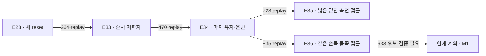

# 과거 결과에서 남길 교훈

**E00–E36에서 집기·공동 운반·손 근접·일부 재파지와 복구를 관측했으나, 정상 평가의 착의 득점은0이며 완전 착의 성공은 확인하지 못했다.** 현재 목표는 유용한 근접 상태에서 실제 조작 효과를 확인하며 첫 소매 새5점을 얻는 것이다. 이 요약은 시간별 시행착오 대신 앞으로의 선택에 필요한 근거를 묶는다.

[현재 계획](COLLECTION_PLAN.md) · [기전·판단 기준](MECHANISMS.ko.md) · [최신 실제 상태](project/STATUS.md) · [모든 시연·영상·계보](EPISODES.md)

## 유지할 결과와 바꿀 질문

| 주제 | 확보한 근거 | 다음 실험에 남길 교훈 |
|---|---|---|
| 수집·관측·행동 연결 | 실제 공개 RGB-D→격리 Astra→공식 action→HDF5 수집과 전수 QC 경로를 사용했다. | 연결 시험·QC 통과는 과제 성공과 분리한다. [Astra 경로](ASTRA.md) |
| 픽업과 공동 운반 | E05 첫 픽업5점, E07 양측 공동 들기·운반. | 유효 유지 조건을 공식 평가로 확인한다. 공통 replay에서 재획득한5점을 새 성공으로 세지 않는다. [대표 장면](EPISODES.md#대표-장면) |
| 공개 관측·깊이 | 과거 RGB, 손목 depth 패널, 픽셀 깊이 조회를 시험했다. | 수치 깊이는 가려진 소매 경로의 정답이 아니다. 손 identity·통로·가시성은 따로 확인한다. [깊이 분석](collection/research/2026-11-06-pixel-depth-query.ko.md) |
| 재파지·지지 | E16/E17/E20/E25에서 실제 열기·이동·닫기, E25→E27에서 새 파지 들기·운반을 시험했다. | 닫기나 국소 천 동행만으로 독립 하중 지지·유효 입구를 확정하지 않는다. 전략 이름과 실제 재파지 횟수를 구분한다. [E25](collection/reviews/20261107-astra-opposing563-named-001.ko.md) · [E27](collection/reviews/20261107-astra-regrasp698-progress-named-001.ko.md) |
| 정렬·접근·복구 | 낮은/높은 접근, 다른 손·면, 대각 진행에서 손·전완 노출과 부분 복구를 관측했다. | 노출 증가·접촉을 소매 통과로 해석하지 않는다. 여러 조건이 달라 단일 변수 비교로 주장하지 않는다. [통합 PDF](reports/20261114-e36-integrated-review/phyrc-e36-integrated-review.ko.pdf) |
| 최신 E28 계보 | 새 reset에서 측면 접근을 시작해 E33 재파지→E34 운반, E35/E36 손목 근접 분기를 만들었다. | E36/933은 최신 정상 후보지만 최선의 출발점으로 입증되지 않았다. 복원 관측을 확인한 뒤 채택한다. |
| 조기 종료·예산 | E36은20결정 한도 중10 act 뒤 모델 finish로 끝났다. | 의미적 정체·사용자 판단·관리 예산·실제 장애를 분리하고, 다음 선택은 live HOLD에서 사용자에게 받는다. |
| 보존 실패 | E09·E32는 미완료 원본·전체 QC 실패로 보존됐다. | 원본 complete를 사후 수정하지 않고 정상 replay·학습에서 제외한다. 진단 백업은 정상 수집 완료와 다르다. |

## 현재 출발 후보를 이해하는 최소 계보

| 시연 | 확인한 결과 | 원문 |
|---|---|---|
| E33 | QC471/471, raw0/50. 순차 재파지·형상 변화, 손 접근 미실행 | [리뷰](collection/reviews/20261114-astra-middle-grip264-001.ko.md) · [receipt](project/sessions/20261114-e33-backup-verification.json) |
| E34 | QC836/836, raw5/50·착의0. 새 파지 들기·운반·짧은 하강 | [리뷰](collection/reviews/20261114-astra-middle-grip470-retain-001.ko.md) · [receipt](project/sessions/20261114-e34-backup-verification.json) |
| E35 | QC983/983, raw5/50·새 득점0. 손목 시야 근접, 통과 미확인 | [리뷰](collection/reviews/20261114-astra-wide-hem723-001.ko.md) · [receipt](project/sessions/20261114-e35-backup-verification.json) |
| E36 | QC933/933, raw5/50·새 득점0. 같은 전완 노출, 손은 파지부 옆에 남음 | [리뷰](collection/reviews/20261114-astra-wrist-body835-001.ko.md) · [receipt](project/sessions/20261114-e36-backup-verification.json) |

이들은 같은 E28 source group이다. E36은 E35 말단에서 이어진 것이 아니며, 행동 재생은 정확한 천 physics checkpoint 복원이 아니다. E33–E36의 학습 승인은 `unreviewed`다. E36까지의 배치는 종료됐으며 남은 횟수·예산을 자동으로 이어받지 않는다.

## 기록을 찾는 방법

- **현재 선택:** [COLLECTION_PLAN](COLLECTION_PLAN.md), [MECHANISMS](MECHANISMS.ko.md), [STATUS](project/STATUS.md).
- **관측과 출처:** [EPISODES](EPISODES.md), [catalog](collection/catalog/catalog.v1.json), 각 review·manifest·provenance.
- **상세 재현 근거:** [보관함](ARCHIVE.md), 날짜별 [sessions](project/sessions/), 당시의 [상세 HISTORY](project/HISTORY.ko.md). 과거 문서의 미래형·“현재”는 작성 당시 상태다.

초기 시간별 기록과 기존 미디어는 보존한다. 앞으로는 동일한 로그를 여러 문서에 반복하지 않고, 현재 전략을 바꾼 관측·가설·결정과 그 근거만 이 요약에 반영한다.
