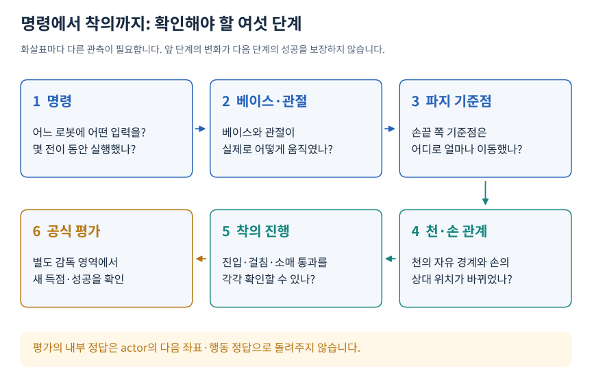
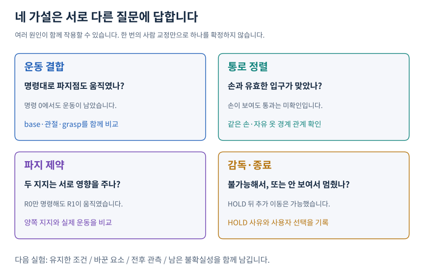
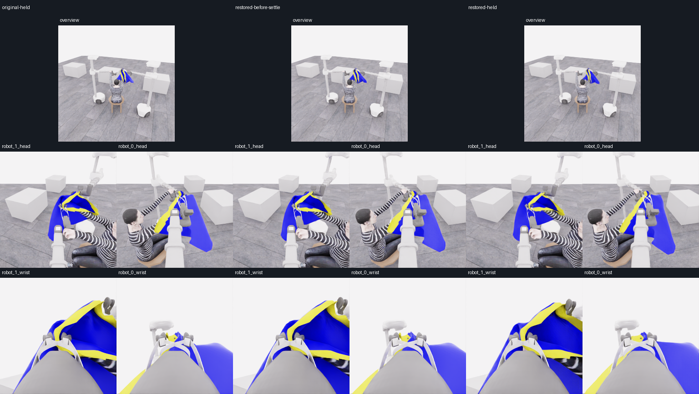
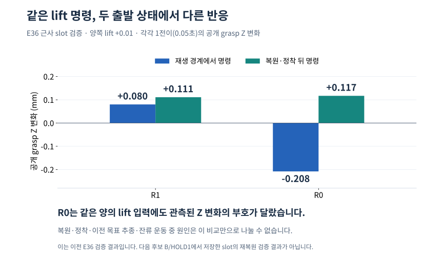
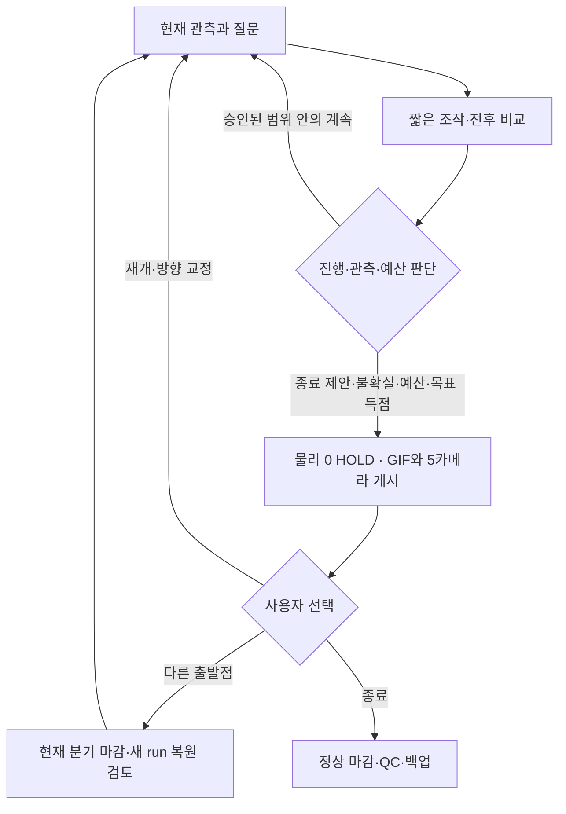
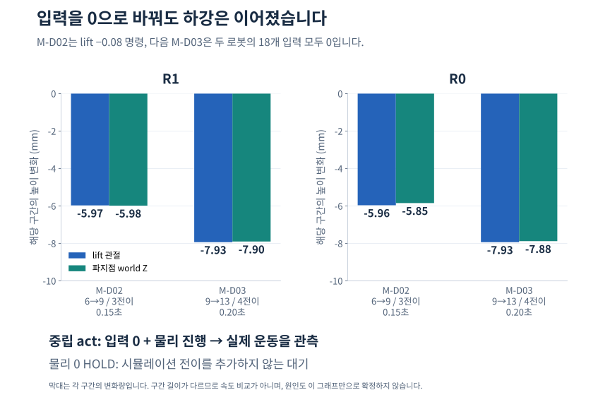
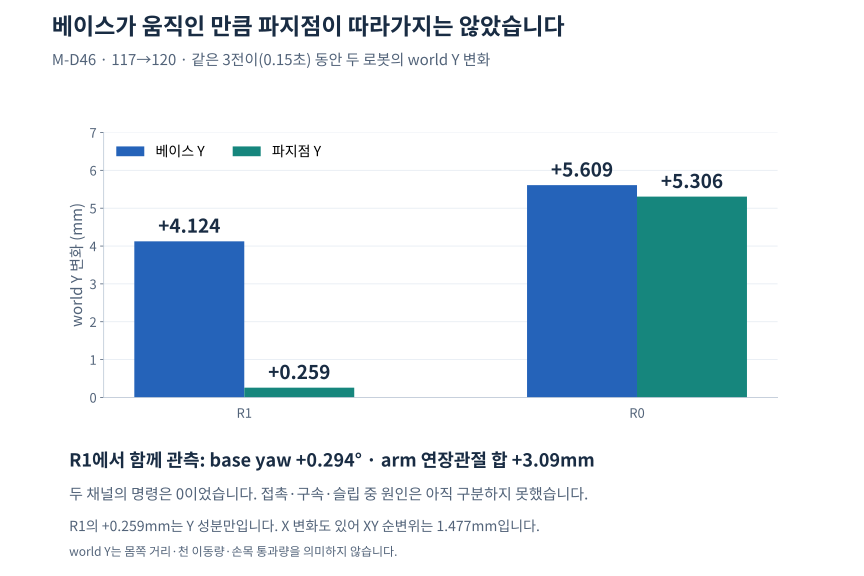
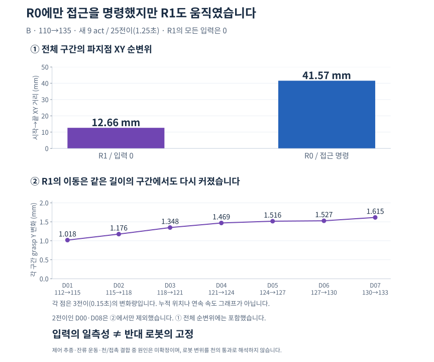
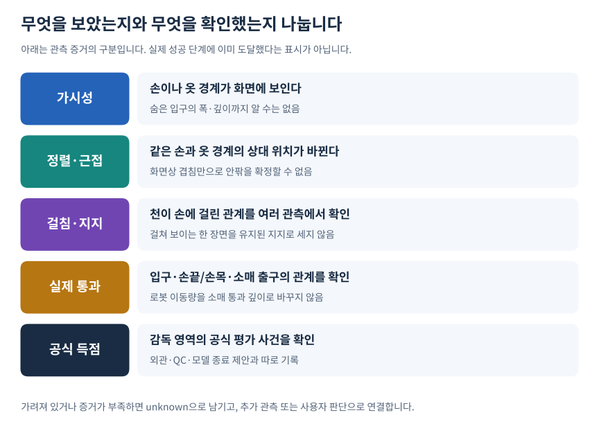

# 착의 기전과 다음 판단

**지금 필요한 것은 명령을 더 오래 보내는 것만이 아니라, 짧게 실행한 뒤 로봇·천·손의 관계가 어떻게 달라졌는지 확인하는 것이다.** 이 문서는 이미 수집한 시연에서 확인한 효과, 아직 남은 원인 가설, 다음에 구분할 질문을 그림과 실측 그래프로 설명한다.

**현재 상태:** 기존 M1과 새 오른손 분기는 정상 마감·QC·백업 검증을 마쳤으며 live HOLD는 없다. 다음 가설은 **마지막 R0 단독 접근 전의 B/HOLD1·110전이 상태에서 두 로봇을 마네킹의 해부학적 왼손 쪽으로 함께 옮긴 뒤 옷을 양손에 걸치는 것**이다. 사용자가 공식 시연을 참고해 제시한 방향이며 아직 실행하지 않았다. 그 상태에서 저장한 새 시작 slot은 저장·해시 확인까지 완료했고, **그 slot의 재복원은 미검증**이다.

[현재 계획](COLLECTION_PLAN.md) · [마감 상태](project/STATUS.md) · [47개 이동의 명령·실측·GIF](collection/reviews/20261116-user-guided-movement-ledger.ko.md) · [전체 수치 JSON](collection/reviews/20261116-user-guided-movement-ledger.json) · [과거 결과 요약](HISTORY_SUMMARY.ko.md)

## 먼저 볼 질문

| 궁금한 점 | 읽을 곳 | 핵심 구분 |
|---|---|---|
| 명령은 실행됐는데 왜 착의로 이어지지 않았나? | [1. 명령에서 착의까지](#1-명령에서-착의-진행까지) | 명령, 로봇 운동, 천의 변화, 통과는 다른 관측 |
| 무엇이 원인인지 어떻게 나눌까? | [2. 네 가설](#2-네-가지-설명을-구분하기) | 운동 결합·정렬·파지·감독을 함께 검토 |
| checkpoint로 같은 조건을 만들 수 있나? | [3. 복원과 정착](#3-checkpoint가-해결할-것과-측정할-것) | 파일 저장, 상태 복원, 이후 반응의 재현은 별도 |
| 다른 연구에서 무엇을 가져올까? | [4. 연구의 적용 원칙](#4-최근-연구에서-이번-시연에-가져올-원칙) | 판단 기준을 참고하고 센서·임계값은 그대로 복사하지 않음 |
| 다음 실험을 어떻게 기록하고 판단할까? | [5. 분석과 사용자 검토](#5-앞으로-남길-분석-단위) | 질문·바꾼 요소·전후 근거·다음 선택을 연결 |
| 명령 0인데 실제로 움직였나? | [6. 세 가지 실측 사례](#6-현재-m1에서-확인한-기전-중립-명령-뒤에도-운동은-남는다) | 중립 act, 물리 0 HOLD, 반대편 고정의 차이 |
| 손이 보이고 천이 겹치면 통과한 것인가? | [7. 가시성과 실제 진행](#7-추가-후퇴-손의-노출과-충분한-여유는-별도-판단) | 가시성·정렬·걸침·통과·득점을 따로 판정 |

**그림 읽는 기준:** 관계도는 설명용 도식이며 시뮬레이션 장면을 생성한 영상이 아니다. 수치 그래프는 기존 공개 관측 장부와 검증 기록에서 만들었다. 막대·점이 나타내는 단위와 실행 구간을 함께 읽는다. 이번 문서 갱신을 위해 새 물리 시연·복원·학습을 실행하지 않았다.

## 1. 명령에서 착의 진행까지

**“로봇이 움직였다”는 착의 진행을 판단하는 여러 단계 중 하나다.** 각 단계에서 무엇이 바뀌었는지 따로 확인해야 다음 행동을 고를 수 있다.

### 1.1 각 단계에서 무엇을 확인하나?

| 단계 | 쉬운 의미 | 실제로 볼 근거 |
|---|---|---|
| 명령 | 어느 로봇을 어느 방향으로 얼마나 오래 조작했는가 | 요청·실제 action 배열, 실행 전이 수, 완료 ACK |
| 베이스·관절 | 몸체와 lift·arm·손목이 실제로 움직였는가 | 베이스 pose, 관절 위치·속도, 제어 목표의 전후 변화 |
| 파지 기준점 | 옷을 잡는 쪽의 로봇 기준점이 어디로 갔는가 | 공개 `grasp_pose_base`와 베이스 pose로 계산한 위치 |
| 천·손 관계 | 천이 어떻게 펼쳐지고 손과 어떤 관계가 됐는가 | 같은 경계의 지정 5 RGB-D, 자유 옷 경계, 구간 GIF |
| 착의 진행 | 밑단 진입·손목 걸침·소매 출구 진행을 확인했는가 | 손·손목·천 경계가 바뀌는 과정, 유지되는 지지, 가림 여부 |
| 공식 평가 | 공식 득점 사건이나 성공 조건이 충족됐는가 | actor 밖의 별도 평가 결과 |

여기서 **파지 기준점(grasp reference point)은 로봇에 정의된 점**이다. 천 입자나 실제 접촉점을 직접 측정한 값이 아니므로, 이 점이 10mm 이동했다고 천이 10mm 이동했거나 손이 소매를 10mm 통과했다고 계산할 수 없다.

### 1.2 숫자와 좌표를 혼동하지 않기

| 용어 | 의미 |
|---|---|
| action | 두 로봇 × 9채널의 정규화 입력. 앞 8채널은 속도 비율, gripper는 열기·닫기 의도 |
| act | 지정한 action을 정해진 길이로 실행한 한 번의 조작. 두 로봇의 명령이 함께 들어가도 1 act |
| 전이 | 관측→행동→다음 관측의 0.05초 단위. 4전이이면 0.20시뮬레이션초 |
| base 좌표 | 해당 로봇을 기준으로 전방 X·왼쪽 Y·위 Z |
| world 좌표 | 장면에 고정된 공통 좌표. world Y의 증가가 항상 몸쪽 접근을 뜻하지는 않음 |
| ΔXYZ | 같은 기준에서 계산한 끝 위치−시작 위치. 이 문서의 이동 장부는 mm로 표시 |

`lift=-0.08`은 **8cm 하강 명령이 아니다.** 정규화 입력이며 실제 변화는 실행 길이와 제어·물리 반응을 거쳐 관측한다. 정책 전이는 20Hz, 제어는 60Hz, 물리는 240Hz이므로 한 전이에 제어 3회·물리 12회가 들어간다. 모델 호출 시간이나 사용자의 대기 시간과도 구분한다.

파지점의 좌표 관계는 다음처럼 이해하면 된다.

> **world 파지점 = world 베이스 위치 + 베이스 방향에 맞춰 회전한 base 기준 파지점**

그래서 베이스가 이동하거나 회전하고 arm·손목 자세가 함께 달라지면, 파지점의 world 변화는 어느 한 관절의 변화와 같지 않을 수 있다. “두 로봇을 같은 공간 방향으로 옮긴다”는 것도 양쪽에 같은 action 숫자를 넣는다는 뜻이 아니다. 각 로봇의 로컬 방향을 고려하고 실제 양쪽 변위를 확인해야 한다.

근거: [정책 인터페이스의 좌표·시간·action 정의](../config/policy_interface.json) · [이동 장부의 좌표와 명령 규약](collection/reviews/20261116-user-guided-movement-ledger.json).

### 1.3 행동을 고르는 정보와 평가 정보를 구별한다

actor는 지정 5 RGB-D와 공개 로봇 상태, 허용된 작업 지시를 사용한다. GitHub 게시·공식 평가·점수 확인은 별도 감독 영역에서 수행한다. 평가 결과는 분석·선택 등 허용된 용도로 쓰되, **평가의 내부 기하·정답을 다음 actor의 좌표 정답이나 교사 행동으로 되돌려주지 않는다.** 자유 viewport나 내부 천 기하로 공개 관측의 가림을 메워 주는 방식도 사용하지 않는다.

## 2. 네 가지 설명을 구분하기

**현재 기록은 “명령이 전혀 실행되지 않았다”는 설명을 지지하지 않는다.** 실제 이동·하강·정착 운동이 있었다. 남은 질문은 그 운동이 왜 유효한 천–손 관계와 통과로 연결되지 않았는가이다.

| 원인 가설 | 쉬운 질문 | 이미 확인한 것 / 아직 모르는 것 | 다음에 구분할 비교 |
|---|---|---|---|
| **운동 결합** | 보낸 방향대로 실제 파지점도 움직였나? | 중립에서도 운동이 남았고 베이스와 파지점의 변화가 달랐다. 특정 접촉·제어 이력의 영향은 미확정 | 실행 길이와 명령을 기록하고 base·관절·grasp의 전후 변화를 같은 구간에서 비교 |
| **통로 정렬** | 손이 가까워진 것인가, 실제 입구에 맞은 것인가? | 손의 가시 위치는 바뀌었지만 파지부 가림과 불완전한 경계 때문에 실제 입구·통과는 미확인 | 같은 손의 신체 연결과 자유 옷 경계를 추적하고 공동 이동 전후의 상대 위치·걸침을 비교 |
| **파지 제약** | 두 지지가 서로의 운동을 제한하거나 함께 움직이나? | R0만 접근을 명령해도 R1이 움직였다. 천·접촉·제어 중 어떤 결합이 지배적인지는 미확정 | 어느 로봇에 명령했는지와 실제 양측 운동을 분리. 재파지는 별도 사용자 선택과 지지 확인 후 비교 |
| **감독·종료** | 물리적으로 진행 불가능했나, 잘 보이지 않아 판단을 멈췄나? | 가림에 따른 HOLD 후 사용자 재개로 더 이동했다. 이것이 통과 가능성이나 성공을 입증하지는 않음 | 목표 미달·관측 부족·새 비대칭·예산 도달을 서로 다른 HOLD 사유로 기록 |

예를 들어 사람이 방향을 조금 교정한 뒤 파지점이 요청 방향으로 움직였다면 **입력→로봇 운동** 연결을 확인한 것이다. 손과 자유 경계의 관계까지 좋아졌다면 **정렬 가설**을 검토할 근거가 더 생긴다. 그래도 소매 통과를 보지 못했다면 성공은 미확인으로 남긴다.

이 네 설명은 함께 작용할 수 있다. 공동 이동처럼 여러 요소가 바뀌는 교정은 결과를 개선할 수 있어도 원인 하나를 분리한 실험은 아닐 수 있다. 가능한 범위에서 **유지한 조건과 바꾼 요소를 명시**하고, 출발 상태의 복원 차이도 함께 남긴다.

“현재 파지로 불가능”, “명령이 전부 무시됨”, “시간만 늘리면 성공”은 입증되지 않았다. 직접 조작은 이런 설명을 나눌 근거를 만드는 데 사용한다. [E36 구분 실험 분석](collection/research/2026-11-16-checkpoint-effect-feedback.ko.md#8-2026-11-16-추가-기록-네-가지-설명을-구분하는-해결-후보)

## 3. Checkpoint가 해결할 것과 측정할 것

**checkpoint는 비교할 출발점을 마련하는 수단이다. 저장 파일이 있다는 사실만으로 이후 운동까지 같아지지는 않는다.**

### 3.1 저장·복원·행동 재생은 무엇이 다른가?

| 방식 | 하는 일 | 확인할 한계 |
|---|---|---|
| 근사 slot 저장 | 현재 저장 가능한 상태를 파일로 남김 | 파일·해시 확인은 저장 성공의 근거이며 실제 재복원 품질의 근거와 다름 |
| slot 복원 | 새 환경에 저장 상태를 불러옴 | 일부 속도·제어 이력·접촉 cache가 초기화되고 기본 정착이 있음 |
| 행동 prefix 재생 | 같은 초기 조건에서 기록된 명령을 순서대로 다시 실행 | 천·미세한 속도·제어 상태까지 정확히 같은 말단을 보장하지 않음 |
| 완전한 물리 checkpoint | 이후 반응까지 재현할 수 있게 필요한 물리 상태를 복원 | 원래 E36에 대해 이런 완전한 FEM 상태 복원을 확보했다고 말할 수 없음 |

**정착(settle)**은 물리를 진행시키며 상태가 변하도록 두는 구간이고, **물리 0 HOLD**는 새 전이를 진행하지 않는 대기다. 기본 reset의 90 control ticks·1.5초 정착과 모델 act 뒤의 별도 자동 settle도 구분한다. 최신 M·B 장부의 act 뒤 별도 자동 settle은 0이지만 reset 정착까지 없었다는 뜻은 아니다.

### 3.2 실제 E36 근사 slot 검증에서 무엇이 달랐나?

E36의 933전이를 새로 재생한 경계에서 slot을 저장하고, 별도 환경에서 복원·기본 정착한 결과를 비교했다. 아래는 **이미 마감한 과거 검증 실행의 실제 관측**이다. 왼쪽부터 저장 경계 / 복원 직후 / 정착 후이며, 각 묶음 안에서는 왼쪽 R1·오른쪽 R0, 위 head·아래 wrist다.

[원본 이미지·출처](collection/user-reviews/20261116-e36-checkpoint-001/validation/provenance.json) · [검증 당시 상세 기록](collection/reviews/20261116-checkpoint-validation.ko.md). 상세 기록의 당시 “현재 live HOLD” 문장은 이력이며, 지금 실행 중인 세션을 뜻하지 않는다.

| 관측 | 무엇을 뜻하나? |
|---|---|
| 복원 직후 base 기준 grasp pose의 최대 원소 차이 약 `1.2e-7` | 해당 공개 pose 값은 매우 가까웠다. 천 solver 전체가 완전히 복원됐다는 증거는 아님 |
| 정착 후 base 기준 grasp XYZ: R1 `(-6.147, -2.042, +2.587)mm`, R0 `(+6.399, -0.623, -2.493)mm` | 정착을 거치며 저장 경계 대비 파지점이 달라졌다. 축별 최대 성분이 약 6.4mm |
| 같은 짧은 lift 명령의 효과도 달라짐 | 정지 화면의 유사성만으로 다음 운동까지 같다고 가정할 수 없음 |

아래 그래프는 양쪽 lift에 **정규화 +0.01을 각각 1전이·0.05초** 준 비교다. 원래 재생 경계의 R0 grasp Z는 −0.208mm, 복원·정착 후에는 +0.117mm로 변화 방향까지 달랐다. R1은 각각 +0.080mm / +0.111mm였다.

이것은 **복원·정착·잔류 운동·제어 이력의 영향을 더 나눠 봐야 한다는 근거**다. 하나의 원인을 확정하거나 checkpoint 방식 전체가 사용할 수 없다고 결론낸 결과가 아니다. 이 검증에서 새 착의 득점은 없었다.

### 3.3 다음 출발 후보의 검증은 어디까지 끝났나?

| 대상 | 완료한 확인 | 남은 확인 |
|---|---|---|
| E36/933 재생으로 만든 원본 근사 slot | 저장·실제 복원·정착·짧은 명령 효과 비교 | 완전한 동일 물리 상태 복원을 입증한 것은 아님 |
| **B/HOLD1·step110 관측 상태** | 같은 원본 slot과 M의 앞 110전이 재생, M/HOLD10과 관측 비교 | 이후 새로운 복원 상태가 이 관측과 얼마나 같은지 확인 |
| **B/HOLD1에서 새로 저장한 시작 slot** | 추가 물리 0으로 저장, 파일·해시 확인 | **그 저장 slot을 다시 불러오는 복원은 아직 미검증** |

B/HOLD1과 기존 M/HOLD10의 **world 파지점 위치 차이의 3D 크기(노름)**는 R1 **0.634mm**, R0 **1.859mm**였다. 큰 지지 배치는 유사했지만 천 경계·속도·제어 목표까지 완전히 같지는 않았다.

위의 **6.4mm는 다른 E36 검증의 base 좌표 축별 차이**, **0.634/1.859mm는 두 110전이 경계 사이의 world 위치 차이 노름**이다. 기준 상태·좌표·집계 방식이 다르므로 숫자만 비교해 “복원이 더 정확해졌다”고 해석하지 않는다.

다음 출발점은 최종 B/HOLD2·135전이나 M/HOLD11·120전이가 아니라 **R0 단독 접근 전의 B/HOLD1·110전이**다. 실제 재개 시 저장 당시 → 새 복원 직후 → 기본 정착 후를 비교하고 출발 적합성을 판단한다. slot 복원이 부적합하면 이미 실행했던 초기 slot+110전이 재생 방식도 비교할 수 있지만, 출발점을 조용히 바꾸지 않고 사용자 선택으로 연결한다.

checkpoint reset은 **새 평가**다. 과거 pickup 5점이나 평가 시간을 이월하지 않는다. [새 분기 비교](collection/reviews/20261116-right-hand-hold10-branch.ko.md) · [새 시작 slot 저장 receipt](gallery/20261116-right-hand-hold10/start-checkpoint-verification.json) · [최신 복원·출발 계약](COLLECTION_PLAN.md#1-다음-출발-후보와-검증)

## 4. 최근 연구에서 이번 시연에 가져올 원칙

**여기서는 저장소에 이미 보존한 조사 내용을 현재 관측 질문으로 바꾼다.** 새 센서·논문 controller를 구현하거나 새 연구 조사를 추가한 것은 아니다.

| 보존한 연구 | 쉽게 풀어 쓴 원칙 | 이번 시연에 적용할 질문과 한계 |
|---|---|---|
| **Dressing in Motion** | 손이 들어간 사건과 팔을 따라 더 덮인 정도는 다르다 | 접근·삽입·전완 진행을 따로 기록한다. 움직이는 사람의 한 팔 조건과 논문의 정체 시간 기준을 그대로 적용하지 않음 |
| **Geometry-Aware RL** | 입구에 가까운 것과 올바르게 통과한 것은 다르다 | 손과 자유 옷 경계의 관계를 보고 정렬과 통과를 구분한다. 팔찌 과제의 gate·거리 임계값·추가 카메라를 티셔츠에 그대로 복사하지 않음 |
| **Wearing A Coat** | 다음 부분을 입히는 동안 이미 얻은 지지·진전을 잃을 수 있다 | 한쪽을 옮길 때 반대편 지지와 기존 관계가 유지되는지 함께 본다. 코트의 경로·구멍 순서나 내부 옷 모델을 그대로 적용하지 않음 |
| **Synchronous dressing support** | 예상한 변화와 실제 변화를 비교해 다음 행동을 고른다 | 공개 RGB-D와 로봇 상태로 확인 가능한 변화를 먼저 정한다. 능동적인 사람의 협조·힘센서 조건은 현재 입력과 다름 |
| **Force-Modulated Visual Policy** | 로봇이 계속 움직여도 천은 정체하거나 걸릴 수 있다 | 로봇 이동과 천의 진전을 따로 보고 정체·예산·사용자 중지 사유를 구분한다. 논문의 힘센서·중지 임계값은 현재 구현 사항이 아님 |
| **REMORA / ReSTEP** | 시간이 뒤인 프레임이 항상 더 나은 상태는 아니다 | 진행·정체·후퇴·복구·관측 부족을 구분하는 참고다. **착의 연구가 아니며** 착의 성능 근거로 사용하지 않음 |
| **All Dressed Up** | 누가 언제 멈추고 다시 시작할지를 명확히 해야 한다 | 모델 종료 제안·사용자 종료·과제 성공을 별도 사건으로 남긴다. FRET 요구사항 자료를 곧바로 실행 가능한 착의 정책으로 설명하지 않음 |

예를 들어 뒤쪽 프레임에서 로봇이 더 전진했어도 자유 옷 경계가 손에서 벗어나거나 기존 걸침을 잃었다면 “진전”이라고 자동 표시하지 않는다. 반대로 교정을 위한 후퇴가 잠시 발생했다고 전체 시연을 즉시 실패로 마감할 근거도 충분하지 않을 수 있다. **진행 판정에는 시간 순서 외에 손·천 관계의 근거가 필요하다.**

각 연구의 원문·데모·코드 공개 여부와 접근 한계는 [착의 연구 조사](collection/research/2026-11-16-recent-dressing-resources.ko.md)에 보존한다. 현재 우선순위는 문헌을 더 늘리는 일보다 위 구분을 실제 관측 기록에 적용하는 것이다.

## 5. 앞으로 남길 분석 단위

**한 실험은 “무엇을 시켰다”에서 끝내지 않고, “무엇을 확인하려 했고 실제로 무엇이 바뀌었나”까지 연결한다.**

| 기록 항목 | 적을 내용 | 이미 있는 예: M-D46 |
|---|---|---|
| 질문 | 어떤 설명을 구분하려는가 | 같은 접근 명령에서 양쪽 파지점도 계속 전진하는가? |
| 유지한 조건 / 바꾼 요소 | 출발 상태·파지 의도·명령·실행 길이 | 기존 닫기 의도 유지, C09 접근, 117→120의 3전이 |
| 관측 근거 | 실제 명령과 양쪽 base·관절·grasp, 같은 구간 GIF | R1 base Y +4.124mm, grasp Y +0.259mm; R0 grasp Y +5.306mm |
| 가설 판단 | 확인한 사실 / 아직 구분하지 못한 원인 | 비대칭 반응 확인. 접촉·구속·슬립의 원인은 미확정 |
| 다음 선택 | 진행·방향 교정·관측 검토·출발 변경·종료 | 당시 사용자 검토를 거쳐 앞 110전이를 재생한 별도 B 분기로 변경 |

이 표는 기존 기록을 읽는 예이며, 당시 모든 act가 사전 통제 실험으로 설계됐다는 뜻은 아니다. 새 실험에서는 질문과 비교 조건을 먼저 적고 결과와 대조하면 된다.

### 5.1 사용자 검토와 다음 행동의 연결

아래는 **시연을 재개했을 때 사용할 판단 흐름**이다. 현재 실행 중인 세션을 표시한 그림은 아니다. checkpoint·물리 0 HOLD·게시·텍스트 재개 경로는 이미 구현·검증했으며, 새 시작 slot의 복원 검증이 별도로 남아 있다.

모델 stop/finish나 관리 예산 도달은 사용자 검토 이유이며, 물리적 불가능이나 성공의 증거가 아니다. 다음 시연에서 공식 `first_sleeve` 새 0→5점을 확인한 경우에도 자동 마감 대신 **득점 검토 HOLD**로 전환해 다음 진행·종료를 사용자에게 묻는다. HOLD 중에는 중립 action을 반복하지 않고 새 물리 전이를 만들지 않는다. **사용자 무응답은 재개 승인이 아니며**, 실제 환경의 하드 종료·프로세스 장애·기록 손상은 살아 있는 HOLD와 구분한다.

질문에는 같은 경계의 overview와 양쪽 head/wrist **5카메라**, 구간별 **실제 움직임 GIF**, 관측 ID·HOLD 이유·unknown을 연결한다. 정지 화면만 보고 “계속할까요?”라고 묻기보다 무엇이 예상과 달랐는지 보여 준다. 상세 예산과 재개·마감 조건은 [현재 계획](COLLECTION_PLAN.md#3-종료-제안예산-도달은-사용자-검토-hold로-바꾼다)을 따른다.

### 5.2 집계 단위와 출처를 연결한다

이번 M·B 장부는 **38+9=47 act**, 새 물리 **120+25=145전이**를 담는다. B 복귀 재생 110전이는 실제 물리를 진행했지만 새 모델 조작에는 중복 집계하지 않는다. 중립 act와 별도 settle, 물리 0 HOLD도 각각 표시한다.

각 결과에는 run·D번호·P구간·C명령·전후 관측 해시·GIF를 연결한다. 글의 해석에서 원본 공개 관측까지 따라갈 수 있어야 한다. [번호·집계 그림과 47개 상세 이동](collection/reviews/20261116-user-guided-movement-ledger.ko.md)

## 6. 현재 M1에서 확인한 기전: 중립 명령 뒤에도 운동은 남는다

아래는 **마감된 M·B 두 실행의 실측 사례**다. M은 `20261116-astra-m1-checkpoint-001`, B는 `20261116-astra-right-hand-hold10-001`의 약칭이다. 그래프는 각 구간의 전후 차이이며, 연속 물리 시간의 모든 순간을 표시하는 것은 아니다.

### 6.1 입력을 0으로 바꾼 뒤에도 내려갔다

M-D02에서 lift −0.08을 3전이 실행한 다음, M-D03에서 두 로봇의 모든 입력을 0으로 바꾸고 4전이를 진행했다. 이 **중립 구간에서도 lift는 약 7.93mm 더 내려갔고**, 파지점 world Z도 양쪽 약 7.9mm 내려갔다.

그래프의 두 구간은 각각 0.15초와 0.20초이므로 막대 높이만으로 속도를 비교하지 않는다. 확인한 사실은 “입력을 0으로 바꿨는데도 실제 운동이 남았다”는 것이다. 제어 목표 추종·잔류 운동 등의 가능성을 비교해야 하며 이 관측만으로 원인을 하나로 정할 수 없다.

| 구분 | 입력·물리 시간 | 해석 |
|---|---|---|
| 중립 act | action 값 0, 지정한 전이는 실제 진행 | 로봇·천이 계속 움직일 수 있음 |
| 물리 0 HOLD | 새 action·settle·종료 도구를 dispatch하지 않음 | 시뮬레이션 전이와 관측 경계를 유지하며 대기 |
| 정착 | 물리를 진행하며 변화를 관찰 | 초기 복원 정착인지 act 뒤 별도 정착인지 출처를 구분 |

gripper 0도 손을 연다는 뜻이 아니라 기존 열기·닫기 의도를 유지한다. 이번 47 act에서는 기존 닫기 의도가 유지됐다. [실제 하강·중립 GIF](gallery/20261116-m1-guided-segments/lower-and-neutral.gif) · [분석 원문](collection/reviews/20261116-m1-front-lower-wrist.ko.md)

### 6.2 베이스가 이동한 만큼 파지점이 따라가지는 않았다

M-D46의 마지막 **117→120, 3전이·0.15초**에서 양쪽 접근 명령을 유지했다. R1의 base Y는 **+4.124mm** 변했지만 grasp Y는 **+0.259mm**였다. 같은 구간의 R0 grasp Y는 **+5.306mm**였다.

R1에서는 해당 입력이 0이었던 **base yaw +0.294도**, **arm 연장관절 합 +3.087mm** 변화도 함께 관측했다. 베이스와 파지점 반응의 비대칭은 확인했지만, 이것만으로 충돌·구속·슬립 중 어느 것이 원인인지 정하지 않는다.

**+0.259mm는 Y 성분 하나다.** R1은 X 방향 변화도 있어서 같은 구간의 XY 순변위는 약 **1.477mm**다. 따라서 “R1이 총 0.26mm만 움직였다”거나 “완전히 막혔다”로 바꿔 읽으면 안 된다. world Y는 몸쪽 거리나 손의 통과 깊이도 아니다.

[해당 실제 GIF](gallery/20261116-m1-guided-segments/third-stripe-approach.gif) · [자세·운동 분석](collection/reviews/20261116-m1-third-stripe.ko.md)

### 6.3 R0에만 접근을 명령했지만 R1도 움직였다

B의 **110→135, 새 9 act·25전이·1.25초**에서는 C11로 R0에만 접근을 명령했다. R1의 9채널은 모두 0이었지만, 전체 구간의 grasp XY 순변위는 **R1 12.66mm / R0 41.57mm**였다. R1 base Y도 약 **7.79mm** 변했다.

위쪽 막대는 **시작점에서 끝점까지의 XY 순변위**다. 중간 경로의 총길이가 아니다. 아래 선 그래프는 길이가 같은 B-D01–D07의 **각 3전이 구간별 R1 grasp Y 변화량**이며 누적 위치나 순간 속도를 그린 선이 아니다.

같은 3전이 창에서 변화량이 약 **1.02→1.61mm**로 다시 커졌다. 단순히 시간이 지나며 줄어드는 초기 잔류 운동 하나로 설명하기에는 근거가 부족하다. 제어 추종·천·접촉 결합의 원인은 여전히 미확정이다. 양끝의 B-D00·D08은 2전이이므로 아래 동일 길이 비교에서만 제외했고, 위 전체 순변위에는 포함했다.

이 결과 때문에 다음 실험에서 **“R1 명령 0”을 “R1 위치 고정” 대조 조건으로 사용할 수 없다.** 어느 로봇에 명령했는지와 실제로 어느 로봇이 움직였는지를 따로 적는다.

[실제 R0 접근 구간 GIF](gallery/20261116-right-hand-hold10/right-hand-only-two-stripes.gif) · [분기 분석](collection/reviews/20261116-right-hand-hold10-branch.ko.md) · [그래프의 원수치](collection/reviews/20261116-user-guided-movement-ledger.json)

## 7. 추가 후퇴: 손의 노출과 충분한 여유는 별도 판단

**손이 더 잘 보였다는 것은 좋은 관측 조건의 변화이지, 충분한 3D 통로가 생겼다는 확정은 아니다.** 손·천·파지부의 관계를 다음처럼 나눠 기록한다.

### 7.1 먼저 같은 손을 보고 있는지 확인한다

해부학적 좌우는 **어깨→팔꿈치→손의 연결**로 정한다. 뒤통수·등이 보이는 overview에서 그 연결을 추적하고 head 화면과 대조했다. 이전 actor가 R1 wrist의 가려진 손을 오른손이라고 단정한 판단은 새 분기에서 교정했다.

| 구분 | R1 / robot_1 | R0 / robot_0 |
|---|---|---|
| 현재 확인한 가까운 손 | 마네킹의 해부학적 왼손 | 마네킹의 해부학적 오른손 |
| 분할 화면의 표시 기준 | 왼쪽 패널 | 오른쪽 패널 |
| 행동 배열의 행 | 행 1 | 행 0 |

카메라 이름·화면 좌우·변위의 비대칭 자체로 해부학적 좌우를 정하지 않는다. 패널 배치는 왼쪽 R1·오른쪽 R0지만 원본 픽셀을 좌우 반전하거나 action 행 순서를 바꾸는 것은 아니다. [해부학적 식별 교정 근거](collection/reviews/20261116-right-hand-hold10-branch.ko.md)

### 7.2 후퇴·재접근에서 실제로 무엇을 보았나?

| 구간의 관측 | 말할 수 있는 것 | 아직 확인하지 못한 것 |
|---|---|---|
| 추가 후퇴 후 손 노출과 천의 처짐이 늘어남 | 가시성과 천 형상의 변화 | 입구 중심, 숨은 경계, 충분한 3D 통로 폭 |
| 재접근하며 손이 화면 중앙 쪽으로 가고 housing 가림이 늘어남 | 화면상 상대 위치와 가림의 변화 | 실제 비접촉 상태, 정확한 접촉 부위, 통과 여부 |
| 약 17mm에서 가림에 따른 HOLD, 사용자 검토 뒤 약 32mm 추가 이동 | HOLD 뒤에도 실제 추가 이동은 가능했음 | 시간만 더 주면 성공한다는 보장, 유지된 걸침·소매 통과 |

마지막 행은 P08·P09에 해당한다. 약 50mm 요청 중 P08에서 일부 이동 후 검토했고, P09의 추가 XY 순변위는 R1 **31.45mm**, R0 **31.97mm**였다. 두 구간 전체는 R1 **48.30mm**, R0 **49.06mm**였다. 수치가 요청에 가까워졌어도 실제 통과를 확인한 것은 아니다.

[후퇴 GIF](gallery/20261116-m1-guided-segments/right-hand-retreat.gif) · [P08: 가림에 따른 중간 HOLD](gallery/20261116-m1-guided-segments/bodyward-50mm-slight-rise.gif) · [P09: 사용자 검토 뒤 추가 이동](gallery/20261116-m1-guided-segments/bodyward-33mm-completion.gif) · [구간별 근거 표](collection/reviews/20261116-user-guided-movement-ledger.ko.md#사용자-지시별-구간)

### 7.3 다음 공동 이동·양손 걸침 가설에서 확인할 것

아래는 **아직 실행하지 않은 관측 질문**이다. 구체적인 실행 순서와 사용자 재개 조건은 [현재 계획](COLLECTION_PLAN.md)에 둔다.

| 질문 | 확인할 근거 |
|---|---|
| 두 로봇이 의도한 공간 방향으로 함께 이동했나? | 각자의 로컬 명령과 실제 base·grasp 변위. 같은 action 숫자를 요구하지 않음 |
| 양손과 자유 옷 경계의 관계가 좋아졌나? | 같은 관측 경계의 5카메라와 전후 GIF. 해부학적 왼손을 고정 world X/Y 부호로 정하지 않음 |
| 천이 양손에 실제로 걸쳐 지지됐나? | 한 장면의 겹침 외에 시간·여러 시점에서 유지되는 경계·지지 관계 |
| 걸침에서 소매 통과로 진행했나? | 손끝·손목·소매 출구를 분리해서 확인. 가려진 부분은 unknown |
| 공식 추가 득점이 있었나? | 새 평가의 공식 사건을 별도 감독 영역에서 확인 |

이번 분석에서 확인한 것은 **명령과 실제 운동의 차이, 복원 뒤 반응 차이, 가림과 사용자 재개에 따른 추가 이동**이다. 새 양손 걸침·소매 통과의 성공은 아직 확인하지 않았다. 기술 QC 통과, 학습 승인, 작업 성능은 별도이며 최신 평가·마감 상태는 [STATUS](project/STATUS.md)를 따른다.

---

그림·수치 출처: [이동 장부 JSON](collection/reviews/20261116-user-guided-movement-ledger.json), [E36 checkpoint 검증](collection/reviews/20261116-checkpoint-validation.ko.md), [원본 검토·GIF](collection/reviews/20261116-user-guided-movement-ledger.ko.md). 설명용 도식과 실측 그래프를 새로 추가했으며 기존 원본·관측·평가·시연 기록은 수정하지 않았다. [개편 전 본문](https://github.com/leonyoon-3dai/PhyRC_2027_phase1/blob/e9a18dbb8b9857d70e96da41e25af81cfed331eb/docs/MECHANISMS.ko.md).
