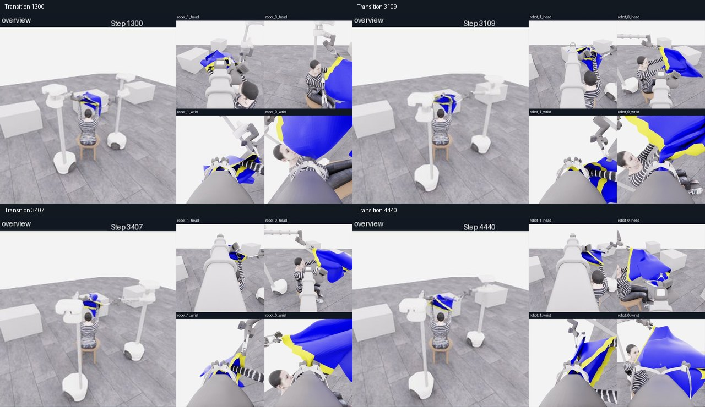

# 시연 1–20 종합 분석

**공식 최고 원점수는 시연 2의 20/50점**입니다. 20개 본 시연에서 모두 픽업 5점 이상을 얻었고, 공식 착의 성공은 없었습니다. **시연 20은 두 팔 끝이 셔츠 안쪽으로 이어져 보이는 장면까지 진행**했습니다. 3,109–3,407전이의 여러 카메라에서는 양팔 쪽 천이 유지되는 동안 두 밑단을 따로 움직였습니다. 손끝이 각각 대응하는 소매 밖으로 나오는 장면과 머리가 목둘레를 통과한 장면은 확인하지 못했습니다. 시연 20의 공식 점수는 5/50점입니다. [시연별 영상과 전체 표](../../README.md) · [공식 배점 기준](../competition/EVALUATION.md)

## 20개 시연 집계

| 범위 | 전체 전이 | 새 전이 | 재실행 전이 | 검토 구간 | 공식 원점수 |
|---|---:|---:|---:|---:|---|
| 시연 1–6 | 6,576 | 6,576 | 0 | 383 | 시연 2는 20/50, 나머지 5/50 |
| 시연 7–13 | 4,646 | 2,449 | 2,197 | 280 | 각 5/50 |
| 시연 14–18 | 3,178 | 1,162 | 2,016 | 182 | 각 5/50 |
| 시연 19 | 652 | 75 | 577 | 24 | 5/50 |
| 시연 20 | 4,440 | 4,021 | 419 | 670 | 5/50 |
| **합계** | **19,492** | **14,283** | **5,209** | **1,539** | **픽업 20/20, 공식 착의 성공 0/20** |

20 Hz 정책 기준 기록 시간은 합계 **16분 14.6초**입니다. 새 행동은 **11분 54.2초**, 분기점까지 재생한 행동은 **4분 20.5초**입니다. 재실행은 전체의 약 26.7%입니다. 집계는 README의 본 시연 20개를 기준으로 했습니다. 별도의 시연 7 Sol Max 예비 시험과 초기 연결 점검은 제외했습니다. 동일한 배치와 행동 접두부에서 갈라진 회차가 포함되므로, 20회 집계를 독립 배치에 대한 성공률로 해석할 수는 없습니다. [시연 1–3 기록](20261123-demonstrations.ko.md) · [시연 4–6 기록](20261124-series-results.json) · [시연 7–13 종료 기록](20261124-demo7-13-closeout.ko.md) · [시연 14–18 종료 기록](20261125-demo14-18-closeout.ko.md)

## 무엇이 잘됐고 어디서 막혔나

| 비교 범위 | 잘된 부분 | 남은 한계 |
|---|---|---|
| **시연 1–6** | 픽업과 양손 앞으로의 운반을 재현했습니다. 시연 2에서 첫 소매, 반대쪽 어깨, 왼쪽 위팔이 득점했습니다. | 시연 2의 왼쪽 위팔 커버는 최종 장면에서 풀렸습니다. 시연 3–6에서 천을 양팔에 걸치거나 한쪽을 받치고 반대쪽을 조정했지만 소매 출구와 목둘레 통과를 확인하지 못했습니다. |
| **시연 7–13** | 시연 7의 521전이에서 한 손목이 두 테두리 사이에 보였습니다. 시연 9의 419전이는 두 가장자리와 안쪽 파란 천을 재현 가능한 비교 지점으로 만들었습니다. 시연 11에서는 입구 분리가, 시연 13에서는 밑단 끝 재파지와 천의 따라 움직임이 보였습니다. | 입구가 벌어져 보이는 장면에서도 주먹 전체 통과에 필요한 깊이와 집게 하우징 여유는 확인하기 어려웠습니다. 시연 13 종료 때 오른손가락은 밑단 밖에 남았습니다. |
| **시연 14–19** | 한쪽 지지를 유지한 조작과 두 로봇의 동시 이동을 비교했습니다. 시연 17의 541전이와 시연 19의 종료 구간까지 반대편 지지를 유지한 장면을 기록했습니다. | 지지를 유지해도 오른손 마디 통과가 확인되지 않았습니다. 반대편 손목이 천과 집게 하우징에 가려졌고, 시연 18에는 모델 호출 시간 초과도 있었습니다. |
| **시연 20** | R1의 윗단 지지를 활용해 R0가 아랫단 위치와 손목 각도를 바꾸었습니다. 3,109–3,407전이에서 양팔 끝과 천의 연결을 여러 시점에서 추적했고, 두 띠를 유지한 채 어깨 쪽으로 조금 옮겼습니다. | 양손목과 손마디가 가려져 소매 출구를 확인하지 못했습니다. 목둘레로 보이는 파란 틈도 윤곽 전체가 보이지 않았습니다. 후반에는 R0의 아랫단 재파지가 반복해서 불확실해 조작이 정체됐습니다. |

시연 2가 공식 득점의 기준이며, 시연 20은 양팔 쪽 천을 유지한 상태에서 셔츠를 조금씩 이동하는 장면을 비교할 기준입니다. 팔이 테두리 안쪽으로 이어져 보이는 장면은 다음 동작을 정하는 시각적 근거입니다. 공식 소매 점수에는 손목과 손끝이 각각 대응하는 소매 끝을 통과해 밖에 나와야 하고, 위팔 점수에는 위팔이 해당 소매 안에 자리잡아야 합니다. [시연 2 세부 평가](20261123-demonstrations.ko.md) · [공식 소매와 위팔 판정](../competition/EVALUATION.md)

## 시연 20의 장면별 검토

| 전이 및 구간 | 관찰 |
|---|---|
| **419–426**, `hold-0001`–`hold-0003` | 시연 13의 행동을 419전이까지 재생했습니다. 첫 새 동작 뒤 전경에 오른 주먹이 보였고 R1 윗단은 집게 근처에 남았습니다. 반대 손목의 덮임은 가려졌습니다. |
| **1,297–1,307**, `hold-0169`–`hold-0171` | 오른팔이 노란 테두리 아래로 이어졌고 R1 윗단은 집게 근처에 남았습니다. 오른손 끝과 R0의 정확한 물림점은 가려졌습니다. 이 구간의 1,300전이를 시연 21 분기점으로 선택했습니다. |
| **2,497–2,505**, `hold-0389`–`hold-0390` | R0가 옮긴 아래쪽 끝을 천이 따라갔고 몸판 접힘이 변했습니다. 오른손 끝 일부와 두 노란 띠의 상대 위치는 거의 유지됐습니다. |
| **3,109–3,407**, `hold-0482`–`hold-0526` | 3,109전이에 양팔 끝이 천 안쪽으로 이어져 보였습니다. 3,342전이에 R0 아랫단이 따라 올라왔고 R1 윗단이 유지됐습니다. 3,400전이에 두 띠가 어깨 쪽으로 조금 이동했고, 3,407전이에도 오른팔은 두 띠 사이로, 왼팔은 천 아래로 이어졌습니다. 손마디와 목둘레는 가려졌습니다. |
| **3,966–4,440**, `hold-0608`–`hold-0670` | 3,966전이에 아래쪽 끝이 R0 집게와 분리돼 보였습니다. 이후 R1은 윗단을 유지했지만 R0 재접근에서 물림 깊이와 천의 따라 움직임이 확인되지 않는 경우가 반복됐습니다. 마지막에는 오른팔이 테두리까지 이어지고 왼팔 끝은 가려졌습니다. |

최종 평가에서 픽업은 시뮬레이션 **8.3초**에 인정돼 5점을 얻었습니다. 이 시점은 419전이 분기 이전의 재실행 구간입니다. 첫 소매, 반대 어깨, 두 번째 소매, 양쪽 위팔, 목, 앞면 방향은 각각 0점입니다. 검토 기록의 단계 이름은 모델이 그 순간 시도한 목표를 나타냅니다. 예를 들어 목 단계로 분류한 장면도 공식 목 통과가 확인돼야 득점합니다.

## 시연 20 진행 시간과 수집 비용

| 항목 | 측정값 |
|---|---:|
| 실제 경과, 11월 25일 13:15:33–20:24:56 KST | **7시간 9분 23초** |
| 정책 전이, 20 Hz | **4,440전이 · 3분 42.0초** |
| 분기까지 재실행 | 419전이 · 시뮬레이션 20.95초 · 시뮬레이터 호출 약 6분 19초 |
| 분기 후 새 행동 | 4,021전이 · 시뮬레이션 201.05초 · 시뮬레이터 호출 약 1시간 9분 44초 |
| 모델 호출 대기 누계 | 약 5시간 27분 50초 · 실제 경과의 약 76% |
| 시뮬레이터 동작 호출 누계, 재생 포함 | 약 1시간 16분 3초 · 실제 경과의 약 18% |
| 초기화·구간 게시 등 나머지 경과 | 약 25분 31초 |
| 모델 호출 | 시도 671회 · 응답 완료 670회 · 시간 초과 1회 · 적용 구간 669개 |
| 완료 모델 호출 시간 | 중앙값 25.7초 · 평균 29.1초 · 90백분위 39.1초 |
| 최종 저장 | 사용자 지시로 4,440전이에서 종료 · 검토 영상 670구간 · HDF5 전체 전이 검증 통과 |

모델은 GPT‑6.2 Sol, 추론 강도는 `ultra`였습니다. 완료 호출 시간에는 CLI 및 세션 준비, 네트워크 대기, 응답 생성이 함께 포함됩니다. 시연 1–3에서는 실제 경과를 각각 약 3시간 58분, 2시간 46분, 49분으로 기록했습니다. 시연 7–13의 Sol Ultra 완료 응답 461회는 호출당 평균 36.07초였습니다. 회차마다 장면과 종료 조건이 달라 이 시간만으로 모델이나 플랜의 속도 차이를 판단하기는 어렵습니다. [시연 1–3 시간 기록](20261123-demonstrations.ko.md) · [시연 7–13 호출 시간 기록](20261124-demo7-13-closeout.ko.md)

## 시연 21에서 확인할 것

시연 20의 1,300전이 장면을 다시 재생한 뒤 양쪽 팔, 두 테두리, 파지점을 새 카메라 장면에서 식별합니다. 왼팔과 오른팔을 번갈아 2–4전이씩 진행할 때마다 움직인 쪽의 천이 실제로 팔을 따라 전진했는지와 반대쪽 지지가 남았는지를 확인합니다. 집게를 닫은 뒤에는 천이 함께 움직이는지 확인해 화면상 겹침과 실제 지지를 구별합니다. 목둘레가 머리에 가까워지면 노란 밑단 중앙과 실제 목둘레를 구별하고, 한쪽 지지를 유지하며 중앙을 당겨 두 팔이 유지된 채 머리가 목둘레를 통과하는지 확인합니다.

동일 분기점의 시연 20·21을 비교할 때에는 처음으로 두 팔의 전진을 각각 확인한 전이, 반대쪽 지지가 풀린 구간, 목둘레의 윤곽을 확인한 구간, 공식 소매·목 점수를 기록합니다. 재생된 전이와 새 전이, 실제 경과와 시뮬레이션 시간을 따로 집계합니다.
