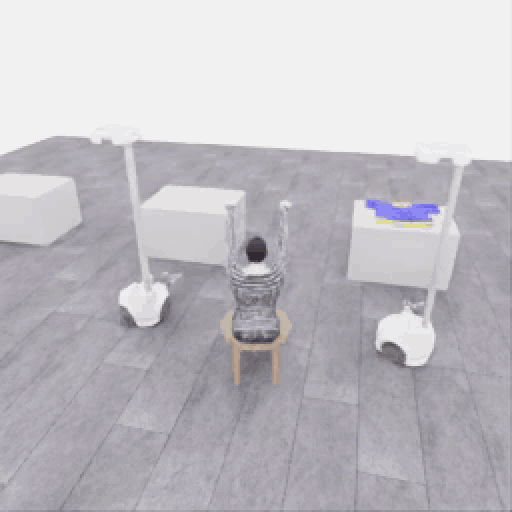

# 시연 데이터 수집 과정

[공개 시연 갤러리](../gallery/README.ko.md) · [저장소 소개](../../README.md) · [2026-11-06 수집 일지](sessions/2026-11-06.md) · [서버 복원·실행 명령](../project/START_HERE.ko.md) · [현재 상태](../project/STATUS.md)

[](research/openwam-feasibility.ko.md)

사용 가능성 분석 · 현재 수집에는 적용하지 않음

**E05의 한 로봇 픽업 5점을 보존하고, E07의 새 에피소드에서 다시 얻은 5점과 공동 지지·회전·마네킹 방향 전진을 별도로 기록합니다.** [E07 원본 사진·중간 검토](experiments/2026-11-06-coordinated-first5-review.ko.md)는 의미 있는 협력 과정을 보여주며, 전체 착의 완료나 종료 후 전수 검사를 뜻하지 않습니다. 영상에서 시간·행동·점수·원본 자료로 이동하고 성공·실패·중단·재시도 기록을 모두 보존합니다.

아래 반복 영상은 이전 **E05의 한 로봇 픽업 부분 점수** 기록입니다.

<a href="../gallery/20261106-astra-pickup-hold5-001.ko.md"></a>

| 빠르게 찾기 | 바로 볼 기록 |
|---|---|
| 영상·짧은 과정 | [공개 갤러리](../gallery/README.ko.md) · [한 로봇 픽업 부분 점수 5점](../gallery/20261106-astra-pickup-hold5-001.ko.md) |
| 점수·종료 | [E07 새 5점·공동 운반 중간 검토](experiments/2026-11-06-coordinated-first5-review.ko.md) · [E05 한 로봇 5점 종료 검토](reviews/20261106-astra-pickup-hold5-001.ko.md) · [앞선 0점 검토](reviews/20261106-astra-pickup-plan2-001.ko.md) |
| 시간·실험 순서 | [당일 일지](sessions/2026-11-06.md) · [방법 비교](experiments/2026-11-06-method-comparison.ko.md) · [서버 비교](experiments/2026-11-06-server-comparison.ko.md) |
| 현재 협력 시도 | [E07 함께 들기·회전·전진 관측](experiments/2026-11-06-coordinated-first5-review.ko.md) · [고정 시작 기록](experiments/2026-11-06-coordinated-fresh.ko.md) · [공식 참고 영상 분석](experiments/2026-11-06-official-demo-strategy.ko.md) |
| 병행 연구 | [지각 기준선과 실제 진행 상태](research/2026-11-06-perception-baselines.ko.md) · [OpenWAM 분석 전용 검토](research/openwam-feasibility.ko.md). 모델 설치·실행은 하지 않음 |
| 후속 시도·분기 | [행동 재실행과 구간별 분기](guides/continuation-and-branches.ko.md). 원본 점수를 복사하지 않고 새 실행을 평가 |
| 화면·운영 | [관찰 화면 안내](guides/live-monitor.ko.md) · [현재 상태](../project/STATUS.md) |
| 완료한 CPU 비교 | [B1 좌표 연결](experiments/2026-11-06-b1-depth-sanity.ko.md) → [B1b 색 후보 실패](experiments/2026-11-06-b1b-color-depth-roi.ko.md) → [B1c 배치·보류 비교](experiments/2026-11-06-b1c-color-pair-comparison.ko.md). actor 미적용 |
| 옷 가장자리 검수 | [원본 3장의 독립 시각 검토](experiments/2026-11-06-cloth-edge-visual-review.ko.md). 색 무늬·천 외곽·유효 파지점을 구분 |
| 기존 행동 개선 | [명명 채널 변환 시험](experiments/2026-11-06-named-action-encoding.ko.md) · [그리퍼 정착 판단 검토](experiments/2026-11-06-gripper-settling-review.ko.md). 현재 수집에는 미적용 |
| 파일·라벨·보존 | 아래 폴더 구조·네이밍·라벨 절을 펼쳐 확인 |

**E07 실행 집계는 05:17:25 UTC에 고정했습니다: 완료 행동 구간 39개·530전이·모델 호출 시도 35회 중 1회 진행 중·공식 중간 점수 5/50.** 공개 관측은 함께 들기와 회전·전진을 뒷받침하지만 이후 파지 안정성·소매 삽입·전체 착의는 미확인입니다. 실행은 계속되며 파일 닫힘과 최종 전수 검사는 아직 확인하지 않았습니다. E07은 04:40:12 UTC에 새 환경에서 시작했고 이전 5점 상태를 재실행하거나 공식 물리·평가를 변경하지 않았습니다. [E06 고정 중간 기록](experiments/2026-11-06-dressing-continuation.ko.md)과 원본·실패·프롬프트·영상도 모두 유지합니다.

<details>
<summary>이전 수집 방향과 피드백 이력</summary>

아래는 E07의 새 시작 요청 이전 이력입니다. 현재 방향은 상단과 피드백 014를 따릅니다.

이 페이지는 결과뿐 아니라 **무엇을 관찰하고, 어떤 프롬프트와 행동을 사용했으며, 어디에서 실패하고 무엇을 바꾸어 재시도했는지**를 추적하는 수집 기록의 입구입니다. 성공·부분 성공·실패·중단을 모두 남깁니다. 메인 README에는 기술 상태만 요약하고 상세 과정·사용자 피드백·이미지·영상·획득 점수는 이 문서 묶음에서 관리합니다.

현재 우선순위는 **빠른 득점보다 안정적인 데이터 수집 시스템과 다양한 방법의 과정 기록**입니다. Codex CLI `gpt-6-astra`/`ultra`를 유지하며 현재 5점에서 50점까지 후속 시도를 계속하도록 승인받았습니다. 누적점수·착의 `success=true`와 다양한 경로를 구분합니다. 연결 시험과 실제 과제 시도를 분리하며 데이터 검사 통과를 착의 성공으로 표시하지 않습니다.

**E05에서 첫 공식 픽업 5점을 확보했습니다. 현재는 추가 피드백을 기다리지 않고 50점까지 계속 시도하도록 승인받은 상태입니다.** E05의 18개 결정·253전이·12.65 simulation초 검사와 착의 `success=false`를 보존합니다. 당시 내장 5점 감시에 따른 종료와 현재 후속 재개 승인을 구분합니다. 점수는 행동 문맥 밖에서만 읽으며 actor 입력에 전달하지 않습니다.

공식 자료 조사·가이드 작성 뒤 최신 사용자 요청으로 **계측 수정 → 상주 호출 pilot → 짧은 다중 행동**의 순차 실험을 진행할 수 있게 됐습니다. 앞선 적용 보류는 당시 이력으로 남깁니다. 현재 모델·추론 설정을 유지하고 실행한 시도의 프롬프트 원문·실패·수정 이유를 보존하며 결과를 자주 공유합니다.

</details>

<details>
<summary>1. 먼저 읽을 기록</summary>

## 1. 먼저 읽을 기록

| 기록 | 내용 | 현재 상태 |
|---|---|---|
| [공개 시연 갤러리](../gallery/README.ko.md) | 실제 영상·대표 장면·원본 관측·짧은 행동 응답을 중심으로 보기 | 사람 부분 시연, Astra 과제 시도, 연결 시험을 구분 |
| [라이브 관찰 화면 안내](guides/live-monitor.ko.md) | 기존 WebRTC 영상·관찰 전용 진행 패널, 표시 범위·실행·검증 | 같은 포트에 배포 완료. 새 화면의 맥북 실수신 확인은 대기 |
| [방법별 수집 실험 비교](experiments/2026-11-06-method-comparison.ko.md) | 기존 방식, 사용량·구간 계측, 상주 호출, 한 호출의 여러 행동 | 실측·실패·보류·진행 중 상태를 구분 |
| [E07 새 5점·공동 운반 중간 검토](experiments/2026-11-06-coordinated-first5-review.ko.md) | 함께 들기, 손목 회전·복구, 마네킹 방향 공동 회전·전진의 원본 관측 | 530전이 경계까지의 고정 부분 기록. 전체 착의·종료 후 전수 검사 미확인 |
| [E05 한 로봇 픽업 부분 점수 5점](attempts/20261106-astra-pickup-hold5-001/README.ko.md) | 18개 결정·공개 관측·최초 득점·행동 경계 종료 | 253전이 검사 통과, 5점·success=false. 두 로봇 협력 들기는 미확인 |
| [서버·수집 경로별 속도 비교](experiments/2026-11-06-server-comparison.ko.md) | 이전·현재 L40S의 라이브 RTF, AI 즉시 저장·모델 대기 구분 | 원본 SHA와 182·101개 선별 창 공개. 가격 비교는 포함하지 않음 |
| [공개 관측의 지각·접촉 검토](experiments/2026-11-06-public-perception-review.ko.md) | E04 결정 0~5의 고정 스냅샷과 원본 이미지 | 실행 중 시점의 분석이며 최종 점수와 구분 |
| [지각 연구의 기준선·다음 검증](research/2026-11-06-perception-baselines.ko.md) | B1/B1b/B1c 완료 결과와 B2~B5 문헌 후보 | 종료된 공개 관측의 CPU 비교. 현재 actor 입력은 유지 |
| [B1 depth → 카메라 XYZ](experiments/2026-11-06-b1-depth-sanity.ko.md) | 중심 10표본의 단위·축·mask·좌표 연결 | 8유효·2invalid 보존. 표적 정확도 미평가 |
| [B1b 색 후보 + depth](experiments/2026-11-06-b1b-color-depth-roi.ko.md) | 공개 3장의 후보 6개와 깊이 주의 | 가림 뒤 두 후보가 같은 조각에 몰린 실패 보존 |
| [B1c 후보 배치·보류 비교](experiments/2026-11-06-b1c-color-pair-comparison.ko.md) | 같은 에피소드 5장의 A/B/C 비교 | obs2 간격 21→65픽셀, C는 2쌍 출력·3건 보류. 실제 파지 성능 미평가 |
| [옷 가장자리의 독립 시각 검토](experiments/2026-11-06-cloth-edge-visual-review.ko.md) | B1b 원본 3장을 확인한 05:06 UTC 고정 기록 | 당시 B1c 준비 중. 이후 완료 결과는 위 B1c 기록으로 분리 |
| [Stanford OpenWAM 사용 가능성](research/openwam-feasibility.ko.md) | 공개 모델·입력·행동·자원·라이선스 조사 | 분석 전용. 설치·가중치 다운로드·모델 실행·현재 수집 적용 없음 |
| [행동 재실행과 분기](guides/continuation-and-branches.ko.md) | 원본 검사·동일 초기 배치의 행동 재실행·점수 구간 색인 | CPU 검증 및 E06 새 평가 5점 확인. E07의 새 시작에는 미적용 |
| [스트리밍 ON/OFF 실측](experiments/2026-11-06-streaming-benchmark-result.ko.md) · [계획](experiments/2026-11-06-streaming-benchmark-plan.ko.md) | 중립 4회·260전이 전수 검사, 요청·응답 ON +5.80% | 조건당 2회. 실제 영상 수신 미확인으로 시청 비용과 구분 |
| [2026-11-06 수집 일지](sessions/2026-11-06.md) | 환경 복원, 화면 연결, actor 격리, 실제 모델 시험, 실패와 재시도, 피드백 반영 | 실제 실행 근거를 계속 갱신 |
| [실제 Astra 로봇 wiring r5](attempts/20261106-codex-robot-wiring-r5/README.ko.md) | 5개 카메라 초기·최종 이미지, 느린 관측 영상, 입력 프롬프트·최종 행동·평가 이벤트·해시 | 실제 생성 완료. 3전이, 공식 0점·success=false |
| [첫 실제 착의 시도 001](attempts/20261106-astra-dressing-001/README.ko.md) | RGB 10장, 33.4초 관측 영상, 프롬프트·행동·점수 이벤트 | SIGTERM 중단, 167전이 검사 통과, 공식 0점·success=false |
| [착의 시도 001 종료 검토](reviews/20261106-astra-dressing-001.ko.md) | 중단·정상 파일 마감·중립 정리 전이·평가의 관계 | 종료 발신자 미확정과 5점 미달을 구분 |
| [E04 픽업 시도](attempts/20261106-astra-pickup-plan2-001/README.ko.md) · [종료 검토](reviews/20261106-astra-pickup-plan2-001.ko.md) | 공개 관측·행동·공식 유지 시간과 모델의 완료 판단 비교 | 168전이 검사 통과, 공식 0점·success=false. 다음 E05에서 첫 5점 확보 |
| [첫 착의 시도의 속도·난도 검토](sessions/2026-11-06-initial-review.md) | 완료 판단 10개의 시간 분해, 접근·복구·파지 불확실성, 실제 공개 이미지 | 02:41:09 UTC 기준 고정 분석. 최종 결과나 실시간 보고가 아님 |
| [호출 지연 개선 가이드](guides/call-latency-options.ko.md) | 한 호출의 조건부 계획·로컬 피드백·상주 프로세스 등 조사 | 최신 피드백에 따라 순차 실험할 근거. 모델·추론 설정 유지 |
| [토큰 사용량 정정](corrections/20261106-token-accounting.ko.md) | CLI 누적 usage 중복 합산 오류와 완료 호출별 정정 자료 | 기존 두 시도 패키지의 `actor_usage`를 총 소비량으로 사용하지 않음 |
| [환경 복원 요약 JSON](../project/sessions/20261106-l40s-restore.json) | build·prepare·smoke, 초기 63전이와 화면 연결 측정 | 해당 초기 단계의 요약이며 이후 CLI 검증은 날짜별 일지를 따름 |
| [10월 26일 사람 부분 시연](../project/DEMO_20261026.ko.md) | 접근·파지·들기·운반 사진과 영상 출처 | 공식 점수·전체 착의 성공 미확인 |

시도별 공개 패키지는 검수한 자료가 실제 생성된 뒤 이 목록과 날짜별 일지에 연결합니다. 전체 서버 원본은 GitHub 문서와 별도로 보존합니다.

</details>

<details>
<summary>2. 한 번의 시도에서 남기는 과정</summary>

## 2. 한 번의 시도에서 남기는 과정

1. **목표와 입력을 고정합니다.** 실행 ID, 모델·추론 설정, 프롬프트, 공개 카메라 순서, 관측 표현과 코드 해시를 기록합니다.
2. **공개 관측을 전달합니다.** 지정 RGB 5장, 전체 공개 로봇 상태, 카메라별 16×16 depth 중앙값 격자를 전달합니다. depth 단위는 미터이며 광학축 Z 거리입니다. 유효값이 없는 칸은 `null`입니다.
3. **최종 행동 JSON을 검사합니다.** 모델은 `tool`, `action`, `steps`, `stage`, `visual_assessment`, `reason`을 반환합니다. 형식·유한값·범위·호출 예산을 검사한 뒤 실행합니다. `reason`은 짧은 행동 설명이며 숨겨진 추론을 공개하는 필드가 아닙니다.
4. **실제 적용 결과를 기록합니다.** 20 Hz마다 `obs → action → next_obs`를 남깁니다. 한 번의 모델 결정이 여러 전이를 만들 수 있으며, `finish_episode`는 새 물리 전이를 만들지 않습니다.
5. **공식 평가를 따로 기록합니다.** 같은 시도의 점수·획득 이벤트·success를 신뢰된 수집기에서 저장합니다. 이 결과는 행동 모델의 다음 입력으로 전달하지 않습니다.
6. **기술 검사와 과제 검수를 분리합니다.** 전체 전이 검사를 통과한 뒤 공개 영상과 실행 결과를 검토해 쓸 구간을 선정합니다. 정상 파일이라고 자동으로 학습을 승인하지 않습니다.
7. **피드백과 재시도를 연결합니다.** 사용자가 지적한 화면·행동·기록 문제와 반영 내용을 기록합니다. 재시도는 새 run ID와 부모 시도·이유를 사용하며 이전 파일을 덮어쓰지 않습니다.

현재 모델 입력은 전체 해상도 depth 영상이 아니라 **RGB 5장과 수치 depth 요약**입니다. 원래 공개 depth와 유효 마스크는 로컬 재현 자료와 HDF5에 보존합니다. 현재 π₀.₅ 학생의 RGB 3장·32차원 상태와 교사의 관측·시간 문맥이 다르므로 후속 학습에서 이 차이를 평가해야 합니다.

</details>

<details>
<summary>3. 실제 로컬 폴더 구조와 접근 범위</summary>

## 3. 실제 로컬 폴더 구조와 접근 범위

아래는 구현된 수집 경로입니다. `<run-id>`와 `<evaluation-id>`는 실제 생성된 이름으로 바꿉니다. 실패 시 초기화 단계에 따라 일부 파일이 없을 수 있으며, 없는 파일을 만들어 완료 상태로 맞추지 않습니다.

```text
output/
├── operator-traces/<run-id>/             # 신뢰된 제어기 기록, actor 접근 불가
│   ├── attempt.json                     # 상태·재시도 관계·시간·소스 해시
│   ├── prompt.txt                       # 공통 과제 및 시험 프롬프트
│   ├── decisions.jsonl                  # 최종 결정·적용 구간·오류·감독 정지
│   ├── source_snapshot/                 # 실행한 참가자 코드 사본·해시 근거
│   ├── review_gate.json                 # 평가 기반 종료 목표의 감시 상태
│   ├── score_segments.json              # 득점 묶음·전이 경계·분기 색인
│   └── simulator.log                    # 비공개 진단 로그, 그대로 게시하지 않음
├── actors/<run-id>/                      # 기본 0700, 에피소드 전용 작업 영역
│   ├── observations/00000/               # 수신한 공개 관측의 재현 자료
│   │   ├── overview.png                 # 같은 번호에서 지정 RGB 5장 보존
│   │   ├── robot_0_wrist.png
│   │   ├── robot_0_head.png
│   │   ├── robot_1_wrist.png
│   │   ├── robot_1_head.png
│   │   ├── observation.json             # 공개 상태·depth 요약
│   │   └── public_depth.npz             # 원래 공개 depth·마스크
│   └── runtime/
│       ├── public/000000/               # actor에 읽기 전용 연결하는 공개 입력만
│       │   ├── prompt.txt
│       │   ├── schema.json
│       │   └── camera-00.png ...        # 부가 메타데이터를 제거한 이미지
│       ├── codex_home/                  # 새 세션, 호스트 .codex 전체를 연결하지 않음
│       │   ├── auth.json                # 실행 중 0600 사본; close 후 제거
│       │   ├── decision-000000.json     # CLI의 구조화된 최종 응답
│       │   └── ...                      # CLI 세션 저장소, 공개 대상 아님
│       └── actor_events/                # CLI 원본 이벤트·stderr, actor에 연결하지 않음
├── collections/<run-id>/
│   ├── policy.hdf5                      # 공개 RGB-D·상태·실제 행동·다음 관측
│   ├── audit.hdf5                       # timing·평가·검수 자료, actor 접근 불가
│   ├── capture.json                     # 파일 완료 상태·해시·수집 시간
│   ├── run_metadata.json
│   ├── operator.jsonl                   # 실행 명령 기록
│   ├── step_timings.jsonl               # 환경 및 기록 시간
│   ├── evaluation_summary.json          # 별도 공식 평가 요약
│   ├── evaluation/<evaluation-id>/      # 점수 이벤트·평가 결과, 원본 게시 금지
│   └── validation.json                  # 종료 후 별도 생성하는 전수 기술 검사
└── sessions/<check-id>/                  # 연결·격리·화면 시험별 결과
```

`runtime/public/`에는 전달한 공개 prompt/schema/이미지만 들어갑니다. 저장소, 평가, audit, 원시 상태, seed, 자유 시점 화면, 호스트 설정은 actor에 연결하지 않습니다. actor는 별도 Docker 내부망에서 허용된 모델·인증 origin에만 프록시로 연결하며 직접 인터넷·호스트 서비스 접근은 차단합니다. shell·browser·앱·플러그인 등 기능을 줄이고 실제 도구 실행 이벤트가 있으면 행동을 거부합니다. **도구 레지스트리가 0개라고 가정하는 방식은 아닙니다.**

`codex_home`의 인증·세션 파일과 CLI 원본 이벤트는 원격 공개 패키지에 포함하지 않습니다. 인증 파일 사본은 종료 시 제거합니다. 그 밖의 원본도 공개 전에 필드별로 선별합니다.

</details>

<details>
<summary>4. 실행·파일 네이밍</summary>

## 4. 실행·파일 네이밍

| 이름 | 실제 의미 | 예 |
|---|---|---|
| run ID | 독립 실행의 고유 식별자. 코드에서 영문·숫자·`_`·`.`·`-` 허용 | `20261106-codex-robot-wiring-r5` |
| `-r2`, `-r3` 등 | 실패 원본을 보존한 새 재시도. 물리 상태 이어하기를 뜻하지 않음 | `...-r5`는 `...-r4`의 후속 실행 |
| `parent_attempt` | 재시도 원인의 직접 상위 실행 ID | manifest에 기록 |
| `retry_reason` | 이번에 바꾼 조건을 식별하는 문자열 | `bounded_prompt_file_instead_of_inline_process_argument` |
| `source_group` | 같은 시도·복원 출처를 묶는 데이터 그룹. 현재 기본값은 run ID이며 관련 복원 시도는 실행자가 같은 그룹을 명시해야 함 | 학습/검증 분리 시 인접 자료가 섞이지 않도록 사용 |
| `demo_0` | 한 capture 파일 안의 HDF5 에피소드 | run ID와 함께 식별 |
| `decision_index` | 모델 호출 순서, 0부터 시작 | 하나의 결정이 여러 20 Hz 전이에 대응 |
| `segment_id` | 적용 구간 식별자 | `<run-id>:00000` |
| `start_step` / `end_step` | 적용 전후 누적 전이 수 | 2단계 명령은 `0 → 2` |

날짜는 UTC로 기록합니다. 날짜 기반 run ID와 실제 `started_at_utc`, `ended_at_utc`를 함께 보존합니다. 실행 도중 수정한 코드가 있으면 commit만으로 동일성을 주장하지 않고 `working_tree_modified`와 파일별 SHA256도 남깁니다.

</details>

<details>
<summary>5. 결과 라벨을 혼합하지 않는 방법</summary>

## 5. 결과 라벨을 혼합하지 않는 방법

| 필드·상태 | 뜻 | 뜻하지 않는 것 |
|---|---|---|
| `source=integration_test` | 연결·기록 검증용 실행 | 과제 성공 시연 |
| `source=gpt` | 모델이 생성한 과제 행동 자료 | 자동 학습 승인 |
| `source=human`, `human_corrected_gpt` | 사람 시연·사람 수정 자료를 위한 출처 분류 | 자동 수집 중 사람 제어권 전환이 구현됐다는 뜻 |
| `status=completed` | 제어기 실행 절차가 정상 종료됨 | 착의 성공 |
| `complete=true` | 파일·에피소드가 정상 마감됨 | 공식 50점 |
| `quality_passed=true` | 해시·전체 전이·시간·연속성·라벨 기술 검사 통과 | 시각적 시연 품질 승인 |
| `quality_status=unreviewed` | 제어기의 시도·적용 구간은 과제 품질 검토 전 | 기술 검사만으로 승인됨 |
| 검사 보고서의 `training_approval=unreviewed` | 별도 학습 승인을 하지 않았다는 표시 | 승인 관리 도구가 구현됐다는 뜻 |
| `stage` / `stage_intent` | 모델이 의도한 작업 단계 | 공식 해당 단계 점수 획득 |
| `visual_assessment` | 공개 관측에 대한 모델의 의견 | 공식 success |
| 평가 `valid=true` | 공식 평가의 유효성 | 0보다 큰 점수 또는 성공 |
| `raw_points` | 공식 누적 항목 점수, 최대 50 | 성공 유지 조건의 충족 |
| `success=true` | 공식 착의 성공 조건 충족 | 파일·출처 검수가 자동 완료됨 |
| `final_score=null`, `no_contact` | 점수 분모에 필요한 접촉 조건이 성립하지 않은 상태 | 임의의 0점/초 |

공식 점수·성공 조건은 [평가 정의](../competition/EVALUATION.md)를 따릅니다. 평가 누락·평가 무효는 성공 또는 0점으로 채우지 않습니다. 중단 구간과 재시작 구간을 이어 붙여 하나의 연속 50점 완주로 표시하지 않습니다.

현재 행동 JSON의 단계 열거값은 `preparation`, `approach`, `grasp`, `lift`, `transport`, `first_sleeve`, `shoulder`, `second_sleeve`, `neck`, `orientation`, `recovery`, `final_check`입니다. 시각적 의견은 `uncertain`, `progressing`, `blocked`, `recovering`, `visually_complete` 중 하나입니다. 이 구조적 라벨은 성공 여부와 관계없이 저장하며, 행동 전 판단을 실행 후 성공 라벨로 바꾸지 않습니다. 공식 평가 항목 이름·점수는 별도 이벤트를 기준으로 연결합니다.

</details>

<details>
<summary>6. 프롬프트·최종 결정·이미지·영상의 공개 방식</summary>

## 6. 프롬프트·최종 결정·이미지·영상의 공개 방식

공개할 시도 패키지의 경로 규약은 다음과 같습니다. 생성 전인 파일은 존재하는 자료로 연결하지 않습니다.

```text
docs/collection/attempts/<run-id>/
├── README.ko.md             # 이 시도 목적, 진행, 결과, 한계와 이미지 설명
├── manifest.json            # 검토한 출처·시간·기술 검사·공식 평가 요약
├── decisions.jsonl          # 최종 행동·적용 구간·짧은 설명만 선별
├── score-events.jsonl       # 허용 필드만 남긴 평가 이벤트·동시 획득 근거
├── prompt.txt               # 실제 과제 프롬프트 원문
├── images/
│   ├── initial-<camera>.png # 실제 지정 카메라의 초기 관측
│   └── final-<camera>.png   # 실제 지정 카메라의 최종 관측
└── overview.mp4            # 실제 전이에서 만든 영상; 생성됐을 때만 포함
```

현재 [`export_report.py`](../../participant/collection/export_report.py)로 [r5 공개 패키지](attempts/20261106-codex-robot-wiring-r5/README.ko.md)를 생성했습니다. PNG 10장과 실제 `obs` 3프레임 영상, 프롬프트·결정·평가 이벤트를 포함하며 [manifest](attempts/20261106-codex-robot-wiring-r5/manifest.json)에 원본·산출물 해시와 공개 필드 범위를 기록합니다. 기술 검사 상태를 학습 승인으로 올리지 않습니다.

[첫 착의 시도 패키지](attempts/20261106-astra-dressing-001/README.ko.md)도 실제 생성했습니다. PNG 10장과 167개의 연속 관측 프레임을 5 fps로 재생하는 33.4초 영상을 포함합니다. 원본 20 Hz보다 4배 느리며 실제 대기 시간은 포함하지 않습니다. 두 패키지의 원본 usage 필드는 그대로 보존하고 [토큰 정정](corrections/20261106-token-accounting.ko.md)을 함께 읽습니다.

프롬프트는 재현을 위해 실제 전달한 문자열을 보존하고 한국어로 목적과 조건을 설명합니다. 최종 행동 JSON과 `reason`의 간단한 행동 설명은 기록하되, **숨겨진 추론·내부 사고과정·원본 CLI reasoning 이벤트는 공개하지 않습니다.** 전체 서버 로그, 내부 기하·seed·원시 상태, 인증 내용과 개인 접속 주소도 게시하지 않습니다.

사진·영상에는 출처, 카메라, 해당 실행과 단계, 시뮬레이션 시간, 편집·배속 여부를 설명합니다. 공개 카메라의 실제 기록과 관찰용 자유 viewport, 합성 색상 연결 시험을 구분합니다. 짧은 wiring 영상은 동작 연결의 증거이며 파지나 착의 성능으로 설명하지 않습니다. 영상의 재생 길이와 수집에 걸린 실제 시간도 구분합니다.

큰 HDF5·원본 영상·모델은 별도 자료 저장소로 보존하고 고정 리비전·SHA256·재다운로드 검증 상태를 기록합니다. 현재 로컬 저장만 완료된 자료를 원격 백업 완료로 표시하지 않습니다.

</details>

<details>
<summary>7. 시간과 데이터 수집 효율</summary>

## 7. 시간과 데이터 수집 효율

| 측정 | 현재 기록 위치·해석 |
|---|---|
| 전체 실행 실제 시간 | `attempt.json.wall_s`. 초기화·모델·환경·정리 포함 |
| actor 호출 시간 | `actor_call_wall_s`와 결정별 `wall_s`. 공개 입력 준비·Docker/CLI·요청/응답 포함 |
| 모델 내부 추론시간 | 현재 제공되지 않아 `null`; actor 시간으로 대체해 표기하지 않음 |
| 환경 dispatch 시간 | 제어기가 요청을 보내고 결과를 받기까지의 시간 |
| 수집기 실제 시간 | `capture.json.wall_s`. 전체 클라이언트 시간과 시작·종료 범위가 다름 |
| 렌더링 대기 시간 | `idle_render_calls`, `idle_render_wall_s`. 물리 진행 없이 관찰용 갱신 |
| 환경·기록 단계 시간 | `step_timings.jsonl`. 센서·시뮬레이션과 파일 기록 비용을 분석 |
| 시뮬레이션 시간 | 실제 적용 전이 수 × 0.05초 |
| 검사 통과량 | `validated_transitions`. 학습 승인량과 구분 |

단계별 도달률은 전체 시도 수와 해당 단계 시도 수를 함께 제시합니다. 실패·중단·평가 무효도 분모에서 숨기지 않습니다. 승인된 전이 또는 유효 시연 시간을 전체 서버 사용 시간과 비교하는 효율 집계는 실제 과제 시도·검수 자료가 쌓인 뒤 수행할 계획입니다. 현재 연결 시험 수치를 성공 시연 생산성으로 환산하지 않습니다.

세션 누적 usage를 호출별 사용량처럼 합산한 오류가 확인됐습니다. 기존 `actor_usage` 합계를 실제 토큰 소비·요금 비교 근거로 사용하지 않습니다. 원본을 보존하고 [정정 설명·시도별 JSON](corrections/20261106-token-accounting.ko.md)에 완료한 호출의 누계·차분을 따로 기록했습니다. 착의 시도의 중단된 16번째 호출 사용량은 미확정이며 0으로 채우지 않습니다. 실제 경과 시간 측정과 이 토큰 집계 오류는 구분합니다.

</details>

<details>
<summary>8. 사용자 피드백을 과정에 반영하기</summary>

## 8. 사용자 피드백을 과정에 반영하기

시도 시작, 의미 있는 단계 변화, 실패 원인 분리, 재시도 조건 변경과 종료 검수 때 진행을 공유합니다. 사용자는 화면이나 공개 시도 패키지를 보고 관찰·행동·기록 방식의 피드백을 줄 수 있습니다. 이미 승인된 범위의 확인을 반복해서 허락받는 절차로 만들지 않습니다.

현재 반영한 피드백은 날짜별 일지에 **요청 요약 → 변경 내용 → 확인 결과**로 기록합니다. [2026-11-06 피드백 JSONL](feedback/2026-11-06.jsonl)에는 ID·UTC·원문 또는 명시된 요약·scope·반영 상태·변경 항목·`actor_input_changed`를 수동 기록합니다. `fb-20261106-005`는 `message_kind=summary_not_verbatim`인 요약입니다. 피드백이 actor에 자동 삽입되는 것은 아니며 현재 기록의 `actor_input_changed=false`와 후속 실험 진행 허용은 구분합니다.

5점 중간 검토 조건은 이번 실행의 별도 신뢰된 감시 프로세스로 적용합니다. `review_gate.json`은 운영 상태를 기록하는 로컬 파일이며 새 UI 기능이나 일반화된 제어권 전환 기능은 아닙니다. 점수가 한 번에 10점 이상으로 오르면 실제 획득한 점수를 보존하고 5점으로 잘라 기록하지 않습니다.

자동 수집의 WebRTC는 관찰 전용이며 브라우저 키·버튼을 통한 로봇 제어는 적용하지 않습니다. 사람 개입 구간과 자동 행동을 섞지 않기 위한 제어권 전환은 아직 구현 전입니다.

다음 표는 이미 수동 기록한 정보와 상세 실행 구간에 연결하기 위한 **추가 구현 계획**을 구분합니다. 자동 피드백 수집·actor 반영 기능은 아직 없습니다.

| 정보 | 상태와 목적 |
|---|---|
| feedback ID·UTC·scope·요청 원문 | JSONL에 수동 기록함. 공개 가능한 기술적 요청만 포함 |
| 반영 상태·변경 내용·actor 입력 변경 여부 | JSONL에 수동 기록함. 적용·보류·추가 검증을 구분 |
| 대상 run/decision/step·세부 유형 | 추가 계획. 어떤 장면·결정·접촉·라벨을 지적했는지 연결 |
| 적용 시점·다음 run·프롬프트 해시 | 추가 계획. 피드백 전후 결과를 비교 |
| 제어 출처·개입 구간 | 추가 계획. 향후 사람 수정 행동이 들어가면 AI 단독 자료와 분리 |

</details>

<details>
<summary>9. 재현과 다음 작업</summary>

## 9. 재현과 다음 작업

준비·로그인·네트워크·수집·검사 명령은 [서버 준비 문서](../project/START_HERE.ko.md)를 따릅니다. 최신 실행 ID와 실패·재시도 이유는 [수집 일지](sessions/2026-11-06.md)에 남깁니다. 현재 핵심 구현은 `codex_actor.py`, `codex_client.py`, `evaluation.py`, `validate_capture.py`, `collector_stream.py`이며 실제 과제 시도의 승인·집계와 학습은 별도 단계입니다.

</details>

<details>
<summary>10. 5점 검토 이후의 다양한 점수 경로와 모델 실험</summary>

## 10. 5점 검토 이후의 다양한 점수 경로와 모델 실험

후속 목표는 최종 50점뿐 아니라 **어떤 부분 점수와 복구를 거쳐 도달했는지 다른 경로들의 과정 데이터**를 확보하는 것입니다. E05에서는 한 로봇 부분 점수 5점을 얻었고 E06의 재실행을 보존했습니다. 현재는 두 로봇이 협력하는 0점 새 에피소드를 실행하며 50점은 후속 목표로 둡니다. 안정적인 수집과 비교 가능한 실험 기록을 우선합니다. 항목별 `score_awarded`와 같은 시점의 `raw_points`, `physics_tick`, 적용 구간·공개 영상을 연결합니다. 같은 tick에 획득한 여러 항목은 하나의 동시 batch이며 파일의 행 순서로 물리적인 선후관계를 만들어내지 않습니다. 누적 50점과 착의 성공 유지 조건은 별개입니다.

현재 항목별 점수 이벤트, 부모 재시도·이유, source group과 단계 구간 기록은 구현했습니다. 여러 시도의 경로를 정규화하고 `path_id`로 비교하는 집계, 단계별 도달률·복구 성공률·최종 50점 경로 다양성 분석은 **추가할 작업**입니다. 한 에피소드 안의 복구와 새 에피소드 재시작을 구분하며, 실패·무득점·중단·평가 무효도 목록에 남깁니다.

| 후속 실험 | 보존·비교 기준 | 현재 상태 |
|---|---|---|
| 여러 VLA baseline | episode와 source group이 겹치지 않는 고정 train/validation/test split, 동일 공개 입력·행동 순서·정규화·공식 평가·환경 배치·실행 예산 | 계획. 기존 π₀.₅ 코드가 있으나 이번 수집 자료로 새 baseline 학습·평가 전 |
| 관측·문맥 비교 | 교사 5 RGB·depth 요약·과거 문맥과 학생 입력의 차이를 명시. 관측을 늘린 실험은 별도 조건으로 표시 | 계획 |
| RL | 공식 보상·종료·리셋 신호는 신뢰된 환경 측에 두고 actor·critic·추론 입력과 행동 정답으로 전달하지 않음. 모방학습 기본 정책을 보존하고 같은 예산으로 비교 | 계획, 학습 실행 전 |
| World model | 연속 공개 `obs, actual_action, next_obs`, `delta_t=0.05`, depth 유효 마스크·결측, 정지·종료·reset 경계를 보존. 서로 다른 에피소드를 연속 물리 전이로 붙이지 않음 | 기초 전이·마스크 저장 구현. 전용 데이터 구성·학습·평가 전 |

모델 대기 중 렌더링은 물리 전이가 아닙니다. `stop`은 실제 중립 전이를 만들고 `finish_episode`는 추가 전이 없이 끝납니다. reset 전후 관측을 일반적인 0.05초 전이로 연결하거나 누락 프레임을 정상 관측으로 채우지 않습니다. 현재 별도 누락 이벤트·경로 집계가 필요한 부분은 추가 구현으로 구분합니다.

공개 관측의 simulation clock과 reset 이후 시작하는 평가 clock은 원점이 다를 수 있습니다. r5에서는 평가 0초가 공개 관측 약 1.525초에 대응합니다. 공개 패키지의 `time_origin_public_simulation_s`를 사용해 같은 물리 시점으로 맞추며, 서로 다른 시계를 같은 절대 시각으로 취급하지 않습니다.

</details>
