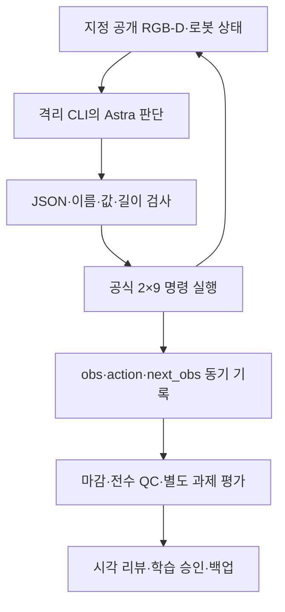

# 시연 데이터 수집과 검수

[메인 화면](../../README.md) · [시간순 갤러리](../gallery/README.ko.md) · [Astra 전체 과정](guides/astra-end-to-end.ko.md) · [현재 상태](../project/STATUS.md)

**목표는 관측·실제 행동·다음 관측이 정확히 연결된 자료를 모으고, 좋은 조작·실패·복구를 구분해 학습 후보로 만드는 것입니다.** 현재 E27까지 마감했고 새 수집은 중지했습니다. 최고 로컬 공식 평가기 원점수5/50, 착의0이며 새 시연을 학습한 baseline은 없습니다.

## 1. 먼저 수집 경로를 구분합니다

| 경로 | 판단과 제어 | 저장 | 대표 근거 |
|---|---|---|---|
| 사람 직접 조작 | Chrome 화면을 보며 키보드 입력 | 기본 deferred export. ESC 뒤 렌더·HDF5 생성, READY까지 대기 | [10월26일 부분 시연](../gallery/20261026-human-pickup-transport.ko.md) |
| Astra 자동 조작 | 격리된 Codex CLI의 `gpt-6-astra`가 공개 RGB-D·상태를 보고 JSON 반환 | 실행 중 센서를 읽어20Hz 전이를 즉시 저장 | [최신 E27](../gallery/20261107-astra-regrasp698-progress-named-001.ko.md) |
| 연결 시험 | 모델 없는 fixture 또는 짧은 wiring 검사 | 같은 인터페이스와 마감 경로의 정상 여부 확인 | [실행 종류 catalog](catalog/README.ko.md) |

사람 시연과 자동 시연의 실시간 제어권 인계는 구현 완료 기능이 아닙니다. 최근 자동 수집에서는 Chrome·WebRTC를 끄고 지정 공개 RGB·상태를 사용했습니다. 연결 시험을 AI 과제 시연이나 성공 데이터로 세지 않습니다.

## 2. 현재 자료를 성과와 용도로 읽습니다

| 자료 | 실제 확인 | 남은 한계·승인 |
|---|---|---|
| 사람 부분 시연 | 2,225전이·111.25로봇초, 집기·들기·운반 일부 | 공식 점수·전체 착의 성공 미확인 |
| E05·E07 | 첫 픽업5, 두 로봇 협력 운반, 이후 분기 원본 | 착의 득점0, 독립 성공률 자료가 아님 |
| E10–E19 | 관측·대기·지지·재파지·깊이 질의·명명 행동 비교 | 가림·입구·연속 통과 미해결 |
| E20–E24 | 목 파지 준비·상방 접근·탐색·진행·복구 | 0점 또는5점, 착의 득점0 |
| E25–E27 | 실제 새 파지의 국소 동행, 이후 운반·팔 접근·부분 복구 | 모두 최종5점. 원하는 입구·소매 통과 미확인 |
| E09 | 중단 응답 오류가 남은141개 부분 전이 | 당시 QC실패, 보존하되 학습·정상 재실행 출처에서 제외 |
| 초기 π0.5 시험 | scripted63전이로30 updates·저장·재로딩 경로 확인 | 새 시연 학습이나 착의 성능 결과가 아님 |

**최신 E27:** `1,159 = 698재실행 + 334모델 행동 + 126자동 정착 + 1예산 정리`입니다. 전체57.95로봇초 중 새 suffix는461전이·23.05초입니다. 전수 기술 검사1,159/1,159 통과, 착의 success는false, 학습 승인은unreviewed입니다. [정확한 실행 manifest](attempts/20261107-astra-regrasp698-progress-named-001/manifest.json) · [시각 리뷰](reviews/20261107-astra-regrasp698-progress-named-001.ko.md)

카탈로그는 실제35실행·13출발점·20방법·38시도 연결을 기록합니다. 실제35에는 연결 검사·시작 실패도 포함하고,38에는 계획3개가 포함됩니다. 성공 시연 수와 다릅니다. 공개 검수 출발점의 학습 승인은 모두unreviewed입니다. [정본과 조회 방법](catalog/README.ko.md)

## 3. Astra 수집의 end-to-end 흐름

모델 호출 한 번과20Hz 전이 한 개는 다릅니다. 모델이 고른 짧은 행동을 여러 전이 동안 실행하고 새 관측을 받습니다. depth 질의는 같은 관측에서 정보를 더 읽는 경로로 물리를 진행하지 않지만 추가 모델 호출 비용이 생깁니다.

[**각 단계의 실제 함수·데이터·예외 처리**](guides/astra-end-to-end.ko.md) · [**코드 지도**](../project/CODE_MAP.ko.md)

## 4. 원본·공개 자료·검수 자료의 위치

| 위치 | 내용 | 읽는 목적 |
|---|---|---|
| `output/collections/<run-id>/` | `policy.hdf5`, `audit.hdf5`, capture·평가·검사 결과 | 실제 센서·행동 원본과 사후 검증 |
| `output/operator-traces/<run-id>/` | 관측 준비·최종 결정·실행 구간·시간·출처 | 어떤 최종 명령을 실제 적용했는지 추적 |
| `docs/collection/attempts/<run-id>/` | 선별한 공개 입력·최종 행동·이미지·영상·manifest | 웹에서 시도별로 검토 |
| `docs/collection/reviews/` | 실제 결과·불확실성·구간별 학습 검토 | 좋은 조작·오류·회복 구간 분리 |
| `docs/gallery/` | 실제 공개 RGB의 GIF·MP4와 설명 | 시간순·주제별로 시각 비교 |
| 비공개 고정 백업 | 대용량 원본·audit·평가·원본 검증 자료 | 클린 서버 복원과 재현 |

GitHub의 영상만으로 학습 원본 전체를 복원할 수 없습니다. 인증·개인 접속 주소·원시 CLI reasoning/events·세션DB·검수하지 않은 로그는 게시하지 않습니다. 공개 패키지의 짧은 행동 설명은 내부 추론 원문이 아닙니다.

## 5. 파일 정상과 좋은 시연을 따로 검사합니다

| 구분 | 질문 | E27 |
|---|---|---|
| 파일 마감 | policy·audit·capture가 정상 완료됐나 | 완료 |
| 기술 QC | shape·dtype·시간·범위·연속성·SHA가 맞나 | 1,159전이, 오류0 |
| 공식 과제 평가 | 어떤 조건으로 몇 점을 얻었나 | 픽업5, 착의0, success=false |
| 시각 검토 | 실제 무엇을 했고 어디서 막혔나 | 새 파지 운반·접근·가림·부분 복구 |
| 학습 승인 | 어떤 구간을 어떤 목표의 정답으로 쓸까 | unreviewed |

`done`은 종료, `complete`는 파일·에피소드 마감, 기본`reward=0`은 수집 필드입니다. 모델의`stage=first_sleeve`나`finish_episode`도 성공 인증이 아닙니다. E27은 모델finish가 아니라 판단 예산으로 종료했습니다.

## 6. 재실행·분기를 학습 표본으로 셀 때

- **run-id:** 이번 실행의 고유 이름. 실패·중단 원본도 덮어쓰지 않습니다.
- **parent_attempt:** 직접 이어받은 부모 시도. 더 이른 비교 자료를 직접 부모로 바꾸지 않습니다.
- **source_group:** 같은 원본 계보를 묶는 단위. 현재 공개 출발점은 E07 파생 계보입니다.
- **segment:** 전이 경계, 행동 출처, 의도, 실제 득점, 실패·복구·승인을 구분합니다.

행동 replay는 과거 공개 명령을 **새 환경에서 다시 실행**합니다. 정확한 천 상태 checkpoint 복원이 아니므로 새 관측·지지·점수를 다시 확인합니다. 반복 prefix를 매번 새 전문가 시연으로 세지 않고 같은 계보의 인접 프레임을 train/validation 양쪽에 넣지 않습니다.

실패 데이터는 버리지 않되, 잘못된 행동을 그대로 전문가 SFT 정답으로 승인하지 않습니다. 픽업·운반·복구는 하위 기술 후보이고, 아직 없는 소매 성공의 정답을 대신하지 않습니다. 교사 Astra와 현재 π0.5 어댑터의 카메라·상태·시간 문맥 차이도 검토해야 합니다. [재실행 가이드](guides/continuation-and-branches.ko.md) · [현재 학습 어댑터](../../participant/pi05/)

## 7. 현재 중단 위치와 다음 작업

E27은 마감·백업 검증을 완료했고 새 실행은 중지 상태입니다. E28은 E27/928에서 같은 팔 목표를 이어갈 후보로 준비했지만 미실행·미예약입니다. 원본을 복원해도 자동으로 수집을 시작하지 않습니다.

다음 재개 때는 최신 상태 확인, 고정 원본·환경 복원, 짧은 연결 검사, 현재 공개 관측 재검토, 한 질문의 비교 실험 순으로 진행합니다. 실행 후에는 소스·모델·프롬프트·관측/행동 계약·시뮬레이션/실제 시간·종료 이유·QC·점수·승인·백업을 함께 남깁니다.

[최신 마감](../project/SESSION_WRAPUP_20261107.ko.md) · [서버 복원](../project/START_HERE.ko.md) · [E28 후보](research/2026-11-07-e27-single-arm-continuation.ko.md)

## 8. 세부 기록 입구

| 찾는 자료 | 위치 |
|---|---|
| 처음부터 모든 실행·실패 | [전체 역사](../project/HISTORY.ko.md) / [11월6일 일지](sessions/2026-11-06.md) |
| 초기 조건·결과 비교 | [E00–E09 비교](experiments/2026-11-06-method-comparison.ko.md) / [E10–E15 기록](../project/sessions/20261106-resume10.ko.md) |
| 후속 수집 원문 | [11월6–7일 재개 일지](../project/sessions/20261106-evening-resume.ko.md) |
| 그림·득점 경계 | [갤러리](../gallery/README.ko.md) / [E07 경계356·700](milestones/20261106-astra-coordinated-fresh-001/README.ko.md) |
| 개별 실행·검수 | [attempts](attempts/) / [reviews](reviews/) / [catalog](catalog/README.ko.md) |
| 연구·방법 제안 | [연구 로드맵](../project/RESEARCH_ROADMAP.ko.md) / [research](research/) |
| 당시 원문·피드백 | [E15 종료 검토](reviews/20261106-astra-opening264-001.ko.md) / [11월6일 피드백](feedback/2026-11-06.jsonl) / [과거 수집 목차](README.before-reorganization-20261106.ko.md) |

이 문서는2026-11-10에 E27까지의 기록을 대조해 정리했습니다. 실행·평가·검수 원문은 수정하지 않으며, 기술 검사 통과와 주최 측 규칙 승인·공식 제출 성과를 구분합니다.
