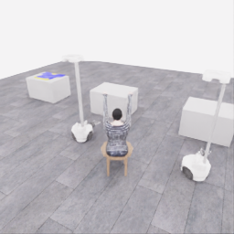
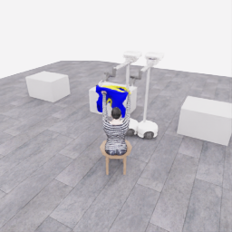
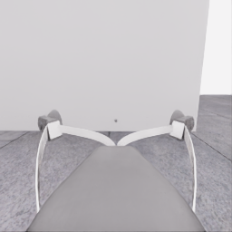
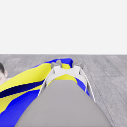
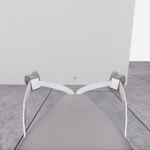
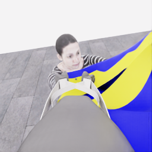
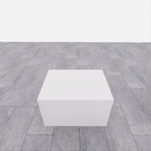
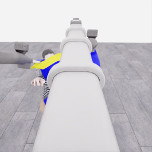
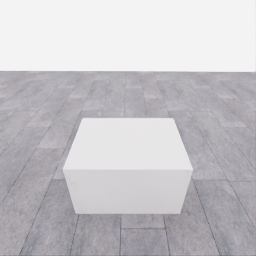
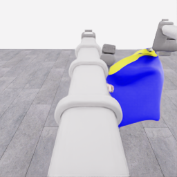

# 자동 시연 수집 시도 · 20261106-astra-coordinated-fresh-001

[전체 수집 기록](../../README.ko.md) · [구조화 요약](manifest.json) · [전체 행동 기록](decisions.jsonl) · [사용한 기본 프롬프트](prompt.txt)

실행 상태는 **completed**, 원본 출처는 `gpt`입니다. 완료 상태와 과제 성공은 아래에서 따로 기록합니다.

## 실행 조건과 시간

| 항목 | 기록 |
|---|---|
| 기록 시작 UTC | 2026-11-06T04:40:12Z |
| 기록 종료 UTC | 2026-11-06T06:04:06Z |
| 이전 시도 | 20261106-astra-dressing-continue-001 |
| 재시도 사유 | user_requested_two_robot_cooperation_from_fresh_zero |
| 출처 그룹 | 20261106-coordinated-demo-methods |
| 요청 모델 / 추론 설정 | gpt-6-astra / ultra |
| 전체 실제 경과 시간 (초) | 5034.038 |
| Actor 호출 합계 (초) | 3737.894 |
| 환경 요청·응답 합계 (초) | 1202.314 |
| 시뮬레이션 시간 (초) | 53.350 |
| 저장 전이 수 | 1067.000 |
| 응답 확인 전이 수 | 1067.000 |
| 모델 호출 시도 수 | 73.000 |
| 완료한 결정 구간 수 | 80.000 |
| 파일 완료 상태 | true |
| 데이터 정합성 검사 | true |
| 학습 데이터 승인 | unreviewed |
| Actor 호출 방식 | exec |
| 한 호출의 최대 계획 구간 수 | 2.000 |
| 한 계획의 최대 제어 step 수 | 40.000 |

Actor 호출 시간은 공개 입력 저장·요청 전송·응답 처리 등 호출 경로를 측정합니다. 방식에 따라 Docker/CLI 시작이 호출 안에 들어가거나 상주 서버 준비 시간으로 분리됩니다. 내부 모델 추론 시간만 별도로 측정한 값은 아닙니다. 모델이 판단하는 동안 물리 시간은 멈추며 실제 경과 시간과 시뮬레이션 시간은 다릅니다. 세부 요청 프로세스 시간에도 CLI 처리·네트워크·서버 대기·생성이 함께 포함됩니다.

## 토큰 사용량의 범위

`actor_usage`는 thread별 관측 누계를 합친 값입니다. 결정의 `usage`는 원본 CLI 누계이며, 호출별 증가량은 `usage_accounting.incremental_usage`입니다. 캐시 입력은 입력의 부분집합이고 추론 출력은 출력의 부분집합이므로 열들을 다시 합산하지 않습니다.

전체 호출 사용량 확정: **true** · 기록한 호출 수: 73.

| 입력 | 캐시 입력 | 캐시 쓰기 입력 | 출력 | 추론 출력 |
|---:|---:|---:|---:|---:|
| 10523634 | 9603200 | 0 | 79930 | 70422 |

중복 누계는 추가 사용량 0으로 처리하고, 역행한 누계는 미확정으로 보존합니다. 새 thread는 별도로 집계합니다. 토큰 기록은 화폐 비용이나 청구서가 아닙니다.

## 리뷰 정지 조건

목표 누적 점수 50.000 · 감시 상태 `collector_ended_before_gate` · 수집기 상태 `completed`.

마지막 관측 점수 5.000 · 응답 확인 step 1066.

`review_ready`는 정지 조건에 따라 실행을 마치고 리뷰할 준비가 된 상태입니다. 50점·착의 성공이나 학습 데이터 승인을 뜻하지 않습니다. 공식 점수와 success는 아래 평가 결과로 확인합니다.

## 공식 평가 결과

평가 유효성 `true` · 누적 점수 **5.000 / 50** · 착의 success **false** · rate 상태 `no_dressing_points` · 최종 rate 0.000 points/s.

누적 50점, 착의 success, 정상 파일 종료와 데이터 정합성은 서로 다른 상태입니다. 접촉 전 `no_contact`의 rate는 0점/초로 바꾸지 않습니다.

| 단계 | 획득 점수 / 최대 | 획득 시각 (episode 초) |
|---|---:|---:|
| 파지·들기 | 5.000 / 5 | 17.800 |
| 첫 소매 | 0.000 / 5 | 미측정/해당 없음 |
| 반대 어깨 | 0.000 / 5 | 미측정/해당 없음 |
| 두 번째 소매 | 0.000 / 5 | 미측정/해당 없음 |
| 왼쪽 위팔 | 0.000 / 5 | 미측정/해당 없음 |
| 오른쪽 위팔 | 0.000 / 5 | 미측정/해당 없음 |
| 목 통과 | 0.000 / 10 | 미측정/해당 없음 |
| 앞면 방향 | 0.000 / 10 | 미측정/해당 없음 |

## 단계 획득 경로

점수 획득은 [평가 이벤트](score-events.jsonl)에서 같은 physics tick끼리 묶었습니다. 같은 시각에 인정된 항목의 내부 순서는 추정하지 않습니다. 착의 success는 점수 획득과 별도로 기록합니다.

| 순서 | episode 시간 (초) | 전이 경계 step | 누적 점수 변화 | 같은 시각의 항목 변화 |
|---:|---:|---:|---:|---|
| 0 | 17.800 | 356 | 0.000→5.000 | 파지·들기 0.000→5.000 |

평가 clock 0초에 대응하는 공개 simulation clock은 1.525초입니다. 두 시계를 같은 절대 시각으로 혼동하지 않습니다.

별도 success 이벤트 수: **0**. 평가 유효성: `true`.


## 원본 관측 화면

지정된 공개 카메라의 저장 RGB 픽셀입니다. 시작은 첫 `obs`, 종료는 마지막 `next_obs`입니다. 이미지 합성이나 내부 상태 기반 장면 재구성 없이 원본 픽셀로 PNG를 저장했습니다.

| 카메라 | 시작 | 종료 |
|---|---|---|
| `overview` | [](images/initial-overview.png) | [](images/final-overview.png) |
| `robot_0_wrist` | [](images/initial-robot_0_wrist.png) | [](images/final-robot_0_wrist.png) |
| `robot_1_wrist` | [](images/initial-robot_1_wrist.png) | [](images/final-robot_1_wrist.png) |
| `robot_0_head` | [](images/initial-robot_0_head.png) | [](images/final-robot_0_head.png) |
| `robot_1_head` | [](images/initial-robot_1_head.png) | [](images/final-robot_1_head.png) |

시작 관측 시각 1.525초 · 종료 관측 시각 54.875초 (공개 simulation clock).

[▶ overview 관측 영상 보기](overview.mp4)

저장된 20 Hz `obs` 중 1067프레임을 순서대로 사용했습니다. 재생은 **4.0배 느리게** (5.000 fps), 실제 대기 시간·모델 호출 지연은 영상에 들어가지 않습니다. 종료 `next_obs`는 위 PNG에서 확인합니다.

## 결정과 실행 순서

아래 근거는 모델 최종 JSON의 짧은 행동 설명입니다. 시각적 평가는 행동 전 관측에 대한 판단이며, 그 행동의 실행 후 성공 라벨로 사용하지 않습니다. 공식 점수는 별도의 평가 결과입니다.

행동의 각 행은 로봇 0·1 순서이며 열은 `전진, 왼쪽 이동, 반시계 회전, 리프트, 팔 신장, 손목 yaw, pitch, roll, gripper`입니다. 앞 8개는 정규화 속도이고 gripper는 닫기 `+1`, 열기 `-1`, 의도 유지 `0`입니다.

이 시도는 **고정 행동 목록의 개방형 실행(open-loop)**을 사용할 수 있도록 구성했습니다. 한 모델 응답의 여러 구간을 순서대로 실행하며 목록 중간에 새 모델 판단이나 관측 조건 분기를 수행하지 않습니다. 20Hz 저장과 각 구간의 최신 관측 기록이 모델의 20Hz 피드백을 뜻하지 않습니다. 모델 입력 관측 시각과 구간 실행 직전 관측 시각을 따로 표시합니다.

### 결정 0 · 접근 · `act`

입력 관측 1.525초 · Actor 호출 58.993초 · 시각적 판단 `uncertain`.

계획 `20261106-astra-coordinated-fresh-001:call-00000` · 모델 호출 인덱스 0 · 계획 구간 1/1 · 이 구간에서 모델 호출 `true`.

실행 직전 최신 관측 1.525초.

공개 입력 저장 0.109초 · 요청 프로세스 58.883초 · 결과 해석 0.001초.

호출 사용량 상태 `observed` · 이번 증가량 입력 17317 / 출력 1474 토큰.

최종 응답의 행동 설명: Robot 0 appears left of the mannequin and robot 1 right; both have empty, open grippers. Move both along the apparent clear approach toward the left garment table while raising their grippers for clearance.

요청 행동:

```json
[[0.2, -0.8, 0, 0.4, 0, 0, 0, 0, -1], [0.2, -0.8, 0, 0.4, 0, 0, 0, 0, -1]]
```

실행 구간 step **[0, 20)** · 요청 20 step / 실제 20 step · 환경 요청·응답 21.209초.

실제 적용 행동:

```json
[[0.20000000298023224, -0.800000011920929, 0.0, 0.4000000059604645, 0.0, 0.0, 0.0, 0.0, -1.0], [0.20000000298023224, -0.800000011920929, 0.0, 0.4000000059604645, 0.0, 0.0, 0.0, 0.0, -1.0]]
```

### 결정 1 · 접근 · `act`

입력 관측 2.525초 · Actor 호출 44.995초 · 시각적 판단 `recovering`.

계획 `20261106-astra-coordinated-fresh-001:call-00001` · 모델 호출 인덱스 1 · 계획 구간 1/1 · 이 구간에서 모델 호출 `true`.

실행 직전 최신 관측 2.525초.

공개 입력 저장 0.091초 · 요청 프로세스 44.904초 · 결과 해석 0.000초.

호출 사용량 상태 `observed` · 이번 증가량 입력 26083 / 출력 1124 토큰.

최종 응답의 행동 설명: Observed motion identifies robot 0 on the overview right and robot 1 nearer the left garment table; both remain empty/open. Reverse lateral travel toward the garment, moving robot 0 faster to reduce their separation.

요청 행동:

```json
[[0.15, 1, 0, 0, 0, 0, 0, 0, -1], [0.15, 0.8, 0, 0, 0, 0, 0, 0, -1]]
```

실행 구간 step **[20, 40)** · 요청 20 step / 실제 20 step · 환경 요청·응답 21.748초.

실제 적용 행동:

```json
[[0.15000000596046448, 1.0, 0.0, 0.0, 0.0, 0.0, 0.0, 0.0, -1.0], [0.15000000596046448, 0.800000011920929, 0.0, 0.0, 0.0, 0.0, 0.0, 0.0, -1.0]]
```

### 결정 2 · 접근 · `act`

입력 관측 3.525초 · Actor 호출 49.052초 · 시각적 판단 `progressing`.

계획 `20261106-astra-coordinated-fresh-001:call-00002` · 모델 호출 인덱스 2 · 계획 구간 1/2 · 이 구간에서 모델 호출 `true`.

실행 직전 최신 관측 3.525초.

후속 구간의 호출 시간 0과 빈 usage는 추가 호출이 없었다는 뜻입니다.

공개 입력 저장 0.088초 · 요청 프로세스 48.964초 · 결과 해석 0.000초.

호출 사용량 상태 `observed` · 이번 증가량 입력 34417 / 출력 1203 토큰.

최종 응답의 행동 설명: Robot 0 remains farther right; robot 1 leads toward the garment table. Both grippers are raised and open. Continue together through the apparent clear lane in front of the tables.

요청 행동:

```json
[[0.1, 1, 0, 0, 0, 0, 0, 0, -1], [0.1, 0.8, 0, 0, 0, 0, 0, 0, -1]]
```

실행 구간 step **[40, 60)** · 요청 20 step / 실제 20 step · 환경 요청·응답 21.330초.

실제 적용 행동:

```json
[[0.10000000149011612, 1.0, 0.0, 0.0, 0.0, 0.0, 0.0, 0.0, -1.0], [0.10000000149011612, 0.800000011920929, 0.0, 0.0, 0.0, 0.0, 0.0, 0.0, -1.0]]
```

### 결정 3 · 접근 · `act`

입력 관측 3.525초 · Actor 호출 0.000초 · 시각적 판단 `progressing`.

계획 `20261106-astra-coordinated-fresh-001:call-00002` · 모델 호출 인덱스 2 · 계획 구간 2/2 · 이 구간에서 모델 호출 `false`.

실행 직전 최신 관측 4.525초.

후속 구간의 호출 시간 0과 빈 usage는 추가 호출이 없었다는 뜻입니다.

최종 응답의 행동 설명: Robot 0 travels faster to reduce separation while robot 1 continues its approach. Extend the same positioning motion with both arms retracted and grippers open; neither is ready to grasp yet.

요청 행동:

```json
[[0.1, 1, 0, 0, 0, 0, 0, 0, -1], [0.1, 0.8, 0, 0, 0, 0, 0, 0, -1]]
```

실행 구간 step **[60, 80)** · 요청 20 step / 실제 20 step · 환경 요청·응답 21.356초.

실제 적용 행동:

```json
[[0.10000000149011612, 1.0, 0.0, 0.0, 0.0, 0.0, 0.0, 0.0, -1.0], [0.10000000149011612, 0.800000011920929, 0.0, 0.0, 0.0, 0.0, 0.0, 0.0, -1.0]]
```

### 결정 4 · 접근 · `act`

입력 관측 5.525초 · Actor 호출 46.100초 · 시각적 판단 `progressing`.

계획 `20261106-astra-coordinated-fresh-001:call-00003` · 모델 호출 인덱스 3 · 계획 구간 1/2 · 이 구간에서 모델 호출 `true`.

실행 직전 최신 관측 5.525초.

후속 구간의 호출 시간 0과 빈 usage는 추가 호출이 없었다는 뜻입니다.

공개 입력 저장 0.091초 · 요청 프로세스 46.009초 · 결과 해석 0.000초.

호출 사용량 상태 `observed` · 이번 증가량 입력 42829 / 출력 1139 토큰.

최종 응답의 행동 설명: Robot 0 still has farther to travel; robot 1 now sees the garment at its head view’s left edge. Move both toward that table, keeping their raised grippers open.

요청 행동:

```json
[[0, 1, 0, 0, 0, 0, 0, 0, -1], [0.1, 0.6, 0, 0, 0, 0, 0, 0, -1]]
```

실행 구간 step **[80, 100)** · 요청 20 step / 실제 20 step · 환경 요청·응답 21.290초.

실제 적용 행동:

```json
[[0.0, 1.0, 0.0, 0.0, 0.0, 0.0, 0.0, 0.0, -1.0], [0.10000000149011612, 0.6000000238418579, 0.0, 0.0, 0.0, 0.0, 0.0, 0.0, -1.0]]
```

### 결정 5 · 접근 · `act`

입력 관측 5.525초 · Actor 호출 0.000초 · 시각적 판단 `progressing`.

계획 `20261106-astra-coordinated-fresh-001:call-00003` · 모델 호출 인덱스 3 · 계획 구간 2/2 · 이 구간에서 모델 호출 `false`.

실행 직전 최신 관측 6.525초.

후속 구간의 호출 시간 0과 빈 usage는 추가 호출이 없었다는 뜻입니다.

최종 응답의 행동 설명: Continue robot 0 along the clear table-front lane while robot 1 approaches more slowly, reducing their separation before either attempts cloth contact.

요청 행동:

```json
[[0, 1, 0, 0, 0, 0, 0, 0, -1], [0.1, 0.6, 0, 0, 0, 0, 0, 0, -1]]
```

실행 구간 step **[100, 120)** · 요청 20 step / 실제 20 step · 환경 요청·응답 20.824초.

실제 적용 행동:

```json
[[0.0, 1.0, 0.0, 0.0, 0.0, 0.0, 0.0, 0.0, -1.0], [0.10000000149011612, 0.6000000238418579, 0.0, 0.0, 0.0, 0.0, 0.0, 0.0, -1.0]]
```

### 결정 6 · 접근 · `act`

입력 관측 7.525초 · Actor 호출 40.843초 · 시각적 판단 `progressing`.

계획 `20261106-astra-coordinated-fresh-001:call-00004` · 모델 호출 인덱스 4 · 계획 구간 1/2 · 이 구간에서 모델 호출 `true`.

실행 직전 최신 관측 7.525초.

후속 구간의 호출 시간 0과 빈 usage는 추가 호출이 없었다는 뜻입니다.

공개 입력 저장 0.093초 · 요청 프로세스 40.750초 · 결과 해석 0.000초.

호출 사용량 상태 `observed` · 이번 증가량 입력 51154 / 출력 1163 토큰.

최종 응답의 행동 설명: Robot 0 remains by the empty middle table; robot 1 sees the shirt but is laterally offset. Move both toward the garment table, with robot 0 catching up and both grippers open.

요청 행동:

```json
[[0.1, 1, 0, 0, 0, 0, 0, 0, -1], [0, 0.55, 0, 0, 0, 0, 0, 0, -1]]
```

실행 구간 step **[120, 140)** · 요청 20 step / 실제 20 step · 환경 요청·응답 21.304초.

실제 적용 행동:

```json
[[0.10000000149011612, 1.0, 0.0, 0.0, 0.0, 0.0, 0.0, 0.0, -1.0], [0.0, 0.550000011920929, 0.0, 0.0, 0.0, 0.0, 0.0, 0.0, -1.0]]
```

### 결정 7 · 접근 · `act`

입력 관측 7.525초 · Actor 호출 0.000초 · 시각적 판단 `progressing`.

계획 `20261106-astra-coordinated-fresh-001:call-00004` · 모델 호출 인덱스 4 · 계획 구간 2/2 · 이 구간에서 모델 호출 `false`.

실행 직전 최신 관측 8.525초.

후속 구간의 호출 시간 0과 빈 usage는 추가 호출이 없었다는 뜻입니다.

최종 응답의 행동 설명: Continue the clear lateral approach: robot 0 reduces the remaining distance while robot 1 advances more slowly toward its eventual edge position. Keep the garment undisturbed on the table.

요청 행동:

```json
[[0.1, 1, 0, 0, 0, 0, 0, 0, -1], [0, 0.55, 0, 0, 0, 0, 0, 0, -1]]
```

실행 구간 step **[140, 160)** · 요청 20 step / 실제 20 step · 환경 요청·응답 21.480초.

실제 적용 행동:

```json
[[0.10000000149011612, 1.0, 0.0, 0.0, 0.0, 0.0, 0.0, 0.0, -1.0], [0.0, 0.550000011920929, 0.0, 0.0, 0.0, 0.0, 0.0, 0.0, -1.0]]
```

### 결정 8 · 접근 · `act`

입력 관측 9.525초 · Actor 호출 88.406초 · 시각적 판단 `progressing`.

계획 `20261106-astra-coordinated-fresh-001:call-00005` · 모델 호출 인덱스 5 · 계획 구간 1/1 · 이 구간에서 모델 호출 `true`.

실행 직전 최신 관측 9.525초.

공개 입력 저장 0.107초 · 요청 프로세스 88.299초 · 결과 해석 0.000초.

호출 사용량 상태 `observed` · 이번 증가량 입력 59503 / 출력 2130 토큰.

최종 응답의 행동 설명: Robot 0 is nearing the garment table; robot 1 is centered before it. Shift toward separated hem-edge positions while pitching both open grippers downward and raising their wrists to maintain tabletop clearance.

요청 행동:

```json
[[0, 0.9, 0, 0.15, 0, 0, 0.25, 0, -1], [0, 0.45, 0, 0.15, 0, 0, 0.25, 0, -1]]
```

실행 구간 step **[160, 180)** · 요청 20 step / 실제 20 step · 환경 요청·응답 22.277초.

실제 적용 행동:

```json
[[0.0, 0.8999999761581421, 0.0, 0.15000000596046448, 0.0, 0.0, 0.25, 0.0, -1.0], [0.0, 0.44999998807907104, 0.0, 0.15000000596046448, 0.0, 0.0, 0.25, 0.0, -1.0]]
```

### 결정 9 · 접근 · `act`

입력 관측 10.525초 · Actor 호출 50.381초 · 시각적 판단 `progressing`.

계획 `20261106-astra-coordinated-fresh-001:call-00006` · 모델 호출 인덱스 6 · 계획 구간 1/1 · 이 구간에서 모델 호출 `true`.

실행 직전 최신 관측 10.525초.

공개 입력 저장 0.114초 · 요청 프로세스 50.267초 · 결과 해석 0.000초.

호출 사용량 상태 `observed` · 이번 증가량 입력 69550 / 출력 1151 토큰.

최종 응답의 행동 설명: Robot 0 approaches one near hem corner and robot 1 the opposite corner; both grippers remain open above the table. Stop lateral travel and advance both bases and arms together toward the supported garment.

요청 행동:

```json
[[0.3, 0, 0, 0, 0.3, 0, 0, 0, -1], [0.3, 0, 0, 0, 0.3, 0, 0, 0, -1]]
```

실행 구간 step **[180, 192)** · 요청 12 step / 실제 12 step · 환경 요청·응답 13.288초.

실제 적용 행동:

```json
[[0.30000001192092896, 0.0, 0.0, 0.0, 0.30000001192092896, 0.0, 0.0, 0.0, -1.0], [0.30000001192092896, 0.0, 0.0, 0.0, 0.30000001192092896, 0.0, 0.0, 0.0, -1.0]]
```

### 결정 10 · 접근 · `act`

입력 관측 11.125초 · Actor 호출 64.459초 · 시각적 판단 `progressing`.

계획 `20261106-astra-coordinated-fresh-001:call-00007` · 모델 호출 인덱스 7 · 계획 구간 1/1 · 이 구간에서 모델 호출 `true`.

실행 직전 최신 관측 11.125초.

공개 입력 저장 0.116초 · 요청 프로세스 64.343초 · 결과 해석 0.000초.

호출 사용량 상태 `observed` · 이번 증가량 입력 78607 / 출력 1515 토큰.

최종 응답의 행동 설명: Robot 0 is aligned near one hem corner and robot 1 near the other; both remain open and above the cloth. Stop the bases and make a short coordinated lowering and extension adjustment before checking contact alignment.

요청 행동:

```json
[[0, 0, 0, -0.2, 0.12, 0, 0, 0, -1], [0, 0, 0, -0.2, 0.12, 0, 0, 0, -1]]
```

실행 구간 step **[192, 200)** · 요청 8 step / 실제 8 step · 환경 요청·응답 9.495초.

실제 적용 행동:

```json
[[0.0, 0.0, 0.0, -0.20000000298023224, 0.11999999731779099, 0.0, 0.0, 0.0, -1.0], [0.0, 0.0, 0.0, -0.20000000298023224, 0.11999999731779099, 0.0, 0.0, 0.0, -1.0]]
```

### 결정 11 · 접근 · `act`

입력 관측 11.525초 · Actor 호출 46.673초 · 시각적 판단 `progressing`.

계획 `20261106-astra-coordinated-fresh-001:call-00008` · 모델 호출 인덱스 8 · 계획 구간 1/1 · 이 구간에서 모델 호출 `true`.

실행 직전 최신 관측 11.525초.

공개 입력 저장 0.115초 · 요청 프로세스 46.558초 · 결과 해석 0.000초.

호출 사용량 상태 `observed` · 이번 증가량 입력 88014 / 출력 1095 토큰.

최종 응답의 행동 설명: Both open grippers hover above separated yellow hem regions. Nudge robot 0 slightly inward while robot 1 holds lateral alignment; lower both gently and let the previous extension settle before closing.

요청 행동:

```json
[[0, 0.08, 0, -0.08, 0, 0, 0, 0, -1], [0, 0, 0, -0.08, 0, 0, 0, 0, -1]]
```

실행 구간 step **[200, 206)** · 요청 6 step / 실제 6 step · 환경 요청·응답 7.326초.

실제 적용 행동:

```json
[[0.0, 0.07999999821186066, 0.0, -0.07999999821186066, 0.0, 0.0, 0.0, 0.0, -1.0], [0.0, 0.0, 0.0, -0.07999999821186066, 0.0, 0.0, 0.0, 0.0, -1.0]]
```

### 결정 12 · 파지 · `act`

입력 관측 11.825초 · Actor 호출 42.073초 · 시각적 판단 `uncertain`.

계획 `20261106-astra-coordinated-fresh-001:call-00009` · 모델 호출 인덱스 9 · 계획 구간 1/1 · 이 구간에서 모델 호출 `true`.

실행 직전 최신 관측 11.825초.

공개 입력 저장 0.125초 · 요청 프로세스 41.947초 · 결과 해석 0.000초.

호출 사용량 상태 `observed` · 이번 증가량 입력 97005 / 출력 1116 토큰.

최종 응답의 행동 설명: Robot 0 and robot 1 are aligned over separated yellow hem regions. Finish the gentle descent and close both grippers together while the shirt stays table-supported; neither grasp is verified yet.

요청 행동:

```json
[[0, 0, 0, -0.02, 0, 0, 0, 0, 1], [0, 0, 0, -0.02, 0, 0, 0, 0, 1]]
```

실행 구간 step **[206, 214)** · 요청 8 step / 실제 8 step · 환경 요청·응답 9.553초.

실제 적용 행동:

```json
[[0.0, 0.0, 0.0, -0.019999999552965164, 0.0, 0.0, 0.0, 0.0, 1.0], [0.0, 0.0, 0.0, -0.019999999552965164, 0.0, 0.0, 0.0, 0.0, 1.0]]
```

### 결정 13 · 파지 · `act`

입력 관측 12.225초 · Actor 호출 26.327초 · 시각적 판단 `uncertain`.

계획 `20261106-astra-coordinated-fresh-001:call-00010` · 모델 호출 인덱스 10 · 계획 구간 1/1 · 이 구간에서 모델 호출 `true`.

실행 직전 최신 관측 12.225초.

공개 입력 저장 0.109초 · 요청 프로세스 26.217초 · 결과 해석 0.000초.

호출 사용량 상태 `observed` · 이번 증가량 입력 106012 / 출력 632 토큰.

최종 응답의 행동 설명: Robot 0 and robot 1 are closing at separated hem regions, but both jaws are still moving. Hold position and let both closures settle before the short coordinated lift test.

요청 행동:

```json
[[0, 0, 0, 0, 0, 0, 0, 0, 1], [0, 0, 0, 0, 0, 0, 0, 0, 1]]
```

실행 구간 step **[214, 222)** · 요청 8 step / 실제 8 step · 환경 요청·응답 9.841초.

실제 적용 행동:

```json
[[0.0, 0.0, 0.0, 0.0, 0.0, 0.0, 0.0, 0.0, 1.0], [0.0, 0.0, 0.0, 0.0, 0.0, 0.0, 0.0, 0.0, 1.0]]
```

### 결정 14 · 들기 · `act`

입력 관측 12.625초 · Actor 호출 16.260초 · 시각적 판단 `uncertain`.

계획 `20261106-astra-coordinated-fresh-001:call-00011` · 모델 호출 인덱스 11 · 계획 구간 1/1 · 이 구간에서 모델 호출 `true`.

실행 직전 최신 관측 12.625초.

공개 입력 저장 0.112초 · 요청 프로세스 16.147초 · 결과 해석 0.000초.

호출 사용량 상태 `observed` · 이번 증가량 입력 114520 / 출력 362 토큰.

최종 응답의 행동 설명: Robot 0 and robot 1 have settled closures at separated hem regions. Perform a short simultaneous vertical lift test with bases and arms fixed; subsequent views must show cloth following each gripper separately.

요청 행동:

```json
[[0, 0, 0, 0.15, 0, 0, 0, 0, 1], [0, 0, 0, 0.15, 0, 0, 0, 0, 1]]
```

실행 구간 step **[222, 228)** · 요청 6 step / 실제 6 step · 환경 요청·응답 7.622초.

실제 적용 행동:

```json
[[0.0, 0.0, 0.0, 0.15000000596046448, 0.0, 0.0, 0.0, 0.0, 1.0], [0.0, 0.0, 0.0, 0.15000000596046448, 0.0, 0.0, 0.0, 0.0, 1.0]]
```

### 결정 15 · 들기 · `act`

입력 관측 12.925초 · Actor 호출 33.340초 · 시각적 판단 `progressing`.

계획 `20261106-astra-coordinated-fresh-001:call-00012` · 모델 호출 인덱스 12 · 계획 구간 1/1 · 이 구간에서 모델 호출 `true`.

실행 직전 최신 관측 12.925초.

공개 입력 저장 0.110초 · 요청 프로세스 33.230초 · 결과 해석 0.000초.

호출 사용량 상태 `observed` · 이번 증가량 입력 122758 / 출력 730 토큰.

최종 응답의 행동 설명: Robot 0’s hem corner remains at its jaws, and robot 1’s corner forms a raised fold; both appear to follow the test lift. Raise together another small amount, preserving separation and closed grips while checking support.

요청 행동:

```json
[[0, 0, 0, 0.12, 0, 0, 0, 0, 1], [0, 0, 0, 0.12, 0, 0, 0, 0, 1]]
```

실행 구간 step **[228, 236)** · 요청 8 step / 실제 8 step · 환경 요청·응답 10.339초.

실제 적용 행동:

```json
[[0.0, 0.0, 0.0, 0.11999999731779099, 0.0, 0.0, 0.0, 0.0, 1.0], [0.0, 0.0, 0.0, 0.11999999731779099, 0.0, 0.0, 0.0, 0.0, 1.0]]
```

### 결정 16 · 복구 · `act`

입력 관측 13.325초 · Actor 호출 49.729초 · 시각적 판단 `recovering`.

계획 `20261106-astra-coordinated-fresh-001:call-00013` · 모델 호출 인덱스 13 · 계획 구간 1/1 · 이 구간에서 모델 호출 `true`.

실행 직전 최신 관측 13.325초.

공개 입력 저장 0.113초 · 요청 프로세스 49.616초 · 결과 해석 0.001초.

호출 사용량 상태 `observed` · 이번 증가량 입력 131406 / 출력 1157 토큰.

최종 응답의 행동 설명: Robot 0’s hem appears below its raised jaws; robot 1’s local fold also leaves support uncertain. Lower both toward the table with grips retained before recovering the unverified grasps.

요청 행동:

```json
[[0, 0, 0, -0.2, 0, 0, 0, 0, 1], [0, 0, 0, -0.2, 0, 0, 0, 0, 1]]
```

실행 구간 step **[236, 244)** · 요청 8 step / 실제 8 step · 환경 요청·응답 10.283초.

실제 적용 행동:

```json
[[0.0, 0.0, 0.0, -0.20000000298023224, 0.0, 0.0, 0.0, 0.0, 1.0], [0.0, 0.0, 0.0, -0.20000000298023224, 0.0, 0.0, 0.0, 0.0, 1.0]]
```

### 결정 17 · 복구 · `act`

입력 관측 13.725초 · Actor 호출 42.518초 · 시각적 판단 `recovering`.

계획 `20261106-astra-coordinated-fresh-001:call-00014` · 모델 호출 인덱스 14 · 계획 구간 1/1 · 이 구간에서 모델 호출 `true`.

실행 직전 최신 관측 13.725초.

공개 입력 저장 0.114초 · 요청 프로세스 42.404초 · 결과 해석 0.000초.

호출 사용량 상태 `observed` · 이번 증가량 입력 140471 / 출력 882 토큰.

최종 응답의 행동 설명: Both hem regions appear table-supported, with neither grasp verified. Reopen robot 0 and robot 1 together and descend slightly farther to place the cloth between their pads before retrying.

요청 행동:

```json
[[0, 0, 0, -0.1, 0, 0, 0, 0, -1], [0, 0, 0, -0.1, 0, 0, 0, 0, -1]]
```

실행 구간 step **[244, 250)** · 요청 6 step / 실제 6 step · 환경 요청·응답 7.680초.

실제 적용 행동:

```json
[[0.0, 0.0, 0.0, -0.10000000149011612, 0.0, 0.0, 0.0, 0.0, -1.0], [0.0, 0.0, 0.0, -0.10000000149011612, 0.0, 0.0, 0.0, 0.0, -1.0]]
```

### 결정 18 · 복구 · `act`

입력 관측 14.025초 · Actor 호출 20.225초 · 시각적 판단 `recovering`.

계획 `20261106-astra-coordinated-fresh-001:call-00015` · 모델 호출 인덱스 15 · 계획 구간 1/1 · 이 구간에서 모델 호출 `true`.

실행 직전 최신 관측 14.025초.

공개 입력 저장 0.116초 · 요청 프로세스 20.108초 · 결과 해석 0.000초.

호출 사용량 상태 `observed` · 이번 증가량 입력 149277 / 출력 415 토큰.

최종 응답의 행동 설명: Robot 0 and robot 1 are reopening over separate table-supported hem regions. Hold base and arm alignment, finish opening both jaws, and let the lower height targets settle before retrying the pinch.

요청 행동:

```json
[[0, 0, 0, 0, 0, 0, 0, 0, -1], [0, 0, 0, 0, 0, 0, 0, 0, -1]]
```

실행 구간 step **[250, 258)** · 요청 8 step / 실제 8 step · 환경 요청·응답 9.616초.

실제 적용 행동:

```json
[[0.0, 0.0, 0.0, 0.0, 0.0, 0.0, 0.0, 0.0, -1.0], [0.0, 0.0, 0.0, 0.0, 0.0, 0.0, 0.0, 0.0, -1.0]]
```

### 결정 19 · 파지 · `act`

입력 관측 14.425초 · Actor 호출 45.572초 · 시각적 판단 `uncertain`.

계획 `20261106-astra-coordinated-fresh-001:call-00016` · 모델 호출 인덱스 16 · 계획 구간 1/1 · 이 구간에서 모델 호출 `true`.

실행 직전 최신 관측 14.425초.

공개 입력 저장 0.112초 · 요청 프로세스 45.459초 · 결과 해석 0.000초.

호출 사용량 상태 `observed` · 이번 증가량 입력 157532 / 출력 1059 토큰.

최종 응답의 행동 설명: Robot 0’s hem corner appears just outside its pinch center; robot 1 remains aligned with the opposite hem region. Nudge robot 0 inward and close both grippers without further lowering or lifting.

요청 행동:

```json
[[0, 0.06, 0, 0, 0, 0, 0, 0, 1], [0, 0, 0, 0, 0, 0, 0, 0, 1]]
```

실행 구간 step **[258, 264)** · 요청 6 step / 실제 6 step · 환경 요청·응답 7.300초.

실제 적용 행동:

```json
[[0.0, 0.05999999865889549, 0.0, 0.0, 0.0, 0.0, 0.0, 0.0, 1.0], [0.0, 0.0, 0.0, 0.0, 0.0, 0.0, 0.0, 0.0, 1.0]]
```

### 결정 20 · 복구 · `act`

입력 관측 14.725초 · Actor 호출 77.635초 · 시각적 판단 `recovering`.

계획 `20261106-astra-coordinated-fresh-001:call-00017` · 모델 호출 인덱스 17 · 계획 구간 1/1 · 이 구간에서 모델 호출 `true`.

실행 직전 최신 관측 14.725초.

공개 입력 저장 0.111초 · 요청 프로세스 77.524초 · 결과 해석 0.000초.

호출 사용량 상태 `observed` · 이번 증가량 입력 166452 / 출력 1741 토큰.

최종 응답의 행동 설명: Robot 0 and robot 1 still have partly open jaws and wrist deflection near the tabletop. Ease both wrists upward slightly to relieve contact while continuing closure, keeping the garment supported in place.

요청 행동:

```json
[[0, 0, 0, 0.025, 0, 0, 0, 0, 1], [0, 0, 0, 0.025, 0, 0, 0, 0, 1]]
```

실행 구간 step **[264, 270)** · 요청 6 step / 실제 6 step · 환경 요청·응답 7.563초.

실제 적용 행동:

```json
[[0.0, 0.0, 0.0, 0.02500000037252903, 0.0, 0.0, 0.0, 0.0, 1.0], [0.0, 0.0, 0.0, 0.02500000037252903, 0.0, 0.0, 0.0, 0.0, 1.0]]
```

### 결정 21 · 복구 · `act`

입력 관측 15.025초 · Actor 호출 83.094초 · 시각적 판단 `recovering`.

계획 `20261106-astra-coordinated-fresh-001:call-00018` · 모델 호출 인덱스 18 · 계획 구간 1/1 · 이 구간에서 모델 호출 `true`.

실행 직전 최신 관측 15.025초.

공개 입력 저장 0.110초 · 요청 프로세스 82.983초 · 결과 해석 0.000초.

호출 사용량 상태 `observed` · 이번 증가량 입력 176057 / 출력 1910 토큰.

최종 응답의 행동 설명: Robot 0 remains at the hem’s outer edge; robot 1’s opposite contact still resists closure. Turn both wrists slightly inward and ease them upward to relieve tabletop contact and bring more hem between the pads.

요청 행동:

```json
[[0, 0, 0, 0.025, 0, 0.12, 0, 0, 1], [0, 0, 0, 0.025, 0, -0.12, 0, 0, 1]]
```

실행 구간 step **[270, 276)** · 요청 6 step / 실제 6 step · 환경 요청·응답 7.154초.

실제 적용 행동:

```json
[[0.0, 0.0, 0.0, 0.02500000037252903, 0.0, 0.11999999731779099, 0.0, 0.0, 1.0], [0.0, 0.0, 0.0, 0.02500000037252903, 0.0, -0.11999999731779099, 0.0, 0.0, 1.0]]
```

### 결정 22 · 파지 · `act`

입력 관측 15.325초 · Actor 호출 18.963초 · 시각적 판단 `uncertain`.

계획 `20261106-astra-coordinated-fresh-001:call-00019` · 모델 호출 인덱스 19 · 계획 구간 1/1 · 이 구간에서 모델 호출 `true`.

실행 직전 최신 관측 15.325초.

공개 입력 저장 0.110초 · 요청 프로세스 18.853초 · 결과 해석 0.000초.

호출 사용량 상태 `observed` · 이번 증가량 입력 185847 / 출력 320 토큰.

최종 응답의 행동 설명: Robot 0 now has a yellow hem fold near its pinch center; robot 1 straddles the opposite hem region. Hold both position targets and maintain closure while the wrist adjustments settle before another lift test.

요청 행동:

```json
[[0, 0, 0, 0, 0, 0, 0, 0, 1], [0, 0, 0, 0, 0, 0, 0, 0, 1]]
```

실행 구간 step **[276, 284)** · 요청 8 step / 실제 8 step · 환경 요청·응답 9.331초.

실제 적용 행동:

```json
[[0.0, 0.0, 0.0, 0.0, 0.0, 0.0, 0.0, 0.0, 1.0], [0.0, 0.0, 0.0, 0.0, 0.0, 0.0, 0.0, 0.0, 1.0]]
```

### 결정 23 · 들기 · `act`

입력 관측 15.725초 · Actor 호출 20.418초 · 시각적 판단 `uncertain`.

계획 `20261106-astra-coordinated-fresh-001:call-00020` · 모델 호출 인덱스 20 · 계획 구간 1/1 · 이 구간에서 모델 호출 `true`.

실행 직전 최신 관측 15.725초.

공개 입력 저장 0.112초 · 요청 프로세스 20.305초 · 결과 해석 0.000초.

호출 사용량 상태 `observed` · 이번 증가량 입력 194044 / 출력 427 토큰.

최종 응답의 행동 설명: Robot 0 and robot 1 have reclosed at adjusted, separated hem contacts. Repeat a short coordinated vertical lift with both grips maintained; check each cloth contact independently before any transport.

요청 행동:

```json
[[0, 0, 0, 0.1, 0, 0, 0, 0, 1], [0, 0, 0, 0.1, 0, 0, 0, 0, 1]]
```

실행 구간 step **[284, 292)** · 요청 8 step / 실제 8 step · 환경 요청·응답 9.749초.

실제 적용 행동:

```json
[[0.0, 0.0, 0.0, 0.10000000149011612, 0.0, 0.0, 0.0, 0.0, 1.0], [0.0, 0.0, 0.0, 0.10000000149011612, 0.0, 0.0, 0.0, 0.0, 1.0]]
```

### 결정 24 · 들기 · `act`

입력 관측 16.125초 · Actor 호출 33.094초 · 시각적 판단 `progressing`.

계획 `20261106-astra-coordinated-fresh-001:call-00021` · 모델 호출 인덱스 21 · 계획 구간 1/1 · 이 구간에서 모델 호출 `true`.

실행 직전 최신 관측 16.125초.

공개 입력 저장 0.111초 · 요청 프로세스 32.983초 · 결과 해석 0.000초.

호출 사용량 상태 `observed` · 이번 증가량 입력 202361 / 출력 755 토큰.

최종 응답의 행동 설명: Robot 0’s corner now forms a rising blue fold at its jaws, and robot 1’s opposite hem also follows with a raised fold. Continue lifting together with fixed separation and closed grips, checking that both contacts persist.

요청 행동:

```json
[[0, 0, 0, 0.18, 0, 0, 0, 0, 1], [0, 0, 0, 0.18, 0, 0, 0, 0, 1]]
```

실행 구간 step **[292, 304)** · 요청 12 step / 실제 12 step · 환경 요청·응답 14.162초.

실제 적용 행동:

```json
[[0.0, 0.0, 0.0, 0.18000000715255737, 0.0, 0.0, 0.0, 0.0, 1.0], [0.0, 0.0, 0.0, 0.18000000715255737, 0.0, 0.0, 0.0, 0.0, 1.0]]
```

### 결정 25 · 들기 · `act`

입력 관측 16.725초 · Actor 호출 46.573초 · 시각적 판단 `progressing`.

계획 `20261106-astra-coordinated-fresh-001:call-00022` · 모델 호출 인덱스 22 · 계획 구간 1/1 · 이 구간에서 모델 호출 `true`.

실행 직전 최신 관측 16.725초.

공개 입력 저장 0.117초 · 요청 프로세스 46.455초 · 결과 해석 0.000초.

호출 사용량 상태 `observed` · 이번 증가량 입력 211018 / 출력 1079 토큰.

최종 응답의 행동 설명: Robot 0 and robot 1 each visibly carry a hem corner, with the yellow rim hanging between them. Lift together and gradually level both wrists to peel more of the shirt from the table while preserving both grips.

요청 행동:

```json
[[0, 0, 0, 0.2, 0, 0, -0.12, 0, 1], [0, 0, 0, 0.2, 0, 0, -0.12, 0, 1]]
```

실행 구간 step **[304, 320)** · 요청 16 step / 실제 16 step · 환경 요청·응답 18.190초.

실제 적용 행동:

```json
[[0.0, 0.0, 0.0, 0.20000000298023224, 0.0, 0.0, -0.11999999731779099, 0.0, 1.0], [0.0, 0.0, 0.0, 0.20000000298023224, 0.0, 0.0, -0.11999999731779099, 0.0, 1.0]]
```

### 결정 26 · 들기 · `act`

입력 관측 17.525초 · Actor 호출 88.573초 · 시각적 판단 `progressing`.

계획 `20261106-astra-coordinated-fresh-001:call-00023` · 모델 호출 인덱스 23 · 계획 구간 1/1 · 이 구간에서 모델 호출 `true`.

실행 직전 최신 관측 17.525초.

공개 입력 저장 0.130초 · 요청 프로세스 88.442초 · 결과 해석 0.000초.

호출 사용량 상태 `observed` · 이번 증가량 입력 220003 / 출력 2062 토큰.

최종 응답의 행동 설명: Both hem grips remain visibly engaged, while the hanging shirt is still near the tabletop. Level and straighten both wrists as the lift settles, increasing clearance and keeping the opening spread before transport.

요청 행동:

```json
[[0, 0, 0, 0, 0, -0.06, -0.15, 0, 1], [0, 0, 0, 0, 0, 0.06, -0.15, 0, 1]]
```

실행 구간 step **[320, 332)** · 요청 12 step / 실제 12 step · 환경 요청·응답 13.677초.

실제 적용 행동:

```json
[[0.0, 0.0, 0.0, 0.0, 0.0, -0.05999999865889549, -0.15000000596046448, 0.0, 1.0], [0.0, 0.0, 0.0, 0.0, 0.0, 0.05999999865889549, -0.15000000596046448, 0.0, 1.0]]
```

### 결정 27 · 운반 · `act`

입력 관측 18.125초 · Actor 호출 67.892초 · 시각적 판단 `progressing`.

계획 `20261106-astra-coordinated-fresh-001:call-00024` · 모델 호출 인덱스 24 · 계획 구간 1/2 · 이 구간에서 모델 호출 `true`.

실행 직전 최신 관측 18.125초.

후속 구간의 호출 시간 0과 빈 usage는 추가 호출이 없었다는 뜻입니다.

공개 입력 저장 0.092초 · 요청 프로세스 67.799초 · 결과 해석 0.001초.

호출 사용량 상태 `observed` · 이번 증가량 입력 229327 / 출력 1536 토큰.

최종 응답의 행동 설명: Both robots visibly support separate hem corners, and the shirt appears clear of the tabletop. Back away together into the clear floor lane while preserving height and both grips.

요청 행동:

```json
[[-0.65, 0, 0, 0, 0, 0, 0, 0, 1], [-0.65, 0, 0, 0, 0, 0, 0, 1, 0]]
```

실행 구간 step **[332, 352)** · 요청 20 step / 실제 20 step · 환경 요청·응답 22.212초.

실제 적용 행동:

```json
[[-0.6499999761581421, 0.0, 0.0, 0.0, 0.0, 0.0, 0.0, 0.0, 1.0], [-0.6499999761581421, 0.0, 0.0, 0.0, 0.0, 0.0, 0.0, 1.0, 0.0]]
```

### 결정 28 · 운반 · `act`

입력 관측 18.125초 · Actor 호출 0.000초 · 시각적 판단 `progressing`.

계획 `20261106-astra-coordinated-fresh-001:call-00024` · 모델 호출 인덱스 24 · 계획 구간 2/2 · 이 구간에서 모델 호출 `false`.

실행 직전 최신 관측 19.125초.

후속 구간의 호출 시간 0과 빈 usage는 추가 호출이 없었다는 뜻입니다.

최종 응답의 행동 설명: Robot 0 and robot 1 retain their shared load. Stop base motion briefly and let the hanging garment settle before coordinating the turn toward the mannequin.

요청 행동:

```json
[[0, 0, 0, 0, 0, 0, 0, 0, 1], [0, 0, 0, 0, 0, 0, 0, 0, 1]]
```

실행 구간 step **[352, 360)** · 요청 8 step / 실제 8 step · 환경 요청·응답 9.486초.

실제 적용 행동:

```json
[[0.0, 0.0, 0.0, 0.0, 0.0, 0.0, 0.0, 0.0, 1.0], [0.0, 0.0, 0.0, 0.0, 0.0, 0.0, 0.0, 0.0, 1.0]]
```

### 결정 29 · 복구 · `act`

입력 관측 19.525초 · Actor 호출 28.624초 · 시각적 판단 `recovering`.

계획 `20261106-astra-coordinated-fresh-001:call-00025` · 모델 호출 인덱스 25 · 계획 구간 1/1 · 이 구간에서 모델 호출 `true`.

실행 직전 최신 관측 19.525초.

공개 입력 저장 0.097초 · 요청 프로세스 28.526초 · 결과 해석 0.000초.

호출 사용량 상태 `observed` · 이번 증가량 입력 238112 / 출력 591 토큰.

최종 응답의 행동 설명: Robot 0 maintains its hem grip; robot 1’s hem is visibly wrapped around its rolled wrist. Pause transport and gently reverse robot 1’s roll while retaining both grips to unwind the cloth.

요청 행동:

```json
[[0, 0, 0, 0, 0, 0, 0, 0, 1], [0, 0, 0, 0, 0, 0, 0, -0.25, 1]]
```

실행 구간 step **[360, 372)** · 요청 12 step / 실제 12 step · 환경 요청·응답 13.729초.

실제 적용 행동:

```json
[[0.0, 0.0, 0.0, 0.0, 0.0, 0.0, 0.0, 0.0, 1.0], [0.0, 0.0, 0.0, 0.0, 0.0, 0.0, 0.0, -0.25, 1.0]]
```

### 결정 30 · 복구 · `act`

입력 관측 20.125초 · Actor 호출 16.641초 · 시각적 판단 `recovering`.

계획 `20261106-astra-coordinated-fresh-001:call-00026` · 모델 호출 인덱스 26 · 계획 구간 1/1 · 이 구간에서 모델 호출 `true`.

실행 직전 최신 관측 20.125초.

공개 입력 저장 0.094초 · 요청 프로세스 16.547초 · 결과 해석 0.000초.

호출 사용량 상태 `observed` · 이번 증가량 입력 245987 / 출력 292 토큰.

최종 응답의 행동 설명: Robot 0 keeps its hem corner supported; robot 1 still has cloth wrapped around its wrist. Continue reversing robot 1’s roll at a steady rate, with both bases fixed and both grips retained.

요청 행동:

```json
[[0, 0, 0, 0, 0, 0, 0, 0, 1], [0, 0, 0, 0, 0, 0, 0, -0.25, 1]]
```

실행 구간 step **[372, 392)** · 요청 20 step / 실제 20 step · 환경 요청·응답 22.005초.

실제 적용 행동:

```json
[[0.0, 0.0, 0.0, 0.0, 0.0, 0.0, 0.0, 0.0, 1.0], [0.0, 0.0, 0.0, 0.0, 0.0, 0.0, 0.0, -0.25, 1.0]]
```

### 결정 31 · 복구 · `act`

입력 관측 21.125초 · Actor 호출 107.228초 · 시각적 판단 `recovering`.

계획 `20261106-astra-coordinated-fresh-001:call-00027` · 모델 호출 인덱스 27 · 계획 구간 1/1 · 이 구간에서 모델 호출 `true`.

실행 직전 최신 관측 21.125초.

공개 입력 저장 0.095초 · 요청 프로세스 107.133초 · 결과 해석 0.000초.

호출 사용량 상태 `observed` · 이번 증가량 입력 59500 / 출력 226 토큰.

최종 응답의 행동 설명: Both hem corners appear retained. Hold robot 0 steady and continue unwinding robot 1’s wrist, keeping both bases fixed and grippers closed.

요청 행동:

```json
[[0, 0, 0, 0, 0, 0, 0, 0, 1], [0, 0, 0, 0, 0, 0, 0, -0.25, 1]]
```

실행 구간 step **[392, 412)** · 요청 20 step / 실제 20 step · 환경 요청·응답 22.095초.

실제 적용 행동:

```json
[[0.0, 0.0, 0.0, 0.0, 0.0, 0.0, 0.0, 0.0, 1.0], [0.0, 0.0, 0.0, 0.0, 0.0, 0.0, 0.0, -0.25, 1.0]]
```

### 결정 32 · 복구 · `act`

입력 관측 22.125초 · Actor 호출 16.899초 · 시각적 판단 `recovering`.

계획 `20261106-astra-coordinated-fresh-001:call-00028` · 모델 호출 인덱스 28 · 계획 구간 1/2 · 이 구간에서 모델 호출 `true`.

실행 직전 최신 관측 22.125초.

후속 구간의 호출 시간 0과 빈 usage는 추가 호출이 없었다는 뜻입니다.

공개 입력 저장 0.095초 · 요청 프로세스 16.803초 · 결과 해석 0.000초.

호출 사용량 상태 `observed` · 이번 증가량 입력 66970 / 출력 438 토큰.

최종 응답의 행동 설명: Both corners appear retained. Reverse robot 1’s remaining wrist roll toward neutral while robot 0 supports the opposite corner.

요청 행동:

```json
[[0, 0, 0, 0, 0, 0, 0, 0, 1], [0, 0, 0, 0, 0, 0, 0, -0.255, 1]]
```

실행 구간 step **[412, 422)** · 요청 10 step / 실제 10 step · 환경 요청·응답 11.752초.

실제 적용 행동:

```json
[[0.0, 0.0, 0.0, 0.0, 0.0, 0.0, 0.0, 0.0, 1.0], [0.0, 0.0, 0.0, 0.0, 0.0, 0.0, 0.0, -0.2549999952316284, 1.0]]
```

### 결정 33 · 복구 · `act`

입력 관측 22.125초 · Actor 호출 0.000초 · 시각적 판단 `uncertain`.

계획 `20261106-astra-coordinated-fresh-001:call-00028` · 모델 호출 인덱스 28 · 계획 구간 2/2 · 이 구간에서 모델 호출 `false`.

실행 직전 최신 관측 22.625초.

후속 구간의 호출 시간 0과 빈 usage는 추가 호출이 없었다는 뜻입니다.

최종 응답의 행동 설명: Hold both grips and let the wrist and suspended fabric settle before checking for residual twisting.

요청 행동:

```json
[[0, 0, 0, 0, 0, 0, 0, 0, 1], [0, 0, 0, 0, 0, 0, 0, 0, 1]]
```

실행 구간 step **[422, 430)** · 요청 8 step / 실제 8 step · 환경 요청·응답 9.446초.

실제 적용 행동:

```json
[[0.0, 0.0, 0.0, 0.0, 0.0, 0.0, 0.0, 0.0, 1.0], [0.0, 0.0, 0.0, 0.0, 0.0, 0.0, 0.0, 0.0, 1.0]]
```

### 결정 34 · 운반 · `act`

입력 관측 23.025초 · Actor 호출 36.935초 · 시각적 판단 `progressing`.

계획 `20261106-astra-coordinated-fresh-001:call-00029` · 모델 호출 인덱스 29 · 계획 구간 1/1 · 이 구간에서 모델 호출 `true`.

실행 직전 최신 관측 23.025초.

공개 입력 저장 0.091초 · 요청 프로세스 36.843초 · 결과 해석 0.001초.

호출 사용량 상태 `observed` · 이번 증가량 입력 74593 / 출력 883 토큰.

최종 응답의 행동 설명: The wrist twist appears cleared and both hem corners remain supported. Begin a coordinated clockwise turn toward the mannequin while maintaining grip, height, and spacing.

요청 행동:

```json
[[-0.202, 0, -0.2, 0, 0, 0, 0, 0, 1], [0.202, 0, -0.2, 0, 0, 0, 0, 0, 1]]
```

실행 구간 step **[430, 450)** · 요청 20 step / 실제 20 step · 환경 요청·응답 22.694초.

실제 적용 행동:

```json
[[-0.20200000703334808, 0.0, -0.20000000298023224, 0.0, 0.0, 0.0, 0.0, 0.0, 1.0], [0.20200000703334808, 0.0, -0.20000000298023224, 0.0, 0.0, 0.0, 0.0, 0.0, 1.0]]
```

### 결정 35 · 운반 · `act`

입력 관측 24.025초 · Actor 호출 16.292초 · 시각적 판단 `progressing`.

계획 `20261106-astra-coordinated-fresh-001:call-00030` · 모델 호출 인덱스 30 · 계획 구간 1/1 · 이 구간에서 모델 호출 `true`.

실행 직전 최신 관측 24.025초.

공개 입력 저장 0.095초 · 요청 프로세스 16.197초 · 결과 해석 0.000초.

호출 사용량 상태 `observed` · 이번 증가량 입력 82736 / 출력 345 토큰.

최종 응답의 행동 설명: Both hem corners remain supported during the turn. Continue rotating the pair clockwise with matched spacing, fixed arm height, and closed grips.

요청 행동:

```json
[[-0.202, 0, -0.2, 0, 0, 0, 0, 0, 1], [0.202, 0, -0.2, 0, 0, 0, 0, 0, 1]]
```

실행 구간 step **[450, 470)** · 요청 20 step / 실제 20 step · 환경 요청·응답 23.197초.

실제 적용 행동:

```json
[[-0.20200000703334808, 0.0, -0.20000000298023224, 0.0, 0.0, 0.0, 0.0, 0.0, 1.0], [0.20200000703334808, 0.0, -0.20000000298023224, 0.0, 0.0, 0.0, 0.0, 0.0, 1.0]]
```

### 결정 36 · 운반 · `act`

입력 관측 25.025초 · Actor 호출 22.504초 · 시각적 판단 `progressing`.

계획 `20261106-astra-coordinated-fresh-001:call-00031` · 모델 호출 인덱스 31 · 계획 구간 1/1 · 이 구간에서 모델 호출 `true`.

실행 직전 최신 관측 25.025초.

공개 입력 저장 0.092초 · 요청 프로세스 22.412초 · 결과 해석 0.000초.

호출 사용량 상태 `observed` · 이번 증가량 입력 90362 / 출력 578 토큰.

최종 응답의 행동 설명: Both grips appear stable, and the mannequin is entering the right side of robot 0’s view. Continue the coordinated clockwise turn to bring it toward the center.

요청 행동:

```json
[[-0.202, 0, -0.2, 0, 0, 0, 0, 0, 1], [0.202, 0, -0.2, 0, 0, 0, 0, 0, 1]]
```

실행 구간 step **[470, 490)** · 요청 20 step / 실제 20 step · 환경 요청·응답 22.887초.

실제 적용 행동:

```json
[[-0.20200000703334808, 0.0, -0.20000000298023224, 0.0, 0.0, 0.0, 0.0, 0.0, 1.0], [0.20200000703334808, 0.0, -0.20000000298023224, 0.0, 0.0, 0.0, 0.0, 0.0, 1.0]]
```

### 결정 37 · 운반 · `act`

입력 관측 26.025초 · Actor 호출 75.112초 · 시각적 판단 `progressing`.

계획 `20261106-astra-coordinated-fresh-001:call-00032` · 모델 호출 인덱스 32 · 계획 구간 1/1 · 이 구간에서 모델 호출 `true`.

실행 직전 최신 관측 26.025초.

공개 입력 저장 0.093초 · 요청 프로세스 75.018초 · 결과 해석 0.000초.

호출 사용량 상태 `observed` · 이번 증가량 입력 98283 / 출력 1695 토큰.

최종 응답의 행동 설명: Both corners remain held and the mannequin is ahead. Stop turning and move the pair forward with a small leftward shift toward its front, keeping the garment raised.

요청 행동:

```json
[[0.55, 0.2, 0, 0, 0, 0, 0, 0, 1], [0.55, 0.2, 0, 0, 0, 0, 0, 0, 1]]
```

실행 구간 step **[490, 510)** · 요청 20 step / 실제 20 step · 환경 요청·응답 23.146초.

실제 적용 행동:

```json
[[0.550000011920929, 0.20000000298023224, 0.0, 0.0, 0.0, 0.0, 0.0, 0.0, 1.0], [0.550000011920929, 0.20000000298023224, 0.0, 0.0, 0.0, 0.0, 0.0, 0.0, 1.0]]
```

### 결정 38 · 운반 · `act`

입력 관측 27.025초 · Actor 호출 28.319초 · 시각적 판단 `progressing`.

계획 `20261106-astra-coordinated-fresh-001:call-00033` · 모델 호출 인덱스 33 · 계획 구간 1/1 · 이 구간에서 모델 호출 `true`.

실행 직전 최신 관측 27.025초.

공개 입력 저장 0.095초 · 요청 프로세스 28.224초 · 결과 해석 0.000초.

호출 사용량 상태 `observed` · 이번 증가량 입력 107330 / 출력 630 토큰.

최종 응답의 행동 설명: Both corners appear retained and the garment remains suspended. Continue toward the front approach area while gently aligning the bases’ headings and reducing their stagger.

요청 행동:

```json
[[0.58, 0.2, -0.006, 0, 0, 0, 0, 0, 1], [0.52, 0.2, 0.006, 0, 0, 0, 0, 0, 1]]
```

실행 구간 step **[510, 530)** · 요청 20 step / 실제 20 step · 환경 요청·응답 22.553초.

실제 적용 행동:

```json
[[0.5799999833106995, 0.20000000298023224, -0.006000000052154064, 0.0, 0.0, 0.0, 0.0, 0.0, 1.0], [0.5199999809265137, 0.20000000298023224, 0.006000000052154064, 0.0, 0.0, 0.0, 0.0, 0.0, 1.0]]
```

### 결정 39 · 운반 · `act`

입력 관측 28.025초 · Actor 호출 80.590초 · 시각적 판단 `progressing`.

계획 `20261106-astra-coordinated-fresh-001:call-00034` · 모델 호출 인덱스 34 · 계획 구간 1/1 · 이 구간에서 모델 호출 `true`.

실행 직전 최신 관측 28.025초.

공개 입력 저장 0.105초 · 요청 프로세스 80.485초 · 결과 해석 0.000초.

호출 사용량 상태 `observed` · 이번 증가량 입력 115366 / 출력 1907 토큰.

최종 응답의 행동 설명: Both corners remain supported, and the mannequin is still viewed from the side. Reorient the pair for a front approach while maintaining garment height, spacing, and closed grips.

요청 행동:

```json
[[-0.198, 0, -0.2, 0, 0, 0, 0, 0, 1], [0.198, 0, -0.2, 0, 0, 0, 0, 0, 1]]
```

실행 구간 step **[530, 550)** · 요청 20 step / 실제 20 step · 환경 요청·응답 22.476초.

실제 적용 행동:

```json
[[-0.1979999989271164, 0.0, -0.20000000298023224, 0.0, 0.0, 0.0, 0.0, 0.0, 1.0], [0.1979999989271164, 0.0, -0.20000000298023224, 0.0, 0.0, 0.0, 0.0, 0.0, 1.0]]
```

### 결정 40 · 운반 · `act`

입력 관측 29.025초 · Actor 호출 26.265초 · 시각적 판단 `progressing`.

계획 `20261106-astra-coordinated-fresh-001:call-00035` · 모델 호출 인덱스 35 · 계획 구간 1/1 · 이 구간에서 모델 호출 `true`.

실행 직전 최신 관측 29.025초.

공개 입력 저장 0.095초 · 요청 프로세스 26.170초 · 결과 해석 0.000초.

호출 사용량 상태 `observed` · 이번 증가량 입력 124608 / 출력 541 토큰.

최종 응답의 행동 설명: The garment remains suspended between both grippers. Continue the coordinated clockwise turn to align the pair for transport across to the mannequin’s front.

요청 행동:

```json
[[-0.191, 0, -0.2, 0, 0, 0, 0, 0, 1], [0.191, 0, -0.2, 0, 0, 0, 0, 0, 1]]
```

실행 구간 step **[550, 570)** · 요청 20 step / 실제 20 step · 환경 요청·응답 22.191초.

실제 적용 행동:

```json
[[-0.19099999964237213, 0.0, -0.20000000298023224, 0.0, 0.0, 0.0, 0.0, 0.0, 1.0], [0.19099999964237213, 0.0, -0.20000000298023224, 0.0, 0.0, 0.0, 0.0, 0.0, 1.0]]
```

### 결정 41 · 운반 · `act`

입력 관측 30.025초 · Actor 호출 52.866초 · 시각적 판단 `progressing`.

계획 `20261106-astra-coordinated-fresh-001:call-00036` · 모델 호출 인덱스 36 · 계획 구간 1/2 · 이 구간에서 모델 호출 `true`.

실행 직전 최신 관측 30.025초.

후속 구간의 호출 시간 0과 빈 usage는 추가 호출이 없었다는 뜻입니다.

공개 입력 저장 0.097초 · 요청 프로세스 52.768초 · 결과 해석 0.000초.

호출 사용량 상태 `observed` · 이번 증가량 입력 132364 / 출력 1323 토큰.

최종 응답의 행동 설명: Both corners remain supported. Complete the clockwise turn while preserving the pair’s spacing and garment height.

요청 행동:

```json
[[-0.183, -0.016, -0.2, 0, 0, 0, 0, 0, 1], [0.183, 0.016, -0.2, 0, 0, 0, 0, 0, 1]]
```

실행 구간 step **[570, 580)** · 요청 10 step / 실제 10 step · 환경 요청·응답 11.654초.

실제 적용 행동:

```json
[[-0.18299999833106995, -0.01600000075995922, -0.20000000298023224, 0.0, 0.0, 0.0, 0.0, 0.0, 1.0], [0.18299999833106995, 0.01600000075995922, -0.20000000298023224, 0.0, 0.0, 0.0, 0.0, 0.0, 1.0]]
```

### 결정 42 · 운반 · `act`

입력 관측 30.025초 · Actor 호출 0.000초 · 시각적 판단 `progressing`.

계획 `20261106-astra-coordinated-fresh-001:call-00036` · 모델 호출 인덱스 36 · 계획 구간 2/2 · 이 구간에서 모델 호출 `false`.

실행 직전 최신 관측 30.525초.

후속 구간의 호출 시간 0과 빈 usage는 추가 호출이 없었다는 뜻입니다.

최종 응답의 행동 설명: Carry the garment sideways toward the mannequin’s front with a small backward offset, keeping both grips closed.

요청 행동:

```json
[[-0.12, 0.6, 0, 0, 0, 0, 0, 0, 1], [-0.12, 0.6, 0, 0, 0, 0, 0, 0, 1]]
```

실행 구간 step **[580, 600)** · 요청 20 step / 실제 20 step · 환경 요청·응답 22.494초.

실제 적용 행동:

```json
[[-0.11999999731779099, 0.6000000238418579, 0.0, 0.0, 0.0, 0.0, 0.0, 0.0, 1.0], [-0.11999999731779099, 0.6000000238418579, 0.0, 0.0, 0.0, 0.0, 0.0, 0.0, 1.0]]
```

### 결정 43 · 운반 · `act`

입력 관측 31.525초 · Actor 호출 52.812초 · 시각적 판단 `progressing`.

계획 `20261106-astra-coordinated-fresh-001:call-00037` · 모델 호출 인덱스 37 · 계획 구간 1/2 · 이 구간에서 모델 호출 `true`.

실행 직전 최신 관측 31.525초.

후속 구간의 호출 시간 0과 빈 usage는 추가 호출이 없었다는 뜻입니다.

공개 입력 저장 0.094초 · 요청 프로세스 52.718초 · 결과 해석 0.000초.

호출 사용량 상태 `observed` · 이번 증가량 입력 140952 / 출력 1174 토큰.

최종 응답의 행동 설명: Both corners remain held. Move sideways toward the mannequin’s front while reducing the bases’ fore-aft stagger.

요청 행동:

```json
[[-0.145, 0.65, 0, 0, 0, 0, 0, 0, 1], [-0.095, 0.65, 0, 0, 0, 0, 0, 0, 1]]
```

실행 구간 step **[600, 620)** · 요청 20 step / 실제 20 step · 환경 요청·응답 22.768초.

실제 적용 행동:

```json
[[-0.14499999582767487, 0.6499999761581421, 0.0, 0.0, 0.0, 0.0, 0.0, 0.0, 1.0], [-0.0949999988079071, 0.6499999761581421, 0.0, 0.0, 0.0, 0.0, 0.0, 0.0, 1.0]]
```

### 결정 44 · 운반 · `act`

입력 관측 31.525초 · Actor 호출 0.000초 · 시각적 판단 `progressing`.

계획 `20261106-astra-coordinated-fresh-001:call-00037` · 모델 호출 인덱스 37 · 계획 구간 2/2 · 이 구간에서 모델 호출 `false`.

실행 직전 최신 관측 32.525초.

후속 구간의 호출 시간 0과 빈 usage는 추가 호출이 없었다는 뜻입니다.

최종 응답의 행동 설명: Continue the coordinated traverse across the visible clear floor, preserving garment height and both grips.

요청 행동:

```json
[[-0.12, 0.65, 0, 0, 0, 0, 0, 0, 1], [-0.12, 0.65, 0, 0, 0, 0, 0, 0, 1]]
```

실행 구간 step **[620, 640)** · 요청 20 step / 실제 20 step · 환경 요청·응답 22.618초.

실제 적용 행동:

```json
[[-0.11999999731779099, 0.6499999761581421, 0.0, 0.0, 0.0, 0.0, 0.0, 0.0, 1.0], [-0.11999999731779099, 0.6499999761581421, 0.0, 0.0, 0.0, 0.0, 0.0, 0.0, 1.0]]
```

### 결정 45 · 운반 · `act`

입력 관측 33.525초 · Actor 호출 69.077초 · 시각적 판단 `progressing`.

계획 `20261106-astra-coordinated-fresh-001:call-00038` · 모델 호출 인덱스 38 · 계획 구간 1/1 · 이 구간에서 모델 호출 `true`.

실행 직전 최신 관측 33.525초.

공개 입력 저장 0.096초 · 요청 프로세스 68.980초 · 결과 해석 0.000초.

호출 사용량 상태 `observed` · 이번 증가량 입력 149378 / 출력 1530 토큰.

최종 응답의 행동 설명: Both corners remain held. Continue the sideways approach with a small backward offset to bring the mannequin into view while preserving clearance and garment height.

요청 행동:

```json
[[-0.12, 0.65, 0, 0, 0, 0, 0, 0, 1], [-0.12, 0.65, 0, 0, 0, 0, 0, 0, 1]]
```

실행 구간 step **[640, 660)** · 요청 20 step / 실제 20 step · 환경 요청·응답 20.858초.

실제 적용 행동:

```json
[[-0.11999999731779099, 0.6499999761581421, 0.0, 0.0, 0.0, 0.0, 0.0, 0.0, 1.0], [-0.11999999731779099, 0.6499999761581421, 0.0, 0.0, 0.0, 0.0, 0.0, 0.0, 1.0]]
```

### 결정 46 · 접근 · `act`

입력 관측 34.525초 · Actor 호출 92.382초 · 시각적 판단 `progressing`.

계획 `20261106-astra-coordinated-fresh-001:call-00039` · 모델 호출 인덱스 39 · 계획 구간 1/1 · 이 구간에서 모델 호출 `true`.

실행 직전 최신 관측 34.525초.

공개 입력 저장 0.095초 · 요청 프로세스 92.286초 · 결과 해석 0.000초.

호출 사용량 상태 `observed` · 이번 증가량 입력 158161 / 출력 2384 토큰.

최종 응답의 행동 설명: The mannequin is visible at robot 1’s left edge. Slow the sideways motion and move slightly backward to position the garment ahead of the hands, retaining both grips.

요청 행동:

```json
[[-0.2, 0.45, 0, 0, 0, 0, 0, 0, 1], [-0.2, 0.45, 0, 0, 0, 0, 0, 0, 1]]
```

실행 구간 step **[660, 680)** · 요청 20 step / 실제 20 step · 환경 요청·응답 21.985초.

실제 적용 행동:

```json
[[-0.20000000298023224, 0.44999998807907104, 0.0, 0.0, 0.0, 0.0, 0.0, 0.0, 1.0], [-0.20000000298023224, 0.44999998807907104, 0.0, 0.0, 0.0, 0.0, 0.0, 0.0, 1.0]]
```

### 결정 47 · 접근 · `act`

입력 관측 35.525초 · Actor 호출 44.496초 · 시각적 판단 `progressing`.

계획 `20261106-astra-coordinated-fresh-001:call-00040` · 모델 호출 인덱스 40 · 계획 구간 1/1 · 이 구간에서 모델 호출 `true`.

실행 직전 최신 관측 35.525초.

공개 입력 저장 0.091초 · 요청 프로세스 44.404초 · 결과 해석 0.001초.

호출 사용량 상태 `observed` · 이번 증가량 입력 167807 / 출력 861 토큰.

최종 응답의 행동 설명: The hands are visible to the left of the garment. Shift both robots left to align the held opening, keeping height, heading, and both grips fixed.

요청 행동:

```json
[[0, 0.4, 0, 0, 0, 0, 0, 0, 1], [0, 0.4, 0, 0, 0, 0, 0, 0, 1]]
```

실행 구간 step **[680, 700)** · 요청 20 step / 실제 20 step · 환경 요청·응답 22.698초.

실제 적용 행동:

```json
[[0.0, 0.4000000059604645, 0.0, 0.0, 0.0, 0.0, 0.0, 0.0, 1.0], [0.0, 0.4000000059604645, 0.0, 0.0, 0.0, 0.0, 0.0, 0.0, 1.0]]
```

### 결정 48 · 접근 · `act`

입력 관측 36.525초 · Actor 호출 85.620초 · 시각적 판단 `progressing`.

계획 `20261106-astra-coordinated-fresh-001:call-00041` · 모델 호출 인덱스 41 · 계획 구간 1/1 · 이 구간에서 모델 호출 `true`.

실행 직전 최신 관측 36.525초.

공개 입력 저장 0.097초 · 요청 프로세스 85.522초 · 결과 해석 0.000초.

호출 사용량 상태 `observed` · 이번 증가량 입력 175920 / 출력 1928 토큰.

최종 응답의 행동 설명: The opening remains offset from the hands. Shift both robots left and retract both arms slightly to preserve clearance while retaining the garment.

요청 행동:

```json
[[0, 0.4, 0, 0, -0.05, 0, 0, 0, 1], [0, 0.4, 0, 0, -0.05, 0, 0, 0, 1]]
```

실행 구간 step **[700, 720)** · 요청 20 step / 실제 20 step · 환경 요청·응답 21.446초.

실제 적용 행동:

```json
[[0.0, 0.4000000059604645, 0.0, 0.0, -0.05000000074505806, 0.0, 0.0, 0.0, 1.0], [0.0, 0.4000000059604645, 0.0, 0.0, -0.05000000074505806, 0.0, 0.0, 0.0, 1.0]]
```

### 결정 49 · 접근 · `act`

입력 관측 37.525초 · Actor 호출 36.016초 · 시각적 판단 `progressing`.

계획 `20261106-astra-coordinated-fresh-001:call-00042` · 모델 호출 인덱스 42 · 계획 구간 1/1 · 이 구간에서 모델 호출 `true`.

실행 직전 최신 관측 37.525초.

공개 입력 저장 0.092초 · 요청 프로세스 35.924초 · 결과 해석 0.000초.

호출 사용량 상태 `observed` · 이번 증가량 입력 185066 / 출력 843 토큰.

최종 응답의 행동 설명: The held opening remains off-center and above the hands. Shift left and lower it slightly while preserving forward clearance and both grips.

요청 행동:

```json
[[0, 0.28, 0, -0.04, 0, 0, 0, 0, 1], [0, 0.28, 0, -0.04, 0, 0, 0, 0, 1]]
```

실행 구간 step **[720, 740)** · 요청 20 step / 실제 20 step · 환경 요청·응답 23.676초.

실제 적용 행동:

```json
[[0.0, 0.2800000011920929, 0.0, -0.03999999910593033, 0.0, 0.0, 0.0, 0.0, 1.0], [0.0, 0.2800000011920929, 0.0, -0.03999999910593033, 0.0, 0.0, 0.0, 0.0, 1.0]]
```

### 결정 50 · 접근 · `act`

입력 관측 38.525초 · Actor 호출 60.300초 · 시각적 판단 `uncertain`.

계획 `20261106-astra-coordinated-fresh-001:call-00043` · 모델 호출 인덱스 43 · 계획 구간 1/1 · 이 구간에서 모델 호출 `true`.

실행 직전 최신 관측 38.525초.

공개 입력 저장 0.106초 · 요청 프로세스 60.194초 · 결과 해석 0.000초.

호출 사용량 상태 `observed` · 이번 증가량 입력 193163 / 출력 1450 토큰.

최종 응답의 행동 설명: The opening is near hand height but appears narrow and offset. Hold robot 0 steady and move robot 1 outward slightly to widen and center it, keeping both grips closed.

요청 행동:

```json
[[0, 0, 0, 0, 0, 0, 0, 0, 1], [0, 0.16, 0, 0, 0, 0, 0, 0, 1]]
```

실행 구간 step **[740, 756)** · 요청 16 step / 실제 16 step · 환경 요청·응답 16.454초.

실제 적용 행동:

```json
[[0.0, 0.0, 0.0, 0.0, 0.0, 0.0, 0.0, 0.0, 1.0], [0.0, 0.1599999964237213, 0.0, 0.0, 0.0, 0.0, 0.0, 0.0, 1.0]]
```

### 결정 51 · 첫 소매 · `act`

입력 관측 39.325초 · Actor 호출 79.880초 · 시각적 판단 `uncertain`.

계획 `20261106-astra-coordinated-fresh-001:call-00044` · 모델 호출 인덱스 44 · 계획 구간 1/1 · 이 구간에서 모델 호출 `true`.

실행 직전 최신 관측 39.325초.

공개 입력 저장 0.098초 · 요청 프로세스 79.782초 · 결과 해석 0.000초.

호출 사용량 상태 `observed` · 이번 증가량 입력 201849 / 출력 1995 토큰.

최종 응답의 행동 설명: Robot 1 supports the opposite edge while robot 0 moves its corner slightly outward, forward, and down toward the nearer hand. Sleeve entry is not yet visible.

요청 행동:

```json
[[0, 0, 0, -0.03, 0.1, -0.06, 0, 0, 1], [0, 0, 0, 0, 0, 0, 0, 0, 1]]
```

실행 구간 step **[756, 768)** · 요청 12 step / 실제 12 step · 환경 요청·응답 11.597초.

실제 적용 행동:

```json
[[0.0, 0.0, 0.0, -0.029999999329447746, 0.10000000149011612, -0.05999999865889549, 0.0, 0.0, 1.0], [0.0, 0.0, 0.0, 0.0, 0.0, 0.0, 0.0, 0.0, 1.0]]
```

### 결정 52 · 첫 소매 · `act`

입력 관측 39.925초 · Actor 호출 87.117초 · 시각적 판단 `uncertain`.

계획 `20261106-astra-coordinated-fresh-001:call-00045` · 모델 호출 인덱스 45 · 계획 구간 1/1 · 이 구간에서 모델 호출 `true`.

실행 직전 최신 관측 39.925초.

공개 입력 저장 0.096초 · 요청 프로세스 87.021초 · 결과 해석 0.000초.

호출 사용량 상태 `observed` · 이번 증가량 입력 211080 / 출력 2257 토큰.

최종 응답의 행동 설명: Shift the opening toward the hand on robot 0’s side and advance that corner slightly. Robot 1 supports the opposite edge; sleeve entry remains unconfirmed.

요청 행동:

```json
[[0, -0.25, 0, 0, 0.06, 0, 0, 0, 1], [0, -0.25, 0, 0, 0, 0, 0, 0, 1]]
```

실행 구간 step **[768, 784)** · 요청 16 step / 실제 16 step · 환경 요청·응답 15.702초.

실제 적용 행동:

```json
[[0.0, -0.25, 0.0, 0.0, 0.05999999865889549, 0.0, 0.0, 0.0, 1.0], [0.0, -0.25, 0.0, 0.0, 0.0, 0.0, 0.0, 0.0, 1.0]]
```

### 결정 53 · 첫 소매 · `act`

입력 관측 40.725초 · Actor 호출 37.832초 · 시각적 판단 `uncertain`.

계획 `20261106-astra-coordinated-fresh-001:call-00046` · 모델 호출 인덱스 46 · 계획 구간 1/1 · 이 구간에서 모델 호출 `true`.

실행 직전 최신 관측 40.725초.

공개 입력 저장 0.100초 · 요청 프로세스 37.732초 · 결과 해석 0.000초.

호출 사용량 상태 `observed` · 이번 증가량 입력 220570 / 출력 799 토큰.

최종 응답의 행동 설명: Robot 0’s corner appears laterally aligned with the nearer hand. Advance it a short distance while robot 1 holds the opposite edge; threading still needs visual confirmation.

요청 행동:

```json
[[0, 0, 0, 0, 0.12, 0, 0, 0, 1], [0, 0, 0, 0, 0, 0, 0, 0, 1]]
```

실행 구간 step **[784, 796)** · 요청 12 step / 실제 12 step · 환경 요청·응답 12.175초.

실제 적용 행동:

```json
[[0.0, 0.0, 0.0, 0.0, 0.11999999731779099, 0.0, 0.0, 0.0, 1.0], [0.0, 0.0, 0.0, 0.0, 0.0, 0.0, 0.0, 0.0, 1.0]]
```

### 결정 54 · 첫 소매 · `act`

입력 관측 41.325초 · Actor 호출 39.485초 · 시각적 판단 `uncertain`.

계획 `20261106-astra-coordinated-fresh-001:call-00047` · 모델 호출 인덱스 47 · 계획 구간 1/1 · 이 구간에서 모델 호출 `true`.

실행 직전 최신 관측 41.325초.

공개 입력 저장 0.101초 · 요청 프로세스 39.384초 · 결과 해석 0.000초.

호출 사용량 상태 `observed` · 이번 증가량 입력 228587 / 출력 848 토큰.

최종 응답의 행동 설명: The nearer hand remains occluded by the garment. Advance robot 0’s corner another short distance while robot 1 supports the far edge, then check for entry or bunching.

요청 행동:

```json
[[0, 0, 0, 0, 0.1, 0, 0, 0, 1], [0, 0, 0, 0, 0, 0, 0, 0, 1]]
```

실행 구간 step **[796, 808)** · 요청 12 step / 실제 12 step · 환경 요청·응답 12.788초.

실제 적용 행동:

```json
[[0.0, 0.0, 0.0, 0.0, 0.10000000149011612, 0.0, 0.0, 0.0, 1.0], [0.0, 0.0, 0.0, 0.0, 0.0, 0.0, 0.0, 0.0, 1.0]]
```

### 결정 55 · 첫 소매 · `act`

입력 관측 41.925초 · Actor 호출 21.800초 · 시각적 판단 `uncertain`.

계획 `20261106-astra-coordinated-fresh-001:call-00048` · 모델 호출 인덱스 48 · 계획 구간 1/1 · 이 구간에서 모델 호출 `true`.

실행 직전 최신 관측 41.925초.

공개 입력 저장 0.097초 · 요청 프로세스 21.703초 · 결과 해석 0.000초.

호출 사용량 상태 `observed` · 이번 증가량 입력 236647 / 출력 459 토큰.

최종 응답의 행동 설명: The near corner has reached the hand region, but entry remains occluded. Hold both targets and grips while the remaining motion and fabric settle before further insertion.

요청 행동:

```json
[[0, 0, 0, 0, 0, 0, 0, 0, 1], [0, 0, 0, 0, 0, 0, 0, 0, 1]]
```

실행 구간 step **[808, 816)** · 요청 8 step / 실제 8 step · 환경 요청·응답 9.194초.

실제 적용 행동:

```json
[[0.0, 0.0, 0.0, 0.0, 0.0, 0.0, 0.0, 0.0, 1.0], [0.0, 0.0, 0.0, 0.0, 0.0, 0.0, 0.0, 0.0, 1.0]]
```

### 결정 56 · 첫 소매 · `act`

입력 관측 42.325초 · Actor 호출 79.450초 · 시각적 판단 `uncertain`.

계획 `20261106-astra-coordinated-fresh-001:call-00049` · 모델 호출 인덱스 49 · 계획 구간 1/1 · 이 구간에서 모델 호출 `true`.

실행 직전 최신 관측 42.325초.

공개 입력 저장 0.095초 · 요청 프로세스 79.355초 · 결과 해석 0.000초.

호출 사용량 상태 `observed` · 이번 증가량 입력 244311 / 출력 1710 토큰.

최종 응답의 행동 설명: Entry remains unconfirmed and the hem appears flattened. Tilt both wrists slightly, compensating with lift, to present the opening toward the hands while retaining both grips.

요청 행동:

```json
[[0, 0, 0, 0.05, 0, 0, 0.05, 0, 1], [0, 0, 0, 0.05, 0, 0, 0.05, 0, 1]]
```

실행 구간 step **[816, 828)** · 요청 12 step / 실제 12 step · 환경 요청·응답 13.741초.

실제 적용 행동:

```json
[[0.0, 0.0, 0.0, 0.05000000074505806, 0.0, 0.0, 0.05000000074505806, 0.0, 1.0], [0.0, 0.0, 0.0, 0.05000000074505806, 0.0, 0.0, 0.05000000074505806, 0.0, 1.0]]
```

### 결정 57 · 첫 소매 · `act`

입력 관측 42.925초 · Actor 호출 146.527초 · 시각적 판단 `uncertain`.

계획 `20261106-astra-coordinated-fresh-001:call-00050` · 모델 호출 인덱스 50 · 계획 구간 1/1 · 이 구간에서 모델 호출 `true`.

실행 직전 최신 관측 42.925초.

공개 입력 저장 0.097초 · 요청 프로세스 146.430초 · 결과 해석 0.000초.

호출 사용량 상태 `observed` · 이번 증가량 입력 58317 / 출력 1151 토큰.

최종 응답의 행동 설명: Sleeve entry remains unconfirmed. Advance robot 0 slightly and lower its held edge toward the first hand while robot 1 anchors the opposite edge; retain both grips.

요청 행동:

```json
[[0.1, 0, 0, -0.025, 0, 0, 0, 0, 1], [0, 0, 0, 0, 0, 0, 0, 0, 1]]
```

실행 구간 step **[828, 838)** · 요청 10 step / 실제 10 step · 환경 요청·응답 11.634초.

실제 적용 행동:

```json
[[0.10000000149011612, 0.0, 0.0, -0.02500000037252903, 0.0, 0.0, 0.0, 0.0, 1.0], [0.0, 0.0, 0.0, 0.0, 0.0, 0.0, 0.0, 0.0, 1.0]]
```

### 결정 58 · 첫 소매 · `act`

입력 관측 43.425초 · Actor 호출 47.849초 · 시각적 판단 `uncertain`.

계획 `20261106-astra-coordinated-fresh-001:call-00051` · 모델 호출 인덱스 51 · 계획 구간 1/1 · 이 구간에서 모델 호출 `true`.

실행 직전 최신 관측 43.425초.

공개 입력 저장 0.098초 · 요청 프로세스 47.750초 · 결과 해석 0.000초.

호출 사용량 상태 `observed` · 이번 증가량 입력 66758 / 출력 1103 토큰.

최종 응답의 행동 설명: The opening appears flattened and sleeve entry remains unconfirmed. Hold robot 0 steady near the first hand and advance robot 1&#x27;s edge slightly to reduce diagonal stretch, retaining both grips.

요청 행동:

```json
[[0, 0, 0, 0, 0, 0, 0, 0, 1], [0, 0, 0, 0, 0.06, 0, 0, 0, 1]]
```

실행 구간 step **[838, 848)** · 요청 10 step / 실제 10 step · 환경 요청·응답 12.509초.

실제 적용 행동:

```json
[[0.0, 0.0, 0.0, 0.0, 0.0, 0.0, 0.0, 0.0, 1.0], [0.0, 0.0, 0.0, 0.0, 0.05999999865889549, 0.0, 0.0, 0.0, 1.0]]
```

### 결정 59 · 첫 소매 · `act`

입력 관측 43.925초 · Actor 호출 30.072초 · 시각적 판단 `uncertain`.

계획 `20261106-astra-coordinated-fresh-001:call-00052` · 모델 호출 인덱스 52 · 계획 구간 1/1 · 이 구간에서 모델 호출 `true`.

실행 직전 최신 관측 43.925초.

공개 입력 저장 0.101초 · 요청 프로세스 29.971초 · 결과 해석 0.000초.

호출 사용량 상태 `observed` · 이번 증가량 입력 75146 / 출력 635 토큰.

최종 응답의 행동 설명: Sleeve entry remains unconfirmed. Guide robot 0&#x27;s held edge slightly forward and down toward the first hand while robot 1 holds the opposite edge steady.

요청 행동:

```json
[[0.08, 0, 0, -0.025, 0, 0, 0, 0, 1], [0, 0, 0, 0, 0, 0, 0, 0, 1]]
```

실행 구간 step **[848, 858)** · 요청 10 step / 실제 10 step · 환경 요청·응답 12.108초.

실제 적용 행동:

```json
[[0.07999999821186066, 0.0, 0.0, -0.02500000037252903, 0.0, 0.0, 0.0, 0.0, 1.0], [0.0, 0.0, 0.0, 0.0, 0.0, 0.0, 0.0, 0.0, 1.0]]
```

### 결정 60 · 첫 소매 · `act`

입력 관측 44.425초 · Actor 호출 58.331초 · 시각적 판단 `uncertain`.

계획 `20261106-astra-coordinated-fresh-001:call-00053` · 모델 호출 인덱스 53 · 계획 구간 1/1 · 이 구간에서 모델 호출 `true`.

실행 직전 최신 관측 44.425초.

공개 입력 저장 0.108초 · 요청 프로세스 58.222초 · 결과 해석 0.000초.

호출 사용량 상태 `observed` · 이번 증가량 입력 83063 / 출력 1273 토큰.

최종 응답의 행동 설명: Robot 0&#x27;s edge is lower, but sleeve entry remains occluded. Maintain its height and advance it slightly toward the first arm while robot 1 supports the opposite edge.

요청 행동:

```json
[[0.1, 0, 0, 0, 0, 0, 0, 0, 1], [0, 0, 0, 0, 0, 0, 0, 0, 1]]
```

실행 구간 step **[858, 868)** · 요청 10 step / 실제 10 step · 환경 요청·응답 12.754초.

실제 적용 행동:

```json
[[0.10000000149011612, 0.0, 0.0, 0.0, 0.0, 0.0, 0.0, 0.0, 1.0], [0.0, 0.0, 0.0, 0.0, 0.0, 0.0, 0.0, 0.0, 1.0]]
```

### 결정 61 · 방향 · `act`

입력 관측 44.925초 · Actor 호출 40.493초 · 시각적 판단 `uncertain`.

계획 `20261106-astra-coordinated-fresh-001:call-00054` · 모델 호출 인덱스 54 · 계획 구간 1/1 · 이 구간에서 모델 호출 `true`.

실행 직전 최신 관측 44.925초.

공개 입력 저장 0.100초 · 요청 프로세스 40.393초 · 결과 해석 0.000초.

호출 사용량 상태 `observed` · 이번 증가량 입력 91627 / 출력 904 토큰.

최종 응답의 행동 설명: Short advances have not revealed sleeve entry. Tilt both held edges further toward the hands, compensating with lift, to adjust the opening while keeping both bases stationary and both grips closed.

요청 행동:

```json
[[0, 0, 0, 0.07, 0, 0, 0.08, 0, 1], [0, 0, 0, 0.07, 0, 0, 0.08, 0, 1]]
```

실행 구간 step **[868, 880)** · 요청 12 step / 실제 12 step · 환경 요청·응답 15.126초.

실제 적용 행동:

```json
[[0.0, 0.0, 0.0, 0.07000000029802322, 0.0, 0.0, 0.07999999821186066, 0.0, 1.0], [0.0, 0.0, 0.0, 0.07000000029802322, 0.0, 0.0, 0.07999999821186066, 0.0, 1.0]]
```

### 결정 62 · 첫 소매 · `act`

입력 관측 45.525초 · Actor 호출 78.227초 · 시각적 판단 `uncertain`.

계획 `20261106-astra-coordinated-fresh-001:call-00055` · 모델 호출 인덱스 55 · 계획 구간 1/1 · 이 구간에서 모델 호출 `true`.

실행 직전 최신 관측 45.525초.

공개 입력 저장 0.115초 · 요청 프로세스 78.111초 · 결과 해석 0.000초.

호출 사용량 상태 `observed` · 이번 증가량 입력 100021 / 출력 1648 토큰.

최종 응답의 행동 설명: The wrist view now shows a hand above the nearby fabric rim. Raise and advance robot 0&#x27;s edge slightly to bring the opening around it while robot 1 anchors the opposite edge.

요청 행동:

```json
[[0.1, 0, 0, 0.035, 0, 0, 0, 0, 1], [0, 0, 0, 0, 0, 0, 0, 0, 1]]
```

실행 구간 step **[880, 890)** · 요청 10 step / 실제 10 step · 환경 요청·응답 13.002초.

실제 적용 행동:

```json
[[0.10000000149011612, 0.0, 0.0, 0.03500000014901161, 0.0, 0.0, 0.0, 0.0, 1.0], [0.0, 0.0, 0.0, 0.0, 0.0, 0.0, 0.0, 0.0, 1.0]]
```

### 결정 63 · 첫 소매 · `act`

입력 관측 46.025초 · Actor 호출 47.266초 · 시각적 판단 `uncertain`.

계획 `20261106-astra-coordinated-fresh-001:call-00056` · 모델 호출 인덱스 56 · 계획 구간 1/1 · 이 구간에서 모델 호출 `true`.

실행 직전 최신 관측 46.025초.

공개 입력 저장 0.113초 · 요청 프로세스 47.153초 · 결과 해석 0.000초.

호출 사용량 상태 `observed` · 이번 증가량 입력 109239 / 출력 926 토큰.

최종 응답의 행동 설명: The visible hand remains left of robot 0&#x27;s held corner. Shift that corner slightly inward to improve alignment while robot 1 holds steady; keep both grips closed.

요청 행동:

```json
[[0, 0.12, 0, 0, 0, 0, 0, 0, 1], [0, 0, 0, 0, 0, 0, 0, 0, 1]]
```

실행 구간 step **[890, 900)** · 요청 10 step / 실제 10 step · 환경 요청·응답 12.266초.

실제 적용 행동:

```json
[[0.0, 0.11999999731779099, 0.0, 0.0, 0.0, 0.0, 0.0, 0.0, 1.0], [0.0, 0.0, 0.0, 0.0, 0.0, 0.0, 0.0, 0.0, 1.0]]
```

### 결정 64 · 첫 소매 · `act`

입력 관측 46.525초 · Actor 호출 38.439초 · 시각적 판단 `uncertain`.

계획 `20261106-astra-coordinated-fresh-001:call-00057` · 모델 호출 인덱스 57 · 계획 구간 1/1 · 이 구간에서 모델 호출 `true`.

실행 직전 최신 관측 46.525초.

공개 입력 저장 0.108초 · 요청 프로세스 38.331초 · 결과 해석 0.000초.

호출 사용량 상태 `observed` · 이번 증가량 입력 117737 / 출력 835 토큰.

최종 응답의 행동 설명: The hand is closer to the held edge, but threading remains unconfirmed. Move robot 0 slightly forward and inward toward the visible hand while robot 1 holds steady.

요청 행동:

```json
[[0.1, 0.1, 0, 0, 0, 0, 0, 0, 1], [0, 0, 0, 0, 0, 0, 0, 0, 1]]
```

실행 구간 step **[900, 912)** · 요청 12 step / 실제 12 step · 환경 요청·응답 14.405초.

실제 적용 행동:

```json
[[0.10000000149011612, 0.10000000149011612, 0.0, 0.0, 0.0, 0.0, 0.0, 0.0, 1.0], [0.0, 0.0, 0.0, 0.0, 0.0, 0.0, 0.0, 0.0, 1.0]]
```

### 결정 65 · 첫 소매 · `act`

입력 관측 47.125초 · Actor 호출 26.524초 · 시각적 판단 `uncertain`.

계획 `20261106-astra-coordinated-fresh-001:call-00058` · 모델 호출 인덱스 58 · 계획 구간 1/1 · 이 구간에서 모델 호출 `true`.

실행 직전 최신 관측 47.125초.

공개 입력 저장 0.112초 · 요청 프로세스 26.412초 · 결과 해석 0.000초.

호출 사용량 상태 `observed` · 이번 증가량 입력 126186 / 출력 496 토큰.

최종 응답의 행동 설명: Fabric is bunching near robot 0&#x27;s fingers, and sleeve entry remains unconfirmed. Hold both robots briefly with grips closed to let the cloth settle before another correction.

요청 행동:

```json
[[0, 0, 0, 0, 0, 0, 0, 0, 1], [0, 0, 0, 0, 0, 0, 0, 0, 1]]
```

실행 구간 step **[912, 920)** · 요청 8 step / 실제 8 step · 환경 요청·응답 9.526초.

실제 적용 행동:

```json
[[0.0, 0.0, 0.0, 0.0, 0.0, 0.0, 0.0, 0.0, 1.0], [0.0, 0.0, 0.0, 0.0, 0.0, 0.0, 0.0, 0.0, 1.0]]
```

### 결정 66 · 복구 · `act`

입력 관측 47.525초 · Actor 호출 78.714초 · 시각적 판단 `uncertain`.

계획 `20261106-astra-coordinated-fresh-001:call-00059` · 모델 호출 인덱스 59 · 계획 구간 1/1 · 이 구간에서 모델 호출 `true`.

실행 직전 최신 관측 47.525초.

공개 입력 저장 0.112초 · 요청 프로세스 78.602초 · 결과 해석 0.000초.

호출 사용량 상태 `observed` · 이번 증가량 입력 134274 / 출력 1555 토큰.

최종 응답의 행동 설명: The rim remains folded near robot 0, with sleeve entry unconfirmed. Hold robot 0 steady and advance robot 1&#x27;s edge slightly to reduce diagonal pull while retaining both grips.

요청 행동:

```json
[[0, 0, 0, 0, 0, 0, 0, 0, 1], [0, 0, 0, 0, 0.08, 0, 0, 0, 1]]
```

실행 구간 step **[920, 932)** · 요청 12 step / 실제 12 step · 환경 요청·응답 13.735초.

실제 적용 행동:

```json
[[0.0, 0.0, 0.0, 0.0, 0.0, 0.0, 0.0, 0.0, 1.0], [0.0, 0.0, 0.0, 0.0, 0.07999999821186066, 0.0, 0.0, 0.0, 1.0]]
```

### 결정 67 · 첫 소매 · `act`

입력 관측 48.125초 · Actor 호출 31.279초 · 시각적 판단 `uncertain`.

계획 `20261106-astra-coordinated-fresh-001:call-00060` · 모델 호출 인덱스 60 · 계획 구간 1/1 · 이 구간에서 모델 호출 `true`.

실행 직전 최신 관측 48.125초.

공개 입력 저장 0.109초 · 요청 프로세스 31.169초 · 결과 해석 0.000초.

호출 사용량 상태 `observed` · 이번 증가량 입력 143418 / 출력 637 토큰.

최종 응답의 행동 설명: Sleeve passage remains unconfirmed. Turn robot 0&#x27;s held corner slightly inward and advance it toward the visible hand while robot 1 holds steady; retain both grips.

요청 행동:

```json
[[0.08, 0, 0, 0, 0, 0.04, 0, 0, 1], [0, 0, 0, 0, 0, 0, 0, 0, 1]]
```

실행 구간 step **[932, 942)** · 요청 10 step / 실제 10 step · 환경 요청·응답 11.110초.

실제 적용 행동:

```json
[[0.07999999821186066, 0.0, 0.0, 0.0, 0.0, 0.03999999910593033, 0.0, 0.0, 1.0], [0.0, 0.0, 0.0, 0.0, 0.0, 0.0, 0.0, 0.0, 1.0]]
```

### 결정 68 · 첫 소매 · `act`

입력 관측 48.625초 · Actor 호출 92.537초 · 시각적 판단 `uncertain`.

계획 `20261106-astra-coordinated-fresh-001:call-00061` · 모델 호출 인덱스 61 · 계획 구간 1/1 · 이 구간에서 모델 호출 `true`.

실행 직전 최신 관측 48.625초.

공개 입력 저장 0.110초 · 요청 프로세스 92.427초 · 결과 해석 0.000초.

호출 사용량 상태 `observed` · 이번 증가량 입력 151653 / 출력 2024 토큰.

최종 응답의 행동 설명: Both grips remain engaged, but sleeve entry is still occluded. Advance robot 0 slightly toward the arm while robot 1 follows with its held edge to limit additional twisting.

요청 행동:

```json
[[0.12, 0, 0, 0, 0, 0, 0, 0, 1], [0, 0, 0, 0, 0.06, 0, 0, 0, 1]]
```

실행 구간 step **[942, 954)** · 요청 12 step / 실제 12 step · 환경 요청·응답 12.619초.

실제 적용 행동:

```json
[[0.11999999731779099, 0.0, 0.0, 0.0, 0.0, 0.0, 0.0, 0.0, 1.0], [0.0, 0.0, 0.0, 0.0, 0.05999999865889549, 0.0, 0.0, 0.0, 1.0]]
```

### 결정 69 · 방향 · `act`

입력 관측 49.225초 · Actor 호출 78.321초 · 시각적 판단 `uncertain`.

계획 `20261106-astra-coordinated-fresh-001:call-00062` · 모델 호출 인덱스 62 · 계획 구간 1/1 · 이 구간에서 모델 호출 `true`.

실행 직전 최신 관측 49.225초.

공개 입력 저장 0.111초 · 요청 프로세스 78.210초 · 결과 해석 0.000초.

호출 사용량 상태 `observed` · 이번 증가량 입력 161287 / 출력 1813 토큰.

최종 응답의 행동 설명: The garment still hangs below the raised arm, with sleeve entry unconfirmed. Raise robot 0&#x27;s side and reduce its downward wrist pitch to improve sleeve presentation while robot 1 maintains support.

요청 행동:

```json
[[0, 0, 0, 0.05, 0, 0, -0.06, 0, 1], [0, 0, 0, 0, 0, 0, 0, 0, 1]]
```

실행 구간 step **[954, 964)** · 요청 10 step / 실제 10 step · 환경 요청·응답 10.947초.

실제 적용 행동:

```json
[[0.0, 0.0, 0.0, 0.05000000074505806, 0.0, 0.0, -0.05999999865889549, 0.0, 1.0], [0.0, 0.0, 0.0, 0.0, 0.0, 0.0, 0.0, 0.0, 1.0]]
```

### 결정 70 · 첫 소매 · `act`

입력 관측 49.725초 · Actor 호출 50.369초 · 시각적 판단 `uncertain`.

계획 `20261106-astra-coordinated-fresh-001:call-00063` · 모델 호출 인덱스 63 · 계획 구간 1/1 · 이 구간에서 모델 호출 `true`.

실행 직전 최신 관측 49.725초.

공개 입력 저장 0.114초 · 요청 프로세스 50.255초 · 결과 해석 0.000초.

호출 사용량 상태 `observed` · 이번 증가량 입력 170647 / 출력 1057 토큰.

최종 응답의 행동 설명: A hand is visible below the rim, but cuff engagement is unclear. Hold both grips while the lift and wrist settle, then reassess whether the fabric surrounds the wrist.

요청 행동:

```json
[[0, 0, 0, 0, 0, 0, 0, 0, 1], [0, 0, 0, 0, 0, 0, 0, 0, 1]]
```

실행 구간 step **[964, 972)** · 요청 8 step / 실제 8 step · 환경 요청·응답 9.452초.

실제 적용 행동:

```json
[[0.0, 0.0, 0.0, 0.0, 0.0, 0.0, 0.0, 0.0, 1.0], [0.0, 0.0, 0.0, 0.0, 0.0, 0.0, 0.0, 0.0, 1.0]]
```

### 결정 71 · 첫 소매 · `act`

입력 관측 50.125초 · Actor 호출 43.095초 · 시각적 판단 `uncertain`.

계획 `20261106-astra-coordinated-fresh-001:call-00064` · 모델 호출 인덱스 64 · 계획 구간 1/1 · 이 구간에서 모델 호출 `true`.

실행 직전 최신 관측 50.125초.

공개 입력 저장 0.104초 · 요청 프로세스 42.991초 · 결과 해석 0.000초.

호출 사용량 상태 `observed` · 이번 증가량 입력 179247 / 출력 1004 토큰.

최종 응답의 행동 설명: The exposed hand appears just below robot 1&#x27;s held edge. Lower and advance that edge slightly toward the hand while robot 0 supports the raised garment; cuff engagement remains unconfirmed.

요청 행동:

```json
[[0, 0, 0, 0, 0, 0, 0, 0, 1], [0, 0, 0, -0.04, 0.05, 0, 0, 0, 1]]
```

실행 구간 step **[972, 982)** · 요청 10 step / 실제 10 step · 환경 요청·응답 11.313초.

실제 적용 행동:

```json
[[0.0, 0.0, 0.0, 0.0, 0.0, 0.0, 0.0, 0.0, 1.0], [0.0, 0.0, 0.0, -0.03999999910593033, 0.05000000074505806, 0.0, 0.0, 0.0, 1.0]]
```

### 결정 72 · 첫 소매 · `act`

입력 관측 50.625초 · Actor 호출 28.578초 · 시각적 판단 `uncertain`.

계획 `20261106-astra-coordinated-fresh-001:call-00065` · 모델 호출 인덱스 65 · 계획 구간 1/1 · 이 구간에서 모델 호출 `true`.

실행 직전 최신 관측 50.625초.

공개 입력 저장 0.114초 · 요청 프로세스 28.463초 · 결과 해석 0.001초.

호출 사용량 상태 `observed` · 이번 증가량 입력 187795 / 출력 603 토큰.

최종 응답의 행동 설명: The exposed hand remains just below robot 1&#x27;s rim, without clear cuff engagement. Advance and lower that edge another small amount while robot 0 holds steady.

요청 행동:

```json
[[0, 0, 0, 0, 0, 0, 0, 0, 1], [0, 0, 0, -0.02, 0.05, 0, 0, 0, 1]]
```

실행 구간 step **[982, 990)** · 요청 8 step / 실제 8 step · 환경 요청·응답 8.906초.

실제 적용 행동:

```json
[[0.0, 0.0, 0.0, 0.0, 0.0, 0.0, 0.0, 0.0, 1.0], [0.0, 0.0, 0.0, -0.019999999552965164, 0.05000000074505806, 0.0, 0.0, 0.0, 1.0]]
```

### 결정 73 · 첫 소매 · `act`

입력 관측 51.025초 · Actor 호출 29.428초 · 시각적 판단 `uncertain`.

계획 `20261106-astra-coordinated-fresh-001:call-00066` · 모델 호출 인덱스 66 · 계획 구간 1/1 · 이 구간에서 모델 호출 `true`.

실행 직전 최신 관측 51.025초.

공개 입력 저장 0.108초 · 요청 프로세스 29.321초 · 결과 해석 0.000초.

호출 사용량 상태 `observed` · 이번 증가량 입력 195919 / 출력 619 토큰.

최종 응답의 행동 설명: The visible hand is close beneath robot 1&#x27;s rim. Maintain height and advance that edge slightly toward the wrist while robot 0 holds steady; cuff engagement remains unconfirmed.

요청 행동:

```json
[[0, 0, 0, 0, 0, 0, 0, 0, 1], [0, 0, 0, 0, 0.06, 0, 0, 0, 1]]
```

실행 구간 step **[990, 998)** · 요청 8 step / 실제 8 step · 환경 요청·응답 8.799초.

실제 적용 행동:

```json
[[0.0, 0.0, 0.0, 0.0, 0.0, 0.0, 0.0, 0.0, 1.0], [0.0, 0.0, 0.0, 0.0, 0.05999999865889549, 0.0, 0.0, 0.0, 1.0]]
```

### 결정 74 · 첫 소매 · `act`

입력 관측 51.425초 · Actor 호출 34.080초 · 시각적 판단 `uncertain`.

계획 `20261106-astra-coordinated-fresh-001:call-00067` · 모델 호출 인덱스 67 · 계획 구간 1/1 · 이 구간에서 모델 호출 `true`.

실행 직전 최신 관측 51.425초.

공개 입력 저장 0.104초 · 요청 프로세스 33.976초 · 결과 해석 0.000초.

호출 사용량 상태 `observed` · 이번 증가량 입력 204075 / 출력 695 토큰.

최종 응답의 행동 설명: The hand remains beneath robot 1&#x27;s grasp, with cuff engagement unclear. Shift robot 1 slightly outward to align the hand with the opening beside the gripper while robot 0 holds steady.

요청 행동:

```json
[[0, 0, 0, 0, 0, 0, 0, 0, 1], [0, 0.1, 0, 0, 0, 0, 0, 0, 1]]
```

실행 구간 step **[998, 1008)** · 요청 10 step / 실제 10 step · 환경 요청·응답 11.239초.

실제 적용 행동:

```json
[[0.0, 0.0, 0.0, 0.0, 0.0, 0.0, 0.0, 0.0, 1.0], [0.0, 0.10000000149011612, 0.0, 0.0, 0.0, 0.0, 0.0, 0.0, 1.0]]
```

### 결정 75 · 방향 · `act`

입력 관측 51.925초 · Actor 호출 40.691초 · 시각적 판단 `uncertain`.

계획 `20261106-astra-coordinated-fresh-001:call-00068` · 모델 호출 인덱스 68 · 계획 구간 1/1 · 이 구간에서 모델 호출 `true`.

실행 직전 최신 관측 51.925초.

공개 입력 저장 0.105초 · 요청 프로세스 40.586초 · 결과 해석 0.000초.

호출 사용량 상태 `observed` · 이번 증가량 입력 212301 / 출력 801 토큰.

최종 응답의 행동 설명: The rim appears flatter after the outward shift, with the hand still below it. Roll robot 1&#x27;s wrist slightly to tilt the opening toward the hand while maintaining both grips.

요청 행동:

```json
[[0, 0, 0, 0, 0, 0, 0, 0, 1], [0, 0, 0, 0, 0, 0, 0, 0.05, 1]]
```

실행 구간 step **[1008, 1018)** · 요청 10 step / 실제 10 step · 환경 요청·응답 11.205초.

실제 적용 행동:

```json
[[0.0, 0.0, 0.0, 0.0, 0.0, 0.0, 0.0, 0.0, 1.0], [0.0, 0.0, 0.0, 0.0, 0.0, 0.0, 0.0, 0.05000000074505806, 1.0]]
```

### 결정 76 · 첫 소매 · `act`

입력 관측 52.425초 · Actor 호출 51.355초 · 시각적 판단 `uncertain`.

계획 `20261106-astra-coordinated-fresh-001:call-00069` · 모델 호출 인덱스 69 · 계획 구간 1/1 · 이 구간에서 모델 호출 `true`.

실행 직전 최신 관측 52.425초.

공개 입력 저장 0.104초 · 요청 프로세스 51.251초 · 결과 해석 0.000초.

호출 사용량 상태 `observed` · 이번 증가량 입력 220637 / 출력 1050 토큰.

최종 응답의 행동 설명: The hand remains visible below the rim, with no confirmed sleeve entry. Advance robot 1 at the current height to bring the opening toward the hand while robot 0 supports the raised edge.

요청 행동:

```json
[[0, 0, 0, 0, 0, 0, 0, 0, 1], [0.12, 0, 0, 0, 0, 0, 0, 0, 1]]
```

실행 구간 step **[1018, 1034)** · 요청 16 step / 실제 16 step · 환경 요청·응답 17.245초.

실제 적용 행동:

```json
[[0.0, 0.0, 0.0, 0.0, 0.0, 0.0, 0.0, 0.0, 1.0], [0.11999999731779099, 0.0, 0.0, 0.0, 0.0, 0.0, 0.0, 0.0, 1.0]]
```

### 결정 77 · 첫 소매 · `act`

입력 관측 53.225초 · Actor 호출 50.556초 · 시각적 판단 `uncertain`.

계획 `20261106-astra-coordinated-fresh-001:call-00070` · 모델 호출 인덱스 70 · 계획 구간 1/1 · 이 구간에서 모델 호출 `true`.

실행 직전 최신 관측 53.225초.

공개 입력 저장 0.105초 · 요청 프로세스 50.451초 · 결과 해석 0.000초.

호출 사용량 상태 `observed` · 이번 증가량 입력 229204 / 출력 935 토큰.

최종 응답의 행동 설명: The rim still appears above the exposed hand, and forward motion has not confirmed cuff engagement. Lower robot 1&#x27;s edge slightly while holding its forward position and maintaining robot 0&#x27;s support.

요청 행동:

```json
[[0, 0, 0, 0, 0, 0, 0, 0, 1], [0, 0, 0, -0.05, 0, 0, 0, 0, 1]]
```

실행 구간 step **[1034, 1046)** · 요청 12 step / 실제 12 step · 환경 요청·응답 13.667초.

실제 적용 행동:

```json
[[0.0, 0.0, 0.0, 0.0, 0.0, 0.0, 0.0, 0.0, 1.0], [0.0, 0.0, 0.0, -0.05000000074505806, 0.0, 0.0, 0.0, 0.0, 1.0]]
```

### 결정 78 · 첫 소매 · `act`

입력 관측 53.825초 · Actor 호출 45.596초 · 시각적 판단 `uncertain`.

계획 `20261106-astra-coordinated-fresh-001:call-00071` · 모델 호출 인덱스 71 · 계획 구간 1/1 · 이 구간에서 모델 호출 `true`.

실행 직전 최신 관측 53.825초.

공개 입력 저장 0.106초 · 요청 프로세스 45.490초 · 결과 해석 0.000초.

호출 사용량 상태 `observed` · 이번 증가량 입력 237677 / 출력 916 토큰.

최종 응답의 행동 설명: A hand is visible beside the blue panel, but wrist enclosure remains unclear. Advance robot 1 briefly with a slight lift correction while robot 0 stabilizes the garment.

요청 행동:

```json
[[0, 0, 0, 0, 0, 0, 0, 0, 1], [0.08, 0, 0, 0.015, 0, 0, 0, 0, 1]]
```

실행 구간 step **[1046, 1054)** · 요청 8 step / 실제 8 step · 환경 요청·응답 9.060초.

실제 적용 행동:

```json
[[0.0, 0.0, 0.0, 0.0, 0.0, 0.0, 0.0, 0.0, 1.0], [0.07999999821186066, 0.0, 0.0, 0.014999999664723873, 0.0, 0.0, 0.0, 0.0, 1.0]]
```

### 결정 79 · 방향 · `act`

입력 관측 54.225초 · Actor 호출 72.832초 · 시각적 판단 `uncertain`.

계획 `20261106-astra-coordinated-fresh-001:call-00072` · 모델 호출 인덱스 72 · 계획 구간 1/1 · 이 구간에서 모델 호출 `true`.

실행 직전 최신 관측 54.225초.

공개 입력 저장 0.107초 · 요청 프로세스 72.725초 · 결과 해석 0.000초.

호출 사용량 상태 `observed` · 이번 증가량 입력 246140 / 출력 1386 토큰.

최종 응답의 행동 설명: Cuff engagement remains unverified and the garment is skewed between the grips. Raise robot 1&#x27;s lower edge to reduce the height difference and diagonal fold while robot 0 holds steady.

요청 행동:

```json
[[0, 0, 0, 0, 0, 0, 0, 0, 1], [0, 0, 0, 0.08, 0, 0, 0, 0, 1]]
```

실행 구간 step **[1054, 1066)** · 요청 12 step / 실제 12 step · 환경 요청·응답 12.984초.

실제 적용 행동:

```json
[[0.0, 0.0, 0.0, 0.0, 0.0, 0.0, 0.0, 0.0, 1.0], [0.0, 0.0, 0.0, 0.07999999821186066, 0.0, 0.0, 0.0, 0.0, 1.0]]
```

수집기 정지: `decision_budget` · 중립 명령 1 step.

## 검수와 후속 판단

현재 데이터 승인은 `unreviewed`입니다. 형식과 시간 정합성 검사를 통과해도 시연의 유용성이나 착의 성공을 보장하지 않습니다.

이 페이지의 원본 파일 SHA256과 생성 파일 SHA256은 [manifest.json](manifest.json)에 있습니다. 실행 실패도 같은 run ID와 부모 시도 관계로 보존합니다. 공개 범위는 카메라, 최종 행동 응답, 시간, 평가 요약입니다.

[개발 피드백과 변경 근거](../../feedback/2026-11-06.jsonl)
