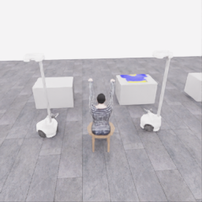
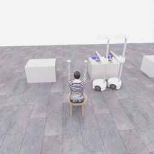
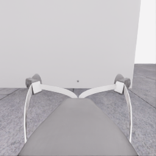
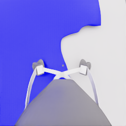
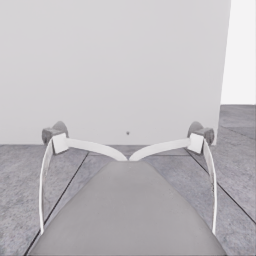
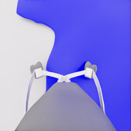
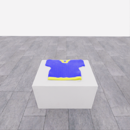
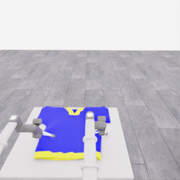
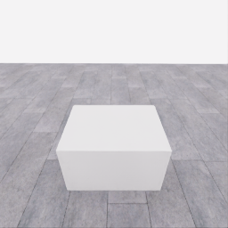
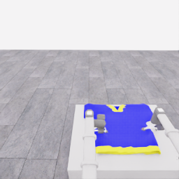

# 자동 시연 수집 시도 · 20261106-astra-dressing-001

[전체 수집 기록](../../README.ko.md) · [구조화 요약](manifest.json) · [전체 행동 기록](decisions.jsonl) · [사용한 기본 프롬프트](prompt.txt)

실행 상태는 **interrupted**, 원본 출처는 `gpt`입니다. 완료 상태와 과제 성공은 아래에서 따로 기록합니다.

## 실행 조건과 시간

| 항목 | 기록 |
|---|---|
| 기록 시작 UTC | 2026-11-06T02:28:49Z |
| 기록 종료 UTC | 2026-11-06T02:45:03Z |
| 이전 시도 | 미측정/해당 없음 |
| 재시도 사유 | 미측정/해당 없음 |
| 출처 그룹 | 20261106-astra-dressing-001 |
| 요청 모델 / 추론 설정 | gpt-6-astra / ultra |
| 전체 실제 경과 시간 (초) | 973.862 |
| Actor 호출 합계 (초) | 723.403 |
| 환경 요청·응답 합계 (초) | 184.135 |
| 시뮬레이션 시간 (초) | 8.350 |
| 저장 전이 수 | 167.000 |
| 응답 확인 전이 수 | 167.000 |
| 완료한 모델 결정 수 | 15.000 |
| 파일 완료 상태 | true |
| 데이터 정합성 검사 | true |
| 학습 데이터 승인 | unreviewed |

Actor 호출 시간은 공개 입력 준비·Docker/CLI 시작·요청과 응답을 포함합니다. 내부 모델 추론 시간만 별도로 측정한 값은 아닙니다. 모델이 판단하는 동안 물리 시간은 멈추며 실제 경과 시간과 시뮬레이션 시간은 다릅니다.

## 공식 평가 결과

평가 유효성 `true` · 누적 점수 **0.000 / 50** · 착의 success **false** · rate 상태 `no_contact` · 최종 rate 미측정/해당 없음 points/s.

누적 50점, 착의 success, 정상 파일 종료와 데이터 정합성은 서로 다른 상태입니다. 접촉 전 `no_contact`의 rate는 0점/초로 바꾸지 않습니다.

| 단계 | 획득 점수 / 최대 | 획득 시각 (episode 초) |
|---|---:|---:|
| 파지·들기 | 0.000 / 5 | 미측정/해당 없음 |
| 첫 소매 | 0.000 / 5 | 미측정/해당 없음 |
| 반대 어깨 | 0.000 / 5 | 미측정/해당 없음 |
| 두 번째 소매 | 0.000 / 5 | 미측정/해당 없음 |
| 왼쪽 위팔 | 0.000 / 5 | 미측정/해당 없음 |
| 오른쪽 위팔 | 0.000 / 5 | 미측정/해당 없음 |
| 목 통과 | 0.000 / 10 | 미측정/해당 없음 |
| 앞면 방향 | 0.000 / 10 | 미측정/해당 없음 |

## 단계 획득 경로

점수 획득은 [평가 이벤트](score-events.jsonl)에서 같은 physics tick끼리 묶었습니다. 같은 시각에 인정된 항목의 내부 순서는 추정하지 않습니다. 착의 success는 점수 획득과 별도로 기록합니다.

| 순서 | episode 시간 (초) | 전이 경계 step | 누적 점수 변화 | 같은 시각의 항목 변화 |
|---:|---:|---:|---:|---|
| — | — | — | — | 기록된 공식 항목 획득 없음 |

평가 clock 0초에 대응하는 공개 simulation clock은 1.525초입니다. 두 시계를 같은 절대 시각으로 혼동하지 않습니다.

별도 success 이벤트 수: **0**. 평가 유효성: `true`.


## 원본 관측 화면

지정된 공개 카메라의 저장 RGB 픽셀입니다. 시작은 첫 `obs`, 종료는 마지막 `next_obs`입니다. 이미지 합성이나 내부 상태 기반 장면 재구성 없이 원본 픽셀로 PNG를 저장했습니다.

| 카메라 | 시작 | 종료 |
|---|---|---|
| `overview` | [](images/initial-overview.png) | [](images/final-overview.png) |
| `robot_0_wrist` | [](images/initial-robot_0_wrist.png) | [](images/final-robot_0_wrist.png) |
| `robot_1_wrist` | [](images/initial-robot_1_wrist.png) | [](images/final-robot_1_wrist.png) |
| `robot_0_head` | [](images/initial-robot_0_head.png) | [](images/final-robot_0_head.png) |
| `robot_1_head` | [](images/initial-robot_1_head.png) | [](images/final-robot_1_head.png) |

시작 관측 시각 1.525초 · 종료 관측 시각 9.875초 (공개 simulation clock).

[▶ overview 관측 영상 보기](overview.mp4)

저장된 20 Hz `obs` 중 167프레임을 순서대로 사용했습니다. 재생은 **4.0배 느리게** (5.000 fps), 실제 대기 시간·모델 호출 지연은 영상에 들어가지 않습니다. 종료 `next_obs`는 위 PNG에서 확인합니다.

## 결정과 실행 순서

아래 근거는 모델 최종 JSON의 짧은 행동 설명입니다. 시각적 평가는 행동 전 관측에 대한 판단이며, 그 행동의 실행 후 성공 라벨로 사용하지 않습니다. 공식 점수는 별도의 평가 결과입니다.

행동의 각 행은 로봇 0·1 순서이며 열은 `전진, 왼쪽 이동, 반시계 회전, 리프트, 팔 신장, 손목 yaw, pitch, roll, gripper`입니다. 앞 8개는 정규화 속도이고 gripper는 닫기 `+1`, 열기 `-1`, 의도 유지 `0`입니다.

### 결정 0 · 준비 · `act`

입력 관측 1.525초 · Actor 호출 58.872초 · 시각적 판단 `uncertain`.

최종 응답의 행동 설명: Robot 0 faces the shirt; robot 1 faces the empty table. Raise both open grippers toward tabletop approach height before repositioning.

요청 행동:

```json
[[0, 0, 0, 0.32, 0, 0, 0, 0, -1], [0, 0, 0, 0.32, 0, 0, 0, 0, -1]]
```

실행 구간 step **[0, 20)** · 요청 20 step / 실제 20 step · 환경 요청·응답 20.452초.

실제 적용 행동:

```json
[[0.0, 0.0, 0.0, 0.3199999928474426, 0.0, 0.0, 0.0, 0.0, -1.0], [0.0, 0.0, 0.0, 0.3199999928474426, 0.0, 0.0, 0.0, 0.0, -1.0]]
```

### 결정 1 · 접근 · `act`

입력 관측 2.525초 · Actor 호출 47.446초 · 시각적 판단 `progressing`.

최종 응답의 행동 설명: The shirt remains flat and both grippers are raised. Advance robot 0 toward one near corner while moving robot 1 diagonally toward the shirt table for cooperative support.

요청 행동:

```json
[[0.45, -0.3, 0, 0, 0, 0, 0, 0, -1], [0.6, -1, 0, 0, 0, 0, 0, 0, -1]]
```

실행 구간 step **[20, 40)** · 요청 20 step / 실제 20 step · 환경 요청·응답 21.362초.

실제 적용 행동:

```json
[[0.44999998807907104, -0.30000001192092896, 0.0, 0.0, 0.0, 0.0, 0.0, 0.0, -1.0], [0.6000000238418579, -1.0, 0.0, 0.0, 0.0, 0.0, 0.0, 0.0, -1.0]]
```

### 결정 2 · 접근 · `act`

입력 관측 3.525초 · Actor 호출 43.087초 · 시각적 판단 `progressing`.

최종 응답의 행동 설명: Robot 0 appears aligned with one near hem corner; advance and extend while keeping the gripper open. Move robot 1 across the aisle toward the opposite side of the shirt table.

요청 행동:

```json
[[0.35, 0, 0, 0, 0.18, 0, 0, 0, -1], [0.15, -1, 0, 0, 0, 0, 0, 0, -1]]
```

실행 구간 step **[40, 60)** · 요청 20 step / 실제 20 step · 환경 요청·응답 21.353초.

실제 적용 행동:

```json
[[0.3499999940395355, 0.0, 0.0, 0.0, 0.18000000715255737, 0.0, 0.0, 0.0, -1.0], [0.15000000596046448, -1.0, 0.0, 0.0, 0.0, 0.0, 0.0, 0.0, -1.0]]
```

### 결정 3 · 접근 · `act`

입력 관측 4.525초 · Actor 호출 52.302초 · 시각적 판단 `progressing`.

최종 응답의 행동 설명: Robot 0 is close to the visible hem corner; extend slowly and lower slightly without closing. Continue moving robot 1 toward the other corner while maintaining separation.

요청 행동:

```json
[[0, 0, 0, -0.07, 0.08, 0, 0, 0, -1], [0, -1, 0, 0, 0, 0, 0, 0, -1]]
```

실행 구간 step **[60, 72)** · 요청 12 step / 실제 12 step · 환경 요청·응답 13.413초.

실제 적용 행동:

```json
[[0.0, 0.0, 0.0, -0.07000000029802322, 0.07999999821186066, 0.0, 0.0, 0.0, -1.0], [0.0, -1.0, 0.0, 0.0, 0.0, 0.0, 0.0, 0.0, -1.0]]
```

### 결정 4 · 접근 · `act`

입력 관측 5.125초 · Actor 호출 51.757초 · 시각적 판단 `progressing`.

최종 응답의 행동 설명: Robot 0&#x27;s open fingers appear close to the yellow hem; lower slightly while its extension settles. Shift robot 1 toward the opposite hem corner and extend its open gripper.

요청 행동:

```json
[[0, 0, 0, -0.02, 0, 0, 0, 0, -1], [0, -0.75, 0, 0, 0.3, 0, 0, 0, -1]]
```

실행 구간 step **[72, 82)** · 요청 10 step / 실제 10 step · 환경 요청·응답 11.723초.

실제 적용 행동:

```json
[[0.0, 0.0, 0.0, -0.019999999552965164, 0.0, 0.0, 0.0, 0.0, -1.0], [0.0, -0.75, 0.0, 0.0, 0.30000001192092896, 0.0, 0.0, 0.0, -1.0]]
```

### 결정 5 · 복구 · `act`

입력 관측 5.625초 · Actor 호출 93.793초 · 시각적 판단 `recovering`.

최종 응답의 행동 설명: Robot 0&#x27;s wrist and base deflection suggest tabletop contact. Raise the wrists while beginning a downward grasp angle; bring robot 1 closer to the opposite hem corner with both grippers open.

요청 행동:

```json
[[0, 0, 0, 0.24, 0, 0, 0.15, 0, -1], [0, -0.13, 0, 0.14, 0.15, 0, 0.15, 0, -1]]
```

실행 구간 step **[82, 90)** · 요청 8 step / 실제 8 step · 환경 요청·응답 9.554초.

실제 적용 행동:

```json
[[0.0, 0.0, 0.0, 0.23999999463558197, 0.0, 0.0, 0.15000000596046448, 0.0, -1.0], [0.0, -0.12999999523162842, 0.0, 0.14000000059604645, 0.15000000596046448, 0.0, 0.15000000596046448, 0.0, -1.0]]
```

### 결정 6 · 접근 · `act`

입력 관측 6.025초 · Actor 호출 53.522초 · 시각적 판단 `progressing`.

최종 응답의 행동 설명: Both grippers now flank the hem and the bases appear level. Increase the downward wrist angle while adjusting lift and extension to bring the open fingers toward the two hem corners.

요청 행동:

```json
[[0, 0, 0, 0.09, 0.16, 0, 0.17, 0, -1], [0, 0, 0, 0.075, 0.25, 0, 0.17, 0, -1]]
```

실행 구간 step **[90, 100)** · 요청 10 step / 실제 10 step · 환경 요청·응답 11.145초.

실제 적용 행동:

```json
[[0.0, 0.0, 0.0, 0.09000000357627869, 0.1599999964237213, 0.0, 0.17000000178813934, 0.0, -1.0], [0.0, 0.0, 0.0, 0.07500000298023224, 0.25, 0.0, 0.17000000178813934, 0.0, -1.0]]
```

### 결정 7 · 파지 · `act`

입력 관측 6.525초 · Actor 호출 50.674초 · 시각적 판단 `progressing`.

최종 응답의 행동 설명: The open fingers appear to straddle the side edges near the hem. Make small downward and forward adjustments while the wrists settle before attempting the pinch.

요청 행동:

```json
[[0, 0, 0, -0.04, 0.04, 0, 0, 0, -1], [0, 0, 0, -0.06, 0.04, 0, 0, 0, -1]]
```

실행 구간 step **[100, 106)** · 요청 6 step / 실제 6 step · 환경 요청·응답 6.988초.

실제 적용 행동:

```json
[[0.0, 0.0, 0.0, -0.03999999910593033, 0.03999999910593033, 0.0, 0.0, 0.0, -1.0], [0.0, 0.0, 0.0, -0.05999999865889549, 0.03999999910593033, 0.0, 0.0, 0.0, -1.0]]
```

### 결정 8 · 파지 · `act`

입력 관측 6.825초 · Actor 호출 36.746초 · 시각적 판단 `uncertain`.

최종 응답의 행동 설명: Both grippers appear positioned at opposite side edges near the hem. Close together while holding position; cloth motion during a subsequent small lift must confirm the grasps.

요청 행동:

```json
[[0, 0, 0, 0, 0, 0, 0, 0, 1], [0, 0, 0, 0, 0, 0, 0, 0, 1]]
```

실행 구간 step **[106, 114)** · 요청 8 step / 실제 8 step · 환경 요청·응답 9.166초.

실제 적용 행동:

```json
[[0.0, 0.0, 0.0, 0.0, 0.0, 0.0, 0.0, 0.0, 1.0], [0.0, 0.0, 0.0, 0.0, 0.0, 0.0, 0.0, 0.0, 1.0]]
```

### 결정 9 · 들기 · `act`

입력 관측 7.225초 · Actor 호출 15.209초 · 시각적 판단 `uncertain`.

최종 응답의 행동 설명: Neither grasp is visually confirmed. Lift both grippers a few centimeters with bases fixed and closing intent maintained, then check whether the cloth follows.

요청 행동:

```json
[[0, 0, 0, 0.08, 0, 0, 0, 0, 1], [0, 0, 0, 0.08, 0, 0, 0, 0, 1]]
```

실행 구간 step **[114, 122)** · 요청 8 step / 실제 8 step · 환경 요청·응답 9.219초.

실제 적용 행동:

```json
[[0.0, 0.0, 0.0, 0.07999999821186066, 0.0, 0.0, 0.0, 0.0, 1.0], [0.0, 0.0, 0.0, 0.07999999821186066, 0.0, 0.0, 0.0, 0.0, 1.0]]
```

### 결정 10 · 들기 · `act`

입력 관측 7.625초 · Actor 호출 32.587초 · 시각적 판단 `uncertain`.

최종 응답의 행동 설명: Small folds near both closing grippers suggest contact, but secure support remains uncertain. Continue a short vertical test lift and check that both cloth edges rise.

요청 행동:

```json
[[0, 0, 0, 0.08, 0, 0, 0, 0, 1], [0, 0, 0, 0.08, 0, 0, 0, 0, 1]]
```

실행 구간 step **[122, 132)** · 요청 10 step / 실제 10 step · 환경 요청·응답 11.220초.

실제 적용 행동:

```json
[[0.0, 0.0, 0.0, 0.07999999821186066, 0.0, 0.0, 0.0, 0.0, 1.0], [0.0, 0.0, 0.0, 0.07999999821186066, 0.0, 0.0, 0.0, 0.0, 1.0]]
```

### 결정 11 · 복구 · `act`

입력 관측 8.125초 · Actor 호출 89.347초 · 시각적 판단 `recovering`.

최종 응답의 행동 설명: The shirt remains flat despite the lift, indicating missed grasps. Reopen, shift slightly inward, and angle the fingers more vertically while compensating reach for another edge pinch.

요청 행동:

```json
[[0.15, 0.07, 0, -0.035, 0.22, 0, 0.22, 0, -1], [0.15, -0.07, 0, -0.035, 0.22, 0, 0.22, 0, -1]]
```

실행 구간 step **[132, 142)** · 요청 10 step / 실제 10 step · 환경 요청·응답 11.027초.

실제 적용 행동:

```json
[[0.15000000596046448, 0.07000000029802322, 0.0, -0.03500000014901161, 0.2199999988079071, 0.0, 0.2199999988079071, 0.0, -1.0], [0.15000000596046448, -0.07000000029802322, 0.0, -0.03500000014901161, 0.2199999988079071, 0.0, 0.2199999988079071, 0.0, -1.0]]
```

### 결정 12 · 파지 · `act`

입력 관측 8.625초 · Actor 호출 43.856초 · 시각적 판단 `recovering`.

최종 응답의 행동 설명: The repositioned fingers now appear aligned over the cloth edges. Stop the bases and lower a short increment, slightly retracting robot 0 to limit forward drift before retrying the pinch.

요청 행동:

```json
[[0, 0, 0, -0.08, -0.05, 0, 0, 0, -1], [0, 0, 0, -0.08, 0, 0, 0, 0, -1]]
```

실행 구간 step **[142, 148)** · 요청 6 step / 실제 6 step · 환경 요청·응답 7.113초.

실제 적용 행동:

```json
[[0.0, 0.0, 0.0, -0.07999999821186066, -0.05000000074505806, 0.0, 0.0, 0.0, -1.0], [0.0, 0.0, 0.0, -0.07999999821186066, 0.0, 0.0, 0.0, 0.0, -1.0]]
```

### 결정 13 · 파지 · `act`

입력 관측 8.925초 · Actor 호출 19.066초 · 시각적 판단 `uncertain`.

최종 응답의 행동 설명: Cloth edges now appear between the repositioned fingers. Close both grippers while holding the bases and wrists steady, allowing the final downward adjustment to settle.

요청 행동:

```json
[[0, 0, 0, 0, 0, 0, 0, 0, 1], [0, 0, 0, 0, 0, 0, 0, 0, 1]]
```

실행 구간 step **[148, 158)** · 요청 10 step / 실제 10 step · 환경 요청·응답 11.244초.

실제 적용 행동:

```json
[[0.0, 0.0, 0.0, 0.0, 0.0, 0.0, 0.0, 0.0, 1.0], [0.0, 0.0, 0.0, 0.0, 0.0, 0.0, 0.0, 0.0, 1.0]]
```

### 결정 14 · 파지 · `act`

입력 관측 9.425초 · Actor 호출 29.132초 · 시각적 판단 `uncertain`.

최종 응답의 행동 설명: The fingers remain spread and slight deflection suggests tabletop contact. Ease both grippers upward a small amount while maintaining closure, watching for cloth capture.

요청 행동:

```json
[[0, 0, 0, 0.035, 0, 0, 0, 0, 1], [0, 0, 0, 0.035, 0, 0, 0, 0, 1]]
```

실행 구간 step **[158, 166)** · 요청 8 step / 실제 8 step · 환경 요청·응답 9.156초.

실제 적용 행동:

```json
[[0.0, 0.0, 0.0, 0.03500000014901161, 0.0, 0.0, 0.0, 0.0, 1.0], [0.0, 0.0, 0.0, 0.03500000014901161, 0.0, 0.0, 0.0, 0.0, 1.0]]
```

### 호출 실패 · 결정 15

오류 종류 `KeyboardInterrupt` · 사용 시간 6.005초.

SIGTERM

수집기 정지: `interrupted` · 중립 명령 1 step.

## 종료 오류

`KeyboardInterrupt`: SIGTERM

## 검수와 후속 판단

현재 데이터 승인은 `unreviewed`입니다. 형식과 시간 정합성 검사를 통과해도 시연의 유용성이나 착의 성공을 보장하지 않습니다.

이 페이지의 원본 파일 SHA256과 생성 파일 SHA256은 [manifest.json](manifest.json)에 있습니다. 실행 실패도 같은 run ID와 부모 시도 관계로 보존합니다. 공개 범위는 카메라, 최종 행동 응답, 시간, 평가 요약입니다.
