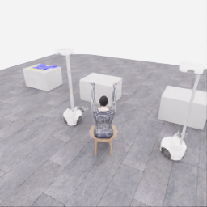
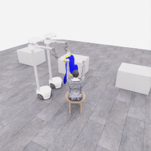
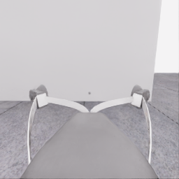
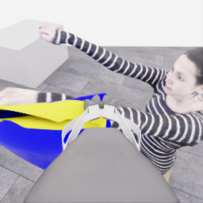
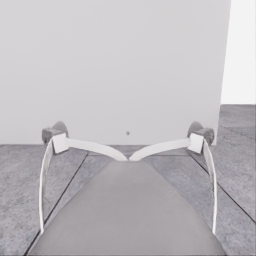
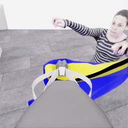
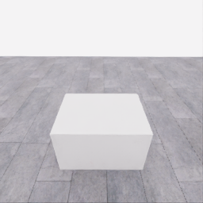
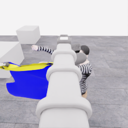
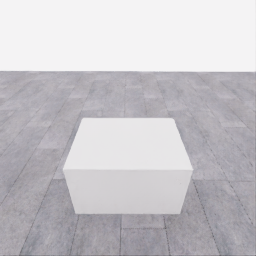
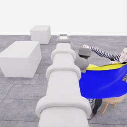

# 자동 시연 수집 시도 · 20261106-astra-guide470-depth-001

[전체 수집 기록](../../README.ko.md) · [구조화 요약](manifest.json) · [전체 행동 기록](decisions.jsonl) · [사용한 기본 프롬프트](prompt.txt)

실행 상태는 **interrupted**, 원본 출처는 `gpt`입니다. 완료 상태와 과제 성공은 아래에서 따로 기록합니다.

## 실행 조건과 시간

| 항목 | 기록 |
|---|---|
| 기록 시작 UTC | 2026-11-06T23:58:53Z |
| 기록 종료 UTC | 2026-11-07T00:29:56Z |
| 이전 시도 | 20261106-astra-support264-002 |
| 재시도 사유 | support_and_sleeve_guide_with_public_pixel_depth |
| 출처 그룹 | 20261106-coordinated-demo-methods |
| 요청 모델 / 추론 설정 | gpt-6-astra / ultra |
| 전체 실제 경과 시간 (초) | 1862.366 |
| Actor 호출 합계 (초) | 1000.803 |
| 환경 요청·응답 합계 (초) | 806.244 |
| 시뮬레이션 시간 (초) | 46.400 |
| 저장 전이 수 | 928.000 |
| 응답 확인 전이 수 | 928.000 |
| 모델 호출 시도 수 | 30.000 |
| 완료한 결정 구간 수 | 26.000 |
| 파일 완료 상태 | true |
| 데이터 정합성 검사 | true |
| 학습 데이터 승인 | unreviewed |
| Actor 호출 방식 | exec |
| 한 호출의 최대 계획 구간 수 | 1.000 |
| 한 계획의 최대 제어 step 수 | 20.000 |
| 제어기 정착 대기 설정 | true |
| 정착 대기 요청 step 수 | 6.000 |
| 완료한 제어기 정착 구간 수 | 24.000 |
| 제어기 정착 전이 수 | 144.000 |
| 제어기 정착 환경 요청·응답 (초) | 129.720 |
| 전이 예산으로 단축한 정착 구간 수 | 0.000 |
| 전이 예산으로 건너뛴 정착 구간 수 | 0.000 |

Actor 호출 시간은 공개 입력 저장·요청 전송·응답 처리 등 호출 경로를 측정합니다. 방식에 따라 Docker/CLI 시작이 호출 안에 들어가거나 상주 서버 준비 시간으로 분리됩니다. 내부 모델 추론 시간만 별도로 측정한 값은 아닙니다. 모델이 판단하는 동안 물리 시간은 멈추며 실제 경과 시간과 시뮬레이션 시간은 다릅니다. 세부 요청 프로세스 시간에도 CLI 처리·네트워크·서버 대기·생성이 함께 포함됩니다.

## 토큰 사용량의 범위

`actor_usage`는 thread별 관측 누계를 합친 값입니다. 결정의 `usage`는 원본 CLI 누계이며, 호출별 증가량은 `usage_accounting.incremental_usage`입니다. 캐시 입력은 입력의 부분집합이고 추론 출력은 출력의 부분집합이므로 열들을 다시 합산하지 않습니다.

전체 호출 사용량 확정: **true** · 기록한 호출 수: 30.

| 입력 | 캐시 입력 | 캐시 쓰기 입력 | 출력 | 추론 출력 |
|---:|---:|---:|---:|---:|
| 3846775 | 3191424 | 0 | 24854 | 20727 |

중복 누계는 추가 사용량 0으로 처리하고, 역행한 누계는 미확정으로 보존합니다. 새 thread는 별도로 집계합니다. 토큰 기록은 화폐 비용이나 청구서가 아닙니다.

## 리뷰 정지 조건

목표 누적 점수 10.000 · 감시 상태 `collector_ended_before_gate` · 수집기 상태 `interrupted`.

마지막 관측 점수 5.000 · 응답 확인 step 927.

`review_ready`는 정지 조건에 따라 실행을 마치고 리뷰할 준비가 된 상태입니다. 50점·착의 성공이나 학습 데이터 승인을 뜻하지 않습니다. 공식 점수와 success는 아래 평가 결과로 확인합니다.

## 공식 평가 결과

평가 유효성 `true` · 누적 점수 **5.000 / 50** · 착의 success **false** · rate 상태 `no_dressing_points` · 최종 rate 0.000 points/s.

누적 50점, 착의 success, 정상 파일 종료와 데이터 정합성은 서로 다른 상태입니다. 접촉 전 `no_contact`의 rate는 0점/초로 바꾸지 않습니다.

| 단계 | 획득 점수 / 최대 | 획득 시각 (episode 초) |
|---|---:|---:|
| 파지·들기 | 5.000 / 5 | 27.150 |
| 첫 소매 | 0.000 / 5 | 미측정/해당 없음 |
| 반대 어깨 | 0.000 / 5 | 미측정/해당 없음 |
| 두 번째 소매 | 0.000 / 5 | 미측정/해당 없음 |
| 왼쪽 위팔 | 0.000 / 5 | 미측정/해당 없음 |
| 오른쪽 위팔 | 0.000 / 5 | 미측정/해당 없음 |
| 목 통과 | 0.000 / 10 | 미측정/해당 없음 |
| 앞면 방향 | 0.000 / 10 | 미측정/해당 없음 |

## 단계 획득 경로

점수 획득은 [평가 이벤트](score-events.jsonl)에서 같은 physics tick끼리 묶었습니다. 같은 시각에 인정된 항목의 내부 순서는 추정하지 않습니다. 착의 success는 점수 획득과 별도로 기록합니다.

| 순서 | episode 시간 (초) | 전이 경계 step | 누적 점수 변화 | 같은 시각의 항목 변화 |
|---:|---:|---:|---:|---|
| 0 | 27.150 | 543 | 0.000→5.000 | 파지·들기 0.000→5.000 |

평가 clock 0초에 대응하는 공개 simulation clock은 1.525초입니다. 두 시계를 같은 절대 시각으로 혼동하지 않습니다.

별도 success 이벤트 수: **0**. 평가 유효성: `true`.


## 원본 관측 화면

지정된 공개 카메라의 저장 RGB 픽셀입니다. 시작은 첫 `obs`, 종료는 마지막 `next_obs`입니다. 이미지 합성이나 내부 상태 기반 장면 재구성 없이 원본 픽셀로 PNG를 저장했습니다.

| 카메라 | 시작 | 종료 |
|---|---|---|
| `overview` | [](images/initial-overview.png) | [](images/final-overview.png) |
| `robot_0_wrist` | [](images/initial-robot_0_wrist.png) | [](images/final-robot_0_wrist.png) |
| `robot_1_wrist` | [](images/initial-robot_1_wrist.png) | [](images/final-robot_1_wrist.png) |
| `robot_0_head` | [](images/initial-robot_0_head.png) | [](images/final-robot_0_head.png) |
| `robot_1_head` | [](images/initial-robot_1_head.png) | [](images/final-robot_1_head.png) |

시작 관측 시각 1.525초 · 종료 관측 시각 47.925초 (공개 simulation clock).

[▶ overview 관측 영상 보기](overview.mp4)

저장된 20 Hz `obs` 중 928프레임을 순서대로 사용했습니다. 재생은 **1배 느리게** (20.000 fps), 실제 대기 시간·모델 호출 지연은 영상에 들어가지 않습니다. 종료 `next_obs`는 위 PNG에서 확인합니다.

## 결정과 실행 순서

아래 근거는 모델 최종 JSON의 짧은 행동 설명입니다. 시각적 평가는 행동 전 관측에 대한 판단이며, 그 행동의 실행 후 성공 라벨로 사용하지 않습니다. 공식 점수는 별도의 평가 결과입니다.

행동의 각 행은 로봇 0·1 순서이며 열은 `전진, 왼쪽 이동, 반시계 회전, 리프트, 팔 신장, 손목 yaw, pitch, roll, gripper`입니다. 앞 8개는 정규화 속도이고 gripper는 닫기 `+1`, 열기 `-1`, 의도 유지 `0`입니다.

제어기 정착 대기는 앞선 모델 결정에 연결된 별도 중립 행동입니다. 추가 모델 호출이나 모델 결정으로 집계하지 않으며, 실제 전이와 환경 요청·응답 시간은 전체 합계에 포함됩니다. 중립 행동은 두 로봇의 속도와 gripper 명령을 모두 0으로 보내 기존 gripper 의도를 유지합니다. 대기를 실행했다는 기록이 옷의 정착이나 과제 개선을 확인했다는 뜻은 아닙니다.

### 기록된 행동의 재실행 구간

원본 `20261106-astra-support264-002`의 행동 470전이를 새 환경에서 다시 실행했습니다. 이 구간에는 새 모델 호출이 없고 관측·평가를 새로 기록했습니다. 정확한 물리 상태 복원이나 독립적인 새 시연으로 집계하지 않습니다. 원본 step 대응과 실제 행동은 `decisions.jsonl`의 `replayed_segment`에 있습니다.

### 별도 모델 호출 0 · `initial`

실행 결정 인덱스 0의 고정 관측을 사용했습니다. 호출 경과 26.586초. 같은 call index의 행동 기록과 사용량을 중복 합산하지 않습니다.

공개 입력 저장 0.232초 · 요청 프로세스 26.354초 · 결과 해석 0.000초.

### 결정 0 · 들기 · `act`

입력 관측 25.025초 · Actor 호출 26.586초 · 시각적 판단 `uncertain`.

계획 `20261106-astra-guide470-depth-001:call-00000` · 모델 호출 인덱스 0 · 계획 구간 1/1 · 이 구간에서 모델 호출 `true`.

실행 직전 최신 관측 25.025초.

공개 입력 저장 0.232초 · 요청 프로세스 26.354초 · 결과 해석 0.000초.

호출 사용량 상태 `observed` · 이번 증가량 입력 22012 / 출력 761 토큰.

최종 응답의 행동 설명: Robot 0 and robot 1 are at separated apparent hem corners with closed, unverified grips. Lift together about 3 cm to check whether cloth follows each gripper while most remains table-supported.

요청 행동:

```json
[[0, 0, 0, 0.1, 0, 0, 0, 0, 1], [0, 0, 0, 0.1, 0, 0, 0, 0, 1]]
```

실행 구간 step **[470, 474)** · 요청 4 step / 실제 4 step · 환경 요청·응답 3.877초.

실제 적용 행동:

```json
[[0.0, 0.0, 0.0, 0.10000000149011612, 0.0, 0.0, 0.0, 0.0, 1.0], [0.0, 0.0, 0.0, 0.10000000149011612, 0.0, 0.0, 0.0, 0.0, 1.0]]
```

### 제어기 정착 대기 · 연결 결정 0

구간 `20261106-astra-guide470-depth-001:settle-00000` · 출처 `controller_settle` · 이 구간에서 모델 호출 `false`.

앞선 모델 호출 인덱스 0에 연결됩니다. 추가 호출은 없습니다.

실행 구간 step **[474, 480)** · 요청 6 step / 실제 6 step · 환경 요청·응답 5.538초.

공개 simulation clock 25.225→25.525초 · 실행 전 관측 25.225초.

실제 적용 중립 행동:

```json
[[0.0, 0.0, 0.0, 0.0, 0.0, 0.0, 0.0, 0.0, 0.0], [0.0, 0.0, 0.0, 0.0, 0.0, 0.0, 0.0, 0.0, 0.0]]
```

### 별도 모델 호출 1 · `initial`

실행 결정 인덱스 1의 고정 관측을 사용했습니다. 호출 경과 20.980초. 같은 call index의 행동 기록과 사용량을 중복 합산하지 않습니다.

공개 입력 저장 0.086초 · 요청 프로세스 20.894초 · 결과 해석 0.000초.

### 결정 1 · 들기 · `act`

입력 관측 25.525초 · Actor 호출 20.980초 · 시각적 판단 `progressing`.

계획 `20261106-astra-guide470-depth-001:call-00001` · 모델 호출 인덱스 1 · 계획 구간 1/1 · 이 구간에서 모델 호출 `true`.

실행 직전 최신 관측 25.525초.

공개 입력 저장 0.086초 · 요청 프로세스 20.894초 · 결과 해석 0.000초.

호출 사용량 상태 `observed` · 이번 증가량 입력 32049 / 출력 538 토큰.

최종 응답의 행동 설명: Cloth near robot 0 and robot 1 tented upward during the paired test, supporting both grasp hypotheses. Raise both about 7 cm to inspect the apparent hem opening while the garment body remains table-supported.

요청 행동:

```json
[[0, 0, 0, 0.16, 0, 0, 0, 0, 1], [0, 0, 0, 0.16, 0, 0, 0, 0, 1]]
```

실행 구간 step **[480, 486)** · 요청 6 step / 실제 6 step · 환경 요청·응답 5.361초.

실제 적용 행동:

```json
[[0.0, 0.0, 0.0, 0.1599999964237213, 0.0, 0.0, 0.0, 0.0, 1.0], [0.0, 0.0, 0.0, 0.1599999964237213, 0.0, 0.0, 0.0, 0.0, 1.0]]
```

### 제어기 정착 대기 · 연결 결정 1

구간 `20261106-astra-guide470-depth-001:settle-00001` · 출처 `controller_settle` · 이 구간에서 모델 호출 `false`.

앞선 모델 호출 인덱스 1에 연결됩니다. 추가 호출은 없습니다.

실행 구간 step **[486, 492)** · 요청 6 step / 실제 6 step · 환경 요청·응답 5.450초.

공개 simulation clock 25.825→26.125초 · 실행 전 관측 25.825초.

실제 적용 중립 행동:

```json
[[0.0, 0.0, 0.0, 0.0, 0.0, 0.0, 0.0, 0.0, 0.0], [0.0, 0.0, 0.0, 0.0, 0.0, 0.0, 0.0, 0.0, 0.0]]
```

### 별도 모델 호출 2 · `initial`

실행 결정 인덱스 2의 고정 관측을 사용했습니다. 호출 경과 29.093초. 같은 call index의 행동 기록과 사용량을 중복 합산하지 않습니다.

공개 입력 저장 0.088초 · 요청 프로세스 29.005초 · 결과 해석 0.000초.

### 결정 2 · 들기 · `act`

입력 관측 26.125초 · Actor 호출 29.093초 · 시각적 판단 `progressing`.

계획 `20261106-astra-guide470-depth-001:call-00002` · 모델 호출 인덱스 2 · 계획 구간 1/1 · 이 구간에서 모델 호출 `true`.

실행 직전 최신 관측 26.125초.

공개 입력 저장 0.088초 · 요청 프로세스 29.005초 · 결과 해석 0.000초.

호출 사용량 상태 `observed` · 이번 증가량 입력 41897 / 출력 792 토큰.

최종 응답의 행동 설명: Robot 0 and robot 1 each retain a visibly raised corner; a narrow apparent hem opening is now visible between them. Lift together at unchanged separation to raise more of the shirt from the table and inspect its drape.

요청 행동:

```json
[[0, 0, 0, 0.25, 0, 0, 0, 0, 1], [0, 0, 0, 0.25, 0, 0, 0, 0, 1]]
```

실행 구간 step **[492, 504)** · 요청 12 step / 실제 12 step · 환경 요청·응답 10.242초.

실제 적용 행동:

```json
[[0.0, 0.0, 0.0, 0.25, 0.0, 0.0, 0.0, 0.0, 1.0], [0.0, 0.0, 0.0, 0.25, 0.0, 0.0, 0.0, 0.0, 1.0]]
```

### 제어기 정착 대기 · 연결 결정 2

구간 `20261106-astra-guide470-depth-001:settle-00002` · 출처 `controller_settle` · 이 구간에서 모델 호출 `false`.

앞선 모델 호출 인덱스 2에 연결됩니다. 추가 호출은 없습니다.

실행 구간 step **[504, 510)** · 요청 6 step / 실제 6 step · 환경 요청·응답 5.294초.

공개 simulation clock 26.725→27.025초 · 실행 전 관측 26.725초.

실제 적용 중립 행동:

```json
[[0.0, 0.0, 0.0, 0.0, 0.0, 0.0, 0.0, 0.0, 0.0], [0.0, 0.0, 0.0, 0.0, 0.0, 0.0, 0.0, 0.0, 0.0]]
```

### 별도 모델 호출 3 · `initial`

실행 결정 인덱스 3의 고정 관측을 사용했습니다. 호출 경과 15.078초. 같은 call index의 행동 기록과 사용량을 중복 합산하지 않습니다.

공개 입력 저장 0.093초 · 요청 프로세스 14.985초 · 결과 해석 0.000초.

### 결정 3 · 들기 · `act`

입력 관측 27.025초 · Actor 호출 15.078초 · 시각적 판단 `progressing`.

계획 `20261106-astra-guide470-depth-001:call-00003` · 모델 호출 인덱스 3 · 계획 구간 1/1 · 이 구간에서 모델 호출 `true`.

실행 직전 최신 관측 27.025초.

공개 입력 저장 0.093초 · 요청 프로세스 14.985초 · 결과 해석 0.000초.

호출 사용량 상태 `observed` · 이번 증가량 입력 51997 / 출력 410 토큰.

최종 응답의 행동 설명: Robot 0 and robot 1 still support their respective corners, and the apparent body opening has widened. The neck and sleeve end remains near the table; raise both together further before attempting transport.

요청 행동:

```json
[[0, 0, 0, 0.25, 0, 0, 0, 0, 1], [0, 0, 0, 0.25, 0, 0, 0, 0, 1]]
```

실행 구간 step **[510, 522)** · 요청 12 step / 실제 12 step · 환경 요청·응답 10.192초.

실제 적용 행동:

```json
[[0.0, 0.0, 0.0, 0.25, 0.0, 0.0, 0.0, 0.0, 1.0], [0.0, 0.0, 0.0, 0.25, 0.0, 0.0, 0.0, 0.0, 1.0]]
```

### 제어기 정착 대기 · 연결 결정 3

구간 `20261106-astra-guide470-depth-001:settle-00003` · 출처 `controller_settle` · 이 구간에서 모델 호출 `false`.

앞선 모델 호출 인덱스 3에 연결됩니다. 추가 호출은 없습니다.

실행 구간 step **[522, 528)** · 요청 6 step / 실제 6 step · 환경 요청·응답 5.507초.

공개 simulation clock 27.625→27.925초 · 실행 전 관측 27.625초.

실제 적용 중립 행동:

```json
[[0.0, 0.0, 0.0, 0.0, 0.0, 0.0, 0.0, 0.0, 0.0], [0.0, 0.0, 0.0, 0.0, 0.0, 0.0, 0.0, 0.0, 0.0]]
```

### 별도 모델 호출 4 · `initial`

실행 결정 인덱스 4의 고정 관측을 사용했습니다. 호출 경과 32.949초. 같은 call index의 행동 기록과 사용량을 중복 합산하지 않습니다.

공개 입력 저장 0.087초 · 요청 프로세스 32.862초 · 결과 해석 0.000초.

### 결정 4 · 들기 · `act`

입력 관측 27.925초 · Actor 호출 32.949초 · 시각적 판단 `progressing`.

계획 `20261106-astra-guide470-depth-001:call-00004` · 모델 호출 인덱스 4 · 계획 구간 1/1 · 이 구간에서 모델 호출 `true`.

실행 직전 최신 관측 27.925초.

공개 입력 저장 0.087초 · 요청 프로세스 32.862초 · 결과 해석 0.000초.

호출 사용량 상태 `observed` · 이번 증가량 입력 61706 / 출력 841 토큰.

최종 응답의 행동 설명: Robot 0 and robot 1 retain their hem-corner supports, but the hanging sleeve end remains close to the table. Lift targets have reached 1.20 m; tilt both wrists upward to gain garment clearance while preserving grip separation.

요청 행동:

```json
[[0, 0, 0, 0, 0, 0, -0.25, 0, 1], [0, 0, 0, 0, 0, 0, -0.25, 0, 1]]
```

실행 구간 step **[528, 536)** · 요청 8 step / 실제 8 step · 환경 요청·응답 6.949초.

실제 적용 행동:

```json
[[0.0, 0.0, 0.0, 0.0, 0.0, 0.0, -0.25, 0.0, 1.0], [0.0, 0.0, 0.0, 0.0, 0.0, 0.0, -0.25, 0.0, 1.0]]
```

### 제어기 정착 대기 · 연결 결정 4

구간 `20261106-astra-guide470-depth-001:settle-00004` · 출처 `controller_settle` · 이 구간에서 모델 호출 `false`.

앞선 모델 호출 인덱스 4에 연결됩니다. 추가 호출은 없습니다.

실행 구간 step **[536, 542)** · 요청 6 step / 실제 6 step · 환경 요청·응답 5.331초.

공개 simulation clock 28.325→28.625초 · 실행 전 관측 28.325초.

실제 적용 중립 행동:

```json
[[0.0, 0.0, 0.0, 0.0, 0.0, 0.0, 0.0, 0.0, 0.0], [0.0, 0.0, 0.0, 0.0, 0.0, 0.0, 0.0, 0.0, 0.0]]
```

### 별도 모델 호출 5 · `initial`

실행 결정 인덱스 5의 고정 관측을 사용했습니다. 호출 경과 44.866초. 같은 call index의 행동 기록과 사용량을 중복 합산하지 않습니다.

공개 입력 저장 0.086초 · 요청 프로세스 44.780초 · 결과 해석 0.000초.

### 결정 5 · 운반 · `act`

입력 관측 28.625초 · Actor 호출 44.866초 · 시각적 판단 `progressing`.

계획 `20261106-astra-guide470-depth-001:call-00005` · 모델 호출 인덱스 5 · 계획 구간 1/1 · 이 구간에서 모델 호출 `true`.

실행 직전 최신 관측 28.625초.

공개 입력 저장 0.086초 · 요청 프로세스 44.780초 · 결과 해석 0.000초.

호출 사용량 상태 `observed` · 이번 증가량 입력 71576 / 출력 1161 토큰.

최종 응답의 행동 설명: Robot 0 and robot 1 both retain their corners, with the shirt now hanging beneath the apparent hem opening. Back both bases away together about 18 cm to clear the pickup table while preserving support and spacing.

요청 행동:

```json
[[-0.4, 0, 0, 0, 0, 0, 0, 0, 1], [-0.4, 0, 0, 0, 0, 0, 0, 0, 1]]
```

실행 구간 step **[542, 557)** · 요청 15 step / 실제 15 step · 환경 요청·응답 12.690초.

실제 적용 행동:

```json
[[-0.4000000059604645, 0.0, 0.0, 0.0, 0.0, 0.0, 0.0, 0.0, 1.0], [-0.4000000059604645, 0.0, 0.0, 0.0, 0.0, 0.0, 0.0, 0.0, 1.0]]
```

### 제어기 정착 대기 · 연결 결정 5

구간 `20261106-astra-guide470-depth-001:settle-00005` · 출처 `controller_settle` · 이 구간에서 모델 호출 `false`.

앞선 모델 호출 인덱스 5에 연결됩니다. 추가 호출은 없습니다.

실행 구간 step **[557, 563)** · 요청 6 step / 실제 6 step · 환경 요청·응답 5.533초.

공개 simulation clock 29.375→29.675초 · 실행 전 관측 29.375초.

실제 적용 중립 행동:

```json
[[0.0, 0.0, 0.0, 0.0, 0.0, 0.0, 0.0, 0.0, 0.0], [0.0, 0.0, 0.0, 0.0, 0.0, 0.0, 0.0, 0.0, 0.0]]
```

### 별도 모델 호출 6 · `initial`

실행 결정 인덱스 6의 고정 관측을 사용했습니다. 호출 경과 15.118초. 같은 call index의 행동 기록과 사용량을 중복 합산하지 않습니다.

공개 입력 저장 0.082초 · 요청 프로세스 15.035초 · 결과 해석 0.000초.

### 공개 픽셀 depth 조회 · 결정 6

물리 전이 없이 같은 카메라·시각의 원본 값을 조회했습니다. 무효 값은 null이며 접촉·입구 통과 판단이 아닙니다.

```json
{
  "request": {
    "kind": "depth_query",
    "observation_id": "66e35759c48264db64f1c9963579772a28950b863714dd12758228d7ed90332e",
    "camera": "overview",
    "pixels_uv": [
      [
        113,
        105
      ],
      [
        143,
        105
      ],
      [
        128,
        125
      ],
      [
        123,
        99
      ],
      [
        82,
        136
      ],
      [
        49,
        89
      ]
    ],
    "include_camera_geometry": true
  },
  "response": {
    "kind": "depth_query_result",
    "observation_id": "66e35759c48264db64f1c9963579772a28950b863714dd12758228d7ed90332e",
    "camera": "overview",
    "camera_index": 0,
    "simulation_time_s": 29.675001547671854,
    "intrinsics_sha256": "f3d52d66f85f9c6dcdb0c49e6817831ad3a4a9d36c828d4bdcc073931e194ee9",
    "request_sha256": "9649d412c11f4d7516b06ec4ce29dd8ddf33fec651ba9b7e3aa1da36aa32df8c",
    "depth_semantics": "optical_Z_metres_not_ray_range",
    "geometry_semantics": "camera_X_right_Y_down_Z_forward",
    "rgb_image_order": [
      "overview",
      "robot_0_wrist",
      "robot_1_wrist",
      "robot_0_head",
      "robot_1_head"
    ],
    "resolution_wh": [
      256,
      256
    ],
    "neighbor_depth_substituted": false,
    "hidden_surfaces_estimated": false,
    "object_pose_or_contact_inferred": false,
    "source_sha256": {
      "observation_json": "6443837faccda363fc276cbce0609804b1780ac01ec7f320c202551431f5ddc2",
      "public_depth_npz": "7b007a5fde3826f8d5421df6d617c1161d6cda7881bdc7f8a1e97c35ef39291e",
      "overview_rgb": "774b2e0cac4e86810cd2537bb56759fb870efc1f12b2ca4efaa7ad2d1bd2bfe0",
      "robot_0_wrist_rgb": "80c56d378e4d922b07817731961882d935efc10ef2cb4df17e8abf7ab659f488",
      "robot_1_wrist_rgb": "7dafbed4e3d79993e4a053b94aa4438358ae91c81cb79d5d936509a96a28a820",
      "robot_0_head_rgb": "c3fcf0bf58ccac9e98da436b48e9d3b552053f6c03b36be30483e566004f6fc7",
      "robot_1_head_rgb": "b6f437e84b7a619e27f12dff3bffb98218bd14da046fe7f86aed2d37bbb9ed0e"
    },
    "results": [
      {
        "pixel_uv": [
          113,
          105
        ],
        "status": "valid",
        "optical_z_m": 4.60971736907959,
        "camera_xyz_m": [
          -0.3118853395226009,
          -0.47822418726798804,
          4.60971736907959
        ],
        "camera_range_m": 4.644939726314144,
        "invalid_reasons": []
      },
      {
        "pixel_uv": [
          143,
          105
        ],
        "status": "valid",
        "optical_z_m": 2.990628242492676,
        "camera_xyz_m": [
          0.20234062744327072,
          -0.31025562874634843,
          2.990628242492676
        ],
        "camera_range_m": 3.0134793129334336,
        "invalid_reasons": []
      },
      {
        "pixel_uv": [
          128,
          125
        ],
        "status": "valid",
        "optical_z_m": 2.5497310161590576,
        "camera_xyz_m": [
          0.0,
          -0.034502059887669606,
          2.5497310161590576
        ],
        "camera_range_m": 2.5499644403206867,
        "invalid_reasons": []
      },
      {
        "pixel_uv": [
          123,
          99
        ],
        "status": "valid",
        "optical_z_m": 4.717521667480469,
        "camera_xyz_m": [
          -0.10639306268077112,
          -0.6170797635484725,
          4.717521667480469
        ],
        "camera_range_m": 4.758898780339348,
        "invalid_reasons": []
      },
      {
        "pixel_uv": [
          82,
          136
        ],
        "status": "valid",
        "optical_z_m": 4.46905517578125,
        "camera_xyz_m": [
          -0.9272630437733387,
          0.16126313804753717,
          4.46905517578125
        ],
        "camera_range_m": 4.5670862391921085,
        "invalid_reasons": []
      },
      {
        "pixel_uv": [
          49,
          89
        ],
        "status": "valid",
        "optical_z_m": 5.31146764755249,
        "camera_xyz_m": [
          -1.8926531625969298,
          -0.9343477638136743,
          5.31146764755249
        ],
        "camera_range_m": 5.715490382165695,
        "invalid_reasons": []
      }
    ]
  }
}
```

### 별도 모델 호출 7 · `action_after_query`

실행 결정 인덱스 6의 고정 관측을 사용했습니다. 호출 경과 75.910초. 같은 call index의 행동 기록과 사용량을 중복 합산하지 않습니다.

공개 입력 저장 0.085초 · 요청 프로세스 75.825초 · 결과 해석 0.000초.

### 결정 6 · 운반 · `act`

입력 관측 29.675초 · Actor 호출 75.910초 · 시각적 판단 `progressing`.

계획 `20261106-astra-guide470-depth-001:call-00007` · 모델 호출 인덱스 7 · 계획 구간 1/1 · 이 구간에서 모델 호출 `true`.

실행 직전 최신 관측 29.675초.

공개 입력 저장 0.085초 · 요청 프로세스 75.825초 · 결과 해석 0.000초.

호출 사용량 상태 `observed` · 이번 증가량 입력 92217 / 출력 2267 토큰.

최종 응답의 행동 설명: Robot 0 and robot 1 retain separate hem supports. The sampled central block lies behind the mannequin; begin translating both robots rightward in their local frames toward the intervening open floor, preserving garment height and spacing.

요청 행동:

```json
[[0, -0.6, 0, 0, 0, 0, 0, 0, 1], [0, -0.6, 0, 0, 0, 0, 0, 0, 1]]
```

실행 구간 step **[563, 583)** · 요청 20 step / 실제 20 step · 환경 요청·응답 16.262초.

실제 적용 행동:

```json
[[0.0, -0.6000000238418579, 0.0, 0.0, 0.0, 0.0, 0.0, 0.0, 1.0], [0.0, -0.6000000238418579, 0.0, 0.0, 0.0, 0.0, 0.0, 0.0, 1.0]]
```

### 제어기 정착 대기 · 연결 결정 6

구간 `20261106-astra-guide470-depth-001:settle-00006` · 출처 `controller_settle` · 이 구간에서 모델 호출 `false`.

앞선 모델 호출 인덱스 7에 연결됩니다. 추가 호출은 없습니다.

실행 구간 step **[583, 589)** · 요청 6 step / 실제 6 step · 환경 요청·응답 5.186초.

공개 simulation clock 30.675→30.975초 · 실행 전 관측 30.675초.

실제 적용 중립 행동:

```json
[[0.0, 0.0, 0.0, 0.0, 0.0, 0.0, 0.0, 0.0, 0.0], [0.0, 0.0, 0.0, 0.0, 0.0, 0.0, 0.0, 0.0, 0.0]]
```

### 별도 모델 호출 8 · `initial`

실행 결정 인덱스 7의 고정 관측을 사용했습니다. 호출 경과 34.902초. 같은 call index의 행동 기록과 사용량을 중복 합산하지 않습니다.

공개 입력 저장 0.084초 · 요청 프로세스 34.818초 · 결과 해석 0.000초.

### 결정 7 · 운반 · `act`

입력 관측 30.975초 · Actor 호출 34.902초 · 시각적 판단 `progressing`.

계획 `20261106-astra-guide470-depth-001:call-00008` · 모델 호출 인덱스 8 · 계획 구간 1/1 · 이 구간에서 모델 호출 `true`.

실행 직전 최신 관측 30.975초.

공개 입력 저장 0.084초 · 요청 프로세스 34.818초 · 결과 해석 0.000초.

호출 사용량 상태 `observed` · 이번 증가량 입력 103615 / 출력 931 토큰.

최종 응답의 행동 설명: Robot 0&#x27;s corner and robot 1&#x27;s corner both followed the sideways translation. Continue moving the pair across the visible floor toward the mannequin, keeping the suspended shirt at the same height and separation.

요청 행동:

```json
[[0, -0.7, 0, 0, 0, 0, 0, 0, 1], [0, -0.7, 0, 0, 0, 0, 0, 0, 1]]
```

실행 구간 step **[589, 609)** · 요청 20 step / 실제 20 step · 환경 요청·응답 16.442초.

실제 적용 행동:

```json
[[0.0, -0.699999988079071, 0.0, 0.0, 0.0, 0.0, 0.0, 0.0, 1.0], [0.0, -0.699999988079071, 0.0, 0.0, 0.0, 0.0, 0.0, 0.0, 1.0]]
```

### 제어기 정착 대기 · 연결 결정 7

구간 `20261106-astra-guide470-depth-001:settle-00007` · 출처 `controller_settle` · 이 구간에서 모델 호출 `false`.

앞선 모델 호출 인덱스 8에 연결됩니다. 추가 호출은 없습니다.

실행 구간 step **[609, 615)** · 요청 6 step / 실제 6 step · 환경 요청·응답 5.402초.

공개 simulation clock 31.975→32.275초 · 실행 전 관측 31.975초.

실제 적용 중립 행동:

```json
[[0.0, 0.0, 0.0, 0.0, 0.0, 0.0, 0.0, 0.0, 0.0], [0.0, 0.0, 0.0, 0.0, 0.0, 0.0, 0.0, 0.0, 0.0]]
```

### 별도 모델 호출 9 · `initial`

실행 결정 인덱스 8의 고정 관측을 사용했습니다. 호출 경과 38.246초. 같은 call index의 행동 기록과 사용량을 중복 합산하지 않습니다.

공개 입력 저장 0.076초 · 요청 프로세스 38.170초 · 결과 해석 0.000초.

### 결정 8 · 운반 · `act`

입력 관측 32.275초 · Actor 호출 38.246초 · 시각적 판단 `progressing`.

계획 `20261106-astra-guide470-depth-001:call-00009` · 모델 호출 인덱스 9 · 계획 구간 1/1 · 이 구간에서 모델 호출 `true`.

실행 직전 최신 관측 32.275초.

공개 입력 저장 0.076초 · 요청 프로세스 38.170초 · 결과 해석 0.000초.

호출 사용량 상태 `observed` · 이번 증가량 입력 113581 / 출력 968 토큰.

최종 응답의 행동 설명: Robot 0 leads on the mannequin side while robot 1 maintains the opposite corner. The central block now enters robot 0&#x27;s right-hand view; move both diagonally backward and right to maintain clearance around its foreground side.

요청 행동:

```json
[[-0.3, -0.65, 0, 0, 0, 0, 0, 0, 1], [-0.3, -0.65, 0, 0, 0, 0, 0, 0, 1]]
```

실행 구간 step **[615, 635)** · 요청 20 step / 실제 20 step · 환경 요청·응답 16.820초.

실제 적용 행동:

```json
[[-0.30000001192092896, -0.6499999761581421, 0.0, 0.0, 0.0, 0.0, 0.0, 0.0, 1.0], [-0.30000001192092896, -0.6499999761581421, 0.0, 0.0, 0.0, 0.0, 0.0, 0.0, 1.0]]
```

### 제어기 정착 대기 · 연결 결정 8

구간 `20261106-astra-guide470-depth-001:settle-00008` · 출처 `controller_settle` · 이 구간에서 모델 호출 `false`.

앞선 모델 호출 인덱스 9에 연결됩니다. 추가 호출은 없습니다.

실행 구간 step **[635, 641)** · 요청 6 step / 실제 6 step · 환경 요청·응답 5.241초.

공개 simulation clock 33.275→33.575초 · 실행 전 관측 33.275초.

실제 적용 중립 행동:

```json
[[0.0, 0.0, 0.0, 0.0, 0.0, 0.0, 0.0, 0.0, 0.0], [0.0, 0.0, 0.0, 0.0, 0.0, 0.0, 0.0, 0.0, 0.0]]
```

### 별도 모델 호출 10 · `initial`

실행 결정 인덱스 9의 고정 관측을 사용했습니다. 호출 경과 45.953초. 같은 call index의 행동 기록과 사용량을 중복 합산하지 않습니다.

공개 입력 저장 0.073초 · 요청 프로세스 45.880초 · 결과 해석 0.000초.

### 결정 9 · 운반 · `act`

입력 관측 33.575초 · Actor 호출 45.953초 · 시각적 판단 `progressing`.

계획 `20261106-astra-guide470-depth-001:call-00010` · 모델 호출 인덱스 10 · 계획 구간 1/1 · 이 구간에서 모델 호출 `true`.

실행 직전 최신 관측 33.575초.

공개 입력 저장 0.073초 · 요청 프로세스 45.880초 · 결과 해석 0.000초.

호출 사용량 상태 `observed` · 이번 증가량 입력 123582 / 출력 1249 토큰.

최종 응답의 행동 설명: Robot 0 and robot 1 retain their corners, but both wrist views still face the tables while the mannequin lies to their right. Begin a shared clockwise turn with opposite forward motions to rotate the formation while preserving support spacing.

요청 행동:

```json
[[-0.186, 0, -0.18, 0, 0, 0, 0, 0, 1], [0.186, 0, -0.18, 0, 0, 0, 0, 0, 1]]
```

실행 구간 step **[641, 661)** · 요청 20 step / 실제 20 step · 환경 요청·응답 16.574초.

실제 적용 행동:

```json
[[-0.1860000044107437, 0.0, -0.18000000715255737, 0.0, 0.0, 0.0, 0.0, 0.0, 1.0], [0.1860000044107437, 0.0, -0.18000000715255737, 0.0, 0.0, 0.0, 0.0, 0.0, 1.0]]
```

### 제어기 정착 대기 · 연결 결정 9

구간 `20261106-astra-guide470-depth-001:settle-00009` · 출처 `controller_settle` · 이 구간에서 모델 호출 `false`.

앞선 모델 호출 인덱스 10에 연결됩니다. 추가 호출은 없습니다.

실행 구간 step **[661, 667)** · 요청 6 step / 실제 6 step · 환경 요청·응답 5.335초.

공개 simulation clock 34.575→34.875초 · 실행 전 관측 34.575초.

실제 적용 중립 행동:

```json
[[0.0, 0.0, 0.0, 0.0, 0.0, 0.0, 0.0, 0.0, 0.0], [0.0, 0.0, 0.0, 0.0, 0.0, 0.0, 0.0, 0.0, 0.0]]
```

### 별도 모델 호출 11 · `initial`

실행 결정 인덱스 10의 고정 관측을 사용했습니다. 호출 경과 11.309초. 같은 call index의 행동 기록과 사용량을 중복 합산하지 않습니다.

공개 입력 저장 0.077초 · 요청 프로세스 11.232초 · 결과 해석 0.000초.

### 결정 10 · 운반 · `act`

입력 관측 34.875초 · Actor 호출 11.309초 · 시각적 판단 `progressing`.

계획 `20261106-astra-guide470-depth-001:call-00011` · 모델 호출 인덱스 11 · 계획 구간 1/1 · 이 구간에서 모델 호출 `true`.

실행 직전 최신 관측 34.875초.

공개 입력 저장 0.077초 · 요청 프로세스 11.232초 · 결과 해석 0.000초.

호출 사용량 상태 `observed` · 이번 증가량 입력 133859 / 출력 238 토큰.

최종 응답의 행동 설명: Robot 0 and robot 1 turned together with both cloth corners following and the opening still visible. Continue the coordinated clockwise turn to bring the mannequin into the wrist views while maintaining separation.

요청 행동:

```json
[[-0.186, 0, -0.18, 0, 0, 0, 0, 0, 1], [0.186, 0, -0.18, 0, 0, 0, 0, 0, 1]]
```

실행 구간 step **[667, 687)** · 요청 20 step / 실제 20 step · 환경 요청·응답 17.393초.

실제 적용 행동:

```json
[[-0.1860000044107437, 0.0, -0.18000000715255737, 0.0, 0.0, 0.0, 0.0, 0.0, 1.0], [0.1860000044107437, 0.0, -0.18000000715255737, 0.0, 0.0, 0.0, 0.0, 0.0, 1.0]]
```

### 제어기 정착 대기 · 연결 결정 10

구간 `20261106-astra-guide470-depth-001:settle-00010` · 출처 `controller_settle` · 이 구간에서 모델 호출 `false`.

앞선 모델 호출 인덱스 11에 연결됩니다. 추가 호출은 없습니다.

실행 구간 step **[687, 693)** · 요청 6 step / 실제 6 step · 환경 요청·응답 5.325초.

공개 simulation clock 35.875→36.175초 · 실행 전 관측 35.875초.

실제 적용 중립 행동:

```json
[[0.0, 0.0, 0.0, 0.0, 0.0, 0.0, 0.0, 0.0, 0.0], [0.0, 0.0, 0.0, 0.0, 0.0, 0.0, 0.0, 0.0, 0.0]]
```

### 별도 모델 호출 12 · `initial`

실행 결정 인덱스 11의 고정 관측을 사용했습니다. 호출 경과 14.368초. 같은 call index의 행동 기록과 사용량을 중복 합산하지 않습니다.

공개 입력 저장 0.082초 · 요청 프로세스 14.286초 · 결과 해석 0.000초.

### 결정 11 · 운반 · `act`

입력 관측 36.175초 · Actor 호출 14.368초 · 시각적 판단 `progressing`.

계획 `20261106-astra-guide470-depth-001:call-00012` · 모델 호출 인덱스 12 · 계획 구간 1/1 · 이 구간에서 모델 호출 `true`.

실행 직전 최신 관측 36.175초.

공개 입력 저장 0.082초 · 요청 프로세스 14.286초 · 결과 해석 0.000초.

호출 사용량 상태 `observed` · 이번 증가량 입력 143222 / 출력 341 토큰.

최종 응답의 행동 설명: Robot 0 now sees part of the mannequin at its right edge; robot 1 still supports the opposite corner with the opening visible. Continue the shared clockwise turn to bring a target hand farther into view.

요청 행동:

```json
[[-0.186, 0, -0.18, 0, 0, 0, 0, 0, 1], [0.186, 0, -0.18, 0, 0, 0, 0, 0, 1]]
```

실행 구간 step **[693, 713)** · 요청 20 step / 실제 20 step · 환경 요청·응답 16.840초.

실제 적용 행동:

```json
[[-0.1860000044107437, 0.0, -0.18000000715255737, 0.0, 0.0, 0.0, 0.0, 0.0, 1.0], [0.1860000044107437, 0.0, -0.18000000715255737, 0.0, 0.0, 0.0, 0.0, 0.0, 1.0]]
```

### 제어기 정착 대기 · 연결 결정 11

구간 `20261106-astra-guide470-depth-001:settle-00011` · 출처 `controller_settle` · 이 구간에서 모델 호출 `false`.

앞선 모델 호출 인덱스 12에 연결됩니다. 추가 호출은 없습니다.

실행 구간 step **[713, 719)** · 요청 6 step / 실제 6 step · 환경 요청·응답 5.691초.

공개 simulation clock 37.175→37.475초 · 실행 전 관측 37.175초.

실제 적용 중립 행동:

```json
[[0.0, 0.0, 0.0, 0.0, 0.0, 0.0, 0.0, 0.0, 0.0], [0.0, 0.0, 0.0, 0.0, 0.0, 0.0, 0.0, 0.0, 0.0]]
```

### 별도 모델 호출 13 · `initial`

실행 결정 인덱스 12의 고정 관측을 사용했습니다. 호출 경과 62.051초. 같은 call index의 행동 기록과 사용량을 중복 합산하지 않습니다.

공개 입력 저장 0.093초 · 요청 프로세스 61.958초 · 결과 해석 0.000초.

### 결정 12 · 운반 · `act`

입력 관측 37.475초 · Actor 호출 62.051초 · 시각적 판단 `progressing`.

계획 `20261106-astra-guide470-depth-001:call-00013` · 모델 호출 인덱스 13 · 계획 구간 1/1 · 이 구간에서 모델 호출 `true`.

실행 직전 최신 관측 37.475초.

공개 입력 저장 0.093초 · 요청 프로세스 61.958초 · 결과 해석 0.000초.

호출 사용량 상태 `observed` · 이번 증가량 입력 152775 / 출력 1685 토큰.

최종 응답의 행동 설명: Robot 0 now has the nearer hand ahead and right of its grip; robot 1 maintains the opposite hem support. Move both forward and right across the visible gap to bring the opening toward the hands, retaining clearance before entry.

요청 행동:

```json
[[0.5, -0.3, 0, 0, 0, 0, 0, 0, 1], [0.5, -0.3, 0, 0, 0, 0, 0, 0, 1]]
```

실행 구간 step **[719, 739)** · 요청 20 step / 실제 20 step · 환경 요청·응답 16.567초.

실제 적용 행동:

```json
[[0.5, -0.30000001192092896, 0.0, 0.0, 0.0, 0.0, 0.0, 0.0, 1.0], [0.5, -0.30000001192092896, 0.0, 0.0, 0.0, 0.0, 0.0, 0.0, 1.0]]
```

### 제어기 정착 대기 · 연결 결정 12

구간 `20261106-astra-guide470-depth-001:settle-00012` · 출처 `controller_settle` · 이 구간에서 모델 호출 `false`.

앞선 모델 호출 인덱스 13에 연결됩니다. 추가 호출은 없습니다.

실행 구간 step **[739, 745)** · 요청 6 step / 실제 6 step · 환경 요청·응답 5.692초.

공개 simulation clock 38.475→38.775초 · 실행 전 관측 38.475초.

실제 적용 중립 행동:

```json
[[0.0, 0.0, 0.0, 0.0, 0.0, 0.0, 0.0, 0.0, 0.0], [0.0, 0.0, 0.0, 0.0, 0.0, 0.0, 0.0, 0.0, 0.0]]
```

### 별도 모델 호출 14 · `initial`

실행 결정 인덱스 13의 고정 관측을 사용했습니다. 호출 경과 28.836초. 같은 call index의 행동 기록과 사용량을 중복 합산하지 않습니다.

공개 입력 저장 0.082초 · 요청 프로세스 28.754초 · 결과 해석 0.000초.

### 결정 13 · 접근 · `act`

입력 관측 38.775초 · Actor 호출 28.836초 · 시각적 판단 `progressing`.

계획 `20261106-astra-guide470-depth-001:call-00014` · 모델 호출 인덱스 14 · 계획 구간 1/1 · 이 구간에서 모델 호출 `true`.

실행 직전 최신 관측 38.775초.

공개 입력 저장 0.082초 · 요청 프로세스 28.754초 · 결과 해석 0.000초.

호출 사용량 상태 `observed` · 이번 증가량 입력 163662 / 출력 841 토큰.

최종 응답의 행동 설명: Robot 0 guides toward the nearer hand visible near (116,31) in its wrist view; robot 1 supports the opposite body edge. That hand remains ahead and slightly right of the apparent opening; advance both forward and right while retaining clearance.

요청 행동:

```json
[[0.4, -0.2, 0, 0, 0, 0, 0, 0, 1], [0.4, -0.2, 0, 0, 0, 0, 0, 0, 1]]
```

실행 구간 step **[745, 765)** · 요청 20 step / 실제 20 step · 환경 요청·응답 16.396초.

실제 적용 행동:

```json
[[0.4000000059604645, -0.20000000298023224, 0.0, 0.0, 0.0, 0.0, 0.0, 0.0, 1.0], [0.4000000059604645, -0.20000000298023224, 0.0, 0.0, 0.0, 0.0, 0.0, 0.0, 1.0]]
```

### 제어기 정착 대기 · 연결 결정 13

구간 `20261106-astra-guide470-depth-001:settle-00013` · 출처 `controller_settle` · 이 구간에서 모델 호출 `false`.

앞선 모델 호출 인덱스 14에 연결됩니다. 추가 호출은 없습니다.

실행 구간 step **[765, 771)** · 요청 6 step / 실제 6 step · 환경 요청·응답 5.538초.

공개 simulation clock 39.775→40.075초 · 실행 전 관측 39.775초.

실제 적용 중립 행동:

```json
[[0.0, 0.0, 0.0, 0.0, 0.0, 0.0, 0.0, 0.0, 0.0], [0.0, 0.0, 0.0, 0.0, 0.0, 0.0, 0.0, 0.0, 0.0]]
```

### 별도 모델 호출 15 · `initial`

실행 결정 인덱스 14의 고정 관측을 사용했습니다. 호출 경과 30.295초. 같은 call index의 행동 기록과 사용량을 중복 합산하지 않습니다.

공개 입력 저장 0.082초 · 요청 프로세스 30.213초 · 결과 해석 0.000초.

### 결정 14 · 접근 · `act`

입력 관측 40.075초 · Actor 호출 30.295초 · 시각적 판단 `progressing`.

계획 `20261106-astra-guide470-depth-001:call-00015` · 모델 호출 인덱스 15 · 계획 구간 1/1 · 이 구간에서 모델 호출 `true`.

실행 직전 최신 관측 40.075초.

공개 입력 저장 0.082초 · 요청 프로세스 30.213초 · 결과 해석 0.000초.

호출 사용량 상태 `observed` · 이번 증가량 입력 173675 / 출력 874 토큰.

최종 응답의 행동 설명: Robot 0&#x27;s target hand has moved closer to the visible hem rim, now near (79,58); robot 1 retains the opposite support. Advance both about 12 cm with a small rightward correction, keeping the hand clear of the held corners.

요청 행동:

```json
[[0.4, -0.1, 0, 0, 0, 0, 0, 0, 1], [0.4, -0.1, 0, 0, 0, 0, 0, 0, 1]]
```

실행 구간 step **[771, 781)** · 요청 10 step / 실제 10 step · 환경 요청·응답 8.874초.

실제 적용 행동:

```json
[[0.4000000059604645, -0.10000000149011612, 0.0, 0.0, 0.0, 0.0, 0.0, 0.0, 1.0], [0.4000000059604645, -0.10000000149011612, 0.0, 0.0, 0.0, 0.0, 0.0, 0.0, 1.0]]
```

### 제어기 정착 대기 · 연결 결정 14

구간 `20261106-astra-guide470-depth-001:settle-00014` · 출처 `controller_settle` · 이 구간에서 모델 호출 `false`.

앞선 모델 호출 인덱스 15에 연결됩니다. 추가 호출은 없습니다.

실행 구간 step **[781, 787)** · 요청 6 step / 실제 6 step · 환경 요청·응답 5.401초.

공개 simulation clock 40.575→40.875초 · 실행 전 관측 40.575초.

실제 적용 중립 행동:

```json
[[0.0, 0.0, 0.0, 0.0, 0.0, 0.0, 0.0, 0.0, 0.0], [0.0, 0.0, 0.0, 0.0, 0.0, 0.0, 0.0, 0.0, 0.0]]
```

### 별도 모델 호출 16 · `initial`

실행 결정 인덱스 15의 고정 관측을 사용했습니다. 호출 경과 14.475초. 같은 call index의 행동 기록과 사용량을 중복 합산하지 않습니다.

공개 입력 저장 0.090초 · 요청 프로세스 14.385초 · 결과 해석 0.000초.

### 공개 픽셀 depth 조회 · 결정 15

물리 전이 없이 같은 카메라·시각의 원본 값을 조회했습니다. 무효 값은 null이며 접촉·입구 통과 판단이 아닙니다.

```json
{
  "request": {
    "kind": "depth_query",
    "observation_id": "6132f03e05c7e333ad461072bf32fa73204227566d1379c212b7f52a656aa223",
    "camera": "robot_0_wrist",
    "pixels_uv": [
      [
        50,
        77
      ],
      [
        65,
        78
      ],
      [
        60,
        143
      ],
      [
        40,
        201
      ],
      [
        95,
        135
      ],
      [
        35,
        177
      ]
    ],
    "include_camera_geometry": true
  },
  "response": {
    "kind": "depth_query_result",
    "observation_id": "6132f03e05c7e333ad461072bf32fa73204227566d1379c212b7f52a656aa223",
    "camera": "robot_0_wrist",
    "camera_index": 1,
    "simulation_time_s": 40.87500213179737,
    "intrinsics_sha256": "3dd91a2df5cb0a47b6f5ceb86d60d41e1f5d6753d2a11a034ac0b52bc385cd23",
    "request_sha256": "a63b0511ee9f982e448614d46c0bfc980bc27346c7957484e458a5d788f25b4f",
    "depth_semantics": "optical_Z_metres_not_ray_range",
    "geometry_semantics": "camera_X_right_Y_down_Z_forward",
    "rgb_image_order": [
      "overview",
      "robot_0_wrist",
      "robot_1_wrist",
      "robot_0_head",
      "robot_1_head"
    ],
    "resolution_wh": [
      256,
      256
    ],
    "neighbor_depth_substituted": false,
    "hidden_surfaces_estimated": false,
    "object_pose_or_contact_inferred": false,
    "source_sha256": {
      "observation_json": "2f76ae40794d48883b0de7c4919fbf1d873817640ea16a8aa2ad2ae3e329b100",
      "public_depth_npz": "2e11c0718f4b266e553f054ea1f3f8ee3f47df9ec431db0621ac6e12643b0b47",
      "overview_rgb": "8433ca7b8cc1dabb1782551ffdfccdbd5725133371329ad7edaf94434ce497ea",
      "robot_0_wrist_rgb": "3a3e0b77159618da62da5790c651875d7e461b72df5f0d3664b613088cd3143b",
      "robot_1_wrist_rgb": "f1321f7ed9cdd5e45670343ad248002f9df8300dd20b68a038a8147102d6e5ca",
      "robot_0_head_rgb": "675b25da6b60776b164a357519d62d209a1454f31e3e73194353014e7620a604",
      "robot_1_head_rgb": "641d7da5da13ca9778144faaf849117f484a52d2121e917c0ec76a988d7a799c"
    },
    "results": [
      {
        "pixel_uv": [
          50,
          77
        ],
        "status": "valid",
        "optical_z_m": 0.46458590030670166,
        "camera_xyz_m": [
          -0.19823367862636235,
          -0.12961432833262154,
          0.46458590030670166
        ],
        "camera_range_m": 0.5214753342341755,
        "invalid_reasons": []
      },
      {
        "pixel_uv": [
          65,
          78
        ],
        "status": "valid",
        "optical_z_m": 0.46676701307296753,
        "camera_xyz_m": [
          -0.1608635016554944,
          -0.1276694457583289,
          0.46676701307296753
        ],
        "camera_range_m": 0.5099490151359898,
        "invalid_reasons": []
      },
      {
        "pixel_uv": [
          60,
          143
        ],
        "status": "valid",
        "optical_z_m": 0.24139153957366943,
        "camera_xyz_m": [
          -0.08979409332443825,
          0.01980752058627314,
          0.24139153957366943
        ],
        "camera_range_m": 0.2583121995676549,
        "invalid_reasons": []
      },
      {
        "pixel_uv": [
          40,
          201
        ],
        "status": "valid",
        "optical_z_m": 0.22101980447769165,
        "camera_xyz_m": [
          -0.10639731656737965,
          0.08826141033430357,
          0.22101980447769165
        ],
        "camera_range_m": 0.26069180941927683,
        "invalid_reasons": []
      },
      {
        "pixel_uv": [
          95,
          135
        ],
        "status": "valid",
        "optical_z_m": 0.2540695071220398,
        "camera_xyz_m": [
          -0.045865200592426304,
          0.009728981943848004,
          0.2540695071220398
        ],
        "camera_range_m": 0.2583594088944381,
        "invalid_reasons": []
      },
      {
        "pixel_uv": [
          35,
          177
        ],
        "status": "valid",
        "optical_z_m": 0.24928098917007446,
        "camera_xyz_m": [
          -0.1268203420365711,
          0.06681931999776326,
          0.24928098917007446
        ],
        "camera_range_m": 0.2875573546978883,
        "invalid_reasons": []
      }
    ]
  }
}
```

### 별도 모델 호출 17 · `action_after_query`

실행 결정 인덱스 15의 고정 관측을 사용했습니다. 호출 경과 39.215초. 같은 call index의 행동 기록과 사용량을 중복 합산하지 않습니다.

공개 입력 저장 0.089초 · 요청 프로세스 39.125초 · 결과 해석 0.000초.

### 결정 15 · 접근 · `act`

입력 관측 40.875초 · Actor 호출 39.215초 · 시각적 판단 `progressing`.

계획 `20261106-astra-guide470-depth-001:call-00017` · 모델 호출 인덱스 17 · 계획 구간 1/1 · 이 구간에서 모델 호출 `true`.

실행 직전 최신 관측 40.875초.

공개 입력 저장 0.089초 · 요청 프로세스 39.125초 · 결과 해석 0.000초.

호출 사용량 상태 `observed` · 이번 증가량 입력 194312 / 출력 1093 토큰.

최종 응답의 행동 설명: Robot 0 guides the same nearer hand; robot 1 supports the opposite rim. The hand remains beyond the opening and appears low relative to nearby rim segments. Lower both supports about 3 cm while advancing about 7 cm, then reassess alignment.

요청 행동:

```json
[[0.3, 0, 0, -0.05, 0, 0, 0, 0, 1], [0.3, 0, 0, -0.05, 0, 0, 0, 0, 1]]
```

실행 구간 step **[787, 795)** · 요청 8 step / 실제 8 step · 환경 요청·응답 6.928초.

실제 적용 행동:

```json
[[0.30000001192092896, 0.0, 0.0, -0.05000000074505806, 0.0, 0.0, 0.0, 0.0, 1.0], [0.30000001192092896, 0.0, 0.0, -0.05000000074505806, 0.0, 0.0, 0.0, 0.0, 1.0]]
```

### 제어기 정착 대기 · 연결 결정 15

구간 `20261106-astra-guide470-depth-001:settle-00015` · 출처 `controller_settle` · 이 구간에서 모델 호출 `false`.

앞선 모델 호출 인덱스 17에 연결됩니다. 추가 호출은 없습니다.

실행 구간 step **[795, 801)** · 요청 6 step / 실제 6 step · 환경 요청·응답 5.508초.

공개 simulation clock 41.275→41.575초 · 실행 전 관측 41.275초.

실제 적용 중립 행동:

```json
[[0.0, 0.0, 0.0, 0.0, 0.0, 0.0, 0.0, 0.0, 0.0], [0.0, 0.0, 0.0, 0.0, 0.0, 0.0, 0.0, 0.0, 0.0]]
```

### 별도 모델 호출 18 · `initial`

실행 결정 인덱스 16의 고정 관측을 사용했습니다. 호출 경과 31.305초. 같은 call index의 행동 기록과 사용량을 중복 합산하지 않습니다.

공개 입력 저장 0.094초 · 요청 프로세스 31.211초 · 결과 해석 0.000초.

### 결정 16 · 접근 · `act`

입력 관측 41.575초 · Actor 호출 31.305초 · 시각적 판단 `progressing`.

계획 `20261106-astra-guide470-depth-001:call-00018` · 모델 호출 인덱스 18 · 계획 구간 1/1 · 이 구간에서 모델 호출 `true`.

실행 직전 최신 관측 41.575초.

공개 입력 저장 0.094초 · 요청 프로세스 31.211초 · 결과 해석 0.000초.

호출 사용량 상태 `observed` · 이번 증가량 입력 204632 / 출력 821 토큰.

최종 응답의 행동 설명: Robot 0 guides the same nearer hand; robot 1 supports the opposite rim. The hand has moved closer to the rim after lowering but remains visibly outside. Advance together about 9 cm while preserving the hand-and-opening view.

요청 행동:

```json
[[0.35, 0, 0, 0, 0, 0, 0, 0, 1], [0.35, 0, 0, 0, 0, 0, 0, 1, 1]]
```

실행 구간 step **[801, 809)** · 요청 8 step / 실제 8 step · 환경 요청·응답 7.268초.

실제 적용 행동:

```json
[[0.3499999940395355, 0.0, 0.0, 0.0, 0.0, 0.0, 0.0, 0.0, 1.0], [0.3499999940395355, 0.0, 0.0, 0.0, 0.0, 0.0, 0.0, 1.0, 1.0]]
```

### 제어기 정착 대기 · 연결 결정 16

구간 `20261106-astra-guide470-depth-001:settle-00016` · 출처 `controller_settle` · 이 구간에서 모델 호출 `false`.

앞선 모델 호출 인덱스 18에 연결됩니다. 추가 호출은 없습니다.

실행 구간 step **[809, 815)** · 요청 6 step / 실제 6 step · 환경 요청·응답 5.652초.

공개 simulation clock 41.975→42.275초 · 실행 전 관측 41.975초.

실제 적용 중립 행동:

```json
[[0.0, 0.0, 0.0, 0.0, 0.0, 0.0, 0.0, 0.0, 0.0], [0.0, 0.0, 0.0, 0.0, 0.0, 0.0, 0.0, 0.0, 0.0]]
```

### 별도 모델 호출 19 · `initial`

실행 결정 인덱스 17의 고정 관측을 사용했습니다. 호출 경과 24.386초. 같은 call index의 행동 기록과 사용량을 중복 합산하지 않습니다.

공개 입력 저장 0.088초 · 요청 프로세스 24.298초 · 결과 해석 0.000초.

### 결정 17 · 복구 · `act`

입력 관측 42.275초 · Actor 호출 24.386초 · 시각적 판단 `recovering`.

계획 `20261106-astra-guide470-depth-001:call-00019` · 모델 호출 인덱스 19 · 계획 구간 1/1 · 이 구간에서 모델 호출 `true`.

실행 직전 최신 관측 42.275초.

공개 입력 저장 0.088초 · 요청 프로세스 24.298초 · 결과 해석 0.000초.

호출 사용량 상태 `observed` · 이번 증가량 입력 214543 / 출력 608 토큰.

최종 응답의 행동 설명: Robot 0 maintains support. My last command also rolled robot 1, twisting its corner and rotating the entry view. Hold both bases and grips while partially unwinding robot 1&#x27;s wrist before any further approach.

요청 행동:

```json
[[0, 0, 0, 0, 0, 0, 0, 0, 1], [0, 0, 0, 0, 0, 0, 0, -0.5, 1]]
```

실행 구간 step **[815, 823)** · 요청 8 step / 실제 8 step · 환경 요청·응답 7.248초.

실제 적용 행동:

```json
[[0.0, 0.0, 0.0, 0.0, 0.0, 0.0, 0.0, 0.0, 1.0], [0.0, 0.0, 0.0, 0.0, 0.0, 0.0, 0.0, -0.5, 1.0]]
```

### 제어기 정착 대기 · 연결 결정 17

구간 `20261106-astra-guide470-depth-001:settle-00017` · 출처 `controller_settle` · 이 구간에서 모델 호출 `false`.

앞선 모델 호출 인덱스 19에 연결됩니다. 추가 호출은 없습니다.

실행 구간 step **[823, 829)** · 요청 6 step / 실제 6 step · 환경 요청·응답 5.507초.

공개 simulation clock 42.675→42.975초 · 실행 전 관측 42.675초.

실제 적용 중립 행동:

```json
[[0.0, 0.0, 0.0, 0.0, 0.0, 0.0, 0.0, 0.0, 0.0], [0.0, 0.0, 0.0, 0.0, 0.0, 0.0, 0.0, 0.0, 0.0]]
```

### 별도 모델 호출 20 · `initial`

실행 결정 인덱스 18의 고정 관측을 사용했습니다. 호출 경과 11.664초. 같은 call index의 행동 기록과 사용량을 중복 합산하지 않습니다.

공개 입력 저장 0.083초 · 요청 프로세스 11.581초 · 결과 해석 0.000초.

### 결정 18 · 복구 · `act`

입력 관측 42.975초 · Actor 호출 11.664초 · 시각적 판단 `recovering`.

계획 `20261106-astra-guide470-depth-001:call-00020` · 모델 호출 인덱스 20 · 계획 구간 1/1 · 이 구간에서 모델 호출 `true`.

실행 직전 최신 관측 42.975초.

공개 입력 저장 0.083초 · 요청 프로세스 11.581초 · 결과 해석 0.000초.

호출 사용량 상태 `observed` · 이번 증가량 입력 224219 / 출력 238 토큰.

최종 응답의 행동 설명: Robot 0&#x27;s anchor remains steady, and robot 1&#x27;s roll decreased with its corner still supported. Unwind the remaining commanded rotation while holding both bases still, then inspect the restored opening.

요청 행동:

```json
[[0, 0, 0, 0, 0, 0, 0, 0, 1], [0, 0, 0, 0, 0, 0, 0, -0.5, 1]]
```

실행 구간 step **[829, 837)** · 요청 8 step / 실제 8 step · 환경 요청·응답 7.298초.

실제 적용 행동:

```json
[[0.0, 0.0, 0.0, 0.0, 0.0, 0.0, 0.0, 0.0, 1.0], [0.0, 0.0, 0.0, 0.0, 0.0, 0.0, 0.0, -0.5, 1.0]]
```

### 제어기 정착 대기 · 연결 결정 18

구간 `20261106-astra-guide470-depth-001:settle-00018` · 출처 `controller_settle` · 이 구간에서 모델 호출 `false`.

앞선 모델 호출 인덱스 20에 연결됩니다. 추가 호출은 없습니다.

실행 구간 step **[837, 843)** · 요청 6 step / 실제 6 step · 환경 요청·응답 5.552초.

공개 simulation clock 43.375→43.675초 · 실행 전 관측 43.375초.

실제 적용 중립 행동:

```json
[[0.0, 0.0, 0.0, 0.0, 0.0, 0.0, 0.0, 0.0, 0.0], [0.0, 0.0, 0.0, 0.0, 0.0, 0.0, 0.0, 0.0, 0.0]]
```

### 별도 모델 호출 21 · `initial`

실행 결정 인덱스 19의 고정 관측을 사용했습니다. 호출 경과 13.877초. 같은 call index의 행동 기록과 사용량을 중복 합산하지 않습니다.

공개 입력 저장 0.093초 · 요청 프로세스 13.784초 · 결과 해석 0.000초.

### 결정 19 · 복구 · `act`

입력 관측 43.675초 · Actor 호출 13.877초 · 시각적 판단 `recovering`.

계획 `20261106-astra-guide470-depth-001:call-00021` · 모델 호출 인덱스 21 · 계획 구간 1/1 · 이 구간에서 모델 호출 `true`.

실행 직전 최신 관측 43.675초.

공개 입력 저장 0.093초 · 요청 프로세스 13.784초 · 결과 해석 0.000초.

호출 사용량 상태 `observed` · 이번 증가량 입력 233586 / 출력 309 토큰.

최종 응답의 행동 설명: Robot 0 holds steady support; robot 1&#x27;s opening view is restored, but its wrist is still moving toward the zero-roll target. Preserve both grips and allow a short settling observation before approaching the hand again.

요청 행동:

```json
[[0, 0, 0, 0, 0, 0, 0, 0, 0], [0, 0, 0, 0, 0, 0, 0, 0, 0]]
```

실행 구간 step **[843, 851)** · 요청 8 step / 실제 8 step · 환경 요청·응답 7.395초.

실제 적용 행동:

```json
[[0.0, 0.0, 0.0, 0.0, 0.0, 0.0, 0.0, 0.0, 0.0], [0.0, 0.0, 0.0, 0.0, 0.0, 0.0, 0.0, 0.0, 0.0]]
```

### 별도 모델 호출 22 · `initial`

실행 결정 인덱스 20의 고정 관측을 사용했습니다. 호출 경과 64.606초. 같은 call index의 행동 기록과 사용량을 중복 합산하지 않습니다.

공개 입력 저장 0.093초 · 요청 프로세스 64.513초 · 결과 해석 0.000초.

### 결정 20 · 방향 · `act`

입력 관측 44.075초 · Actor 호출 64.606초 · 시각적 판단 `progressing`.

계획 `20261106-astra-guide470-depth-001:call-00022` · 모델 호출 인덱스 22 · 계획 구간 1/1 · 이 구간에서 모델 호출 `true`.

실행 직전 최신 관측 44.075초.

공개 입력 저장 0.093초 · 요청 프로세스 64.513초 · 결과 해석 0.000초.

호출 사용량 상태 `observed` · 이번 증가량 입력 242996 / 출력 1776 토큰.

최종 응답의 행동 설명: Robot 0 and robot 1 retain support, and robot 1&#x27;s roll is nearly restored. The target hand is near the outer edges of both wrist views. Turn both wrists inward with compensating outward base shifts to improve the hand-and-rim view while approximately preserving grip spacing.

요청 행동:

```json
[[0.05, -0.3, 0, 0, 0, 0.15, 0, 0, 1], [0.05, 0.3, 0, 0, 0, -0.15, 0, 0, 1]]
```

실행 구간 step **[851, 859)** · 요청 8 step / 실제 8 step · 환경 요청·응답 7.415초.

실제 적용 행동:

```json
[[0.05000000074505806, -0.30000001192092896, 0.0, 0.0, 0.0, 0.15000000596046448, 0.0, 0.0, 1.0], [0.05000000074505806, 0.30000001192092896, 0.0, 0.0, 0.0, -0.15000000596046448, 0.0, 0.0, 1.0]]
```

### 제어기 정착 대기 · 연결 결정 20

구간 `20261106-astra-guide470-depth-001:settle-00020` · 출처 `controller_settle` · 이 구간에서 모델 호출 `false`.

앞선 모델 호출 인덱스 22에 연결됩니다. 추가 호출은 없습니다.

실행 구간 step **[859, 865)** · 요청 6 step / 실제 6 step · 환경 요청·응답 5.572초.

공개 simulation clock 44.475→44.775초 · 실행 전 관측 44.475초.

실제 적용 중립 행동:

```json
[[0.0, 0.0, 0.0, 0.0, 0.0, 0.0, 0.0, 0.0, 0.0], [0.0, 0.0, 0.0, 0.0, 0.0, 0.0, 0.0, 0.0, 0.0]]
```

### 별도 모델 호출 23 · `initial`

실행 결정 인덱스 21의 고정 관측을 사용했습니다. 호출 경과 30.649초. 같은 call index의 행동 기록과 사용량을 중복 합산하지 않습니다.

공개 입력 저장 0.089초 · 요청 프로세스 30.561초 · 결과 해석 0.000초.

### 결정 21 · 첫 소매 · `act`

입력 관측 44.775초 · Actor 호출 30.649초 · 시각적 판단 `progressing`.

계획 `20261106-astra-guide470-depth-001:call-00023` · 모델 호출 인덱스 23 · 계획 구간 1/1 · 이 구간에서 모델 호출 `true`.

실행 직전 최신 관측 44.775초.

공개 입력 저장 0.089초 · 요청 프로세스 30.561초 · 결과 해석 0.000초.

호출 사용량 상태 `observed` · 이번 증가량 입력 253923 / 출력 828 토큰.

최종 응답의 행동 설명: Robot 0 now sees the target hand clearly beside the apparent body opening; robot 1 supports the opposite rim. Advance the opening about 7 cm toward that hand, then inspect the hand-rim relationship before further entry motion.

요청 행동:

```json
[[0.3, 0, 0, 0, 0, 0, 0, 0, 1], [0.3, 0, 0, 0, 0, 0, 0, 1, 1]]
```

실행 구간 step **[865, 873)** · 요청 8 step / 실제 8 step · 환경 요청·응답 8.286초.

실제 적용 행동:

```json
[[0.30000001192092896, 0.0, 0.0, 0.0, 0.0, 0.0, 0.0, 0.0, 1.0], [0.30000001192092896, 0.0, 0.0, 0.0, 0.0, 0.0, 0.0, 1.0, 1.0]]
```

### 제어기 정착 대기 · 연결 결정 21

구간 `20261106-astra-guide470-depth-001:settle-00021` · 출처 `controller_settle` · 이 구간에서 모델 호출 `false`.

앞선 모델 호출 인덱스 23에 연결됩니다. 추가 호출은 없습니다.

실행 구간 step **[873, 879)** · 요청 6 step / 실제 6 step · 환경 요청·응답 5.031초.

공개 simulation clock 45.175→45.475초 · 실행 전 관측 45.175초.

실제 적용 중립 행동:

```json
[[0.0, 0.0, 0.0, 0.0, 0.0, 0.0, 0.0, 0.0, 0.0], [0.0, 0.0, 0.0, 0.0, 0.0, 0.0, 0.0, 0.0, 0.0]]
```

### 별도 모델 호출 24 · `initial`

실행 결정 인덱스 22의 고정 관측을 사용했습니다. 호출 경과 100.863초. 같은 call index의 행동 기록과 사용량을 중복 합산하지 않습니다.

공개 입력 저장 0.092초 · 요청 프로세스 100.771초 · 결과 해석 0.000초.

### 결정 22 · 복구 · `act`

입력 관측 45.475초 · Actor 호출 100.863초 · 시각적 판단 `recovering`.

계획 `20261106-astra-guide470-depth-001:call-00024` · 모델 호출 인덱스 24 · 계획 구간 1/1 · 이 구간에서 모델 호출 `true`.

실행 직전 최신 관측 45.475초.

공개 입력 저장 0.092초 · 요청 프로세스 100.771초 · 결과 해석 0.000초.

호출 사용량 상태 `observed` · 이번 증가량 입력 64389 / 출력 403 토큰.

최종 응답의 행동 설명: Robot 0 anchors the rim while robot 1 retains its grip. The previous command unintentionally rolled robot 1, twisting the opening. Hold both bases and unwind 1.1 radians before reassessing; hand entry remains unconfirmed.

요청 행동:

```json
[[0, 0, 0, 0, 0, 0, 0, 0, 1], [0, 0, 0, 0, 0, 0, 0, -0.5, 1]]
```

실행 구간 step **[879, 887)** · 요청 8 step / 실제 8 step · 환경 요청·응답 6.528초.

실제 적용 행동:

```json
[[0.0, 0.0, 0.0, 0.0, 0.0, 0.0, 0.0, 0.0, 1.0], [0.0, 0.0, 0.0, 0.0, 0.0, 0.0, 0.0, -0.5, 1.0]]
```

### 제어기 정착 대기 · 연결 결정 22

구간 `20261106-astra-guide470-depth-001:settle-00022` · 출처 `controller_settle` · 이 구간에서 모델 호출 `false`.

앞선 모델 호출 인덱스 24에 연결됩니다. 추가 호출은 없습니다.

실행 구간 step **[887, 893)** · 요청 6 step / 실제 6 step · 환경 요청·응답 5.181초.

공개 simulation clock 45.875→46.175초 · 실행 전 관측 45.875초.

실제 적용 중립 행동:

```json
[[0.0, 0.0, 0.0, 0.0, 0.0, 0.0, 0.0, 0.0, 0.0], [0.0, 0.0, 0.0, 0.0, 0.0, 0.0, 0.0, 0.0, 0.0]]
```

### 별도 모델 호출 25 · `initial`

실행 결정 인덱스 23의 고정 관측을 사용했습니다. 호출 경과 9.161초. 같은 call index의 행동 기록과 사용량을 중복 합산하지 않습니다.

공개 입력 저장 0.083초 · 요청 프로세스 9.078초 · 결과 해석 0.000초.

### 결정 23 · 복구 · `act`

입력 관측 46.175초 · Actor 호출 9.161초 · 시각적 판단 `recovering`.

계획 `20261106-astra-guide470-depth-001:call-00025` · 모델 호출 인덱스 25 · 계획 구간 1/1 · 이 구간에서 모델 호출 `true`.

실행 직전 최신 관측 46.175초.

공개 입력 저장 0.083초 · 요청 프로세스 9.078초 · 결과 해석 0.000초.

호출 사용량 상태 `observed` · 이번 증가량 입력 73848 / 출력 212 토큰.

최종 응답의 행동 설명: Robot 0 holds the rim steady; robot 1 retains the opposite edge but remains rolled about 1.21 radians. Keep both bases stationary and unwind the remaining 1.1-radian target offset, then inspect the opening and target hand.

요청 행동:

```json
[[0, 0, 0, 0, 0, 0, 0, 0, 1], [0, 0, 0, 0, 0, 0, 0, -0.5, 1]]
```

실행 구간 step **[893, 901)** · 요청 8 step / 실제 8 step · 환경 요청·응답 6.545초.

실제 적용 행동:

```json
[[0.0, 0.0, 0.0, 0.0, 0.0, 0.0, 0.0, 0.0, 1.0], [0.0, 0.0, 0.0, 0.0, 0.0, 0.0, 0.0, -0.5, 1.0]]
```

### 제어기 정착 대기 · 연결 결정 23

구간 `20261106-astra-guide470-depth-001:settle-00023` · 출처 `controller_settle` · 이 구간에서 모델 호출 `false`.

앞선 모델 호출 인덱스 25에 연결됩니다. 추가 호출은 없습니다.

실행 구간 step **[901, 907)** · 요청 6 step / 실제 6 step · 환경 요청·응답 5.159초.

공개 simulation clock 46.575→46.875초 · 실행 전 관측 46.575초.

실제 적용 중립 행동:

```json
[[0.0, 0.0, 0.0, 0.0, 0.0, 0.0, 0.0, 0.0, 0.0], [0.0, 0.0, 0.0, 0.0, 0.0, 0.0, 0.0, 0.0, 0.0]]
```

### 별도 모델 호출 26 · `initial`

실행 결정 인덱스 24의 고정 관측을 사용했습니다. 호출 경과 12.518초. 같은 call index의 행동 기록과 사용량을 중복 합산하지 않습니다.

공개 입력 저장 0.085초 · 요청 프로세스 12.433초 · 결과 해석 0.000초.

### 결정 24 · 복구 · `act`

입력 관측 46.875초 · Actor 호출 12.518초 · 시각적 판단 `recovering`.

계획 `20261106-astra-guide470-depth-001:call-00026` · 모델 호출 인덱스 26 · 계획 구간 1/1 · 이 구간에서 모델 호출 `true`.

실행 직전 최신 관측 46.875초.

공개 입력 저장 0.085초 · 요청 프로세스 12.433초 · 결과 해석 0.000초.

호출 사용량 상태 `observed` · 이번 증가량 입력 83164 / 출력 329 토큰.

최종 응답의 행동 설명: Robot 0 anchors the rim; robot 1 supports the opposite edge. Robot 1&#x27;s roll target is zero, but its wrist is still settling. Hold both grips and positions before reassessing the opening; hand entry remains unconfirmed.

요청 행동:

```json
[[0, 0, 0, 0, 0, 0, 0, 0, 1], [0, 0, 0, 0, 0, 0, 0, 0, 1]]
```

실행 구간 step **[907, 915)** · 요청 8 step / 실제 8 step · 환경 요청·응답 6.714초.

실제 적용 행동:

```json
[[0.0, 0.0, 0.0, 0.0, 0.0, 0.0, 0.0, 0.0, 1.0], [0.0, 0.0, 0.0, 0.0, 0.0, 0.0, 0.0, 0.0, 1.0]]
```

### 별도 모델 호출 27 · `initial`

실행 결정 인덱스 25의 고정 관측을 사용했습니다. 호출 경과 26.539초. 같은 call index의 행동 기록과 사용량을 중복 합산하지 않습니다.

공개 입력 저장 0.086초 · 요청 프로세스 26.452초 · 결과 해석 0.000초.

### 공개 픽셀 depth 조회 · 결정 25

물리 전이 없이 같은 카메라·시각의 원본 값을 조회했습니다. 무효 값은 null이며 접촉·입구 통과 판단이 아닙니다.

```json
{
  "request": {
    "kind": "depth_query",
    "observation_id": "59dc1b9fc647cf396ef6310b693570786e65b12dba0d47967187e14b6dd692a4",
    "camera": "robot_0_wrist",
    "pixels_uv": [
      [
        27,
        117
      ],
      [
        47,
        112
      ],
      [
        40,
        135
      ],
      [
        75,
        135
      ],
      [
        40,
        157
      ],
      [
        65,
        157
      ],
      [
        10,
        147
      ],
      [
        48,
        180
      ]
    ],
    "include_camera_geometry": true
  },
  "response": {
    "kind": "depth_query_result",
    "observation_id": "59dc1b9fc647cf396ef6310b693570786e65b12dba0d47967187e14b6dd692a4",
    "camera": "robot_0_wrist",
    "camera_index": 1,
    "simulation_time_s": 47.275002465583384,
    "intrinsics_sha256": "3dd91a2df5cb0a47b6f5ceb86d60d41e1f5d6753d2a11a034ac0b52bc385cd23",
    "request_sha256": "f6b8a0a565233d2cbd14c2977c771ddcd83392ca842121a8276650c26143a7d8",
    "depth_semantics": "optical_Z_metres_not_ray_range",
    "geometry_semantics": "camera_X_right_Y_down_Z_forward",
    "rgb_image_order": [
      "overview",
      "robot_0_wrist",
      "robot_1_wrist",
      "robot_0_head",
      "robot_1_head"
    ],
    "resolution_wh": [
      256,
      256
    ],
    "neighbor_depth_substituted": false,
    "hidden_surfaces_estimated": false,
    "object_pose_or_contact_inferred": false,
    "source_sha256": {
      "observation_json": "70dc5d66a419d403e5053343bf35843d1591ac4025b6906c0b4e2852734df103",
      "public_depth_npz": "35f1e2f8354e50af438ad1d8e3782fc10454617b77e6d502a88a07f50e271dee",
      "overview_rgb": "ad3ecba5c869366104905e369048ebd7329deb1ded874d92d7f39fa4f035caa2",
      "robot_0_wrist_rgb": "fca876b6ffcb7faa045dad653ec2c4010c1517919f934a229c21206e572c6b7d",
      "robot_1_wrist_rgb": "ac807b56c77992ce16fe4196fc81fd347f18e56546e259adf77fc9f8661cf869",
      "robot_0_head_rgb": "c8e045fd4ded4d015327cc5f5f41fcc208a3ee39ac72c47c4a318c715bada548",
      "robot_1_head_rgb": "eef0114a94f55b12e614d69c06f639d0547eba1f5fac646996b2048d0282dcc0"
    },
    "results": [
      {
        "pixel_uv": [
          27,
          117
        ],
        "status": "valid",
        "optical_z_m": 0.30342626571655273,
        "camera_xyz_m": [
          -0.16764529072735013,
          -0.01825839800000843,
          0.30342626571655273
        ],
        "camera_range_m": 0.3471394695612651,
        "invalid_reasons": []
      },
      {
        "pixel_uv": [
          47,
          112
        ],
        "status": "valid",
        "optical_z_m": 0.3172414302825928,
        "camera_xyz_m": [
          -0.14056970401734709,
          -0.027766855114537692,
          0.3172414302825928
        ],
        "camera_range_m": 0.3480990735670255,
        "invalid_reasons": []
      },
      {
        "pixel_uv": [
          40,
          135
        ],
        "status": "valid",
        "optical_z_m": 0.23755580186843872,
        "camera_xyz_m": [
          -0.11435762470944147,
          0.009096629238251025,
          0.23755580186843872
        ],
        "camera_range_m": 0.2638051818938373,
        "invalid_reasons": []
      },
      {
        "pixel_uv": [
          75,
          135
        ],
        "status": "valid",
        "optical_z_m": 0.2505779266357422,
        "camera_xyz_m": [
          -0.07264997903424401,
          0.009595280249805813,
          0.2505779266357422
        ],
        "camera_range_m": 0.26107352637488124,
        "invalid_reasons": []
      },
      {
        "pixel_uv": [
          40,
          157
        ],
        "status": "valid",
        "optical_z_m": 0.2267027497291565,
        "camera_xyz_m": [
          -0.10913304482659192,
          0.0359642988633087,
          0.2267027497291565
        ],
        "camera_range_m": 0.25416055752341443,
        "invalid_reasons": []
      },
      {
        "pixel_uv": [
          65,
          157
        ],
        "status": "valid",
        "optical_z_m": 0.2383672595024109,
        "camera_xyz_m": [
          -0.08214931854575487,
          0.03781476567979193,
          0.2383672595024109
        ],
        "camera_range_m": 0.2549459108196073,
        "invalid_reasons": []
      },
      {
        "pixel_uv": [
          10,
          147
        ],
        "status": "valid",
        "optical_z_m": 0.2293837070465088,
        "camera_xyz_m": [
          -0.14806806012766777,
          0.023841467308692268,
          0.2293837070465088
        ],
        "camera_range_m": 0.2740610352673299,
        "invalid_reasons": []
      },
      {
        "pixel_uv": [
          48,
          180
        ],
        "status": "valid",
        "optical_z_m": 0.34546202421188354,
        "camera_xyz_m": [
          -0.15118444594896632,
          0.09826988986682811,
          0.34546202421188354
        ],
        "camera_range_m": 0.3896892584148381,
        "invalid_reasons": []
      }
    ]
  }
}
```

### 별도 모델 호출 28 · `action_after_query`

실행 결정 인덱스 25의 고정 관측을 사용했습니다. 호출 경과 42.722초. 같은 call index의 행동 기록과 사용량을 중복 합산하지 않습니다.

공개 입력 저장 0.095초 · 요청 프로세스 42.627초 · 결과 해석 0.000초.

### 결정 25 · 첫 소매 · `act`

입력 관측 47.275초 · Actor 호출 42.722초 · 시각적 판단 `uncertain`.

계획 `20261106-astra-guide470-depth-001:call-00028` · 모델 호출 인덱스 28 · 계획 구간 1/1 · 이 구간에서 모델 호출 `true`.

실행 직전 최신 관측 47.275초.

공개 입력 저장 0.095초 · 요청 프로세스 42.627초 · 결과 해석 0.000초.

호출 사용량 상태 `observed` · 이번 증가량 입력 103670 / 출력 1167 토큰.

최종 응답의 행동 설명: Robot 0 guides the target-hand side; robot 1 supports the opposite rim. Advance both about 4.6 cm and lower about 2 cm to align the visible opening with the hand, then reassess before further insertion.

요청 행동:

```json
[[0.25, 0, 0, -0.045, 0, 0, 0, 0, 1], [0.25, 0, 0, -0.045, 0, 0, 0, 0, 1]]
```

실행 구간 step **[915, 921)** · 요청 6 step / 실제 6 step · 환경 요청·응답 5.101초.

실제 적용 행동:

```json
[[0.25, 0.0, 0.0, -0.04500000178813934, 0.0, 0.0, 0.0, 0.0, 1.0], [0.25, 0.0, 0.0, -0.04500000178813934, 0.0, 0.0, 0.0, 0.0, 1.0]]
```

### 제어기 정착 대기 · 연결 결정 25

구간 `20261106-astra-guide470-depth-001:settle-00025` · 출처 `controller_settle` · 이 구간에서 모델 호출 `false`.

앞선 모델 호출 인덱스 28에 연결됩니다. 추가 호출은 없습니다.

실행 구간 step **[921, 927)** · 요청 6 step / 실제 6 step · 환경 요청·응답 5.094초.

공개 simulation clock 47.575→47.875초 · 실행 전 관측 47.575초.

실제 적용 중립 행동:

```json
[[0.0, 0.0, 0.0, 0.0, 0.0, 0.0, 0.0, 0.0, 0.0], [0.0, 0.0, 0.0, 0.0, 0.0, 0.0, 0.0, 0.0, 0.0]]
```

### 별도 모델 호출 29 · `initial`

실행 결정 인덱스 26의 고정 관측을 사용했습니다. 호출 경과 52.280초. 같은 call index의 행동 기록과 사용량을 중복 합산하지 않습니다.

공개 입력 저장 0.085초 · 요청 프로세스 52.194초 · 결과 해석 0.000초.

픽셀 질의 판단 중단 · 결정 26 · `KeyboardInterrupt`. 이 사건은 실행 행동이 아니며 종료 정리는 별도로 기록합니다.

수집기 정지: `interrupted` · 중립 명령 1 step.

## 종료 오류

`KeyboardInterrupt`: SIGINT

## 검수와 후속 판단

현재 데이터 승인은 `unreviewed`입니다. 형식과 시간 정합성 검사를 통과해도 시연의 유용성이나 착의 성공을 보장하지 않습니다.

이 페이지의 원본 파일 SHA256과 생성 파일 SHA256은 [manifest.json](manifest.json)에 있습니다. 실행 실패도 같은 run ID와 부모 시도 관계로 보존합니다. 공개 범위는 카메라, 최종 행동 응답, 시간, 평가 요약입니다.

[개발 피드백과 변경 근거](../../feedback/2026-11-06.jsonl)
