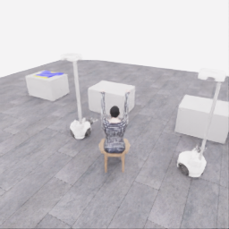
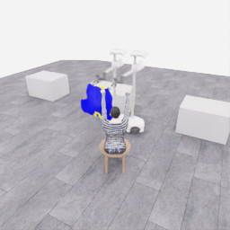
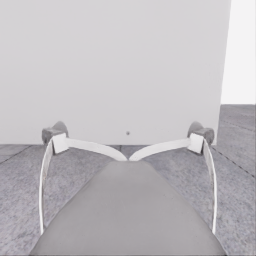
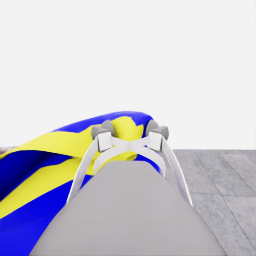
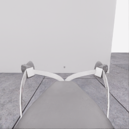
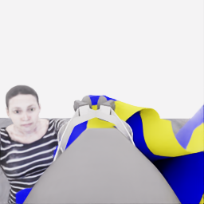
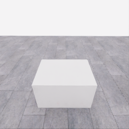
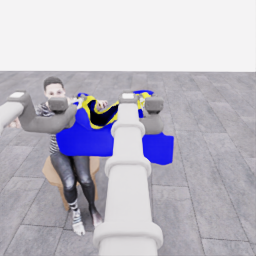
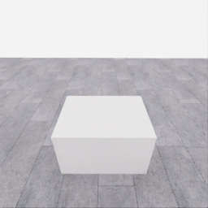
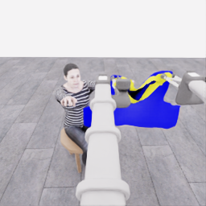

# 자동 시연 수집 시도 · 20261106-astra-hem-depth-001

[전체 수집 기록](../../README.ko.md) · [구조화 요약](manifest.json) · [전체 행동 기록](decisions.jsonl) · [사용한 기본 프롬프트](prompt.txt)

실행 상태는 **completed**, 원본 출처는 `gpt`입니다. 완료 상태와 과제 성공은 아래에서 따로 기록합니다.

## 실행 조건과 시간

| 항목 | 기록 |
|---|---|
| 기록 시작 UTC | 2026-11-06T10:35:22Z |
| 기록 종료 UTC | 2026-11-06T11:08:52Z |
| 이전 시도 | 20261106-astra-coordinated-fresh-001 |
| 재시도 사유 | current_native_wrist_depth_for_hem_hand_relation |
| 출처 그룹 | 20261106-coordinated-demo-methods |
| 요청 모델 / 추론 설정 | gpt-6-astra / ultra |
| 전체 실제 경과 시간 (초) | 2010.295 |
| Actor 호출 합계 (초) | 1253.547 |
| 환경 요청·응답 합계 (초) | 702.869 |
| 시뮬레이션 시간 (초) | 40.500 |
| 저장 전이 수 | 810.000 |
| 응답 확인 전이 수 | 810.000 |
| 모델 호출 시도 수 | 18.000 |
| 완료한 결정 구간 수 | 18.000 |
| 파일 완료 상태 | true |
| 데이터 정합성 검사 | true |
| 학습 데이터 승인 | unreviewed |
| Actor 호출 방식 | exec |
| 한 호출의 최대 계획 구간 수 | 1.000 |
| 한 계획의 최대 제어 step 수 | 20.000 |

Actor 호출 시간은 공개 입력 저장·요청 전송·응답 처리 등 호출 경로를 측정합니다. 방식에 따라 Docker/CLI 시작이 호출 안에 들어가거나 상주 서버 준비 시간으로 분리됩니다. 내부 모델 추론 시간만 별도로 측정한 값은 아닙니다. 모델이 판단하는 동안 물리 시간은 멈추며 실제 경과 시간과 시뮬레이션 시간은 다릅니다. 세부 요청 프로세스 시간에도 CLI 처리·네트워크·서버 대기·생성이 함께 포함됩니다.

## 토큰 사용량의 범위

`actor_usage`는 thread별 관측 누계를 합친 값입니다. 결정의 `usage`는 원본 CLI 누계이며, 호출별 증가량은 `usage_accounting.incremental_usage`입니다. 캐시 입력은 입력의 부분집합이고 추론 출력은 출력의 부분집합이므로 열들을 다시 합산하지 않습니다.

전체 호출 사용량 확정: **true** · 기록한 호출 수: 18.

| 입력 | 캐시 입력 | 캐시 쓰기 입력 | 출력 | 추론 출력 |
|---:|---:|---:|---:|---:|
| 1916188 | 1725824 | 0 | 26085 | 23706 |

중복 누계는 추가 사용량 0으로 처리하고, 역행한 누계는 미확정으로 보존합니다. 새 thread는 별도로 집계합니다. 토큰 기록은 화폐 비용이나 청구서가 아닙니다.

## 리뷰 정지 조건

목표 누적 점수 10.000 · 감시 상태 `collector_ended_before_gate` · 수집기 상태 `completed`.

마지막 관측 점수 5.000 · 응답 확인 step 810.

`review_ready`는 정지 조건에 따라 실행을 마치고 리뷰할 준비가 된 상태입니다. 50점·착의 성공이나 학습 데이터 승인을 뜻하지 않습니다. 공식 점수와 success는 아래 평가 결과로 확인합니다.

## 공식 평가 결과

평가 유효성 `true` · 누적 점수 **5.000 / 50** · 착의 success **false** · rate 상태 `no_dressing_points` · 최종 rate 0.000 points/s.

누적 50점, 착의 success, 정상 파일 종료와 데이터 정합성은 서로 다른 상태입니다. 접촉 전 `no_contact`의 rate는 0점/초로 바꾸지 않습니다.

| 단계 | 획득 점수 / 최대 | 획득 시각 (episode 초) |
|---|---:|---:|
| 파지·들기 | 5.000 / 5 | 17.800 |
| 첫 소매 | 0.000 / 5 | 미측정/해당 없음 |
| 반대 어깨 | 0.000 / 5 | 미측정/해당 없음 |
| 두 번째 소매 | 0.000 / 5 | 미측정/해당 없음 |
| 왼쪽 위팔 | 0.000 / 5 | 미측정/해당 없음 |
| 오른쪽 위팔 | 0.000 / 5 | 미측정/해당 없음 |
| 목 통과 | 0.000 / 10 | 미측정/해당 없음 |
| 앞면 방향 | 0.000 / 10 | 미측정/해당 없음 |

## 단계 획득 경로

점수 획득은 [평가 이벤트](score-events.jsonl)에서 같은 physics tick끼리 묶었습니다. 같은 시각에 인정된 항목의 내부 순서는 추정하지 않습니다. 착의 success는 점수 획득과 별도로 기록합니다.

| 순서 | episode 시간 (초) | 전이 경계 step | 누적 점수 변화 | 같은 시각의 항목 변화 |
|---:|---:|---:|---:|---|
| 0 | 17.800 | 356 | 0.000→5.000 | 파지·들기 0.000→5.000 |

평가 clock 0초에 대응하는 공개 simulation clock은 1.525초입니다. 두 시계를 같은 절대 시각으로 혼동하지 않습니다.

별도 success 이벤트 수: **0**. 평가 유효성: `true`.


## 원본 관측 화면

지정된 공개 카메라의 저장 RGB 픽셀입니다. 시작은 첫 `obs`, 종료는 마지막 `next_obs`입니다. 이미지 합성이나 내부 상태 기반 장면 재구성 없이 원본 픽셀로 PNG를 저장했습니다.

| 카메라 | 시작 | 종료 |
|---|---|---|
| `overview` | [](images/initial-overview.png) | [](images/final-overview.png) |
| `robot_0_wrist` | [](images/initial-robot_0_wrist.png) | [](images/final-robot_0_wrist.png) |
| `robot_1_wrist` | [](images/initial-robot_1_wrist.png) | [](images/final-robot_1_wrist.png) |
| `robot_0_head` | [](images/initial-robot_0_head.png) | [](images/final-robot_0_head.png) |
| `robot_1_head` | [](images/initial-robot_1_head.png) | [](images/final-robot_1_head.png) |

시작 관측 시각 1.525초 · 종료 관측 시각 42.025초 (공개 simulation clock).

[▶ overview 관측 영상 보기](overview.mp4)

저장된 20 Hz `obs` 중 810프레임을 순서대로 사용했습니다. 재생은 **4.0배 느리게** (5.000 fps), 실제 대기 시간·모델 호출 지연은 영상에 들어가지 않습니다. 종료 `next_obs`는 위 PNG에서 확인합니다.

## 결정과 실행 순서

아래 근거는 모델 최종 JSON의 짧은 행동 설명입니다. 시각적 평가는 행동 전 관측에 대한 판단이며, 그 행동의 실행 후 성공 라벨로 사용하지 않습니다. 공식 점수는 별도의 평가 결과입니다.

행동의 각 행은 로봇 0·1 순서이며 열은 `전진, 왼쪽 이동, 반시계 회전, 리프트, 팔 신장, 손목 yaw, pitch, roll, gripper`입니다. 앞 8개는 정규화 속도이고 gripper는 닫기 `+1`, 열기 `-1`, 의도 유지 `0`입니다.

### 기록된 행동의 재실행 구간

원본 `20261106-astra-coordinated-fresh-001`의 행동 700전이를 새 환경에서 다시 실행했습니다. 이 구간에는 새 모델 호출이 없고 관측·평가를 새로 기록했습니다. 정확한 물리 상태 복원이나 독립적인 새 시연으로 집계하지 않습니다. 원본 step 대응과 실제 행동은 `decisions.jsonl`의 `replayed_segment`에 있습니다.

### 결정 0 · 첫 소매 · `act`

입력 관측 36.525초 · Actor 호출 167.164초 · 시각적 판단 `uncertain`.

계획 `20261106-astra-hem-depth-001:call-00000` · 모델 호출 인덱스 0 · 계획 구간 1/1 · 이 구간에서 모델 호출 `true`.

실행 직전 최신 관측 36.525초.

공개 입력 저장 0.265초 · 요청 프로세스 166.899초 · 결과 해석 0.000초.

호출 사용량 상태 `observed` · 이번 증가량 입력 20124 / 출력 3633 토큰.

최종 응답의 행동 설명: Robot 0 appears to support the farther hem corner; robot 1 supports the corner nearer the raised hand. Shift both slightly forward-left to align the apparent hem opening, preserving grips. Recheck cloth-following and hand–rim alignment; entry remains unconfirmed.

요청 행동:

```json
[[0.25, 0.3, 0, 0, 0, 0, 0, 0, 1], [0.25, 0.3, 0, 0, 0, 0, 0, 0, 1]]
```

실행 구간 step **[700, 706)** · 요청 6 step / 실제 6 step · 환경 요청·응답 5.879초.

실제 적용 행동:

```json
[[0.25, 0.30000001192092896, 0.0, 0.0, 0.0, 0.0, 0.0, 0.0, 1.0], [0.25, 0.30000001192092896, 0.0, 0.0, 0.0, 0.0, 0.0, 0.0, 1.0]]
```

### 결정 1 · 첫 소매 · `act`

입력 관측 36.825초 · Actor 호출 60.380초 · 시각적 판단 `progressing`.

계획 `20261106-astra-hem-depth-001:call-00001` · 모델 호출 인덱스 1 · 계획 구간 1/1 · 이 구간에서 모델 호출 `true`.

실행 직전 최신 관측 36.825초.

공개 입력 저장 0.080초 · 요청 프로세스 60.299초 · 결과 해석 0.000초.

호출 사용량 상태 `observed` · 이번 증가량 입력 32238 / 출력 1167 토큰.

최종 응답의 행동 설명: Both cloth edges followed the previous shift. Robot 0 maintains the outer corner; robot 1 guides the hand-side corner. Move together left and slightly forward to improve hem alignment with the same raised hand; rim crossing remains unconfirmed.

요청 행동:

```json
[[0.25, 0.4, 0, 0, 0, 0, 0, 0, 1], [0.25, 0.4, 0, 0, 0, 0, 0, 0, 1]]
```

실행 구간 step **[706, 714)** · 요청 8 step / 실제 8 step · 환경 요청·응답 7.301초.

실제 적용 행동:

```json
[[0.25, 0.4000000059604645, 0.0, 0.0, 0.0, 0.0, 0.0, 0.0, 1.0], [0.25, 0.4000000059604645, 0.0, 0.0, 0.0, 0.0, 0.0, 0.0, 1.0]]
```

### 결정 2 · 복구 · `act`

입력 관측 37.225초 · Actor 호출 60.784초 · 시각적 판단 `recovering`.

계획 `20261106-astra-hem-depth-001:call-00002` · 모델 호출 인덱스 2 · 계획 구간 1/1 · 이 구간에서 모델 호출 `true`.

실행 직전 최신 관측 37.225초.

공개 입력 저장 0.081초 · 요청 프로세스 60.703초 · 결과 해석 0.000초.

호출 사용량 상태 `observed` · 이번 증가량 입력 41878 / 출력 1348 토큰.

최종 응답의 행동 설명: Both robots retain apparent hem support, but two alignment shifts have not resolved the target hand–rim relationship. Back both slightly away while robot 0 raises its corner and robot 1 steadies the other, reshaping the opening before further entry motion.

요청 행동:

```json
[[-0.2, 0, 0, 0.1, 0, 0, 0, 0, 1], [-0.2, 0, 0, 0, 0, 0, 0, 0, 1]]
```

실행 구간 step **[714, 720)** · 요청 6 step / 실제 6 step · 환경 요청·응답 5.477초.

실제 적용 행동:

```json
[[-0.20000000298023224, 0.0, 0.0, 0.10000000149011612, 0.0, 0.0, 0.0, 0.0, 1.0], [-0.20000000298023224, 0.0, 0.0, 0.0, 0.0, 0.0, 0.0, 0.0, 1.0]]
```

### 결정 3 · 첫 소매 · `act`

입력 관측 37.525초 · Actor 호출 110.955초 · 시각적 판단 `uncertain`.

계획 `20261106-astra-hem-depth-001:call-00003` · 모델 호출 인덱스 3 · 계획 구간 1/1 · 이 구간에서 모델 호출 `true`.

실행 직전 최신 관측 37.525초.

공개 입력 저장 0.079초 · 요청 프로세스 110.875초 · 결과 해석 0.000초.

호출 사용량 상태 `observed` · 이번 증가량 입력 51674 / 출력 2284 토큰.

최종 응답의 행동 설명: Robot 0 supports the elevated corner and robot 1 the lower corner. The target hand appears below the hem rim. Lower both briefly while preserving the opening to test entry, then check for rim crossing rather than exterior-panel overlap.

요청 행동:

```json
[[0, 0, 0, -0.12, 0, 0, 0, 0, 1], [0, 0, 0, -0.12, 0, 0, 0, 0, 1]]
```

실행 구간 step **[720, 726)** · 요청 6 step / 실제 6 step · 환경 요청·응답 5.572초.

실제 적용 행동:

```json
[[0.0, 0.0, 0.0, -0.11999999731779099, 0.0, 0.0, 0.0, 0.0, 1.0], [0.0, 0.0, 0.0, -0.11999999731779099, 0.0, 0.0, 0.0, 0.0, 1.0]]
```

### 결정 4 · 첫 소매 · `act`

입력 관측 37.825초 · Actor 호출 76.357초 · 시각적 판단 `uncertain`.

계획 `20261106-astra-hem-depth-001:call-00004` · 모델 호출 인덱스 4 · 계획 구간 1/1 · 이 구간에서 모델 호출 `true`.

실행 직전 최신 관측 37.825초.

공개 입력 저장 0.083초 · 요청 프로세스 76.274초 · 결과 해석 0.000초.

호출 사용량 상태 `observed` · 이번 증가량 입력 62421 / 출력 1558 토큰.

최종 응답의 행동 설명: Cloth followed both grippers downward; robot 0 maintains the higher corner and robot 1 the lower corner. The target hand still appears below the rim. Lower one further short increment, then reassess for visible crossing before any sleeve-directed motion.

요청 행동:

```json
[[0, 0, 0, -0.15, 0, 0, 0, 0, 1], [0, 0, 0, -0.15, 0, 0, 0, 0, 1]]
```

실행 구간 step **[726, 732)** · 요청 6 step / 실제 6 step · 환경 요청·응답 4.978초.

실제 적용 행동:

```json
[[0.0, 0.0, 0.0, -0.15000000596046448, 0.0, 0.0, 0.0, 0.0, 1.0], [0.0, 0.0, 0.0, -0.15000000596046448, 0.0, 0.0, 0.0, 0.0, 1.0]]
```

### 결정 5 · 복구 · `act`

입력 관측 38.125초 · Actor 호출 73.549초 · 시각적 판단 `recovering`.

계획 `20261106-astra-hem-depth-001:call-00005` · 모델 호출 인덱스 5 · 계획 구간 1/1 · 이 구간에서 모델 호출 `true`.

실행 직전 최신 관측 38.125초.

공개 입력 저장 0.081초 · 요청 프로세스 73.468초 · 결과 해석 0.000초.

호출 사용량 상태 `observed` · 이번 증가량 입력 72460 / 출력 1636 토큰.

최종 응답의 행동 설명: Robot 0 and robot 1 still support their respective corners, but neither lowering step revealed rim crossing. Arrest descent and back both away, retracting robot 0 farther to reshape the opening and expose the target hand before reassessing entry.

요청 행동:

```json
[[-0.2, 0, 0, 0.08, -0.15, 0, 0, 0, 1], [-0.2, 0, 0, 0.08, 0, 0, 0, 0, 1]]
```

실행 구간 step **[732, 738)** · 요청 6 step / 실제 6 step · 환경 요청·응답 4.928초.

실제 적용 행동:

```json
[[-0.20000000298023224, 0.0, 0.0, 0.07999999821186066, -0.15000000596046448, 0.0, 0.0, 0.0, 1.0], [-0.20000000298023224, 0.0, 0.0, 0.07999999821186066, 0.0, 0.0, 0.0, 0.0, 1.0]]
```

### 결정 6 · 첫 소매 · `act`

입력 관측 38.425초 · Actor 호출 75.955초 · 시각적 판단 `progressing`.

계획 `20261106-astra-hem-depth-001:call-00006` · 모델 호출 인덱스 6 · 계획 구간 1/1 · 이 구간에서 모델 호출 `true`.

실행 직전 최신 관측 38.425초.

공개 입력 저장 0.083초 · 요청 프로세스 75.872초 · 결과 해석 0.000초.

호출 사용량 상태 `observed` · 이번 증가량 입력 82577 / 출력 1752 토큰.

최종 응답의 행동 설명: Robot 0 supports the higher, retracted corner; robot 1 supports the lower corner. The mannequin’s left fingertips are now visible beyond the apparent hem rim in both head views. Advance and raise the opening slightly toward those fingertips for a controlled entry test.

요청 행동:

```json
[[0.25, 0, 0, 0.06, 0.08, 0, 0, 0, 1], [0.25, 0, 0, 0.06, 0, 0, 0, 0, 1]]
```

실행 구간 step **[738, 746)** · 요청 8 step / 실제 8 step · 환경 요청·응답 6.476초.

실제 적용 행동:

```json
[[0.25, 0.0, 0.0, 0.05999999865889549, 0.07999999821186066, 0.0, 0.0, 0.0, 1.0], [0.25, 0.0, 0.0, 0.05999999865889549, 0.0, 0.0, 0.0, 0.0, 1.0]]
```

### 결정 7 · 복구 · `act`

입력 관측 38.825초 · Actor 호출 51.217초 · 시각적 판단 `recovering`.

계획 `20261106-astra-hem-depth-001:call-00007` · 모델 호출 인덱스 7 · 계획 구간 1/1 · 이 구간에서 모델 호출 `true`.

실행 직전 최신 관측 38.825초.

공개 입력 저장 0.082초 · 요청 프로세스 51.134초 · 결과 해석 0.000초.

호출 사용량 상태 `observed` · 이번 증가량 입력 92783 / 출력 1082 토큰.

최종 응답의 행동 설명: Robot 0 retains the higher corner and robot 1 the lower corner. Raising the rim hid the left fingertips without showing a crossing. Stop base motion and lower both slightly to restore the hand–rim view before advancing.

요청 행동:

```json
[[0, 0, 0, -0.15, 0, 0, 0, 0, 1], [0, 0, 0, -0.15, 0, 0, 0, 0, 1]]
```

실행 구간 step **[746, 752)** · 요청 6 step / 실제 6 step · 환경 요청·응답 4.986초.

실제 적용 행동:

```json
[[0.0, 0.0, 0.0, -0.15000000596046448, 0.0, 0.0, 0.0, 0.0, 1.0], [0.0, 0.0, 0.0, -0.15000000596046448, 0.0, 0.0, 0.0, 0.0, 1.0]]
```

### 결정 8 · 복구 · `act`

입력 관측 39.125초 · Actor 호출 73.150초 · 시각적 판단 `uncertain`.

계획 `20261106-astra-hem-depth-001:call-00008` · 모델 호출 인덱스 8 · 계획 구간 1/1 · 이 구간에서 모델 호출 `true`.

실행 직전 최신 관측 39.125초.

공개 입력 저장 0.082초 · 요청 프로세스 73.067초 · 결과 해석 0.000초.

호출 사용량 상태 `observed` · 이번 증가량 입력 102331 / 출력 1678 토큰.

최종 응답의 행동 설명: Robot 0 supports the higher corner and robot 1 the lower corner; both lifts are still descending toward their commanded heights. Let that motion settle while retaining both grips, then reassess the obscured fingertips and hem rim. Entry remains unconfirmed.

요청 행동:

```json
[[0, 0, 0, 0, 0, 0, 0, 0, 1], [0, 0, 0, 0, 0, 0, 0, 0, 1]]
```

실행 구간 step **[752, 758)** · 요청 6 step / 실제 6 step · 환경 요청·응답 4.767초.

실제 적용 행동:

```json
[[0.0, 0.0, 0.0, 0.0, 0.0, 0.0, 0.0, 0.0, 1.0], [0.0, 0.0, 0.0, 0.0, 0.0, 0.0, 0.0, 0.0, 1.0]]
```

### 결정 9 · 첫 소매 · `act`

입력 관측 39.425초 · Actor 호출 31.841초 · 시각적 판단 `progressing`.

계획 `20261106-astra-hem-depth-001:call-00009` · 모델 호출 인덱스 9 · 계획 구간 1/1 · 이 구간에서 모델 호출 `true`.

실행 직전 최신 관측 39.425초.

공개 입력 저장 0.082초 · 요청 프로세스 31.759초 · 결과 해석 0.000초.

호출 사용량 상태 `observed` · 이번 증가량 입력 112459 / 출력 645 토큰.

최종 응답의 행동 설명: Robot 0 supports the higher hem corner and robot 1 the lower corner. The left fingertips are visible again beyond the far rim. Keep lift height fixed and extend both arms briefly toward that hand, then inspect for actual rim crossing.

요청 행동:

```json
[[0, 0, 0, 0, 0.2, 0, 0, 0, 1], [0, 0, 0, 0, 0.2, 0, 0, 0, 1]]
```

실행 구간 step **[758, 766)** · 요청 8 step / 실제 8 step · 환경 요청·응답 6.348초.

실제 적용 행동:

```json
[[0.0, 0.0, 0.0, 0.0, 0.20000000298023224, 0.0, 0.0, 0.0, 1.0], [0.0, 0.0, 0.0, 0.0, 0.20000000298023224, 0.0, 0.0, 0.0, 1.0]]
```

### 결정 10 · 복구 · `act`

입력 관측 39.825초 · Actor 호출 69.947초 · 시각적 판단 `recovering`.

계획 `20261106-astra-hem-depth-001:call-00010` · 모델 호출 인덱스 10 · 계획 구간 1/1 · 이 구간에서 모델 호출 `true`.

실행 직전 최신 관측 39.825초.

공개 입력 저장 0.082초 · 요청 프로세스 69.864초 · 결과 해석 0.000초.

호출 사용량 상태 `observed` · 이번 증가량 입력 121585 / 출력 1363 토큰.

최종 응답의 행동 설명: Robot 0 retains the higher corner and robot 1 the lower corner, but extension did not reveal hand entry. Slightly retract, turn the supported corners inward, and level the hem to reshape its opening before another entry test.

요청 행동:

```json
[[0, 0, 0.05, -0.04, -0.09, 0, 0, 0, 1], [0, 0, -0.05, 0.04, -0.09, 0, 0, 0, 1]]
```

실행 구간 step **[766, 774)** · 요청 8 step / 실제 8 step · 환경 요청·응답 6.604초.

실제 적용 행동:

```json
[[0.0, 0.0, 0.05000000074505806, -0.03999999910593033, -0.09000000357627869, 0.0, 0.0, 0.0, 1.0], [0.0, 0.0, -0.05000000074505806, 0.03999999910593033, -0.09000000357627869, 0.0, 0.0, 0.0, 1.0]]
```

### 결정 11 · 첫 소매 · `act`

입력 관측 40.225초 · Actor 호출 76.358초 · 시각적 판단 `progressing`.

계획 `20261106-astra-hem-depth-001:call-00011` · 모델 호출 인덱스 11 · 계획 구간 1/1 · 이 구간에서 모델 호출 `true`.

실행 직전 최신 관측 40.225초.

공개 입력 저장 0.086초 · 요청 프로세스 76.272초 · 결과 해석 0.000초.

호출 사용량 상태 `observed` · 이번 증가량 입력 131433 / 출력 1546 토큰.

최종 응답의 행동 설명: Robot 0 and robot 1 retain their corners, and reshaping has exposed the left fingertips at the deeper hem mouth. Hold base angles and lift heights while extending both arms briefly to test passage across the rim; entry is not yet established.

요청 행동:

```json
[[0, 0, 0, 0, 0.18, 0, 0, 0, 1], [0, 0, 0, 0, 0.18, 0, 0, 0, 1]]
```

실행 구간 step **[774, 780)** · 요청 6 step / 실제 6 step · 환경 요청·응답 5.095초.

실제 적용 행동:

```json
[[0.0, 0.0, 0.0, 0.0, 0.18000000715255737, 0.0, 0.0, 0.0, 1.0], [0.0, 0.0, 0.0, 0.0, 0.18000000715255737, 0.0, 0.0, 0.0, 1.0]]
```

### 결정 12 · 첫 소매 · `act`

입력 관측 40.525초 · Actor 호출 38.049초 · 시각적 판단 `uncertain`.

계획 `20261106-astra-hem-depth-001:call-00012` · 모델 호출 인덱스 12 · 계획 구간 1/1 · 이 구간에서 모델 호출 `true`.

실행 직전 최신 관측 40.525초.

공개 입력 저장 0.082초 · 요청 프로세스 37.967초 · 결과 해석 0.000초.

호출 사용량 상태 `observed` · 이번 증가량 입력 141427 / 출력 762 토큰.

최종 응답의 행동 설명: Robot 0 and robot 1 now support nearly level corners. The left fingertips remain visible at the far side of the opening, without confirmed crossing. Make one smaller coordinated extension at fixed height, then inspect the hand–rim relationship before further advance.

요청 행동:

```json
[[0, 0, 0, 0, 0.1, 0, 0, 0, 1], [0, 0, 0, 0, 0.1, 0, 0, 0, 1]]
```

실행 구간 step **[780, 786)** · 요청 6 step / 실제 6 step · 환경 요청·응답 5.224초.

실제 적용 행동:

```json
[[0.0, 0.0, 0.0, 0.0, 0.10000000149011612, 0.0, 0.0, 0.0, 1.0], [0.0, 0.0, 0.0, 0.0, 0.10000000149011612, 0.0, 0.0, 0.0, 1.0]]
```

### 결정 13 · 복구 · `act`

입력 관측 40.825초 · Actor 호출 93.827초 · 시각적 판단 `recovering`.

계획 `20261106-astra-hem-depth-001:call-00013` · 모델 호출 인덱스 13 · 계획 구간 1/1 · 이 구간에서 모델 호출 `true`.

실행 직전 최신 관측 40.825초.

공개 입력 저장 0.082초 · 요청 프로세스 93.745초 · 결과 해석 0.000초.

호출 사용량 상태 `observed` · 이번 증가량 입력 150666 / 출력 1748 토큰.

최종 응답의 행동 설명: Robot 0 and robot 1 retain cloth support, but two extensions have not shown an unambiguous rim crossing. Arrest further reach; robot 0 steadies its corner while robot 1 lowers its corner to tilt the mouth and clarify the hand’s relationship to both rim edges.

요청 행동:

```json
[[0, 0, 0, 0, -0.07, 0, 0, 0, 1], [0, 0, 0, -0.12, -0.07, 0, 0, 0, 1]]
```

실행 구간 step **[786, 792)** · 요청 6 step / 실제 6 step · 환경 요청·응답 5.663초.

실제 적용 행동:

```json
[[0.0, 0.0, 0.0, 0.0, -0.07000000029802322, 0.0, 0.0, 0.0, 1.0], [0.0, 0.0, 0.0, -0.11999999731779099, -0.07000000029802322, 0.0, 0.0, 0.0, 1.0]]
```

### 결정 14 · 첫 소매 · `act`

입력 관측 41.125초 · Actor 호출 53.072초 · 시각적 판단 `uncertain`.

계획 `20261106-astra-hem-depth-001:call-00014` · 모델 호출 인덱스 14 · 계획 구간 1/1 · 이 구간에서 모델 호출 `true`.

실행 직전 최신 관측 41.125초.

공개 입력 저장 0.083초 · 요청 프로세스 52.990초 · 결과 해석 0.000초.

호출 사용량 상태 `observed` · 이번 증가량 입력 160876 / 출력 1030 토큰.

최종 응답의 행동 설명: Robot 0 supports the upper corner and robot 1 the lowered corner. The tilt exposes the left fingertips beside the opening’s right rim rather than clearly inside. Shift both slightly robot-right to align the mouth beneath those fingertips, retaining both grips.

요청 행동:

```json
[[0, -0.2, 0, 0, 0, 0, 0, 0, 1], [0, -0.2, 0, 0, 0, 0, 0, 0, 1]]
```

실행 구간 step **[792, 798)** · 요청 6 step / 실제 6 step · 환경 요청·응답 5.185초.

실제 적용 행동:

```json
[[0.0, -0.20000000298023224, 0.0, 0.0, 0.0, 0.0, 0.0, 0.0, 1.0], [0.0, -0.20000000298023224, 0.0, 0.0, 0.0, 0.0, 0.0, 0.0, 1.0]]
```

### 결정 15 · 첫 소매 · `act`

입력 관측 41.425초 · Actor 호출 47.316초 · 시각적 판단 `progressing`.

계획 `20261106-astra-hem-depth-001:call-00015` · 모델 호출 인덱스 15 · 계획 구간 1/1 · 이 구간에서 모델 호출 `true`.

실행 직전 최신 관측 41.425초.

공개 입력 저장 0.085초 · 요청 프로세스 47.230초 · 결과 해석 0.000초.

호출 사용량 상태 `observed` · 이번 증가량 입력 170394 / 출력 903 토큰.

최종 응답의 행동 설명: Robot 0 steadies the upper corner; robot 1 controls the lower lip. The left fingertips now appear aligned with the hem mouth in robot 1’s wrist view. Raise robot 1’s corner slightly with a small coordinated extension to test visible rim crossing.

요청 행동:

```json
[[0, 0, 0, 0, 0.06, 0, 0, 0, 1], [0, 0, 0, 0.1, 0.06, 0, 0, 0, 1]]
```

실행 구간 step **[798, 804)** · 요청 6 step / 실제 6 step · 환경 요청·응답 5.186초.

실제 적용 행동:

```json
[[0.0, 0.0, 0.0, 0.0, 0.05999999865889549, 0.0, 0.0, 0.0, 1.0], [0.0, 0.0, 0.0, 0.10000000149011612, 0.05999999865889549, 0.0, 0.0, 0.0, 1.0]]
```

### 결정 16 · 첫 소매 · `act`

입력 관측 41.725초 · Actor 호출 41.456초 · 시각적 판단 `uncertain`.

계획 `20261106-astra-hem-depth-001:call-00016` · 모델 호출 인덱스 16 · 계획 구간 1/1 · 이 구간에서 모델 호출 `true`.

실행 직전 최신 관측 41.725초.

공개 입력 저장 0.082초 · 요청 프로세스 41.374초 · 결과 해석 0.000초.

호출 사용량 상태 `observed` · 이번 증가량 입력 179767 / 출력 860 토큰.

최종 응답의 행동 설명: Robot 0 steadies the upper edge while robot 1’s edge is still rising. The left fingertips remain slightly right of the visible mouth. Shift both a small distance robot-right without adding forward reach, centering the opening beneath the hand as the lift settles.

요청 행동:

```json
[[0, -0.15, 0, 0, 0, 0, 0, 0, 1], [0, -0.15, 0, 0, 0, 0, 0, 0, 1]]
```

실행 구간 step **[804, 810)** · 요청 6 step / 실제 6 step · 환경 요청·응답 5.254초.

실제 적용 행동:

```json
[[0.0, -0.15000000596046448, 0.0, 0.0, 0.0, 0.0, 0.0, 0.0, 1.0], [0.0, -0.15000000596046448, 0.0, 0.0, 0.0, 0.0, 0.0, 0.0, 1.0]]
```

### 결정 17 · 최종 확인 · `finish_episode`

입력 관측 42.025초 · Actor 호출 52.171초 · 시각적 판단 `blocked`.

계획 `20261106-astra-hem-depth-001:call-00017` · 모델 호출 인덱스 17 · 계획 구간 1/1 · 이 구간에서 모델 호출 `true`.

실행 직전 최신 관측 42.025초.

공개 입력 저장 0.083초 · 요청 프로세스 52.088초 · 결과 해석 0.000초.

호출 사용량 상태 `observed` · 이번 증가량 입력 189095 / 출력 1090 토큰.

최종 응답의 행동 설명: Robot 0 and robot 1 retain hem support. Repeated reshaping and entry tests leave hand–rim crossing ambiguous, with no visible sleeve emergence. End this unproductive attempt with both grips preserved; dressing remains incomplete.

요청 행동:

```json
[[0, 0, 0, 0, 0, 0, 0, 0, 0], [0, 0, 0, 0, 0, 0, 0, 0, 0]]
```

실행 구간 step **[810, 810)** · 요청 0 step / 실제 0 step · 환경 요청·응답 0.010초.

실제 적용 행동:

```json
[[0.0, 0.0, 0.0, 0.0, 0.0, 0.0, 0.0, 0.0, 0.0], [0.0, 0.0, 0.0, 0.0, 0.0, 0.0, 0.0, 0.0, 0.0]]
```

## 검수와 후속 판단

현재 데이터 승인은 `unreviewed`입니다. 형식과 시간 정합성 검사를 통과해도 시연의 유용성이나 착의 성공을 보장하지 않습니다.

이 페이지의 원본 파일 SHA256과 생성 파일 SHA256은 [manifest.json](manifest.json)에 있습니다. 실행 실패도 같은 run ID와 부모 시도 관계로 보존합니다. 공개 범위는 카메라, 최종 행동 응답, 시간, 평가 요약입니다.

[개발 피드백과 변경 근거](../../feedback/2026-11-06.jsonl)
