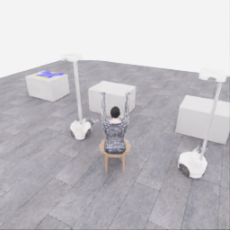
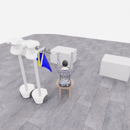
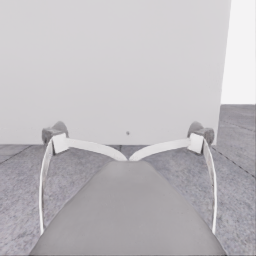
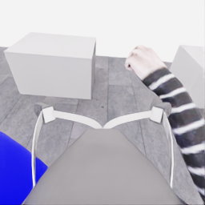
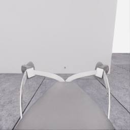
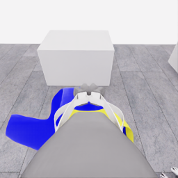
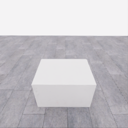
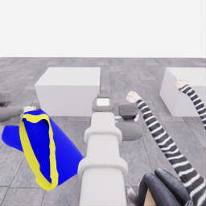
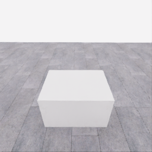
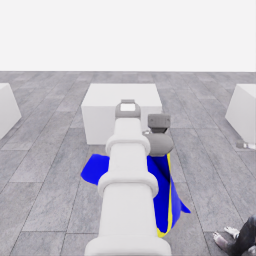

# 자동 시연 수집 시도 · 20261106-astra-opening264-001

[전체 수집 기록](../../README.ko.md) · [구조화 요약](manifest.json) · [전체 행동 기록](decisions.jsonl) · [사용한 기본 프롬프트](prompt.txt)

실행 상태는 **completed**, 원본 출처는 `gpt`입니다. 완료 상태와 과제 성공은 아래에서 따로 기록합니다.

## 실행 조건과 시간

| 항목 | 기록 |
|---|---|
| 기록 시작 UTC | 2026-11-06T11:55:47Z |
| 기록 종료 UTC | 2026-11-06T12:24:16Z |
| 이전 시도 | 20261106-astra-coordinated-fresh-001 |
| 재시도 사유 | prepare_visible_opening_before_transport_with_bounded_one_sided_regrasp |
| 출처 그룹 | 20261106-coordinated-demo-methods |
| 요청 모델 / 추론 설정 | gpt-6-astra / ultra |
| 전체 실제 경과 시간 (초) | 1709.785 |
| Actor 호출 합계 (초) | 1105.822 |
| 환경 요청·응답 합계 (초) | 548.946 |
| 시뮬레이션 시간 (초) | 30.550 |
| 저장 전이 수 | 611.000 |
| 응답 확인 전이 수 | 611.000 |
| 모델 호출 시도 수 | 24.000 |
| 완료한 결정 구간 수 | 24.000 |
| 파일 완료 상태 | true |
| 데이터 정합성 검사 | true |
| 학습 데이터 승인 | unreviewed |
| Actor 호출 방식 | exec |
| 한 호출의 최대 계획 구간 수 | 1.000 |
| 한 계획의 최대 제어 step 수 | 20.000 |
| 제어기 정착 대기 설정 | true |
| 정착 대기 요청 step 수 | 6.000 |
| 완료한 제어기 정착 구간 수 | 21.000 |
| 제어기 정착 전이 수 | 126.000 |
| 제어기 정착 환경 요청·응답 (초) | 118.679 |
| 전이 예산으로 단축한 정착 구간 수 | 0.000 |
| 전이 예산으로 건너뛴 정착 구간 수 | 0.000 |

Actor 호출 시간은 공개 입력 저장·요청 전송·응답 처리 등 호출 경로를 측정합니다. 방식에 따라 Docker/CLI 시작이 호출 안에 들어가거나 상주 서버 준비 시간으로 분리됩니다. 내부 모델 추론 시간만 별도로 측정한 값은 아닙니다. 모델이 판단하는 동안 물리 시간은 멈추며 실제 경과 시간과 시뮬레이션 시간은 다릅니다. 세부 요청 프로세스 시간에도 CLI 처리·네트워크·서버 대기·생성이 함께 포함됩니다.

## 토큰 사용량의 범위

`actor_usage`는 thread별 관측 누계를 합친 값입니다. 결정의 `usage`는 원본 CLI 누계이며, 호출별 증가량은 `usage_accounting.incremental_usage`입니다. 캐시 입력은 입력의 부분집합이고 추론 출력은 출력의 부분집합이므로 열들을 다시 합산하지 않습니다.

전체 호출 사용량 확정: **true** · 기록한 호출 수: 24.

| 입력 | 캐시 입력 | 캐시 쓰기 입력 | 출력 | 추론 출력 |
|---:|---:|---:|---:|---:|
| 3216324 | 2965760 | 0 | 23337 | 20124 |

중복 누계는 추가 사용량 0으로 처리하고, 역행한 누계는 미확정으로 보존합니다. 새 thread는 별도로 집계합니다. 토큰 기록은 화폐 비용이나 청구서가 아닙니다.

## 리뷰 정지 조건

목표 누적 점수 10.000 · 감시 상태 `collector_ended_before_gate` · 수집기 상태 `completed`.

마지막 관측 점수 5.000 · 응답 확인 step 611.

`review_ready`는 정지 조건에 따라 실행을 마치고 리뷰할 준비가 된 상태입니다. 50점·착의 성공이나 학습 데이터 승인을 뜻하지 않습니다. 공식 점수와 success는 아래 평가 결과로 확인합니다.

## 공식 평가 결과

평가 유효성 `true` · 누적 점수 **5.000 / 50** · 착의 success **false** · rate 상태 `no_dressing_points` · 최종 rate 0.000 points/s.

누적 50점, 착의 success, 정상 파일 종료와 데이터 정합성은 서로 다른 상태입니다. 접촉 전 `no_contact`의 rate는 0점/초로 바꾸지 않습니다.

| 단계 | 획득 점수 / 최대 | 획득 시각 (episode 초) |
|---|---:|---:|
| 파지·들기 | 5.000 / 5 | 17.550 |
| 첫 소매 | 0.000 / 5 | 미측정/해당 없음 |
| 반대 어깨 | 0.000 / 5 | 미측정/해당 없음 |
| 두 번째 소매 | 0.000 / 5 | 미측정/해당 없음 |
| 왼쪽 위팔 | 0.000 / 5 | 미측정/해당 없음 |
| 오른쪽 위팔 | 0.000 / 5 | 미측정/해당 없음 |
| 목 통과 | 0.000 / 10 | 미측정/해당 없음 |
| 앞면 방향 | 0.000 / 10 | 미측정/해당 없음 |

## 단계 획득 경로

점수 획득은 [평가 이벤트](score-events.jsonl)에서 같은 physics tick끼리 묶었습니다. 같은 시각에 인정된 항목의 내부 순서는 추정하지 않습니다. 착의 success는 점수 획득과 별도로 기록합니다.

| 순서 | episode 시간 (초) | 전이 경계 step | 누적 점수 변화 | 같은 시각의 항목 변화 |
|---:|---:|---:|---:|---|
| 0 | 17.550 | 351 | 0.000→5.000 | 파지·들기 0.000→5.000 |

평가 clock 0초에 대응하는 공개 simulation clock은 1.525초입니다. 두 시계를 같은 절대 시각으로 혼동하지 않습니다.

별도 success 이벤트 수: **0**. 평가 유효성: `true`.


## 원본 관측 화면

지정된 공개 카메라의 저장 RGB 픽셀입니다. 시작은 첫 `obs`, 종료는 마지막 `next_obs`입니다. 이미지 합성이나 내부 상태 기반 장면 재구성 없이 원본 픽셀로 PNG를 저장했습니다.

| 카메라 | 시작 | 종료 |
|---|---|---|
| `overview` | [](images/initial-overview.png) | [](images/final-overview.png) |
| `robot_0_wrist` | [](images/initial-robot_0_wrist.png) | [](images/final-robot_0_wrist.png) |
| `robot_1_wrist` | [](images/initial-robot_1_wrist.png) | [](images/final-robot_1_wrist.png) |
| `robot_0_head` | [](images/initial-robot_0_head.png) | [](images/final-robot_0_head.png) |
| `robot_1_head` | [](images/initial-robot_1_head.png) | [](images/final-robot_1_head.png) |

시작 관측 시각 1.525초 · 종료 관측 시각 32.075초 (공개 simulation clock).

[▶ overview 관측 영상 보기](overview.mp4)

저장된 20 Hz `obs` 중 611프레임을 순서대로 사용했습니다. 재생은 **4.0배 느리게** (5.000 fps), 실제 대기 시간·모델 호출 지연은 영상에 들어가지 않습니다. 종료 `next_obs`는 위 PNG에서 확인합니다.

## 결정과 실행 순서

아래 근거는 모델 최종 JSON의 짧은 행동 설명입니다. 시각적 평가는 행동 전 관측에 대한 판단이며, 그 행동의 실행 후 성공 라벨로 사용하지 않습니다. 공식 점수는 별도의 평가 결과입니다.

행동의 각 행은 로봇 0·1 순서이며 열은 `전진, 왼쪽 이동, 반시계 회전, 리프트, 팔 신장, 손목 yaw, pitch, roll, gripper`입니다. 앞 8개는 정규화 속도이고 gripper는 닫기 `+1`, 열기 `-1`, 의도 유지 `0`입니다.

제어기 정착 대기는 앞선 모델 결정에 연결된 별도 중립 행동입니다. 추가 모델 호출이나 모델 결정으로 집계하지 않으며, 실제 전이와 환경 요청·응답 시간은 전체 합계에 포함됩니다. 중립 행동은 두 로봇의 속도와 gripper 명령을 모두 0으로 보내 기존 gripper 의도를 유지합니다. 대기를 실행했다는 기록이 옷의 정착이나 과제 개선을 확인했다는 뜻은 아닙니다.

### 기록된 행동의 재실행 구간

원본 `20261106-astra-coordinated-fresh-001`의 행동 264전이를 새 환경에서 다시 실행했습니다. 이 구간에는 새 모델 호출이 없고 관측·평가를 새로 기록했습니다. 정확한 물리 상태 복원이나 독립적인 새 시연으로 집계하지 않습니다. 원본 step 대응과 실제 행동은 `decisions.jsonl`의 `replayed_segment`에 있습니다.

### 결정 0 · 들기 · `act`

입력 관측 14.725초 · Actor 호출 23.141초 · 시각적 판단 `uncertain`.

계획 `20261106-astra-opening264-001:call-00000` · 모델 호출 인덱스 0 · 계획 구간 1/1 · 이 구간에서 모델 호출 `true`.

실행 직전 최신 관측 14.725초.

공개 입력 저장 0.093초 · 요청 프로세스 23.047초 · 결과 해석 0.000초.

호출 사용량 상태 `observed` · 이번 증가량 입력 19446 / 출력 592 토큰.

최종 응답의 행동 설명: Robot 0 is near the right near-edge corner and robot 1 near the left; neither grasp is verified. Preserve both grip intents and lift approximately 3 cm together to check whether cloth follows each gripper, keeping the garment near table support.

요청 행동:

```json
[[0, 0, 0, 0.1, 0, 0, 0, 0, 0], [0, 0, 0, 0.1, 0, 0, 0, 0, 0]]
```

실행 구간 step **[264, 268)** · 요청 4 step / 실제 4 step · 환경 요청·응답 4.076초.

실제 적용 행동:

```json
[[0.0, 0.0, 0.0, 0.10000000149011612, 0.0, 0.0, 0.0, 0.0, 0.0], [0.0, 0.0, 0.0, 0.10000000149011612, 0.0, 0.0, 0.0, 0.0, 0.0]]
```

### 제어기 정착 대기 · 연결 결정 0

구간 `20261106-astra-opening264-001:settle-00000` · 출처 `controller_settle` · 이 구간에서 모델 호출 `false`.

앞선 모델 호출 인덱스 0에 연결됩니다. 추가 호출은 없습니다.

실행 구간 step **[268, 274)** · 요청 6 step / 실제 6 step · 환경 요청·응답 5.792초.

공개 simulation clock 14.925→15.225초 · 실행 전 관측 14.925초.

실제 적용 중립 행동:

```json
[[0.0, 0.0, 0.0, 0.0, 0.0, 0.0, 0.0, 0.0, 0.0], [0.0, 0.0, 0.0, 0.0, 0.0, 0.0, 0.0, 0.0, 0.0]]
```

### 결정 1 · 준비 · `act`

입력 관측 15.225초 · Actor 호출 37.313초 · 시각적 판단 `uncertain`.

계획 `20261106-astra-opening264-001:call-00001` · 모델 호출 인덱스 1 · 계획 구간 1/1 · 이 구간에서 모델 호출 `true`.

실행 직전 최신 관측 15.225초.

공개 입력 저장 0.095초 · 요청 프로세스 37.219초 · 결과 해석 0.000초.

호출 사용량 상태 `observed` · 이번 증가량 입력 29128 / 출력 652 토큰.

최종 응답의 행동 설명: Robot 0’s corner appears to follow its fingertips; robot 1’s edge also remains near its raised fingertips, suggesting support. The opening is still flattened. Preserve both grips and gently raise and tilt together for the first bounded reshaping check near the table.

요청 행동:

```json
[[0, 0, 0, 0.08, 0, 0, -0.15, 0, 0], [0, 0, 0, 0.08, 0, 0, -0.15, 0, 0]]
```

실행 구간 step **[274, 278)** · 요청 4 step / 실제 4 step · 환경 요청·응답 3.902초.

실제 적용 행동:

```json
[[0.0, 0.0, 0.0, 0.07999999821186066, 0.0, 0.0, -0.15000000596046448, 0.0, 0.0], [0.0, 0.0, 0.0, 0.07999999821186066, 0.0, 0.0, -0.15000000596046448, 0.0, 0.0]]
```

### 제어기 정착 대기 · 연결 결정 1

구간 `20261106-astra-opening264-001:settle-00001` · 출처 `controller_settle` · 이 구간에서 모델 호출 `false`.

앞선 모델 호출 인덱스 1에 연결됩니다. 추가 호출은 없습니다.

실행 구간 step **[278, 284)** · 요청 6 step / 실제 6 step · 환경 요청·응답 5.692초.

공개 simulation clock 15.425→15.725초 · 실행 전 관측 15.425초.

실제 적용 중립 행동:

```json
[[0.0, 0.0, 0.0, 0.0, 0.0, 0.0, 0.0, 0.0, 0.0], [0.0, 0.0, 0.0, 0.0, 0.0, 0.0, 0.0, 0.0, 0.0]]
```

### 결정 2 · 준비 · `act`

입력 관측 15.725초 · Actor 호출 51.533초 · 시각적 판단 `uncertain`.

계획 `20261106-astra-opening264-001:call-00002` · 모델 호출 인덱스 2 · 계획 구간 1/1 · 이 구간에서 모델 호출 `true`.

실행 직전 최신 관측 15.725초.

공개 입력 저장 0.094초 · 요청 프로세스 51.438초 · 결과 해석 0.000초.

호출 사용량 상태 `observed` · 이번 증가량 입력 38896 / 출력 1176 토큰.

최종 응답의 행동 설명: Robot 0’s right corner and robot 1’s left region appear locally raised with their grippers, but an opening remains untraceable. Preserve both grips for the second bounded reshape: tilt together and raise robot 0 slightly higher, leaving the rest of the shirt near table support.

요청 행동:

```json
[[0, 0, 0, 0.14, 0, 0, -0.15, 0, 0], [0, 0, 0, 0.08, 0, 0, -0.15, 0, 0]]
```

실행 구간 step **[284, 289)** · 요청 5 step / 실제 5 step · 환경 요청·응답 5.223초.

실제 적용 행동:

```json
[[0.0, 0.0, 0.0, 0.14000000059604645, 0.0, 0.0, -0.15000000596046448, 0.0, 0.0], [0.0, 0.0, 0.0, 0.07999999821186066, 0.0, 0.0, -0.15000000596046448, 0.0, 0.0]]
```

### 제어기 정착 대기 · 연결 결정 2

구간 `20261106-astra-opening264-001:settle-00002` · 출처 `controller_settle` · 이 구간에서 모델 호출 `false`.

앞선 모델 호출 인덱스 2에 연결됩니다. 추가 호출은 없습니다.

실행 구간 step **[289, 295)** · 요청 6 step / 실제 6 step · 환경 요청·응답 5.761초.

공개 simulation clock 15.975→16.275초 · 실행 전 관측 15.975초.

실제 적용 중립 행동:

```json
[[0.0, 0.0, 0.0, 0.0, 0.0, 0.0, 0.0, 0.0, 0.0], [0.0, 0.0, 0.0, 0.0, 0.0, 0.0, 0.0, 0.0, 0.0]]
```

### 결정 3 · 들기 · `act`

입력 관측 16.275초 · Actor 호출 38.070초 · 시각적 판단 `progressing`.

계획 `20261106-astra-opening264-001:call-00003` · 모델 호출 인덱스 3 · 계획 구간 1/1 · 이 구간에서 모델 호출 `true`.

실행 직전 최신 관측 16.275초.

공개 입력 저장 0.101초 · 요청 프로세스 37.969초 · 결과 해석 0.000초.

호출 사용량 상태 `observed` · 이번 증가량 입력 49207 / 출력 796 토큰.

최종 응답의 행동 설명: Robot 0’s right region and robot 1’s left region rose with their grippers. Separated upper and lower rim contours across the head and wrist views now suggest a body-hem opening. Lift together in place, preserving both grips and checking that this opening remains trackable.

요청 행동:

```json
[[0, 0, 0, 0.22, 0, 0, 0, 0, 0], [0, 0, 0, 0.22, 0, 0, 0, 0, 0]]
```

실행 구간 step **[295, 303)** · 요청 8 step / 실제 8 step · 환경 요청·응답 7.259초.

실제 적용 행동:

```json
[[0.0, 0.0, 0.0, 0.2199999988079071, 0.0, 0.0, 0.0, 0.0, 0.0], [0.0, 0.0, 0.0, 0.2199999988079071, 0.0, 0.0, 0.0, 0.0, 0.0]]
```

### 제어기 정착 대기 · 연결 결정 3

구간 `20261106-astra-opening264-001:settle-00003` · 출처 `controller_settle` · 이 구간에서 모델 호출 `false`.

앞선 모델 호출 인덱스 3에 연결됩니다. 추가 호출은 없습니다.

실행 구간 step **[303, 309)** · 요청 6 step / 실제 6 step · 환경 요청·응답 5.767초.

공개 simulation clock 16.675→16.975초 · 실행 전 관측 16.675초.

실제 적용 중립 행동:

```json
[[0.0, 0.0, 0.0, 0.0, 0.0, 0.0, 0.0, 0.0, 0.0], [0.0, 0.0, 0.0, 0.0, 0.0, 0.0, 0.0, 0.0, 0.0]]
```

### 결정 4 · 들기 · `act`

입력 관측 16.975초 · Actor 호출 25.658초 · 시각적 판단 `progressing`.

계획 `20261106-astra-opening264-001:call-00004` · 모델 호출 인덱스 4 · 계획 구간 1/1 · 이 구간에서 모델 호출 `true`.

실행 직전 최신 관측 16.975초.

공개 입력 저장 0.107초 · 요청 프로세스 25.551초 · 결과 해석 0.000초.

호출 사용량 상태 `observed` · 이번 증가량 입력 59139 / 출력 575 토큰.

최종 응답의 행동 설명: Robot 0 and robot 1 each retain a cloth region that visibly followed the lift; the separated near-edge rims remain trackable. Raise both together about 22 cm, preserving spacing and grips, to lift the remaining shirt body from the table.

요청 행동:

```json
[[0, 0, 0, 0.28, 0, 0, 0, 0, 0], [0, 0, 0, 0.28, 0, 0, 0, 0, 0]]
```

실행 구간 step **[309, 319)** · 요청 10 step / 실제 10 step · 환경 요청·응답 8.930초.

실제 적용 행동:

```json
[[0.0, 0.0, 0.0, 0.2800000011920929, 0.0, 0.0, 0.0, 0.0, 0.0], [0.0, 0.0, 0.0, 0.2800000011920929, 0.0, 0.0, 0.0, 0.0, 0.0]]
```

### 제어기 정착 대기 · 연결 결정 4

구간 `20261106-astra-opening264-001:settle-00004` · 출처 `controller_settle` · 이 구간에서 모델 호출 `false`.

앞선 모델 호출 인덱스 4에 연결됩니다. 추가 호출은 없습니다.

실행 구간 step **[319, 325)** · 요청 6 step / 실제 6 step · 환경 요청·응답 5.586초.

공개 simulation clock 17.475→17.775초 · 실행 전 관측 17.475초.

실제 적용 중립 행동:

```json
[[0.0, 0.0, 0.0, 0.0, 0.0, 0.0, 0.0, 0.0, 0.0], [0.0, 0.0, 0.0, 0.0, 0.0, 0.0, 0.0, 0.0, 0.0]]
```

### 결정 5 · 운반 · `act`

입력 관측 17.775초 · Actor 호출 48.447초 · 시각적 판단 `progressing`.

계획 `20261106-astra-opening264-001:call-00005` · 모델 호출 인덱스 5 · 계획 구간 1/1 · 이 구간에서 모델 호출 `true`.

실행 직전 최신 관측 17.775초.

공개 입력 저장 0.115초 · 요청 프로세스 48.332초 · 결과 해석 0.000초.

호출 사용량 상태 `observed` · 이번 증가량 입력 68856 / 출력 1022 토큰.

최종 응답의 행동 설명: Robot 0 supports the right region and robot 1 the left; both have followed the lift, and the plausible hem rims remain traceable. Begin a short synchronized move toward the clear aisle on robot 0’s side while raising the trailing fabric farther above the table.

요청 행동:

```json
[[0, -0.35, 0, 0.12, 0, 0, 0, 0, 0], [0, -0.35, 0, 0.12, 0, 0, 0, 0, 0]]
```

실행 구간 step **[325, 335)** · 요청 10 step / 실제 10 step · 환경 요청·응답 9.108초.

실제 적용 행동:

```json
[[0.0, -0.3499999940395355, 0.0, 0.11999999731779099, 0.0, 0.0, 0.0, 0.0, 0.0], [0.0, -0.3499999940395355, 0.0, 0.11999999731779099, 0.0, 0.0, 0.0, 0.0, 0.0]]
```

### 제어기 정착 대기 · 연결 결정 5

구간 `20261106-astra-opening264-001:settle-00005` · 출처 `controller_settle` · 이 구간에서 모델 호출 `false`.

앞선 모델 호출 인덱스 5에 연결됩니다. 추가 호출은 없습니다.

실행 구간 step **[335, 341)** · 요청 6 step / 실제 6 step · 환경 요청·응답 5.739초.

공개 simulation clock 18.275→18.575초 · 실행 전 관측 18.275초.

실제 적용 중립 행동:

```json
[[0.0, 0.0, 0.0, 0.0, 0.0, 0.0, 0.0, 0.0, 0.0], [0.0, 0.0, 0.0, 0.0, 0.0, 0.0, 0.0, 0.0, 0.0]]
```

### 결정 6 · 운반 · `act`

입력 관측 18.575초 · Actor 호출 35.520초 · 시각적 판단 `progressing`.

계획 `20261106-astra-opening264-001:call-00006` · 모델 호출 인덱스 6 · 계획 구간 1/1 · 이 구간에서 모델 호출 `true`.

실행 직전 최신 관측 18.575초.

공개 입력 저장 0.104초 · 요청 프로세스 35.415초 · 결과 해석 0.000초.

호출 사용량 상태 `observed` · 이번 증가량 입력 79047 / 출력 728 토큰.

최종 응답의 행동 설명: Robot 0 leads toward the clear aisle while robot 1 maintains the opposite support; both held regions moved with their grippers and the plausible hem opening persists. Translate together away from the table, maintaining spacing, height, and grip.

요청 행동:

```json
[[0, -0.7, 0, 0, 0, 0, 0, 0, 0], [0, -0.7, 0, 0, 0, 0, 0, 0, 0]]
```

실행 구간 step **[341, 361)** · 요청 20 step / 실제 20 step · 환경 요청·응답 17.538초.

실제 적용 행동:

```json
[[0.0, -0.699999988079071, 0.0, 0.0, 0.0, 0.0, 0.0, 0.0, 0.0], [0.0, -0.699999988079071, 0.0, 0.0, 0.0, 0.0, 0.0, 0.0, 0.0]]
```

### 제어기 정착 대기 · 연결 결정 6

구간 `20261106-astra-opening264-001:settle-00006` · 출처 `controller_settle` · 이 구간에서 모델 호출 `false`.

앞선 모델 호출 인덱스 6에 연결됩니다. 추가 호출은 없습니다.

실행 구간 step **[361, 367)** · 요청 6 step / 실제 6 step · 환경 요청·응답 5.584초.

공개 simulation clock 19.575→19.875초 · 실행 전 관측 19.575초.

실제 적용 중립 행동:

```json
[[0.0, 0.0, 0.0, 0.0, 0.0, 0.0, 0.0, 0.0, 0.0], [0.0, 0.0, 0.0, 0.0, 0.0, 0.0, 0.0, 0.0, 0.0]]
```

### 결정 7 · 운반 · `act`

입력 관측 19.875초 · Actor 호출 50.587초 · 시각적 판단 `progressing`.

계획 `20261106-astra-opening264-001:call-00007` · 모델 호출 인덱스 7 · 계획 구간 1/1 · 이 구간에서 모델 호출 `true`.

실행 직전 최신 관측 19.875초.

공개 입력 저장 0.101초 · 요청 프로세스 50.486초 · 결과 해석 0.000초.

호출 사용량 상태 `observed` · 이번 증가량 입력 88939 / 출력 877 토큰.

최종 응답의 행동 설명: Robot 0 leads through the aisle and robot 1 follows alongside with the opposite cloth region supported. The shirt moves with both grippers and its separated rim remains visible. Continue the coordinated lateral transport toward the mannequin while preserving height and spacing.

요청 행동:

```json
[[0, -0.7, 0, 0, 0, 0, 0, 0, 0], [0, -0.7, 0, 0, 0, 0, 0, 0, 0]]
```

실행 구간 step **[367, 387)** · 요청 20 step / 실제 20 step · 환경 요청·응답 17.518초.

실제 적용 행동:

```json
[[0.0, -0.699999988079071, 0.0, 0.0, 0.0, 0.0, 0.0, 0.0, 0.0], [0.0, -0.699999988079071, 0.0, 0.0, 0.0, 0.0, 0.0, 0.0, 0.0]]
```

### 제어기 정착 대기 · 연결 결정 7

구간 `20261106-astra-opening264-001:settle-00007` · 출처 `controller_settle` · 이 구간에서 모델 호출 `false`.

앞선 모델 호출 인덱스 7에 연결됩니다. 추가 호출은 없습니다.

실행 구간 step **[387, 393)** · 요청 6 step / 실제 6 step · 환경 요청·응답 5.539초.

공개 simulation clock 20.875→21.175초 · 실행 전 관측 20.875초.

실제 적용 중립 행동:

```json
[[0.0, 0.0, 0.0, 0.0, 0.0, 0.0, 0.0, 0.0, 0.0], [0.0, 0.0, 0.0, 0.0, 0.0, 0.0, 0.0, 0.0, 0.0]]
```

### 결정 8 · 운반 · `act`

입력 관측 21.175초 · Actor 호출 60.952초 · 시각적 판단 `progressing`.

계획 `20261106-astra-opening264-001:call-00008` · 모델 호출 인덱스 8 · 계획 구간 1/1 · 이 구간에서 모델 호출 `true`.

실행 직전 최신 관측 21.175초.

공개 입력 저장 0.101초 · 요청 프로세스 60.851초 · 결과 해석 0.000초.

호출 사용량 상태 `observed` · 이번 증가량 입력 98970 / 출력 1352 토큰.

최종 응답의 행동 설명: Robot 0 retains the leading support and robot 1 the opposite support; cloth motion and the separated rim remain consistent with both grips holding. Move diagonally toward the mannequin, adding backward clearance from the white block appearing on robot 0’s right.

요청 행동:

```json
[[-0.4, -0.7, 0, 0, 0, 0, 0, 0, 0], [-0.4, -0.7, 0, 0, 0, 0, 0, 0, 0]]
```

실행 구간 step **[393, 413)** · 요청 20 step / 실제 20 step · 환경 요청·응답 17.653초.

실제 적용 행동:

```json
[[-0.4000000059604645, -0.699999988079071, 0.0, 0.0, 0.0, 0.0, 0.0, 0.0, 0.0], [-0.4000000059604645, -0.699999988079071, 0.0, 0.0, 0.0, 0.0, 0.0, 0.0, 0.0]]
```

### 제어기 정착 대기 · 연결 결정 8

구간 `20261106-astra-opening264-001:settle-00008` · 출처 `controller_settle` · 이 구간에서 모델 호출 `false`.

앞선 모델 호출 인덱스 8에 연결됩니다. 추가 호출은 없습니다.

실행 구간 step **[413, 419)** · 요청 6 step / 실제 6 step · 환경 요청·응답 5.671초.

공개 simulation clock 22.175→22.475초 · 실행 전 관측 22.175초.

실제 적용 중립 행동:

```json
[[0.0, 0.0, 0.0, 0.0, 0.0, 0.0, 0.0, 0.0, 0.0], [0.0, 0.0, 0.0, 0.0, 0.0, 0.0, 0.0, 0.0, 0.0]]
```

### 결정 9 · 운반 · `act`

입력 관측 22.475초 · Actor 호출 36.565초 · 시각적 판단 `progressing`.

계획 `20261106-astra-opening264-001:call-00009` · 모델 호출 인덱스 9 · 계획 구간 1/1 · 이 구간에서 모델 호출 `true`.

실행 직전 최신 관측 22.475초.

공개 입력 저장 0.098초 · 요청 프로세스 36.467초 · 결과 해석 0.000초.

호출 사용량 상태 `observed` · 이번 증가량 입력 109455 / 출력 807 토큰.

최종 응답의 행동 설명: Robot 0 leads around the central block while robot 1 preserves the opposite support; both cloth regions and the plausible hem rim remain stable. Continue diagonally through the open aisle toward the mannequin’s image-left raised hand, without attempting entry yet.

요청 행동:

```json
[[-0.7, -0.6, 0, 0, 0, 0, 0, 0, 0], [-0.7, -0.6, 0, 0, 0, 0, 0, 0, 0]]
```

실행 구간 step **[419, 439)** · 요청 20 step / 실제 20 step · 환경 요청·응답 16.962초.

실제 적용 행동:

```json
[[-0.699999988079071, -0.6000000238418579, 0.0, 0.0, 0.0, 0.0, 0.0, 0.0, 0.0], [-0.699999988079071, -0.6000000238418579, 0.0, 0.0, 0.0, 0.0, 0.0, 0.0, 0.0]]
```

### 제어기 정착 대기 · 연결 결정 9

구간 `20261106-astra-opening264-001:settle-00009` · 출처 `controller_settle` · 이 구간에서 모델 호출 `false`.

앞선 모델 호출 인덱스 9에 연결됩니다. 추가 호출은 없습니다.

실행 구간 step **[439, 445)** · 요청 6 step / 실제 6 step · 환경 요청·응답 6.174초.

공개 simulation clock 23.475→23.775초 · 실행 전 관측 23.475초.

실제 적용 중립 행동:

```json
[[0.0, 0.0, 0.0, 0.0, 0.0, 0.0, 0.0, 0.0, 0.0], [0.0, 0.0, 0.0, 0.0, 0.0, 0.0, 0.0, 0.0, 0.0]]
```

### 결정 10 · 접근 · `act`

입력 관측 23.775초 · Actor 호출 65.604초 · 시각적 판단 `uncertain`.

계획 `20261106-astra-opening264-001:call-00010` · 모델 호출 인덱스 10 · 계획 구간 1/1 · 이 구간에서 모델 호출 `true`.

실행 직전 최신 관측 23.775초.

공개 입력 저장 0.095초 · 요청 프로세스 65.508초 · 결과 해석 0.000초.

호출 사용량 상태 `observed` · 이번 증가량 입력 119385 / 출력 1425 토큰.

최종 응답의 행동 설명: Robot 0 carries the region nearer the image-left raised hand; robot 1 maintains the opposite support. The hand-to-hem alignment is not yet clear. Make a short diagonal adjustment and tilt both wrists upward to raise the held rim and improve the approach view before entry.

요청 행동:

```json
[[-0.25, -0.25, 0, 0, 0, 0, -0.2, 0, 0], [-0.25, -0.25, 0, 0, 0, 0, -0.2, 0, 0]]
```

실행 구간 step **[445, 451)** · 요청 6 step / 실제 6 step · 환경 요청·응답 5.635초.

실제 적용 행동:

```json
[[-0.25, -0.25, 0.0, 0.0, 0.0, 0.0, -0.20000000298023224, 0.0, 0.0], [-0.25, -0.25, 0.0, 0.0, 0.0, 0.0, -0.20000000298023224, 0.0, 0.0]]
```

### 제어기 정착 대기 · 연결 결정 10

구간 `20261106-astra-opening264-001:settle-00010` · 출처 `controller_settle` · 이 구간에서 모델 호출 `false`.

앞선 모델 호출 인덱스 10에 연결됩니다. 추가 호출은 없습니다.

실행 구간 step **[451, 457)** · 요청 6 step / 실제 6 step · 환경 요청·응답 5.615초.

공개 simulation clock 24.075→24.375초 · 실행 전 관측 24.075초.

실제 적용 중립 행동:

```json
[[0.0, 0.0, 0.0, 0.0, 0.0, 0.0, 0.0, 0.0, 0.0], [0.0, 0.0, 0.0, 0.0, 0.0, 0.0, 0.0, 0.0, 0.0]]
```

### 결정 11 · 접근 · `act`

입력 관측 24.375초 · Actor 호출 26.787초 · 시각적 판단 `progressing`.

계획 `20261106-astra-opening264-001:call-00011` · 모델 호출 인덱스 11 · 계획 구간 1/1 · 이 구간에서 모델 호출 `true`.

실행 직전 최신 관측 24.375초.

공개 입력 저장 0.085초 · 요청 프로세스 26.701초 · 결과 해석 0.000초.

호출 사용량 상태 `observed` · 이번 증가량 입력 129497 / 출력 537 토큰.

최종 응답의 행동 설명: Robot 0 holds the nearer rim region and robot 1 maintains the opposite support; both regions followed the wrist adjustment. The overview still places the target hand to the right and nearer than the opening. Move both diagonally to reduce that separation while preserving the raised rim.

요청 행동:

```json
[[-0.55, -0.55, 0, 0, 0, 0, 0, 0, 0], [-0.55, -0.55, 0, 0, 0, 0, 0, 0, 0]]
```

실행 구간 step **[457, 477)** · 요청 20 step / 실제 20 step · 환경 요청·응답 17.119초.

실제 적용 행동:

```json
[[-0.550000011920929, -0.550000011920929, 0.0, 0.0, 0.0, 0.0, 0.0, 0.0, 0.0], [-0.550000011920929, -0.550000011920929, 0.0, 0.0, 0.0, 0.0, 0.0, 0.0, 0.0]]
```

### 제어기 정착 대기 · 연결 결정 11

구간 `20261106-astra-opening264-001:settle-00011` · 출처 `controller_settle` · 이 구간에서 모델 호출 `false`.

앞선 모델 호출 인덱스 11에 연결됩니다. 추가 호출은 없습니다.

실행 구간 step **[477, 483)** · 요청 6 step / 실제 6 step · 환경 요청·응답 5.717초.

공개 simulation clock 25.375→25.675초 · 실행 전 관측 25.375초.

실제 적용 중립 행동:

```json
[[0.0, 0.0, 0.0, 0.0, 0.0, 0.0, 0.0, 0.0, 0.0], [0.0, 0.0, 0.0, 0.0, 0.0, 0.0, 0.0, 0.0, 0.0]]
```

### 결정 12 · 접근 · `act`

입력 관측 25.675초 · Actor 호출 92.381초 · 시각적 판단 `uncertain`.

계획 `20261106-astra-opening264-001:call-00012` · 모델 호출 인덱스 12 · 계획 구간 1/1 · 이 구간에서 모델 호출 `true`.

실행 직전 최신 관측 25.675초.

공개 입력 저장 0.084초 · 요청 프로세스 92.297초 · 결과 해석 0.000초.

호출 사용량 상태 `observed` · 이번 증가량 입력 138618 / 출력 1693 토큰.

최종 응답의 행동 설명: Robot 0 maintains the nearer rim support and robot 1 the opposite support. The target hand remains offset from the plausible hem opening in the overview and is not clearly resolved in the wrist views. Shift both mostly backward with a smaller lateral adjustment to improve alignment before any entry motion.

요청 행동:

```json
[[-0.65, -0.45, 0, 0, 0, 0, 0, 0, 0], [-0.65, -0.45, 0, 0, 0, 0, 0, 0, 0]]
```

실행 구간 step **[483, 503)** · 요청 20 step / 실제 20 step · 환경 요청·응답 17.603초.

실제 적용 행동:

```json
[[-0.6499999761581421, -0.44999998807907104, 0.0, 0.0, 0.0, 0.0, 0.0, 0.0, 0.0], [-0.6499999761581421, -0.44999998807907104, 0.0, 0.0, 0.0, 0.0, 0.0, 0.0, 0.0]]
```

### 제어기 정착 대기 · 연결 결정 12

구간 `20261106-astra-opening264-001:settle-00012` · 출처 `controller_settle` · 이 구간에서 모델 호출 `false`.

앞선 모델 호출 인덱스 12에 연결됩니다. 추가 호출은 없습니다.

실행 구간 step **[503, 509)** · 요청 6 step / 실제 6 step · 환경 요청·응답 5.755초.

공개 simulation clock 26.675→26.975초 · 실행 전 관측 26.675초.

실제 적용 중립 행동:

```json
[[0.0, 0.0, 0.0, 0.0, 0.0, 0.0, 0.0, 0.0, 0.0], [0.0, 0.0, 0.0, 0.0, 0.0, 0.0, 0.0, 0.0, 0.0]]
```

### 결정 13 · 접근 · `act`

입력 관측 26.975초 · Actor 호출 60.434초 · 시각적 판단 `progressing`.

계획 `20261106-astra-opening264-001:call-00013` · 모델 호출 인덱스 13 · 계획 구간 1/1 · 이 구간에서 모델 호출 `true`.

실행 직전 최신 관측 26.975초.

공개 입력 저장 0.083초 · 요청 프로세스 60.351초 · 결과 해석 0.000초.

호출 사용량 상태 `observed` · 이번 증가량 입력 148967 / 출력 1369 토큰.

최종 응답의 행동 설명: Robot 0 now sees the target hand outside and to the right of its held corner; robot 1 maintains the opposite rim support. Shift both about 4.6 cm right to bring the visible hand toward the plausible body-hem opening, then inspect its relationship to both rim edges.

요청 행동:

```json
[[0, -0.3, 0, 0, 0, 0, 0, 0, 0], [0, -0.3, 0, 0, 0, 0, 0, 0, 0]]
```

실행 구간 step **[509, 514)** · 요청 5 step / 실제 5 step · 환경 요청·응답 4.849초.

실제 적용 행동:

```json
[[0.0, -0.30000001192092896, 0.0, 0.0, 0.0, 0.0, 0.0, 0.0, 0.0], [0.0, -0.30000001192092896, 0.0, 0.0, 0.0, 0.0, 0.0, 0.0, 0.0]]
```

### 제어기 정착 대기 · 연결 결정 13

구간 `20261106-astra-opening264-001:settle-00013` · 출처 `controller_settle` · 이 구간에서 모델 호출 `false`.

앞선 모델 호출 인덱스 13에 연결됩니다. 추가 호출은 없습니다.

실행 구간 step **[514, 520)** · 요청 6 step / 실제 6 step · 환경 요청·응답 5.848초.

공개 simulation clock 27.225→27.525초 · 실행 전 관측 27.225초.

실제 적용 중립 행동:

```json
[[0.0, 0.0, 0.0, 0.0, 0.0, 0.0, 0.0, 0.0, 0.0], [0.0, 0.0, 0.0, 0.0, 0.0, 0.0, 0.0, 0.0, 0.0]]
```

### 결정 14 · 복구 · `act`

입력 관측 27.525초 · Actor 호출 39.555초 · 시각적 판단 `recovering`.

계획 `20261106-astra-opening264-001:call-00014` · 모델 호출 인덱스 14 · 계획 구간 1/1 · 이 구간에서 모델 호출 `true`.

실행 직전 최신 관측 27.525초.

공개 입력 저장 0.082초 · 요청 프로세스 39.472초 · 결과 해석 0.000초.

호출 사용량 상태 `observed` · 이번 증가량 입력 159029 / 출력 787 토큰.

최종 응답의 행동 설명: Robot 0’s wrist housing now obscures the target hand; robot 1 retains the opposite cloth support. No rim crossing is established. Stop lateral advancement and make a small coordinated backward-and-downward adjustment to restore the hand-to-rim view.

요청 행동:

```json
[[-0.1, 0, 0, -0.1, 0, 0, 0, 0, 0], [-0.1, 0, 0, -0.1, 0, 0, 0, 0, 0]]
```

실행 구간 step **[520, 524)** · 요청 4 step / 실제 4 step · 환경 요청·응답 4.109초.

실제 적용 행동:

```json
[[-0.10000000149011612, 0.0, 0.0, -0.10000000149011612, 0.0, 0.0, 0.0, 0.0, 0.0], [-0.10000000149011612, 0.0, 0.0, -0.10000000149011612, 0.0, 0.0, 0.0, 0.0, 0.0]]
```

### 제어기 정착 대기 · 연결 결정 14

구간 `20261106-astra-opening264-001:settle-00014` · 출처 `controller_settle` · 이 구간에서 모델 호출 `false`.

앞선 모델 호출 인덱스 14에 연결됩니다. 추가 호출은 없습니다.

실행 구간 step **[524, 530)** · 요청 6 step / 실제 6 step · 환경 요청·응답 5.651초.

공개 simulation clock 27.725→28.025초 · 실행 전 관측 27.725초.

실제 적용 중립 행동:

```json
[[0.0, 0.0, 0.0, 0.0, 0.0, 0.0, 0.0, 0.0, 0.0], [0.0, 0.0, 0.0, 0.0, 0.0, 0.0, 0.0, 0.0, 0.0]]
```

### 결정 15 · 첫 소매 · `act`

입력 관측 28.025초 · Actor 호출 90.329초 · 시각적 판단 `uncertain`.

계획 `20261106-astra-opening264-001:call-00015` · 모델 호출 인덱스 15 · 계획 구간 1/1 · 이 구간에서 모델 호출 `true`.

실행 직전 최신 관측 28.025초.

공개 입력 저장 0.084초 · 요청 프로세스 90.244초 · 결과 해석 0.000초.

호출 사용량 상태 `observed` · 이번 증가량 입력 168511 / 출력 1978 토큰.

최종 응답의 행동 설명: Robot 0’s target hand is partly visible again, just outside the right end of the plausible hem; robot 1 supports the opposite rim. Make one short rightward rim motion with a slight downward wrist tilt toward the fingertips, then check for an actual rim crossing.

요청 행동:

```json
[[0, -0.25, 0, 0, 0, 0, 0.08, 0, 0], [0, -0.25, 0, 0, 0, 0, 0.08, 0, 0]]
```

실행 구간 step **[530, 535)** · 요청 5 step / 실제 5 step · 환경 요청·응답 5.305초.

실제 적용 행동:

```json
[[0.0, -0.25, 0.0, 0.0, 0.0, 0.0, 0.07999999821186066, 0.0, 0.0], [0.0, -0.25, 0.0, 0.0, 0.0, 0.0, 0.07999999821186066, 0.0, 0.0]]
```

### 제어기 정착 대기 · 연결 결정 15

구간 `20261106-astra-opening264-001:settle-00015` · 출처 `controller_settle` · 이 구간에서 모델 호출 `false`.

앞선 모델 호출 인덱스 15에 연결됩니다. 추가 호출은 없습니다.

실행 구간 step **[535, 541)** · 요청 6 step / 실제 6 step · 환경 요청·응답 5.244초.

공개 simulation clock 28.275→28.575초 · 실행 전 관측 28.275초.

실제 적용 중립 행동:

```json
[[0.0, 0.0, 0.0, 0.0, 0.0, 0.0, 0.0, 0.0, 0.0], [0.0, 0.0, 0.0, 0.0, 0.0, 0.0, 0.0, 0.0, 0.0]]
```

### 결정 16 · 복구 · `act`

입력 관측 28.575초 · Actor 호출 61.996초 · 시각적 판단 `recovering`.

계획 `20261106-astra-opening264-001:call-00016` · 모델 호출 인덱스 16 · 계획 구간 1/1 · 이 구간에서 모델 호출 `true`.

실행 직전 최신 관측 28.575초.

공개 입력 저장 0.093초 · 요청 프로세스 61.903초 · 결과 해석 0.000초.

호출 사용량 상태 `observed` · 이번 증가량 입력 179314 / 출력 1348 토큰.

최종 응답의 행동 설명: Robot 0’s target fingertips remain obscured near its wrist, so the attempted motion provides no visible rim-crossing evidence; robot 1 still supports the opposite edge. Back both grips slightly away and lower the rim to expose the fingertips before reassessing entry.

요청 행동:

```json
[[-0.25, 0, 0, -0.1, 0, 0, 0, 0, 0], [-0.25, 0, 0, -0.1, 0, 0, 0, 0, 0]]
```

실행 구간 step **[541, 547)** · 요청 6 step / 실제 6 step · 환경 요청·응답 5.152초.

실제 적용 행동:

```json
[[-0.25, 0.0, 0.0, -0.10000000149011612, 0.0, 0.0, 0.0, 0.0, 0.0], [-0.25, 0.0, 0.0, -0.10000000149011612, 0.0, 0.0, 0.0, 0.0, 0.0]]
```

### 제어기 정착 대기 · 연결 결정 16

구간 `20261106-astra-opening264-001:settle-00016` · 출처 `controller_settle` · 이 구간에서 모델 호출 `false`.

앞선 모델 호출 인덱스 16에 연결됩니다. 추가 호출은 없습니다.

실행 구간 step **[547, 553)** · 요청 6 step / 실제 6 step · 환경 요청·응답 5.477초.

공개 simulation clock 28.875→29.175초 · 실행 전 관측 28.875초.

실제 적용 중립 행동:

```json
[[0.0, 0.0, 0.0, 0.0, 0.0, 0.0, 0.0, 0.0, 0.0], [0.0, 0.0, 0.0, 0.0, 0.0, 0.0, 0.0, 0.0, 0.0]]
```

### 결정 17 · 첫 소매 · `act`

입력 관측 29.175초 · Actor 호출 45.869초 · 시각적 판단 `uncertain`.

계획 `20261106-astra-opening264-001:call-00017` · 모델 호출 인덱스 17 · 계획 구간 1/1 · 이 구간에서 모델 호출 `true`.

실행 직전 최신 관측 29.175초.

공개 입력 저장 0.090초 · 요청 프로세스 45.779초 · 결과 해석 0.000초.

호출 사용량 상태 `observed` · 이번 증가량 입력 189476 / 출력 1012 토큰.

최종 응답의 행동 설명: Robot 0 now clearly sees the target fingertips above and outside the right end of the rim; robot 1 maintains the opposite support. Shift the opening about 5.5 cm right beneath the hand with a 1.4 cm rise, then inspect whether the fingertips approach or cross the rim.

요청 행동:

```json
[[0, -0.3, 0, 0.03, 0, 0, 0, 0, 0], [0, -0.3, 0, 0.03, 0, 0, 0, 0, 0]]
```

실행 구간 step **[553, 559)** · 요청 6 step / 실제 6 step · 환경 요청·응답 5.442초.

실제 적용 행동:

```json
[[0.0, -0.30000001192092896, 0.0, 0.029999999329447746, 0.0, 0.0, 0.0, 0.0, 0.0], [0.0, -0.30000001192092896, 0.0, 0.029999999329447746, 0.0, 0.0, 0.0, 0.0, 0.0]]
```

### 제어기 정착 대기 · 연결 결정 17

구간 `20261106-astra-opening264-001:settle-00017` · 출처 `controller_settle` · 이 구간에서 모델 호출 `false`.

앞선 모델 호출 인덱스 17에 연결됩니다. 추가 호출은 없습니다.

실행 구간 step **[559, 565)** · 요청 6 step / 실제 6 step · 환경 요청·응답 5.612초.

공개 simulation clock 29.475→29.775초 · 실행 전 관측 29.475초.

실제 적용 중립 행동:

```json
[[0.0, 0.0, 0.0, 0.0, 0.0, 0.0, 0.0, 0.0, 0.0], [0.0, 0.0, 0.0, 0.0, 0.0, 0.0, 0.0, 0.0, 0.0]]
```

### 결정 18 · 복구 · `act`

입력 관측 29.775초 · Actor 호출 45.067초 · 시각적 판단 `recovering`.

계획 `20261106-astra-opening264-001:call-00018` · 모델 호출 인덱스 18 · 계획 구간 1/1 · 이 구간에서 모델 호출 `true`.

실행 직전 최신 관측 29.775초.

공개 입력 저장 0.089초 · 요청 프로세스 44.978초 · 결과 해석 0.000초.

호출 사용량 상태 `observed` · 이번 증가량 입력 199315 / 출력 1005 토큰.

최종 응답의 행동 설명: Robot 0’s target hand disappeared behind the blue exterior panel without a visible rim crossing; robot 1 retains the opposite support. Stop advancing and reverse the last lateral-and-lift motion to uncover the hand before reassessing the opening.

요청 행동:

```json
[[0, 0.3, 0, -0.03, 0, 0, 0, 0, 0], [0, 0.3, 0, -0.03, 0, 0, 0, 0, 0]]
```

실행 구간 step **[565, 571)** · 요청 6 step / 실제 6 step · 환경 요청·응답 5.606초.

실제 적용 행동:

```json
[[0.0, 0.30000001192092896, 0.0, -0.029999999329447746, 0.0, 0.0, 0.0, 0.0, 0.0], [0.0, 0.30000001192092896, 0.0, -0.029999999329447746, 0.0, 0.0, 0.0, 0.0, 0.0]]
```

### 제어기 정착 대기 · 연결 결정 18

구간 `20261106-astra-opening264-001:settle-00018` · 출처 `controller_settle` · 이 구간에서 모델 호출 `false`.

앞선 모델 호출 인덱스 18에 연결됩니다. 추가 호출은 없습니다.

실행 구간 step **[571, 577)** · 요청 6 step / 실제 6 step · 환경 요청·응답 5.563초.

공개 simulation clock 30.075→30.375초 · 실행 전 관측 30.075초.

실제 적용 중립 행동:

```json
[[0.0, 0.0, 0.0, 0.0, 0.0, 0.0, 0.0, 0.0, 0.0], [0.0, 0.0, 0.0, 0.0, 0.0, 0.0, 0.0, 0.0, 0.0]]
```

### 결정 19 · 복구 · `act`

입력 관측 30.375초 · Actor 호출 62.893초 · 시각적 판단 `recovering`.

계획 `20261106-astra-opening264-001:call-00019` · 모델 호출 인덱스 19 · 계획 구간 1/1 · 이 구간에서 모델 호출 `true`.

실행 직전 최신 관측 30.375초.

공개 입력 저장 0.089초 · 요청 프로세스 62.804초 · 결과 해석 0.000초.

호출 사용량 상태 `observed` · 이번 증가량 입력 209122 / 출력 1416 토큰.

최종 응답의 행동 설명: Robot 0’s target hand is visible beside the exterior panel and appears close against its right jaw; robot 1 retains the opposite support. No hem entry is established. Suspend entry attempts and withdraw both grips laterally away from the hand with a slight lowering for clearance.

요청 행동:

```json
[[0, 0.3, 0, -0.04, 0, 0, 0, 0, 0], [0, 0.3, 0, -0.04, 0, 0, 0, 0, 0]]
```

실행 구간 step **[577, 583)** · 요청 6 step / 실제 6 step · 환경 요청·응답 5.535초.

실제 적용 행동:

```json
[[0.0, 0.30000001192092896, 0.0, -0.03999999910593033, 0.0, 0.0, 0.0, 0.0, 0.0], [0.0, 0.30000001192092896, 0.0, -0.03999999910593033, 0.0, 0.0, 0.0, 0.0, 0.0]]
```

### 제어기 정착 대기 · 연결 결정 19

구간 `20261106-astra-opening264-001:settle-00019` · 출처 `controller_settle` · 이 구간에서 모델 호출 `false`.

앞선 모델 호출 인덱스 19에 연결됩니다. 추가 호출은 없습니다.

실행 구간 step **[583, 589)** · 요청 6 step / 실제 6 step · 환경 요청·응답 5.642초.

공개 simulation clock 30.675→30.975초 · 실행 전 관측 30.675초.

실제 적용 중립 행동:

```json
[[0.0, 0.0, 0.0, 0.0, 0.0, 0.0, 0.0, 0.0, 0.0], [0.0, 0.0, 0.0, 0.0, 0.0, 0.0, 0.0, 0.0, 0.0]]
```

### 결정 20 · 복구 · `act`

입력 관측 30.975초 · Actor 호출 31.448초 · 시각적 판단 `blocked`.

계획 `20261106-astra-opening264-001:call-00020` · 모델 호출 인덱스 20 · 계획 구간 1/1 · 이 구간에서 모델 호출 `true`.

실행 직전 최신 관측 30.975초.

공개 입력 저장 0.089초 · 요청 프로세스 31.359초 · 결과 해석 0.000초.

호출 사용량 상태 `observed` · 이번 증가량 입력 219356 / 출력 645 토큰.

최종 응답의 행동 설명: Robot 0’s outer jaw appears caught against the mannequin’s wrist and is increasingly deflected; robot 1 retains the opposite cloth support. Hold both robots stationary and open only robot 0 to relieve that contact. Further entry attempts are unproductive without visible rim crossing.

요청 행동:

```json
[[0, 0, 0, 0, 0, 0, 0, 0, -1], [0, 0, 0, 0, 0, 0, 0, 0, 0]]
```

실행 구간 step **[589, 593)** · 요청 4 step / 실제 4 step · 환경 요청·응답 3.892초.

실제 적용 행동:

```json
[[0.0, 0.0, 0.0, 0.0, 0.0, 0.0, 0.0, 0.0, -1.0], [0.0, 0.0, 0.0, 0.0, 0.0, 0.0, 0.0, 0.0, 0.0]]
```

### 결정 21 · 복구 · `act`

입력 관측 31.175초 · Actor 호출 27.694초 · 시각적 판단 `recovering`.

계획 `20261106-astra-opening264-001:call-00021` · 모델 호출 인덱스 21 · 계획 구간 1/1 · 이 구간에서 모델 호출 `true`.

실행 직전 최신 관측 31.175초.

공개 입력 저장 0.090초 · 요청 프로세스 27.604초 · 결과 해석 0.000초.

호출 사용량 상태 `observed` · 이번 증가량 입력 228834 / 출력 605 토큰.

최종 응답의 행동 설명: Robot 0 has released the cloth, but its opening fingers remain close to the mannequin’s wrist; robot 1 supports the hanging garment. Complete robot 0’s opening while holding both poses before withdrawing from the contact.

요청 행동:

```json
[[0, 0, 0, 0, 0, 0, 0, 0, -1], [0, 0, 0, 0, 0, 0, 0, 0, 0]]
```

실행 구간 step **[593, 599)** · 요청 6 step / 실제 6 step · 환경 요청·응답 5.520초.

실제 적용 행동:

```json
[[0.0, 0.0, 0.0, 0.0, 0.0, 0.0, 0.0, 0.0, -1.0], [0.0, 0.0, 0.0, 0.0, 0.0, 0.0, 0.0, 0.0, 0.0]]
```

### 결정 22 · 복구 · `act`

입력 관측 31.475초 · Actor 호출 26.092초 · 시각적 판단 `recovering`.

계획 `20261106-astra-opening264-001:call-00022` · 모델 호출 인덱스 22 · 계획 구간 1/1 · 이 구간에서 모델 호출 `true`.

실행 직전 최신 관측 31.475초.

공개 입력 저장 0.091초 · 요청 프로세스 26.001초 · 결과 해석 0.000초.

호출 사용량 상태 `observed` · 이번 증가량 입력 238243 / 출력 482 토큰.

최종 응답의 행동 설명: Robot 0 is open and no longer supports cloth; robot 1 retains the hanging garment. Retract and lower robot 0’s empty gripper slightly to clear the mannequin’s wrist, keeping robot 1 stationary and closed.

요청 행동:

```json
[[0, 0, 0, -0.1, -0.15, 0, 0, 0, -1], [0, 0, 0, 0, 0, 0, 0, 0, 0]]
```

실행 구간 step **[599, 605)** · 요청 6 step / 실제 6 step · 환경 요청·응답 5.384초.

실제 적용 행동:

```json
[[0.0, 0.0, 0.0, -0.10000000149011612, -0.15000000596046448, 0.0, 0.0, 0.0, -1.0], [0.0, 0.0, 0.0, 0.0, 0.0, 0.0, 0.0, 0.0, 0.0]]
```

### 제어기 정착 대기 · 연결 결정 22

구간 `20261106-astra-opening264-001:settle-00022` · 출처 `controller_settle` · 이 구간에서 모델 호출 `false`.

앞선 모델 호출 인덱스 22에 연결됩니다. 추가 호출은 없습니다.

실행 구간 step **[605, 611)** · 요청 6 step / 실제 6 step · 환경 요청·응답 5.250초.

공개 simulation clock 31.775→32.075초 · 실행 전 관측 31.775초.

실제 적용 중립 행동:

```json
[[0.0, 0.0, 0.0, 0.0, 0.0, 0.0, 0.0, 0.0, 0.0], [0.0, 0.0, 0.0, 0.0, 0.0, 0.0, 0.0, 0.0, 0.0]]
```

### 결정 23 · 최종 확인 · `finish_episode`

입력 관측 32.075초 · Actor 호출 21.888초 · 시각적 판단 `blocked`.

계획 `20261106-astra-opening264-001:call-00023` · 모델 호출 인덱스 23 · 계획 구간 1/1 · 이 구간에서 모델 호출 `true`.

실행 직전 최신 관측 32.075초.

공개 입력 저장 0.092초 · 요청 프로세스 21.795초 · 결과 해석 0.000초.

호출 사용량 상태 `observed` · 이번 증가량 입력 247574 / 출력 458 토큰.

최종 응답의 행동 설명: Robot 0 is open and withdrawn; robot 1 retains the hanging shirt. Bounded entry attempts produced exterior-panel overlap and jaw contact without visible hem crossing or sleeve emergence. End this unproductive attempt with dressing incomplete.

요청 행동:

```json
[[0, 0, 0, 0, 0, 0, 0, 0, 0], [0, 0, 0, 0, 0, 0, 0, 0, 0]]
```

실행 구간 step **[611, 611)** · 요청 0 step / 실제 0 step · 환경 요청·응답 0.013초.

실제 적용 행동:

```json
[[0.0, 0.0, 0.0, 0.0, 0.0, 0.0, 0.0, 0.0, 0.0], [0.0, 0.0, 0.0, 0.0, 0.0, 0.0, 0.0, 0.0, 0.0]]
```

## 검수와 후속 판단

현재 데이터 승인은 `unreviewed`입니다. 형식과 시간 정합성 검사를 통과해도 시연의 유용성이나 착의 성공을 보장하지 않습니다.

이 페이지의 원본 파일 SHA256과 생성 파일 SHA256은 [manifest.json](manifest.json)에 있습니다. 실행 실패도 같은 run ID와 부모 시도 관계로 보존합니다. 공개 범위는 카메라, 최종 행동 응답, 시간, 평가 요약입니다.

[개발 피드백과 변경 근거](../../feedback/2026-11-06.jsonl)
