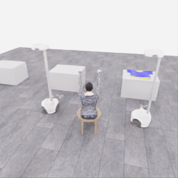
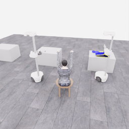
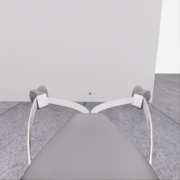
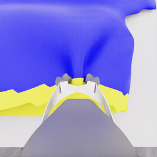
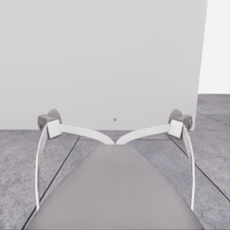
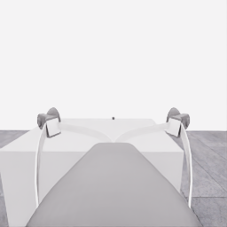
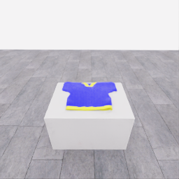
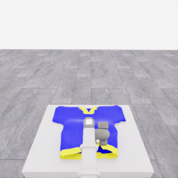
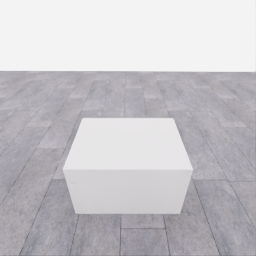
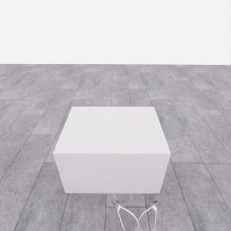

# 자동 시연 수집 시도 · 20261106-astra-pickup-hold5-001

[전체 수집 기록](../../README.ko.md) · [구조화 요약](manifest.json) · [전체 행동 기록](decisions.jsonl) · [사용한 기본 프롬프트](prompt.txt)

**공식 pickup 5점 획득: episode 12.30초에 인정됐고, 행동 응답 경계에서 리뷰를 위해 종료했습니다.** 5초는 행동 목표였으며, 실제 공식 3초 인정 후 조기 종료했습니다. 착의 success는 false입니다. [5점 획득·유지 시간·종료 검토](../../reviews/20261106-astra-pickup-hold5-001.ko.md)를 함께 확인합니다.

실행 상태는 **review_ready**, 원본 출처는 `gpt`입니다. 완료 상태와 과제 성공은 아래에서 따로 기록합니다.

## 실행 조건과 시간

| 항목 | 기록 |
|---|---|
| 기록 시작 UTC | 2026-11-06T03:42:40Z |
| 기록 종료 UTC | 2026-11-06T03:56:28Z |
| 이전 시도 | 20261106-astra-pickup-plan2-001 |
| 재시도 사유 | conservative_five_second_visible_hold_margin |
| 출처 그룹 | 20261106-astra-pickup-methods |
| 요청 모델 / 추론 설정 | gpt-6-astra / ultra |
| 전체 실제 경과 시간 (초) | 828.300 |
| Actor 호출 합계 (초) | 479.009 |
| 환경 요청·응답 합계 (초) | 281.724 |
| 시뮬레이션 시간 (초) | 12.650 |
| 저장 전이 수 | 253.000 |
| 응답 확인 전이 수 | 253.000 |
| 모델 호출 시도 수 | 18.000 |
| 완료한 결정 구간 수 | 18.000 |
| 파일 완료 상태 | true |
| 데이터 정합성 검사 | true |
| 학습 데이터 승인 | unreviewed |
| Actor 호출 방식 | exec |
| 한 호출의 최대 계획 구간 수 | 2.000 |
| 한 계획의 최대 제어 step 수 | 20.000 |

Actor 호출 시간은 공개 입력 저장·요청 전송·응답 처리 등 호출 경로를 측정합니다. 방식에 따라 Docker/CLI 시작이 호출 안에 들어가거나 상주 서버 준비 시간으로 분리됩니다. 내부 모델 추론 시간만 별도로 측정한 값은 아닙니다. 모델이 판단하는 동안 물리 시간은 멈추며 실제 경과 시간과 시뮬레이션 시간은 다릅니다. 세부 요청 프로세스 시간에도 CLI 처리·네트워크·서버 대기·생성이 함께 포함됩니다.

## 토큰 사용량의 범위

`actor_usage`는 thread별 관측 누계를 합친 값입니다. 결정의 `usage`는 원본 CLI 누계이며, 호출별 증가량은 `usage_accounting.incremental_usage`입니다. 캐시 입력은 입력의 부분집합이고 추론 출력은 출력의 부분집합이므로 열들을 다시 합산하지 않습니다.

전체 호출 사용량 확정: **true** · 기록한 호출 수: 18.

| 입력 | 캐시 입력 | 캐시 쓰기 입력 | 출력 | 추론 출력 |
|---:|---:|---:|---:|---:|
| 1554788 | 1399808 | 0 | 9141 | 7074 |

중복 누계는 추가 사용량 0으로 처리하고, 역행한 누계는 미확정으로 보존합니다. 새 thread는 별도로 집계합니다. 토큰 기록은 화폐 비용이나 청구서가 아닙니다.

## 리뷰 정지 조건

목표 누적 점수 5.000 · 감시 상태 `triggered` · 수집기 상태 `review_ready`.

마지막 관측 점수 5.000 · 응답 확인 step 252.

`review_ready`는 정지 조건에 따라 실행을 마치고 리뷰할 준비가 된 상태입니다. 50점·착의 성공이나 학습 데이터 승인을 뜻하지 않습니다. 공식 점수와 success는 아래 평가 결과로 확인합니다.

## 공식 평가 결과

평가 유효성 `true` · 누적 점수 **5.000 / 50** · 착의 success **false** · rate 상태 `no_contact` · 최종 rate 미측정/해당 없음 points/s.

누적 50점, 착의 success, 정상 파일 종료와 데이터 정합성은 서로 다른 상태입니다. 접촉 전 `no_contact`의 rate는 0점/초로 바꾸지 않습니다.

| 단계 | 획득 점수 / 최대 | 획득 시각 (episode 초) |
|---|---:|---:|
| 파지·들기 | 5.000 / 5 | 12.300 |
| 첫 소매 | 0.000 / 5 | 미측정/해당 없음 |
| 반대 어깨 | 0.000 / 5 | 미측정/해당 없음 |
| 두 번째 소매 | 0.000 / 5 | 미측정/해당 없음 |
| 왼쪽 위팔 | 0.000 / 5 | 미측정/해당 없음 |
| 오른쪽 위팔 | 0.000 / 5 | 미측정/해당 없음 |
| 목 통과 | 0.000 / 10 | 미측정/해당 없음 |
| 앞면 방향 | 0.000 / 10 | 미측정/해당 없음 |

## 단계 획득 경로

점수 획득은 [평가 이벤트](score-events.jsonl)에서 같은 physics tick끼리 묶었습니다. 같은 시각에 인정된 항목의 내부 순서는 추정하지 않습니다. 착의 success는 점수 획득과 별도로 기록합니다.

| 순서 | episode 시간 (초) | 전이 경계 step | 누적 점수 변화 | 같은 시각의 항목 변화 |
|---:|---:|---:|---:|---|
| 0 | 12.300 | 246 | 0.000→5.000 | 파지·들기 0.000→5.000 |

평가 clock 0초에 대응하는 공개 simulation clock은 1.525초입니다. 두 시계를 같은 절대 시각으로 혼동하지 않습니다.

별도 success 이벤트 수: **0**. 평가 유효성: `true`.


## 원본 관측 화면

지정된 공개 카메라의 저장 RGB 픽셀입니다. 시작은 첫 `obs`, 종료는 마지막 `next_obs`입니다. 이미지 합성이나 내부 상태 기반 장면 재구성 없이 원본 픽셀로 PNG를 저장했습니다.

| 카메라 | 시작 | 종료 |
|---|---|---|
| `overview` | [](images/initial-overview.png) | [](images/final-overview.png) |
| `robot_0_wrist` | [](images/initial-robot_0_wrist.png) | [](images/final-robot_0_wrist.png) |
| `robot_1_wrist` | [](images/initial-robot_1_wrist.png) | [](images/final-robot_1_wrist.png) |
| `robot_0_head` | [](images/initial-robot_0_head.png) | [](images/final-robot_0_head.png) |
| `robot_1_head` | [](images/initial-robot_1_head.png) | [](images/final-robot_1_head.png) |

시작 관측 시각 1.525초 · 종료 관측 시각 14.175초 (공개 simulation clock).

[▶ overview 관측 영상 보기](overview.mp4)

저장된 20 Hz `obs` 중 253프레임을 순서대로 사용했습니다. 재생은 **4.0배 느리게** (5.000 fps), 실제 대기 시간·모델 호출 지연은 영상에 들어가지 않습니다. 종료 `next_obs`는 위 PNG에서 확인합니다.

## 결정과 실행 순서

아래 근거는 모델 최종 JSON의 짧은 행동 설명입니다. 시각적 평가는 행동 전 관측에 대한 판단이며, 그 행동의 실행 후 성공 라벨로 사용하지 않습니다. 공식 점수는 별도의 평가 결과입니다.

행동의 각 행은 로봇 0·1 순서이며 열은 `전진, 왼쪽 이동, 반시계 회전, 리프트, 팔 신장, 손목 yaw, pitch, roll, gripper`입니다. 앞 8개는 정규화 속도이고 gripper는 닫기 `+1`, 열기 `-1`, 의도 유지 `0`입니다.

이 시도는 **고정 행동 목록의 개방형 실행(open-loop)**을 사용할 수 있도록 구성했습니다. 한 모델 응답의 여러 구간을 순서대로 실행하며 목록 중간에 새 모델 판단이나 관측 조건 분기를 수행하지 않습니다. 20Hz 저장과 각 구간의 최신 관측 기록이 모델의 20Hz 피드백을 뜻하지 않습니다. 모델 입력 관측 시각과 구간 실행 직전 관측 시각을 따로 표시합니다.

### 결정 0 · 준비 · `act`

입력 관측 1.525초 · Actor 호출 36.850초 · 시각적 판단 `uncertain`.

계획 `20261106-astra-pickup-hold5-001:call-00000` · 모델 호출 인덱스 0 · 계획 구간 1/1 · 이 구간에서 모델 호출 `true`.

실행 직전 최신 관측 1.525초.

공개 입력 저장 0.109초 · 요청 프로세스 36.740초 · 결과 해석 0.001초.

호출 사용량 상태 `observed` · 이번 증가량 입력 17145 / 출력 797 토큰.

최종 응답의 행동 설명: Robot 0 faces the shirt; robot 1 faces an empty table. Raise both open grippers about 69 cm from their low starting poses before approaching.

요청 행동:

```json
[[0, 0, 0, 0.45, 0, 0, 0, 0, -1], [0, 0, 0, 0.45, 0, 0, 0, 0, -1]]
```

실행 구간 step **[0, 20)** · 요청 20 step / 실제 20 step · 환경 요청·응답 21.353초.

실제 적용 행동:

```json
[[0.0, 0.0, 0.0, 0.44999998807907104, 0.0, 0.0, 0.0, 0.0, -1.0], [0.0, 0.0, 0.0, 0.44999998807907104, 0.0, 0.0, 0.0, 0.0, -1.0]]
```

### 결정 1 · 접근 · `act`

입력 관측 2.525초 · Actor 호출 51.465초 · 시각적 판단 `progressing`.

계획 `20261106-astra-pickup-hold5-001:call-00001` · 모델 호출 인덱스 1 · 계획 구간 1/1 · 이 구간에서 모델 호출 `true`.

실행 직전 최신 관측 2.525초.

공개 입력 저장 0.098초 · 요청 프로세스 51.366초 · 결과 해석 0.000초.

호출 사용량 상태 `observed` · 이번 증가량 입력 25154 / 출력 973 토큰.

최종 응답의 행동 설명: The shirt remains flat ahead of robot 0. Advance its open gripper toward the near hem, adding height and pitching downward for clearance; keep robot 1 stationary.

요청 행동:

```json
[[0.6, 0, 0, 0.1, 0.1, 0, 0.18, 0, -1], [0, 0, 0, 0, 0, 0, 0, 0, 0]]
```

실행 구간 step **[20, 40)** · 요청 20 step / 실제 20 step · 환경 요청·응답 21.550초.

실제 적용 행동:

```json
[[0.6000000238418579, 0.0, 0.0, 0.10000000149011612, 0.10000000149011612, 0.0, 0.18000000715255737, 0.0, -1.0], [0.0, 0.0, 0.0, 0.0, 0.0, 0.0, 0.0, 0.0, 0.0]]
```

### 결정 2 · 접근 · `act`

입력 관측 3.525초 · Actor 호출 63.543초 · 시각적 판단 `progressing`.

계획 `20261106-astra-pickup-hold5-001:call-00002` · 모델 호출 인덱스 2 · 계획 구간 1/1 · 이 구간에서 모델 호출 `true`.

실행 직전 최신 관측 3.525초.

공개 입력 저장 0.101초 · 요청 프로세스 63.442초 · 결과 해석 0.000초.

호출 사용량 상태 `observed` · 이번 증가량 입력 33654 / 출력 1319 토큰.

최종 응답의 행동 설명: Robot 0&#x27;s wrist view shows the yellow hem ahead with clear separation. Advance and extend toward it while turning the open fingers downward, maintaining height before descent.

요청 행동:

```json
[[0.25, 0, 0, 0, 0.28, 0, 0.105, 0, -1], [0, 0, 0, 0, 0, 0, 0, 0, 0]]
```

실행 구간 step **[40, 60)** · 요청 20 step / 실제 20 step · 환경 요청·응답 21.509초.

실제 적용 행동:

```json
[[0.25, 0.0, 0.0, 0.0, 0.2800000011920929, 0.0, 0.10499999672174454, 0.0, -1.0], [0.0, 0.0, 0.0, 0.0, 0.0, 0.0, 0.0, 0.0, 0.0]]
```

### 결정 3 · 접근 · `act`

입력 관측 4.525초 · Actor 호출 39.644초 · 시각적 판단 `progressing`.

계획 `20261106-astra-pickup-hold5-001:call-00003` · 모델 호출 인덱스 3 · 계획 구간 1/1 · 이 구간에서 모델 호출 `true`.

실행 직전 최신 관측 4.525초.

공개 입력 저장 0.101초 · 요청 프로세스 39.543초 · 결과 해석 0.000초.

호출 사용량 상태 `observed` · 이번 증가량 입력 42494 / 출력 761 토큰.

최종 응답의 행동 설명: Robot 0&#x27;s open gripper is above the shirt near the hem, with visible depth separation. Stop horizontal motion and lower toward the fabric before checking contact clearance.

요청 행동:

```json
[[0, 0, 0, -0.15, 0, 0, 0, 0, -1], [0, 0, 0, 0, 0, 0, 0, 0, 0]]
```

실행 구간 step **[60, 76)** · 요청 16 step / 실제 16 step · 환경 요청·응답 17.639초.

실제 적용 행동:

```json
[[0.0, 0.0, 0.0, -0.15000000596046448, 0.0, 0.0, 0.0, 0.0, -1.0], [0.0, 0.0, 0.0, 0.0, 0.0, 0.0, 0.0, 0.0, 0.0]]
```

### 결정 4 · 접근 · `act`

입력 관측 5.325초 · Actor 호출 40.401초 · 시각적 판단 `progressing`.

계획 `20261106-astra-pickup-hold5-001:call-00004` · 모델 호출 인덱스 4 · 계획 구간 1/1 · 이 구간에서 모델 호출 `true`.

실행 직전 최신 관측 5.325초.

공개 입력 저장 0.102초 · 요청 프로세스 40.298초 · 결과 해석 0.000초.

호출 사용량 상태 `observed` · 이번 증가량 입력 50765 / 출력 802 토큰.

최종 응답의 행동 설명: The fabric remains below robot 0&#x27;s fingertips, and the lift is still settling. Make a small descent with fingers open, then inspect clearance before closing.

요청 행동:

```json
[[0, 0, 0, -0.02, 0, 0, 0, 0, -1], [0, 0, 0, 0, 0, 0, 0, 0, 0]]
```

실행 구간 step **[76, 82)** · 요청 6 step / 실제 6 step · 환경 요청·응답 7.277초.

실제 적용 행동:

```json
[[0.0, 0.0, 0.0, -0.019999999552965164, 0.0, 0.0, 0.0, 0.0, -1.0], [0.0, 0.0, 0.0, 0.0, 0.0, 0.0, 0.0, 0.0, 0.0]]
```

### 결정 5 · 파지 · `act`

입력 관측 5.625초 · Actor 호출 10.391초 · 시각적 판단 `uncertain`.

계획 `20261106-astra-pickup-hold5-001:call-00005` · 모델 호출 인덱스 5 · 계획 구간 1/1 · 이 구간에서 모델 호출 `true`.

실행 직전 최신 관측 5.625초.

공개 입력 저장 0.106초 · 요청 프로세스 10.285초 · 결과 해석 0.000초.

호출 사용량 상태 `observed` · 이번 증가량 입력 59087 / 출력 195 토큰.

최종 응답의 행동 설명: Robot 0&#x27;s fingers are aligned over fabric close to its surface. Close without further descent; attachment remains unconfirmed until a separate lift test shows cloth following.

요청 행동:

```json
[[0, 0, 0, 0, 0, 0, 0, 0, 1], [0, 0, 0, 0, 0, 0, 0, 0, 0]]
```

실행 구간 step **[82, 90)** · 요청 8 step / 실제 8 step · 환경 요청·응답 9.397초.

실제 적용 행동:

```json
[[0.0, 0.0, 0.0, 0.0, 0.0, 0.0, 0.0, 0.0, 1.0], [0.0, 0.0, 0.0, 0.0, 0.0, 0.0, 0.0, 0.0, 0.0]]
```

### 결정 6 · 들기 · `act`

입력 관측 6.025초 · Actor 호출 15.802초 · 시각적 판단 `uncertain`.

계획 `20261106-astra-pickup-hold5-001:call-00006` · 모델 호출 인덱스 6 · 계획 구간 1/1 · 이 구간에서 모델 호출 `true`.

실행 직전 최신 관측 6.025초.

공개 입력 저장 0.104초 · 요청 프로세스 15.697초 · 결과 해석 0.000초.

호출 사용량 상태 `observed` · 이번 증가량 입력 66793 / 출력 310 토큰.

최종 응답의 행동 설명: The fingers have not visibly narrowed despite the close command. Make a small upward test while maintaining closure to check whether fabric follows and relieve possible tabletop contact.

요청 행동:

```json
[[0, 0, 0, 0.1, 0, 0, 0, 0, 1], [0, 0, 0, 0, 0, 0, 0, 0, 0]]
```

실행 구간 step **[90, 98)** · 요청 8 step / 실제 8 step · 환경 요청·응답 9.502초.

실제 적용 행동:

```json
[[0.0, 0.0, 0.0, 0.10000000149011612, 0.0, 0.0, 0.0, 0.0, 1.0], [0.0, 0.0, 0.0, 0.0, 0.0, 0.0, 0.0, 0.0, 0.0]]
```

### 결정 7 · 들기 · `act`

입력 관측 6.425초 · Actor 호출 20.161초 · 시각적 판단 `progressing`.

계획 `20261106-astra-pickup-hold5-001:call-00007` · 모델 호출 인덱스 7 · 계획 구간 1/1 · 이 구간에서 모델 호출 `true`.

실행 직전 최신 관측 6.425초.

공개 입력 저장 0.105초 · 요청 프로세스 20.056초 · 결과 해석 0.000초.

호출 사용량 상태 `observed` · 이번 증가량 입력 74637 / 출력 389 토큰.

최종 응답의 행동 설명: Fabric now gathers upward between the narrowing fingers, and the hem deforms during the test lift. Raise the same grip further while keeping the base and wrist fixed.

요청 행동:

```json
[[0, 0, 0, 0.1, 0, 0, 0, 0, 1], [0, 0, 0, 0, 0, 0, 0, 0, 0]]
```

실행 구간 step **[98, 114)** · 요청 16 step / 실제 16 step · 환경 요청·응답 17.720초.

실제 적용 행동:

```json
[[0.0, 0.0, 0.0, 0.10000000149011612, 0.0, 0.0, 0.0, 0.0, 1.0], [0.0, 0.0, 0.0, 0.0, 0.0, 0.0, 0.0, 0.0, 0.0]]
```

### 결정 8 · 복구 · `act`

입력 관측 7.225초 · Actor 호출 47.621초 · 시각적 판단 `recovering`.

계획 `20261106-astra-pickup-hold5-001:call-00008` · 모델 호출 인덱스 8 · 계획 구간 1/1 · 이 구간에서 모델 호출 `true`.

실행 직전 최신 관측 7.225초.

공개 입력 저장 0.112초 · 요청 프로세스 47.509초 · 결과 해석 0.000초.

호출 사용량 상태 `observed` · 이번 증가량 입력 82560 / 출력 930 토큰.

최종 응답의 행동 설명: The shirt has flattened onto the table, visibly separated from the raised fingers; the grasp appears to have slipped. Open and retract toward the thicker yellow hem while lowering partway for another attempt.

요청 행동:

```json
[[0, 0, 0, -0.1, -0.15, 0, 0, 0, -1], [0, 0, 0, 0, 0, 0, 0, 0, 0]]
```

실행 구간 step **[114, 126)** · 요청 12 step / 실제 12 step · 환경 요청·응답 13.087초.

실제 적용 행동:

```json
[[0.0, 0.0, 0.0, -0.10000000149011612, -0.15000000596046448, 0.0, 0.0, 0.0, -1.0], [0.0, 0.0, 0.0, 0.0, 0.0, 0.0, 0.0, 0.0, 0.0]]
```

### 결정 9 · 접근 · `act`

입력 관측 7.825초 · Actor 호출 33.582초 · 시각적 판단 `progressing`.

계획 `20261106-astra-pickup-hold5-001:call-00009` · 모델 호출 인덱스 9 · 계획 구간 1/1 · 이 구간에서 모델 호출 `true`.

실행 직전 최신 관측 7.825초.

공개 입력 저장 0.101초 · 요청 프로세스 33.481초 · 결과 해석 0.000초.

호출 사용량 상태 `observed` · 이번 증가량 입력 91026 / 출력 629 토큰.

최종 응답의 행동 설명: The open gripper is now aligned near the yellow hem. Lower toward this folded edge, keeping horizontal position fixed and stopping before the next pinch attempt.

요청 행동:

```json
[[0, 0, 0, -0.1, 0, 0, 0, 0, -1], [0, 0, 0, 0, 0, 0, 0, 0, 0]]
```

실행 구간 step **[126, 136)** · 요청 10 step / 실제 10 step · 환경 요청·응답 11.261초.

실제 적용 행동:

```json
[[0.0, 0.0, 0.0, -0.10000000149011612, 0.0, 0.0, 0.0, 0.0, -1.0], [0.0, 0.0, 0.0, 0.0, 0.0, 0.0, 0.0, 0.0, 0.0]]
```

### 결정 10 · 파지 · `act`

입력 관측 8.325초 · Actor 호출 19.606초 · 시각적 판단 `uncertain`.

계획 `20261106-astra-pickup-hold5-001:call-00010` · 모델 호출 인덱스 10 · 계획 구간 1/1 · 이 구간에서 모델 호출 `true`.

실행 직전 최신 관측 8.325초.

공개 입력 저장 0.101초 · 요청 프로세스 19.504초 · 결과 해석 0.000초.

호출 사용량 상태 `observed` · 이번 증가량 입력 99187 / 출력 331 토큰.

최종 응답의 행동 설명: The yellow hem lies beneath the aligned fingers. Close while the lift settles at its current target, then inspect the pinch before applying any upward motion.

요청 행동:

```json
[[0, 0, 0, 0, 0, 0, 0, 0, 1], [0, 0, 0, 0, 0, 0, 0, 0, 0]]
```

실행 구간 step **[136, 146)** · 요청 10 step / 실제 10 step · 환경 요청·응답 11.414초.

실제 적용 행동:

```json
[[0.0, 0.0, 0.0, 0.0, 0.0, 0.0, 0.0, 0.0, 1.0], [0.0, 0.0, 0.0, 0.0, 0.0, 0.0, 0.0, 0.0, 0.0]]
```

### 결정 11 · 파지 · `act`

입력 관측 8.825초 · Actor 호출 11.843초 · 시각적 판단 `uncertain`.

계획 `20261106-astra-pickup-hold5-001:call-00011` · 모델 호출 인덱스 11 · 계획 구간 1/1 · 이 구간에서 모델 호출 `true`.

실행 직전 최신 관측 8.825초.

공개 입력 저장 0.106초 · 요청 프로세스 11.736초 · 결과 해석 0.000초.

호출 사용량 상태 `observed` · 이번 증가량 입력 107029 / 출력 208 토큰.

최종 응답의 행동 설명: The hem is bunching beneath partially closed fingers. Add only about 1 cm of upward travel while maintaining closure, then inspect whether the pinch tightens without losing the fabric.

요청 행동:

```json
[[0, 0, 0, 0.02, 0, 0, 0, 0, 1], [0, 0, 0, 0, 0, 0, 0, 0, 0]]
```

실행 구간 step **[146, 154)** · 요청 8 step / 실제 8 step · 환경 요청·응답 9.421초.

실제 적용 행동:

```json
[[0.0, 0.0, 0.0, 0.019999999552965164, 0.0, 0.0, 0.0, 0.0, 1.0], [0.0, 0.0, 0.0, 0.0, 0.0, 0.0, 0.0, 0.0, 0.0]]
```

### 결정 12 · 파지 · `act`

입력 관측 9.225초 · Actor 호출 12.799초 · 시각적 판단 `progressing`.

계획 `20261106-astra-pickup-hold5-001:call-00012` · 모델 호출 인덱스 12 · 계획 구간 1/1 · 이 구간에서 모델 호출 `true`.

실행 직전 최신 관측 9.225초.

공개 입력 저장 0.108초 · 요청 프로세스 12.690초 · 결과 해석 0.000초.

호출 사용량 상태 `observed` · 이번 증가량 입력 114764 / 출력 211 토큰.

최종 응답의 행동 설명: The fingers are narrowing and the hem remains gathered between them. Maintain closure without further lift so the pinch can settle before testing whether it holds.

요청 행동:

```json
[[0, 0, 0, 0, 0, 0, 0, 0, 1], [0, 0, 0, 0, 0, 0, 0, 0, 0]]
```

실행 구간 step **[154, 166)** · 요청 12 step / 실제 12 step · 환경 요청·응답 13.821초.

실제 적용 행동:

```json
[[0.0, 0.0, 0.0, 0.0, 0.0, 0.0, 0.0, 0.0, 1.0], [0.0, 0.0, 0.0, 0.0, 0.0, 0.0, 0.0, 0.0, 0.0]]
```

### 결정 13 · 들기 · `act`

입력 관측 9.825초 · Actor 호출 12.995초 · 시각적 판단 `uncertain`.

계획 `20261106-astra-pickup-hold5-001:call-00013` · 모델 호출 인덱스 13 · 계획 구간 1/1 · 이 구간에서 모델 호출 `true`.

실행 직전 최신 관측 9.825초.

공개 입력 저장 0.105초 · 요청 프로세스 12.889초 · 결과 해석 0.000초.

호출 사용량 상태 `observed` · 이번 증가량 입력 122508 / 출력 236 토큰.

최종 응답의 행동 설명: A distinct fabric fold remains between the fingers after the pinch settled. Apply a slow, small lift test while preserving closure, then check whether the hem follows.

요청 행동:

```json
[[0, 0, 0, 0.04, 0, 0, 0, 0, 1], [0, 0, 0, 0, 0, 0, 0, 0, 0]]
```

실행 구간 step **[166, 176)** · 요청 10 step / 실제 10 step · 환경 요청·응답 11.890초.

실제 적용 행동:

```json
[[0.0, 0.0, 0.0, 0.03999999910593033, 0.0, 0.0, 0.0, 0.0, 1.0], [0.0, 0.0, 0.0, 0.0, 0.0, 0.0, 0.0, 0.0, 0.0]]
```

### 결정 14 · 들기 · `act`

입력 관측 10.325초 · Actor 호출 19.362초 · 시각적 판단 `progressing`.

계획 `20261106-astra-pickup-hold5-001:call-00014` · 모델 호출 인덱스 14 · 계획 구간 1/1 · 이 구간에서 모델 호출 `true`.

실행 직전 최신 관측 10.325초.

공개 입력 저장 0.111초 · 요청 프로세스 19.251초 · 결과 해석 0.000초.

호출 사용량 상태 `observed` · 이번 증가량 입력 130262 / 출력 308 토큰.

최종 응답의 행동 설명: The hem fold stayed between the fingers during the test while surrounding fabric stretched toward the table. Continue a slow vertical lift with the same grip.

요청 행동:

```json
[[0, 0, 0, 0.05, 0, 0, 0, 0, 1], [0, 0, 0, 0, 0, 0, 0, 0, 0]]
```

실행 구간 step **[176, 192)** · 요청 16 step / 실제 16 step · 환경 요청·응답 18.198초.

실제 적용 행동:

```json
[[0.0, 0.0, 0.0, 0.05000000074505806, 0.0, 0.0, 0.0, 0.0, 1.0], [0.0, 0.0, 0.0, 0.0, 0.0, 0.0, 0.0, 0.0, 0.0]]
```

### 결정 15 · 최종 확인 · `act`

입력 관측 11.125초 · Actor 호출 14.345초 · 시각적 판단 `progressing`.

계획 `20261106-astra-pickup-hold5-001:call-00015` · 모델 호출 인덱스 15 · 계획 구간 1/1 · 이 구간에서 모델 호출 `true`.

실행 직전 최신 관측 11.125초.

공개 입력 저장 0.103초 · 요청 프로세스 14.241초 · 결과 해석 0.000초.

호출 사용량 상태 `observed` · 이번 증가량 입력 138094 / 출력 259 토큰.

최종 응답의 행동 설명: The gathered hem remains visibly raised with the same gripper. Preserve closure and stop commanded motion so the lift and fabric can settle before starting the five-second stable-hold interval.

요청 행동:

```json
[[0, 0, 0, 0, 0, 0, 0, 0, 0], [0, 0, 0, 0, 0, 0, 0, 0, 0]]
```

실행 구간 step **[192, 212)** · 요청 20 step / 실제 20 step · 환경 요청·응답 21.882초.

실제 적용 행동:

```json
[[0.0, 0.0, 0.0, 0.0, 0.0, 0.0, 0.0, 0.0, 0.0], [0.0, 0.0, 0.0, 0.0, 0.0, 0.0, 0.0, 0.0, 0.0]]
```

### 결정 16 · 최종 확인 · `act`

입력 관측 12.125초 · Actor 호출 18.812초 · 시각적 판단 `progressing`.

계획 `20261106-astra-pickup-hold5-001:call-00016` · 모델 호출 인덱스 16 · 계획 구간 1/1 · 이 구간에서 모델 호출 `true`.

실행 직전 최신 관측 12.125초.

공개 입력 저장 0.105초 · 요청 프로세스 18.707초 · 결과 해석 0.000초.

호출 사용량 상태 `observed` · 이번 증가량 입력 145873 / 출력 358 토큰.

최종 응답의 행동 설명: The hem remains visibly raised and appears settled at simulation time 12.125 s. Start the five-second hold interval now, preserving the grip with neutral motion.

요청 행동:

```json
[[0, 0, 0, 0, 0, 0, 0, 0, 0], [0, 0, 0, 0, 0, 0, 0, 0, 0]]
```

실행 구간 step **[212, 232)** · 요청 20 step / 실제 20 step · 환경 요청·응답 21.928초.

실제 적용 행동:

```json
[[0.0, 0.0, 0.0, 0.0, 0.0, 0.0, 0.0, 0.0, 0.0], [0.0, 0.0, 0.0, 0.0, 0.0, 0.0, 0.0, 0.0, 0.0]]
```

### 결정 17 · 최종 확인 · `act`

입력 관측 13.125초 · Actor 호출 9.788초 · 시각적 판단 `progressing`.

계획 `20261106-astra-pickup-hold5-001:call-00017` · 모델 호출 인덱스 17 · 계획 구간 1/1 · 이 구간에서 모델 호출 `true`.

실행 직전 최신 관측 13.125초.

공개 입력 저장 0.105초 · 요청 프로세스 9.683초 · 결과 해석 0.000초.

호출 사용량 상태 `observed` · 이번 증가량 입력 153756 / 출력 125 토큰.

최종 응답의 행동 설명: At 13.125 s, the raised hem remains steady in the same grip: one second of the five-second hold observed. Continue neutral motion while preserving closure.

요청 행동:

```json
[[0, 0, 0, 0, 0, 0, 0, 0, 0], [0, 0, 0, 0, 0, 0, 0, 0, 0]]
```

실행 구간 step **[232, 252)** · 요청 20 step / 실제 20 step · 환경 요청·응답 22.876초.

실제 적용 행동:

```json
[[0.0, 0.0, 0.0, 0.0, 0.0, 0.0, 0.0, 0.0, 0.0], [0.0, 0.0, 0.0, 0.0, 0.0, 0.0, 0.0, 0.0, 0.0]]
```

수집기 정지: `review_points` · 중립 명령 1 step.

## 검수와 후속 판단

현재 데이터 승인은 `unreviewed`입니다. 형식과 시간 정합성 검사를 통과해도 시연의 유용성이나 착의 성공을 보장하지 않습니다.

이 페이지의 원본 파일 SHA256과 생성 파일 SHA256은 [manifest.json](manifest.json)에 있습니다. 실행 실패도 같은 run ID와 부모 시도 관계로 보존합니다. 공개 범위는 카메라, 최종 행동 응답, 시간, 평가 요약입니다.

[개발 피드백과 변경 근거](../../feedback/2026-11-06.jsonl)
