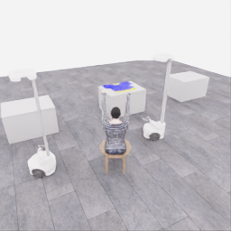
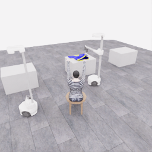
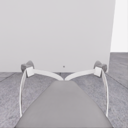
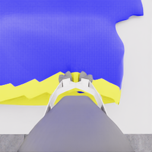
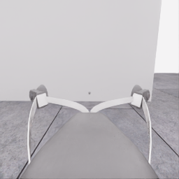
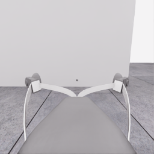
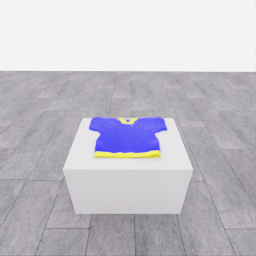
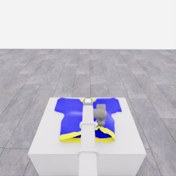
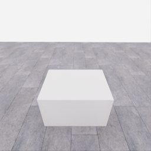
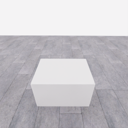

# 자동 시연 수집 시도 · 20261106-astra-pickup-plan2-001

[전체 수집 기록](../../README.ko.md) · [구조화 요약](manifest.json) · [전체 행동 기록](decisions.jsonl) · [사용한 기본 프롬프트](prompt.txt)

**검수 결과: 공식 pickup은 0점입니다. 모델은 시각적 완료를 판단했지만, 공식 유지 시간은 2.9초로 3.0초 기준보다 0.1초 부족했습니다.** [시각 판단·공식 조건·종료 원인 검토](../../reviews/20261106-astra-pickup-plan2-001.ko.md)를 함께 확인합니다.

실행 상태는 **completed**, 원본 출처는 `gpt`입니다. 완료 상태와 과제 성공은 아래에서 따로 기록합니다.

## 실행 조건과 시간

| 항목 | 기록 |
|---|---|
| 기록 시작 UTC | 2026-11-06T03:25:32Z |
| 기록 종료 UTC | 2026-11-06T03:35:14Z |
| 이전 시도 | 20261106-astra-dressing-001 |
| 재시도 사유 | pickup_focus_with_bounded_two_segment_plans |
| 출처 그룹 | 20261106-astra-pickup-methods |
| 요청 모델 / 추론 설정 | gpt-6-astra / ultra |
| 전체 실제 경과 시간 (초) | 582.025 |
| Actor 호출 합계 (초) | 337.250 |
| 환경 요청·응답 합계 (초) | 181.917 |
| 시뮬레이션 시간 (초) | 8.400 |
| 저장 전이 수 | 168.000 |
| 응답 확인 전이 수 | 168.000 |
| 모델 호출 시도 수 | 13.000 |
| 완료한 결정 구간 수 | 13.000 |
| 파일 완료 상태 | true |
| 데이터 정합성 검사 | true |
| 학습 데이터 승인 | unreviewed |
| Actor 호출 방식 | exec |
| 한 호출의 최대 계획 구간 수 | 2.000 |
| 한 계획의 최대 제어 step 수 | 20.000 |

Actor 호출 시간은 공개 입력 저장·요청 전송·응답 처리 등 호출 경로를 측정합니다. 방식에 따라 Docker/CLI 시작이 호출 안에 들어가거나 상주 서버 준비 시간으로 분리됩니다. 내부 모델 추론 시간만 별도로 측정한 값은 아닙니다. 모델이 판단하는 동안 물리 시간은 멈추며 실제 경과 시간과 시뮬레이션 시간은 다릅니다. 세부 요청 프로세스 시간에도 CLI 처리·네트워크·서버 대기·생성이 함께 포함됩니다.

## 토큰 사용량의 범위

`actor_usage`는 thread별 관측 누계를 합친 값입니다. 결정의 `usage`는 원본 CLI 누계이며, 호출별 증가량은 `usage_accounting.incremental_usage`입니다. 캐시 입력은 입력의 부분집합이고 추론 출력은 출력의 부분집합이므로 열들을 다시 합산하지 않습니다.

전체 호출 사용량 확정: **true** · 기록한 호출 수: 13.

| 입력 | 캐시 입력 | 캐시 쓰기 입력 | 출력 | 추론 출력 |
|---:|---:|---:|---:|---:|
| 887823 | 768768 | 0 | 6575 | 5114 |

중복 누계는 추가 사용량 0으로 처리하고, 역행한 누계는 미확정으로 보존합니다. 새 thread는 별도로 집계합니다. 토큰 기록은 화폐 비용이나 청구서가 아닙니다.

## 리뷰 정지 조건

목표 누적 점수 5.000 · 감시 상태 `collector_ended_before_gate` · 수집기 상태 `completed`.

마지막 관측 점수 0.000 · 응답 확인 step 168.

`review_ready`는 정지 조건에 따라 실행을 마치고 리뷰할 준비가 된 상태입니다. 50점·착의 성공이나 학습 데이터 승인을 뜻하지 않습니다. 공식 점수와 success는 아래 평가 결과로 확인합니다.

## 공식 평가 결과

평가 유효성 `true` · 누적 점수 **0.000 / 50** · 착의 success **false** · rate 상태 `no_contact` · 최종 rate 미측정/해당 없음 points/s.

누적 50점, 착의 success, 정상 파일 종료와 데이터 정합성은 서로 다른 상태입니다. 접촉 전 `no_contact`의 rate는 0점/초로 바꾸지 않습니다.

| 단계 | 획득 점수 / 최대 | 획득 시각 (episode 초) |
|---|---:|---:|
| 파지·들기 | 0.000 / 5 | 미측정/해당 없음 |
| 첫 소매 | 0.000 / 5 | 미측정/해당 없음 |
| 반대 어깨 | 0.000 / 5 | 미측정/해당 없음 |
| 두 번째 소매 | 0.000 / 5 | 미측정/해당 없음 |
| 왼쪽 위팔 | 0.000 / 5 | 미측정/해당 없음 |
| 오른쪽 위팔 | 0.000 / 5 | 미측정/해당 없음 |
| 목 통과 | 0.000 / 10 | 미측정/해당 없음 |
| 앞면 방향 | 0.000 / 10 | 미측정/해당 없음 |

## 단계 획득 경로

점수 획득은 [평가 이벤트](score-events.jsonl)에서 같은 physics tick끼리 묶었습니다. 같은 시각에 인정된 항목의 내부 순서는 추정하지 않습니다. 착의 success는 점수 획득과 별도로 기록합니다.

| 순서 | episode 시간 (초) | 전이 경계 step | 누적 점수 변화 | 같은 시각의 항목 변화 |
|---:|---:|---:|---:|---|
| — | — | — | — | 기록된 공식 항목 획득 없음 |

평가 clock 0초에 대응하는 공개 simulation clock은 1.525초입니다. 두 시계를 같은 절대 시각으로 혼동하지 않습니다.

별도 success 이벤트 수: **0**. 평가 유효성: `true`.


## 원본 관측 화면

지정된 공개 카메라의 저장 RGB 픽셀입니다. 시작은 첫 `obs`, 종료는 마지막 `next_obs`입니다. 이미지 합성이나 내부 상태 기반 장면 재구성 없이 원본 픽셀로 PNG를 저장했습니다.

| 카메라 | 시작 | 종료 |
|---|---|---|
| `overview` | [](images/initial-overview.png) | [](images/final-overview.png) |
| `robot_0_wrist` | [](images/initial-robot_0_wrist.png) | [](images/final-robot_0_wrist.png) |
| `robot_1_wrist` | [](images/initial-robot_1_wrist.png) | [](images/final-robot_1_wrist.png) |
| `robot_0_head` | [](images/initial-robot_0_head.png) | [](images/final-robot_0_head.png) |
| `robot_1_head` | [](images/initial-robot_1_head.png) | [](images/final-robot_1_head.png) |

시작 관측 시각 1.525초 · 종료 관측 시각 9.925초 (공개 simulation clock).

[▶ overview 관측 영상 보기](overview.mp4)

저장된 20 Hz `obs` 중 168프레임을 순서대로 사용했습니다. 재생은 **4.0배 느리게** (5.000 fps), 실제 대기 시간·모델 호출 지연은 영상에 들어가지 않습니다. 종료 `next_obs`는 위 PNG에서 확인합니다.

## 결정과 실행 순서

아래 근거는 모델 최종 JSON의 짧은 행동 설명입니다. 시각적 평가는 행동 전 관측에 대한 판단이며, 그 행동의 실행 후 성공 라벨로 사용하지 않습니다. 공식 점수는 별도의 평가 결과입니다.

행동의 각 행은 로봇 0·1 순서이며 열은 `전진, 왼쪽 이동, 반시계 회전, 리프트, 팔 신장, 손목 yaw, pitch, roll, gripper`입니다. 앞 8개는 정규화 속도이고 gripper는 닫기 `+1`, 열기 `-1`, 의도 유지 `0`입니다.

이 시도는 **고정 행동 목록의 개방형 실행(open-loop)**을 사용할 수 있도록 구성했습니다. 한 모델 응답의 여러 구간을 순서대로 실행하며 목록 중간에 새 모델 판단이나 관측 조건 분기를 수행하지 않습니다. 20Hz 저장과 각 구간의 최신 관측 기록이 모델의 20Hz 피드백을 뜻하지 않습니다. 모델 입력 관측 시각과 구간 실행 직전 관측 시각을 따로 표시합니다.

### 결정 0 · 준비 · `act`

입력 관측 1.525초 · Actor 호출 46.373초 · 시각적 판단 `uncertain`.

계획 `20261106-astra-pickup-plan2-001:call-00000` · 모델 호출 인덱스 0 · 계획 구간 1/1 · 이 구간에서 모델 호출 `true`.

실행 직전 최신 관측 1.525초.

공개 입력 저장 0.116초 · 요청 프로세스 46.256초 · 결과 해석 0.000초.

호출 사용량 상태 `observed` · 이번 증가량 입력 17052 / 출력 1024 토큰.

최종 응답의 행동 설명: Robot 0 sees the shirt; robot 1 faces an empty table. Raise robot 0&#x27;s open gripper toward clearance above the estimated tabletop before approaching.

요청 행동:

```json
[[0, 0, 0, 0.35, 0, 0, 0, 0, -1], [0, 0, 0, 0, 0, 0, 0, 0, 0]]
```

실행 구간 step **[0, 20)** · 요청 20 step / 실제 20 step · 환경 요청·응답 21.428초.

실제 적용 행동:

```json
[[0.0, 0.0, 0.0, 0.3499999940395355, 0.0, 0.0, 0.0, 0.0, -1.0], [0.0, 0.0, 0.0, 0.0, 0.0, 0.0, 0.0, 0.0, 0.0]]
```

### 결정 1 · 접근 · `act`

입력 관측 2.525초 · Actor 호출 63.689초 · 시각적 판단 `progressing`.

계획 `20261106-astra-pickup-plan2-001:call-00001` · 모델 호출 인덱스 1 · 계획 구간 1/1 · 이 구간에서 모델 호출 `true`.

실행 직전 최신 관측 2.525초.

공개 입력 저장 0.098초 · 요청 프로세스 63.591초 · 결과 해석 0.000초.

호출 사용량 상태 `observed` · 이번 증가량 입력 25658 / 출력 1289 토큰.

최종 응답의 행동 설명: Bring robot 0 closer to the visible hem while raising and pitching its open gripper downward for an overhead approach. Keep robot 1 stationary.

요청 행동:

```json
[[0.45, 0, 0, 0.16, 0.25, 0, 0.25, 0, -1], [0, 0, 0, 0, 0, 0, 0, 0, 0]]
```

실행 구간 step **[20, 40)** · 요청 20 step / 실제 20 step · 환경 요청·응답 22.518초.

실제 적용 행동:

```json
[[0.44999998807907104, 0.0, 0.0, 0.1599999964237213, 0.25, 0.0, 0.25, 0.0, -1.0], [0.0, 0.0, 0.0, 0.0, 0.0, 0.0, 0.0, 0.0, 0.0]]
```

### 결정 2 · 접근 · `act`

입력 관측 3.525초 · Actor 호출 58.636초 · 시각적 판단 `progressing`.

계획 `20261106-astra-pickup-plan2-001:call-00002` · 모델 호출 인덱스 2 · 계획 구간 1/1 · 이 구간에서 모델 호출 `true`.

실행 직전 최신 관측 3.525초.

공개 입력 저장 0.105초 · 요청 프로세스 58.531초 · 결과 해석 0.000초.

호출 사용량 상태 `observed` · 이번 증가량 입력 34811 / 출력 1227 토큰.

최종 응답의 행동 설명: The yellow hem remains ahead of robot 0&#x27;s open fingertips. Advance toward it while maintaining lift height, then inspect alignment before descending.

요청 행동:

```json
[[0.25, 0, 0, 0, 0.12, 0, 0, 0, -1], [0, 0, 0, 0, 0, 0, 0, 0, 0]]
```

실행 구간 step **[40, 56)** · 요청 16 step / 실제 16 step · 환경 요청·응답 17.716초.

실제 적용 행동:

```json
[[0.25, 0.0, 0.0, 0.0, 0.11999999731779099, 0.0, 0.0, 0.0, -1.0], [0.0, 0.0, 0.0, 0.0, 0.0, 0.0, 0.0, 0.0, 0.0]]
```

### 결정 3 · 접근 · `act`

입력 관측 4.325초 · Actor 호출 34.305초 · 시각적 판단 `progressing`.

계획 `20261106-astra-pickup-plan2-001:call-00003` · 모델 호출 인덱스 3 · 계획 구간 1/1 · 이 구간에서 모델 호출 `true`.

실행 직전 최신 관측 4.325초.

공개 입력 저장 0.116초 · 요청 프로세스 34.188초 · 결과 해석 0.000초.

호출 사용량 상태 `observed` · 이번 증가량 입력 43926 / 출력 628 토큰.

최종 응답의 행동 설명: The hem is just ahead of the open fingertips. Stop base travel, extend slightly, and lower cautiously toward the cloth before attempting closure.

요청 행동:

```json
[[0, 0, 0, -0.1, 0.06, 0, 0, 0, -1], [0, 0, 0, 0, 0, 0, 0, 0, 0]]
```

실행 구간 step **[56, 66)** · 요청 10 step / 실제 10 step · 환경 요청·응답 11.209초.

실제 적용 행동:

```json
[[0.0, 0.0, 0.0, -0.10000000149011612, 0.05999999865889549, 0.0, 0.0, 0.0, -1.0], [0.0, 0.0, 0.0, 0.0, 0.0, 0.0, 0.0, 0.0, 0.0]]
```

### 결정 4 · 접근 · `act`

입력 관측 4.825초 · Actor 호출 30.529초 · 시각적 판단 `progressing`.

계획 `20261106-astra-pickup-plan2-001:call-00004` · 모델 호출 인덱스 4 · 계획 구간 1/1 · 이 구간에서 모델 호출 `true`.

실행 직전 최신 관측 4.825초.

공개 입력 저장 0.109초 · 요청 프로세스 30.420초 · 결과 해석 0.000초.

호출 사용량 상태 `observed` · 이번 증가량 입력 52412 / 출력 560 토큰.

최종 응답의 행동 설명: The hem appears aligned between the open fingers, with depth still suggesting clearance. Lower slightly without further advance before closing.

요청 행동:

```json
[[0, 0, 0, -0.03, 0, 0, 0, 0, -1], [0, 0, 0, 0, 0, 0, 0, 0, 0]]
```

실행 구간 step **[66, 74)** · 요청 8 step / 실제 8 step · 환경 요청·응답 8.796초.

실제 적용 행동:

```json
[[0.0, 0.0, 0.0, -0.029999999329447746, 0.0, 0.0, 0.0, 0.0, -1.0], [0.0, 0.0, 0.0, 0.0, 0.0, 0.0, 0.0, 0.0, 0.0]]
```

### 결정 5 · 파지 · `act`

입력 관측 5.225초 · Actor 호출 12.143초 · 시각적 판단 `uncertain`.

계획 `20261106-astra-pickup-plan2-001:call-00005` · 모델 호출 인덱스 5 · 계획 구간 1/1 · 이 구간에서 모델 호출 `true`.

실행 직전 최신 관측 5.225초.

공개 입력 저장 0.108초 · 요청 프로세스 12.034초 · 결과 해석 0.000초.

호출 사용량 상태 `observed` · 이번 증가량 입력 60859 / 출력 203 토큰.

최종 응답의 행동 설명: Attempt to pinch the aligned yellow hem while holding position. Closure alone will not confirm a grasp; inspect before a small lift test.

요청 행동:

```json
[[0, 0, 0, 0, 0, 0, 0, 0, 1], [0, 0, 0, 0, 0, 0, 0, 0, 0]]
```

실행 구간 step **[74, 82)** · 요청 8 step / 실제 8 step · 환경 요청·응답 8.980초.

실제 적용 행동:

```json
[[0.0, 0.0, 0.0, 0.0, 0.0, 0.0, 0.0, 0.0, 1.0], [0.0, 0.0, 0.0, 0.0, 0.0, 0.0, 0.0, 0.0, 0.0]]
```

### 결정 6 · 파지 · `act`

입력 관측 5.625초 · Actor 호출 17.655초 · 시각적 판단 `uncertain`.

계획 `20261106-astra-pickup-plan2-001:call-00006` · 모델 호출 인덱스 6 · 계획 구간 1/1 · 이 구간에서 모델 호출 `true`.

실행 직전 최신 관측 5.625초.

공개 입력 저장 0.110초 · 요청 프로세스 17.545초 · 결과 해석 0.000초.

호출 사용량 상태 `observed` · 이번 증가량 입력 68938 / 출력 284 토큰.

최종 응답의 행동 설명: The fingers are still converging around the hem. Maintain closure and let the pinch settle before testing whether the cloth follows.

요청 행동:

```json
[[0, 0, 0, 0, 0, 0, 0, 0, 1], [0, 0, 0, 0, 0, 0, 0, 0, 0]]
```

실행 구간 step **[82, 90)** · 요청 8 step / 실제 8 step · 환경 요청·응답 8.645초.

실제 적용 행동:

```json
[[0.0, 0.0, 0.0, 0.0, 0.0, 0.0, 0.0, 0.0, 1.0], [0.0, 0.0, 0.0, 0.0, 0.0, 0.0, 0.0, 0.0, 0.0]]
```

### 결정 7 · 들기 · `act`

입력 관측 6.025초 · Actor 호출 10.139초 · 시각적 판단 `uncertain`.

계획 `20261106-astra-pickup-plan2-001:call-00007` · 모델 호출 인덱스 7 · 계획 구간 1/1 · 이 구간에서 모델 호출 `true`.

실행 직전 최신 관측 6.025초.

공개 입력 저장 0.107초 · 요청 프로세스 10.032초 · 결과 해석 0.000초.

호출 사용량 상태 `observed` · 이번 증가량 입력 77098 / 출력 197 토큰.

최종 응답의 행동 설명: The hem visibly bunches between the fingers. Make a small vertical test lift while maintaining closure to check whether the cloth follows.

요청 행동:

```json
[[0, 0, 0, 0.08, 0, 0, 0, 0, 1], [0, 0, 0, 0, 0, 0, 0, 0, 0]]
```

실행 구간 step **[90, 98)** · 요청 8 step / 실제 8 step · 환경 요청·응답 8.586초.

실제 적용 행동:

```json
[[0.0, 0.0, 0.0, 0.07999999821186066, 0.0, 0.0, 0.0, 0.0, 1.0], [0.0, 0.0, 0.0, 0.0, 0.0, 0.0, 0.0, 0.0, 0.0]]
```

### 결정 8 · 들기 · `act`

입력 관측 6.425초 · Actor 호출 13.947초 · 시각적 판단 `progressing`.

계획 `20261106-astra-pickup-plan2-001:call-00008` · 모델 호출 인덱스 8 · 계획 구간 1/1 · 이 구간에서 모델 호출 `true`.

실행 직전 최신 관측 6.425초.

공개 입력 저장 0.109초 · 요청 프로세스 13.838초 · 결과 해석 0.000초.

호출 사용량 상태 `observed` · 이번 증가량 입력 85177 / 출력 265 토큰.

최종 응답의 행동 설명: The pinched hem appears to follow the fingertips as the table recedes in the wrist view. Raise further with the same grip before beginning the stable hold.

요청 행동:

```json
[[0, 0, 0, 0.1, 0, 0, 0, 0, 1], [0, 0, 0, 0, 0, 0, 0, 0, 0]]
```

실행 구간 step **[98, 108)** · 요청 10 step / 실제 10 step · 환경 요청·응답 11.458초.

실제 적용 행동:

```json
[[0.0, 0.0, 0.0, 0.10000000149011612, 0.0, 0.0, 0.0, 0.0, 1.0], [0.0, 0.0, 0.0, 0.0, 0.0, 0.0, 0.0, 0.0, 0.0]]
```

### 결정 9 · 최종 확인 · `act`

입력 관측 6.925초 · Actor 호출 15.752초 · 시각적 판단 `progressing`.

계획 `20261106-astra-pickup-plan2-001:call-00009` · 모델 호출 인덱스 9 · 계획 구간 1/1 · 이 구간에서 모델 호출 `true`.

실행 직전 최신 관측 6.925초.

공개 입력 저장 0.110초 · 요청 프로세스 15.642초 · 결과 해석 0.000초.

호출 사용량 상태 `observed` · 이번 증가량 입력 93317 / 출력 309 토큰.

최종 응답의 행동 설명: The hem follows the raised gripper and visibly tents above the table. Maintain the lift target and grip for one simulation second, starting at 6.925 s, to check stability.

요청 행동:

```json
[[0, 0, 0, 0, 0, 0, 0, 0, 1], [0, 0, 0, 0, 0, 0, 0, 0, 0]]
```

실행 구간 step **[108, 128)** · 요청 20 step / 실제 20 step · 환경 요청·응답 20.733초.

실제 적용 행동:

```json
[[0.0, 0.0, 0.0, 0.0, 0.0, 0.0, 0.0, 0.0, 1.0], [0.0, 0.0, 0.0, 0.0, 0.0, 0.0, 0.0, 0.0, 0.0]]
```

### 결정 10 · 최종 확인 · `act`

입력 관측 7.925초 · Actor 호출 10.193초 · 시각적 판단 `progressing`.

계획 `20261106-astra-pickup-plan2-001:call-00010` · 모델 호출 인덱스 10 · 계획 구간 1/1 · 이 구간에서 모델 호출 `true`.

실행 직전 최신 관측 7.925초.

공개 입력 저장 0.111초 · 요청 프로세스 10.082초 · 결과 해석 0.000초.

호출 사용량 상태 `observed` · 이번 증가량 입력 101506 / 출력 172 토큰.

최종 응답의 행동 설명: At 7.925 s, the hem remains visibly raised in the same grip after one second of holding. Continue the stationary hold for another simulation second.

요청 행동:

```json
[[0, 0, 0, 0, 0, 0, 0, 0, 1], [0, 0, 0, 0, 0, 0, 0, 0, 0]]
```

실행 구간 step **[128, 148)** · 요청 20 step / 실제 20 step · 환경 요청·응답 20.767초.

실제 적용 행동:

```json
[[0.0, 0.0, 0.0, 0.0, 0.0, 0.0, 0.0, 0.0, 1.0], [0.0, 0.0, 0.0, 0.0, 0.0, 0.0, 0.0, 0.0, 0.0]]
```

### 결정 11 · 최종 확인 · `act`

입력 관측 8.925초 · Actor 호출 8.742초 · 시각적 판단 `progressing`.

계획 `20261106-astra-pickup-plan2-001:call-00011` · 모델 호출 인덱스 11 · 계획 구간 1/1 · 이 구간에서 모델 호출 `true`.

실행 직전 최신 관측 8.925초.

공개 입력 저장 0.113초 · 요청 프로세스 8.629초 · 결과 해석 0.000초.

호출 사용량 상태 `observed` · 이번 증가량 입력 109545 / 출력 112 토큰.

최종 응답의 행동 설명: At 8.925 s, the hem remains raised without visible slipping after two seconds of holding. Preserve the same grip for one more simulation second before final inspection.

요청 행동:

```json
[[0, 0, 0, 0, 0, 0, 0, 0, 1], [0, 0, 0, 0, 0, 0, 0, 0, 0]]
```

실행 구간 step **[148, 168)** · 요청 20 step / 실제 20 step · 환경 요청·응답 21.070초.

실제 적용 행동:

```json
[[0.0, 0.0, 0.0, 0.0, 0.0, 0.0, 0.0, 0.0, 1.0], [0.0, 0.0, 0.0, 0.0, 0.0, 0.0, 0.0, 0.0, 0.0]]
```

### 결정 12 · 최종 확인 · `finish_episode`

입력 관측 9.925초 · Actor 호출 15.149초 · 시각적 판단 `visually_complete`.

계획 `20261106-astra-pickup-plan2-001:call-00012` · 모델 호출 인덱스 12 · 계획 구간 1/1 · 이 구간에서 모델 호출 `true`.

실행 직전 최신 관측 9.925초.

공개 입력 저장 0.109초 · 요청 프로세스 15.040초 · 결과 해석 0.000초.

호출 사용량 상태 `observed` · 이번 증가량 입력 117524 / 출력 305 토큰.

최종 응답의 행동 설명: The hem followed robot 0 upward by approximately 10 cm and remained visibly raised without slipping during the 6.925–9.925 s hold. Finish the pickup-only episode, preserving the grip.

요청 행동:

```json
[[0, 0, 0, 0, 0, 0, 0, 0, 0], [0, 0, 0, 0, 0, 0, 0, 0, 0]]
```

실행 구간 step **[168, 168)** · 요청 0 step / 실제 0 step · 환경 요청·응답 0.011초.

실제 적용 행동:

```json
[[0.0, 0.0, 0.0, 0.0, 0.0, 0.0, 0.0, 0.0, 0.0], [0.0, 0.0, 0.0, 0.0, 0.0, 0.0, 0.0, 0.0, 0.0]]
```

## 검수와 후속 판단

현재 데이터 승인은 `unreviewed`입니다. 형식과 시간 정합성 검사를 통과해도 시연의 유용성이나 착의 성공을 보장하지 않습니다.

이 페이지의 원본 파일 SHA256과 생성 파일 SHA256은 [manifest.json](manifest.json)에 있습니다. 실행 실패도 같은 run ID와 부모 시도 관계로 보존합니다. 공개 범위는 카메라, 최종 행동 응답, 시간, 평가 요약입니다.

[개발 피드백과 변경 근거](../../feedback/2026-11-06.jsonl)
