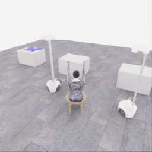
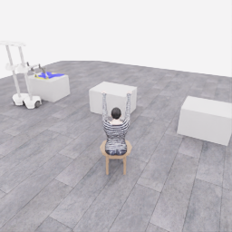
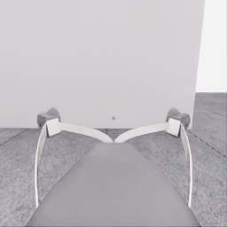
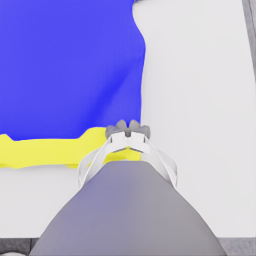
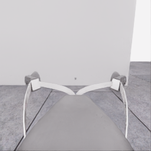
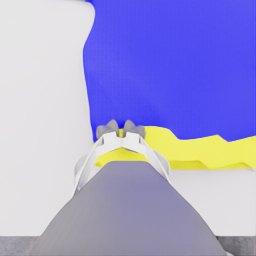
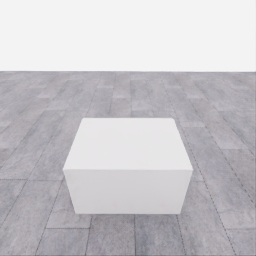
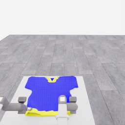
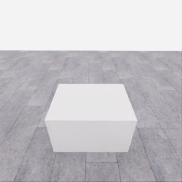
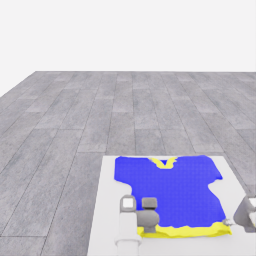

# 자동 시연 수집 시도 · 20261106-astra-support264-002

[전체 수집 기록](../../README.ko.md) · [구조화 요약](manifest.json) · [전체 행동 기록](decisions.jsonl) · [사용한 기본 프롬프트](prompt.txt)

실행 상태는 **completed**, 원본 출처는 `gpt`입니다. 완료 상태와 과제 성공은 아래에서 따로 기록합니다.

## 실행 조건과 시간

| 항목 | 기록 |
|---|---|
| 기록 시작 UTC | 2026-11-06T22:46:26Z |
| 기록 종료 UTC | 2026-11-06T23:19:06Z |
| 이전 시도 | 20261106-astra-coordinated-fresh-001 |
| 재시도 사유 | sequential_support_diagnostic_parent_corrected |
| 출처 그룹 | 20261106-coordinated-demo-methods |
| 요청 모델 / 추론 설정 | gpt-6-astra / ultra |
| 전체 실제 경과 시간 (초) | 1959.821 |
| Actor 호출 합계 (초) | 1451.035 |
| 환경 요청·응답 합계 (초) | 456.810 |
| 시뮬레이션 시간 (초) | 25.800 |
| 저장 전이 수 | 516.000 |
| 응답 확인 전이 수 | 516.000 |
| 모델 호출 시도 수 | 34.000 |
| 완료한 결정 구간 수 | 34.000 |
| 파일 완료 상태 | true |
| 데이터 정합성 검사 | true |
| 학습 데이터 승인 | unreviewed |
| Actor 호출 방식 | exec |
| 한 호출의 최대 계획 구간 수 | 1.000 |
| 한 계획의 최대 제어 step 수 | 20.000 |
| 제어기 정착 대기 설정 | true |
| 정착 대기 요청 step 수 | 6.000 |
| 완료한 제어기 정착 구간 수 | 16.000 |
| 제어기 정착 전이 수 | 96.000 |
| 제어기 정착 환경 요청·응답 (초) | 89.196 |
| 전이 예산으로 단축한 정착 구간 수 | 0.000 |
| 전이 예산으로 건너뛴 정착 구간 수 | 0.000 |

Actor 호출 시간은 공개 입력 저장·요청 전송·응답 처리 등 호출 경로를 측정합니다. 방식에 따라 Docker/CLI 시작이 호출 안에 들어가거나 상주 서버 준비 시간으로 분리됩니다. 내부 모델 추론 시간만 별도로 측정한 값은 아닙니다. 모델이 판단하는 동안 물리 시간은 멈추며 실제 경과 시간과 시뮬레이션 시간은 다릅니다. 세부 요청 프로세스 시간에도 CLI 처리·네트워크·서버 대기·생성이 함께 포함됩니다.

## 토큰 사용량의 범위

`actor_usage`는 thread별 관측 누계를 합친 값입니다. 결정의 `usage`는 원본 CLI 누계이며, 호출별 증가량은 `usage_accounting.incremental_usage`입니다. 캐시 입력은 입력의 부분집합이고 추론 출력은 출력의 부분집합이므로 열들을 다시 합산하지 않습니다.

전체 호출 사용량 확정: **true** · 기록한 호출 수: 34.

| 입력 | 캐시 입력 | 캐시 쓰기 입력 | 출력 | 추론 출력 |
|---:|---:|---:|---:|---:|
| 4328691 | 3714816 | 0 | 20820 | 16576 |

중복 누계는 추가 사용량 0으로 처리하고, 역행한 누계는 미확정으로 보존합니다. 새 thread는 별도로 집계합니다. 토큰 기록은 화폐 비용이나 청구서가 아닙니다.

## 리뷰 정지 조건

목표 누적 점수 10.000 · 감시 상태 `collector_ended_before_gate` · 수집기 상태 `completed`.

마지막 관측 점수 0.000 · 응답 확인 step 516.

`review_ready`는 정지 조건에 따라 실행을 마치고 리뷰할 준비가 된 상태입니다. 50점·착의 성공이나 학습 데이터 승인을 뜻하지 않습니다. 공식 점수와 success는 아래 평가 결과로 확인합니다.

## 공식 평가 결과

평가 유효성 `true` · 누적 점수 **0.000 / 50** · 착의 success **false** · rate 상태 `no_contact` · 최종 rate 미측정/해당 없음 points/s.

누적 50점, 착의 success, 정상 파일 종료와 데이터 정합성은 서로 다른 상태입니다. 접촉 전 `no_contact`의 rate는 0점/초로 바꾸지 않습니다.

| 단계 | 획득 점수 / 최대 | 획득 시각 (episode 초) |
|---|---:|---:|
| 파지·들기 | 0.000 / 5 | 미측정/해당 없음 |
| 첫 소매 | 0.000 / 5 | 미측정/해당 없음 |
| 반대 어깨 | 0.000 / 5 | 미측정/해당 없음 |
| 두 번째 소매 | 0.000 / 5 | 미측정/해당 없음 |
| 왼쪽 위팔 | 0.000 / 5 | 미측정/해당 없음 |
| 오른쪽 위팔 | 0.000 / 5 | 미측정/해당 없음 |
| 목 통과 | 0.000 / 10 | 미측정/해당 없음 |
| 앞면 방향 | 0.000 / 10 | 미측정/해당 없음 |

## 단계 획득 경로

점수 획득은 [평가 이벤트](score-events.jsonl)에서 같은 physics tick끼리 묶었습니다. 같은 시각에 인정된 항목의 내부 순서는 추정하지 않습니다. 착의 success는 점수 획득과 별도로 기록합니다.

| 순서 | episode 시간 (초) | 전이 경계 step | 누적 점수 변화 | 같은 시각의 항목 변화 |
|---:|---:|---:|---:|---|
| — | — | — | — | 기록된 공식 항목 획득 없음 |

평가 clock 0초에 대응하는 공개 simulation clock은 1.525초입니다. 두 시계를 같은 절대 시각으로 혼동하지 않습니다.

별도 success 이벤트 수: **0**. 평가 유효성: `true`.


## 원본 관측 화면

지정된 공개 카메라의 저장 RGB 픽셀입니다. 시작은 첫 `obs`, 종료는 마지막 `next_obs`입니다. 이미지 합성이나 내부 상태 기반 장면 재구성 없이 원본 픽셀로 PNG를 저장했습니다.

| 카메라 | 시작 | 종료 |
|---|---|---|
| `overview` | [](images/initial-overview.png) | [](images/final-overview.png) |
| `robot_0_wrist` | [](images/initial-robot_0_wrist.png) | [](images/final-robot_0_wrist.png) |
| `robot_1_wrist` | [](images/initial-robot_1_wrist.png) | [](images/final-robot_1_wrist.png) |
| `robot_0_head` | [](images/initial-robot_0_head.png) | [](images/final-robot_0_head.png) |
| `robot_1_head` | [](images/initial-robot_1_head.png) | [](images/final-robot_1_head.png) |

시작 관측 시각 1.525초 · 종료 관측 시각 27.325초 (공개 simulation clock).

[▶ overview 관측 영상 보기](overview.mp4)

저장된 20 Hz `obs` 중 516프레임을 순서대로 사용했습니다. 재생은 **1배 느리게** (20.000 fps), 실제 대기 시간·모델 호출 지연은 영상에 들어가지 않습니다. 종료 `next_obs`는 위 PNG에서 확인합니다.

## 결정과 실행 순서

아래 근거는 모델 최종 JSON의 짧은 행동 설명입니다. 시각적 평가는 행동 전 관측에 대한 판단이며, 그 행동의 실행 후 성공 라벨로 사용하지 않습니다. 공식 점수는 별도의 평가 결과입니다.

행동의 각 행은 로봇 0·1 순서이며 열은 `전진, 왼쪽 이동, 반시계 회전, 리프트, 팔 신장, 손목 yaw, pitch, roll, gripper`입니다. 앞 8개는 정규화 속도이고 gripper는 닫기 `+1`, 열기 `-1`, 의도 유지 `0`입니다.

제어기 정착 대기는 앞선 모델 결정에 연결된 별도 중립 행동입니다. 추가 모델 호출이나 모델 결정으로 집계하지 않으며, 실제 전이와 환경 요청·응답 시간은 전체 합계에 포함됩니다. 중립 행동은 두 로봇의 속도와 gripper 명령을 모두 0으로 보내 기존 gripper 의도를 유지합니다. 대기를 실행했다는 기록이 옷의 정착이나 과제 개선을 확인했다는 뜻은 아닙니다.

### 기록된 행동의 재실행 구간

원본 `20261106-astra-coordinated-fresh-001`의 행동 264전이를 새 환경에서 다시 실행했습니다. 이 구간에는 새 모델 호출이 없고 관측·평가를 새로 기록했습니다. 정확한 물리 상태 복원이나 독립적인 새 시연으로 집계하지 않습니다. 원본 step 대응과 실제 행동은 `decisions.jsonl`의 `replayed_segment`에 있습니다.

### 결정 0 · 파지 · `act`

입력 관측 14.725초 · Actor 호출 41.004초 · 시각적 판단 `uncertain`.

계획 `20261106-astra-support264-002:call-00000` · 모델 호출 인덱스 0 · 계획 구간 1/1 · 이 구간에서 모델 호출 `true`.

실행 직전 최신 관측 14.725초.

공개 입력 저장 0.083초 · 요청 프로세스 40.921초 · 결과 해석 0.000초.

호출 사용량 상태 `observed` · 이번 증가량 입력 19622 / 출력 638 토큰.

최종 응답의 행동 설명: Robot 0 is near the right garment edge and robot 1 near the left; wrist and finger motion persists. Preserve both close intents during a short neutral interval, then reassess before separate support tests. Neither grasp is verified.

요청 행동:

```json
[[0, 0, 0, 0, 0, 0, 0, 0, 0], [0, 0, 0, 0, 0, 0, 0, 0, 0]]
```

실행 구간 step **[264, 268)** · 요청 4 step / 실제 4 step · 환경 요청·응답 3.768초.

실제 적용 행동:

```json
[[0.0, 0.0, 0.0, 0.0, 0.0, 0.0, 0.0, 0.0, 0.0], [0.0, 0.0, 0.0, 0.0, 0.0, 0.0, 0.0, 0.0, 0.0]]
```

### 결정 1 · 파지 · `act`

입력 관측 14.925초 · Actor 호출 31.794초 · 시각적 판단 `uncertain`.

계획 `20261106-astra-support264-002:call-00001` · 모델 호출 인덱스 1 · 계획 구간 1/1 · 이 구간에서 모델 호출 `true`.

실행 직전 최신 관측 14.925초.

공개 입력 저장 0.082초 · 요청 프로세스 31.711초 · 결과 해석 0.000초.

호출 사용량 상태 `observed` · 이번 증가량 입력 29350 / 출력 412 토큰.

최종 응답의 행동 설명: Robot 0 remains at the right edge and robot 1 at the left. Both closing targets advanced, and measured joint motion persists. Preserve grip intents and table support during another short neutral interval; reassess before independent lift tests.

요청 행동:

```json
[[0, 0, 0, 0, 0, 0, 0, 0, 0], [0, 0, 0, 0, 0, 0, 0, 0, 0]]
```

실행 구간 step **[268, 274)** · 요청 6 step / 실제 6 step · 환경 요청·응답 5.305초.

실제 적용 행동:

```json
[[0.0, 0.0, 0.0, 0.0, 0.0, 0.0, 0.0, 0.0, 0.0], [0.0, 0.0, 0.0, 0.0, 0.0, 0.0, 0.0, 0.0, 0.0]]
```

### 결정 2 · 들기 · `act`

입력 관측 15.225초 · Actor 호출 36.251초 · 시각적 판단 `uncertain`.

계획 `20261106-astra-support264-002:call-00002` · 모델 호출 인덱스 2 · 계획 구간 1/1 · 이 구간에서 모델 호출 `true`.

실행 직전 최신 관측 15.225초.

공개 입력 저장 0.085초 · 요청 프로세스 36.166초 · 결과 해석 0.000초.

호출 사용량 상태 `observed` · 이번 증가량 입력 38847 / 출력 534 토큰.

최종 응답의 행동 설명: Closing targets and finger positions are nearly unchanged. Test robot 1 at the left edge with a roughly 3 cm lift while robot 0 preserves its right-edge targets and grip intent. Independent cloth following remains unverified.

요청 행동:

```json
[[0, 0, 0, 0, 0, 0, 0, 0, 0], [0, 0, 0, 0.1, 0, 0, 0, 0, 0]]
```

실행 구간 step **[274, 278)** · 요청 4 step / 실제 4 step · 환경 요청·응답 3.927초.

실제 적용 행동:

```json
[[0.0, 0.0, 0.0, 0.0, 0.0, 0.0, 0.0, 0.0, 0.0], [0.0, 0.0, 0.0, 0.10000000149011612, 0.0, 0.0, 0.0, 0.0, 0.0]]
```

### 제어기 정착 대기 · 연결 결정 2

구간 `20261106-astra-support264-002:settle-00002` · 출처 `controller_settle` · 이 구간에서 모델 호출 `false`.

앞선 모델 호출 인덱스 2에 연결됩니다. 추가 호출은 없습니다.

실행 구간 step **[278, 284)** · 요청 6 step / 실제 6 step · 환경 요청·응답 5.452초.

공개 simulation clock 15.425→15.725초 · 실행 전 관측 15.425초.

실제 적용 중립 행동:

```json
[[0.0, 0.0, 0.0, 0.0, 0.0, 0.0, 0.0, 0.0, 0.0], [0.0, 0.0, 0.0, 0.0, 0.0, 0.0, 0.0, 0.0, 0.0]]
```

### 결정 3 · 들기 · `act`

입력 관측 15.725초 · Actor 호출 75.003초 · 시각적 판단 `uncertain`.

계획 `20261106-astra-support264-002:call-00003` · 모델 호출 인덱스 3 · 계획 구간 1/1 · 이 구간에서 모델 호출 `true`.

실행 직전 최신 관측 15.725초.

공개 입력 저장 0.083초 · 요청 프로세스 74.920초 · 결과 해석 0.000초.

호출 사용량 상태 `observed` · 이번 증가량 입력 48478 / 출력 1157 토큰.

최종 응답의 행동 설명: Robot 1’s lift joint rose, but its base also leveled and its fingers are still closing; local cloth rise is unclear. Robot 0 moved only slightly. Hold both targets briefly before returning robot 1 toward its starting height.

요청 행동:

```json
[[0, 0, 0, 0, 0, 0, 0, 0, 0], [0, 0, 0, 0, 0, 0, 0, 0, 0]]
```

실행 구간 step **[284, 288)** · 요청 4 step / 실제 4 step · 환경 요청·응답 3.987초.

실제 적용 행동:

```json
[[0.0, 0.0, 0.0, 0.0, 0.0, 0.0, 0.0, 0.0, 0.0], [0.0, 0.0, 0.0, 0.0, 0.0, 0.0, 0.0, 0.0, 0.0]]
```

### 결정 4 · 들기 · `act`

입력 관측 15.925초 · Actor 호출 27.840초 · 시각적 판단 `uncertain`.

계획 `20261106-astra-support264-002:call-00004` · 모델 호출 인덱스 4 · 계획 구간 1/1 · 이 구간에서 모델 호출 `true`.

실행 직전 최신 관측 15.925초.

공개 입력 저장 0.084초 · 요청 프로세스 27.756초 · 결과 해석 0.000초.

호출 사용량 상태 `observed` · 이번 증가량 입력 58731 / 출력 395 토큰.

최종 응답의 행동 설명: Robot 1’s local edge remains near the tabletop without a clearly distinguishable cloth rise; robot 0’s pose changed only slightly. Return robot 1 toward its starting lift height while preserving both grip intents, then inspect before testing robot 0.

요청 행동:

```json
[[0, 0, 0, 0, 0, 0, 0, 0, 0], [0, 0, 0, -0.1, 0, 0, 0, 0, 0]]
```

실행 구간 step **[288, 292)** · 요청 4 step / 실제 4 step · 환경 요청·응답 4.044초.

실제 적용 행동:

```json
[[0.0, 0.0, 0.0, 0.0, 0.0, 0.0, 0.0, 0.0, 0.0], [0.0, 0.0, 0.0, -0.10000000149011612, 0.0, 0.0, 0.0, 0.0, 0.0]]
```

### 제어기 정착 대기 · 연결 결정 4

구간 `20261106-astra-support264-002:settle-00004` · 출처 `controller_settle` · 이 구간에서 모델 호출 `false`.

앞선 모델 호출 인덱스 4에 연결됩니다. 추가 호출은 없습니다.

실행 구간 step **[292, 298)** · 요청 6 step / 실제 6 step · 환경 요청·응답 5.537초.

공개 simulation clock 16.125→16.425초 · 실행 전 관측 16.125초.

실제 적용 중립 행동:

```json
[[0.0, 0.0, 0.0, 0.0, 0.0, 0.0, 0.0, 0.0, 0.0], [0.0, 0.0, 0.0, 0.0, 0.0, 0.0, 0.0, 0.0, 0.0]]
```

### 결정 5 · 들기 · `act`

입력 관측 16.425초 · Actor 호출 20.831초 · 시각적 판단 `uncertain`.

계획 `20261106-astra-support264-002:call-00005` · 모델 호출 인덱스 5 · 계획 구간 1/1 · 이 구간에서 모델 호출 `true`.

실행 직전 최신 관측 16.425초.

공개 입력 저장 0.086초 · 요청 프로세스 20.745초 · 결과 해석 0.000초.

호출 사용량 상태 `observed` · 이번 증가량 입력 68213 / 출력 335 토큰.

최종 응답의 행동 설명: Robot 0 retains its right-edge pose. Robot 1 has returned near its starting height but is still descending and closing its fingers; local cloth support remains unclear. Hold both targets briefly so partner motion does not confound robot 0’s upcoming test.

요청 행동:

```json
[[0, 0, 0, 0, 0, 0, 0, 0, 0], [0, 0, 0, 0, 0, 0, 0, 0, 0]]
```

실행 구간 step **[298, 304)** · 요청 6 step / 실제 6 step · 환경 요청·응답 5.632초.

실제 적용 행동:

```json
[[0.0, 0.0, 0.0, 0.0, 0.0, 0.0, 0.0, 0.0, 0.0], [0.0, 0.0, 0.0, 0.0, 0.0, 0.0, 0.0, 0.0, 0.0]]
```

### 결정 6 · 들기 · `act`

입력 관측 16.725초 · Actor 호출 37.603초 · 시각적 판단 `uncertain`.

계획 `20261106-astra-support264-002:call-00006` · 모델 호출 인덱스 6 · 계획 구간 1/1 · 이 구간에서 모델 호출 `true`.

실행 직전 최신 관측 16.725초.

공개 입력 저장 0.084초 · 요청 프로세스 37.519초 · 결과 해석 0.000초.

호출 사용량 상태 `observed` · 이번 증가량 입력 77624 / 출력 537 토큰.

최종 응답의 행동 설명: Robot 1 is near its starting height with reduced return motion and retains its left-edge targets. Test robot 0 alone with a roughly 3.7 cm lift, observing whether its local right-edge cloth follows. Neither support is yet established.

요청 행동:

```json
[[0, 0, 0, 0.12, 0, 0, 0, 0, 0], [0, 0, 0, 0, 0, 0, 0, 0, 0]]
```

실행 구간 step **[304, 308)** · 요청 4 step / 실제 4 step · 환경 요청·응답 3.947초.

실제 적용 행동:

```json
[[0.0, 0.0, 0.0, 0.11999999731779099, 0.0, 0.0, 0.0, 0.0, 0.0], [0.0, 0.0, 0.0, 0.0, 0.0, 0.0, 0.0, 0.0, 0.0]]
```

### 제어기 정착 대기 · 연결 결정 6

구간 `20261106-astra-support264-002:settle-00006` · 출처 `controller_settle` · 이 구간에서 모델 호출 `false`.

앞선 모델 호출 인덱스 6에 연결됩니다. 추가 호출은 없습니다.

실행 구간 step **[308, 314)** · 요청 6 step / 실제 6 step · 환경 요청·응답 5.676초.

공개 simulation clock 16.925→17.225초 · 실행 전 관측 16.925초.

실제 적용 중립 행동:

```json
[[0.0, 0.0, 0.0, 0.0, 0.0, 0.0, 0.0, 0.0, 0.0], [0.0, 0.0, 0.0, 0.0, 0.0, 0.0, 0.0, 0.0, 0.0]]
```

### 결정 7 · 들기 · `act`

입력 관측 17.225초 · Actor 호출 47.070초 · 시각적 판단 `uncertain`.

계획 `20261106-astra-support264-002:call-00007` · 모델 호출 인덱스 7 · 계획 구간 1/1 · 이 구간에서 모델 호출 `true`.

실행 직전 최신 관측 17.225초.

공개 입력 저장 0.083초 · 요청 프로세스 46.987초 · 결과 해석 0.000초.

호출 사용량 상태 `observed` · 이번 증가량 입력 87260 / 출력 641 토큰.

최종 응답의 행동 설명: Robot 0’s nearby rim shifted, but base leveling and ongoing lift/finger motion obscure independent cloth support. Robot 1’s measured pose changed only a few millimetres. Hold both targets briefly to inspect the tested right side before returning it.

요청 행동:

```json
[[0, 0, 0, 0, 0, 0, 0, 0, 0], [0, 0, 0, 0, 0, 0, 0, 0, 0]]
```

실행 구간 step **[314, 320)** · 요청 6 step / 실제 6 step · 환경 요청·응답 5.639초.

실제 적용 행동:

```json
[[0.0, 0.0, 0.0, 0.0, 0.0, 0.0, 0.0, 0.0, 0.0], [0.0, 0.0, 0.0, 0.0, 0.0, 0.0, 0.0, 0.0, 0.0]]
```

### 결정 8 · 들기 · `act`

입력 관측 17.525초 · Actor 호출 36.301초 · 시각적 판단 `uncertain`.

계획 `20261106-astra-support264-002:call-00008` · 모델 호출 인덱스 8 · 계획 구간 1/1 · 이 구간에서 모델 호출 `true`.

실행 직전 최신 관측 17.525초.

공개 입력 저장 0.085초 · 요청 프로세스 36.216초 · 결과 해석 0.000초.

호출 사용량 상태 `observed` · 이번 증가량 입력 97010 / 출력 531 토큰.

최종 응답의 행동 설명: Robot 0’s gripper rose and its nearby edge folded, but independent cloth following remains unclear. Robot 1’s edge and measured pose stayed nearly unchanged. Return robot 0 toward its starting height, preserving both grip intents and table support.

요청 행동:

```json
[[0, 0, 0, -0.12, 0, 0, 0, 0, 0], [0, 0, 0, 0, 0, 0, 0, 0, 0]]
```

실행 구간 step **[320, 324)** · 요청 4 step / 실제 4 step · 환경 요청·응답 4.055초.

실제 적용 행동:

```json
[[0.0, 0.0, 0.0, -0.11999999731779099, 0.0, 0.0, 0.0, 0.0, 0.0], [0.0, 0.0, 0.0, 0.0, 0.0, 0.0, 0.0, 0.0, 0.0]]
```

### 제어기 정착 대기 · 연결 결정 8

구간 `20261106-astra-support264-002:settle-00008` · 출처 `controller_settle` · 이 구간에서 모델 호출 `false`.

앞선 모델 호출 인덱스 8에 연결됩니다. 추가 호출은 없습니다.

실행 구간 step **[324, 330)** · 요청 6 step / 실제 6 step · 환경 요청·응답 5.546초.

공개 simulation clock 17.725→18.025초 · 실행 전 관측 17.725초.

실제 적용 중립 행동:

```json
[[0.0, 0.0, 0.0, 0.0, 0.0, 0.0, 0.0, 0.0, 0.0], [0.0, 0.0, 0.0, 0.0, 0.0, 0.0, 0.0, 0.0, 0.0]]
```

### 결정 9 · 복구 · `act`

입력 관측 18.025초 · Actor 호출 57.083초 · 시각적 판단 `uncertain`.

계획 `20261106-astra-support264-002:call-00009` · 모델 호출 인덱스 9 · 계획 구간 1/1 · 이 구간에서 모델 호출 `true`.

실행 직전 최신 관측 18.025초.

공개 입력 저장 0.083초 · 요청 프로세스 57.000초 · 결과 해석 0.000초.

호출 사용량 상태 `observed` · 이번 증가량 입력 106617 / 출력 782 토큰.

최종 응답의 행동 설명: Robot 0 is back near the table but still descending; robot 1 retains its left-edge pose without verified support. Preserve both grip intents while the return settles, then reassess a useful partner anchor before any one-sided regrasp.

요청 행동:

```json
[[0, 0, 0, 0, 0, 0, 0, 0, 0], [0, 0, 0, 0, 0, 0, 0, 0, 0]]
```

실행 구간 step **[330, 336)** · 요청 6 step / 실제 6 step · 환경 요청·응답 5.528초.

실제 적용 행동:

```json
[[0.0, 0.0, 0.0, 0.0, 0.0, 0.0, 0.0, 0.0, 0.0], [0.0, 0.0, 0.0, 0.0, 0.0, 0.0, 0.0, 0.0, 0.0]]
```

### 결정 10 · 복구 · `act`

입력 관측 18.325초 · Actor 호출 33.296초 · 시각적 판단 `uncertain`.

계획 `20261106-astra-support264-002:call-00010` · 모델 호출 인덱스 10 · 계획 구간 1/1 · 이 구간에서 모델 호출 `true`.

실행 직전 최신 관측 18.325초.

공개 입력 저장 0.082초 · 요청 프로세스 33.214초 · 결과 해석 0.000초.

호출 사용량 상태 `observed` · 이번 증가량 입력 116476 / 출력 473 토큰.

최종 응답의 행동 설명: Robot 0 holds its right-edge pose near table support. Robot 1’s earlier test showed no clear cloth rise and was obscured by base leveling. Make one bounded, approximately 5 cm robot-1-only anchor check before considering a one-sided regrasp.

요청 행동:

```json
[[0, 0, 0, 0, 0, 0, 0, 0, 0], [0, 0, 0, 0.16, 0, 0, 0, 0, 0]]
```

실행 구간 step **[336, 340)** · 요청 4 step / 실제 4 step · 환경 요청·응답 4.072초.

실제 적용 행동:

```json
[[0.0, 0.0, 0.0, 0.0, 0.0, 0.0, 0.0, 0.0, 0.0], [0.0, 0.0, 0.0, 0.1599999964237213, 0.0, 0.0, 0.0, 0.0, 0.0]]
```

### 제어기 정착 대기 · 연결 결정 10

구간 `20261106-astra-support264-002:settle-00010` · 출처 `controller_settle` · 이 구간에서 모델 호출 `false`.

앞선 모델 호출 인덱스 10에 연결됩니다. 추가 호출은 없습니다.

실행 구간 step **[340, 346)** · 요청 6 step / 실제 6 step · 환경 요청·응답 5.640초.

공개 simulation clock 18.525→18.825초 · 실행 전 관측 18.525초.

실제 적용 중립 행동:

```json
[[0.0, 0.0, 0.0, 0.0, 0.0, 0.0, 0.0, 0.0, 0.0], [0.0, 0.0, 0.0, 0.0, 0.0, 0.0, 0.0, 0.0, 0.0]]
```

### 결정 11 · 복구 · `act`

입력 관측 18.825초 · Actor 호출 65.143초 · 시각적 판단 `uncertain`.

계획 `20261106-astra-support264-002:call-00011` · 모델 호출 인덱스 11 · 계획 구간 1/1 · 이 구간에서 모델 호출 `true`.

실행 직전 최신 관측 18.825초.

공개 입력 저장 0.082초 · 요청 프로세스 65.061초 · 결과 해석 0.000초.

호출 사용량 상태 `observed` · 이번 증가량 입력 126035 / 출력 582 토큰.

최종 응답의 행동 설명: Robot 1’s nearby cloth appears to tent locally, while robot 0 and its edge remain nearly stationary. Robot 1 is still rising toward its target. Hold both targets briefly to distinguish sustained cloth following from transient deformation before any release.

요청 행동:

```json
[[0, 0, 0, 0, 0, 0, 0, 0, 0], [0, 0, 0, 0, 0, 0, 0, 0, 0]]
```

실행 구간 step **[346, 352)** · 요청 6 step / 실제 6 step · 환경 요청·응답 5.610초.

실제 적용 행동:

```json
[[0.0, 0.0, 0.0, 0.0, 0.0, 0.0, 0.0, 0.0, 0.0], [0.0, 0.0, 0.0, 0.0, 0.0, 0.0, 0.0, 0.0, 0.0]]
```

### 결정 12 · 복구 · `act`

입력 관측 19.125초 · Actor 호출 73.006초 · 시각적 판단 `recovering`.

계획 `20261106-astra-support264-002:call-00012` · 모델 호출 인덱스 12 · 계획 구간 1/1 · 이 구간에서 모델 호출 `true`.

실행 직전 최신 관측 19.125초.

공개 입력 저장 0.084초 · 요청 프로세스 72.922초 · 결과 해석 0.000초.

호출 사용량 상태 `observed` · 이번 증가량 입력 135717 / 출력 1095 토큰.

최종 응답의 행동 설명: Robot 1’s local edge appears to follow its further rise while robot 0 remains nearly fixed, providing a tentative anchor. Keep robot 1 holding; open only robot 0 over table support for one deliberate regrasp of the visible right edge.

요청 행동:

```json
[[0, 0, 0, 0, 0, 0, 0, 0, -1], [0, 0, 0, 0, 0, 0, 0, 0, 0]]
```

실행 구간 step **[352, 356)** · 요청 4 step / 실제 4 step · 환경 요청·응답 3.945초.

실제 적용 행동:

```json
[[0.0, 0.0, 0.0, 0.0, 0.0, 0.0, 0.0, 0.0, -1.0], [0.0, 0.0, 0.0, 0.0, 0.0, 0.0, 0.0, 0.0, 0.0]]
```

### 결정 13 · 복구 · `act`

입력 관측 19.325초 · Actor 호출 62.138초 · 시각적 판단 `recovering`.

계획 `20261106-astra-support264-002:call-00013` · 모델 호출 인덱스 13 · 계획 구간 1/1 · 이 구간에서 모델 호출 `true`.

실행 직전 최신 관측 19.325초.

공개 입력 저장 0.082초 · 요청 프로세스 62.056초 · 결과 해석 0.000초.

호출 사용량 상태 `observed` · 이번 증가량 입력 145918 / 출력 796 토큰.

최종 응답의 행동 설명: Robot 0’s fingers are still moving after the open command, so release clearance is not established. Robot 1’s local tent remains visible with little measured displacement. Preserve robot 1’s grip and briefly hold motion targets before aligning robot 0’s regrasp.

요청 행동:

```json
[[0, 0, 0, 0, 0, 0, 0, 0, 0], [0, 0, 0, 0, 0, 0, 0, 0, 0]]
```

실행 구간 step **[356, 362)** · 요청 6 step / 실제 6 step · 환경 요청·응답 5.613초.

실제 적용 행동:

```json
[[0.0, 0.0, 0.0, 0.0, 0.0, 0.0, 0.0, 0.0, 0.0], [0.0, 0.0, 0.0, 0.0, 0.0, 0.0, 0.0, 0.0, 0.0]]
```

### 결정 14 · 복구 · `act`

입력 관측 19.625초 · Actor 호출 68.352초 · 시각적 판단 `recovering`.

계획 `20261106-astra-support264-002:call-00014` · 모델 호출 인덱스 14 · 계획 구간 1/1 · 이 구간에서 모델 호출 `true`.

실행 직전 최신 관측 19.625초.

공개 입력 저장 0.082초 · 요청 프로세스 68.270초 · 결과 해석 0.000초.

호출 사용량 상태 `observed` · 이번 증가량 입력 155817 / 출력 804 토큰.

최종 응답의 행동 설명: Robot 0’s fingers are opening asymmetrically near the tabletop and have shifted nearby cloth. Raise its open-intent gripper about 5 cm for clearance before lateral alignment. Robot 1 retains the tentative left-edge anchor while most cloth remains table-supported.

요청 행동:

```json
[[0, 0, 0, 0.16, 0, 0, 0, 0, 0], [0, 0, 0, 0, 0, 0, 0, 0, 0]]
```

실행 구간 step **[362, 366)** · 요청 4 step / 실제 4 step · 환경 요청·응답 3.887초.

실제 적용 행동:

```json
[[0.0, 0.0, 0.0, 0.1599999964237213, 0.0, 0.0, 0.0, 0.0, 0.0], [0.0, 0.0, 0.0, 0.0, 0.0, 0.0, 0.0, 0.0, 0.0]]
```

### 제어기 정착 대기 · 연결 결정 14

구간 `20261106-astra-support264-002:settle-00014` · 출처 `controller_settle` · 이 구간에서 모델 호출 `false`.

앞선 모델 호출 인덱스 14에 연결됩니다. 추가 호출은 없습니다.

실행 구간 step **[366, 372)** · 요청 6 step / 실제 6 step · 환경 요청·응답 5.570초.

공개 simulation clock 19.825→20.125초 · 실행 전 관측 19.825초.

실제 적용 중립 행동:

```json
[[0.0, 0.0, 0.0, 0.0, 0.0, 0.0, 0.0, 0.0, 0.0], [0.0, 0.0, 0.0, 0.0, 0.0, 0.0, 0.0, 0.0, 0.0]]
```

### 결정 15 · 복구 · `act`

입력 관측 20.125초 · Actor 호출 42.815초 · 시각적 판단 `recovering`.

계획 `20261106-astra-support264-002:call-00015` · 모델 호출 인덱스 15 · 계획 구간 1/1 · 이 구간에서 모델 호출 `true`.

실행 직전 최신 관측 20.125초.

공개 입력 저장 0.084초 · 요청 프로세스 42.730초 · 결과 해석 0.000초.

호출 사용량 상태 `observed` · 이번 증가량 입력 165736 / 출력 629 토큰.

최종 응답의 행동 설명: Robot 0 has risen and its fingers are visibly wider, but lift and right-finger opening are still progressing. Robot 1 retains the left-edge tent with little displacement. Hold targets briefly before positioning robot 0 around the accessible right edge.

요청 행동:

```json
[[0, 0, 0, 0, 0, 0, 0, 0, 0], [0, 0, 0, 0, 0, 0, 0, 0, 0]]
```

실행 구간 step **[372, 378)** · 요청 6 step / 실제 6 step · 환경 요청·응답 5.807초.

실제 적용 행동:

```json
[[0.0, 0.0, 0.0, 0.0, 0.0, 0.0, 0.0, 0.0, 0.0], [0.0, 0.0, 0.0, 0.0, 0.0, 0.0, 0.0, 0.0, 0.0]]
```

### 결정 16 · 복구 · `act`

입력 관측 20.425초 · Actor 호출 94.654초 · 시각적 판단 `recovering`.

계획 `20261106-astra-support264-002:call-00016` · 모델 호출 인덱스 16 · 계획 구간 1/1 · 이 구간에서 모델 호출 `true`.

실행 직전 최신 관측 20.425초.

공개 입력 저장 0.092초 · 요청 프로세스 94.562초 · 결과 해석 0.000초.

호출 사용량 상태 `observed` · 이번 증가량 입력 175501 / 출력 854 토큰.

최종 응답의 행동 설명: Robot 0’s open fingers have clearance, and the accessible right corner lies left of the closing center. Shift robot 0 inward about 2 cm at its current height. Robot 1 retains the left-edge tent while the table supports the shirt body.

요청 행동:

```json
[[0, 0.16, 0, 0, 0, 0, 0, 0, 0], [0, 0, 0, 0, 0, 0, 0, 0, 0]]
```

실행 구간 step **[378, 382)** · 요청 4 step / 실제 4 step · 환경 요청·응답 4.130초.

실제 적용 행동:

```json
[[0.0, 0.1599999964237213, 0.0, 0.0, 0.0, 0.0, 0.0, 0.0, 0.0], [0.0, 0.0, 0.0, 0.0, 0.0, 0.0, 0.0, 0.0, 0.0]]
```

### 제어기 정착 대기 · 연결 결정 16

구간 `20261106-astra-support264-002:settle-00016` · 출처 `controller_settle` · 이 구간에서 모델 호출 `false`.

앞선 모델 호출 인덱스 16에 연결됩니다. 추가 호출은 없습니다.

실행 구간 step **[382, 388)** · 요청 6 step / 실제 6 step · 환경 요청·응답 5.586초.

공개 simulation clock 20.625→20.925초 · 실행 전 관측 20.625초.

실제 적용 중립 행동:

```json
[[0.0, 0.0, 0.0, 0.0, 0.0, 0.0, 0.0, 0.0, 0.0], [0.0, 0.0, 0.0, 0.0, 0.0, 0.0, 0.0, 0.0, 0.0]]
```

### 결정 17 · 복구 · `act`

입력 관측 20.925초 · Actor 호출 32.198초 · 시각적 판단 `recovering`.

계획 `20261106-astra-support264-002:call-00017` · 모델 호출 인덱스 17 · 계획 구간 1/1 · 이 구간에서 모델 호출 `true`.

실행 직전 최신 관측 20.925초.

공개 입력 저장 0.084초 · 요청 프로세스 32.114초 · 결과 해석 0.000초.

호출 사용량 상태 `observed` · 이번 증가량 입력 185477 / 출력 456 토큰.

최종 응답의 행동 설명: Robot 0’s visible right edge is now inside its open finger span. Lower robot 0 about 1.2 cm for the final regrasp alignment; robot 1 retains the left-edge anchor while the shirt body remains supported by the table.

요청 행동:

```json
[[0, 0, 0, -0.04, 0, 0, 0, 0, 0], [0, 0, 0, 0, 0, 0, 0, 0, 0]]
```

실행 구간 step **[388, 392)** · 요청 4 step / 실제 4 step · 환경 요청·응답 3.935초.

실제 적용 행동:

```json
[[0.0, 0.0, 0.0, -0.03999999910593033, 0.0, 0.0, 0.0, 0.0, 0.0], [0.0, 0.0, 0.0, 0.0, 0.0, 0.0, 0.0, 0.0, 0.0]]
```

### 제어기 정착 대기 · 연결 결정 17

구간 `20261106-astra-support264-002:settle-00017` · 출처 `controller_settle` · 이 구간에서 모델 호출 `false`.

앞선 모델 호출 인덱스 17에 연결됩니다. 추가 호출은 없습니다.

실행 구간 step **[392, 398)** · 요청 6 step / 실제 6 step · 환경 요청·응답 5.700초.

공개 simulation clock 21.125→21.425초 · 실행 전 관측 21.125초.

실제 적용 중립 행동:

```json
[[0.0, 0.0, 0.0, 0.0, 0.0, 0.0, 0.0, 0.0, 0.0], [0.0, 0.0, 0.0, 0.0, 0.0, 0.0, 0.0, 0.0, 0.0]]
```

### 결정 18 · 파지 · `act`

입력 관측 21.425초 · Actor 호출 20.179초 · 시각적 판단 `uncertain`.

계획 `20261106-astra-support264-002:call-00018` · 모델 호출 인덱스 18 · 계획 구간 1/1 · 이 구간에서 모델 호출 `true`.

실행 직전 최신 관측 21.425초.

공개 입력 저장 0.085초 · 요청 프로세스 20.095초 · 결과 해석 0.000초.

호출 사용량 상태 `observed` · 이번 증가량 입력 195055 / 출력 247 토큰.

최종 응답의 행동 설명: Robot 0 has lowered about 1 cm with the visible right edge inside its closing region; robot 1 retains the left-edge anchor. Close only robot 0 at this pose, then inspect finger motion before independently testing the renewed grasp.

요청 행동:

```json
[[0, 0, 0, 0, 0, 0, 0, 0, 1], [0, 0, 0, 0, 0, 0, 0, 0, 0]]
```

실행 구간 step **[398, 402)** · 요청 4 step / 실제 4 step · 환경 요청·응답 4.298초.

실제 적용 행동:

```json
[[0.0, 0.0, 0.0, 0.0, 0.0, 0.0, 0.0, 0.0, 1.0], [0.0, 0.0, 0.0, 0.0, 0.0, 0.0, 0.0, 0.0, 0.0]]
```

### 결정 19 · 파지 · `act`

입력 관측 21.625초 · Actor 호출 16.374초 · 시각적 판단 `uncertain`.

계획 `20261106-astra-support264-002:call-00019` · 모델 호출 인덱스 19 · 계획 구간 1/1 · 이 구간에서 모델 호출 `true`.

실행 직전 최신 관측 21.625초.

공개 입력 저장 0.085초 · 요청 프로세스 16.288초 · 결과 해석 0.000초.

호출 사용량 상태 `observed` · 이번 증가량 입력 204438 / 출력 166 토큰.

최종 응답의 행동 설명: Robot 0’s fingers are still closing rapidly around the right-edge region; cloth support is unverified. Robot 1’s left-edge tent and measured pose remain nearly unchanged. Preserve both close intents during a short neutral interval before the renewed support test.

요청 행동:

```json
[[0, 0, 0, 0, 0, 0, 0, 0, 0], [0, 0, 0, 0, 0, 0, 0, 0, 0]]
```

실행 구간 step **[402, 408)** · 요청 6 step / 실제 6 step · 환경 요청·응답 5.501초.

실제 적용 행동:

```json
[[0.0, 0.0, 0.0, 0.0, 0.0, 0.0, 0.0, 0.0, 0.0], [0.0, 0.0, 0.0, 0.0, 0.0, 0.0, 0.0, 0.0, 0.0]]
```

### 결정 20 · 파지 · `act`

입력 관측 21.925초 · Actor 호출 36.306초 · 시각적 판단 `uncertain`.

계획 `20261106-astra-support264-002:call-00020` · 모델 호출 인덱스 20 · 계획 구간 1/1 · 이 구간에서 모델 호출 `true`.

실행 직전 최신 관측 21.925초.

공개 입력 저장 0.087초 · 요청 프로세스 36.219초 · 결과 해석 0.000초.

호출 사용량 상태 `observed` · 이번 증가량 입력 213723 / 출력 196 토큰.

최종 응답의 행동 설명: Robot 0’s closing target has reached its limit, but both fingers are still moving appreciably; this does not establish support. Robot 1 maintains the left-edge tent. Keep both poses and close intents for another short observation interval before testing robot 0.

요청 행동:

```json
[[0, 0, 0, 0, 0, 0, 0, 0, 0], [0, 0, 0, 0, 0, 0, 0, 0, 0]]
```

실행 구간 step **[408, 414)** · 요청 6 step / 실제 6 step · 환경 요청·응답 5.581초.

실제 적용 행동:

```json
[[0.0, 0.0, 0.0, 0.0, 0.0, 0.0, 0.0, 0.0, 0.0], [0.0, 0.0, 0.0, 0.0, 0.0, 0.0, 0.0, 0.0, 0.0]]
```

### 결정 21 · 들기 · `act`

입력 관측 22.225초 · Actor 호출 58.138초 · 시각적 판단 `uncertain`.

계획 `20261106-astra-support264-002:call-00021` · 모델 호출 인덱스 21 · 계획 구간 1/1 · 이 구간에서 모델 호출 `true`.

실행 직전 최신 관측 22.225초.

공개 입력 저장 0.083초 · 요청 프로세스 58.055초 · 결과 해석 0.000초.

호출 사용량 상태 `observed` · 이번 증가량 입력 223034 / 출력 285 토큰.

최종 응답의 행동 설명: Robot 0’s closing motion has slowed substantially, but its renewed grasp remains unverified. Robot 1 retains its nearly stationary left-edge anchor. Lift only robot 0 about 3 cm to check whether the local right-edge cloth follows independently.

요청 행동:

```json
[[0, 0, 0, 0.1, 0, 0, 0, 0, 0], [0, 0, 0, 0, 0, 0, 0, 0, 0]]
```

실행 구간 step **[414, 418)** · 요청 4 step / 실제 4 step · 환경 요청·응답 3.916초.

실제 적용 행동:

```json
[[0.0, 0.0, 0.0, 0.10000000149011612, 0.0, 0.0, 0.0, 0.0, 0.0], [0.0, 0.0, 0.0, 0.0, 0.0, 0.0, 0.0, 0.0, 0.0]]
```

### 제어기 정착 대기 · 연결 결정 21

구간 `20261106-astra-support264-002:settle-00021` · 출처 `controller_settle` · 이 구간에서 모델 호출 `false`.

앞선 모델 호출 인덱스 21에 연결됩니다. 추가 호출은 없습니다.

실행 구간 step **[418, 424)** · 요청 6 step / 실제 6 step · 환경 요청·응답 5.570초.

공개 simulation clock 22.425→22.725초 · 실행 전 관측 22.425초.

실제 적용 중립 행동:

```json
[[0.0, 0.0, 0.0, 0.0, 0.0, 0.0, 0.0, 0.0, 0.0], [0.0, 0.0, 0.0, 0.0, 0.0, 0.0, 0.0, 0.0, 0.0]]
```

### 결정 22 · 들기 · `act`

입력 관측 22.725초 · Actor 호출 44.716초 · 시각적 판단 `uncertain`.

계획 `20261106-astra-support264-002:call-00022` · 모델 호출 인덱스 22 · 계획 구간 1/1 · 이 구간에서 모델 호출 `true`.

실행 직전 최신 관측 22.725초.

공개 입력 저장 0.083초 · 요청 프로세스 44.632초 · 결과 해석 0.000초.

호출 사용량 상태 `observed` · 이번 증가량 입력 232421 / 출력 503 토큰.

최종 응답의 행동 설명: Robot 0’s gripper rose about 2.6 cm; the nearby yellow rim deformed, but sustained cloth following is not yet clear. Robot 1’s measured pose changed minimally. Hold both targets briefly to inspect the remaining lift and finger motion before returning robot 0.

요청 행동:

```json
[[0, 0, 0, 0, 0, 0, 0, 0, 0], [0, 0, 0, 0, 0, 0, 0, 0, 0]]
```

실행 구간 step **[424, 430)** · 요청 6 step / 실제 6 step · 환경 요청·응답 5.716초.

실제 적용 행동:

```json
[[0.0, 0.0, 0.0, 0.0, 0.0, 0.0, 0.0, 0.0, 0.0], [0.0, 0.0, 0.0, 0.0, 0.0, 0.0, 0.0, 0.0, 0.0]]
```

### 결정 23 · 들기 · `act`

입력 관측 23.025초 · Actor 호출 26.835초 · 시각적 판단 `uncertain`.

계획 `20261106-astra-support264-002:call-00023` · 모델 호출 인덱스 23 · 계획 구간 1/1 · 이 구간에서 모델 호출 `true`.

실행 직전 최신 관측 23.025초.

공개 입력 저장 0.083초 · 요청 프로세스 26.752초 · 결과 해석 0.000초.

호출 사용량 상태 `observed` · 이번 증가량 입력 242069 / 출력 368 토큰.

최종 응답의 행동 설명: Robot 0’s small yellow fold stayed near its fingers during the additional rise, suggesting local support; robot 1 remained nearly fixed. Return robot 0 toward its test starting height and inspect whether that fold follows downward. Keep both grip intents.

요청 행동:

```json
[[0, 0, 0, -0.1, 0, 0, 0, 0, 0], [0, 0, 0, 0, 0, 0, 0, 0, 0]]
```

실행 구간 step **[430, 434)** · 요청 4 step / 실제 4 step · 환경 요청·응답 4.092초.

실제 적용 행동:

```json
[[0.0, 0.0, 0.0, -0.10000000149011612, 0.0, 0.0, 0.0, 0.0, 0.0], [0.0, 0.0, 0.0, 0.0, 0.0, 0.0, 0.0, 0.0, 0.0]]
```

### 제어기 정착 대기 · 연결 결정 23

구간 `20261106-astra-support264-002:settle-00023` · 출처 `controller_settle` · 이 구간에서 모델 호출 `false`.

앞선 모델 호출 인덱스 23에 연결됩니다. 추가 호출은 없습니다.

실행 구간 step **[434, 440)** · 요청 6 step / 실제 6 step · 환경 요청·응답 5.816초.

공개 simulation clock 23.225→23.525초 · 실행 전 관측 23.225초.

실제 적용 중립 행동:

```json
[[0.0, 0.0, 0.0, 0.0, 0.0, 0.0, 0.0, 0.0, 0.0], [0.0, 0.0, 0.0, 0.0, 0.0, 0.0, 0.0, 0.0, 0.0]]
```

### 결정 24 · 들기 · `act`

입력 관측 23.525초 · Actor 호출 24.639초 · 시각적 판단 `progressing`.

계획 `20261106-astra-support264-002:call-00024` · 모델 호출 인덱스 24 · 계획 구간 1/1 · 이 구간에서 모델 호출 `true`.

실행 직전 최신 관측 23.525초.

공개 입력 저장 0.089초 · 요청 프로세스 24.551초 · 결과 해석 0.000초.

호출 사용량 상태 `observed` · 이번 증가량 입력 251565 / 출력 620 토큰.

최종 응답의 행동 설명: Robot 0’s local rim stayed near its fingers through the downward return while robot 1 remained nearly fixed, supporting the renewed grasp visually. Keep robot 0 holding; return robot 1 toward its pretest height to complete the separate left-side check near table support.

요청 행동:

```json
[[0, 0, 0, 0, 0, 0, 0, 0, 0], [0, 0, 0, -0.16, 0, 0, 0, 0, 0]]
```

실행 구간 step **[440, 444)** · 요청 4 step / 실제 4 step · 환경 요청·응답 4.240초.

실제 적용 행동:

```json
[[0.0, 0.0, 0.0, 0.0, 0.0, 0.0, 0.0, 0.0, 0.0], [0.0, 0.0, 0.0, -0.1599999964237213, 0.0, 0.0, 0.0, 0.0, 0.0]]
```

### 제어기 정착 대기 · 연결 결정 24

구간 `20261106-astra-support264-002:settle-00024` · 출처 `controller_settle` · 이 구간에서 모델 호출 `false`.

앞선 모델 호출 인덱스 24에 연결됩니다. 추가 호출은 없습니다.

실행 구간 step **[444, 450)** · 요청 6 step / 실제 6 step · 환경 요청·응답 5.535초.

공개 simulation clock 23.725→24.025초 · 실행 전 관측 23.725초.

실제 적용 중립 행동:

```json
[[0.0, 0.0, 0.0, 0.0, 0.0, 0.0, 0.0, 0.0, 0.0], [0.0, 0.0, 0.0, 0.0, 0.0, 0.0, 0.0, 0.0, 0.0]]
```

### 결정 25 · 들기 · `act`

입력 관측 24.025초 · Actor 호출 100.746초 · 시각적 판단 `uncertain`.

계획 `20261106-astra-support264-002:call-00025` · 모델 호출 인덱스 25 · 계획 구간 1/1 · 이 구간에서 모델 호출 `true`.

실행 직전 최신 관측 24.025초.

공개 입력 저장 0.083초 · 요청 프로세스 100.663초 · 결과 해석 0.000초.

호출 사용량 상태 `observed` · 이번 증가량 입력 63841 / 출력 635 토큰.

최종 응답의 행동 설명: Robot 0 remains nearly stationary as the anchor; robot 1 is still returning with changing base tilt and wrist orientation. Briefly preserve both targets and closed-grip intents to distinguish settling from cloth following before confirming the left support.

요청 행동:

```json
[[0, 0, 0, 0, 0, 0, 0, 0, 0], [0, 0, 0, 0, 0, 0, 0, 0, 0]]
```

실행 구간 step **[450, 454)** · 요청 4 step / 실제 4 step · 환경 요청·응답 4.019초.

실제 적용 행동:

```json
[[0.0, 0.0, 0.0, 0.0, 0.0, 0.0, 0.0, 0.0, 0.0], [0.0, 0.0, 0.0, 0.0, 0.0, 0.0, 0.0, 0.0, 0.0]]
```

### 결정 26 · 복구 · `act`

입력 관측 24.225초 · Actor 호출 19.726초 · 시각적 판단 `recovering`.

계획 `20261106-astra-support264-002:call-00026` · 모델 호출 인덱스 26 · 계획 구간 1/1 · 이 구간에서 모델 호출 `true`.

실행 직전 최신 관측 24.225초.

공개 입력 저장 0.084초 · 요청 프로세스 19.642초 · 결과 해석 0.000초.

호출 사용량 상태 `observed` · 이번 증가량 입력 73578 / 출력 550 토큰.

최종 응답의 행동 설명: Robot 0 remains nearly stationary as the anchor. Robot 1’s return increased base tilt and wrist deviation; raise only robot 1 toward its previously level height, preserving both grips, before reassessing cloth support.

요청 행동:

```json
[[0, 0, 0, 0, 0, 0, 0, 0, 0], [0, 0, 0, 0.16, 0, 0, 0, 0, 0]]
```

실행 구간 step **[454, 458)** · 요청 4 step / 실제 4 step · 환경 요청·응답 3.889초.

실제 적용 행동:

```json
[[0.0, 0.0, 0.0, 0.0, 0.0, 0.0, 0.0, 0.0, 0.0], [0.0, 0.0, 0.0, 0.1599999964237213, 0.0, 0.0, 0.0, 0.0, 0.0]]
```

### 제어기 정착 대기 · 연결 결정 26

구간 `20261106-astra-support264-002:settle-00026` · 출처 `controller_settle` · 이 구간에서 모델 호출 `false`.

앞선 모델 호출 인덱스 26에 연결됩니다. 추가 호출은 없습니다.

실행 구간 step **[458, 464)** · 요청 6 step / 실제 6 step · 환경 요청·응답 5.415초.

공개 simulation clock 24.425→24.725초 · 실행 전 관측 24.425초.

실제 적용 중립 행동:

```json
[[0.0, 0.0, 0.0, 0.0, 0.0, 0.0, 0.0, 0.0, 0.0], [0.0, 0.0, 0.0, 0.0, 0.0, 0.0, 0.0, 0.0, 0.0]]
```

### 결정 27 · 복구 · `act`

입력 관측 24.725초 · Actor 호출 14.572초 · 시각적 판단 `progressing`.

계획 `20261106-astra-support264-002:call-00027` · 모델 호출 인덱스 27 · 계획 구간 1/1 · 이 구간에서 모델 호출 `true`.

실행 직전 최신 관측 24.725초.

공개 입력 저장 0.086초 · 요청 프로세스 14.485초 · 결과 해석 0.000초.

호출 사용량 상태 `observed` · 이번 증가량 입력 83262 / 출력 397 토큰.

최종 응답의 행동 설명: Robot 1 is level again, and its local rim appears to follow the gripper while robot 0 stays steady. Robot 1’s lift is still rising; preserve both targets and grip intents briefly before judging support and reshaping.

요청 행동:

```json
[[0, 0, 0, 0, 0, 0, 0, 0, 0], [0, 0, 0, 0, 0, 0, 0, 0, 0]]
```

실행 구간 step **[464, 470)** · 요청 6 step / 실제 6 step · 환경 요청·응답 5.439초.

실제 적용 행동:

```json
[[0.0, 0.0, 0.0, 0.0, 0.0, 0.0, 0.0, 0.0, 0.0], [0.0, 0.0, 0.0, 0.0, 0.0, 0.0, 0.0, 0.0, 0.0]]
```

### 결정 28 · 들기 · `act`

입력 관측 25.025초 · Actor 호출 34.257초 · 시각적 판단 `progressing`.

계획 `20261106-astra-support264-002:call-00028` · 모델 호출 인덱스 28 · 계획 구간 1/1 · 이 구간에서 모델 호출 `true`.

실행 직전 최신 관측 25.025초.

공개 입력 저장 0.090초 · 요청 프로세스 34.167초 · 결과 해석 0.000초.

호출 사용량 상태 `observed` · 이번 증가량 입력 92788 / 출력 798 토큰.

최종 응답의 행동 설명: The separate checks support both grasps through local cloth following. Raise robot 0 slightly more than robot 1 to level the held corners and expose the rim near the table; preserve both grips and inspect for an actual body opening.

요청 행동:

```json
[[0, 0, 0, 0.12, 0, 0, 0, 0, 0], [0, 0, 0, 0.08, 0, 0, 0, 0, 0]]
```

실행 구간 step **[470, 474)** · 요청 4 step / 실제 4 step · 환경 요청·응답 4.051초.

실제 적용 행동:

```json
[[0.0, 0.0, 0.0, 0.11999999731779099, 0.0, 0.0, 0.0, 0.0, 0.0], [0.0, 0.0, 0.0, 0.07999999821186066, 0.0, 0.0, 0.0, 0.0, 0.0]]
```

### 제어기 정착 대기 · 연결 결정 28

구간 `20261106-astra-support264-002:settle-00028` · 출처 `controller_settle` · 이 구간에서 모델 호출 `false`.

앞선 모델 호출 인덱스 28에 연결됩니다. 추가 호출은 없습니다.

실행 구간 step **[474, 480)** · 요청 6 step / 실제 6 step · 환경 요청·응답 5.627초.

공개 simulation clock 25.225→25.525초 · 실행 전 관측 25.225초.

실제 적용 중립 행동:

```json
[[0.0, 0.0, 0.0, 0.0, 0.0, 0.0, 0.0, 0.0, 0.0], [0.0, 0.0, 0.0, 0.0, 0.0, 0.0, 0.0, 0.0, 0.0]]
```

### 결정 29 · 방향 · `act`

입력 관측 25.525초 · Actor 호출 43.513초 · 시각적 판단 `uncertain`.

계획 `20261106-astra-support264-002:call-00029` · 모델 호출 인덱스 29 · 계획 구간 1/1 · 이 구간에서 모델 호출 `true`.

실행 직전 최신 관측 25.525초.

공개 입력 저장 0.083초 · 요청 프로세스 43.430초 · 결과 해석 0.000초.

호출 사용량 상태 `observed` · 이번 증가량 입력 102690 / 출력 1088 토큰.

최종 응답의 행동 설명: Both corners show local cloth following, but no interior opening is visible. Preserve both grips and lift targets; move robot 0 and robot 1 slightly inward to relax the hem and check whether its layers separate near the table.

요청 행동:

```json
[[0, 0.1, 0, 0, 0, 0, 0, 0, 0], [0, -0.1, 0, 0, 0, 0, 0, 0, 0]]
```

실행 구간 step **[480, 484)** · 요청 4 step / 실제 4 step · 환경 요청·응답 3.753초.

실제 적용 행동:

```json
[[0.0, 0.10000000149011612, 0.0, 0.0, 0.0, 0.0, 0.0, 0.0, 0.0], [0.0, -0.10000000149011612, 0.0, 0.0, 0.0, 0.0, 0.0, 0.0, 0.0]]
```

### 제어기 정착 대기 · 연결 결정 29

구간 `20261106-astra-support264-002:settle-00029` · 출처 `controller_settle` · 이 구간에서 모델 호출 `false`.

앞선 모델 호출 인덱스 29에 연결됩니다. 추가 호출은 없습니다.

실행 구간 step **[484, 490)** · 요청 6 step / 실제 6 step · 환경 요청·응답 5.555초.

공개 simulation clock 25.725→26.025초 · 실행 전 관측 25.725초.

실제 적용 중립 행동:

```json
[[0.0, 0.0, 0.0, 0.0, 0.0, 0.0, 0.0, 0.0, 0.0], [0.0, 0.0, 0.0, 0.0, 0.0, 0.0, 0.0, 0.0, 0.0]]
```

### 결정 30 · 들기 · `act`

입력 관측 26.025초 · Actor 호출 47.530초 · 시각적 판단 `uncertain`.

계획 `20261106-astra-support264-002:call-00030` · 모델 호출 인덱스 30 · 계획 구간 1/1 · 이 구간에서 모델 호출 `true`.

실행 직전 최신 관측 26.025초.

공개 입력 저장 0.094초 · 요청 프로세스 47.435초 · 결과 해석 0.000초.

호출 사용량 상태 `observed` · 이번 증가량 입력 112897 / 출력 1188 토큰.

최종 응답의 행동 설명: The inward adjustment produced folds without a clear interior opening. Keep both grips and the narrowed span; raise both corners one small increment for a second bounded opening check while the garment remains near table support.

요청 행동:

```json
[[0, 0, 0, 0.12, 0, 0, 0, 0, 0], [0, 0, 0, 0.12, 0, 0, 0, 0, 0]]
```

실행 구간 step **[490, 494)** · 요청 4 step / 실제 4 step · 환경 요청·응답 3.805초.

실제 적용 행동:

```json
[[0.0, 0.0, 0.0, 0.11999999731779099, 0.0, 0.0, 0.0, 0.0, 0.0], [0.0, 0.0, 0.0, 0.11999999731779099, 0.0, 0.0, 0.0, 0.0, 0.0]]
```

### 제어기 정착 대기 · 연결 결정 30

구간 `20261106-astra-support264-002:settle-00030` · 출처 `controller_settle` · 이 구간에서 모델 호출 `false`.

앞선 모델 호출 인덱스 30에 연결됩니다. 추가 호출은 없습니다.

실행 구간 step **[494, 500)** · 요청 6 step / 실제 6 step · 환경 요청·응답 5.468초.

공개 simulation clock 26.225→26.525초 · 실행 전 관측 26.225초.

실제 적용 중립 행동:

```json
[[0.0, 0.0, 0.0, 0.0, 0.0, 0.0, 0.0, 0.0, 0.0], [0.0, 0.0, 0.0, 0.0, 0.0, 0.0, 0.0, 0.0, 0.0]]
```

### 결정 31 · 방향 · `act`

입력 관측 26.525초 · Actor 호출 26.791초 · 시각적 판단 `uncertain`.

계획 `20261106-astra-support264-002:call-00031` · 모델 호출 인덱스 31 · 계획 구간 1/1 · 이 구간에서 모델 호출 `true`.

실행 직전 최신 관측 26.525초.

공개 입력 저장 0.087초 · 요청 프로세스 26.704초 · 결과 해석 0.000초.

호출 사용량 상태 `observed` · 이번 증가량 입력 123214 / 출력 634 토큰.

최종 응답의 행동 설명: Both local cloth corners followed their grippers, but the small near-hem separation could still be a fold. Hold both targets and grips while residual lift motion settles, then inspect for a continuous rim and visible interior.

요청 행동:

```json
[[0, 0, 0, 0, 0, 0, 0, 0, 0], [0, 0, 0, 0, 0, 0, 0, 0, 0]]
```

실행 구간 step **[500, 506)** · 요청 6 step / 실제 6 step · 환경 요청·응답 5.314초.

실제 적용 행동:

```json
[[0.0, 0.0, 0.0, 0.0, 0.0, 0.0, 0.0, 0.0, 0.0], [0.0, 0.0, 0.0, 0.0, 0.0, 0.0, 0.0, 0.0, 0.0]]
```

### 결정 32 · 복구 · `act`

입력 관측 26.825초 · Actor 호출 21.832초 · 시각적 판단 `recovering`.

계획 `20261106-astra-support264-002:call-00032` · 모델 호출 인덱스 32 · 계획 구간 1/1 · 이 구간에서 모델 호출 `true`.

실행 직전 최신 관측 26.825초.

공개 입력 저장 0.087초 · 요청 프로세스 21.745초 · 결과 해석 0.000초.

호출 사용량 상태 `observed` · 이번 증가량 입력 132989 / 출력 566 토큰.

최종 응답의 행동 설명: Two opening adjustments and settling have not revealed a continuous rim with visible interior. Both corners still appear supported; lower robot 0 and robot 1 together toward the previous near-table height while preserving both grips.

요청 행동:

```json
[[0, 0, 0, -0.12, 0, 0, 0, 0, 0], [0, 0, 0, -0.12, 0, 0, 0, 0, 0]]
```

실행 구간 step **[506, 510)** · 요청 4 step / 실제 4 step · 환경 요청·응답 3.966초.

실제 적용 행동:

```json
[[0.0, 0.0, 0.0, -0.11999999731779099, 0.0, 0.0, 0.0, 0.0, 0.0], [0.0, 0.0, 0.0, -0.11999999731779099, 0.0, 0.0, 0.0, 0.0, 0.0]]
```

### 제어기 정착 대기 · 연결 결정 32

구간 `20261106-astra-support264-002:settle-00032` · 출처 `controller_settle` · 이 구간에서 모델 호출 `false`.

앞선 모델 호출 인덱스 32에 연결됩니다. 추가 호출은 없습니다.

실행 구간 step **[510, 516)** · 요청 6 step / 실제 6 step · 환경 요청·응답 5.502초.

공개 simulation clock 27.025→27.325초 · 실행 전 관측 27.025초.

실제 적용 중립 행동:

```json
[[0.0, 0.0, 0.0, 0.0, 0.0, 0.0, 0.0, 0.0, 0.0], [0.0, 0.0, 0.0, 0.0, 0.0, 0.0, 0.0, 0.0, 0.0]]
```

### 결정 33 · 최종 확인 · `finish_episode`

입력 관측 27.325초 · Actor 호출 32.498초 · 시각적 판단 `blocked`.

계획 `20261106-astra-support264-002:call-00033` · 모델 호출 인덱스 33 · 계획 구간 1/1 · 이 구간에서 모델 호출 `true`.

실행 직전 최신 관측 27.325초.

공개 입력 저장 0.084초 · 요청 프로세스 32.413초 · 결과 해석 0.000초.

호출 사용량 상태 `observed` · 이번 증가량 입력 142698 / 출력 928 토큰.

최종 응답의 행동 설명: Both robots have lowered the corners near table support and retained their grips. A continuous body opening remains unverified after bounded reshaping. End the episode without transport; dressing remains incomplete.

요청 행동:

```json
[[0, 0, 0, 0, 0, 0, 0, 0, 0], [0, 0, 0, 0, 0, 0, 0, 0, 0]]
```

실행 구간 step **[516, 516)** · 요청 0 step / 실제 0 step · 환경 요청·응답 0.014초.

실제 적용 행동:

```json
[[0.0, 0.0, 0.0, 0.0, 0.0, 0.0, 0.0, 0.0, 0.0], [0.0, 0.0, 0.0, 0.0, 0.0, 0.0, 0.0, 0.0, 0.0]]
```

## 검수와 후속 판단

현재 데이터 승인은 `unreviewed`입니다. 형식과 시간 정합성 검사를 통과해도 시연의 유용성이나 착의 성공을 보장하지 않습니다.

이 페이지의 원본 파일 SHA256과 생성 파일 SHA256은 [manifest.json](manifest.json)에 있습니다. 실행 실패도 같은 run ID와 부모 시도 관계로 보존합니다. 공개 범위는 카메라, 최종 행동 응답, 시간, 평가 요약입니다.

[개발 피드백과 변경 근거](../../feedback/2026-11-06.jsonl)
