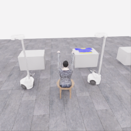
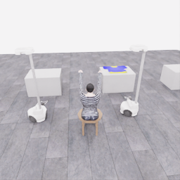
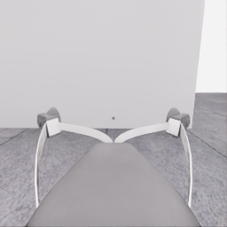
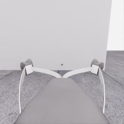
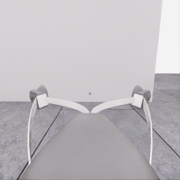
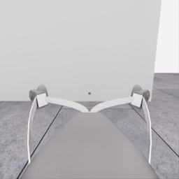
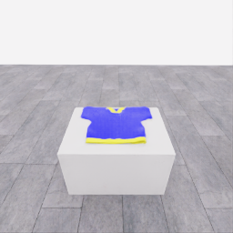
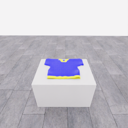
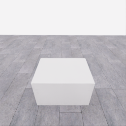
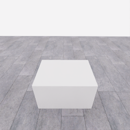

# 연결 시험 · 20261106-exec-metering-wiring-001

[전체 수집 기록](../../README.ko.md) · [구조화 요약](manifest.json) · [전체 행동 기록](decisions.jsonl) · [사용한 기본 프롬프트](prompt.txt)

실행 상태는 **completed**, 원본 출처는 `integration_test`입니다. 작은 들기·정지·저장 연결을 확인한 시험이며 착의 성공 시연이 아닙니다.

## 실행 조건과 시간

| 항목 | 기록 |
|---|---|
| 기록 시작 UTC | 2026-11-06T03:19:14Z |
| 기록 종료 UTC | 2026-11-06T03:20:36Z |
| 이전 시도 | 미측정/해당 없음 |
| 재시도 사유 | 미측정/해당 없음 |
| 출처 그룹 | 20261106-exec-metering-wiring-001 |
| 요청 모델 / 추론 설정 | gpt-6-astra / ultra |
| 전체 실제 경과 시간 (초) | 82.423 |
| Actor 호출 합계 (초) | 21.538 |
| 환경 요청·응답 합계 (초) | 4.957 |
| 시뮬레이션 시간 (초) | 0.150 |
| 저장 전이 수 | 3.000 |
| 응답 확인 전이 수 | 3.000 |
| 모델 호출 시도 수 | 3.000 |
| 완료한 결정 구간 수 | 3.000 |
| 파일 완료 상태 | true |
| 데이터 정합성 검사 | true |
| 학습 데이터 승인 | unreviewed |
| Actor 호출 방식 | exec |
| 한 호출의 최대 계획 구간 수 | 1.000 |
| 한 계획의 최대 제어 step 수 | 20.000 |

Actor 호출 시간은 공개 입력 저장·요청 전송·응답 처리 등 호출 경로를 측정합니다. 방식에 따라 Docker/CLI 시작이 호출 안에 들어가거나 상주 서버 준비 시간으로 분리됩니다. 내부 모델 추론 시간만 별도로 측정한 값은 아닙니다. 모델이 판단하는 동안 물리 시간은 멈추며 실제 경과 시간과 시뮬레이션 시간은 다릅니다. 세부 요청 프로세스 시간에도 CLI 처리·네트워크·서버 대기·생성이 함께 포함됩니다.

## 토큰 사용량의 범위

`actor_usage`는 thread별 관측 누계를 합친 값입니다. 결정의 `usage`는 원본 CLI 누계이며, 호출별 증가량은 `usage_accounting.incremental_usage`입니다. 캐시 입력은 입력의 부분집합이고 추론 출력은 출력의 부분집합이므로 열들을 다시 합산하지 않습니다.

전체 호출 사용량 확정: **true** · 기록한 호출 수: 3.

| 입력 | 캐시 입력 | 캐시 쓰기 입력 | 출력 | 추론 출력 |
|---:|---:|---:|---:|---:|
| 74514 | 41472 | 0 | 315 | 38 |

중복 누계는 추가 사용량 0으로 처리하고, 역행한 누계는 미확정으로 보존합니다. 새 thread는 별도로 집계합니다. 토큰 기록은 화폐 비용이나 청구서가 아닙니다.

## 리뷰 정지 조건

목표 누적 점수 5.000 · 감시 상태 `disabled_wiring` · 수집기 상태 `completed`.

마지막 관측 점수 미측정/해당 없음 · 응답 확인 step 미측정/해당 없음.

`review_ready`는 정지 조건에 따라 실행을 마치고 리뷰할 준비가 된 상태입니다. 50점·착의 성공이나 학습 데이터 승인을 뜻하지 않습니다. 공식 점수와 success는 아래 평가 결과로 확인합니다.

## 공식 평가 결과

평가 유효성 `true` · 누적 점수 **0.000 / 50** · 착의 success **false** · rate 상태 `no_contact` · 최종 rate 미측정/해당 없음 points/s.

누적 50점, 착의 success, 정상 파일 종료와 데이터 정합성은 서로 다른 상태입니다. 접촉 전 `no_contact`의 rate는 0점/초로 바꾸지 않습니다.

| 단계 | 획득 점수 / 최대 | 획득 시각 (episode 초) |
|---|---:|---:|
| 파지·들기 | 0.000 / 5 | 미측정/해당 없음 |
| 첫 소매 | 0.000 / 5 | 미측정/해당 없음 |
| 반대 어깨 | 0.000 / 5 | 미측정/해당 없음 |
| 두 번째 소매 | 0.000 / 5 | 미측정/해당 없음 |
| 왼쪽 위팔 | 0.000 / 5 | 미측정/해당 없음 |
| 오른쪽 위팔 | 0.000 / 5 | 미측정/해당 없음 |
| 목 통과 | 0.000 / 10 | 미측정/해당 없음 |
| 앞면 방향 | 0.000 / 10 | 미측정/해당 없음 |

## 단계 획득 경로

점수 획득은 [평가 이벤트](score-events.jsonl)에서 같은 physics tick끼리 묶었습니다. 같은 시각에 인정된 항목의 내부 순서는 추정하지 않습니다. 착의 success는 점수 획득과 별도로 기록합니다.

| 순서 | episode 시간 (초) | 전이 경계 step | 누적 점수 변화 | 같은 시각의 항목 변화 |
|---:|---:|---:|---:|---|
| — | — | — | — | 기록된 공식 항목 획득 없음 |

평가 clock 0초에 대응하는 공개 simulation clock은 1.525초입니다. 두 시계를 같은 절대 시각으로 혼동하지 않습니다.

별도 success 이벤트 수: **0**. 평가 유효성: `true`.


## 원본 관측 화면

지정된 공개 카메라의 저장 RGB 픽셀입니다. 시작은 첫 `obs`, 종료는 마지막 `next_obs`입니다. 이미지 합성이나 내부 상태 기반 장면 재구성 없이 원본 픽셀로 PNG를 저장했습니다.

| 카메라 | 시작 | 종료 |
|---|---|---|
| `overview` | [](images/initial-overview.png) | [](images/final-overview.png) |
| `robot_0_wrist` | [](images/initial-robot_0_wrist.png) | [](images/final-robot_0_wrist.png) |
| `robot_1_wrist` | [](images/initial-robot_1_wrist.png) | [](images/final-robot_1_wrist.png) |
| `robot_0_head` | [](images/initial-robot_0_head.png) | [](images/final-robot_0_head.png) |
| `robot_1_head` | [](images/initial-robot_1_head.png) | [](images/final-robot_1_head.png) |

시작 관측 시각 1.525초 · 종료 관측 시각 1.675초 (공개 simulation clock).

[▶ overview 관측 영상 보기](overview.mp4)

저장된 20 Hz `obs` 중 3프레임을 순서대로 사용했습니다. 재생은 **20배 느리게** (1.000 fps), 실제 대기 시간·모델 호출 지연은 영상에 들어가지 않습니다. 종료 `next_obs`는 위 PNG에서 확인합니다.

## 결정과 실행 순서

아래 근거는 모델 최종 JSON의 짧은 행동 설명입니다. 시각적 평가는 행동 전 관측에 대한 판단이며, 그 행동의 실행 후 성공 라벨로 사용하지 않습니다. 공식 점수는 별도의 평가 결과입니다.

행동의 각 행은 로봇 0·1 순서이며 열은 `전진, 왼쪽 이동, 반시계 회전, 리프트, 팔 신장, 손목 yaw, pitch, roll, gripper`입니다. 앞 8개는 정규화 속도이고 gripper는 닫기 `+1`, 열기 `-1`, 의도 유지 `0`입니다.

### 결정 0 · 준비 · `act`

입력 관측 1.525초 · Actor 호출 7.132초 · 시각적 판단 `uncertain`.

계획 `20261106-exec-metering-wiring-001:call-00000` · 모델 호출 인덱스 0 · 계획 구간 1/1 · 이 구간에서 모델 호출 `true`.

실행 직전 최신 관측 1.525초.

공개 입력 저장 0.106초 · 요청 프로세스 7.026초 · 결과 해석 0.000초.

호출 사용량 상태 `observed` · 이번 증가량 입력 16855 / 출력 138 토큰.

최종 응답의 행동 설명: Run wiring test: apply +0.03 lift velocity and open both grippers for two steps.

요청 행동:

```json
[[0, 0, 0, 0.03, 0, 0, 0, 0, -1], [0, 0, 0, 0.03, 0, 0, 0, 0, -1]]
```

실행 구간 step **[0, 2)** · 요청 2 step / 실제 2 step · 환경 요청·응답 3.025초.

실제 적용 행동:

```json
[[0.0, 0.0, 0.0, 0.029999999329447746, 0.0, 0.0, 0.0, 0.0, -1.0], [0.0, 0.0, 0.0, 0.029999999329447746, 0.0, 0.0, 0.0, 0.0, -1.0]]
```

### 결정 1 · 준비 · `stop`

입력 관측 1.625초 · Actor 호출 7.378초 · 시각적 판단 `uncertain`.

계획 `20261106-exec-metering-wiring-001:call-00001` · 모델 호출 인덱스 1 · 계획 구간 1/1 · 이 구간에서 모델 호출 `true`.

실행 직전 최신 관측 1.625초.

공개 입력 저장 0.102초 · 요청 프로세스 7.276초 · 결과 해석 0.000초.

호출 사용량 상태 `observed` · 이번 증가량 입력 24853 / 출력 87 토큰.

최종 응답의 행동 설명: Apply the scheduled wiring-test stop, preserving open-gripper intent.

요청 행동:

```json
[[0, 0, 0, 0, 0, 0, 0, 0, 0], [0, 0, 0, 0, 0, 0, 0, 0, 0]]
```

실행 구간 step **[2, 3)** · 요청 1 step / 실제 1 step · 환경 요청·응답 1.909초.

실제 적용 행동:

```json
[[0.0, 0.0, 0.0, 0.0, 0.0, 0.0, 0.0, 0.0, 0.0], [0.0, 0.0, 0.0, 0.0, 0.0, 0.0, 0.0, 0.0, 0.0]]
```

### 결정 2 · 준비 · `finish_episode`

입력 관측 1.675초 · Actor 호출 7.028초 · 시각적 판단 `uncertain`.

계획 `20261106-exec-metering-wiring-001:call-00002` · 모델 호출 인덱스 2 · 계획 구간 1/1 · 이 구간에서 모델 호출 `true`.

실행 직전 최신 관측 1.675초.

공개 입력 저장 0.102초 · 요청 프로세스 6.926초 · 결과 해석 0.000초.

호출 사용량 상태 `observed` · 이번 증가량 입력 32806 / 출력 90 토큰.

최종 응답의 행동 설명: End the wiring test as scheduled; the shirt remains visibly on the table.

요청 행동:

```json
[[0, 0, 0, 0, 0, 0, 0, 0, 0], [0, 0, 0, 0, 0, 0, 0, 0, 0]]
```

실행 구간 step **[3, 3)** · 요청 0 step / 실제 0 step · 환경 요청·응답 0.022초.

실제 적용 행동:

```json
[[0.0, 0.0, 0.0, 0.0, 0.0, 0.0, 0.0, 0.0, 0.0], [0.0, 0.0, 0.0, 0.0, 0.0, 0.0, 0.0, 0.0, 0.0]]
```

## 검수와 후속 판단

현재 데이터 승인은 `unreviewed`입니다. 형식과 시간 정합성 검사를 통과해도 시연의 유용성이나 착의 성공을 보장하지 않습니다.

이 페이지의 원본 파일 SHA256과 생성 파일 SHA256은 [manifest.json](manifest.json)에 있습니다. 실행 실패도 같은 run ID와 부모 시도 관계로 보존합니다. 공개 범위는 카메라, 최종 행동 응답, 시간, 평가 요약입니다.

[개발 피드백과 변경 근거](../../feedback/2026-11-06.jsonl)
