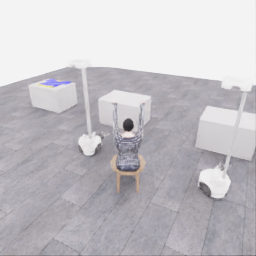
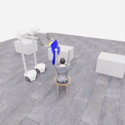
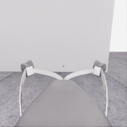
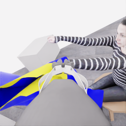
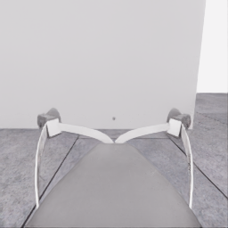
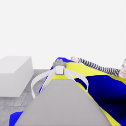
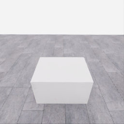
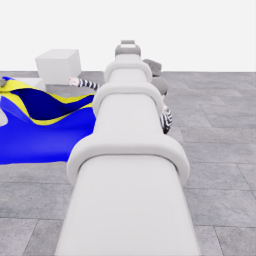
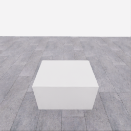
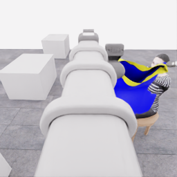

# 자동 시연 수집 시도 · 20261107-astra-entry801-named-001

[전체 수집 기록](../../README.ko.md) · [구조화 요약](manifest.json) · [전체 행동 기록](decisions.jsonl) · [사용한 기본 프롬프트](prompt.txt)

실행 상태는 **completed**, 원본 출처는 `gpt`입니다. 완료 상태와 과제 성공은 아래에서 따로 기록합니다.

## 실행 조건과 시간

| 항목 | 기록 |
|---|---|
| 기록 시작 UTC | 2026-11-07T00:45:20Z |
| 기록 종료 UTC | 2026-11-07T01:11:37Z |
| 이전 시도 | 20261106-astra-guide470-depth-001 |
| 재시도 사유 | named_channels_before_repeated_roll_error |
| 출처 그룹 | 20261106-coordinated-demo-methods |
| 요청 모델 / 추론 설정 | gpt-6-astra / ultra |
| 전체 실제 경과 시간 (초) | 1577.537 |
| Actor 호출 합계 (초) | 736.918 |
| 환경 요청·응답 합계 (초) | 793.905 |
| 시뮬레이션 시간 (초) | 46.600 |
| 저장 전이 수 | 932.000 |
| 응답 확인 전이 수 | 932.000 |
| 모델 호출 시도 수 | 14.000 |
| 완료한 결정 구간 수 | 13.000 |
| 파일 완료 상태 | true |
| 데이터 정합성 검사 | true |
| 학습 데이터 승인 | unreviewed |
| Actor 호출 방식 | exec |
| 한 호출의 최대 계획 구간 수 | 1.000 |
| 한 계획의 최대 제어 step 수 | 20.000 |
| 제어기 정착 대기 설정 | true |
| 정착 대기 요청 step 수 | 6.000 |
| 완료한 제어기 정착 구간 수 | 12.000 |
| 제어기 정착 전이 수 | 72.000 |
| 제어기 정착 환경 요청·응답 (초) | 59.839 |
| 전이 예산으로 단축한 정착 구간 수 | 0.000 |
| 전이 예산으로 건너뛴 정착 구간 수 | 0.000 |

Actor 호출 시간은 공개 입력 저장·요청 전송·응답 처리 등 호출 경로를 측정합니다. 방식에 따라 Docker/CLI 시작이 호출 안에 들어가거나 상주 서버 준비 시간으로 분리됩니다. 내부 모델 추론 시간만 별도로 측정한 값은 아닙니다. 모델이 판단하는 동안 물리 시간은 멈추며 실제 경과 시간과 시뮬레이션 시간은 다릅니다. 세부 요청 프로세스 시간에도 CLI 처리·네트워크·서버 대기·생성이 함께 포함됩니다.

## 토큰 사용량의 범위

`actor_usage`는 thread별 관측 누계를 합친 값입니다. 결정의 `usage`는 원본 CLI 누계이며, 호출별 증가량은 `usage_accounting.incremental_usage`입니다. 캐시 입력은 입력의 부분집합이고 추론 출력은 출력의 부분집합이므로 열들을 다시 합산하지 않습니다.

전체 호출 사용량 확정: **true** · 기록한 호출 수: 14.

| 입력 | 캐시 입력 | 캐시 쓰기 입력 | 출력 | 추론 출력 |
|---:|---:|---:|---:|---:|
| 1273274 | 1037440 | 0 | 21350 | 18297 |

중복 누계는 추가 사용량 0으로 처리하고, 역행한 누계는 미확정으로 보존합니다. 새 thread는 별도로 집계합니다. 토큰 기록은 화폐 비용이나 청구서가 아닙니다.

## 리뷰 정지 조건

목표 누적 점수 10.000 · 감시 상태 `collector_ended_before_gate` · 수집기 상태 `completed`.

마지막 관측 점수 5.000 · 응답 확인 step 932.

`review_ready`는 정지 조건에 따라 실행을 마치고 리뷰할 준비가 된 상태입니다. 50점·착의 성공이나 학습 데이터 승인을 뜻하지 않습니다. 공식 점수와 success는 아래 평가 결과로 확인합니다.

## 공식 평가 결과

평가 유효성 `true` · 누적 점수 **5.000 / 50** · 착의 success **false** · rate 상태 `no_dressing_points` · 최종 rate 0.000 points/s.

누적 50점, 착의 success, 정상 파일 종료와 데이터 정합성은 서로 다른 상태입니다. 접촉 전 `no_contact`의 rate는 0점/초로 바꾸지 않습니다.

| 단계 | 획득 점수 / 최대 | 획득 시각 (episode 초) |
|---|---:|---:|
| 파지·들기 | 5.000 / 5 | 27.150 |
| 첫 소매 | 0.000 / 5 | 미측정/해당 없음 |
| 반대 어깨 | 0.000 / 5 | 미측정/해당 없음 |
| 두 번째 소매 | 0.000 / 5 | 미측정/해당 없음 |
| 왼쪽 위팔 | 0.000 / 5 | 미측정/해당 없음 |
| 오른쪽 위팔 | 0.000 / 5 | 미측정/해당 없음 |
| 목 통과 | 0.000 / 10 | 미측정/해당 없음 |
| 앞면 방향 | 0.000 / 10 | 미측정/해당 없음 |

## 단계 획득 경로

점수 획득은 [평가 이벤트](score-events.jsonl)에서 같은 physics tick끼리 묶었습니다. 같은 시각에 인정된 항목의 내부 순서는 추정하지 않습니다. 착의 success는 점수 획득과 별도로 기록합니다.

| 순서 | episode 시간 (초) | 전이 경계 step | 누적 점수 변화 | 같은 시각의 항목 변화 |
|---:|---:|---:|---:|---|
| 0 | 27.150 | 543 | 0.000→5.000 | 파지·들기 0.000→5.000 |

평가 clock 0초에 대응하는 공개 simulation clock은 1.525초입니다. 두 시계를 같은 절대 시각으로 혼동하지 않습니다.

별도 success 이벤트 수: **0**. 평가 유효성: `true`.


## 원본 관측 화면

지정된 공개 카메라의 저장 RGB 픽셀입니다. 시작은 첫 `obs`, 종료는 마지막 `next_obs`입니다. 이미지 합성이나 내부 상태 기반 장면 재구성 없이 원본 픽셀로 PNG를 저장했습니다.

| 카메라 | 시작 | 종료 |
|---|---|---|
| `overview` | [](images/initial-overview.png) | [](images/final-overview.png) |
| `robot_0_wrist` | [](images/initial-robot_0_wrist.png) | [](images/final-robot_0_wrist.png) |
| `robot_1_wrist` | [](images/initial-robot_1_wrist.png) | [](images/final-robot_1_wrist.png) |
| `robot_0_head` | [](images/initial-robot_0_head.png) | [](images/final-robot_0_head.png) |
| `robot_1_head` | [](images/initial-robot_1_head.png) | [](images/final-robot_1_head.png) |

시작 관측 시각 1.525초 · 종료 관측 시각 48.125초 (공개 simulation clock).

[▶ overview 관측 영상 보기](overview.mp4)

저장된 20 Hz `obs` 중 932프레임을 순서대로 사용했습니다. 재생은 **1배 느리게** (20.000 fps), 실제 대기 시간·모델 호출 지연은 영상에 들어가지 않습니다. 종료 `next_obs`는 위 PNG에서 확인합니다.

## 결정과 실행 순서

아래 근거는 모델 최종 JSON의 짧은 행동 설명입니다. 시각적 평가는 행동 전 관측에 대한 판단이며, 그 행동의 실행 후 성공 라벨로 사용하지 않습니다. 공식 점수는 별도의 평가 결과입니다.

행동의 각 행은 로봇 0·1 순서이며 열은 `전진, 왼쪽 이동, 반시계 회전, 리프트, 팔 신장, 손목 yaw, pitch, roll, gripper`입니다. 앞 8개는 정규화 속도이고 gripper는 닫기 `+1`, 열기 `-1`, 의도 유지 `0`입니다.

제어기 정착 대기는 앞선 모델 결정에 연결된 별도 중립 행동입니다. 추가 모델 호출이나 모델 결정으로 집계하지 않으며, 실제 전이와 환경 요청·응답 시간은 전체 합계에 포함됩니다. 중립 행동은 두 로봇의 속도와 gripper 명령을 모두 0으로 보내 기존 gripper 의도를 유지합니다. 대기를 실행했다는 기록이 옷의 정착이나 과제 개선을 확인했다는 뜻은 아닙니다.

### 기록된 행동의 재실행 구간

원본 `20261106-astra-guide470-depth-001`의 행동 801전이를 새 환경에서 다시 실행했습니다. 이 구간에는 새 모델 호출이 없고 관측·평가를 새로 기록했습니다. 정확한 물리 상태 복원이나 독립적인 새 시연으로 집계하지 않습니다. 원본 step 대응과 실제 행동은 `decisions.jsonl`의 `replayed_segment`에 있습니다.

### 별도 모델 호출 0 · `initial`

실행 결정 인덱스 0의 고정 관측을 사용했습니다. 호출 경과 66.698초. 같은 call index의 행동 기록과 사용량을 중복 합산하지 않습니다.

공개 입력 저장 0.234초 · 요청 프로세스 66.464초 · 결과 해석 0.000초.

### 결정 0 · 첫 소매 · `act`

입력 관측 41.575초 · Actor 호출 66.698초 · 시각적 판단 `uncertain`.

계획 `20261107-astra-entry801-named-001:call-00000` · 모델 호출 인덱스 0 · 계획 구간 1/1 · 이 구간에서 모델 호출 `true`.

실행 직전 최신 관측 41.575초.

공개 입력 저장 0.234초 · 요청 프로세스 66.464초 · 결과 해석 0.000초.

호출 사용량 상태 `observed` · 이번 증가량 입력 22157 / 출력 1968 토큰.

최종 응답의 행동 설명: Robot 0 guides one apparent rim; robot 1 supports the opposite edge. The nearer hand remains above the candidate body opening. Raise both about 5 cm to improve alignment and check whether cloth follows each gripper before advancing.

요청 행동:

```json
[[0, 0, 0, 0.16, 0, 0, 0, 0, 0], [0, 0, 0, 0.16, 0, 0, 0, 0, 0]]
```

실행 구간 step **[801, 805)** · 요청 4 step / 실제 4 step · 환경 요청·응답 3.629초.

실제 적용 행동:

```json
[[0.0, 0.0, 0.0, 0.1599999964237213, 0.0, 0.0, 0.0, 0.0, 0.0], [0.0, 0.0, 0.0, 0.1599999964237213, 0.0, 0.0, 0.0, 0.0, 0.0]]
```

### 제어기 정착 대기 · 연결 결정 0

구간 `20261107-astra-entry801-named-001:settle-00000` · 출처 `controller_settle` · 이 구간에서 모델 호출 `false`.

앞선 모델 호출 인덱스 0에 연결됩니다. 추가 호출은 없습니다.

실행 구간 step **[805, 811)** · 요청 6 step / 실제 6 step · 환경 요청·응답 5.208초.

공개 simulation clock 41.775→42.075초 · 실행 전 관측 41.775초.

실제 적용 중립 행동:

```json
[[0.0, 0.0, 0.0, 0.0, 0.0, 0.0, 0.0, 0.0, 0.0], [0.0, 0.0, 0.0, 0.0, 0.0, 0.0, 0.0, 0.0, 0.0]]
```

### 별도 모델 호출 1 · `initial`

실행 결정 인덱스 1의 고정 관측을 사용했습니다. 호출 경과 31.944초. 같은 call index의 행동 기록과 사용량을 중복 합산하지 않습니다.

공개 입력 저장 0.081초 · 요청 프로세스 31.862초 · 결과 해석 0.000초.

### 결정 1 · 첫 소매 · `act`

입력 관측 42.075초 · Actor 호출 31.944초 · 시각적 판단 `progressing`.

계획 `20261107-astra-entry801-named-001:call-00001` · 모델 호출 인덱스 1 · 계획 구간 1/1 · 이 구간에서 모델 호출 `true`.

실행 직전 최신 관측 42.075초.

공개 입력 저장 0.081초 · 요청 프로세스 31.862초 · 결과 해석 0.000초.

호출 사용량 상태 `observed` · 이번 증가량 입력 33229 / 출력 900 토큰.

최종 응답의 행동 설명: Robot 0 guides and robot 1 supports; both cloth edges appear to have followed the lift. Lift targets reached 1.20 m, but the same nearer hand remains above the opening. Pitch both wrists upward to raise and reorient the candidate rim before entry.

요청 행동:

```json
[[0, 0, 0, 0, 0, 0, -0.18, 0, 0], [0, 0, 0, 0, 0, 0, -0.18, 0, 0]]
```

실행 구간 step **[811, 815)** · 요청 4 step / 실제 4 step · 환경 요청·응답 3.812초.

실제 적용 행동:

```json
[[0.0, 0.0, 0.0, 0.0, 0.0, 0.0, -0.18000000715255737, 0.0, 0.0], [0.0, 0.0, 0.0, 0.0, 0.0, 0.0, -0.18000000715255737, 0.0, 0.0]]
```

### 제어기 정착 대기 · 연결 결정 1

구간 `20261107-astra-entry801-named-001:settle-00001` · 출처 `controller_settle` · 이 구간에서 모델 호출 `false`.

앞선 모델 호출 인덱스 1에 연결됩니다. 추가 호출은 없습니다.

실행 구간 step **[815, 821)** · 요청 6 step / 실제 6 step · 환경 요청·응답 5.184초.

공개 simulation clock 42.275→42.575초 · 실행 전 관측 42.275초.

실제 적용 중립 행동:

```json
[[0.0, 0.0, 0.0, 0.0, 0.0, 0.0, 0.0, 0.0, 0.0], [0.0, 0.0, 0.0, 0.0, 0.0, 0.0, 0.0, 0.0, 0.0]]
```

### 별도 모델 호출 2 · `initial`

실행 결정 인덱스 2의 고정 관측을 사용했습니다. 호출 경과 54.369초. 같은 call index의 행동 기록과 사용량을 중복 합산하지 않습니다.

공개 입력 저장 0.079초 · 요청 프로세스 54.290초 · 결과 해석 0.000초.

### 결정 2 · 첫 소매 · `act`

입력 관측 42.575초 · Actor 호출 54.369초 · 시각적 판단 `progressing`.

계획 `20261107-astra-entry801-named-001:call-00002` · 모델 호출 인덱스 2 · 계획 구간 1/1 · 이 구간에서 모델 호출 `true`.

실행 직전 최신 관측 42.575초.

공개 입력 저장 0.079초 · 요청 프로세스 54.290초 · 결과 해석 0.000초.

호출 사용량 상태 `observed` · 이번 증가량 입력 42989 / 출력 1601 토큰.

최종 응답의 행동 설명: Robot 0 guides the candidate opening while robot 1 supports its opposite edge. Pitching raised both rims and brought the nearer hand alongside the upper rim in projection; entry is unproven. Extend both about 5 cm toward that hand, then inspect its relationship to both rims.

요청 행동:

```json
[[0, 0, 0, 0, 0.16, 0, 0, 0, 0], [0, 0, 0, 0, 0.16, 0, 0, 0, 0]]
```

실행 구간 step **[821, 826)** · 요청 5 step / 실제 5 step · 환경 요청·응답 4.386초.

실제 적용 행동:

```json
[[0.0, 0.0, 0.0, 0.0, 0.1599999964237213, 0.0, 0.0, 0.0, 0.0], [0.0, 0.0, 0.0, 0.0, 0.1599999964237213, 0.0, 0.0, 0.0, 0.0]]
```

### 제어기 정착 대기 · 연결 결정 2

구간 `20261107-astra-entry801-named-001:settle-00002` · 출처 `controller_settle` · 이 구간에서 모델 호출 `false`.

앞선 모델 호출 인덱스 2에 연결됩니다. 추가 호출은 없습니다.

실행 구간 step **[826, 832)** · 요청 6 step / 실제 6 step · 환경 요청·응답 5.195초.

공개 simulation clock 42.825→43.125초 · 실행 전 관측 42.825초.

실제 적용 중립 행동:

```json
[[0.0, 0.0, 0.0, 0.0, 0.0, 0.0, 0.0, 0.0, 0.0], [0.0, 0.0, 0.0, 0.0, 0.0, 0.0, 0.0, 0.0, 0.0]]
```

### 별도 모델 호출 3 · `initial`

실행 결정 인덱스 3의 고정 관측을 사용했습니다. 호출 경과 27.433초. 같은 call index의 행동 기록과 사용량을 중복 합산하지 않습니다.

공개 입력 저장 0.080초 · 요청 프로세스 27.353초 · 결과 해석 0.000초.

### 결정 3 · 복구 · `act`

입력 관측 43.125초 · Actor 호출 27.433초 · 시각적 판단 `recovering`.

계획 `20261107-astra-entry801-named-001:call-00003` · 모델 호출 인덱스 3 · 계획 구간 1/1 · 이 구간에서 모델 호출 `true`.

실행 직전 최신 관측 43.125초.

공개 입력 저장 0.080초 · 요청 프로세스 27.353초 · 결과 해석 0.000초.

호출 사용량 상태 `observed` · 이번 증가량 입력 53418 / 출력 836 토큰.

최종 응답의 행동 설명: Robot 0 guides and robot 1 supports, with cloth still following both. The extension executed, but the target hand disappeared behind the panel without visible rim crossing. Retract both about 5 cm to restore the hand-and-rim view before changing opening orientation.

요청 행동:

```json
[[0, 0, 0, 0, -0.16, 0, 0, 0, 0], [0, 0, 0, 0, -0.16, 0, 0, 0, 0]]
```

실행 구간 step **[832, 837)** · 요청 5 step / 실제 5 step · 환경 요청·응답 4.360초.

실제 적용 행동:

```json
[[0.0, 0.0, 0.0, 0.0, -0.1599999964237213, 0.0, 0.0, 0.0, 0.0], [0.0, 0.0, 0.0, 0.0, -0.1599999964237213, 0.0, 0.0, 0.0, 0.0]]
```

### 제어기 정착 대기 · 연결 결정 3

구간 `20261107-astra-entry801-named-001:settle-00003` · 출처 `controller_settle` · 이 구간에서 모델 호출 `false`.

앞선 모델 호출 인덱스 3에 연결됩니다. 추가 호출은 없습니다.

실행 구간 step **[837, 843)** · 요청 6 step / 실제 6 step · 환경 요청·응답 5.574초.

공개 simulation clock 43.375→43.675초 · 실행 전 관측 43.375초.

실제 적용 중립 행동:

```json
[[0.0, 0.0, 0.0, 0.0, 0.0, 0.0, 0.0, 0.0, 0.0], [0.0, 0.0, 0.0, 0.0, 0.0, 0.0, 0.0, 0.0, 0.0]]
```

### 별도 모델 호출 4 · `initial`

실행 결정 인덱스 4의 고정 관측을 사용했습니다. 호출 경과 62.077초. 같은 call index의 행동 기록과 사용량을 중복 합산하지 않습니다.

공개 입력 저장 0.074초 · 요청 프로세스 62.002초 · 결과 해석 0.000초.

### 공개 픽셀 depth 조회 · 결정 4

물리 전이 없이 같은 카메라·시각의 원본 값을 조회했습니다. 무효 값은 null이며 접촉·입구 통과 판단이 아닙니다.

```json
{
  "request": {
    "kind": "depth_query",
    "observation_id": "0c20e5c8eabe29b1c5df41ca45b92b857191ac149b360b0374b13e4c677916a4",
    "camera": "robot_0_wrist",
    "pixels_uv": [
      [
        53,
        128
      ],
      [
        66,
        127
      ],
      [
        52,
        143
      ],
      [
        36,
        201
      ],
      [
        24,
        171
      ],
      [
        93,
        131
      ]
    ],
    "include_camera_geometry": true
  },
  "response": {
    "kind": "depth_query_result",
    "observation_id": "0c20e5c8eabe29b1c5df41ca45b92b857191ac149b360b0374b13e4c677916a4",
    "camera": "robot_0_wrist",
    "camera_index": 1,
    "simulation_time_s": 43.67500227782875,
    "intrinsics_sha256": "3dd91a2df5cb0a47b6f5ceb86d60d41e1f5d6753d2a11a034ac0b52bc385cd23",
    "request_sha256": "5f055d6219ac4549e576a6e01a67d992a1c72ccbf49c5ce7202d0a312b8998a7",
    "depth_semantics": "optical_Z_metres_not_ray_range",
    "geometry_semantics": "camera_X_right_Y_down_Z_forward",
    "rgb_image_order": [
      "overview",
      "robot_0_wrist",
      "robot_1_wrist",
      "robot_0_head",
      "robot_1_head"
    ],
    "resolution_wh": [
      256,
      256
    ],
    "neighbor_depth_substituted": false,
    "hidden_surfaces_estimated": false,
    "object_pose_or_contact_inferred": false,
    "source_sha256": {
      "observation_json": "f779670f7d41e62eed113a636d66337af3aec3a75eff1d05766018cc50ad6071",
      "public_depth_npz": "d7dd824eeed7005f17ef5a48d6bbf5b25c557555201f5fd4afaaa09b48727eb2",
      "overview_rgb": "9408606aaa666502f2275882df7a7825ac08c789058648e04a0c490daf8b2635",
      "robot_0_wrist_rgb": "c9d3e5e4d18b358bcfe2ce69cfd931c807112b5cafdcfa5d45b9805bc729e2e4",
      "robot_1_wrist_rgb": "2938ff49e4416127009579b02c691bf5d324c8f2a3406389cdac75d58571a708",
      "robot_0_head_rgb": "721d1d0f2119d87598d27acbb435ca47f6d4514b84607896f9fc9864519fc513",
      "robot_1_head_rgb": "0e229ec6149f02c54dc877fc57e338a1412be0857ab9ee193467022c100de70b"
    },
    "results": [
      {
        "pixel_uv": [
          53,
          128
        ],
        "status": "valid",
        "optical_z_m": 0.44391506910324097,
        "camera_xyz_m": [
          -0.18212852209627356,
          0.0,
          0.44391506910324097
        ],
        "camera_range_m": 0.4798243294560083,
        "invalid_reasons": []
      },
      {
        "pixel_uv": [
          66,
          127
        ],
        "status": "valid",
        "optical_z_m": 0.4666622281074524,
        "camera_xyz_m": [
          -0.15827457355431085,
          -0.0025528157024888847,
          0.4666622281074524
        ],
        "camera_range_m": 0.4927788476020676,
        "invalid_reasons": []
      },
      {
        "pixel_uv": [
          52,
          143
        ],
        "status": "valid",
        "optical_z_m": 0.23869478702545166,
        "camera_xyz_m": [
          -0.09923693421640833,
          0.01958623701639638,
          0.23869478702545166
        ],
        "camera_range_m": 0.25924272631312134,
        "invalid_reasons": []
      },
      {
        "pixel_uv": [
          36,
          201
        ],
        "status": "valid",
        "optical_z_m": 0.21887487173080444,
        "camera_xyz_m": [
          -0.11015406898573842,
          0.08740485908650981,
          0.21887487173080444
        ],
        "camera_range_m": 0.26015329669489784,
        "invalid_reasons": []
      },
      {
        "pixel_uv": [
          24,
          171
        ],
        "status": "valid",
        "optical_z_m": 0.4184674024581909,
        "camera_xyz_m": [
          -0.2380738991282126,
          0.0984344006010879,
          0.4184674024581909
        ],
        "camera_range_m": 0.4914096860949236,
        "invalid_reasons": []
      },
      {
        "pixel_uv": [
          93,
          131
        ],
        "status": "valid",
        "optical_z_m": 0.25570857524871826,
        "camera_xyz_m": [
          -0.048958730617895366,
          0.004196462624391032,
          0.25570857524871826
        ],
        "camera_range_m": 0.2603871023265226,
        "invalid_reasons": []
      }
    ]
  }
}
```

### 별도 모델 호출 5 · `action_after_query`

실행 결정 인덱스 4의 고정 관측을 사용했습니다. 호출 경과 72.537초. 같은 call index의 행동 기록과 사용량을 중복 합산하지 않습니다.

공개 입력 저장 0.074초 · 요청 프로세스 72.463초 · 결과 해석 0.000초.

### 결정 4 · 복구 · `act`

입력 관측 43.675초 · Actor 호출 72.537초 · 시각적 판단 `recovering`.

계획 `20261107-astra-entry801-named-001:call-00005` · 모델 호출 인덱스 5 · 계획 구간 1/1 · 이 구간에서 모델 호출 `true`.

실행 직전 최신 관측 43.675초.

공개 입력 저장 0.074초 · 요청 프로세스 72.463초 · 결과 해석 0.000초.

호출 사용량 상태 `observed` · 이번 증가량 입력 74817 / 출력 1907 토큰.

최종 응답의 행동 설명: Robot 1 anchors while robot 0 lowers its held edge about 6 cm to tilt the opening and improve visibility. Sampled hand surfaces remain roughly 20 cm farther in optical depth than the candidate rims; overlap does not establish entry. Inspect the reshaped opening before advancing.

요청 행동:

```json
[[0, 0, 0, -0.16, 0, 0, 0, 0, 0], [0, 0, 0, 0, 0, 0, 0, 0, 0]]
```

실행 구간 step **[843, 848)** · 요청 5 step / 실제 5 step · 환경 요청·응답 4.455초.

실제 적용 행동:

```json
[[0.0, 0.0, 0.0, -0.1599999964237213, 0.0, 0.0, 0.0, 0.0, 0.0], [0.0, 0.0, 0.0, 0.0, 0.0, 0.0, 0.0, 0.0, 0.0]]
```

### 제어기 정착 대기 · 연결 결정 4

구간 `20261107-astra-entry801-named-001:settle-00004` · 출처 `controller_settle` · 이 구간에서 모델 호출 `false`.

앞선 모델 호출 인덱스 5에 연결됩니다. 추가 호출은 없습니다.

실행 구간 step **[848, 854)** · 요청 6 step / 실제 6 step · 환경 요청·응답 5.266초.

공개 simulation clock 43.925→44.225초 · 실행 전 관측 43.925초.

실제 적용 중립 행동:

```json
[[0.0, 0.0, 0.0, 0.0, 0.0, 0.0, 0.0, 0.0, 0.0], [0.0, 0.0, 0.0, 0.0, 0.0, 0.0, 0.0, 0.0, 0.0]]
```

### 별도 모델 호출 6 · `initial`

실행 결정 인덱스 5의 고정 관측을 사용했습니다. 호출 경과 33.285초. 같은 call index의 행동 기록과 사용량을 중복 합산하지 않습니다.

공개 입력 저장 0.074초 · 요청 프로세스 33.211초 · 결과 해석 0.000초.

### 결정 5 · 첫 소매 · `act`

입력 관측 44.225초 · Actor 호출 33.285초 · 시각적 판단 `progressing`.

계획 `20261107-astra-entry801-named-001:call-00006` · 모델 호출 인덱스 6 · 계획 구간 1/1 · 이 구간에서 모델 호출 `true`.

실행 직전 최신 관측 44.225초.

공개 입력 저장 0.074초 · 요청 프로세스 33.211초 · 결과 해석 0.000초.

호출 사용량 상태 `observed` · 이번 증가량 입력 85722 / 출력 1019 토큰.

최종 응답의 행동 설명: Robot 0&#x27;s lowered guide edge restored a clearer target-hand view; robot 1 maintains the higher support edge. Advance both about 7 cm while preserving this tilt, then compare the same hand against both candidate rims. Entry remains unconfirmed.

요청 행동:

```json
[[0, 0, 0, 0, 0.2, 0, 0, 0, 0], [0, 0, 0, 0, 0.2, 0, 0, 0, 0]]
```

실행 구간 step **[854, 860)** · 요청 6 step / 실제 6 step · 환경 요청·응답 5.189초.

실제 적용 행동:

```json
[[0.0, 0.0, 0.0, 0.0, 0.20000000298023224, 0.0, 0.0, 0.0, 0.0], [0.0, 0.0, 0.0, 0.0, 0.20000000298023224, 0.0, 0.0, 0.0, 0.0]]
```

### 제어기 정착 대기 · 연결 결정 5

구간 `20261107-astra-entry801-named-001:settle-00005` · 출처 `controller_settle` · 이 구간에서 모델 호출 `false`.

앞선 모델 호출 인덱스 6에 연결됩니다. 추가 호출은 없습니다.

실행 구간 step **[860, 866)** · 요청 6 step / 실제 6 step · 환경 요청·응답 5.103초.

공개 simulation clock 44.525→44.825초 · 실행 전 관측 44.525초.

실제 적용 중립 행동:

```json
[[0.0, 0.0, 0.0, 0.0, 0.0, 0.0, 0.0, 0.0, 0.0], [0.0, 0.0, 0.0, 0.0, 0.0, 0.0, 0.0, 0.0, 0.0]]
```

### 별도 모델 호출 7 · `initial`

실행 결정 인덱스 6의 고정 관측을 사용했습니다. 호출 경과 68.332초. 같은 call index의 행동 기록과 사용량을 중복 합산하지 않습니다.

공개 입력 저장 0.076초 · 요청 프로세스 68.256초 · 결과 해석 0.000초.

### 결정 6 · 복구 · `act`

입력 관측 44.825초 · Actor 호출 68.332초 · 시각적 판단 `recovering`.

계획 `20261107-astra-entry801-named-001:call-00007` · 모델 호출 인덱스 7 · 계획 구간 1/1 · 이 구간에서 모델 호출 `true`.

실행 직전 최신 관측 44.825초.

공개 입력 저장 0.076초 · 요청 프로세스 68.256초 · 결과 해석 0.000초.

호출 사용량 상태 `observed` · 이번 증가량 입력 95593 / 출력 1822 토큰.

최종 응답의 행동 설명: Robot 0 guides while robot 1 maintains support. The executed advance again hid the target hand without showing rim crossing. Withdraw both about 7 cm and roll robot 0&#x27;s held edge about 24 degrees to reshape the opening and change its viewing angle before reassessing.

요청 행동:

```json
[[0, 0, 0, 0, -0.2, 0, 0, 0.25, 0], [0, 0, 0, 0, -0.2, 0, 0, 0, 0]]
```

실행 구간 step **[866, 872)** · 요청 6 step / 실제 6 step · 환경 요청·응답 4.784초.

실제 적용 행동:

```json
[[0.0, 0.0, 0.0, 0.0, -0.20000000298023224, 0.0, 0.0, 0.25, 0.0], [0.0, 0.0, 0.0, 0.0, -0.20000000298023224, 0.0, 0.0, 0.0, 0.0]]
```

### 제어기 정착 대기 · 연결 결정 6

구간 `20261107-astra-entry801-named-001:settle-00006` · 출처 `controller_settle` · 이 구간에서 모델 호출 `false`.

앞선 모델 호출 인덱스 7에 연결됩니다. 추가 호출은 없습니다.

실행 구간 step **[872, 878)** · 요청 6 step / 실제 6 step · 환경 요청·응답 4.633초.

공개 simulation clock 45.125→45.425초 · 실행 전 관측 45.125초.

실제 적용 중립 행동:

```json
[[0.0, 0.0, 0.0, 0.0, 0.0, 0.0, 0.0, 0.0, 0.0], [0.0, 0.0, 0.0, 0.0, 0.0, 0.0, 0.0, 0.0, 0.0]]
```

### 별도 모델 호출 8 · `initial`

실행 결정 인덱스 7의 고정 관측을 사용했습니다. 호출 경과 71.884초. 같은 call index의 행동 기록과 사용량을 중복 합산하지 않습니다.

공개 입력 저장 0.074초 · 요청 프로세스 71.809초 · 결과 해석 0.000초.

### 결정 7 · 복구 · `act`

입력 관측 45.425초 · Actor 호출 71.884초 · 시각적 판단 `uncertain`.

계획 `20261107-astra-entry801-named-001:call-00008` · 모델 호출 인덱스 8 · 계획 구간 1/1 · 이 구간에서 모델 호출 `true`.

실행 직전 최신 관측 45.425초.

공개 입력 저장 0.074초 · 요청 프로세스 71.809초 · 결과 해석 0.000초.

호출 사용량 상태 `observed` · 이번 증가량 입력 106291 / 출력 1945 토큰.

최종 응답의 행동 설명: Robot 1 anchors; robot 0&#x27;s changed view reveals the hand but still leaves its rim relationship unclear. Pitch robot 0 downward while compensating with lift and extension to approximately preserve its held-edge position. Inspect from this higher viewing angle before another entry attempt.

요청 행동:

```json
[[0, 0, 0, 0.18, 0.13, 0, 0.2, 0, 0], [0, 0, 0, 0, 0, 0, 0, 0, 0]]
```

실행 구간 step **[878, 882)** · 요청 4 step / 실제 4 step · 환경 요청·응답 3.363초.

실제 적용 행동:

```json
[[0.0, 0.0, 0.0, 0.18000000715255737, 0.12999999523162842, 0.0, 0.20000000298023224, 0.0, 0.0], [0.0, 0.0, 0.0, 0.0, 0.0, 0.0, 0.0, 0.0, 0.0]]
```

### 제어기 정착 대기 · 연결 결정 7

구간 `20261107-astra-entry801-named-001:settle-00007` · 출처 `controller_settle` · 이 구간에서 모델 호출 `false`.

앞선 모델 호출 인덱스 8에 연결됩니다. 추가 호출은 없습니다.

실행 구간 step **[882, 888)** · 요청 6 step / 실제 6 step · 환경 요청·응답 4.717초.

공개 simulation clock 45.625→45.925초 · 실행 전 관측 45.625초.

실제 적용 중립 행동:

```json
[[0.0, 0.0, 0.0, 0.0, 0.0, 0.0, 0.0, 0.0, 0.0], [0.0, 0.0, 0.0, 0.0, 0.0, 0.0, 0.0, 0.0, 0.0]]
```

### 별도 모델 호출 9 · `initial`

실행 결정 인덱스 8의 고정 관측을 사용했습니다. 호출 경과 95.721초. 같은 call index의 행동 기록과 사용량을 중복 합산하지 않습니다.

공개 입력 저장 0.078초 · 요청 프로세스 95.643초 · 결과 해석 0.000초.

### 결정 8 · 복구 · `act`

입력 관측 45.925초 · Actor 호출 95.721초 · 시각적 판단 `uncertain`.

계획 `20261107-astra-entry801-named-001:call-00009` · 모델 호출 인덱스 9 · 계획 구간 1/1 · 이 구간에서 모델 호출 `true`.

실행 직전 최신 관측 45.925초.

공개 입력 저장 0.078초 · 요청 프로세스 95.643초 · 결과 해석 0.000초.

호출 사용량 상태 `observed` · 이번 증가량 입력 117226 / 출력 2662 토큰.

최종 응답의 행동 설명: Robot 1 anchors; robot 0 now sees the hand clearly, but the passage remains obscured. Sidestep robot 0 away from its partner while turning its wrist inward and compensating extension to approximately preserve the held-edge position. Seek an oblique hand-and-opening view without advancing the garment.

요청 행동:

```json
[[0, -0.55, 0, 0, 0.08, 0.3, 0, 0, 0], [0, 0, 0, 0, 0, 0, 0, 0, 0]]
```

실행 구간 step **[888, 894)** · 요청 6 step / 실제 6 step · 환경 요청·응답 4.697초.

실제 적용 행동:

```json
[[0.0, -0.550000011920929, 0.0, 0.0, 0.07999999821186066, 0.30000001192092896, 0.0, 0.0, 0.0], [0.0, 0.0, 0.0, 0.0, 0.0, 0.0, 0.0, 0.0, 0.0]]
```

### 제어기 정착 대기 · 연결 결정 8

구간 `20261107-astra-entry801-named-001:settle-00008` · 출처 `controller_settle` · 이 구간에서 모델 호출 `false`.

앞선 모델 호출 인덱스 9에 연결됩니다. 추가 호출은 없습니다.

실행 구간 step **[894, 900)** · 요청 6 step / 실제 6 step · 환경 요청·응답 4.711초.

공개 simulation clock 46.225→46.525초 · 실행 전 관측 46.225초.

실제 적용 중립 행동:

```json
[[0.0, 0.0, 0.0, 0.0, 0.0, 0.0, 0.0, 0.0, 0.0], [0.0, 0.0, 0.0, 0.0, 0.0, 0.0, 0.0, 0.0, 0.0]]
```

### 별도 모델 호출 10 · `initial`

실행 결정 인덱스 9의 고정 관측을 사용했습니다. 호출 경과 68.836초. 같은 call index의 행동 기록과 사용량을 중복 합산하지 않습니다.

공개 입력 저장 0.078초 · 요청 프로세스 68.758초 · 결과 해석 0.000초.

### 결정 9 · 첫 소매 · `act`

입력 관측 46.525초 · Actor 호출 68.836초 · 시각적 판단 `progressing`.

계획 `20261107-astra-entry801-named-001:call-00010` · 모델 호출 인덱스 10 · 계획 구간 1/1 · 이 구간에서 모델 호출 `true`.

실행 직전 최신 관측 46.525초.

공개 입력 저장 0.078초 · 요청 프로세스 68.758초 · 결과 해석 0.000초.

호출 사용량 상태 `observed` · 이번 증가량 입력 128910 / 출력 2244 토큰.

최종 응답의 행동 설명: Robot 0 provides an oblique guide view while robot 1 supports the opposite edge. The target hand appears approximately level with the candidate upper lip. Pitch both wrists upward to raise the opening about 4–5 cm, aiming its interior toward the hand before advancing.

요청 행동:

```json
[[0, 0, 0, 0, 0, 0, -0.16, 0, 0], [0, 0, 0, 0, 0, 0, -0.16, 0, 0]]
```

실행 구간 step **[900, 904)** · 요청 4 step / 실제 4 step · 환경 요청·응답 3.510초.

실제 적용 행동:

```json
[[0.0, 0.0, 0.0, 0.0, 0.0, 0.0, -0.1599999964237213, 0.0, 0.0], [0.0, 0.0, 0.0, 0.0, 0.0, 0.0, -0.1599999964237213, 0.0, 0.0]]
```

### 제어기 정착 대기 · 연결 결정 9

구간 `20261107-astra-entry801-named-001:settle-00009` · 출처 `controller_settle` · 이 구간에서 모델 호출 `false`.

앞선 모델 호출 인덱스 10에 연결됩니다. 추가 호출은 없습니다.

실행 구간 step **[904, 910)** · 요청 6 step / 실제 6 step · 환경 요청·응답 4.770초.

공개 simulation clock 46.725→47.025초 · 실행 전 관측 46.725초.

실제 적용 중립 행동:

```json
[[0.0, 0.0, 0.0, 0.0, 0.0, 0.0, 0.0, 0.0, 0.0], [0.0, 0.0, 0.0, 0.0, 0.0, 0.0, 0.0, 0.0, 0.0]]
```

### 별도 모델 호출 11 · `initial`

실행 결정 인덱스 10의 고정 관측을 사용했습니다. 호출 경과 43.805초. 같은 call index의 행동 기록과 사용량을 중복 합산하지 않습니다.

공개 입력 저장 0.080초 · 요청 프로세스 43.725초 · 결과 해석 0.000초.

### 결정 10 · 첫 소매 · `act`

입력 관측 47.025초 · Actor 호출 43.805초 · 시각적 판단 `uncertain`.

계획 `20261107-astra-entry801-named-001:call-00011` · 모델 호출 인덱스 11 · 계획 구간 1/1 · 이 구간에서 모델 호출 `true`.

실행 직전 최신 관측 47.025초.

공개 입력 저장 0.080초 · 요청 프로세스 43.725초 · 결과 해석 0.000초.

호출 사용량 상태 `observed` · 이번 증가량 입력 139986 / 출력 1386 토큰.

최종 응답의 행동 설명: Robot 0 guides from the oblique view; robot 1 supports the higher edge. Both rims rose, and the same target hand remains partly visible beyond them. Advance both about 6 cm with the grippers flanking its path, then inspect for hand-between-rims evidence rather than panel overlap.

요청 행동:

```json
[[0, 0, 0, 0, 0.2, 0, 0, 0, 0], [0, 0, 0, 0, 0.2, 0, 0, 0, 0]]
```

실행 구간 step **[910, 915)** · 요청 5 step / 실제 5 step · 환경 요청·응답 4.173초.

실제 적용 행동:

```json
[[0.0, 0.0, 0.0, 0.0, 0.20000000298023224, 0.0, 0.0, 0.0, 0.0], [0.0, 0.0, 0.0, 0.0, 0.20000000298023224, 0.0, 0.0, 0.0, 0.0]]
```

### 제어기 정착 대기 · 연결 결정 10

구간 `20261107-astra-entry801-named-001:settle-00010` · 출처 `controller_settle` · 이 구간에서 모델 호출 `false`.

앞선 모델 호출 인덱스 11에 연결됩니다. 추가 호출은 없습니다.

실행 구간 step **[915, 921)** · 요청 6 step / 실제 6 step · 환경 요청·응답 4.791초.

공개 simulation clock 47.275→47.575초 · 실행 전 관측 47.275초.

실제 적용 중립 행동:

```json
[[0.0, 0.0, 0.0, 0.0, 0.0, 0.0, 0.0, 0.0, 0.0], [0.0, 0.0, 0.0, 0.0, 0.0, 0.0, 0.0, 0.0, 0.0]]
```

### 별도 모델 호출 12 · `initial`

실행 결정 인덱스 11의 고정 관측을 사용했습니다. 호출 경과 24.288초. 같은 call index의 행동 기록과 사용량을 중복 합산하지 않습니다.

공개 입력 저장 0.090초 · 요청 프로세스 24.198초 · 결과 해석 0.000초.

### 결정 11 · 복구 · `act`

입력 관측 47.575초 · Actor 호출 24.288초 · 시각적 판단 `recovering`.

계획 `20261107-astra-entry801-named-001:call-00012` · 모델 호출 인덱스 12 · 계획 구간 1/1 · 이 구간에서 모델 호출 `true`.

실행 직전 최신 관측 47.575초.

공개 입력 저장 0.090초 · 요청 프로세스 24.198초 · 결과 해석 0.000초.

호출 사용량 상태 `observed` · 이번 증가량 입력 150157 / 출력 717 토큰.

최종 응답의 행동 설명: Robot 0 retains the guide grip and robot 1 supports the opposite edge. Three approaches with different opening orientations and views have hidden the target hand without visible rim crossing. Retract both about 6 cm while preserving support; further advancement is currently unproductive.

요청 행동:

```json
[[0, 0, 0, 0, -0.2, 0, 0, 0, 0], [0, 0, 0, 0, -0.2, 0, 0, 0, 0]]
```

실행 구간 step **[921, 926)** · 요청 5 step / 실제 5 step · 환경 요청·응답 4.086초.

실제 적용 행동:

```json
[[0.0, 0.0, 0.0, 0.0, -0.20000000298023224, 0.0, 0.0, 0.0, 0.0], [0.0, 0.0, 0.0, 0.0, -0.20000000298023224, 0.0, 0.0, 0.0, 0.0]]
```

### 제어기 정착 대기 · 연결 결정 11

구간 `20261107-astra-entry801-named-001:settle-00011` · 출처 `controller_settle` · 이 구간에서 모델 호출 `false`.

앞선 모델 호출 인덱스 12에 연결됩니다. 추가 호출은 없습니다.

실행 구간 step **[926, 932)** · 요청 6 step / 실제 6 step · 환경 요청·응답 4.685초.

공개 simulation clock 47.825→48.125초 · 실행 전 관측 47.825초.

실제 적용 중립 행동:

```json
[[0.0, 0.0, 0.0, 0.0, 0.0, 0.0, 0.0, 0.0, 0.0], [0.0, 0.0, 0.0, 0.0, 0.0, 0.0, 0.0, 0.0, 0.0]]
```

### 별도 모델 호출 13 · `initial`

실행 결정 인덱스 12의 고정 관측을 사용했습니다. 호출 경과 15.707초. 같은 call index의 행동 기록과 사용량을 중복 합산하지 않습니다.

공개 입력 저장 0.071초 · 요청 프로세스 15.636초 · 결과 해석 0.000초.

### 결정 12 · 최종 확인 · `finish_episode`

입력 관측 48.125초 · Actor 호출 15.707초 · 시각적 판단 `blocked`.

계획 `20261107-astra-entry801-named-001:call-00013` · 모델 호출 인덱스 13 · 계획 구간 1/1 · 이 구간에서 모델 호출 `true`.

실행 직전 최신 관측 48.125초.

공개 입력 저장 0.071초 · 요청 프로세스 15.636초 · 결과 해석 0.000초.

호출 사용량 상태 `observed` · 이번 증가량 입력 159671 / 출력 531 토큰.

최종 응답의 행동 설명: Robot 0 retains the guide grip and robot 1 the support grip after retreat. Repeated approaches and viewpoint changes revealed no clear hand entry or sleeve emergence. Table support for regrasp is not established. End this unproductive attempt with dressing incomplete and grips preserved.

요청 행동:

```json
[[0, 0, 0, 0, 0, 0, 0, 0, 0], [0, 0, 0, 0, 0, 0, 0, 0, 0]]
```

실행 구간 step **[932, 932)** · 요청 0 step / 실제 0 step · 환경 요청·응답 0.008초.

실제 적용 행동:

```json
[[0.0, 0.0, 0.0, 0.0, 0.0, 0.0, 0.0, 0.0, 0.0], [0.0, 0.0, 0.0, 0.0, 0.0, 0.0, 0.0, 0.0, 0.0]]
```

## 검수와 후속 판단

현재 데이터 승인은 `unreviewed`입니다. 형식과 시간 정합성 검사를 통과해도 시연의 유용성이나 착의 성공을 보장하지 않습니다.

이 페이지의 원본 파일 SHA256과 생성 파일 SHA256은 [manifest.json](manifest.json)에 있습니다. 실행 실패도 같은 run ID와 부모 시도 관계로 보존합니다. 공개 범위는 카메라, 최종 행동 응답, 시간, 평가 요약입니다.
