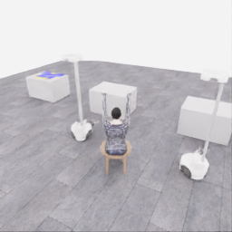
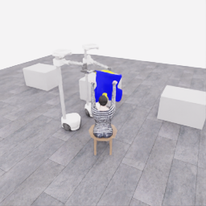
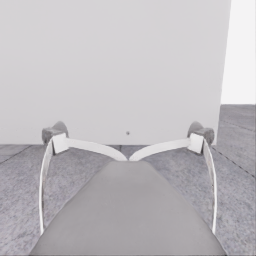
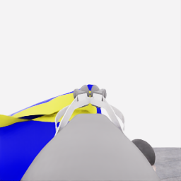
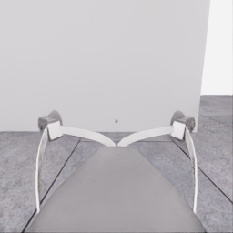
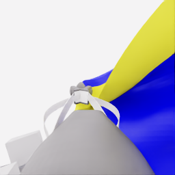
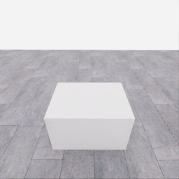
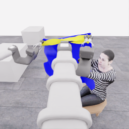
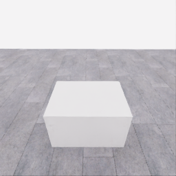
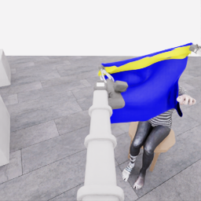

# 자동 시연 수집 시도 · 20261107-astra-hand-swap787-named-001

[전체 수집 기록](../../README.ko.md) · [구조화 요약](manifest.json) · [전체 행동 기록](decisions.jsonl) · [사용한 기본 프롬프트](prompt.txt)

실행 상태는 **completed**, 원본 출처는 `gpt`입니다. 완료 상태와 과제 성공은 아래에서 따로 기록합니다.

## 실행 조건과 시간

| 항목 | 기록 |
|---|---|
| 기록 시작 UTC | 2026-11-07T05:51:36Z |
| 기록 종료 UTC | 2026-11-07T06:42:28Z |
| 이전 시도 | 20261106-astra-guide470-depth-001 |
| 재시도 사유 | compare_leading_hand_roles_and_body_entry_approach |
| 출처 그룹 | 20261106-coordinated-demo-methods |
| 요청 모델 / 추론 설정 | gpt-6-astra / ultra |
| 전체 실제 경과 시간 (초) | 3051.141 |
| Actor 호출 합계 (초) | 2022.295 |
| 환경 요청·응답 합계 (초) | 977.668 |
| 시뮬레이션 시간 (초) | 56.950 |
| 저장 전이 수 | 1139.000 |
| 응답 확인 전이 수 | 1139.000 |
| 모델 호출 시도 수 | 25.000 |
| 완료한 결정 구간 수 | 22.000 |
| 파일 완료 상태 | true |
| 데이터 정합성 검사 | true |
| 학습 데이터 승인 | unreviewed |
| Actor 호출 방식 | exec |
| 한 호출의 최대 계획 구간 수 | 1.000 |
| 한 계획의 최대 제어 step 수 | 20.000 |
| 제어기 정착 대기 설정 | true |
| 정착 대기 요청 step 수 | 6.000 |
| 완료한 제어기 정착 구간 수 | 20.000 |
| 제어기 정착 전이 수 | 120.000 |
| 제어기 정착 환경 요청·응답 (초) | 108.577 |
| 전이 예산으로 단축한 정착 구간 수 | 0.000 |
| 전이 예산으로 건너뛴 정착 구간 수 | 0.000 |

Actor 호출 시간은 공개 입력 저장·요청 전송·응답 처리 등 호출 경로를 측정합니다. 방식에 따라 Docker/CLI 시작이 호출 안에 들어가거나 상주 서버 준비 시간으로 분리됩니다. 내부 모델 추론 시간만 별도로 측정한 값은 아닙니다. 모델이 판단하는 동안 물리 시간은 멈추며 실제 경과 시간과 시뮬레이션 시간은 다릅니다. 세부 요청 프로세스 시간에도 CLI 처리·네트워크·서버 대기·생성이 함께 포함됩니다.

## 토큰 사용량의 범위

`actor_usage`는 thread별 관측 누계를 합친 값입니다. 결정의 `usage`는 원본 CLI 누계이며, 호출별 증가량은 `usage_accounting.incremental_usage`입니다. 캐시 입력은 입력의 부분집합이고 추론 출력은 출력의 부분집합이므로 열들을 다시 합산하지 않습니다.

전체 호출 사용량 확정: **true** · 기록한 호출 수: 25.

| 입력 | 캐시 입력 | 캐시 쓰기 입력 | 출력 | 추론 출력 |
|---:|---:|---:|---:|---:|
| 3175760 | 2611328 | 0 | 56415 | 49576 |

중복 누계는 추가 사용량 0으로 처리하고, 역행한 누계는 미확정으로 보존합니다. 새 thread는 별도로 집계합니다. 토큰 기록은 화폐 비용이나 청구서가 아닙니다.

## 리뷰 정지 조건

목표 누적 점수 10.000 · 감시 상태 `collector_ended_before_gate` · 수집기 상태 `completed`.

마지막 관측 점수 5.000 · 응답 확인 step 1139.

`review_ready`는 정지 조건에 따라 실행을 마치고 리뷰할 준비가 된 상태입니다. 50점·착의 성공이나 학습 데이터 승인을 뜻하지 않습니다. 공식 점수와 success는 아래 평가 결과로 확인합니다.

## 공식 평가 결과

평가 유효성 `true` · 누적 점수 **5.000 / 50** · 착의 success **false** · rate 상태 `no_dressing_points` · 최종 rate 0.000 points/s.

누적 50점, 착의 success, 정상 파일 종료와 데이터 정합성은 서로 다른 상태입니다. 접촉 전 `no_contact`의 rate는 0점/초로 바꾸지 않습니다.

| 단계 | 획득 점수 / 최대 | 획득 시각 (episode 초) |
|---|---:|---:|
| 파지·들기 | 5.000 / 5 | 27.150 |
| 첫 소매 | 0.000 / 5 | 미측정/해당 없음 |
| 반대 어깨 | 0.000 / 5 | 미측정/해당 없음 |
| 두 번째 소매 | 0.000 / 5 | 미측정/해당 없음 |
| 왼쪽 위팔 | 0.000 / 5 | 미측정/해당 없음 |
| 오른쪽 위팔 | 0.000 / 5 | 미측정/해당 없음 |
| 목 통과 | 0.000 / 10 | 미측정/해당 없음 |
| 앞면 방향 | 0.000 / 10 | 미측정/해당 없음 |

## 단계 획득 경로

점수 획득은 [평가 이벤트](score-events.jsonl)에서 같은 physics tick끼리 묶었습니다. 같은 시각에 인정된 항목의 내부 순서는 추정하지 않습니다. 착의 success는 점수 획득과 별도로 기록합니다.

| 순서 | episode 시간 (초) | 전이 경계 step | 누적 점수 변화 | 같은 시각의 항목 변화 |
|---:|---:|---:|---:|---|
| 0 | 27.150 | 543 | 0.000→5.000 | 파지·들기 0.000→5.000 |

평가 clock 0초에 대응하는 공개 simulation clock은 1.525초입니다. 두 시계를 같은 절대 시각으로 혼동하지 않습니다.

별도 success 이벤트 수: **0**. 평가 유효성: `true`.


## 원본 관측 화면

지정된 공개 카메라의 저장 RGB 픽셀입니다. 시작은 첫 `obs`, 종료는 마지막 `next_obs`입니다. 이미지 합성이나 내부 상태 기반 장면 재구성 없이 원본 픽셀로 PNG를 저장했습니다.

| 카메라 | 시작 | 종료 |
|---|---|---|
| `overview` | [](images/initial-overview.png) | [](images/final-overview.png) |
| `robot_0_wrist` | [](images/initial-robot_0_wrist.png) | [](images/final-robot_0_wrist.png) |
| `robot_1_wrist` | [](images/initial-robot_1_wrist.png) | [](images/final-robot_1_wrist.png) |
| `robot_0_head` | [](images/initial-robot_0_head.png) | [](images/final-robot_0_head.png) |
| `robot_1_head` | [](images/initial-robot_1_head.png) | [](images/final-robot_1_head.png) |

시작 관측 시각 1.525초 · 종료 관측 시각 58.475초 (공개 simulation clock).

[▶ overview 관측 영상 보기](overview.mp4)

저장된 20 Hz `obs` 중 1139프레임을 순서대로 사용했습니다. 재생은 **1배 느리게** (20.000 fps), 실제 대기 시간·모델 호출 지연은 영상에 들어가지 않습니다. 종료 `next_obs`는 위 PNG에서 확인합니다.

## 결정과 실행 순서

아래 근거는 모델 최종 JSON의 짧은 행동 설명입니다. 시각적 평가는 행동 전 관측에 대한 판단이며, 그 행동의 실행 후 성공 라벨로 사용하지 않습니다. 공식 점수는 별도의 평가 결과입니다.

행동의 각 행은 로봇 0·1 순서이며 열은 `전진, 왼쪽 이동, 반시계 회전, 리프트, 팔 신장, 손목 yaw, pitch, roll, gripper`입니다. 앞 8개는 정규화 속도이고 gripper는 닫기 `+1`, 열기 `-1`, 의도 유지 `0`입니다.

제어기 정착 대기는 앞선 모델 결정에 연결된 별도 중립 행동입니다. 추가 모델 호출이나 모델 결정으로 집계하지 않으며, 실제 전이와 환경 요청·응답 시간은 전체 합계에 포함됩니다. 중립 행동은 두 로봇의 속도와 gripper 명령을 모두 0으로 보내 기존 gripper 의도를 유지합니다. 대기를 실행했다는 기록이 옷의 정착이나 과제 개선을 확인했다는 뜻은 아닙니다.

### 기록된 행동의 재실행 구간

원본 `20261106-astra-guide470-depth-001`의 행동 787전이를 새 환경에서 다시 실행했습니다. 이 구간에는 새 모델 호출이 없고 관측·평가를 새로 기록했습니다. 정확한 물리 상태 복원이나 독립적인 새 시연으로 집계하지 않습니다. 원본 step 대응과 실제 행동은 `decisions.jsonl`의 `replayed_segment`에 있습니다.

### 별도 모델 호출 0 · `initial`

실행 결정 인덱스 0의 고정 관측을 사용했습니다. 호출 경과 102.509초. 같은 call index의 행동 기록과 사용량을 중복 합산하지 않습니다.

공개 입력 저장 0.248초 · 요청 프로세스 102.261초 · 결과 해석 0.000초.

### 결정 0 · 접근 · `act`

입력 관측 40.875초 · Actor 호출 102.509초 · 시각적 판단 `uncertain`.

계획 `20261107-astra-hand-swap787-named-001:call-00000` · 모델 호출 인덱스 0 · 계획 구간 1/1 · 이 구간에서 모델 호출 `true`.

실행 직전 최신 관측 40.875초.

공개 입력 저장 0.248초 · 요청 프로세스 102.261초 · 결과 해석 0.000초.

호출 사용량 상태 `observed` · 이번 증가량 입력 22463 / 출력 3252 토큰.

최종 응답의 행동 설명: Both robots appear to retain opposite rim supports. Select upper/farther H_B, traced through a different forearm from lower/nearer H_A; prior target and roles remain uncertain: hand swap unestablished. Assign robot 1 to guide H_B and robot 0 to support. The candidate body opening is below and offset from H_B. Target 11 cm local-left and 7 cm forward together, with 9 cm additional robot-1 extension, creating an oblique placement. Recheck bilateral cloth following and H_B-to-rim alignment afterward.

요청 행동:

```json
[[0.15, 0.22, 0, 0, 0, 0, 0, 0, 0], [0.15, 0.22, 0, 0, 0.09, 0, 0, 0, 0]]
```

실행 구간 step **[787, 803)** · 요청 16 step / 실제 16 step · 환경 요청·응답 13.137초.

실제 적용 행동:

```json
[[0.15000000596046448, 0.2199999988079071, 0.0, 0.0, 0.0, 0.0, 0.0, 0.0, 0.0], [0.15000000596046448, 0.2199999988079071, 0.0, 0.0, 0.09000000357627869, 0.0, 0.0, 0.0, 0.0]]
```

### 제어기 정착 대기 · 연결 결정 0

구간 `20261107-astra-hand-swap787-named-001:settle-00000` · 출처 `controller_settle` · 이 구간에서 모델 호출 `false`.

앞선 모델 호출 인덱스 0에 연결됩니다. 추가 호출은 없습니다.

실행 구간 step **[803, 809)** · 요청 6 step / 실제 6 step · 환경 요청·응답 5.430초.

공개 simulation clock 41.675→41.975초 · 실행 전 관측 41.675초.

실제 적용 중립 행동:

```json
[[0.0, 0.0, 0.0, 0.0, 0.0, 0.0, 0.0, 0.0, 0.0], [0.0, 0.0, 0.0, 0.0, 0.0, 0.0, 0.0, 0.0, 0.0]]
```

### 별도 모델 호출 1 · `initial`

실행 결정 인덱스 1의 고정 관측을 사용했습니다. 호출 경과 101.135초. 같은 call index의 행동 기록과 사용량을 중복 합산하지 않습니다.

공개 입력 저장 0.080초 · 요청 프로세스 101.055초 · 결과 해석 0.000초.

### 결정 1 · 방향 · `act`

입력 관측 41.975초 · Actor 호출 101.135초 · 시각적 판단 `progressing`.

계획 `20261107-astra-hand-swap787-named-001:call-00001` · 모델 호출 인덱스 1 · 계획 구간 1/1 · 이 구간에서 모델 호출 `true`.

실행 직전 최신 관측 41.975초.

공개 입력 저장 0.080초 · 요청 프로세스 101.055초 · 결과 해석 0.000초.

호출 사용량 상태 `observed` · 이번 증가량 입력 34809 / 출력 3042 토큰.

최종 응답의 행동 설명: Robot 1 guides H_B; robot 0 supports the opposite edge, with both edges appearing to follow. Bases moved about 7 cm forward/11 cm left and robot 1 extended 8 cm; targets are nearly reached. Upper/farther H_B is nearer the mouth&#x27;s lateral center but remains above and beyond it. Pitch both wrists upward about 25 degrees and extend robot 1 another 4 cm to test improved mouth-to-hand alignment. Hand swap unestablished; prior role exchange unestablished. No entry is visible.

요청 행동:

```json
[[0, 0, 0, 0, 0, 0, -0.13, 0, 0], [0, 0, 0, 0, 0.06, 0, -0.13, 0, 0]]
```

실행 구간 step **[809, 821)** · 요청 12 step / 실제 12 step · 환경 요청·응답 10.428초.

실제 적용 행동:

```json
[[0.0, 0.0, 0.0, 0.0, 0.0, 0.0, -0.12999999523162842, 0.0, 0.0], [0.0, 0.0, 0.0, 0.0, 0.05999999865889549, 0.0, -0.12999999523162842, 0.0, 0.0]]
```

### 제어기 정착 대기 · 연결 결정 1

구간 `20261107-astra-hand-swap787-named-001:settle-00001` · 출처 `controller_settle` · 이 구간에서 모델 호출 `false`.

앞선 모델 호출 인덱스 1에 연결됩니다. 추가 호출은 없습니다.

실행 구간 step **[821, 827)** · 요청 6 step / 실제 6 step · 환경 요청·응답 5.393초.

공개 simulation clock 42.575→42.875초 · 실행 전 관측 42.575초.

실제 적용 중립 행동:

```json
[[0.0, 0.0, 0.0, 0.0, 0.0, 0.0, 0.0, 0.0, 0.0], [0.0, 0.0, 0.0, 0.0, 0.0, 0.0, 0.0, 0.0, 0.0]]
```

### 별도 모델 호출 2 · `initial`

실행 결정 인덱스 2의 고정 관측을 사용했습니다. 호출 경과 93.364초. 같은 call index의 행동 기록과 사용량을 중복 합산하지 않습니다.

공개 입력 저장 0.068초 · 요청 프로세스 93.296초 · 결과 해석 0.000초.

### 공개 픽셀 depth 조회 · 결정 2

물리 전이 없이 같은 카메라·시각의 원본 값을 조회했습니다. 무효 값은 null이며 접촉·입구 통과 판단이 아닙니다.

```json
{
  "request": {
    "kind": "depth_query",
    "observation_id": "eab581c5e57cd7048fba2b729fd39aee777409dd91b5a75c80f62b9f194f4682",
    "camera": "robot_0_wrist",
    "pixels_uv": [
      [
        73,
        122
      ],
      [
        81,
        123
      ],
      [
        48,
        133
      ],
      [
        39,
        177
      ],
      [
        117,
        134
      ],
      [
        157,
        146
      ]
    ],
    "include_camera_geometry": true
  },
  "response": {
    "kind": "depth_query_result",
    "observation_id": "eab581c5e57cd7048fba2b729fd39aee777409dd91b5a75c80f62b9f194f4682",
    "camera": "robot_0_wrist",
    "camera_index": 1,
    "simulation_time_s": 42.8750022361055,
    "intrinsics_sha256": "3dd91a2df5cb0a47b6f5ceb86d60d41e1f5d6753d2a11a034ac0b52bc385cd23",
    "request_sha256": "e117982af0e30df5f1d78f00833b4e0a439a53dac53bf48e1af632f8565fb495",
    "depth_semantics": "optical_Z_metres_not_ray_range",
    "geometry_semantics": "camera_X_right_Y_down_Z_forward",
    "rgb_image_order": [
      "overview",
      "robot_0_wrist",
      "robot_1_wrist",
      "robot_0_head",
      "robot_1_head"
    ],
    "resolution_wh": [
      256,
      256
    ],
    "neighbor_depth_substituted": false,
    "hidden_surfaces_estimated": false,
    "object_pose_or_contact_inferred": false,
    "source_sha256": {
      "observation_json": "4e335867704cbafd6334a5b9246602b2b7804295e8d1dcce43b12e5f4538199a",
      "public_depth_npz": "a960aad8d8570f6e904a52d6b024415fce83b1d3332489b7043c9d815a147e9f",
      "overview_rgb": "382f2b791b662d04f7fa76046598a9f723c7fb49d902d374b121c9e9c3f2202f",
      "robot_0_wrist_rgb": "7b0731b99d50c88406dd23cdfc284f624a4d06a321b28b0cf7679596e0928776",
      "robot_1_wrist_rgb": "8ef4c2f560f43f1be1e00d22951911b7ee4cd969430b9710465da41366ad08b0",
      "robot_0_head_rgb": "d20954d84ece933fa2d732cf28797e04258f8654b56aacb6e3f450d6df5e2c2d",
      "robot_1_head_rgb": "a95411d586661384aa8d02516d3b149d3f9316ad8f15df921c30b0bb189951e1"
    },
    "results": [
      {
        "pixel_uv": [
          73,
          122
        ],
        "status": "valid",
        "optical_z_m": 0.7690938711166382,
        "camera_xyz_m": [
          -0.23139760107868465,
          -0.025243374663129238,
          0.7690938711166382
        ],
        "camera_range_m": 0.8035468003411682,
        "invalid_reasons": []
      },
      {
        "pixel_uv": [
          81,
          123
        ],
        "status": "valid",
        "optical_z_m": 0.7872015237808228,
        "camera_xyz_m": [
          -0.2023953806949266,
          -0.02153142347818368,
          0.7872015237808228
        ],
        "camera_range_m": 0.8130890058083988,
        "invalid_reasons": []
      },
      {
        "pixel_uv": [
          48,
          133
        ],
        "status": "valid",
        "optical_z_m": 0.2678073048591614,
        "camera_xyz_m": [
          -0.11720043353125664,
          0.00732502709570354,
          0.2678073048591614
        ],
        "camera_range_m": 0.2924215282392784,
        "invalid_reasons": []
      },
      {
        "pixel_uv": [
          39,
          177
        ],
        "status": "valid",
        "optical_z_m": 0.2311747670173645,
        "camera_xyz_m": [
          -0.11255045305733943,
          0.06196597977314193,
          0.2311747670173645
        ],
        "camera_range_m": 0.26447903515815874,
        "invalid_reasons": []
      },
      {
        "pixel_uv": [
          117,
          134
        ],
        "status": "valid",
        "optical_z_m": 0.20354092121124268,
        "camera_xyz_m": [
          -0.012247888758038032,
          0.006680666595293472,
          0.20354092121124268
        ],
        "camera_range_m": 0.2040185008588879,
        "invalid_reasons": []
      },
      {
        "pixel_uv": [
          157,
          146
        ],
        "status": "valid",
        "optical_z_m": 0.9593508243560791,
        "camera_xyz_m": [
          0.15219215383635115,
          0.09446409548463175,
          0.9593508243560791
        ],
        "camera_range_m": 0.9759302850192557,
        "invalid_reasons": []
      }
    ]
  }
}
```

### 별도 모델 호출 3 · `action_after_query`

실행 결정 인덱스 2의 고정 관측을 사용했습니다. 호출 경과 44.594초. 같은 call index의 행동 기록과 사용량을 중복 합산하지 않습니다.

공개 입력 저장 0.067초 · 요청 프로세스 44.527초 · 결과 해석 0.000초.

### 결정 2 · 접근 · `act`

입력 관측 42.875초 · Actor 호출 44.594초 · 시각적 판단 `uncertain`.

계획 `20261107-astra-hand-swap787-named-001:call-00003` · 모델 호출 인덱스 3 · 계획 구간 1/1 · 이 구간에서 모델 호출 `true`.

실행 직전 최신 관측 42.875초.

공개 입력 저장 0.067초 · 요청 프로세스 44.527초 · 결과 해석 0.000초.

호출 사용량 상태 `observed` · 이번 증가량 입력 58981 / 출력 1373 토큰.

최종 응답의 행동 설명: Robot 1 guides H_B while robot 0 supports; both edges appear retained. H_B samples are at 0.77–0.79 m optical depth versus 0.23–0.27 m for the lip candidates, so image overlap is not entry. Advance both about 10 cm and pitch toward 0.024 rad, predicting roughly 5 cm additional rim elevation including pending motion. Preserve the oblique opening placement and inspect for approach versus exterior-panel folding. Hand swap unestablished; prior role exchange unestablished.

요청 행동:

```json
[[0.26, 0, 0, 0, 0, 0, -0.04, 0, 0], [0.26, 0, 0, 0, 0, 0, -0.04, 0, 0]]
```

실행 구간 step **[827, 839)** · 요청 12 step / 실제 12 step · 환경 요청·응답 10.336초.

실제 적용 행동:

```json
[[0.25999999046325684, 0.0, 0.0, 0.0, 0.0, 0.0, -0.03999999910593033, 0.0, 0.0], [0.25999999046325684, 0.0, 0.0, 0.0, 0.0, 0.0, -0.03999999910593033, 0.0, 0.0]]
```

### 제어기 정착 대기 · 연결 결정 2

구간 `20261107-astra-hand-swap787-named-001:settle-00002` · 출처 `controller_settle` · 이 구간에서 모델 호출 `false`.

앞선 모델 호출 인덱스 3에 연결됩니다. 추가 호출은 없습니다.

실행 구간 step **[839, 845)** · 요청 6 step / 실제 6 step · 환경 요청·응답 5.052초.

공개 simulation clock 43.475→43.775초 · 실행 전 관측 43.475초.

실제 적용 중립 행동:

```json
[[0.0, 0.0, 0.0, 0.0, 0.0, 0.0, 0.0, 0.0, 0.0], [0.0, 0.0, 0.0, 0.0, 0.0, 0.0, 0.0, 0.0, 0.0]]
```

### 별도 모델 호출 4 · `initial`

실행 결정 인덱스 3의 고정 관측을 사용했습니다. 호출 경과 61.217초. 같은 call index의 행동 기록과 사용량을 중복 합산하지 않습니다.

공개 입력 저장 0.067초 · 요청 프로세스 61.150초 · 결과 해석 0.000초.

### 결정 3 · 복구 · `act`

입력 관측 43.775초 · Actor 호출 61.217초 · 시각적 판단 `recovering`.

계획 `20261107-astra-hand-swap787-named-001:call-00004` · 모델 호출 인덱스 4 · 계획 구간 1/1 · 이 구간에서 모델 호출 `true`.

실행 직전 최신 관측 43.775초.

공개 입력 저장 0.067초 · 요청 프로세스 61.150초 · 결과 해석 0.000초.

호출 사용량 상태 `observed` · 이번 증가량 입력 69086 / 출력 1803 토큰.

최종 응답의 행동 설명: Robot 1 retains its guide lead; robot 0 supports the opposite edge. Both edges appear to follow: bases advanced 9.5 cm and grips rose 4.4 cm. However, the mouth narrowed and H_B became obscured; entry is unestablished. Targets are nearly reached. Withdraw both about 4 cm and return pitch toward 0.30 rad, preserving grips and the oblique placement. Test whether the lip widens and H_B becomes observable again. Hand swap unestablished; prior role exchange unestablished.

요청 행동:

```json
[[-0.1, 0, 0, 0, 0, 0, 0.085, 0, 0], [-0.1, 0, 0, 0, 0, 0, 0.085, 0, 0]]
```

실행 구간 step **[845, 857)** · 요청 12 step / 실제 12 step · 환경 요청·응답 9.526초.

실제 적용 행동:

```json
[[-0.10000000149011612, 0.0, 0.0, 0.0, 0.0, 0.0, 0.08500000089406967, 0.0, 0.0], [-0.10000000149011612, 0.0, 0.0, 0.0, 0.0, 0.0, 0.08500000089406967, 0.0, 0.0]]
```

### 제어기 정착 대기 · 연결 결정 3

구간 `20261107-astra-hand-swap787-named-001:settle-00003` · 출처 `controller_settle` · 이 구간에서 모델 호출 `false`.

앞선 모델 호출 인덱스 4에 연결됩니다. 추가 호출은 없습니다.

실행 구간 step **[857, 863)** · 요청 6 step / 실제 6 step · 환경 요청·응답 5.327초.

공개 simulation clock 44.375→44.675초 · 실행 전 관측 44.375초.

실제 적용 중립 행동:

```json
[[0.0, 0.0, 0.0, 0.0, 0.0, 0.0, 0.0, 0.0, 0.0], [0.0, 0.0, 0.0, 0.0, 0.0, 0.0, 0.0, 0.0, 0.0]]
```

### 별도 모델 호출 5 · `initial`

실행 결정 인덱스 4의 고정 관측을 사용했습니다. 호출 경과 86.053초. 같은 call index의 행동 기록과 사용량을 중복 합산하지 않습니다.

공개 입력 저장 0.069초 · 요청 프로세스 85.983초 · 결과 해석 0.000초.

### 결정 4 · 접근 · `act`

입력 관측 44.675초 · Actor 호출 86.053초 · 시각적 판단 `progressing`.

계획 `20261107-astra-hand-swap787-named-001:call-00005` · 모델 호출 인덱스 5 · 계획 구간 1/1 · 이 구간에서 모델 호출 `true`.

실행 직전 최신 관측 44.675초.

공개 입력 저장 0.069초 · 요청 프로세스 85.983초 · 결과 해석 0.000초.

호출 사용량 상태 `observed` · 이번 증가량 입력 79596 / 출력 2579 토큰.

최종 응답의 행동 설명: Robot 1 guides H_B; robot 0 maintains opposite-edge support. Both bases withdrew 3.8 cm and grips lowered 7.3 cm; the mouth widened and H_B reappeared above its rim. H_B remains beyond the candidate opening. Keep the recovered pitch target and advance both about 12 cm, preserving the oblique placement. Test reduced hand-to-rim separation without another upward tilt; inspect both supports and any panel folding afterward. Hand swap unestablished; prior role exchange unestablished.

요청 행동:

```json
[[0.25, 0, 0, 0, 0, 0, 0, 0, 0], [0.25, 0, 0, 0, 0, 0, 0, 0, 0]]
```

실행 구간 step **[863, 879)** · 요청 16 step / 실제 16 step · 환경 요청·응답 12.750초.

실제 적용 행동:

```json
[[0.25, 0.0, 0.0, 0.0, 0.0, 0.0, 0.0, 0.0, 0.0], [0.25, 0.0, 0.0, 0.0, 0.0, 0.0, 0.0, 0.0, 0.0]]
```

### 제어기 정착 대기 · 연결 결정 4

구간 `20261107-astra-hand-swap787-named-001:settle-00004` · 출처 `controller_settle` · 이 구간에서 모델 호출 `false`.

앞선 모델 호출 인덱스 5에 연결됩니다. 추가 호출은 없습니다.

실행 구간 step **[879, 885)** · 요청 6 step / 실제 6 step · 환경 요청·응답 5.064초.

공개 simulation clock 45.475→45.775초 · 실행 전 관측 45.475초.

실제 적용 중립 행동:

```json
[[0.0, 0.0, 0.0, 0.0, 0.0, 0.0, 0.0, 0.0, 0.0], [0.0, 0.0, 0.0, 0.0, 0.0, 0.0, 0.0, 0.0, 0.0]]
```

### 별도 모델 호출 6 · `initial`

실행 결정 인덱스 5의 고정 관측을 사용했습니다. 호출 경과 123.402초. 같은 call index의 행동 기록과 사용량을 중복 합산하지 않습니다.

공개 입력 저장 0.070초 · 요청 프로세스 123.332초 · 결과 해석 0.000초.

### 결정 5 · 방향 · `act`

입력 관측 45.775초 · Actor 호출 123.402초 · 시각적 판단 `recovering`.

계획 `20261107-astra-hand-swap787-named-001:call-00006` · 모델 호출 인덱스 6 · 계획 구간 1/1 · 이 구간에서 모델 호출 `true`.

실행 직전 최신 관측 45.775초.

공개 입력 저장 0.070초 · 요청 프로세스 123.332초 · 결과 해석 0.000초.

호출 사용량 상태 `observed` · 이번 증가량 입력 90879 / 출력 3368 토큰.

최종 응답의 행동 설명: Robot 1 remains guide and robot 0 support; both edges appear held. The 12 cm advance occurred, but the mouth narrowed and H_B became obscured again; near-target joints rule out substantial pending correction. Change opening orientation: advance guide 1 about 5.5 cm, withdraw support 0 equally, move each inward 2 cm, and yaw both wrists about -15 degrees. This targets a sideways rotation with approximately preserved grip spacing, rather than another common forward push. Reassess rim folding and H_B alignment. Hand swap unestablished; prior role exchange unestablished.

요청 행동:

```json
[[-0.15, 0.06, 0, 0, 0, -0.08, 0, 0, 0], [0.15, -0.06, 0, 0, 0, -0.08, 0, 0, 0]]
```

실행 구간 step **[885, 897)** · 요청 12 step / 실제 12 step · 환경 요청·응답 9.640초.

실제 적용 행동:

```json
[[-0.15000000596046448, 0.05999999865889549, 0.0, 0.0, 0.0, -0.07999999821186066, 0.0, 0.0, 0.0], [0.15000000596046448, -0.05999999865889549, 0.0, 0.0, 0.0, -0.07999999821186066, 0.0, 0.0, 0.0]]
```

### 제어기 정착 대기 · 연결 결정 5

구간 `20261107-astra-hand-swap787-named-001:settle-00005` · 출처 `controller_settle` · 이 구간에서 모델 호출 `false`.

앞선 모델 호출 인덱스 6에 연결됩니다. 추가 호출은 없습니다.

실행 구간 step **[897, 903)** · 요청 6 step / 실제 6 step · 환경 요청·응답 5.169초.

공개 simulation clock 46.375→46.675초 · 실행 전 관측 46.375초.

실제 적용 중립 행동:

```json
[[0.0, 0.0, 0.0, 0.0, 0.0, 0.0, 0.0, 0.0, 0.0], [0.0, 0.0, 0.0, 0.0, 0.0, 0.0, 0.0, 0.0, 0.0]]
```

### 별도 모델 호출 7 · `initial`

실행 결정 인덱스 6의 고정 관측을 사용했습니다. 호출 경과 125.864초. 같은 call index의 행동 기록과 사용량을 중복 합산하지 않습니다.

공개 입력 저장 0.074초 · 요청 프로세스 125.790초 · 결과 해석 0.000초.

### 결정 6 · 접근 · `act`

입력 관측 46.675초 · Actor 호출 125.864초 · 시각적 판단 `uncertain`.

계획 `20261107-astra-hand-swap787-named-001:call-00007` · 모델 호출 인덱스 7 · 계획 구간 1/1 · 이 구간에서 모델 호출 `true`.

실행 직전 최신 관측 46.675초.

공개 입력 저장 0.074초 · 요청 프로세스 125.790초 · 결과 해석 0.000초.

호출 사용량 상태 `observed` · 이번 증가량 입력 102961 / 출력 3564 토큰.

최종 응답의 행동 설명: Robot 1 guides and robot 0 supports; both cloth edges appear retained. Including wrist motion, guide 1 advanced only about 2 cm while support 0 withdrew about 9 cm. The garment turned in the head views, but H_B remains obscured and entry unestablished. Preserve this orientation and shift both about 7 cm local-left and 4 cm forward, testing a lateral body-opening approach toward tracked H_B rather than repeating the straight push. Inspect cloth folding and hand-to-rim placement next. Hand swap unestablished; prior role exchange unestablished.

요청 행동:

```json
[[0.12, 0.2, 0, 0, 0, 0, 0, 0, 0], [0.12, 0.2, 0, 0, 0, 0, 0, 0, 0]]
```

실행 구간 step **[903, 915)** · 요청 12 step / 실제 12 step · 환경 요청·응답 9.596초.

실제 적용 행동:

```json
[[0.11999999731779099, 0.20000000298023224, 0.0, 0.0, 0.0, 0.0, 0.0, 0.0, 0.0], [0.11999999731779099, 0.20000000298023224, 0.0, 0.0, 0.0, 0.0, 0.0, 0.0, 0.0]]
```

### 제어기 정착 대기 · 연결 결정 6

구간 `20261107-astra-hand-swap787-named-001:settle-00006` · 출처 `controller_settle` · 이 구간에서 모델 호출 `false`.

앞선 모델 호출 인덱스 7에 연결됩니다. 추가 호출은 없습니다.

실행 구간 step **[915, 921)** · 요청 6 step / 실제 6 step · 환경 요청·응답 5.073초.

공개 simulation clock 47.275→47.575초 · 실행 전 관측 47.275초.

실제 적용 중립 행동:

```json
[[0.0, 0.0, 0.0, 0.0, 0.0, 0.0, 0.0, 0.0, 0.0], [0.0, 0.0, 0.0, 0.0, 0.0, 0.0, 0.0, 0.0, 0.0]]
```

### 별도 모델 호출 8 · `initial`

실행 결정 인덱스 7의 고정 관측을 사용했습니다. 호출 경과 37.538초. 같은 call index의 행동 기록과 사용량을 중복 합산하지 않습니다.

공개 입력 저장 0.070초 · 요청 프로세스 37.467초 · 결과 해석 0.000초.

### 결정 7 · 복구 · `act`

입력 관측 47.575초 · Actor 호출 37.538초 · 시각적 판단 `recovering`.

계획 `20261107-astra-hand-swap787-named-001:call-00008` · 모델 호출 인덱스 8 · 계획 구간 1/1 · 이 구간에서 모델 호출 `true`.

실행 직전 최신 관측 47.575초.

공개 입력 저장 0.070초 · 요청 프로세스 37.467초 · 결과 해석 0.000초.

호출 사용량 상태 `observed` · 이번 증가량 입력 115249 / 출력 1165 토큰.

최종 응답의 행동 설명: Robot 1 remains guide and robot 0 support; both rims remain at their grippers. Bases moved approximately 4 cm forward and 7.5 cm left, with yaw targets reached, but H_B remains obscured. The last two placements have not established hand-to-mouth progress. Keep the new orientation and lower both lift targets to about 1.09 m, testing whether an 11 cm lower mouth exposes H_B and separates entry from panel overlap. Preserve both grasps. Hand swap unestablished; prior role exchange unestablished.

요청 행동:

```json
[[0, 0, 0, -0.14, 0, 0, 0, 0, 0], [0, 0, 0, -0.14, 0, 0, 0, 0, 0]]
```

실행 구간 step **[921, 931)** · 요청 10 step / 실제 10 step · 환경 요청·응답 7.890초.

실제 적용 행동:

```json
[[0.0, 0.0, 0.0, -0.14000000059604645, 0.0, 0.0, 0.0, 0.0, 0.0], [0.0, 0.0, 0.0, -0.14000000059604645, 0.0, 0.0, 0.0, 0.0, 0.0]]
```

### 제어기 정착 대기 · 연결 결정 7

구간 `20261107-astra-hand-swap787-named-001:settle-00007` · 출처 `controller_settle` · 이 구간에서 모델 호출 `false`.

앞선 모델 호출 인덱스 8에 연결됩니다. 추가 호출은 없습니다.

실행 구간 step **[931, 937)** · 요청 6 step / 실제 6 step · 환경 요청·응답 5.049초.

공개 simulation clock 48.075→48.375초 · 실행 전 관측 48.075초.

실제 적용 중립 행동:

```json
[[0.0, 0.0, 0.0, 0.0, 0.0, 0.0, 0.0, 0.0, 0.0], [0.0, 0.0, 0.0, 0.0, 0.0, 0.0, 0.0, 0.0, 0.0]]
```

### 별도 모델 호출 9 · `initial`

실행 결정 인덱스 8의 고정 관측을 사용했습니다. 호출 경과 89.217초. 같은 call index의 행동 기록과 사용량을 중복 합산하지 않습니다.

공개 입력 저장 0.082초 · 요청 프로세스 89.135초 · 결과 해석 0.000초.

### 결정 8 · 접근 · `act`

입력 관측 48.375초 · Actor 호출 89.217초 · 시각적 판단 `progressing`.

계획 `20261107-astra-hand-swap787-named-001:call-00009` · 모델 호출 인덱스 9 · 계획 구간 1/1 · 이 구간에서 모델 호출 `true`.

실행 직전 최신 관측 48.375초.

공개 입력 저장 0.082초 · 요청 프로세스 89.135초 · 결과 해석 0.000초.

호출 사용량 상태 `observed` · 이번 증가량 입력 125168 / 출력 2699 토큰.

최종 응답의 행동 설명: Robot 1 guides H_B; robot 0 supports the opposite rim. Both grips lowered about 10 cm with cloth following, revealing H_B through its connected upper forearm. In robot 1&#x27;s wrist view, the hand is around 0.42 m optical depth versus roughly 0.24 m at the upper rim; passage remains unestablished. Advance both about 6 cm with the recovered height and oblique orientation retained, then inspect hand-to-lip motion and folding. Hand swap unestablished; prior role exchange unestablished.

요청 행동:

```json
[[0.2, 0, 0, 0, 0, 0, 0, 0, 0], [0.2, 0, 0, 0, 0, 0, 0, 0, 0]]
```

실행 구간 step **[937, 947)** · 요청 10 step / 실제 10 step · 환경 요청·응답 7.906초.

실제 적용 행동:

```json
[[0.20000000298023224, 0.0, 0.0, 0.0, 0.0, 0.0, 0.0, 0.0, 0.0], [0.20000000298023224, 0.0, 0.0, 0.0, 0.0, 0.0, 0.0, 0.0, 0.0]]
```

### 제어기 정착 대기 · 연결 결정 8

구간 `20261107-astra-hand-swap787-named-001:settle-00008` · 출처 `controller_settle` · 이 구간에서 모델 호출 `false`.

앞선 모델 호출 인덱스 9에 연결됩니다. 추가 호출은 없습니다.

실행 구간 step **[947, 953)** · 요청 6 step / 실제 6 step · 환경 요청·응답 5.028초.

공개 simulation clock 48.875→49.175초 · 실행 전 관측 48.875초.

실제 적용 중립 행동:

```json
[[0.0, 0.0, 0.0, 0.0, 0.0, 0.0, 0.0, 0.0, 0.0], [0.0, 0.0, 0.0, 0.0, 0.0, 0.0, 0.0, 0.0, 0.0]]
```

### 별도 모델 호출 10 · `initial`

실행 결정 인덱스 9의 고정 관측을 사용했습니다. 호출 경과 102.578초. 같은 call index의 행동 기록과 사용량을 중복 합산하지 않습니다.

공개 입력 저장 0.075초 · 요청 프로세스 102.502초 · 결과 해석 0.000초.

### 결정 9 · 첫 소매 · `act`

입력 관측 49.175초 · Actor 호출 102.578초 · 시각적 판단 `progressing`.

계획 `20261107-astra-hand-swap787-named-001:call-00010` · 모델 호출 인덱스 10 · 계획 구간 1/1 · 이 구간에서 모델 호출 `true`.

실행 직전 최신 관측 49.175초.

공개 입력 저장 0.075초 · 요청 프로세스 102.502초 · 결과 해석 0.000초.

호출 사용량 상태 `observed` · 이번 증가량 입력 136589 / 출력 2860 토큰.

최종 응답의 행동 설명: Robot 1 guides H_B; robot 0 retains the opposite rim. Both bases advanced 6 cm, and H_B&#x27;s optical depth decreased from about 0.42 to 0.36–0.39 m in robot 1&#x27;s view. Entry remains unestablished. H_A now appears close beside robot 0&#x27;s outer finger. Retract robot 0 about 2 cm while extending robot 1 about 4 cm, testing increased H_A clearance and continued H_B-to-mouth approach. Preserve height, orientation and grasps. Hand swap unestablished; prior role exchange unestablished.

요청 행동:

```json
[[0, 0, 0, 0, -0.04, 0, 0, 0, 0], [0, 0, 0, 0, 0.08, 0, 0, 0, 0]]
```

실행 구간 step **[953, 961)** · 요청 8 step / 실제 8 step · 환경 요청·응답 6.663초.

실제 적용 행동:

```json
[[0.0, 0.0, 0.0, 0.0, -0.03999999910593033, 0.0, 0.0, 0.0, 0.0], [0.0, 0.0, 0.0, 0.0, 0.07999999821186066, 0.0, 0.0, 0.0, 0.0]]
```

### 제어기 정착 대기 · 연결 결정 9

구간 `20261107-astra-hand-swap787-named-001:settle-00009` · 출처 `controller_settle` · 이 구간에서 모델 호출 `false`.

앞선 모델 호출 인덱스 10에 연결됩니다. 추가 호출은 없습니다.

실행 구간 step **[961, 967)** · 요청 6 step / 실제 6 step · 환경 요청·응답 5.320초.

공개 simulation clock 49.575→49.875초 · 실행 전 관측 49.575초.

실제 적용 중립 행동:

```json
[[0.0, 0.0, 0.0, 0.0, 0.0, 0.0, 0.0, 0.0, 0.0], [0.0, 0.0, 0.0, 0.0, 0.0, 0.0, 0.0, 0.0, 0.0]]
```

### 별도 모델 호출 11 · `initial`

실행 결정 인덱스 10의 고정 관측을 사용했습니다. 호출 경과 80.150초. 같은 call index의 행동 기록과 사용량을 중복 합산하지 않습니다.

공개 입력 저장 0.074초 · 요청 프로세스 80.076초 · 결과 해석 0.000초.

### 공개 픽셀 depth 조회 · 결정 10

물리 전이 없이 같은 카메라·시각의 원본 값을 조회했습니다. 무효 값은 null이며 접촉·입구 통과 판단이 아닙니다.

```json
{
  "request": {
    "kind": "depth_query",
    "observation_id": "2c19065e7e502dd34c20e3ad3c08e7b2dea31fb02addf3736c6afc4022684051",
    "camera": "robot_1_wrist",
    "pixels_uv": [
      [
        202,
        127
      ],
      [
        194,
        120
      ],
      [
        200,
        145
      ],
      [
        175,
        137
      ],
      [
        194,
        213
      ],
      [
        223,
        230
      ],
      [
        218,
        176
      ],
      [
        116,
        134
      ]
    ],
    "include_camera_geometry": true
  },
  "response": {
    "kind": "depth_query_result",
    "observation_id": "2c19065e7e502dd34c20e3ad3c08e7b2dea31fb02addf3736c6afc4022684051",
    "camera": "robot_1_wrist",
    "camera_index": 2,
    "simulation_time_s": 49.87500260118395,
    "intrinsics_sha256": "3dd91a2df5cb0a47b6f5ceb86d60d41e1f5d6753d2a11a034ac0b52bc385cd23",
    "request_sha256": "d2e0ebb892987a21280fe2cc34d20926342ec85738ae462a0e09ae9d3aa4cad1",
    "depth_semantics": "optical_Z_metres_not_ray_range",
    "geometry_semantics": "camera_X_right_Y_down_Z_forward",
    "rgb_image_order": [
      "overview",
      "robot_0_wrist",
      "robot_1_wrist",
      "robot_0_head",
      "robot_1_head"
    ],
    "resolution_wh": [
      256,
      256
    ],
    "neighbor_depth_substituted": false,
    "hidden_surfaces_estimated": false,
    "object_pose_or_contact_inferred": false,
    "source_sha256": {
      "observation_json": "4447e07891d352838c58d2a8bba076b58a1be9829128b5ec3e31a8369d2cbcaf",
      "public_depth_npz": "72846f22166796788df02f5310893834191a9fa29fd78d225eefbb71f7cff798",
      "overview_rgb": "ba409a3f59a97ecbee59255a411690143d83695096911ab194cccbefc0567bd0",
      "robot_0_wrist_rgb": "04042e1ee07565f02dd3ccef93fb14e9a7a6a4c3107041bdefc04d4087095446",
      "robot_1_wrist_rgb": "cc8c29c744c74a9e321916967e5e1f6e16303f228cf88f0d6aa30d2f897ce2ea",
      "robot_0_head_rgb": "de37e5e409f7dfb52e319589eaac53c3680a449c914d54cb587832dd5634c396",
      "robot_1_head_rgb": "b2ea2e90672c7601710b240d59efcf75536657e0155be81581f85261ef316dc3"
    },
    "results": [
      {
        "pixel_uv": [
          202,
          127
        ],
        "status": "valid",
        "optical_z_m": 0.3394891619682312,
        "camera_xyz_m": [
          0.13742775317147102,
          -0.0018571317996144733,
          0.3394891619682312
        ],
        "camera_range_m": 0.3662550032070167,
        "invalid_reasons": []
      },
      {
        "pixel_uv": [
          194,
          120
        ],
        "status": "valid",
        "optical_z_m": 0.3571009635925293,
        "camera_xyz_m": [
          0.12892934309549256,
          -0.015627799163090008,
          0.3571009635925293
        ],
        "camera_range_m": 0.3799843441727962,
        "invalid_reasons": []
      },
      {
        "pixel_uv": [
          200,
          145
        ],
        "status": "valid",
        "optical_z_m": 0.2096421718597412,
        "camera_xyz_m": [
          0.08257107884785103,
          0.019495949172409273,
          0.2096421718597412
        ],
        "camera_range_m": 0.22615904872080725,
        "invalid_reasons": []
      },
      {
        "pixel_uv": [
          175,
          137
        ],
        "status": "valid",
        "optical_z_m": 0.22420531511306763,
        "camera_xyz_m": [
          0.05764485806403208,
          0.011038377076091248,
          0.22420531511306763
        ],
        "camera_range_m": 0.23176021823135723,
        "invalid_reasons": []
      },
      {
        "pixel_uv": [
          194,
          213
        ],
        "status": "valid",
        "optical_z_m": 0.06350070238113403,
        "camera_xyz_m": [
          0.022926580095829426,
          0.029526656184022747,
          0.06350070238113403
        ],
        "camera_range_m": 0.07368711354909577,
        "invalid_reasons": []
      },
      {
        "pixel_uv": [
          223,
          230
        ],
        "status": "valid",
        "optical_z_m": 0.2036287784576416,
        "camera_xyz_m": [
          0.1058228792100405,
          0.11362035452025399,
          0.2036287784576416
        ],
        "camera_range_m": 0.25607175975058694,
        "invalid_reasons": []
      },
      {
        "pixel_uv": [
          218,
          176
        ],
        "status": "valid",
        "optical_z_m": 0.2975262999534607,
        "camera_xyz_m": [
          0.14648214237402402,
          0.07812380926614615,
          0.2975262999534607
        ],
        "camera_range_m": 0.3407084483436442,
        "invalid_reasons": []
      },
      {
        "pixel_uv": [
          116,
          134
        ],
        "status": "valid",
        "optical_z_m": 0.20626020431518555,
        "camera_xyz_m": [
          -0.013539839052578235,
          0.006769919526289117,
          0.20626020431518555
        ],
        "camera_range_m": 0.2068149678725025,
        "invalid_reasons": []
      }
    ]
  }
}
```

### 별도 모델 호출 12 · `action_after_query`

실행 결정 인덱스 10의 고정 관측을 사용했습니다. 호출 경과 51.014초. 같은 call index의 행동 기록과 사용량을 중복 합산하지 않습니다.

공개 입력 저장 0.081초 · 요청 프로세스 50.933초 · 결과 해석 0.000초.

### 결정 10 · 첫 소매 · `act`

입력 관측 49.875초 · Actor 호출 51.014초 · 시각적 판단 `progressing`.

계획 `20261107-astra-hand-swap787-named-001:call-00012` · 모델 호출 인덱스 12 · 계획 구간 1/1 · 이 구간에서 모델 호출 `true`.

실행 직전 최신 관측 49.875초.

공개 입력 저장 0.081초 · 요청 프로세스 50.933초 · 결과 해석 0.000초.

호출 사용량 상태 `observed` · 이번 증가량 입력 160618 / 출력 1762 토큰.

최종 응답의 행동 설명: Robot 0 retains opposite-edge support beside H_A; robot 1 guides H_B. Queried H_B depths are 0.339–0.357 m versus 0.210–0.224 m at the upper-lip candidates; passage remains unestablished. Hold robot 0&#x27;s targets while guiding robot 1 about 4 cm forward, including its pending 6 mm extension, and 1 cm inward. This tests approach through the candidate body mouth while keeping the guide gripper lateral to H_B. Recheck both cloth supports and lip displacement. Hand swap unestablished; prior role exchange unestablished.

요청 행동:

```json
[[0, 0, 0, 0, 0, 0, 0, 0, 0], [0, -0.04, 0, 0, 0.07, 0, 0, 0, 0]]
```

실행 구간 step **[967, 975)** · 요청 8 step / 실제 8 step · 환경 요청·응답 7.200초.

실제 적용 행동:

```json
[[0.0, 0.0, 0.0, 0.0, 0.0, 0.0, 0.0, 0.0, 0.0], [0.0, -0.03999999910593033, 0.0, 0.0, 0.07000000029802322, 0.0, 0.0, 0.0, 0.0]]
```

### 제어기 정착 대기 · 연결 결정 10

구간 `20261107-astra-hand-swap787-named-001:settle-00010` · 출처 `controller_settle` · 이 구간에서 모델 호출 `false`.

앞선 모델 호출 인덱스 12에 연결됩니다. 추가 호출은 없습니다.

실행 구간 step **[975, 981)** · 요청 6 step / 실제 6 step · 환경 요청·응답 5.202초.

공개 simulation clock 50.275→50.575초 · 실행 전 관측 50.275초.

실제 적용 중립 행동:

```json
[[0.0, 0.0, 0.0, 0.0, 0.0, 0.0, 0.0, 0.0, 0.0], [0.0, 0.0, 0.0, 0.0, 0.0, 0.0, 0.0, 0.0, 0.0]]
```

### 별도 모델 호출 13 · `initial`

실행 결정 인덱스 11의 고정 관측을 사용했습니다. 호출 경과 54.162초. 같은 call index의 행동 기록과 사용량을 중복 합산하지 않습니다.

공개 입력 저장 0.075초 · 요청 프로세스 54.086초 · 결과 해석 0.000초.

### 결정 11 · 첫 소매 · `act`

입력 관측 50.575초 · Actor 호출 54.162초 · 시각적 판단 `progressing`.

계획 `20261107-astra-hand-swap787-named-001:call-00013` · 모델 호출 인덱스 13 · 계획 구간 1/1 · 이 구간에서 모델 호출 `true`.

실행 직전 최신 관측 50.575초.

공개 입력 저장 0.075초 · 요청 프로세스 54.086초 · 결과 해석 0.000초.

호출 사용량 상태 `observed` · 이번 증가량 입력 171245 / 출력 1643 토큰.

최종 응답의 행동 설명: Robot 1 guides H_B; robot 0 maintains support beside H_A. Guide motion measured about 3.2 cm forward and 1 cm inward, with both rims retained. H_B is closer to the lip but partly obscured; entry remains unestablished. Move robot 1&#x27;s base about 3 cm forward and 1 cm inward while its remaining 7 mm extension settles. Hold robot 0&#x27;s targets for H_A clearance. Inspect lip crossing and cloth deformation rather than treating disappearance as passage. Hand swap unestablished; prior role exchange unestablished.

요청 행동:

```json
[[0, 0, 0, 0, 0, 0, 0, 0, 0], [0.12, -0.04, 0, 0, 0, 0, 0, 0, 0]]
```

실행 구간 step **[981, 989)** · 요청 8 step / 실제 8 step · 환경 요청·응답 7.079초.

실제 적용 행동:

```json
[[0.0, 0.0, 0.0, 0.0, 0.0, 0.0, 0.0, 0.0, 0.0], [0.11999999731779099, -0.03999999910593033, 0.0, 0.0, 0.0, 0.0, 0.0, 0.0, 0.0]]
```

### 제어기 정착 대기 · 연결 결정 11

구간 `20261107-astra-hand-swap787-named-001:settle-00011` · 출처 `controller_settle` · 이 구간에서 모델 호출 `false`.

앞선 모델 호출 인덱스 13에 연결됩니다. 추가 호출은 없습니다.

실행 구간 step **[989, 995)** · 요청 6 step / 실제 6 step · 환경 요청·응답 5.525초.

공개 simulation clock 50.975→51.275초 · 실행 전 관측 50.975초.

실제 적용 중립 행동:

```json
[[0.0, 0.0, 0.0, 0.0, 0.0, 0.0, 0.0, 0.0, 0.0], [0.0, 0.0, 0.0, 0.0, 0.0, 0.0, 0.0, 0.0, 0.0]]
```

### 별도 모델 호출 14 · `initial`

실행 결정 인덱스 12의 고정 관측을 사용했습니다. 호출 경과 91.229초. 같은 call index의 행동 기록과 사용량을 중복 합산하지 않습니다.

공개 입력 저장 0.083초 · 요청 프로세스 91.146초 · 결과 해석 0.000초.

### 결정 12 · 첫 소매 · `act`

입력 관측 51.275초 · Actor 호출 91.229초 · 시각적 판단 `uncertain`.

계획 `20261107-astra-hand-swap787-named-001:call-00014` · 모델 호출 인덱스 14 · 계획 구간 1/1 · 이 구간에서 모델 호출 `true`.

실행 직전 최신 관측 51.275초.

공개 입력 저장 0.083초 · 요청 프로세스 91.146초 · 결과 해석 0.000초.

호출 사용량 상태 `observed` · 이번 증가량 입력 181647 / 출력 2632 토큰.

최종 응답의 행동 설명: Robot 1 guides H_B; robot 0 supports beside H_A. Guide motion reached about 3 cm, but H_B is increasingly covered by the rim without confirmed passage. Both supports remain visible; arm-target errors are about 6 mm. Advance robot 0 about 6 cm while raising it 5 cm for H_A clearance, and advance robot 1 about 3 cm. This translates the mouth and reduces its fore-aft skew, testing body entry versus panel folding. Recheck H_B and both supports. Hand swap unestablished; prior role exchange unestablished.

요청 행동:

```json
[[0.24, 0, 0, 0.08, 0, 0, 0, 0, 0], [0.12, 0, 0, 0, 0, 0, 0, 0, 0]]
```

실행 구간 step **[995, 1003)** · 요청 8 step / 실제 8 step · 환경 요청·응답 6.850초.

실제 적용 행동:

```json
[[0.23999999463558197, 0.0, 0.0, 0.07999999821186066, 0.0, 0.0, 0.0, 0.0, 0.0], [0.11999999731779099, 0.0, 0.0, 0.0, 0.0, 0.0, 0.0, 0.0, 0.0]]
```

### 제어기 정착 대기 · 연결 결정 12

구간 `20261107-astra-hand-swap787-named-001:settle-00012` · 출처 `controller_settle` · 이 구간에서 모델 호출 `false`.

앞선 모델 호출 인덱스 14에 연결됩니다. 추가 호출은 없습니다.

실행 구간 step **[1003, 1009)** · 요청 6 step / 실제 6 step · 환경 요청·응답 5.638초.

공개 simulation clock 51.675→51.975초 · 실행 전 관측 51.675초.

실제 적용 중립 행동:

```json
[[0.0, 0.0, 0.0, 0.0, 0.0, 0.0, 0.0, 0.0, 0.0], [0.0, 0.0, 0.0, 0.0, 0.0, 0.0, 0.0, 0.0, 0.0]]
```

### 별도 모델 호출 15 · `initial`

실행 결정 인덱스 13의 고정 관측을 사용했습니다. 호출 경과 95.317초. 같은 call index의 행동 기록과 사용량을 중복 합산하지 않습니다.

공개 입력 저장 0.073초 · 요청 프로세스 95.244초 · 결과 해석 0.000초.

### 결정 13 · 방향 · `act`

입력 관측 51.975초 · Actor 호출 95.317초 · 시각적 판단 `recovering`.

계획 `20261107-astra-hand-swap787-named-001:call-00015` · 모델 호출 인덱스 15 · 계획 구간 1/1 · 이 구간에서 모델 호출 `true`.

실행 직전 최신 관측 51.975초.

공개 입력 저장 0.073초 · 요청 프로세스 95.244초 · 결과 해석 0.000초.

호출 사용량 상태 `observed` · 이번 증가량 입력 192992 / 출력 2639 토큰.

최종 응답의 행동 설명: Robot 1 guides H_B and robot 0 supports; both corners appear retained. The last motions occurred, but H_B is now hidden without confirmed lip crossing or sleeve exit. Test a more upright body-opening orientation: pitch both wrists upward about 28 degrees while lowering lifts 15 cm and retracting arms 9 mm to approximately preserve held-edge positions, based on measured wrist response. Inspect actual cloth rotation and H_B placement before further approach. Hand swap unestablished; prior role exchange unestablished.

요청 행동:

```json
[[0, 0, 0, -0.158, -0.012, 0, -0.15, 0, 0], [0, 0, 0, -0.158, -0.012, 0, -0.15, 0, 0]]
```

실행 구간 step **[1009, 1021)** · 요청 12 step / 실제 12 step · 환경 요청·응답 11.052초.

실제 적용 행동:

```json
[[0.0, 0.0, 0.0, -0.15800000727176666, -0.012000000104308128, 0.0, -0.15000000596046448, 0.0, 0.0], [0.0, 0.0, 0.0, -0.15800000727176666, -0.012000000104308128, 0.0, -0.15000000596046448, 0.0, 0.0]]
```

### 제어기 정착 대기 · 연결 결정 13

구간 `20261107-astra-hand-swap787-named-001:settle-00013` · 출처 `controller_settle` · 이 구간에서 모델 호출 `false`.

앞선 모델 호출 인덱스 15에 연결됩니다. 추가 호출은 없습니다.

실행 구간 step **[1021, 1027)** · 요청 6 step / 실제 6 step · 환경 요청·응답 5.750초.

공개 simulation clock 52.575→52.875초 · 실행 전 관측 52.575초.

실제 적용 중립 행동:

```json
[[0.0, 0.0, 0.0, 0.0, 0.0, 0.0, 0.0, 0.0, 0.0], [0.0, 0.0, 0.0, 0.0, 0.0, 0.0, 0.0, 0.0, 0.0]]
```

### 별도 모델 호출 16 · `initial`

실행 결정 인덱스 14의 고정 관측을 사용했습니다. 호출 경과 59.220초. 같은 call index의 행동 기록과 사용량을 중복 합산하지 않습니다.

공개 입력 저장 0.076초 · 요청 프로세스 59.144초 · 결과 해석 0.000초.

### 결정 14 · 방향 · `act`

입력 관측 52.875초 · Actor 호출 59.220초 · 시각적 판단 `uncertain`.

계획 `20261107-astra-hand-swap787-named-001:call-00016` · 모델 호출 인덱스 16 · 계획 구간 1/1 · 이 구간에서 모델 호출 `true`.

실행 직전 최신 관측 52.875초.

공개 입력 저장 0.076초 · 요청 프로세스 59.144초 · 결과 해석 0.000초.

호출 사용량 상태 `observed` · 이번 증가량 입력 204177 / 출력 1665 토큰.

최종 응답의 행동 설명: Robot 1 guides H_B; robot 0 supports the opposite rim. Compensation kept both grasp positions within a few millimetres, and cloth remains at both grips. Wrists are still about 0.039 rad from their pitch targets and lifts about 7 mm high, with ongoing motion. Apply six neutral steps, then compare measured settling and the exposed head-view rim relationship. H_B entry and sleeve exit remain unestablished. Hand swap unestablished; prior role exchange unestablished.

요청 행동:

```json
[[0, 0, 0, 0, 0, 0, 0, 0, 0], [0, 0, 0, 0, 0, 0, 0, 0, 0]]
```

실행 구간 step **[1027, 1033)** · 요청 6 step / 실제 6 step · 환경 요청·응답 6.152초.

실제 적용 행동:

```json
[[0.0, 0.0, 0.0, 0.0, 0.0, 0.0, 0.0, 0.0, 0.0], [0.0, 0.0, 0.0, 0.0, 0.0, 0.0, 0.0, 0.0, 0.0]]
```

### 별도 모델 호출 17 · `initial`

실행 결정 인덱스 15의 고정 관측을 사용했습니다. 호출 경과 46.699초. 같은 call index의 행동 기록과 사용량을 중복 합산하지 않습니다.

공개 입력 저장 0.072초 · 요청 프로세스 46.627초 · 결과 해석 0.000초.

### 결정 15 · 첫 소매 · `act`

입력 관측 53.175초 · Actor 호출 46.699초 · 시각적 판단 `uncertain`.

계획 `20261107-astra-hand-swap787-named-001:call-00017` · 모델 호출 인덱스 17 · 계획 구간 1/1 · 이 구간에서 모델 호출 `true`.

실행 직전 최신 관측 53.175초.

공개 입력 저장 0.072초 · 요청 프로세스 46.627초 · 결과 해석 0.000초.

호출 사용량 상태 `observed` · 이번 증가량 입력 214399 / 출력 1249 토큰.

최종 응답의 행동 설명: Robot 1 guides H_B; robot 0 supports the opposite rim. Settling preserved both corner positions; lifts reached their targets, with about 0.013 rad pitch motion remaining. H_B remains obscured where its forearm approaches the rim. With the changed opening orientation, test body entry by advancing both about 4 cm and raising them 6 cm, bringing the sleeve region toward the selected hand. Inspect forearm-to-cloth motion, sleeve emergence or exterior folding afterward. Hand swap unestablished; prior role exchange unestablished.

요청 행동:

```json
[[0.12, 0, 0, 0.08, 0, 0, 0, 0, 0], [0.12, 0, 0, 0.08, 0, 0, 0, 0, 0]]
```

실행 구간 step **[1033, 1043)** · 요청 10 step / 실제 10 step · 환경 요청·응답 9.577초.

실제 적용 행동:

```json
[[0.11999999731779099, 0.0, 0.0, 0.07999999821186066, 0.0, 0.0, 0.0, 0.0, 0.0], [0.11999999731779099, 0.0, 0.0, 0.07999999821186066, 0.0, 0.0, 0.0, 0.0, 0.0]]
```

### 제어기 정착 대기 · 연결 결정 15

구간 `20261107-astra-hand-swap787-named-001:settle-00015` · 출처 `controller_settle` · 이 구간에서 모델 호출 `false`.

앞선 모델 호출 인덱스 17에 연결됩니다. 추가 호출은 없습니다.

실행 구간 step **[1043, 1049)** · 요청 6 step / 실제 6 step · 환경 요청·응답 5.878초.

공개 simulation clock 53.675→53.975초 · 실행 전 관측 53.675초.

실제 적용 중립 행동:

```json
[[0.0, 0.0, 0.0, 0.0, 0.0, 0.0, 0.0, 0.0, 0.0], [0.0, 0.0, 0.0, 0.0, 0.0, 0.0, 0.0, 0.0, 0.0]]
```

### 별도 모델 호출 18 · `initial`

실행 결정 인덱스 16의 고정 관측을 사용했습니다. 호출 경과 89.908초. 같은 call index의 행동 기록과 사용량을 중복 합산하지 않습니다.

공개 입력 저장 0.070초 · 요청 프로세스 89.838초 · 결과 해석 0.000초.

### 결정 16 · 첫 소매 · `act`

입력 관측 53.975초 · Actor 호출 89.908초 · 시각적 판단 `uncertain`.

계획 `20261107-astra-hand-swap787-named-001:call-00018` · 모델 호출 인덱스 18 · 계획 구간 1/1 · 이 구간에서 모델 호출 `true`.

실행 직전 최신 관측 53.975초.

공개 입력 저장 0.070초 · 요청 프로세스 89.838초 · 결과 해석 0.000초.

호출 사용량 상태 `observed` · 이번 증가량 입력 224208 / 출력 2582 토큰.

최종 응답의 행동 설명: Robot 1 guides H_B; robot 0 supports. Both grips advanced about 4 cm and rose 5.7 cm with cloth following. The rim is now above the exposed forearm, but sleeve passage remains unestablished. Shift the supported garment about 5 cm local-right and 8 cm upward to bring the guide-side sleeve candidate toward H_B under the body-entry hypothesis. Inspect for hand emergence versus exterior-panel folding; retain both grasps. Hand swap unestablished; prior role exchange unestablished.

요청 행동:

```json
[[0, -0.16, 0, 0.1, 0, 0, 0, 0, 0], [0, -0.16, 0, 0.1, 0, 0, 0, 0, 0]]
```

실행 구간 step **[1049, 1059)** · 요청 10 step / 실제 10 step · 환경 요청·응답 10.072초.

실제 적용 행동:

```json
[[0.0, -0.1599999964237213, 0.0, 0.10000000149011612, 0.0, 0.0, 0.0, 0.0, 0.0], [0.0, -0.1599999964237213, 0.0, 0.10000000149011612, 0.0, 0.0, 0.0, 0.0, 0.0]]
```

### 제어기 정착 대기 · 연결 결정 16

구간 `20261107-astra-hand-swap787-named-001:settle-00016` · 출처 `controller_settle` · 이 구간에서 모델 호출 `false`.

앞선 모델 호출 인덱스 18에 연결됩니다. 추가 호출은 없습니다.

실행 구간 step **[1059, 1065)** · 요청 6 step / 실제 6 step · 환경 요청·응답 5.907초.

공개 simulation clock 54.475→54.775초 · 실행 전 관측 54.475초.

실제 적용 중립 행동:

```json
[[0.0, 0.0, 0.0, 0.0, 0.0, 0.0, 0.0, 0.0, 0.0], [0.0, 0.0, 0.0, 0.0, 0.0, 0.0, 0.0, 0.0, 0.0]]
```

### 별도 모델 호출 19 · `initial`

실행 결정 인덱스 17의 고정 관측을 사용했습니다. 호출 경과 145.235초. 같은 call index의 행동 기록과 사용량을 중복 합산하지 않습니다.

공개 입력 저장 0.073초 · 요청 프로세스 145.161초 · 결과 해석 0.000초.

### 결정 17 · 복구 · `act`

입력 관측 54.775초 · Actor 호출 145.235초 · 시각적 판단 `recovering`.

계획 `20261107-astra-hand-swap787-named-001:call-00019` · 모델 호출 인덱스 19 · 계획 구간 1/1 · 이 구간에서 모델 호출 `true`.

실행 직전 최신 관측 54.775초.

공개 입력 저장 0.073초 · 요청 프로세스 145.161초 · 결과 해석 0.000초.

호출 사용량 상태 `observed` · 이번 증가량 입력 235332 / 출력 4228 토큰.

최종 응답의 행동 설명: Robot 1 guides and robot 0 supports; both rims followed the lateral shift and 7.6 cm rise. A small hand fragment now appears at robot 1&#x27;s head-view right border, but its identity and sleeve passage are unestablished. Turn that head view right about 8 degrees, compensating with approximately 9 cm base-left travel and opposite wrist yaw to preserve the held edge approximately. Hold robot 0&#x27;s targets. Inspect the fragment&#x27;s connected forearm and actual grip displacement before further dressing. Hand swap unestablished; prior role exchange unestablished.

요청 행동:

```json
[[0, 0, 0, 0, 0, 0, 0, 0, 0], [0, 0.296, -0.1, 0, 0, 0.052, 0, 0, 0]]
```

실행 구간 step **[1065, 1075)** · 요청 10 step / 실제 10 step · 환경 요청·응답 9.199초.

실제 적용 행동:

```json
[[0.0, 0.0, 0.0, 0.0, 0.0, 0.0, 0.0, 0.0, 0.0], [0.0, 0.29600000381469727, -0.10000000149011612, 0.0, 0.0, 0.052000001072883606, 0.0, 0.0, 0.0]]
```

### 제어기 정착 대기 · 연결 결정 17

구간 `20261107-astra-hand-swap787-named-001:settle-00017` · 출처 `controller_settle` · 이 구간에서 모델 호출 `false`.

앞선 모델 호출 인덱스 19에 연결됩니다. 추가 호출은 없습니다.

실행 구간 step **[1075, 1081)** · 요청 6 step / 실제 6 step · 환경 요청·응답 5.804초.

공개 simulation clock 55.275→55.575초 · 실행 전 관측 55.275초.

실제 적용 중립 행동:

```json
[[0.0, 0.0, 0.0, 0.0, 0.0, 0.0, 0.0, 0.0, 0.0], [0.0, 0.0, 0.0, 0.0, 0.0, 0.0, 0.0, 0.0, 0.0]]
```

### 별도 모델 호출 20 · `initial`

실행 결정 인덱스 18의 고정 관측을 사용했습니다. 호출 경과 68.628초. 같은 call index의 행동 기록과 사용량을 중복 합산하지 않습니다.

공개 입력 저장 0.069초 · 요청 프로세스 68.559초 · 결과 해석 0.000초.

### 결정 18 · 복구 · `act`

입력 관측 55.575초 · Actor 호출 68.628초 · 시각적 판단 `recovering`.

계획 `20261107-astra-hand-swap787-named-001:call-00020` · 모델 호출 인덱스 20 · 계획 구간 1/1 · 이 구간에서 모델 호출 `true`.

실행 직전 최신 관측 55.575초.

공개 입력 저장 0.069초 · 요청 프로세스 68.559초 · 결과 해석 0.000초.

호출 사용량 상태 `observed` · 이번 증가량 입력 248101 / 출력 2018 토큰.

최종 응답의 행동 설명: Robot 1 retains the guide rim and robot 0 supports. The compensated sweep kept robot 1&#x27;s grasp within a few millimetres horizontally while exposing more of the hand fragment; its forearm connection remains hidden. Continue the supported viewing orbit about 20 degrees right, with matched lateral base motion and wrist counter-yaw. Inspect whether the fragment connects to H_B and crosses a sleeve boundary or merely lies beside the panel. Preserve both grasps. Hand swap unestablished; prior role exchange unestablished.

요청 행동:

```json
[[0, 0, 0, 0, 0, 0, 0, 0, 0], [0, 0.37, -0.125, 0, 0, 0.065, 0, 0, 0]]
```

실행 구간 step **[1081, 1101)** · 요청 20 step / 실제 20 step · 환경 요청·응답 18.140초.

실제 적용 행동:

```json
[[0.0, 0.0, 0.0, 0.0, 0.0, 0.0, 0.0, 0.0, 0.0], [0.0, 0.3700000047683716, -0.125, 0.0, 0.0, 0.06499999761581421, 0.0, 0.0, 0.0]]
```

### 제어기 정착 대기 · 연결 결정 18

구간 `20261107-astra-hand-swap787-named-001:settle-00018` · 출처 `controller_settle` · 이 구간에서 모델 호출 `false`.

앞선 모델 호출 인덱스 20에 연결됩니다. 추가 호출은 없습니다.

실행 구간 step **[1101, 1107)** · 요청 6 step / 실제 6 step · 환경 요청·응답 5.796초.

공개 simulation clock 56.575→56.875초 · 실행 전 관측 56.575초.

실제 적용 중립 행동:

```json
[[0.0, 0.0, 0.0, 0.0, 0.0, 0.0, 0.0, 0.0, 0.0], [0.0, 0.0, 0.0, 0.0, 0.0, 0.0, 0.0, 0.0, 0.0]]
```

### 별도 모델 호출 21 · `initial`

실행 결정 인덱스 19의 고정 관측을 사용했습니다. 호출 경과 141.726초. 같은 call index의 행동 기록과 사용량을 중복 합산하지 않습니다.

공개 입력 저장 0.070초 · 요청 프로세스 141.656초 · 결과 해석 0.000초.

### 공개 픽셀 depth 조회 · 결정 19

물리 전이 없이 같은 카메라·시각의 원본 값을 조회했습니다. 무효 값은 null이며 접촉·입구 통과 판단이 아닙니다.

```json
{
  "request": {
    "kind": "depth_query",
    "observation_id": "31c88b10d56a45eb038193ce13d14edf3f0a6fcd0ebdf291adad2ddab5bee8db",
    "camera": "robot_1_head",
    "pixels_uv": [
      [
        237,
        128
      ],
      [
        229,
        126
      ],
      [
        226,
        119
      ],
      [
        226,
        138
      ],
      [
        213,
        128
      ],
      [
        202,
        147
      ],
      [
        143,
        66
      ],
      [
        238,
        61
      ]
    ],
    "include_camera_geometry": true
  },
  "response": {
    "kind": "depth_query_result",
    "observation_id": "31c88b10d56a45eb038193ce13d14edf3f0a6fcd0ebdf291adad2ddab5bee8db",
    "camera": "robot_1_head",
    "camera_index": 4,
    "simulation_time_s": 56.8750029662624,
    "intrinsics_sha256": "3dd91a2df5cb0a47b6f5ceb86d60d41e1f5d6753d2a11a034ac0b52bc385cd23",
    "request_sha256": "5f22928a8d811c40e72e3809e8be71d8732148e5291d27a474da635ad9cc5305",
    "depth_semantics": "optical_Z_metres_not_ray_range",
    "geometry_semantics": "camera_X_right_Y_down_Z_forward",
    "rgb_image_order": [
      "overview",
      "robot_0_wrist",
      "robot_1_wrist",
      "robot_0_head",
      "robot_1_head"
    ],
    "resolution_wh": [
      256,
      256
    ],
    "neighbor_depth_substituted": false,
    "hidden_surfaces_estimated": false,
    "object_pose_or_contact_inferred": false,
    "source_sha256": {
      "observation_json": "f5dfa5b0c09a05ce202d003f02ee2ae23995730ae30aa9f81c985b42d93eb641",
      "public_depth_npz": "543830e5a5d78b1cc04b121d484c6b83fe16ae1eb418bbc3aae0e2fd433cd3ac",
      "overview_rgb": "0cd19fbe6ed5aa0ac050000a19350ad1afa03cc98ec9ae37177b32c79b05ebb2",
      "robot_0_wrist_rgb": "4e83217d0b51702e4fb0cc4d748b0067f30f1fd074c6763baa3af9a083a467e4",
      "robot_1_wrist_rgb": "8e007b061f17dfd3a9421ebf3a3d58a0af301af35c64af3c1b4e7c9df673c372",
      "robot_0_head_rgb": "d05d52049039613b7d74e4500b8a351b978f401b50f3bfcbaf1293114c4a4a98",
      "robot_1_head_rgb": "361f98c0626b4183ac8b15e56e7aa938dbbf7a4de43779089cec86cf799e197c"
    },
    "results": [
      {
        "pixel_uv": [
          237,
          128
        ],
        "status": "valid",
        "optical_z_m": 0.72615647315979,
        "camera_xyz_m": [
          0.4329856700817385,
          0.0,
          0.72615647315979
        ],
        "camera_range_m": 0.8454465175325977,
        "invalid_reasons": []
      },
      {
        "pixel_uv": [
          229,
          126
        ],
        "status": "valid",
        "optical_z_m": 0.7634632587432861,
        "camera_xyz_m": [
          0.4218191845370164,
          -0.00835285513934686,
          0.7634632587432861
        ],
        "camera_range_m": 0.8722828337663021,
        "invalid_reasons": []
      },
      {
        "pixel_uv": [
          226,
          119
        ],
        "status": "valid",
        "optical_z_m": 0.9069551229476929,
        "camera_xyz_m": [
          0.48621537314669594,
          -0.04465243222775779,
          0.9069551229476929
        ],
        "camera_range_m": 1.0300324382411943,
        "invalid_reasons": []
      },
      {
        "pixel_uv": [
          226,
          138
        ],
        "status": "valid",
        "optical_z_m": 1.0176773071289062,
        "camera_xyz_m": [
          0.5455731370924107,
          0.05567072827473579,
          1.0176773071289062
        ],
        "camera_range_m": 1.1560347656314822,
        "invalid_reasons": []
      },
      {
        "pixel_uv": [
          213,
          128
        ],
        "status": "valid",
        "optical_z_m": 1.0238879919052124,
        "camera_xyz_m": [
          0.47608904428302123,
          0.0,
          1.0238879919052124
        ],
        "camera_range_m": 1.1291622549722466,
        "invalid_reasons": []
      },
      {
        "pixel_uv": [
          202,
          147
        ],
        "status": "valid",
        "optical_z_m": 1.3915126323699951,
        "camera_xyz_m": [
          0.5632947263106526,
          0.1446297270257081,
          1.3915126323699951
        ],
        "camera_range_m": 1.5081532125995014,
        "invalid_reasons": []
      },
      {
        "pixel_uv": [
          143,
          66
        ],
        "status": "valid",
        "optical_z_m": 0.8404826521873474,
        "camera_xyz_m": [
          0.06896628384328947,
          -0.2850606398855965,
          0.8404826521873474
        ],
        "camera_range_m": 0.8901836919125269,
        "invalid_reasons": []
      },
      {
        "pixel_uv": [
          238,
          61
        ],
        "status": "valid",
        "optical_z_m": 0.7494804263114929,
        "camera_xyz_m": [
          0.450992991147131,
          -0.27469573097143435,
          0.7494804263114929
        ],
        "camera_range_m": 0.9168278639427491,
        "invalid_reasons": []
      }
    ]
  }
}
```

### 별도 모델 호출 22 · `action_after_query`

실행 결정 인덱스 19의 고정 관측을 사용했습니다. 호출 경과 79.544초. 같은 call index의 행동 기록과 사용량을 중복 합산하지 않습니다.

공개 입력 저장 0.070초 · 요청 프로세스 79.473초 · 결과 해석 0.000초.

### 결정 19 · 복구 · `act`

입력 관측 56.875초 · Actor 호출 79.544초 · 시각적 판단 `recovering`.

계획 `20261107-astra-hand-swap787-named-001:call-00022` · 모델 호출 인덱스 22 · 계획 구간 1/1 · 이 구간에서 모델 호출 `true`.

실행 직전 최신 관측 56.875초.

공개 입력 저장 0.070초 · 요청 프로세스 79.473초 · 결과 해석 0.000초.

호출 사용량 상태 `observed` · 이번 증가량 입력 73191 / 출력 2091 토큰.

최종 응답의 행동 설명: The visible hand is nearer than adjacent fabric, but sleeve passage remains unverified. Hold robot 0&#x27;s anchor; lower robot 1&#x27;s guide about 9 cm and retract 3 cm to expose H_B and relieve the folded entry edge. Preserve both grasps. Hand swap and prior role exchange remain unestablished.

요청 행동:

```json
[[0, 0, 0, 0, 0, 0, 0, 0, 0], [0, 0, 0, -0.15, -0.06, 0, 0, 0, 0]]
```

실행 구간 step **[1107, 1115)** · 요청 8 step / 실제 8 step · 환경 요청·응답 7.615초.

실제 적용 행동:

```json
[[0.0, 0.0, 0.0, 0.0, 0.0, 0.0, 0.0, 0.0, 0.0], [0.0, 0.0, 0.0, -0.15000000596046448, -0.05999999865889549, 0.0, 0.0, 0.0, 0.0]]
```

### 제어기 정착 대기 · 연결 결정 19

구간 `20261107-astra-hand-swap787-named-001:settle-00019` · 출처 `controller_settle` · 이 구간에서 모델 호출 `false`.

앞선 모델 호출 인덱스 22에 연결됩니다. 추가 호출은 없습니다.

실행 구간 step **[1115, 1121)** · 요청 6 step / 실제 6 step · 환경 요청·응답 5.771초.

공개 simulation clock 57.275→57.575초 · 실행 전 관측 57.275초.

실제 적용 중립 행동:

```json
[[0.0, 0.0, 0.0, 0.0, 0.0, 0.0, 0.0, 0.0, 0.0], [0.0, 0.0, 0.0, 0.0, 0.0, 0.0, 0.0, 0.0, 0.0]]
```

### 별도 모델 호출 23 · `initial`

실행 결정 인덱스 20의 고정 관측을 사용했습니다. 호출 경과 36.134초. 같은 call index의 행동 기록과 사용량을 중복 합산하지 않습니다.

공개 입력 저장 0.072초 · 요청 프로세스 36.062초 · 결과 해석 0.000초.

### 결정 20 · 방향 · `act`

입력 관측 57.575초 · Actor 호출 36.134초 · 시각적 판단 `recovering`.

계획 `20261107-astra-hand-swap787-named-001:call-00023` · 모델 호출 인덱스 23 · 계획 구간 1/1 · 이 구간에서 모델 호출 `true`.

실행 직전 최신 관측 57.575초.

공개 입력 저장 0.072초 · 요청 프로세스 36.062초 · 결과 해석 0.000초.

호출 사용량 상태 `observed` · 이번 증가량 입력 83930 / 출력 974 토큰.

최종 응답의 행동 설명: Robot 1&#x27;s corner lowered about 8 cm, but H_B remains hidden and the yellow lip folds upward. Keep robot 0 anchored and roll robot 1&#x27;s wrist about 19 degrees to test opening that fold before advancing. Preserve both grasps; hand swap and prior role exchange remain unestablished.

요청 행동:

```json
[[0, 0, 0, 0, 0, 0, 0, 0, 0], [0, 0, 0, 0, 0, 0, 0, 0.1, 0]]
```

실행 구간 step **[1121, 1133)** · 요청 12 step / 실제 12 step · 환경 요청·응답 10.360초.

실제 적용 행동:

```json
[[0.0, 0.0, 0.0, 0.0, 0.0, 0.0, 0.0, 0.0, 0.0], [0.0, 0.0, 0.0, 0.0, 0.0, 0.0, 0.0, 0.10000000149011612, 0.0]]
```

### 제어기 정착 대기 · 연결 결정 20

구간 `20261107-astra-hand-swap787-named-001:settle-00020` · 출처 `controller_settle` · 이 구간에서 모델 호출 `false`.

앞선 모델 호출 인덱스 23에 연결됩니다. 추가 호출은 없습니다.

실행 구간 step **[1133, 1139)** · 요청 6 step / 실제 6 step · 환경 요청·응답 5.401초.

공개 simulation clock 58.175→58.475초 · 실행 전 관측 58.175초.

실제 적용 중립 행동:

```json
[[0.0, 0.0, 0.0, 0.0, 0.0, 0.0, 0.0, 0.0, 0.0], [0.0, 0.0, 0.0, 0.0, 0.0, 0.0, 0.0, 0.0, 0.0]]
```

### 별도 모델 호출 24 · `initial`

실행 결정 인덱스 21의 고정 관측을 사용했습니다. 호출 경과 15.861초. 같은 call index의 행동 기록과 사용량을 중복 합산하지 않습니다.

공개 입력 저장 0.075초 · 요청 프로세스 15.785초 · 결과 해석 0.000초.

### 결정 21 · 최종 확인 · `finish_episode`

입력 관측 58.475초 · Actor 호출 15.861초 · 시각적 판단 `blocked`.

계획 `20261107-astra-hand-swap787-named-001:call-00024` · 모델 호출 인덱스 24 · 계획 구간 1/1 · 이 구간에서 모델 호출 `true`.

실행 직전 최신 관측 58.475초.

공개 입력 저장 0.075초 · 요청 프로세스 15.785초 · 결과 해석 0.000초.

호출 사용량 상태 `observed` · 이번 증가량 입력 93512 / 출력 527 토큰.

최종 응답의 행동 설명: Both grasps remain supported, but viewing, lowering, and wrist-roll recoveries have not exposed H_B or established sleeve passage. The garment remains suspended in front of the person. End incomplete with both grasps retained; hand swap and prior role exchange remain unestablished.

요청 행동:

```json
[[0, 0, 0, 0, 0, 0, 0, 0, 0], [0, 0, 0, 0, 0, 0, 0, 0, 0]]
```

실행 구간 step **[1139, 1139)** · 요청 0 step / 실제 0 step · 환경 요청·응답 0.011초.

실제 적용 행동:

```json
[[0.0, 0.0, 0.0, 0.0, 0.0, 0.0, 0.0, 0.0, 0.0], [0.0, 0.0, 0.0, 0.0, 0.0, 0.0, 0.0, 0.0, 0.0]]
```

## 검수와 후속 판단

현재 데이터 승인은 `unreviewed`입니다. 형식과 시간 정합성 검사를 통과해도 시연의 유용성이나 착의 성공을 보장하지 않습니다.

이 페이지의 원본 파일 SHA256과 생성 파일 SHA256은 [manifest.json](manifest.json)에 있습니다. 실행 실패도 같은 run ID와 부모 시도 관계로 보존합니다. 공개 범위는 카메라, 최종 행동 응답, 시간, 평가 요약입니다.

[개발 피드백과 변경 근거](../../feedback/2026-11-07.jsonl)
