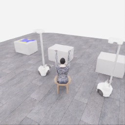
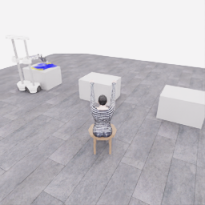
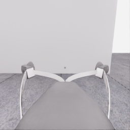
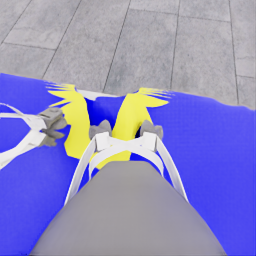
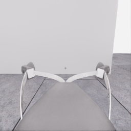
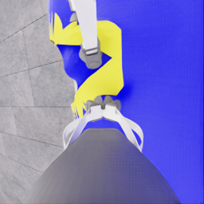
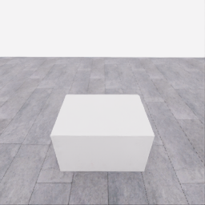
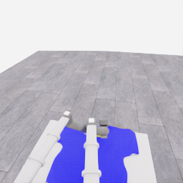
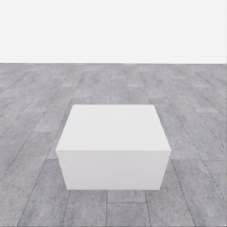
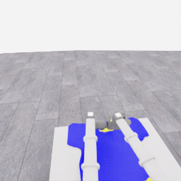

# 자동 시연 수집 시도 · 20261107-astra-neckline470-named-001

[전체 수집 기록](../../README.ko.md) · [구조화 요약](manifest.json) · [전체 행동 기록](decisions.jsonl) · [사용한 기본 프롬프트](prompt.txt)

실행 상태는 **completed**, 원본 출처는 `gpt`입니다. 완료 상태와 과제 성공은 아래에서 따로 기록합니다.

## 실행 조건과 시간

| 항목 | 기록 |
|---|---|
| 기록 시작 UTC | 2026-11-07T01:18:21Z |
| 기록 종료 UTC | 2026-11-07T01:48:05Z |
| 이전 시도 | 20261106-astra-guide470-depth-001 |
| 재시도 사유 | neckline_first_after_three_occluded_entry_approaches |
| 출처 그룹 | 20261106-coordinated-demo-methods |
| 요청 모델 / 추론 설정 | gpt-6-astra / ultra |
| 전체 실제 경과 시간 (초) | 1783.289 |
| Actor 호출 합계 (초) | 1090.694 |
| 환경 요청·응답 합계 (초) | 640.650 |
| 시뮬레이션 시간 (초) | 36.300 |
| 저장 전이 수 | 726.000 |
| 응답 확인 전이 수 | 726.000 |
| 모델 호출 시도 수 | 25.000 |
| 완료한 결정 구간 수 | 24.000 |
| 파일 완료 상태 | true |
| 데이터 정합성 검사 | true |
| 학습 데이터 승인 | unreviewed |
| Actor 호출 방식 | exec |
| 한 호출의 최대 계획 구간 수 | 1.000 |
| 한 계획의 최대 제어 step 수 | 20.000 |
| 제어기 정착 대기 설정 | true |
| 정착 대기 요청 step 수 | 6.000 |
| 완료한 제어기 정착 구간 수 | 17.000 |
| 제어기 정착 전이 수 | 102.000 |
| 제어기 정착 환경 요청·응답 (초) | 95.204 |
| 전이 예산으로 단축한 정착 구간 수 | 0.000 |
| 전이 예산으로 건너뛴 정착 구간 수 | 0.000 |

Actor 호출 시간은 공개 입력 저장·요청 전송·응답 처리 등 호출 경로를 측정합니다. 방식에 따라 Docker/CLI 시작이 호출 안에 들어가거나 상주 서버 준비 시간으로 분리됩니다. 내부 모델 추론 시간만 별도로 측정한 값은 아닙니다. 모델이 판단하는 동안 물리 시간은 멈추며 실제 경과 시간과 시뮬레이션 시간은 다릅니다. 세부 요청 프로세스 시간에도 CLI 처리·네트워크·서버 대기·생성이 함께 포함됩니다.

## 토큰 사용량의 범위

`actor_usage`는 thread별 관측 누계를 합친 값입니다. 결정의 `usage`는 원본 CLI 누계이며, 호출별 증가량은 `usage_accounting.incremental_usage`입니다. 캐시 입력은 입력의 부분집합이고 추론 출력은 출력의 부분집합이므로 열들을 다시 합산하지 않습니다.

전체 호출 사용량 확정: **true** · 기록한 호출 수: 25.

| 입력 | 캐시 입력 | 캐시 쓰기 입력 | 출력 | 추론 출력 |
|---:|---:|---:|---:|---:|
| 3271056 | 2770304 | 0 | 27925 | 22432 |

중복 누계는 추가 사용량 0으로 처리하고, 역행한 누계는 미확정으로 보존합니다. 새 thread는 별도로 집계합니다. 토큰 기록은 화폐 비용이나 청구서가 아닙니다.

## 리뷰 정지 조건

목표 누적 점수 10.000 · 감시 상태 `collector_ended_before_gate` · 수집기 상태 `completed`.

마지막 관측 점수 0.000 · 응답 확인 step 726.

`review_ready`는 정지 조건에 따라 실행을 마치고 리뷰할 준비가 된 상태입니다. 50점·착의 성공이나 학습 데이터 승인을 뜻하지 않습니다. 공식 점수와 success는 아래 평가 결과로 확인합니다.

## 공식 평가 결과

평가 유효성 `true` · 누적 점수 **0.000 / 50** · 착의 success **false** · rate 상태 `no_contact` · 최종 rate 미측정/해당 없음 points/s.

누적 50점, 착의 success, 정상 파일 종료와 데이터 정합성은 서로 다른 상태입니다. 접촉 전 `no_contact`의 rate는 0점/초로 바꾸지 않습니다.

| 단계 | 획득 점수 / 최대 | 획득 시각 (episode 초) |
|---|---:|---:|
| 파지·들기 | 0.000 / 5 | 미측정/해당 없음 |
| 첫 소매 | 0.000 / 5 | 미측정/해당 없음 |
| 반대 어깨 | 0.000 / 5 | 미측정/해당 없음 |
| 두 번째 소매 | 0.000 / 5 | 미측정/해당 없음 |
| 왼쪽 위팔 | 0.000 / 5 | 미측정/해당 없음 |
| 오른쪽 위팔 | 0.000 / 5 | 미측정/해당 없음 |
| 목 통과 | 0.000 / 10 | 미측정/해당 없음 |
| 앞면 방향 | 0.000 / 10 | 미측정/해당 없음 |

## 단계 획득 경로

점수 획득은 [평가 이벤트](score-events.jsonl)에서 같은 physics tick끼리 묶었습니다. 같은 시각에 인정된 항목의 내부 순서는 추정하지 않습니다. 착의 success는 점수 획득과 별도로 기록합니다.

| 순서 | episode 시간 (초) | 전이 경계 step | 누적 점수 변화 | 같은 시각의 항목 변화 |
|---:|---:|---:|---:|---|
| — | — | — | — | 기록된 공식 항목 획득 없음 |

평가 clock 0초에 대응하는 공개 simulation clock은 1.525초입니다. 두 시계를 같은 절대 시각으로 혼동하지 않습니다.

별도 success 이벤트 수: **0**. 평가 유효성: `true`.


## 원본 관측 화면

지정된 공개 카메라의 저장 RGB 픽셀입니다. 시작은 첫 `obs`, 종료는 마지막 `next_obs`입니다. 이미지 합성이나 내부 상태 기반 장면 재구성 없이 원본 픽셀로 PNG를 저장했습니다.

| 카메라 | 시작 | 종료 |
|---|---|---|
| `overview` | [](images/initial-overview.png) | [](images/final-overview.png) |
| `robot_0_wrist` | [](images/initial-robot_0_wrist.png) | [](images/final-robot_0_wrist.png) |
| `robot_1_wrist` | [](images/initial-robot_1_wrist.png) | [](images/final-robot_1_wrist.png) |
| `robot_0_head` | [](images/initial-robot_0_head.png) | [](images/final-robot_0_head.png) |
| `robot_1_head` | [](images/initial-robot_1_head.png) | [](images/final-robot_1_head.png) |

시작 관측 시각 1.525초 · 종료 관측 시각 37.825초 (공개 simulation clock).

[▶ overview 관측 영상 보기](overview.mp4)

저장된 20 Hz `obs` 중 726프레임을 순서대로 사용했습니다. 재생은 **1배 느리게** (20.000 fps), 실제 대기 시간·모델 호출 지연은 영상에 들어가지 않습니다. 종료 `next_obs`는 위 PNG에서 확인합니다.

## 결정과 실행 순서

아래 근거는 모델 최종 JSON의 짧은 행동 설명입니다. 시각적 평가는 행동 전 관측에 대한 판단이며, 그 행동의 실행 후 성공 라벨로 사용하지 않습니다. 공식 점수는 별도의 평가 결과입니다.

행동의 각 행은 로봇 0·1 순서이며 열은 `전진, 왼쪽 이동, 반시계 회전, 리프트, 팔 신장, 손목 yaw, pitch, roll, gripper`입니다. 앞 8개는 정규화 속도이고 gripper는 닫기 `+1`, 열기 `-1`, 의도 유지 `0`입니다.

제어기 정착 대기는 앞선 모델 결정에 연결된 별도 중립 행동입니다. 추가 모델 호출이나 모델 결정으로 집계하지 않으며, 실제 전이와 환경 요청·응답 시간은 전체 합계에 포함됩니다. 중립 행동은 두 로봇의 속도와 gripper 명령을 모두 0으로 보내 기존 gripper 의도를 유지합니다. 대기를 실행했다는 기록이 옷의 정착이나 과제 개선을 확인했다는 뜻은 아닙니다.

### 기록된 행동의 재실행 구간

원본 `20261106-astra-guide470-depth-001`의 행동 470전이를 새 환경에서 다시 실행했습니다. 이 구간에는 새 모델 호출이 없고 관측·평가를 새로 기록했습니다. 정확한 물리 상태 복원이나 독립적인 새 시연으로 집계하지 않습니다. 원본 step 대응과 실제 행동은 `decisions.jsonl`의 `replayed_segment`에 있습니다.

### 별도 모델 호출 0 · `initial`

실행 결정 인덱스 0의 고정 관측을 사용했습니다. 호출 경과 43.666초. 같은 call index의 행동 기록과 사용량을 중복 합산하지 않습니다.

공개 입력 저장 0.240초 · 요청 프로세스 43.425초 · 결과 해석 0.000초.

### 결정 0 · 준비 · `act`

입력 관측 25.025초 · Actor 호출 43.666초 · 시각적 판단 `uncertain`.

계획 `20261107-astra-neckline470-named-001:call-00000` · 모델 호출 인덱스 0 · 계획 구간 1/1 · 이 구간에서 모델 호출 `true`.

실행 직전 최신 관측 25.025초.

공개 입력 저장 0.240초 · 요청 프로세스 43.425초 · 결과 해석 0.000초.

호출 사용량 상태 `observed` · 이번 증가량 입력 22322 / 출력 1229 토큰.

최종 응답의 행동 설명: Robot 0 is at the near-right edge and robot 1 at the near-left edge; both grips are unconfirmed and appear hem-like. The far-center V remains only a neckline candidate. Test a coordinated 3 cm lift while retaining table support, checking local cloth following separately before one-sided neckline repositioning.

요청 행동:

```json
[[0, 0, 0, 0.1, 0, 0, 0, 0, 0], [0, 0, 0, 0.1, 0, 0, 0, 0, 0]]
```

실행 구간 step **[470, 474)** · 요청 4 step / 실제 4 step · 환경 요청·응답 4.004초.

실제 적용 행동:

```json
[[0.0, 0.0, 0.0, 0.10000000149011612, 0.0, 0.0, 0.0, 0.0, 0.0], [0.0, 0.0, 0.0, 0.10000000149011612, 0.0, 0.0, 0.0, 0.0, 0.0]]
```

### 제어기 정착 대기 · 연결 결정 0

구간 `20261107-astra-neckline470-named-001:settle-00000` · 출처 `controller_settle` · 이 구간에서 모델 호출 `false`.

앞선 모델 호출 인덱스 0에 연결됩니다. 추가 호출은 없습니다.

실행 구간 step **[474, 480)** · 요청 6 step / 실제 6 step · 환경 요청·응답 5.516초.

공개 simulation clock 25.225→25.525초 · 실행 전 관측 25.225초.

실제 적용 중립 행동:

```json
[[0.0, 0.0, 0.0, 0.0, 0.0, 0.0, 0.0, 0.0, 0.0], [0.0, 0.0, 0.0, 0.0, 0.0, 0.0, 0.0, 0.0, 0.0]]
```

### 별도 모델 호출 1 · `initial`

실행 결정 인덱스 1의 고정 관측을 사용했습니다. 호출 경과 22.379초. 같은 call index의 행동 기록과 사용량을 중복 합산하지 않습니다.

공개 입력 저장 0.084초 · 요청 프로세스 22.295초 · 결과 해석 0.000초.

### 결정 1 · 준비 · `act`

입력 관측 25.525초 · Actor 호출 22.379초 · 시각적 판단 `progressing`.

계획 `20261107-astra-neckline470-named-001:call-00001` · 모델 호출 인덱스 1 · 계획 구간 1/1 · 이 구간에서 모델 호출 `true`.

실행 직전 최신 관측 25.525초.

공개 입력 저장 0.084초 · 요청 프로세스 22.295초 · 결과 해석 0.000초.

호출 사용량 상태 `observed` · 이번 증가량 입력 32810 / 출력 722 토큰.

최종 응답의 행동 설명: Local cloth folds appear to have followed both measured lifts. Robot 1 retains the left hem anchor while robot 0 releases the right hem, beginning its single neckline regrasp with the body table-supported. The far-center V remains an unverified opening candidate.

요청 행동:

```json
[[0, 0, 0, 0, 0, 0, 0, 0, -1], [0, 0, 0, 0, 0, 0, 0, 0, 0]]
```

실행 구간 step **[480, 484)** · 요청 4 step / 실제 4 step · 환경 요청·응답 3.843초.

실제 적용 행동:

```json
[[0.0, 0.0, 0.0, 0.0, 0.0, 0.0, 0.0, 0.0, -1.0], [0.0, 0.0, 0.0, 0.0, 0.0, 0.0, 0.0, 0.0, 0.0]]
```

### 별도 모델 호출 2 · `initial`

실행 결정 인덱스 2의 고정 관측을 사용했습니다. 호출 경과 21.287초. 같은 call index의 행동 기록과 사용량을 중복 합산하지 않습니다.

공개 입력 저장 0.094초 · 요청 프로세스 21.193초 · 결과 해석 0.000초.

### 결정 2 · 준비 · `act`

입력 관측 25.725초 · Actor 호출 21.287초 · 시각적 판단 `progressing`.

계획 `20261107-astra-neckline470-named-001:call-00002` · 모델 호출 인덱스 2 · 계획 구간 1/1 · 이 구간에서 모델 호출 `true`.

실행 직전 최신 관측 25.725초.

공개 입력 저장 0.094초 · 요청 프로세스 21.193초 · 결과 해석 0.000초.

호출 사용량 상태 `observed` · 이번 증가량 입력 42812 / 출력 543 토큰.

최종 응답의 행동 설명: Robot 0&#x27;s fingers are opening toward their target; robot 1 retains the left hem anchor. Raise robot 0 about 9 cm and extend about 11 cm toward the candidate neckline, clearing the supported panel. Check that the released hem stays on the table as the gripper moves away.

요청 행동:

```json
[[0, 0, 0, 0.2, 0.3, 0, 0, 0, 0], [0, 0, 0, 0, 0, 0, 0, 0, 0]]
```

실행 구간 step **[484, 490)** · 요청 6 step / 실제 6 step · 환경 요청·응답 5.425초.

실제 적용 행동:

```json
[[0.0, 0.0, 0.0, 0.20000000298023224, 0.30000001192092896, 0.0, 0.0, 0.0, 0.0], [0.0, 0.0, 0.0, 0.0, 0.0, 0.0, 0.0, 0.0, 0.0]]
```

### 제어기 정착 대기 · 연결 결정 2

구간 `20261107-astra-neckline470-named-001:settle-00002` · 출처 `controller_settle` · 이 구간에서 모델 호출 `false`.

앞선 모델 호출 인덱스 2에 연결됩니다. 추가 호출은 없습니다.

실행 구간 step **[490, 496)** · 요청 6 step / 실제 6 step · 환경 요청·응답 5.367초.

공개 simulation clock 26.025→26.325초 · 실행 전 관측 26.025초.

실제 적용 중립 행동:

```json
[[0.0, 0.0, 0.0, 0.0, 0.0, 0.0, 0.0, 0.0, 0.0], [0.0, 0.0, 0.0, 0.0, 0.0, 0.0, 0.0, 0.0, 0.0]]
```

### 별도 모델 호출 3 · `initial`

실행 결정 인덱스 3의 고정 관측을 사용했습니다. 호출 경과 42.016초. 같은 call index의 행동 기록과 사용량을 중복 합산하지 않습니다.

공개 입력 저장 0.090초 · 요청 프로세스 41.926초 · 결과 해석 0.000초.

### 결정 3 · 준비 · `act`

입력 관측 26.325초 · Actor 호출 42.016초 · 시각적 판단 `progressing`.

계획 `20261107-astra-neckline470-named-001:call-00003` · 모델 호출 인덱스 3 · 계획 구간 1/1 · 이 구간에서 모델 호출 `true`.

실행 직전 최신 관측 26.325초.

공개 입력 저장 0.090초 · 요청 프로세스 41.926초 · 결과 해석 0.000초.

호출 사용량 상태 `observed` · 이번 증가량 입력 52620 / 출력 1250 토큰.

최종 응답의 행동 설명: Robot 0 is visibly open and clear of the released edge; robot 1 retains the hem anchor and the body stays table-supported. Extend robot 0 about 27 cm and turn inward about 10 degrees to approach the candidate neckline&#x27;s right flank at clearance height, then inspect before descending.

요청 행동:

```json
[[0, 0, 0.12, 0, 0.45, 0, 0, 0, 0], [0, 0, 0, 0, 0, 0, 0, 0, 0]]
```

실행 구간 step **[496, 506)** · 요청 10 step / 실제 10 step · 환경 요청·응답 8.619초.

실제 적용 행동:

```json
[[0.0, 0.0, 0.11999999731779099, 0.0, 0.44999998807907104, 0.0, 0.0, 0.0, 0.0], [0.0, 0.0, 0.0, 0.0, 0.0, 0.0, 0.0, 0.0, 0.0]]
```

### 제어기 정착 대기 · 연결 결정 3

구간 `20261107-astra-neckline470-named-001:settle-00003` · 출처 `controller_settle` · 이 구간에서 모델 호출 `false`.

앞선 모델 호출 인덱스 3에 연결됩니다. 추가 호출은 없습니다.

실행 구간 step **[506, 512)** · 요청 6 step / 실제 6 step · 환경 요청·응답 5.303초.

공개 simulation clock 26.825→27.125초 · 실행 전 관측 26.825초.

실제 적용 중립 행동:

```json
[[0.0, 0.0, 0.0, 0.0, 0.0, 0.0, 0.0, 0.0, 0.0], [0.0, 0.0, 0.0, 0.0, 0.0, 0.0, 0.0, 0.0, 0.0]]
```

### 별도 모델 호출 4 · `initial`

실행 결정 인덱스 4의 고정 관측을 사용했습니다. 호출 경과 36.654초. 같은 call index의 행동 기록과 사용량을 중복 합산하지 않습니다.

공개 입력 저장 0.090초 · 요청 프로세스 36.563초 · 결과 해석 0.000초.

### 결정 4 · 준비 · `act`

입력 관측 27.125초 · Actor 호출 36.654초 · 시각적 판단 `progressing`.

계획 `20261107-astra-neckline470-named-001:call-00004` · 모델 호출 인덱스 4 · 계획 구간 1/1 · 이 구간에서 모델 호출 `true`.

실행 직전 최신 관측 27.125초.

공개 입력 저장 0.090초 · 요청 프로세스 36.563초 · 결과 해석 0.000초.

호출 사용량 상태 `observed` · 이번 증가량 입력 63149 / 출력 1060 토큰.

최종 응답의 행동 설명: Robot 0 reached its 0.52 m extension target, advancing less than requested; the candidate rim remains ahead of its open jaws. Robot 1 retains the hem anchor. Advance robot 0&#x27;s base about 15 cm at clearance height along the visible table approach, then reassess alignment and clearance.

요청 행동:

```json
[[0.4, 0, 0, 0, 0, 0, 0, 0, 0], [0, 0, 0, 0, 0, 0, 0, 0, 0]]
```

실행 구간 step **[512, 524)** · 요청 12 step / 실제 12 step · 환경 요청·응답 10.672초.

실제 적용 행동:

```json
[[0.4000000059604645, 0.0, 0.0, 0.0, 0.0, 0.0, 0.0, 0.0, 0.0], [0.0, 0.0, 0.0, 0.0, 0.0, 0.0, 0.0, 0.0, 0.0]]
```

### 제어기 정착 대기 · 연결 결정 4

구간 `20261107-astra-neckline470-named-001:settle-00004` · 출처 `controller_settle` · 이 구간에서 모델 호출 `false`.

앞선 모델 호출 인덱스 4에 연결됩니다. 추가 호출은 없습니다.

실행 구간 step **[524, 530)** · 요청 6 step / 실제 6 step · 환경 요청·응답 5.424초.

공개 simulation clock 27.725→28.025초 · 실행 전 관측 27.725초.

실제 적용 중립 행동:

```json
[[0.0, 0.0, 0.0, 0.0, 0.0, 0.0, 0.0, 0.0, 0.0], [0.0, 0.0, 0.0, 0.0, 0.0, 0.0, 0.0, 0.0, 0.0]]
```

### 별도 모델 호출 5 · `initial`

실행 결정 인덱스 5의 고정 관측을 사용했습니다. 호출 경과 39.308초. 같은 call index의 행동 기록과 사용량을 중복 합산하지 않습니다.

공개 입력 저장 0.091초 · 요청 프로세스 39.216초 · 결과 해석 0.000초.

### 결정 5 · 준비 · `act`

입력 관측 28.025초 · Actor 호출 39.308초 · 시각적 판단 `progressing`.

계획 `20261107-astra-neckline470-named-001:call-00005` · 모델 호출 인덱스 5 · 계획 구간 1/1 · 이 구간에서 모델 호출 `true`.

실행 직전 최신 관측 28.025초.

공개 입력 저장 0.091초 · 요청 프로세스 39.216초 · 결과 해석 0.000초.

호출 사용량 상태 `observed` · 이번 증가량 입력 73488 / 출력 1118 토큰.

최종 응답의 행동 설명: The candidate rim moved toward robot 0&#x27;s open jaws as predicted, but remains ahead and below them; robot 1 retains the hem anchor. Move robot 0 forward about 9 cm, turn inward 2 degrees, and lower about 11 cm, stopping above the candidate right rim for contact alignment. The body remains table-supported.

요청 행동:

```json
[[0.46, 0, 0.04, -0.24, 0, 0, 0, 0, 0], [0, 0, 0, 0, 0, 0, 0, 0, 0]]
```

실행 구간 step **[530, 536)** · 요청 6 step / 실제 6 step · 환경 요청·응답 5.714초.

실제 적용 행동:

```json
[[0.46000000834465027, 0.0, 0.03999999910593033, -0.23999999463558197, 0.0, 0.0, 0.0, 0.0, 0.0], [0.0, 0.0, 0.0, 0.0, 0.0, 0.0, 0.0, 0.0, 0.0]]
```

### 제어기 정착 대기 · 연결 결정 5

구간 `20261107-astra-neckline470-named-001:settle-00005` · 출처 `controller_settle` · 이 구간에서 모델 호출 `false`.

앞선 모델 호출 인덱스 5에 연결됩니다. 추가 호출은 없습니다.

실행 구간 step **[536, 542)** · 요청 6 step / 실제 6 step · 환경 요청·응답 5.844초.

공개 simulation clock 28.325→28.625초 · 실행 전 관측 28.325초.

실제 적용 중립 행동:

```json
[[0.0, 0.0, 0.0, 0.0, 0.0, 0.0, 0.0, 0.0, 0.0], [0.0, 0.0, 0.0, 0.0, 0.0, 0.0, 0.0, 0.0, 0.0]]
```

### 별도 모델 호출 6 · `initial`

실행 결정 인덱스 6의 고정 관측을 사용했습니다. 호출 경과 31.647초. 같은 call index의 행동 기록과 사용량을 중복 합산하지 않습니다.

공개 입력 저장 0.090초 · 요청 프로세스 31.557초 · 결과 해석 0.000초.

### 결정 6 · 준비 · `act`

입력 관측 28.625초 · Actor 호출 31.647초 · 시각적 판단 `progressing`.

계획 `20261107-astra-neckline470-named-001:call-00006` · 모델 호출 인덱스 6 · 계획 구간 1/1 · 이 구간에서 모델 호출 `true`.

실행 직전 최신 관측 28.625초.

공개 입력 저장 0.090초 · 요청 프로세스 31.557초 · 결과 해석 0.000초.

호출 사용량 상태 `observed` · 이번 증가량 입력 83865 / 출력 936 토큰.

최종 응답의 행동 설명: Robot 0&#x27;s candidate right neckline band is now between the open jaws in projection but remains below the fingertips; robot 1 retains the hem anchor. First short placement correction: lower the target 4 cm and advance about 2 cm, then inspect before closing. The body remains table-supported and the opening unverified.

요청 행동:

```json
[[0.18, 0, 0, -0.13, 0, 0, 0, 0, 0], [0, 0, 0, 0, 0, 0, 0, 0, 0]]
```

실행 구간 step **[542, 546)** · 요청 4 step / 실제 4 step · 환경 요청·응답 3.995초.

실제 적용 행동:

```json
[[0.18000000715255737, 0.0, 0.0, -0.12999999523162842, 0.0, 0.0, 0.0, 0.0, 0.0], [0.0, 0.0, 0.0, 0.0, 0.0, 0.0, 0.0, 0.0, 0.0]]
```

### 제어기 정착 대기 · 연결 결정 6

구간 `20261107-astra-neckline470-named-001:settle-00006` · 출처 `controller_settle` · 이 구간에서 모델 호출 `false`.

앞선 모델 호출 인덱스 6에 연결됩니다. 추가 호출은 없습니다.

실행 구간 step **[546, 552)** · 요청 6 step / 실제 6 step · 환경 요청·응답 5.798초.

공개 simulation clock 28.825→29.125초 · 실행 전 관측 28.825초.

실제 적용 중립 행동:

```json
[[0.0, 0.0, 0.0, 0.0, 0.0, 0.0, 0.0, 0.0, 0.0], [0.0, 0.0, 0.0, 0.0, 0.0, 0.0, 0.0, 0.0, 0.0]]
```

### 별도 모델 호출 7 · `initial`

실행 결정 인덱스 7의 고정 관측을 사용했습니다. 호출 경과 28.698초. 같은 call index의 행동 기록과 사용량을 중복 합산하지 않습니다.

공개 입력 저장 0.094초 · 요청 프로세스 28.603초 · 결과 해석 0.000초.

### 결정 7 · 파지 · `act`

입력 관측 29.125초 · Actor 호출 28.698초 · 시각적 판단 `uncertain`.

계획 `20261107-astra-neckline470-named-001:call-00007` · 모델 호출 인덱스 7 · 계획 구간 1/1 · 이 구간에서 모델 호출 `true`.

실행 직전 최신 관측 29.125초.

공개 입력 저장 0.094초 · 요청 프로세스 28.603초 · 결과 해석 0.000초.

호출 사용량 상태 `observed` · 이번 증가량 입력 94064 / 출력 847 토큰.

최종 응답의 행동 설명: Robot 0 lowered near the candidate right rim, but its base barely advanced; stop forward commands and close in place. Robot 1 retains the hem anchor with the body table-supported. This new grasp remains unconfirmed; inspect closure and subsequent cloth following before repositioning robot 1.

요청 행동:

```json
[[0, 0, 0, 0, 0, 0, 0, 0, 1], [0, 0, 0, 0, 0, 0, 0, 0, 0]]
```

실행 구간 step **[552, 560)** · 요청 8 step / 실제 8 step · 환경 요청·응답 7.651초.

실제 적용 행동:

```json
[[0.0, 0.0, 0.0, 0.0, 0.0, 0.0, 0.0, 0.0, 1.0], [0.0, 0.0, 0.0, 0.0, 0.0, 0.0, 0.0, 0.0, 0.0]]
```

### 별도 모델 호출 8 · `initial`

실행 결정 인덱스 8의 고정 관측을 사용했습니다. 호출 경과 27.644초. 같은 call index의 행동 기록과 사용량을 중복 합산하지 않습니다.

공개 입력 저장 0.090초 · 요청 프로세스 27.554초 · 결과 해석 0.000초.

### 결정 8 · 복구 · `act`

입력 관측 29.525초 · Actor 호출 27.644초 · 시각적 판단 `recovering`.

계획 `20261107-astra-neckline470-named-001:call-00008` · 모델 호출 인덱스 8 · 계획 구간 1/1 · 이 구간에서 모델 호출 `true`.

실행 직전 최신 관측 29.525초.

공개 입력 저장 0.090초 · 요청 프로세스 27.554초 · 결과 해석 0.000초.

호출 사용량 상태 `observed` · 이번 증가량 입력 104167 / 출력 740 토큰.

최종 응답의 행동 설명: Robot 0&#x27;s fingers remain near 0.50 despite the 0.103 close target, with wrist deflection suggesting interference; no grasp is established. Robot 1 retains the hem anchor. Second placement correction: raise robot 0 about 2 cm while preserving close intent, checking whether the jaws converge with the body still table-supported.

요청 행동:

```json
[[0, 0, 0, 0.065, 0, 0, 0, 0, 0], [0, 0, 0, 0, 0, 0, 0, 0, 0]]
```

실행 구간 step **[560, 564)** · 요청 4 step / 실제 4 step · 환경 요청·응답 4.020초.

실제 적용 행동:

```json
[[0.0, 0.0, 0.0, 0.06499999761581421, 0.0, 0.0, 0.0, 0.0, 0.0], [0.0, 0.0, 0.0, 0.0, 0.0, 0.0, 0.0, 0.0, 0.0]]
```

### 제어기 정착 대기 · 연결 결정 8

구간 `20261107-astra-neckline470-named-001:settle-00008` · 출처 `controller_settle` · 이 구간에서 모델 호출 `false`.

앞선 모델 호출 인덱스 8에 연결됩니다. 추가 호출은 없습니다.

실행 구간 step **[564, 570)** · 요청 6 step / 실제 6 step · 환경 요청·응답 5.690초.

공개 simulation clock 29.725→30.025초 · 실행 전 관측 29.725초.

실제 적용 중립 행동:

```json
[[0.0, 0.0, 0.0, 0.0, 0.0, 0.0, 0.0, 0.0, 0.0], [0.0, 0.0, 0.0, 0.0, 0.0, 0.0, 0.0, 0.0, 0.0]]
```

### 별도 모델 호출 9 · `initial`

실행 결정 인덱스 9의 고정 관측을 사용했습니다. 호출 경과 14.977초. 같은 call index의 행동 기록과 사용량을 중복 합산하지 않습니다.

공개 입력 저장 0.092초 · 요청 프로세스 14.885초 · 결과 해석 0.000초.

### 결정 9 · 파지 · `act`

입력 관측 30.025초 · Actor 호출 14.977초 · 시각적 판단 `progressing`.

계획 `20261107-astra-neckline470-named-001:call-00009` · 모델 호출 인덱스 9 · 계획 구간 1/1 · 이 구간에서 모델 호출 `true`.

실행 직전 최신 관측 30.025초.

공개 입력 저장 0.092초 · 요청 프로세스 14.885초 · 결과 해석 0.000초.

호출 사용량 상태 `observed` · 이번 증가량 입력 114183 / 출력 412 토큰.

최종 응답의 행동 설명: Robot 0&#x27;s jaws converged from about 0.50 to 0.32 after the clearance correction, and nearby fabric gathered upward; closure is still approaching its 0.103 target. Robot 1 retains the hem anchor. Hold motion targets briefly to observe settling before testing the new support; the fold alone does not confirm capture.

요청 행동:

```json
[[0, 0, 0, 0, 0, 0, 0, 0, 0], [0, 0, 0, 0, 0, 0, 0, 0, 0]]
```

실행 구간 step **[570, 578)** · 요청 8 step / 실제 8 step · 환경 요청·응답 7.373초.

실제 적용 행동:

```json
[[0.0, 0.0, 0.0, 0.0, 0.0, 0.0, 0.0, 0.0, 0.0], [0.0, 0.0, 0.0, 0.0, 0.0, 0.0, 0.0, 0.0, 0.0]]
```

### 별도 모델 호출 10 · `initial`

실행 결정 인덱스 10의 고정 관측을 사용했습니다. 호출 경과 32.652초. 같은 call index의 행동 기록과 사용량을 중복 합산하지 않습니다.

공개 입력 저장 0.090초 · 요청 프로세스 32.562초 · 결과 해석 0.000초.

### 결정 10 · 파지 · `act`

입력 관측 30.425초 · Actor 호출 32.652초 · 시각적 판단 `uncertain`.

계획 `20261107-astra-neckline470-named-001:call-00010` · 모델 호출 인덱스 10 · 계획 구간 1/1 · 이 구간에서 모델 호출 `true`.

실행 직전 최신 관측 30.425초.

공개 입력 저장 0.090초 · 요청 프로세스 32.562초 · 결과 해석 0.000초.

호출 사용량 상태 `observed` · 이번 증가량 입력 123874 / 출력 911 토큰.

최종 응답의 행동 설명: Robot 0&#x27;s jaws narrowed further and fabric remains gathered, although closure has not reached its target. Robot 1 retains the hem anchor. Test robot 0&#x27;s candidate support with a 3 cm lift over the table, checking local cloth following separately from hand motion before changing robot 1&#x27;s grasp.

요청 행동:

```json
[[0, 0, 0, 0.1, 0, 0, 0, 0, 0], [0, 0, 0, 0, 0, 0, 0, 0, 0]]
```

실행 구간 step **[578, 582)** · 요청 4 step / 실제 4 step · 환경 요청·응답 3.887초.

실제 적용 행동:

```json
[[0.0, 0.0, 0.0, 0.10000000149011612, 0.0, 0.0, 0.0, 0.0, 0.0], [0.0, 0.0, 0.0, 0.0, 0.0, 0.0, 0.0, 0.0, 0.0]]
```

### 제어기 정착 대기 · 연결 결정 10

구간 `20261107-astra-neckline470-named-001:settle-00010` · 출처 `controller_settle` · 이 구간에서 모델 호출 `false`.

앞선 모델 호출 인덱스 10에 연결됩니다. 추가 호출은 없습니다.

실행 구간 step **[582, 588)** · 요청 6 step / 실제 6 step · 환경 요청·응답 5.502초.

공개 simulation clock 30.625→30.925초 · 실행 전 관측 30.625초.

실제 적용 중립 행동:

```json
[[0.0, 0.0, 0.0, 0.0, 0.0, 0.0, 0.0, 0.0, 0.0], [0.0, 0.0, 0.0, 0.0, 0.0, 0.0, 0.0, 0.0, 0.0]]
```

### 별도 모델 호출 11 · `initial`

실행 결정 인덱스 11의 고정 관측을 사용했습니다. 호출 경과 20.282초. 같은 call index의 행동 기록과 사용량을 중복 합산하지 않습니다.

공개 입력 저장 0.091초 · 요청 프로세스 20.191초 · 결과 해석 0.000초.

### 결정 11 · 준비 · `act`

입력 관측 30.925초 · Actor 호출 20.282초 · 시각적 판단 `progressing`.

계획 `20261107-astra-neckline470-named-001:call-00011` · 모델 호출 인덱스 11 · 계획 구간 1/1 · 이 구간에서 모델 호출 `true`.

실행 직전 최신 관측 30.925초.

공개 입력 저장 0.091초 · 요청 프로세스 20.191초 · 결과 해석 0.000초.

호출 사용량 상태 `observed` · 이번 증가량 입력 134045 / 출력 624 토큰.

최종 응답의 행동 설명: Robot 0&#x27;s local candidate-rim fold followed its measured 2.6 cm rise while the surrounding table receded, providing visual support evidence. Retain that anchor and open robot 1&#x27;s hem grip to begin its single move toward the separately visible opposite candidate rim. The body remains table-supported; the opening is still unverified.

요청 행동:

```json
[[0, 0, 0, 0, 0, 0, 0, 0, 0], [0, 0, 0, 0, 0, 0, 0, 0, -1]]
```

실행 구간 step **[588, 592)** · 요청 4 step / 실제 4 step · 환경 요청·응답 3.955초.

실제 적용 행동:

```json
[[0.0, 0.0, 0.0, 0.0, 0.0, 0.0, 0.0, 0.0, 0.0], [0.0, 0.0, 0.0, 0.0, 0.0, 0.0, 0.0, 0.0, -1.0]]
```

### 별도 모델 호출 12 · `initial`

실행 결정 인덱스 12의 고정 관측을 사용했습니다. 호출 경과 65.766초. 같은 call index의 행동 기록과 사용량을 중복 합산하지 않습니다.

공개 입력 저장 0.107초 · 요청 프로세스 65.659초 · 결과 해석 0.000초.

### 결정 12 · 준비 · `act`

입력 관측 31.125초 · Actor 호출 65.766초 · 시각적 판단 `progressing`.

계획 `20261107-astra-neckline470-named-001:call-00012` · 모델 호출 인덱스 12 · 계획 구간 1/1 · 이 구간에서 모델 호출 `true`.

실행 직전 최신 관측 31.125초.

공개 입력 저장 0.107초 · 요청 프로세스 65.659초 · 결과 해석 0.000초.

호출 사용량 상태 `observed` · 이번 증가량 입력 143953 / 출력 2039 토큰.

최종 응답의 행동 설명: Robot 0 retains the tested candidate-rim support; robot 1&#x27;s released hem has dropped toward the table as its jaws open. Raise robot 1 about 8 cm, extend about 24 cm, and turn inward about 7 degrees to approach the opposite candidate rim above the supported body, then inspect separation from robot 0.

요청 행동:

```json
[[0, 0, 0, 0, 0, 0, 0, 0, 0], [0, 0, -0.08, 0.1, 0.4, 0, 0, 0, 0]]
```

실행 구간 step **[592, 602)** · 요청 10 step / 실제 10 step · 환경 요청·응답 9.384초.

실제 적용 행동:

```json
[[0.0, 0.0, 0.0, 0.0, 0.0, 0.0, 0.0, 0.0, 0.0], [0.0, 0.0, -0.07999999821186066, 0.10000000149011612, 0.4000000059604645, 0.0, 0.0, 0.0, 0.0]]
```

### 제어기 정착 대기 · 연결 결정 12

구간 `20261107-astra-neckline470-named-001:settle-00012` · 출처 `controller_settle` · 이 구간에서 모델 호출 `false`.

앞선 모델 호출 인덱스 12에 연결됩니다. 추가 호출은 없습니다.

실행 구간 step **[602, 608)** · 요청 6 step / 실제 6 step · 환경 요청·응답 5.648초.

공개 simulation clock 31.625→31.925초 · 실행 전 관측 31.625초.

실제 적용 중립 행동:

```json
[[0.0, 0.0, 0.0, 0.0, 0.0, 0.0, 0.0, 0.0, 0.0], [0.0, 0.0, 0.0, 0.0, 0.0, 0.0, 0.0, 0.0, 0.0]]
```

### 별도 모델 호출 13 · `initial`

실행 결정 인덱스 13의 고정 관측을 사용했습니다. 호출 경과 61.746초. 같은 call index의 행동 기록과 사용량을 중복 합산하지 않습니다.

공개 입력 저장 0.093초 · 요청 프로세스 61.652초 · 결과 해석 0.000초.

### 결정 13 · 준비 · `act`

입력 관측 31.925초 · Actor 호출 61.746초 · 시각적 판단 `progressing`.

계획 `20261107-astra-neckline470-named-001:call-00013` · 모델 호출 인덱스 13 · 계획 구간 1/1 · 이 구간에서 모델 호출 `true`.

실행 직전 최신 관측 31.925초.

공개 입력 저장 0.093초 · 요청 프로세스 61.652초 · 결과 해석 0.000초.

호출 사용량 상태 `observed` · 이번 증가량 입력 155258 / 출력 1560 토큰.

최종 응답의 행동 설명: Robot 0 retains the candidate-rim fold; robot 1 is open and elevated, with visible separation from robot 0. Advance robot 1 about 15 cm at unchanged height to bring the opposite candidate rim closer, then reassess hand clearance before descent. The garment body remains table-supported.

요청 행동:

```json
[[0, 0, 0, 0, 0, 0, 0, 0, 0], [0.4, 0, 0, 0, 0, 0, 0, 0, 0]]
```

실행 구간 step **[608, 620)** · 요청 12 step / 실제 12 step · 환경 요청·응답 10.586초.

실제 적용 행동:

```json
[[0.0, 0.0, 0.0, 0.0, 0.0, 0.0, 0.0, 0.0, 0.0], [0.4000000059604645, 0.0, 0.0, 0.0, 0.0, 0.0, 0.0, 0.0, 0.0]]
```

### 제어기 정착 대기 · 연결 결정 13

구간 `20261107-astra-neckline470-named-001:settle-00013` · 출처 `controller_settle` · 이 구간에서 모델 호출 `false`.

앞선 모델 호출 인덱스 13에 연결됩니다. 추가 호출은 없습니다.

실행 구간 step **[620, 626)** · 요청 6 step / 실제 6 step · 환경 요청·응답 5.619초.

공개 simulation clock 32.525→32.825초 · 실행 전 관측 32.525초.

실제 적용 중립 행동:

```json
[[0.0, 0.0, 0.0, 0.0, 0.0, 0.0, 0.0, 0.0, 0.0], [0.0, 0.0, 0.0, 0.0, 0.0, 0.0, 0.0, 0.0, 0.0]]
```

### 별도 모델 호출 14 · `initial`

실행 결정 인덱스 14의 고정 관측을 사용했습니다. 호출 경과 33.670초. 같은 call index의 행동 기록과 사용량을 중복 합산하지 않습니다.

공개 입력 저장 0.105초 · 요청 프로세스 33.565초 · 결과 해석 0.000초.

### 공개 픽셀 depth 조회 · 결정 14

물리 전이 없이 같은 카메라·시각의 원본 값을 조회했습니다. 무효 값은 null이며 접촉·입구 통과 판단이 아닙니다.

```json
{
  "request": {
    "kind": "depth_query",
    "observation_id": "29ebc10bf8739c508c37986b53c42c8d25144ed9d1d6b989c43f4f053371e81f",
    "camera": "robot_1_wrist",
    "pixels_uv": [
      [
        142,
        92
      ],
      [
        153,
        114
      ],
      [
        177,
        100
      ],
      [
        197,
        132
      ],
      [
        56,
        133
      ],
      [
        128,
        120
      ],
      [
        160,
        82
      ],
      [
        145,
        76
      ]
    ],
    "include_camera_geometry": true
  },
  "response": {
    "kind": "depth_query_result",
    "observation_id": "29ebc10bf8739c508c37986b53c42c8d25144ed9d1d6b989c43f4f053371e81f",
    "camera": "robot_1_wrist",
    "camera_index": 2,
    "simulation_time_s": 32.82500171195716,
    "intrinsics_sha256": "3dd91a2df5cb0a47b6f5ceb86d60d41e1f5d6753d2a11a034ac0b52bc385cd23",
    "request_sha256": "ff4fc956ebf300bb88a54c7197e3ad6fc3beb323d8384bd605d91a4f722ed11a",
    "depth_semantics": "optical_Z_metres_not_ray_range",
    "geometry_semantics": "camera_X_right_Y_down_Z_forward",
    "rgb_image_order": [
      "overview",
      "robot_0_wrist",
      "robot_1_wrist",
      "robot_0_head",
      "robot_1_head"
    ],
    "resolution_wh": [
      256,
      256
    ],
    "neighbor_depth_substituted": false,
    "hidden_surfaces_estimated": false,
    "object_pose_or_contact_inferred": false,
    "source_sha256": {
      "observation_json": "c8b919de8f91bb41a01098c8dad2869a95ae3ee3d1e574aff7d69ec3a85faef6",
      "public_depth_npz": "ef61a700bd3cb7dacf9a3c67fb9373ed2bcbd5f3da02dc6df2ee7b80094b15f0",
      "overview_rgb": "dc32aec56df43c428102112c969d3c95edbc1e3ccca8a902da96eb320069ea4e",
      "robot_0_wrist_rgb": "9846b20fa0afd18441c457a74eb05d618a2dbf2383fee29b09239604261dd3b9",
      "robot_1_wrist_rgb": "08a36349a853271baa8c712d520f8bbc61d7e302050da2bbd46d60d25357ae7c",
      "robot_0_head_rgb": "fb47852fde9ad723745df3d01621ae8b0e79d2442aca04a925de633c9d5d13ff",
      "robot_1_head_rgb": "8bfea284c1cab93a36e9233fd4ea928a3fc5f0074be5e4864e1f105cb954d791"
    },
    "results": [
      {
        "pixel_uv": [
          142,
          92
        ],
        "status": "valid",
        "optical_z_m": 0.375732421875,
        "camera_xyz_m": [
          0.028775542484791576,
          -0.07399425210374977,
          0.375732421875
        ],
        "camera_range_m": 0.38402868908161053,
        "invalid_reasons": []
      },
      {
        "pixel_uv": [
          153,
          114
        ],
        "status": "valid",
        "optical_z_m": 0.3534282445907593,
        "camera_xyz_m": [
          0.04833459396067865,
          -0.02706737261798005,
          0.3534282445907593
        ],
        "camera_range_m": 0.3577434831108595,
        "invalid_reasons": []
      },
      {
        "pixel_uv": [
          177,
          100
        ],
        "status": "valid",
        "optical_z_m": 0.3346453905105591,
        "camera_xyz_m": [
          0.08970109396928633,
          -0.05125776798244933,
          0.3346453905105591
        ],
        "camera_range_m": 0.3502301849181391,
        "invalid_reasons": []
      },
      {
        "pixel_uv": [
          197,
          132
        ],
        "status": "valid",
        "optical_z_m": 0.19526326656341553,
        "camera_xyz_m": [
          0.07370321852841977,
          0.00427265034947361,
          0.19526326656341553
        ],
        "camera_range_m": 0.2087538340521494,
        "invalid_reasons": []
      },
      {
        "pixel_uv": [
          56,
          133
        ],
        "status": "valid",
        "optical_z_m": 0.19274824857711792,
        "camera_xyz_m": [
          -0.07591712435460951,
          0.005272022524625661,
          0.19274824857711792
        ],
        "camera_range_m": 0.20722714909325912,
        "invalid_reasons": []
      },
      {
        "pixel_uv": [
          128,
          120
        ],
        "status": "valid",
        "optical_z_m": 0.3563241958618164,
        "camera_xyz_m": [
          0.0,
          -0.015593805499309806,
          0.3563241958618164
        ],
        "camera_range_m": 0.3566652482742332,
        "invalid_reasons": []
      },
      {
        "pixel_uv": [
          160,
          82
        ],
        "status": "valid",
        "optical_z_m": 0.3758295774459839,
        "camera_xyz_m": [
          0.06578967580246195,
          -0.09457265896603907,
          0.3758295774459839
        ],
        "camera_range_m": 0.3930904991847635,
        "invalid_reasons": []
      },
      {
        "pixel_uv": [
          145,
          76
        ],
        "status": "valid",
        "optical_z_m": 0.4188656806945801,
        "camera_xyz_m": [
          0.03895296422683333,
          -0.11915024351737254,
          0.4188656806945801
        ],
        "camera_range_m": 0.4372214226407943,
        "invalid_reasons": []
      }
    ]
  }
}
```

### 별도 모델 호출 15 · `action_after_query`

실행 결정 인덱스 14의 고정 관측을 사용했습니다. 호출 경과 89.695초. 같은 call index의 행동 기록과 사용량을 중복 합산하지 않습니다.

공개 입력 저장 0.099초 · 요청 프로세스 89.595초 · 결과 해석 0.000초.

### 결정 14 · 준비 · `act`

입력 관측 32.825초 · Actor 호출 89.695초 · 시각적 판단 `uncertain`.

계획 `20261107-astra-neckline470-named-001:call-00015` · 모델 호출 인덱스 15 · 계획 구간 1/1 · 이 구간에서 모델 호출 `true`.

실행 직전 최신 관측 32.825초.

공개 입력 저장 0.099초 · 요청 프로세스 89.595초 · 결과 해석 0.000초.

호출 사용량 상태 `observed` · 이번 증가량 입력 177573 / 출력 2386 토큰.

최종 응답의 행동 설명: Robot 0 retains the anchor. Sampled candidate-band and robot 0 fingertip surfaces are only about 8 cm apart, leaving lateral jaw clearance uncertain. Roll robot 1&#x27;s open gripper about 90 degrees at its elevated position to redirect the finger sweep, then inspect clearance before descent.

요청 행동:

```json
[[0, 0, 0, 0, 0, 0, 0, 0, 0], [0, 0, 0, 0, 0, 0, 0, 0.47, 0]]
```

실행 구간 step **[626, 638)** · 요청 12 step / 실제 12 step · 환경 요청·응답 10.735초.

실제 적용 행동:

```json
[[0.0, 0.0, 0.0, 0.0, 0.0, 0.0, 0.0, 0.0, 0.0], [0.0, 0.0, 0.0, 0.0, 0.0, 0.0, 0.0, 0.4699999988079071, 0.0]]
```

### 제어기 정착 대기 · 연결 결정 14

구간 `20261107-astra-neckline470-named-001:settle-00014` · 출처 `controller_settle` · 이 구간에서 모델 호출 `false`.

앞선 모델 호출 인덱스 15에 연결됩니다. 추가 호출은 없습니다.

실행 구간 step **[638, 644)** · 요청 6 step / 실제 6 step · 환경 요청·응답 5.794초.

공개 simulation clock 33.425→33.725초 · 실행 전 관측 33.425초.

실제 적용 중립 행동:

```json
[[0.0, 0.0, 0.0, 0.0, 0.0, 0.0, 0.0, 0.0, 0.0], [0.0, 0.0, 0.0, 0.0, 0.0, 0.0, 0.0, 0.0, 0.0]]
```

### 별도 모델 호출 16 · `initial`

실행 결정 인덱스 15의 고정 관측을 사용했습니다. 호출 경과 69.171초. 같은 call index의 행동 기록과 사용량을 중복 합산하지 않습니다.

공개 입력 저장 0.104초 · 요청 프로세스 69.067초 · 결과 해석 0.000초.

### 결정 15 · 준비 · `act`

입력 관측 33.725초 · Actor 호출 69.171초 · 시각적 판단 `uncertain`.

계획 `20261107-astra-neckline470-named-001:call-00016` · 모델 호출 인덱스 16 · 계획 구간 1/1 · 이 구간에서 모델 호출 `true`.

실행 직전 최신 관측 33.725초.

공개 입력 저장 0.104초 · 요청 프로세스 69.067초 · 결과 해석 0.000초.

호출 사용량 상태 `observed` · 이번 증가량 입력 189345 / 출력 1912 토큰.

최종 응답의 행동 설명: Robot 0 retains the rim anchor. Robot 1&#x27;s fingers now run mostly fore-and-aft, but remain short of and above the opposite candidate band, visible in the head and robot 0 wrist views. Make a short forward/inward approach with shallower pitch and partial descent, then inspect hand clearance before contact.

요청 행동:

```json
[[0, 0, 0, 0, 0, 0, 0, 0, 0], [0.3, 0, -0.05, -0.18, 0, 0, -0.1, 0, 0]]
```

실행 구간 step **[644, 650)** · 요청 6 step / 실제 6 step · 환경 요청·응답 5.621초.

실제 적용 행동:

```json
[[0.0, 0.0, 0.0, 0.0, 0.0, 0.0, 0.0, 0.0, 0.0], [0.30000001192092896, 0.0, -0.05000000074505806, -0.18000000715255737, 0.0, 0.0, -0.10000000149011612, 0.0, 0.0]]
```

### 제어기 정착 대기 · 연결 결정 15

구간 `20261107-astra-neckline470-named-001:settle-00015` · 출처 `controller_settle` · 이 구간에서 모델 호출 `false`.

앞선 모델 호출 인덱스 16에 연결됩니다. 추가 호출은 없습니다.

실행 구간 step **[650, 656)** · 요청 6 step / 실제 6 step · 환경 요청·응답 5.725초.

공개 simulation clock 34.025→34.325초 · 실행 전 관측 34.025초.

실제 적용 중립 행동:

```json
[[0.0, 0.0, 0.0, 0.0, 0.0, 0.0, 0.0, 0.0, 0.0], [0.0, 0.0, 0.0, 0.0, 0.0, 0.0, 0.0, 0.0, 0.0]]
```

### 별도 모델 호출 17 · `initial`

실행 결정 인덱스 16의 고정 관측을 사용했습니다. 호출 경과 41.630초. 같은 call index의 행동 기록과 사용량을 중복 합산하지 않습니다.

공개 입력 저장 0.109초 · 요청 프로세스 41.520초 · 결과 해석 0.000초.

### 결정 16 · 준비 · `act`

입력 관측 34.325초 · Actor 호출 41.630초 · 시각적 판단 `progressing`.

계획 `20261107-astra-neckline470-named-001:call-00017` · 모델 호출 인덱스 17 · 계획 구간 1/1 · 이 구간에서 모델 호출 `true`.

실행 직전 최신 관측 34.325초.

공개 입력 저장 0.109초 · 요청 프로세스 41.520초 · 결과 해석 0.000초.

호출 사용량 상태 `observed` · 이번 증가량 입력 200544 / 출력 1054 토큰.

최종 응답의 행동 설명: Robot 0&#x27;s anchor remains steady. Robot 1 advanced and reoriented as intended; the opposite candidate band is now near its grasp projection but below the open fingers. First short placement correction for robot 1: lower about 5.5 cm without further horizontal motion, then inspect the lower finger and cloth before closing.

요청 행동:

```json
[[0, 0, 0, 0, 0, 0, 0, 0, 0], [0, 0, 0, -0.18, 0, 0, 0, 0, 0]]
```

실행 구간 step **[656, 660)** · 요청 4 step / 실제 4 step · 환경 요청·응답 3.938초.

실제 적용 행동:

```json
[[0.0, 0.0, 0.0, 0.0, 0.0, 0.0, 0.0, 0.0, 0.0], [0.0, 0.0, 0.0, -0.18000000715255737, 0.0, 0.0, 0.0, 0.0, 0.0]]
```

### 제어기 정착 대기 · 연결 결정 16

구간 `20261107-astra-neckline470-named-001:settle-00016` · 출처 `controller_settle` · 이 구간에서 모델 호출 `false`.

앞선 모델 호출 인덱스 17에 연결됩니다. 추가 호출은 없습니다.

실행 구간 step **[660, 666)** · 요청 6 step / 실제 6 step · 환경 요청·응답 5.594초.

공개 simulation clock 34.525→34.825초 · 실행 전 관측 34.525초.

실제 적용 중립 행동:

```json
[[0.0, 0.0, 0.0, 0.0, 0.0, 0.0, 0.0, 0.0, 0.0], [0.0, 0.0, 0.0, 0.0, 0.0, 0.0, 0.0, 0.0, 0.0]]
```

### 별도 모델 호출 18 · `initial`

실행 결정 인덱스 17의 고정 관측을 사용했습니다. 호출 경과 44.633초. 같은 call index의 행동 기록과 사용량을 중복 합산하지 않습니다.

공개 입력 저장 0.100초 · 요청 프로세스 44.533초 · 결과 해석 0.000초.

### 결정 17 · 파지 · `act`

입력 관측 34.825초 · Actor 호출 44.633초 · 시각적 판단 `uncertain`.

계획 `20261107-astra-neckline470-named-001:call-00018` · 모델 호출 인덱스 18 · 계획 구간 1/1 · 이 구간에서 모델 호출 `true`.

실행 직전 최신 관측 34.825초.

공개 입력 저장 0.100초 · 요청 프로세스 44.533초 · 결과 해석 0.000초.

호출 사용량 상태 `observed` · 이번 증가량 입력 210858 / 출력 1057 토큰.

최종 응답의 행동 설명: Robot 0 retains its anchor. Robot 1&#x27;s lower finger deflected despite open intent and its arm fell short of target during descent, indicating possible interference rather than a grasp. Stop placement motion and close around the candidate band, checking actual jaw and cloth motion before any lift.

요청 행동:

```json
[[0, 0, 0, 0, 0, 0, 0, 0, 0], [0, 0, 0, 0, 0, 0, 0, 0, 1]]
```

실행 구간 step **[666, 674)** · 요청 8 step / 실제 8 step · 환경 요청·응답 7.387초.

실제 적용 행동:

```json
[[0.0, 0.0, 0.0, 0.0, 0.0, 0.0, 0.0, 0.0, 0.0], [0.0, 0.0, 0.0, 0.0, 0.0, 0.0, 0.0, 0.0, 1.0]]
```

### 별도 모델 호출 19 · `initial`

실행 결정 인덱스 18의 고정 관측을 사용했습니다. 호출 경과 25.397초. 같은 call index의 행동 기록과 사용량을 중복 합산하지 않습니다.

공개 입력 저장 0.097초 · 요청 프로세스 25.300초 · 결과 해석 0.000초.

### 결정 18 · 파지 · `act`

입력 관측 35.225초 · Actor 호출 25.397초 · 시각적 판단 `progressing`.

계획 `20261107-astra-neckline470-named-001:call-00019` · 모델 호출 인덱스 19 · 계획 구간 1/1 · 이 구간에서 모델 호출 `true`.

실행 직전 최신 관측 35.225초.

공개 입력 저장 0.097초 · 요청 프로세스 25.300초 · 결과 해석 0.000초.

호출 사용량 상태 `observed` · 이번 증가량 입력 221205 / 출력 535 토큰.

최종 응답의 행동 설명: Robot 0 retains its anchor. Robot 1&#x27;s jaws visibly narrowed, while its arm is still returning toward the extension target; the changed fold does not yet confirm capture. Hold motion commands briefly and inspect measured settling before a short cooperative support test.

요청 행동:

```json
[[0, 0, 0, 0, 0, 0, 0, 0, 0], [0, 0, 0, 0, 0, 0, 0, 0, 0]]
```

실행 구간 step **[674, 680)** · 요청 6 step / 실제 6 step · 환경 요청·응답 5.673초.

실제 적용 행동:

```json
[[0.0, 0.0, 0.0, 0.0, 0.0, 0.0, 0.0, 0.0, 0.0], [0.0, 0.0, 0.0, 0.0, 0.0, 0.0, 0.0, 0.0, 0.0]]
```

### 별도 모델 호출 20 · `initial`

실행 결정 인덱스 19의 고정 관측을 사용했습니다. 호출 경과 17.590초. 같은 call index의 행동 기록과 사용량을 중복 합산하지 않습니다.

공개 입력 저장 0.102초 · 요청 프로세스 17.488초 · 결과 해석 0.000초.

### 결정 19 · 들기 · `act`

입력 관측 35.525초 · Actor 호출 17.590초 · 시각적 판단 `uncertain`.

계획 `20261107-astra-neckline470-named-001:call-00020` · 모델 호출 인덱스 20 · 계획 구간 1/1 · 이 구간에서 모델 호출 `true`.

실행 직전 최신 관측 35.525초.

공개 입력 저장 0.102초 · 요청 프로세스 17.488초 · 결과 해석 0.000초.

호출 사용량 상태 `observed` · 이번 증가량 입력 231030 / 출력 469 토큰.

최종 응답의 행동 설명: Robot 0 retains its tested support; robot 1&#x27;s jaws have narrowed further and its arm is nearer target, but its new grasp remains untested. Raise both about 3 cm together while the body stays table-supported. Check local cloth following separately at each hand and whether the candidate rim remains trackable.

요청 행동:

```json
[[0, 0, 0, 0.1, 0, 0, 0, 0, 0], [0, 0, 0, 0.1, 0, 0, 0, 0, 0]]
```

실행 구간 step **[680, 684)** · 요청 4 step / 실제 4 step · 환경 요청·응답 4.027초.

실제 적용 행동:

```json
[[0.0, 0.0, 0.0, 0.10000000149011612, 0.0, 0.0, 0.0, 0.0, 0.0], [0.0, 0.0, 0.0, 0.10000000149011612, 0.0, 0.0, 0.0, 0.0, 0.0]]
```

### 제어기 정착 대기 · 연결 결정 19

구간 `20261107-astra-neckline470-named-001:settle-00019` · 출처 `controller_settle` · 이 구간에서 모델 호출 `false`.

앞선 모델 호출 인덱스 20에 연결됩니다. 추가 호출은 없습니다.

실행 구간 step **[684, 690)** · 요청 6 step / 실제 6 step · 환경 요청·응답 5.676초.

공개 simulation clock 35.725→36.025초 · 실행 전 관측 35.725초.

실제 적용 중립 행동:

```json
[[0.0, 0.0, 0.0, 0.0, 0.0, 0.0, 0.0, 0.0, 0.0], [0.0, 0.0, 0.0, 0.0, 0.0, 0.0, 0.0, 0.0, 0.0]]
```

### 별도 모델 호출 21 · `initial`

실행 결정 인덱스 20의 고정 관측을 사용했습니다. 호출 경과 67.624초. 같은 call index의 행동 기록과 사용량을 중복 합산하지 않습니다.

공개 입력 저장 0.112초 · 요청 프로세스 67.512초 · 결과 해석 0.000초.

### 결정 20 · 준비 · `act`

입력 관측 36.025초 · Actor 호출 67.624초 · 시각적 판단 `progressing`.

계획 `20261107-astra-neckline470-named-001:call-00021` · 모델 호출 인덱스 21 · 계획 구간 1/1 · 이 구간에서 모델 호출 `true`.

실행 직전 최신 관측 36.025초.

공개 입력 저장 0.112초 · 요청 프로세스 67.512초 · 결과 해석 0.000초.

호출 사용량 상태 `observed` · 이번 증가량 입력 240768 / 출력 1897 토큰.

최종 응답의 행동 설명: Local folds appear to have followed both robots&#x27; measured lifts, providing visual support evidence at each hand. The candidate neckline remains collapsed. Raise both about 6 cm and gently increase hand separation about 3 cm while retaining table support, aiming to reveal rim continuity and an actual opening before transport.

요청 행동:

```json
[[0, 0, -0.02, 0.13, 0, 0, 0, 0, 0], [0, 0, 0.02, 0.13, 0, 0, 0, 0, 0]]
```

실행 구간 step **[690, 696)** · 요청 6 step / 실제 6 step · 환경 요청·응답 5.760초.

실제 적용 행동:

```json
[[0.0, 0.0, -0.019999999552965164, 0.12999999523162842, 0.0, 0.0, 0.0, 0.0, 0.0], [0.0, 0.0, 0.019999999552965164, 0.12999999523162842, 0.0, 0.0, 0.0, 0.0, 0.0]]
```

### 제어기 정착 대기 · 연결 결정 20

구간 `20261107-astra-neckline470-named-001:settle-00020` · 출처 `controller_settle` · 이 구간에서 모델 호출 `false`.

앞선 모델 호출 인덱스 21에 연결됩니다. 추가 호출은 없습니다.

실행 구간 step **[696, 702)** · 요청 6 step / 실제 6 step · 환경 요청·응답 5.530초.

공개 simulation clock 36.325→36.625초 · 실행 전 관측 36.325초.

실제 적용 중립 행동:

```json
[[0.0, 0.0, 0.0, 0.0, 0.0, 0.0, 0.0, 0.0, 0.0], [0.0, 0.0, 0.0, 0.0, 0.0, 0.0, 0.0, 0.0, 0.0]]
```

### 별도 모델 호출 22 · `initial`

실행 결정 인덱스 21의 고정 관측을 사용했습니다. 호출 경과 84.740초. 같은 call index의 행동 기록과 사용량을 중복 합산하지 않습니다.

공개 입력 저장 0.102초 · 요청 프로세스 84.638초 · 결과 해석 0.000초.

### 결정 21 · 방향 · `act`

입력 관측 36.625초 · Actor 호출 84.740초 · 시각적 판단 `uncertain`.

계획 `20261107-astra-neckline470-named-001:call-00022` · 모델 호출 인덱스 22 · 계획 구간 1/1 · 이 구간에서 모델 호출 `true`.

실행 직전 최신 관측 36.625초.

공개 입력 저장 0.102초 · 요청 프로세스 84.638초 · 결과 해석 0.000초.

호출 사용량 상태 `observed` · 이번 증가량 입력 251925 / 출력 2461 토큰.

최종 응답의 행동 설명: Both local folds followed the lift, but the candidate neckline remains blue-filled with no readable layer separation. Robot 1 holds its anchor while robot 0 tilts its wrist about 13 degrees, compensating reach and height to keep its grip approximately fixed. Inspect the rim from this changed view while preserving table support.

요청 행동:

```json
[[0, 0, 0, -0.1, -0.23, 0, -0.2, 0, 0], [0, 0, 0, 0, 0, 0, 0, 0, 0]]
```

실행 구간 step **[702, 706)** · 요청 4 step / 실제 4 step · 환경 요청·응답 3.782초.

실제 적용 행동:

```json
[[0.0, 0.0, 0.0, -0.10000000149011612, -0.23000000417232513, 0.0, -0.20000000298023224, 0.0, 0.0], [0.0, 0.0, 0.0, 0.0, 0.0, 0.0, 0.0, 0.0, 0.0]]
```

### 제어기 정착 대기 · 연결 결정 21

구간 `20261107-astra-neckline470-named-001:settle-00021` · 출처 `controller_settle` · 이 구간에서 모델 호출 `false`.

앞선 모델 호출 인덱스 22에 연결됩니다. 추가 호출은 없습니다.

실행 구간 step **[706, 712)** · 요청 6 step / 실제 6 step · 환경 요청·응답 5.438초.

공개 simulation clock 36.825→37.125초 · 실행 전 관측 36.825초.

실제 적용 중립 행동:

```json
[[0.0, 0.0, 0.0, 0.0, 0.0, 0.0, 0.0, 0.0, 0.0], [0.0, 0.0, 0.0, 0.0, 0.0, 0.0, 0.0, 0.0, 0.0]]
```

### 별도 모델 호출 23 · `initial`

실행 결정 인덱스 22의 고정 관측을 사용했습니다. 호출 경과 112.631초. 같은 call index의 행동 기록과 사용량을 중복 합산하지 않습니다.

공개 입력 저장 0.100초 · 요청 프로세스 112.531초 · 결과 해석 0.000초.

### 결정 22 · 복구 · `act`

입력 관측 37.125초 · Actor 호출 112.631초 · 시각적 판단 `recovering`.

계획 `20261107-astra-neckline470-named-001:call-00023` · 모델 호출 인덱스 23 · 계획 구간 1/1 · 이 구간에서 모델 호출 `true`.

실행 직전 최신 관측 37.125초.

공개 입력 저장 0.100초 · 요청 프로세스 112.531초 · 결과 해석 0.000초.

호출 사용량 상태 `observed` · 이번 증가량 입력 65580 / 출력 676 토큰.

최종 응답의 행동 설명: The changed wrist view still does not reveal a separated neck opening. Both robots retain their grips and lower together about 9 cm, returning the raised fabric toward table support before a final check.

요청 행동:

```json
[[0, 0, 0, -0.15, 0, 0, 0, 0, 0], [0, 0, 0, -0.15, 0, 0, 0, 0, 0]]
```

실행 구간 step **[712, 720)** · 요청 8 step / 실제 8 step · 환경 요청·응답 7.063초.

실제 적용 행동:

```json
[[0.0, 0.0, 0.0, -0.15000000596046448, 0.0, 0.0, 0.0, 0.0, 0.0], [0.0, 0.0, 0.0, -0.15000000596046448, 0.0, 0.0, 0.0, 0.0, 0.0]]
```

### 제어기 정착 대기 · 연결 결정 22

구간 `20261107-astra-neckline470-named-001:settle-00022` · 출처 `controller_settle` · 이 구간에서 모델 호출 `false`.

앞선 모델 호출 인덱스 23에 연결됩니다. 추가 호출은 없습니다.

실행 구간 step **[720, 726)** · 요청 6 step / 실제 6 step · 환경 요청·응답 5.735초.

공개 simulation clock 37.525→37.825초 · 실행 전 관측 37.525초.

실제 적용 중립 행동:

```json
[[0.0, 0.0, 0.0, 0.0, 0.0, 0.0, 0.0, 0.0, 0.0], [0.0, 0.0, 0.0, 0.0, 0.0, 0.0, 0.0, 0.0, 0.0]]
```

### 별도 모델 호출 24 · `initial`

실행 결정 인덱스 23의 고정 관측을 사용했습니다. 호출 경과 15.191초. 같은 call index의 행동 기록과 사용량을 중복 합산하지 않습니다.

공개 입력 저장 0.104초 · 요청 프로세스 15.087초 · 결과 해석 0.000초.

### 결정 23 · 최종 확인 · `finish_episode`

입력 관측 37.825초 · Actor 호출 15.191초 · 시각적 판단 `uncertain`.

계획 `20261107-astra-neckline470-named-001:call-00024` · 모델 호출 인덱스 24 · 계획 구간 1/1 · 이 구간에서 모델 호출 `true`.

실행 직전 최신 관측 37.825초.

공개 입력 저장 0.104초 · 요청 프로세스 15.087초 · 결과 해석 0.000초.

호출 사용량 상태 `observed` · 이번 증가량 입력 75535 / 출력 482 토큰.

최종 응답의 행동 설명: The garment body remains table-supported after lowering, with both grips retained. The neck opening remains unverified after bounded preparation. End unresolved before transport; no head or sleeve passage occurred.

요청 행동:

```json
[[0, 0, 0, 0, 0, 0, 0, 0, 0], [0, 0, 0, 0, 0, 0, 0, 0, 0]]
```

실행 구간 step **[726, 726)** · 요청 0 step / 실제 0 step · 환경 요청·응답 0.011초.

실제 적용 행동:

```json
[[0.0, 0.0, 0.0, 0.0, 0.0, 0.0, 0.0, 0.0, 0.0], [0.0, 0.0, 0.0, 0.0, 0.0, 0.0, 0.0, 0.0, 0.0]]
```

## 검수와 후속 판단

현재 데이터 승인은 `unreviewed`입니다. 형식과 시간 정합성 검사를 통과해도 시연의 유용성이나 착의 성공을 보장하지 않습니다.

이 페이지의 원본 파일 SHA256과 생성 파일 SHA256은 [manifest.json](manifest.json)에 있습니다. 실행 실패도 같은 run ID와 부모 시도 관계로 보존합니다. 공개 범위는 카메라, 최종 행동 응답, 시간, 평가 요약입니다.

[개발 피드백과 변경 근거](../../feedback/2026-11-07.jsonl)
