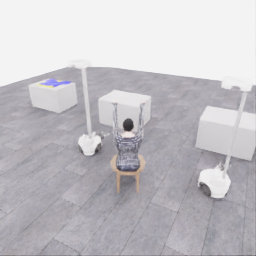
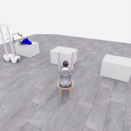
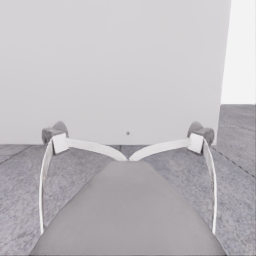
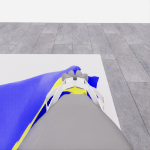
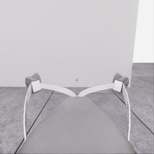
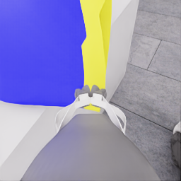
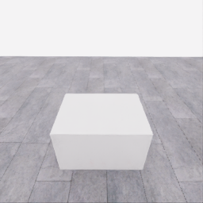
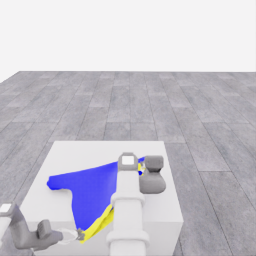
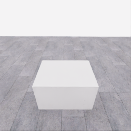
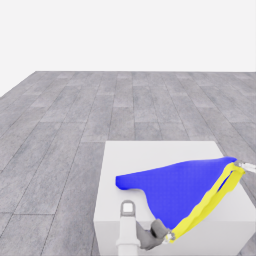

# 자동 시연 수집 시도 · 20261107-astra-opposing563-named-001

[전체 수집 기록](../../README.ko.md) · [구조화 요약](manifest.json) · [전체 행동 기록](decisions.jsonl) · [사용한 기본 프롬프트](prompt.txt)

실행 상태는 **completed**, 원본 출처는 `gpt`입니다. 완료 상태와 과제 성공은 아래에서 따로 기록합니다.

## 실행 조건과 시간

| 항목 | 기록 |
|---|---|
| 기록 시작 UTC | 2026-11-07T05:18:00Z |
| 기록 종료 UTC | 2026-11-07T05:38:26Z |
| 이전 시도 | 20261106-astra-guide470-depth-001 |
| 재시도 사유 | test_opposing_rim_grasp_after_current_grip_entry_comparisons |
| 출처 그룹 | 20261106-coordinated-demo-methods |
| 요청 모델 / 추론 설정 | gpt-6-astra / ultra |
| 전체 실제 경과 시간 (초) | 1225.594 |
| Actor 호출 합계 (초) | 568.194 |
| 환경 요청·응답 합계 (초) | 609.287 |
| 시뮬레이션 시간 (초) | 34.900 |
| 저장 전이 수 | 698.000 |
| 응답 확인 전이 수 | 698.000 |
| 모델 호출 시도 수 | 15.000 |
| 완료한 결정 구간 수 | 14.000 |
| 파일 완료 상태 | true |
| 데이터 정합성 검사 | true |
| 학습 데이터 승인 | unreviewed |
| Actor 호출 방식 | exec |
| 한 호출의 최대 계획 구간 수 | 1.000 |
| 한 계획의 최대 제어 step 수 | 20.000 |
| 제어기 정착 대기 설정 | true |
| 정착 대기 요청 step 수 | 6.000 |
| 완료한 제어기 정착 구간 수 | 7.000 |
| 제어기 정착 전이 수 | 42.000 |
| 제어기 정착 환경 요청·응답 (초) | 37.575 |
| 전이 예산으로 단축한 정착 구간 수 | 0.000 |
| 전이 예산으로 건너뛴 정착 구간 수 | 0.000 |

Actor 호출 시간은 공개 입력 저장·요청 전송·응답 처리 등 호출 경로를 측정합니다. 방식에 따라 Docker/CLI 시작이 호출 안에 들어가거나 상주 서버 준비 시간으로 분리됩니다. 내부 모델 추론 시간만 별도로 측정한 값은 아닙니다. 모델이 판단하는 동안 물리 시간은 멈추며 실제 경과 시간과 시뮬레이션 시간은 다릅니다. 세부 요청 프로세스 시간에도 CLI 처리·네트워크·서버 대기·생성이 함께 포함됩니다.

## 토큰 사용량의 범위

`actor_usage`는 thread별 관측 누계를 합친 값입니다. 결정의 `usage`는 원본 CLI 누계이며, 호출별 증가량은 `usage_accounting.incremental_usage`입니다. 캐시 입력은 입력의 부분집합이고 추론 출력은 출력의 부분집합이므로 열들을 다시 합산하지 않습니다.

전체 호출 사용량 확정: **true** · 기록한 호출 수: 15.

| 입력 | 캐시 입력 | 캐시 쓰기 입력 | 출력 | 추론 출력 |
|---:|---:|---:|---:|---:|
| 1424658 | 1192704 | 0 | 16326 | 13017 |

중복 누계는 추가 사용량 0으로 처리하고, 역행한 누계는 미확정으로 보존합니다. 새 thread는 별도로 집계합니다. 토큰 기록은 화폐 비용이나 청구서가 아닙니다.

## 리뷰 정지 조건

목표 누적 점수 10.000 · 감시 상태 `collector_ended_before_gate` · 수집기 상태 `completed`.

마지막 관측 점수 5.000 · 응답 확인 step 698.

`review_ready`는 정지 조건에 따라 실행을 마치고 리뷰할 준비가 된 상태입니다. 50점·착의 성공이나 학습 데이터 승인을 뜻하지 않습니다. 공식 점수와 success는 아래 평가 결과로 확인합니다.

## 공식 평가 결과

평가 유효성 `true` · 누적 점수 **5.000 / 50** · 착의 success **false** · rate 상태 `no_contact` · 최종 rate 미측정/해당 없음 points/s.

누적 50점, 착의 success, 정상 파일 종료와 데이터 정합성은 서로 다른 상태입니다. 접촉 전 `no_contact`의 rate는 0점/초로 바꾸지 않습니다.

| 단계 | 획득 점수 / 최대 | 획득 시각 (episode 초) |
|---|---:|---:|
| 파지·들기 | 5.000 / 5 | 27.150 |
| 첫 소매 | 0.000 / 5 | 미측정/해당 없음 |
| 반대 어깨 | 0.000 / 5 | 미측정/해당 없음 |
| 두 번째 소매 | 0.000 / 5 | 미측정/해당 없음 |
| 왼쪽 위팔 | 0.000 / 5 | 미측정/해당 없음 |
| 오른쪽 위팔 | 0.000 / 5 | 미측정/해당 없음 |
| 목 통과 | 0.000 / 10 | 미측정/해당 없음 |
| 앞면 방향 | 0.000 / 10 | 미측정/해당 없음 |

## 단계 획득 경로

점수 획득은 [평가 이벤트](score-events.jsonl)에서 같은 physics tick끼리 묶었습니다. 같은 시각에 인정된 항목의 내부 순서는 추정하지 않습니다. 착의 success는 점수 획득과 별도로 기록합니다.

| 순서 | episode 시간 (초) | 전이 경계 step | 누적 점수 변화 | 같은 시각의 항목 변화 |
|---:|---:|---:|---:|---|
| 0 | 27.150 | 543 | 0.000→5.000 | 파지·들기 0.000→5.000 |

평가 clock 0초에 대응하는 공개 simulation clock은 1.525초입니다. 두 시계를 같은 절대 시각으로 혼동하지 않습니다.

별도 success 이벤트 수: **0**. 평가 유효성: `true`.


## 원본 관측 화면

지정된 공개 카메라의 저장 RGB 픽셀입니다. 시작은 첫 `obs`, 종료는 마지막 `next_obs`입니다. 이미지 합성이나 내부 상태 기반 장면 재구성 없이 원본 픽셀로 PNG를 저장했습니다.

| 카메라 | 시작 | 종료 |
|---|---|---|
| `overview` | [](images/initial-overview.png) | [](images/final-overview.png) |
| `robot_0_wrist` | [](images/initial-robot_0_wrist.png) | [](images/final-robot_0_wrist.png) |
| `robot_1_wrist` | [](images/initial-robot_1_wrist.png) | [](images/final-robot_1_wrist.png) |
| `robot_0_head` | [](images/initial-robot_0_head.png) | [](images/final-robot_0_head.png) |
| `robot_1_head` | [](images/initial-robot_1_head.png) | [](images/final-robot_1_head.png) |

시작 관측 시각 1.525초 · 종료 관측 시각 36.425초 (공개 simulation clock).

[▶ overview 관측 영상 보기](overview.mp4)

저장된 20 Hz `obs` 중 698프레임을 순서대로 사용했습니다. 재생은 **1배 느리게** (20.000 fps), 실제 대기 시간·모델 호출 지연은 영상에 들어가지 않습니다. 종료 `next_obs`는 위 PNG에서 확인합니다.

## 결정과 실행 순서

아래 근거는 모델 최종 JSON의 짧은 행동 설명입니다. 시각적 평가는 행동 전 관측에 대한 판단이며, 그 행동의 실행 후 성공 라벨로 사용하지 않습니다. 공식 점수는 별도의 평가 결과입니다.

행동의 각 행은 로봇 0·1 순서이며 열은 `전진, 왼쪽 이동, 반시계 회전, 리프트, 팔 신장, 손목 yaw, pitch, roll, gripper`입니다. 앞 8개는 정규화 속도이고 gripper는 닫기 `+1`, 열기 `-1`, 의도 유지 `0`입니다.

제어기 정착 대기는 앞선 모델 결정에 연결된 별도 중립 행동입니다. 추가 모델 호출이나 모델 결정으로 집계하지 않으며, 실제 전이와 환경 요청·응답 시간은 전체 합계에 포함됩니다. 중립 행동은 두 로봇의 속도와 gripper 명령을 모두 0으로 보내 기존 gripper 의도를 유지합니다. 대기를 실행했다는 기록이 옷의 정착이나 과제 개선을 확인했다는 뜻은 아닙니다.

### 기록된 행동의 재실행 구간

원본 `20261106-astra-guide470-depth-001`의 행동 563전이를 새 환경에서 다시 실행했습니다. 이 구간에는 새 모델 호출이 없고 관측·평가를 새로 기록했습니다. 정확한 물리 상태 복원이나 독립적인 새 시연으로 집계하지 않습니다. 원본 step 대응과 실제 행동은 `decisions.jsonl`의 `replayed_segment`에 있습니다.

### 별도 모델 호출 0 · `initial`

실행 결정 인덱스 0의 고정 관측을 사용했습니다. 호출 경과 31.370초. 같은 call index의 행동 기록과 사용량을 중복 합산하지 않습니다.

공개 입력 저장 0.264초 · 요청 프로세스 31.105초 · 결과 해석 0.000초.

### 결정 0 · 준비 · `act`

입력 관측 29.675초 · Actor 호출 31.370초 · 시각적 판단 `uncertain`.

계획 `20261107-astra-opposing563-named-001:call-00000` · 모델 호출 인덱스 0 · 계획 구간 1/1 · 이 구간에서 모델 호출 `true`.

실행 직전 최신 관측 29.675초.

공개 입력 저장 0.264초 · 요청 프로세스 31.105초 · 결과 해석 0.000초.

호출 사용량 상태 `observed` · 이번 증가량 입력 22118 / 출력 949 토큰.

최종 응답의 행동 설명: Robot 0 is the planned anchor; robot 1 retains its apparent rim support pending one grasp change. Table support remains unclear. Lower both together with existing close intents preserved, then inspect whether the body settles onto the table before releasing either grip.

요청 행동:

```json
[[0, 0, 0, -0.25, 0, 0, 0, 0, 0], [0, 0, 0, -0.25, 0, 0, 0, 0, 0]]
```

실행 구간 step **[563, 571)** · 요청 8 step / 실제 8 step · 환경 요청·응답 6.881초.

실제 적용 행동:

```json
[[0.0, 0.0, 0.0, -0.25, 0.0, 0.0, 0.0, 0.0, 0.0], [0.0, 0.0, 0.0, -0.25, 0.0, 0.0, 0.0, 0.0, 0.0]]
```

### 제어기 정착 대기 · 연결 결정 0

구간 `20261107-astra-opposing563-named-001:settle-00000` · 출처 `controller_settle` · 이 구간에서 모델 호출 `false`.

앞선 모델 호출 인덱스 0에 연결됩니다. 추가 호출은 없습니다.

실행 구간 step **[571, 577)** · 요청 6 step / 실제 6 step · 환경 요청·응답 5.392초.

공개 simulation clock 30.075→30.375초 · 실행 전 관측 30.075초.

실제 적용 중립 행동:

```json
[[0.0, 0.0, 0.0, 0.0, 0.0, 0.0, 0.0, 0.0, 0.0], [0.0, 0.0, 0.0, 0.0, 0.0, 0.0, 0.0, 0.0, 0.0]]
```

### 별도 모델 호출 1 · `initial`

실행 결정 인덱스 1의 고정 관측을 사용했습니다. 호출 경과 23.131초. 같은 call index의 행동 기록과 사용량을 중복 합산하지 않습니다.

공개 입력 저장 0.085초 · 요청 프로세스 23.045초 · 결과 해석 0.000초.

### 결정 1 · 준비 · `act`

입력 관측 30.375초 · Actor 호출 23.131초 · 시각적 판단 `progressing`.

계획 `20261107-astra-opposing563-named-001:call-00001` · 모델 호출 인덱스 1 · 계획 구간 1/1 · 이 구간에서 모델 호출 `true`.

실행 직전 최신 관측 30.375초.

공개 입력 저장 0.085초 · 요청 프로세스 23.045초 · 결과 해석 0.000초.

호출 사용량 상태 `observed` · 이번 증가량 입력 32064 / 출력 616 토큰.

최종 응답의 행동 설명: Robot 0 remains the closed anchor candidate; robot 1 retains its grip. Both grasp points descended about 14 cm with cloth still at their jaws, but broad table support is unclear. Lower together another commanded 12 cm and inspect for the body spreading onto the tabletop.

요청 행동:

```json
[[0, 0, 0, -0.2, 0, 0, 0, 0, 0], [0, 0, 0, -0.2, 0, 0, 0, 0, 0]]
```

실행 구간 step **[577, 585)** · 요청 8 step / 실제 8 step · 환경 요청·응답 7.024초.

실제 적용 행동:

```json
[[0.0, 0.0, 0.0, -0.20000000298023224, 0.0, 0.0, 0.0, 0.0, 0.0], [0.0, 0.0, 0.0, -0.20000000298023224, 0.0, 0.0, 0.0, 0.0, 0.0]]
```

### 제어기 정착 대기 · 연결 결정 1

구간 `20261107-astra-opposing563-named-001:settle-00001` · 출처 `controller_settle` · 이 구간에서 모델 호출 `false`.

앞선 모델 호출 인덱스 1에 연결됩니다. 추가 호출은 없습니다.

실행 구간 step **[585, 591)** · 요청 6 step / 실제 6 step · 환경 요청·응답 5.236초.

공개 simulation clock 30.775→31.075초 · 실행 전 관측 30.775초.

실제 적용 중립 행동:

```json
[[0.0, 0.0, 0.0, 0.0, 0.0, 0.0, 0.0, 0.0, 0.0], [0.0, 0.0, 0.0, 0.0, 0.0, 0.0, 0.0, 0.0, 0.0]]
```

### 별도 모델 호출 2 · `initial`

실행 결정 인덱스 2의 고정 관측을 사용했습니다. 호출 경과 54.280초. 같은 call index의 행동 기록과 사용량을 중복 합산하지 않습니다.

공개 입력 저장 0.088초 · 요청 프로세스 54.191초 · 결과 해석 0.000초.

### 결정 2 · 파지 · `act`

입력 관측 31.075초 · Actor 호출 54.280초 · 시각적 판단 `progressing`.

계획 `20261107-astra-opposing563-named-001:call-00002` · 모델 호출 인덱스 2 · 계획 구간 1/1 · 이 구간에서 모델 호출 `true`.

실행 직전 최신 관측 31.075초.

공개 입력 저장 0.088초 · 요청 프로세스 54.191초 · 결과 해석 0.000초.

호출 사용량 상태 `observed` · 이번 증가량 입력 41765 / 출력 1474 토큰.

최종 응답의 행동 설명: Robot 0 retains the closed anchor; robot 1 begins the sole grasp-change cycle. Both descended another 12.6 cm and the body now appears spread onto the table. Open only robot 1, preserving motion targets, then inspect the separately visible curved rim below its jaw as a candidate opposing boundary.

요청 행동:

```json
[[0, 0, 0, 0, 0, 0, 0, 0, 0], [0, 0, 0, 0, 0, 0, 0, 0, -1]]
```

실행 구간 step **[591, 599)** · 요청 8 step / 실제 8 step · 환경 요청·응답 6.993초.

실제 적용 행동:

```json
[[0.0, 0.0, 0.0, 0.0, 0.0, 0.0, 0.0, 0.0, 0.0], [0.0, 0.0, 0.0, 0.0, 0.0, 0.0, 0.0, 0.0, -1.0]]
```

### 별도 모델 호출 3 · `initial`

실행 결정 인덱스 3의 고정 관측을 사용했습니다. 호출 경과 29.945초. 같은 call index의 행동 기록과 사용량을 중복 합산하지 않습니다.

공개 입력 저장 0.086초 · 요청 프로세스 29.858초 · 결과 해석 0.000초.

### 공개 픽셀 depth 조회 · 결정 3

물리 전이 없이 같은 카메라·시각의 원본 값을 조회했습니다. 무효 값은 null이며 접촉·입구 통과 판단이 아닙니다.

```json
{
  "request": {
    "kind": "depth_query",
    "observation_id": "b1ab9540cad19172d263e9eccea3d1b4ea969f30d63a4e31ac968fb65d44a9b0",
    "camera": "robot_1_head",
    "pixels_uv": [
      [
        180,
        207
      ],
      [
        190,
        199
      ],
      [
        202,
        188
      ],
      [
        182,
        177
      ],
      [
        180,
        220
      ],
      [
        125,
        160
      ]
    ],
    "include_camera_geometry": true
  },
  "response": {
    "kind": "depth_query_result",
    "observation_id": "b1ab9540cad19172d263e9eccea3d1b4ea969f30d63a4e31ac968fb65d44a9b0",
    "camera": "robot_1_head",
    "camera_index": 4,
    "simulation_time_s": 31.47500164154917,
    "intrinsics_sha256": "3dd91a2df5cb0a47b6f5ceb86d60d41e1f5d6753d2a11a034ac0b52bc385cd23",
    "request_sha256": "5777eaed11b683a2f0a556619a92a22434757a0626bc05bc19ef335dc234d8d5",
    "depth_semantics": "optical_Z_metres_not_ray_range",
    "geometry_semantics": "camera_X_right_Y_down_Z_forward",
    "rgb_image_order": [
      "overview",
      "robot_0_wrist",
      "robot_1_wrist",
      "robot_0_head",
      "robot_1_head"
    ],
    "resolution_wh": [
      256,
      256
    ],
    "neighbor_depth_substituted": false,
    "hidden_surfaces_estimated": false,
    "object_pose_or_contact_inferred": false,
    "source_sha256": {
      "observation_json": "cbeb61f13401c097f229ee587ab1223361c7bf4c4afa6ad507ddcc31e1e4223a",
      "public_depth_npz": "9a59b052188cc312e3aa3dde2647a604d75ea35bb15db75e2ade5c1348f44583",
      "overview_rgb": "f11132a13acdeaea36b0d85a31078c00e205a7c13ff9e82d0ffafb0e8639c767",
      "robot_0_wrist_rgb": "bb9fe807c8537380c54b82d12b967aea846b403546351c3abca1029bd15b344d",
      "robot_1_wrist_rgb": "867d108de04d645d2f67b4cb5105c758af61f30e73558f9a169d8c2d0d00a40d",
      "robot_0_head_rgb": "a1276c7927ab9b7e9f2781d9ade5cff599ed3ba630406a875795a79506c7a173",
      "robot_1_head_rgb": "0845bbf13302ad0ec04a58fbc9b9a9565cdd5cfd5a0df3d77fb61ff02ef665ac"
    },
    "results": [
      {
        "pixel_uv": [
          180,
          207
        ],
        "status": "valid",
        "optical_z_m": 0.9237200021743774,
        "camera_xyz_m": [
          0.2627607566665203,
          0.3991942264741367,
          0.9237200021743774
        ],
        "camera_range_m": 1.040027830450358,
        "invalid_reasons": []
      },
      {
        "pixel_uv": [
          190,
          199
        ],
        "status": "valid",
        "optical_z_m": 0.9063453674316406,
        "camera_xyz_m": [
          0.307398837709525,
          0.35202124963510123,
          0.9063453674316406
        ],
        "camera_range_m": 1.0197425805979765,
        "invalid_reasons": []
      },
      {
        "pixel_uv": [
          202,
          188
        ],
        "status": "valid",
        "optical_z_m": 0.8874883055686951,
        "camera_xyz_m": [
          0.35926190719359397,
          0.2912934382650762,
          0.8874883055686951
        ],
        "camera_range_m": 1.0007779362365368,
        "invalid_reasons": []
      },
      {
        "pixel_uv": [
          182,
          177
        ],
        "status": "valid",
        "optical_z_m": 0.9952394366264343,
        "camera_xyz_m": [
          0.2939937844989715,
          0.26677213778610376,
          0.9952394366264343
        ],
        "camera_range_m": 1.0714948693481916,
        "invalid_reasons": []
      },
      {
        "pixel_uv": [
          180,
          220
        ],
        "status": "valid",
        "optical_z_m": 1.0051560401916504,
        "camera_xyz_m": [
          0.28592599604530633,
          0.5058690699263112,
          1.0051560401916504
        ],
        "camera_range_m": 1.161032237388941,
        "invalid_reasons": []
      },
      {
        "pixel_uv": [
          125,
          160
        ],
        "status": "valid",
        "optical_z_m": 0.4849795699119568,
        "camera_xyz_m": [
          -0.007959055095235666,
          0.08489658768251376,
          0.4849795699119568
        ],
        "camera_range_m": 0.4924184809591638,
        "invalid_reasons": []
      }
    ]
  }
}
```

### 별도 모델 호출 4 · `action_after_query`

실행 결정 인덱스 3의 고정 관측을 사용했습니다. 호출 경과 90.732초. 같은 call index의 행동 기록과 사용량을 중복 합산하지 않습니다.

공개 입력 저장 0.087초 · 요청 프로세스 90.645초 · 결과 해석 0.000초.

### 결정 3 · 파지 · `act`

입력 관측 31.475초 · Actor 호출 90.732초 · 시각적 판단 `progressing`.

계획 `20261107-astra-opposing563-named-001:call-00004` · 모델 호출 인덱스 4 · 계획 구간 1/1 · 이 구간에서 모델 호출 `true`.

실행 직전 최신 관측 31.475초.

공개 입력 저장 0.087초 · 요청 프로세스 90.645초 · 결과 해석 0.000초.

호출 사용량 상태 `observed` · 이번 증가량 입력 63272 / 출력 2702 토큰.

최종 응답의 행동 설명: Robot 0 keeps its closed anchor and unchanged targets; robot 1 continues opening. The queried lower rim lies below and inward of robot 1&#x27;s jaws. Make the initial placement approach by lowering, retracting slightly and yawing inward, then inspect alignment before closing.

요청 행동:

```json
[[0, 0, 0, 0, 0, 0, 0, 0, 0], [0, 0, 0, -0.3, -0.04, -0.3, 0, 0, 0]]
```

실행 구간 step **[599, 607)** · 요청 8 step / 실제 8 step · 환경 요청·응답 7.006초.

실제 적용 행동:

```json
[[0.0, 0.0, 0.0, 0.0, 0.0, 0.0, 0.0, 0.0, 0.0], [0.0, 0.0, 0.0, -0.30000001192092896, -0.03999999910593033, -0.30000001192092896, 0.0, 0.0, 0.0]]
```

### 제어기 정착 대기 · 연결 결정 3

구간 `20261107-astra-opposing563-named-001:settle-00003` · 출처 `controller_settle` · 이 구간에서 모델 호출 `false`.

앞선 모델 호출 인덱스 4에 연결됩니다. 추가 호출은 없습니다.

실행 구간 step **[607, 613)** · 요청 6 step / 실제 6 step · 환경 요청·응답 5.418초.

공개 simulation clock 31.875→32.175초 · 실행 전 관측 31.875초.

실제 적용 중립 행동:

```json
[[0.0, 0.0, 0.0, 0.0, 0.0, 0.0, 0.0, 0.0, 0.0], [0.0, 0.0, 0.0, 0.0, 0.0, 0.0, 0.0, 0.0, 0.0]]
```

### 별도 모델 호출 5 · `initial`

실행 결정 인덱스 4의 고정 관측을 사용했습니다. 호출 경과 41.408초. 같은 call index의 행동 기록과 사용량을 중복 합산하지 않습니다.

공개 입력 저장 0.089초 · 요청 프로세스 41.319초 · 결과 해석 0.000초.

### 결정 4 · 파지 · `act`

입력 관측 32.175초 · Actor 호출 41.408초 · 시각적 판단 `progressing`.

계획 `20261107-astra-opposing563-named-001:call-00005` · 모델 호출 인덱스 5 · 계획 구간 1/1 · 이 구간에서 모델 호출 `true`.

실행 직전 최신 관측 32.175초.

공개 입력 저장 0.089초 · 요청 프로세스 41.319초 · 결과 해석 0.000초.

호출 사용량 상태 `observed` · 이번 증가량 입력 75238 / 출력 1196 토큰.

최종 응답의 행동 설명: Robot 0&#x27;s closed anchor moved under 2 mm. Robot 1 approached the visible rim, but remains 14 mm above its lift target and 0.06 rad short of its yaw target, with both still moving. Preserve targets for a short settling observation before correcting placement; the rim remains beyond the open jaws.

요청 행동:

```json
[[0, 0, 0, 0, 0, 0, 0, 0, 0], [0, 0, 0, 0, 0, 0, 0, 0, 0]]
```

실행 구간 step **[613, 619)** · 요청 6 step / 실제 6 step · 환경 요청·응답 5.565초.

실제 적용 행동:

```json
[[0.0, 0.0, 0.0, 0.0, 0.0, 0.0, 0.0, 0.0, 0.0], [0.0, 0.0, 0.0, 0.0, 0.0, 0.0, 0.0, 0.0, 0.0]]
```

### 별도 모델 호출 6 · `initial`

실행 결정 인덱스 5의 고정 관측을 사용했습니다. 호출 경과 67.754초. 같은 call index의 행동 기록과 사용량을 중복 합산하지 않습니다.

공개 입력 저장 0.091초 · 요청 프로세스 67.662초 · 결과 해석 0.000초.

### 결정 5 · 파지 · `act`

입력 관측 32.475초 · Actor 호출 67.754초 · 시각적 판단 `progressing`.

계획 `20261107-astra-opposing563-named-001:call-00006` · 모델 호출 인덱스 6 · 계획 구간 1/1 · 이 구간에서 모델 호출 `true`.

실행 직전 최신 관측 32.475초.

공개 입력 저장 0.091초 · 요청 프로세스 67.662초 · 결과 해석 0.000초.

호출 사용량 상태 `observed` · 이번 증가량 입력 85591 / 출력 2008 토큰.

최종 응답의 행동 설명: Robot 0 remains a closed, nearly stationary anchor; robot 1&#x27;s approach has largely settled. The continuous lower rim remains below and beyond its open jaws. Placement correction 1 lowers and extends slightly while yawing toward the rim&#x27;s free end; inspect whether that boundary comes between the fingers while the body stays table-supported.

요청 행동:

```json
[[0, 0, 0, 0, 0, 0, 0, 0, 0], [0, 0, 0, -0.26, 0.08, -0.11, 0, 0, 0]]
```

실행 구간 step **[619, 627)** · 요청 8 step / 실제 8 step · 환경 요청·응답 7.053초.

실제 적용 행동:

```json
[[0.0, 0.0, 0.0, 0.0, 0.0, 0.0, 0.0, 0.0, 0.0], [0.0, 0.0, 0.0, -0.25999999046325684, 0.07999999821186066, -0.10999999940395355, 0.0, 0.0, 0.0]]
```

### 제어기 정착 대기 · 연결 결정 5

구간 `20261107-astra-opposing563-named-001:settle-00005` · 출처 `controller_settle` · 이 구간에서 모델 호출 `false`.

앞선 모델 호출 인덱스 6에 연결됩니다. 추가 호출은 없습니다.

실행 구간 step **[627, 633)** · 요청 6 step / 실제 6 step · 환경 요청·응답 5.472초.

공개 simulation clock 32.875→33.175초 · 실행 전 관측 32.875초.

실제 적용 중립 행동:

```json
[[0.0, 0.0, 0.0, 0.0, 0.0, 0.0, 0.0, 0.0, 0.0], [0.0, 0.0, 0.0, 0.0, 0.0, 0.0, 0.0, 0.0, 0.0]]
```

### 별도 모델 호출 7 · `initial`

실행 결정 인덱스 6의 고정 관측을 사용했습니다. 호출 경과 30.950초. 같은 call index의 행동 기록과 사용량을 중복 합산하지 않습니다.

공개 입력 저장 0.091초 · 요청 프로세스 30.859초 · 결과 해석 0.000초.

### 결정 6 · 파지 · `act`

입력 관측 33.175초 · Actor 호출 30.950초 · 시각적 판단 `progressing`.

계획 `20261107-astra-opposing563-named-001:call-00007` · 모델 호출 인덱스 7 · 계획 구간 1/1 · 이 구간에서 모델 호출 `true`.

실행 직전 최신 관측 33.175초.

공개 입력 저장 0.091초 · 요청 프로세스 30.859초 · 결과 해석 0.000초.

호출 사용량 상태 `observed` · 이번 증가량 입력 96769 / 출력 871 토큰.

최종 응답의 행동 설명: Robot 0 retains its nearly stationary anchor. Correction 1 brought the selected rim into robot 1&#x27;s central jaw region, but its lift remains 12 mm above target and descending; yaw and extension also continue settling. Preserve the open grip and targets briefly to inspect final placement before the sole reclose.

요청 행동:

```json
[[0, 0, 0, 0, 0, 0, 0, 0, 0], [0, 0, 0, 0, 0, 0, 0, 0, 0]]
```

실행 구간 step **[633, 639)** · 요청 6 step / 실제 6 step · 환경 요청·응답 5.440초.

실제 적용 행동:

```json
[[0.0, 0.0, 0.0, 0.0, 0.0, 0.0, 0.0, 0.0, 0.0], [0.0, 0.0, 0.0, 0.0, 0.0, 0.0, 0.0, 0.0, 0.0]]
```

### 별도 모델 호출 8 · `initial`

실행 결정 인덱스 7의 고정 관측을 사용했습니다. 호출 경과 15.376초. 같은 call index의 행동 기록과 사용량을 중복 합산하지 않습니다.

공개 입력 저장 0.091초 · 요청 프로세스 15.285초 · 결과 해석 0.000초.

### 결정 7 · 파지 · `act`

입력 관측 33.475초 · Actor 호출 15.376초 · 시각적 판단 `progressing`.

계획 `20261107-astra-opposing563-named-001:call-00008` · 모델 호출 인덱스 8 · 계획 구간 1/1 · 이 구간에서 모델 호출 `true`.

실행 직전 최신 관측 33.475초.

공개 입력 저장 0.091초 · 요청 프로세스 15.285초 · 결과 해석 0.000초.

호출 사용량 상태 `observed` · 이번 증가량 입력 106841 / 출력 421 토큰.

최종 응답의 행동 설명: Robot 0 retains the anchor; robot 1 is now near its placement targets, with the selected rim across the closing region and the body still apparently table-supported. Reclose robot 1 once while preserving all motion targets, then inspect finger tracking and cloth position before testing support.

요청 행동:

```json
[[0, 0, 0, 0, 0, 0, 0, 0, 0], [0, 0, 0, 0, 0, 0, 0, 0, 1]]
```

실행 구간 step **[639, 649)** · 요청 10 step / 실제 10 step · 환경 요청·응답 8.564초.

실제 적용 행동:

```json
[[0.0, 0.0, 0.0, 0.0, 0.0, 0.0, 0.0, 0.0, 0.0], [0.0, 0.0, 0.0, 0.0, 0.0, 0.0, 0.0, 0.0, 1.0]]
```

### 별도 모델 호출 9 · `initial`

실행 결정 인덱스 8의 고정 관측을 사용했습니다. 호출 경과 12.423초. 같은 call index의 행동 기록과 사용량을 중복 합산하지 않습니다.

공개 입력 저장 0.091초 · 요청 프로세스 12.332초 · 결과 해석 0.000초.

### 결정 8 · 파지 · `act`

입력 관측 33.975초 · Actor 호출 12.423초 · 시각적 판단 `uncertain`.

계획 `20261107-astra-opposing563-named-001:call-00009` · 모델 호출 인덱스 9 · 계획 구간 1/1 · 이 구간에서 모델 호출 `true`.

실행 직전 최신 관측 33.975초.

공개 입력 저장 0.091초 · 요청 프로세스 12.332초 · 결과 해석 0.000초.

호출 사용량 상태 `observed` · 이번 증가량 입력 116457 / 출력 368 토큰.

최종 응답의 행동 설명: Robot 0 retains the anchor. Robot 1&#x27;s fingers are still closing: approximately 0.21 rad versus the 0.103 rad targets, with substantial inward velocity. Keep the garment near table support and preserve targets for a short observation; the visible rim between the jaws does not yet establish attachment.

요청 행동:

```json
[[0, 0, 0, 0, 0, 0, 0, 0, 0], [0, 0, 0, 0, 0, 0, 0, 0, 0]]
```

실행 구간 step **[649, 657)** · 요청 8 step / 실제 8 step · 환경 요청·응답 6.964초.

실제 적용 행동:

```json
[[0.0, 0.0, 0.0, 0.0, 0.0, 0.0, 0.0, 0.0, 0.0], [0.0, 0.0, 0.0, 0.0, 0.0, 0.0, 0.0, 0.0, 0.0]]
```

### 별도 모델 호출 10 · `initial`

실행 결정 인덱스 9의 고정 관측을 사용했습니다. 호출 경과 18.832초. 같은 call index의 행동 기록과 사용량을 중복 합산하지 않습니다.

공개 입력 저장 0.091초 · 요청 프로세스 18.741초 · 결과 해석 0.000초.

### 결정 9 · 들기 · `act`

입력 관측 34.375초 · Actor 호출 18.832초 · 시각적 판단 `uncertain`.

계획 `20261107-astra-opposing563-named-001:call-00010` · 모델 호출 인덱스 10 · 계획 구간 1/1 · 이 구간에서 모델 호출 `true`.

실행 직전 최신 관측 34.375초.

공개 입력 저장 0.091초 · 요청 프로세스 18.741초 · 결과 해석 0.000초.

호출 사용량 상태 `observed` · 이번 증가량 입력 126009 / 출력 537 토큰.

최종 응답의 행동 설명: Robot 0 retains its nearly stationary anchor. Robot 1&#x27;s fingers are near their close targets, with some closing still progressing. Raise only robot 1&#x27;s lift target about 3 cm near table support; compare measured gripper displacement with local rim following and check that the anchor remains useful.

요청 행동:

```json
[[0, 0, 0, 0, 0, 0, 0, 0, 0], [0, 0, 0, 0.1, 0, 0, 0, 0, 0]]
```

실행 구간 step **[657, 661)** · 요청 4 step / 실제 4 step · 환경 요청·응답 3.768초.

실제 적용 행동:

```json
[[0.0, 0.0, 0.0, 0.0, 0.0, 0.0, 0.0, 0.0, 0.0], [0.0, 0.0, 0.0, 0.10000000149011612, 0.0, 0.0, 0.0, 0.0, 0.0]]
```

### 제어기 정착 대기 · 연결 결정 9

구간 `20261107-astra-opposing563-named-001:settle-00009` · 출처 `controller_settle` · 이 구간에서 모델 호출 `false`.

앞선 모델 호출 인덱스 10에 연결됩니다. 추가 호출은 없습니다.

실행 구간 step **[661, 667)** · 요청 6 step / 실제 6 step · 환경 요청·응답 5.335초.

공개 simulation clock 34.575→34.875초 · 실행 전 관측 34.575초.

실제 적용 중립 행동:

```json
[[0.0, 0.0, 0.0, 0.0, 0.0, 0.0, 0.0, 0.0, 0.0], [0.0, 0.0, 0.0, 0.0, 0.0, 0.0, 0.0, 0.0, 0.0]]
```

### 별도 모델 호출 11 · `initial`

실행 결정 인덱스 10의 고정 관측을 사용했습니다. 호출 경과 35.907초. 같은 call index의 행동 기록과 사용량을 중복 합산하지 않습니다.

공개 입력 저장 0.091초 · 요청 프로세스 35.816초 · 결과 해석 0.000초.

### 결정 10 · 방향 · `act`

입력 관측 34.875초 · Actor 호출 35.907초 · 시각적 판단 `progressing`.

계획 `20261107-astra-opposing563-named-001:call-00011` · 모델 호출 인덱스 11 · 계획 구간 1/1 · 이 구간에서 모델 호출 `true`.

실행 직전 최신 관측 34.875초.

공개 입력 저장 0.091초 · 요청 프로세스 35.816초 · 결과 해석 0.000초.

호출 사용량 상태 `observed` · 이번 증가량 입력 135748 / 출력 1043 토큰.

최종 응답의 행동 설명: Robot 1 rose 2.7 cm with apparent local rim following; robot 0 moved under 1 mm and retained its anchor, supporting provisional bilateral support. The boundary relationship remains unclear. Retract robot 1 about 3 cm with a small roll to test differential boundary movement while keeping the body near table support.

요청 행동:

```json
[[0, 0, 0, 0, 0, 0, 0, 0, 0], [0, 0, 0, 0, -0.1, 0, 0, 0.12, 0]]
```

실행 구간 step **[667, 672)** · 요청 5 step / 실제 5 step · 환경 요청·응답 4.627초.

실제 적용 행동:

```json
[[0.0, 0.0, 0.0, 0.0, 0.0, 0.0, 0.0, 0.0, 0.0], [0.0, 0.0, 0.0, 0.0, -0.10000000149011612, 0.0, 0.0, 0.11999999731779099, 0.0]]
```

### 제어기 정착 대기 · 연결 결정 10

구간 `20261107-astra-opposing563-named-001:settle-00010` · 출처 `controller_settle` · 이 구간에서 모델 호출 `false`.

앞선 모델 호출 인덱스 11에 연결됩니다. 추가 호출은 없습니다.

실행 구간 step **[672, 678)** · 요청 6 step / 실제 6 step · 환경 요청·응답 5.427초.

공개 simulation clock 35.125→35.425초 · 실행 전 관측 35.125초.

실제 적용 중립 행동:

```json
[[0.0, 0.0, 0.0, 0.0, 0.0, 0.0, 0.0, 0.0, 0.0], [0.0, 0.0, 0.0, 0.0, 0.0, 0.0, 0.0, 0.0, 0.0]]
```

### 별도 모델 호출 12 · `initial`

실행 결정 인덱스 11의 고정 관측을 사용했습니다. 호출 경과 75.519초. 같은 call index의 행동 기록과 사용량을 중복 합산하지 않습니다.

공개 입력 저장 0.094초 · 요청 프로세스 75.425초 · 결과 해석 0.000초.

### 결정 11 · 복구 · `act`

입력 관측 35.425초 · Actor 호출 75.519초 · 시각적 판단 `recovering`.

계획 `20261107-astra-opposing563-named-001:call-00012` · 모델 호출 인덱스 12 · 계획 구간 1/1 · 이 구간에서 모델 호출 `true`.

실행 직전 최신 관측 35.425초.

공개 입력 저장 0.094초 · 요청 프로세스 75.425초 · 결과 해석 0.000초.

호출 사용량 상태 `observed` · 이번 증가량 입력 146005 / 출력 2110 토큰.

최종 응답의 행동 설명: Robot 0 retained its nearly stationary anchor; robot 1 retracted 2.7 cm and rolled with apparent rim following, but two controllable boundaries remain unresolved. Change robot 1 to a more downward viewing posture, compensating with lift and extension to keep the held region near table support. Preserve both grips; no further regrasp.

요청 행동:

```json
[[0, 0, 0, 0, 0, 0, 0, 0, 0], [0, 0, 0, 0.12, 0.09, 0, 0.15, 0, 0]]
```

실행 구간 step **[678, 684)** · 요청 6 step / 실제 6 step · 환경 요청·응답 5.318초.

실제 적용 행동:

```json
[[0.0, 0.0, 0.0, 0.0, 0.0, 0.0, 0.0, 0.0, 0.0], [0.0, 0.0, 0.0, 0.11999999731779099, 0.09000000357627869, 0.0, 0.15000000596046448, 0.0, 0.0]]
```

### 제어기 정착 대기 · 연결 결정 11

구간 `20261107-astra-opposing563-named-001:settle-00011` · 출처 `controller_settle` · 이 구간에서 모델 호출 `false`.

앞선 모델 호출 인덱스 12에 연결됩니다. 추가 호출은 없습니다.

실행 구간 step **[684, 690)** · 요청 6 step / 실제 6 step · 환경 요청·응답 5.295초.

공개 simulation clock 35.725→36.025초 · 실행 전 관측 35.725초.

실제 적용 중립 행동:

```json
[[0.0, 0.0, 0.0, 0.0, 0.0, 0.0, 0.0, 0.0, 0.0], [0.0, 0.0, 0.0, 0.0, 0.0, 0.0, 0.0, 0.0, 0.0]]
```

### 별도 모델 호출 13 · `initial`

실행 결정 인덱스 12의 고정 관측을 사용했습니다. 호출 경과 24.089초. 같은 call index의 행동 기록과 사용량을 중복 합산하지 않습니다.

공개 입력 저장 0.091초 · 요청 프로세스 23.997초 · 결과 해석 0.000초.

### 결정 12 · 최종 확인 · `act`

입력 관측 36.025초 · Actor 호출 24.089초 · 시각적 판단 `uncertain`.

계획 `20261107-astra-opposing563-named-001:call-00013` · 모델 호출 인덱스 13 · 계획 구간 1/1 · 이 구간에서 모델 호출 `true`.

실행 직전 최신 관측 36.025초.

공개 입력 저장 0.091초 · 요청 프로세스 23.997초 · 결과 해석 0.000초.

호출 사용량 상태 `observed` · 이번 증가량 입력 157288 / 출력 717 토큰.

최종 응답의 행동 설명: Robot 0 retains the anchor; robot 1 retains apparent local support at roughly unchanged height. The changed view still leaves opposing body-rim boundaries unresolved. Robot 1&#x27;s pitch, lift and extension are approaching their targets, so preserve both grips for one settling observation before judging the grasp-change experiment.

요청 행동:

```json
[[0, 0, 0, 0, 0, 0, 0, 0, 0], [0, 0, 0, 0, 0, 0, 0, 0, 0]]
```

실행 구간 step **[690, 698)** · 요청 8 step / 실제 8 step · 환경 요청·응답 6.867초.

실제 적용 행동:

```json
[[0.0, 0.0, 0.0, 0.0, 0.0, 0.0, 0.0, 0.0, 0.0], [0.0, 0.0, 0.0, 0.0, 0.0, 0.0, 0.0, 0.0, 0.0]]
```

### 별도 모델 호출 14 · `initial`

실행 결정 인덱스 13의 고정 관측을 사용했습니다. 호출 경과 16.479초. 같은 call index의 행동 기록과 사용량을 중복 합산하지 않습니다.

공개 입력 저장 0.090초 · 요청 프로세스 16.388초 · 결과 해석 0.000초.

### 결정 13 · 최종 확인 · `finish_episode`

입력 관측 36.425초 · Actor 호출 16.479초 · 시각적 판단 `blocked`.

계획 `20261107-astra-opposing563-named-001:call-00014` · 모델 호출 인덱스 14 · 계획 구간 1/1 · 이 구간에서 모델 호출 `true`.

실행 직전 최신 관측 36.425초.

공개 입력 저장 0.090초 · 요청 프로세스 16.388초 · 결과 해석 0.000초.

호출 사용량 상태 `observed` · 이번 증가량 입력 167168 / 출력 503 토큰.

최종 응답의 행동 설명: Robot 0 retains the anchor; robot 1&#x27;s single changed grasp showed provisional local following. With posture targets now nearly reached, differential shaping and view recovery still leave opposing body-opening boundaries unresolved. Finish preserving both grips and apparent table support; dressing remains incomplete.

요청 행동:

```json
[[0, 0, 0, 0, 0, 0, 0, 0, 0], [0, 0, 0, 0, 0, 0, 0, 0, 0]]
```

실행 구간 step **[698, 698)** · 요청 0 step / 실제 0 step · 환경 요청·응답 0.009초.

실제 적용 행동:

```json
[[0.0, 0.0, 0.0, 0.0, 0.0, 0.0, 0.0, 0.0, 0.0], [0.0, 0.0, 0.0, 0.0, 0.0, 0.0, 0.0, 0.0, 0.0]]
```

## 검수와 후속 판단

현재 데이터 승인은 `unreviewed`입니다. 형식과 시간 정합성 검사를 통과해도 시연의 유용성이나 착의 성공을 보장하지 않습니다.

이 페이지의 원본 파일 SHA256과 생성 파일 SHA256은 [manifest.json](manifest.json)에 있습니다. 실행 실패도 같은 run ID와 부모 시도 관계로 보존합니다. 공개 범위는 카메라, 최종 행동 응답, 시간, 평가 요약입니다.

[개발 피드백과 변경 근거](../../feedback/2026-11-07.jsonl)
