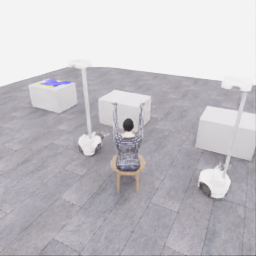
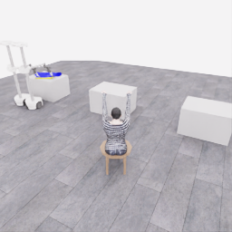
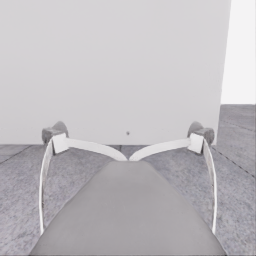
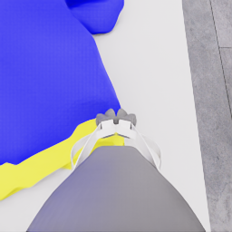
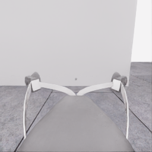
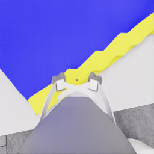
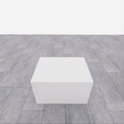
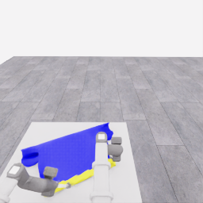
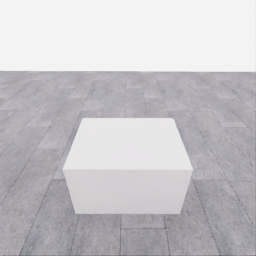
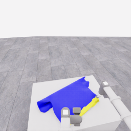

# 자동 시연 수집 시도 · 20261107-astra-overhead470-named-001

[전체 수집 기록](../../README.ko.md) · [구조화 요약](manifest.json) · [전체 행동 기록](decisions.jsonl) · [사용한 기본 프롬프트](prompt.txt)

실행 상태는 **completed**, 원본 출처는 `gpt`입니다. 완료 상태와 과제 성공은 아래에서 따로 기록합니다.

## 실행 조건과 시간

| 항목 | 기록 |
|---|---|
| 기록 시작 UTC | 2026-11-07T01:56:25Z |
| 기록 종료 UTC | 2026-11-07T02:48:54Z |
| 이전 시도 | 20261106-astra-guide470-depth-001 |
| 재시도 사유 | overhead_lowering_after_neckline_preparation_unresolved |
| 출처 그룹 | 20261106-coordinated-demo-methods |
| 요청 모델 / 추론 설정 | gpt-6-astra / ultra |
| 전체 실제 경과 시간 (초) | 3149.109 |
| Actor 호출 합계 (초) | 2160.242 |
| 환경 요청·응답 합계 (초) | 926.844 |
| 시뮬레이션 시간 (초) | 55.550 |
| 저장 전이 수 | 1111.000 |
| 응답 확인 전이 수 | 1111.000 |
| 모델 호출 시도 수 | 44.000 |
| 완료한 결정 구간 수 | 40.000 |
| 파일 완료 상태 | true |
| 데이터 정합성 검사 | true |
| 학습 데이터 승인 | unreviewed |
| Actor 호출 방식 | exec |
| 한 호출의 최대 계획 구간 수 | 1.000 |
| 한 계획의 최대 제어 step 수 | 20.000 |
| 제어기 정착 대기 설정 | true |
| 정착 대기 요청 step 수 | 6.000 |
| 완료한 제어기 정착 구간 수 | 38.000 |
| 제어기 정착 전이 수 | 228.000 |
| 제어기 정착 환경 요청·응답 (초) | 191.723 |
| 전이 예산으로 단축한 정착 구간 수 | 0.000 |
| 전이 예산으로 건너뛴 정착 구간 수 | 0.000 |

Actor 호출 시간은 공개 입력 저장·요청 전송·응답 처리 등 호출 경로를 측정합니다. 방식에 따라 Docker/CLI 시작이 호출 안에 들어가거나 상주 서버 준비 시간으로 분리됩니다. 내부 모델 추론 시간만 별도로 측정한 값은 아닙니다. 모델이 판단하는 동안 물리 시간은 멈추며 실제 경과 시간과 시뮬레이션 시간은 다릅니다. 세부 요청 프로세스 시간에도 CLI 처리·네트워크·서버 대기·생성이 함께 포함됩니다.

## 토큰 사용량의 범위

`actor_usage`는 thread별 관측 누계를 합친 값입니다. 결정의 `usage`는 원본 CLI 누계이며, 호출별 증가량은 `usage_accounting.incremental_usage`입니다. 캐시 입력은 입력의 부분집합이고 추론 출력은 출력의 부분집합이므로 열들을 다시 합산하지 않습니다.

전체 호출 사용량 확정: **true** · 기록한 호출 수: 44.

| 입력 | 캐시 입력 | 캐시 쓰기 입력 | 출력 | 추론 출력 |
|---:|---:|---:|---:|---:|
| 6284187 | 5336960 | 0 | 56878 | 47392 |

중복 누계는 추가 사용량 0으로 처리하고, 역행한 누계는 미확정으로 보존합니다. 새 thread는 별도로 집계합니다. 토큰 기록은 화폐 비용이나 청구서가 아닙니다.

## 리뷰 정지 조건

목표 누적 점수 10.000 · 감시 상태 `collector_ended_before_gate` · 수집기 상태 `completed`.

마지막 관측 점수 5.000 · 응답 확인 step 1110.

`review_ready`는 정지 조건에 따라 실행을 마치고 리뷰할 준비가 된 상태입니다. 50점·착의 성공이나 학습 데이터 승인을 뜻하지 않습니다. 공식 점수와 success는 아래 평가 결과로 확인합니다.

## 공식 평가 결과

평가 유효성 `true` · 누적 점수 **5.000 / 50** · 착의 success **false** · rate 상태 `no_dressing_points` · 최종 rate 0.000 points/s.

누적 50점, 착의 success, 정상 파일 종료와 데이터 정합성은 서로 다른 상태입니다. 접촉 전 `no_contact`의 rate는 0점/초로 바꾸지 않습니다.

| 단계 | 획득 점수 / 최대 | 획득 시각 (episode 초) |
|---|---:|---:|
| 파지·들기 | 5.000 / 5 | 26.900 |
| 첫 소매 | 0.000 / 5 | 미측정/해당 없음 |
| 반대 어깨 | 0.000 / 5 | 미측정/해당 없음 |
| 두 번째 소매 | 0.000 / 5 | 미측정/해당 없음 |
| 왼쪽 위팔 | 0.000 / 5 | 미측정/해당 없음 |
| 오른쪽 위팔 | 0.000 / 5 | 미측정/해당 없음 |
| 목 통과 | 0.000 / 10 | 미측정/해당 없음 |
| 앞면 방향 | 0.000 / 10 | 미측정/해당 없음 |

## 단계 획득 경로

점수 획득은 [평가 이벤트](score-events.jsonl)에서 같은 physics tick끼리 묶었습니다. 같은 시각에 인정된 항목의 내부 순서는 추정하지 않습니다. 착의 success는 점수 획득과 별도로 기록합니다.

| 순서 | episode 시간 (초) | 전이 경계 step | 누적 점수 변화 | 같은 시각의 항목 변화 |
|---:|---:|---:|---:|---|
| 0 | 26.900 | 538 | 0.000→5.000 | 파지·들기 0.000→5.000 |

평가 clock 0초에 대응하는 공개 simulation clock은 1.525초입니다. 두 시계를 같은 절대 시각으로 혼동하지 않습니다.

별도 success 이벤트 수: **0**. 평가 유효성: `true`.


## 원본 관측 화면

지정된 공개 카메라의 저장 RGB 픽셀입니다. 시작은 첫 `obs`, 종료는 마지막 `next_obs`입니다. 이미지 합성이나 내부 상태 기반 장면 재구성 없이 원본 픽셀로 PNG를 저장했습니다.

| 카메라 | 시작 | 종료 |
|---|---|---|
| `overview` | [](images/initial-overview.png) | [](images/final-overview.png) |
| `robot_0_wrist` | [](images/initial-robot_0_wrist.png) | [](images/final-robot_0_wrist.png) |
| `robot_1_wrist` | [](images/initial-robot_1_wrist.png) | [](images/final-robot_1_wrist.png) |
| `robot_0_head` | [](images/initial-robot_0_head.png) | [](images/final-robot_0_head.png) |
| `robot_1_head` | [](images/initial-robot_1_head.png) | [](images/final-robot_1_head.png) |

시작 관측 시각 1.525초 · 종료 관측 시각 57.075초 (공개 simulation clock).

[▶ overview 관측 영상 보기](overview.mp4)

저장된 20 Hz `obs` 중 1111프레임을 순서대로 사용했습니다. 재생은 **1배 느리게** (20.000 fps), 실제 대기 시간·모델 호출 지연은 영상에 들어가지 않습니다. 종료 `next_obs`는 위 PNG에서 확인합니다.

## 결정과 실행 순서

아래 근거는 모델 최종 JSON의 짧은 행동 설명입니다. 시각적 평가는 행동 전 관측에 대한 판단이며, 그 행동의 실행 후 성공 라벨로 사용하지 않습니다. 공식 점수는 별도의 평가 결과입니다.

행동의 각 행은 로봇 0·1 순서이며 열은 `전진, 왼쪽 이동, 반시계 회전, 리프트, 팔 신장, 손목 yaw, pitch, roll, gripper`입니다. 앞 8개는 정규화 속도이고 gripper는 닫기 `+1`, 열기 `-1`, 의도 유지 `0`입니다.

제어기 정착 대기는 앞선 모델 결정에 연결된 별도 중립 행동입니다. 추가 모델 호출이나 모델 결정으로 집계하지 않으며, 실제 전이와 환경 요청·응답 시간은 전체 합계에 포함됩니다. 중립 행동은 두 로봇의 속도와 gripper 명령을 모두 0으로 보내 기존 gripper 의도를 유지합니다. 대기를 실행했다는 기록이 옷의 정착이나 과제 개선을 확인했다는 뜻은 아닙니다.

### 기록된 행동의 재실행 구간

원본 `20261106-astra-guide470-depth-001`의 행동 470전이를 새 환경에서 다시 실행했습니다. 이 구간에는 새 모델 호출이 없고 관측·평가를 새로 기록했습니다. 정확한 물리 상태 복원이나 독립적인 새 시연으로 집계하지 않습니다. 원본 step 대응과 실제 행동은 `decisions.jsonl`의 `replayed_segment`에 있습니다.

### 별도 모델 호출 0 · `initial`

실행 결정 인덱스 0의 고정 관측을 사용했습니다. 호출 경과 30.648초. 같은 call index의 행동 기록과 사용량을 중복 합산하지 않습니다.

공개 입력 저장 0.237초 · 요청 프로세스 30.410초 · 결과 해석 0.000초.

### 결정 0 · 들기 · `act`

입력 관측 25.025초 · Actor 호출 30.648초 · 시각적 판단 `uncertain`.

계획 `20261107-astra-overhead470-named-001:call-00000` · 모델 호출 인덱스 0 · 계획 구간 1/1 · 이 구간에서 모델 호출 `true`.

실행 직전 최신 관측 25.025초.

공개 입력 저장 0.237초 · 요청 프로세스 30.410초 · 결과 해석 0.000초.

호출 사용량 상태 `observed` · 이번 증가량 입력 22444 / 출력 938 토큰.

최종 응답의 행동 설명: Robot 0 is aligned at one near-edge corner and robot 1 at the opposite corner; both closed grips remain unverified. Preserve both grips and test a coordinated 4.6 cm rise above the table, checking next whether local cloth follows each gripper and exposes a plausible body-opening rim.

요청 행동:

```json
[[0, 0, 0, 0.15, 0, 0, 0, 0, 0], [0, 0, 0, 0.15, 0, 0, 0, 0, 0]]
```

실행 구간 step **[470, 474)** · 요청 4 step / 실제 4 step · 환경 요청·응답 3.979초.

실제 적용 행동:

```json
[[0.0, 0.0, 0.0, 0.15000000596046448, 0.0, 0.0, 0.0, 0.0, 0.0], [0.0, 0.0, 0.0, 0.15000000596046448, 0.0, 0.0, 0.0, 0.0, 0.0]]
```

### 제어기 정착 대기 · 연결 결정 0

구간 `20261107-astra-overhead470-named-001:settle-00000` · 출처 `controller_settle` · 이 구간에서 모델 호출 `false`.

앞선 모델 호출 인덱스 0에 연결됩니다. 추가 호출은 없습니다.

실행 구간 step **[474, 480)** · 요청 6 step / 실제 6 step · 환경 요청·응답 5.441초.

공개 simulation clock 25.225→25.525초 · 실행 전 관측 25.225초.

실제 적용 중립 행동:

```json
[[0.0, 0.0, 0.0, 0.0, 0.0, 0.0, 0.0, 0.0, 0.0], [0.0, 0.0, 0.0, 0.0, 0.0, 0.0, 0.0, 0.0, 0.0]]
```

### 별도 모델 호출 1 · `initial`

실행 결정 인덱스 1의 고정 관측을 사용했습니다. 호출 경과 38.707초. 같은 call index의 행동 기록과 사용량을 중복 합산하지 않습니다.

공개 입력 저장 0.085초 · 요청 프로세스 38.622초 · 결과 해석 0.000초.

### 결정 1 · 방향 · `act`

입력 관측 25.525초 · Actor 호출 38.707초 · 시각적 판단 `progressing`.

계획 `20261107-astra-overhead470-named-001:call-00001` · 모델 호출 인덱스 1 · 계획 구간 1/1 · 이 구간에서 모델 호출 `true`.

실행 직전 최신 관측 25.525초.

공개 입력 저장 0.085초 · 요청 프로세스 38.622초 · 결과 해석 0.000초.

호출 사용량 상태 `observed` · 이번 증가량 입력 32655 / 출력 1086 토큰.

최종 응답의 행동 설명: Cloth at robot 0&#x27;s corner and robot 1&#x27;s corner appears to have followed upward, forming local slopes while the far panel remains table-supported. Preserve both apparent supports; briefly raise and tilt them to expose the still-unclear candidate body-opening rim before transport.

요청 행동:

```json
[[0, 0, 0, 0.16, 0, 0, -0.1, 0, 0], [0, 0, 0, 0.16, 0, 0, -0.1, 0, 0]]
```

실행 구간 step **[480, 486)** · 요청 6 step / 실제 6 step · 환경 요청·응답 5.484초.

실제 적용 행동:

```json
[[0.0, 0.0, 0.0, 0.1599999964237213, 0.0, 0.0, -0.10000000149011612, 0.0, 0.0], [0.0, 0.0, 0.0, 0.1599999964237213, 0.0, 0.0, -0.10000000149011612, 0.0, 0.0]]
```

### 제어기 정착 대기 · 연결 결정 1

구간 `20261107-astra-overhead470-named-001:settle-00001` · 출처 `controller_settle` · 이 구간에서 모델 호출 `false`.

앞선 모델 호출 인덱스 1에 연결됩니다. 추가 호출은 없습니다.

실행 구간 step **[486, 492)** · 요청 6 step / 실제 6 step · 환경 요청·응답 5.292초.

공개 simulation clock 25.825→26.125초 · 실행 전 관측 25.825초.

실제 적용 중립 행동:

```json
[[0.0, 0.0, 0.0, 0.0, 0.0, 0.0, 0.0, 0.0, 0.0], [0.0, 0.0, 0.0, 0.0, 0.0, 0.0, 0.0, 0.0, 0.0]]
```

### 별도 모델 호출 2 · `initial`

실행 결정 인덱스 2의 고정 관측을 사용했습니다. 호출 경과 64.753초. 같은 call index의 행동 기록과 사용량을 중복 합산하지 않습니다.

공개 입력 저장 0.090초 · 요청 프로세스 64.662초 · 결과 해석 0.000초.

### 결정 2 · 들기 · `act`

입력 관측 26.125초 · Actor 호출 64.753초 · 시각적 판단 `progressing`.

계획 `20261107-astra-overhead470-named-001:call-00002` · 모델 호출 인덱스 2 · 계획 구간 1/1 · 이 구간에서 모델 호출 `true`.

실행 직전 최신 관측 26.125초.

공개 입력 저장 0.090초 · 요청 프로세스 64.662초 · 결과 해석 0.000초.

호출 사용량 상태 `observed` · 이번 증가량 입력 43022 / 출력 1665 토큰.

최종 응답의 행동 설명: Robot 0 and robot 1 each retain a rising cloth corner; a lower lip now sags separately beneath the supported edge, consistent with a body opening opposite the neckline and sleeves. Lift and tilt together to peel more panel from the table, retracting slightly to limit forward drift and preserving grip separation.

요청 행동:

```json
[[0, 0, 0, 0.25, -0.08, 0, -0.1, 0, 0], [0, 0, 0, 0.25, -0.08, 0, -0.1, 0, 0]]
```

실행 구간 step **[492, 500)** · 요청 8 step / 실제 8 step · 환경 요청·응답 7.046초.

실제 적용 행동:

```json
[[0.0, 0.0, 0.0, 0.25, -0.07999999821186066, 0.0, -0.10000000149011612, 0.0, 0.0], [0.0, 0.0, 0.0, 0.25, -0.07999999821186066, 0.0, -0.10000000149011612, 0.0, 0.0]]
```

### 제어기 정착 대기 · 연결 결정 2

구간 `20261107-astra-overhead470-named-001:settle-00002` · 출처 `controller_settle` · 이 구간에서 모델 호출 `false`.

앞선 모델 호출 인덱스 2에 연결됩니다. 추가 호출은 없습니다.

실행 구간 step **[500, 506)** · 요청 6 step / 실제 6 step · 환경 요청·응답 5.357초.

공개 simulation clock 26.525→26.825초 · 실행 전 관측 26.525초.

실제 적용 중립 행동:

```json
[[0.0, 0.0, 0.0, 0.0, 0.0, 0.0, 0.0, 0.0, 0.0], [0.0, 0.0, 0.0, 0.0, 0.0, 0.0, 0.0, 0.0, 0.0]]
```

### 별도 모델 호출 3 · `initial`

실행 결정 인덱스 3의 고정 관측을 사용했습니다. 호출 경과 31.859초. 같은 call index의 행동 기록과 사용량을 중복 합산하지 않습니다.

공개 입력 저장 0.096초 · 요청 프로세스 31.763초 · 결과 해석 0.000초.

### 결정 3 · 들기 · `act`

입력 관측 26.825초 · Actor 호출 31.859초 · 시각적 판단 `progressing`.

계획 `20261107-astra-overhead470-named-001:call-00003` · 모델 호출 인덱스 3 · 계획 구간 1/1 · 이 구간에서 모델 호출 `true`.

실행 직전 최신 관측 26.825초.

공개 입력 저장 0.096초 · 요청 프로세스 31.763초 · 결과 해석 0.000초.

호출 사용량 상태 `observed` · 이번 증가량 입력 53944 / 출력 705 토큰.

최종 응답의 행동 설명: Robot 0 and robot 1 retain their respective corners, and the near opening now forms a broader separated loop. The neckline panel remains near the tabletop. Raise both supports and level the wrists, compensating with slight retraction, to free the trailing panel before moving the bases.

요청 행동:

```json
[[0, 0, 0, 0.2, -0.1, 0, -0.15, 0, 0], [0, 0, 0, 0.2, -0.1, 0, -0.15, 0, 0]]
```

실행 구간 step **[506, 516)** · 요청 10 step / 실제 10 step · 환경 요청·응답 8.559초.

실제 적용 행동:

```json
[[0.0, 0.0, 0.0, 0.20000000298023224, -0.10000000149011612, 0.0, -0.15000000596046448, 0.0, 0.0], [0.0, 0.0, 0.0, 0.20000000298023224, -0.10000000149011612, 0.0, -0.15000000596046448, 0.0, 0.0]]
```

### 제어기 정착 대기 · 연결 결정 3

구간 `20261107-astra-overhead470-named-001:settle-00003` · 출처 `controller_settle` · 이 구간에서 모델 호출 `false`.

앞선 모델 호출 인덱스 3에 연결됩니다. 추가 호출은 없습니다.

실행 구간 step **[516, 522)** · 요청 6 step / 실제 6 step · 환경 요청·응답 5.351초.

공개 simulation clock 27.325→27.625초 · 실행 전 관측 27.325초.

실제 적용 중립 행동:

```json
[[0.0, 0.0, 0.0, 0.0, 0.0, 0.0, 0.0, 0.0, 0.0], [0.0, 0.0, 0.0, 0.0, 0.0, 0.0, 0.0, 0.0, 0.0]]
```

### 별도 모델 호출 4 · `initial`

실행 결정 인덱스 4의 고정 관측을 사용했습니다. 호출 경과 38.952초. 같은 call index의 행동 기록과 사용량을 중복 합산하지 않습니다.

공개 입력 저장 0.082초 · 요청 프로세스 38.870초 · 결과 해석 0.000초.

### 공개 픽셀 depth 조회 · 결정 4

물리 전이 없이 같은 카메라·시각의 원본 값을 조회했습니다. 무효 값은 null이며 접촉·입구 통과 판단이 아닙니다.

```json
{
  "request": {
    "kind": "depth_query",
    "observation_id": "5e47247a8dbf684eed2e4b9c3e4c482e0bde0345f813a79d9369b8cb585492fb",
    "camera": "overview",
    "pixels_uv": [
      [
        128,
        124
      ],
      [
        115,
        104
      ],
      [
        142,
        105
      ],
      [
        49,
        74
      ],
      [
        79,
        132
      ],
      [
        90,
        163
      ]
    ],
    "include_camera_geometry": true
  },
  "response": {
    "kind": "depth_query_result",
    "observation_id": "5e47247a8dbf684eed2e4b9c3e4c482e0bde0345f813a79d9369b8cb585492fb",
    "camera": "overview",
    "camera_index": 0,
    "simulation_time_s": 27.625001440756023,
    "intrinsics_sha256": "f3d52d66f85f9c6dcdb0c49e6817831ad3a4a9d36c828d4bdcc073931e194ee9",
    "request_sha256": "f237cd620f080610a6b3e34346cd5ef897fd43c73d828ad9b0b584ea9a324597",
    "depth_semantics": "optical_Z_metres_not_ray_range",
    "geometry_semantics": "camera_X_right_Y_down_Z_forward",
    "rgb_image_order": [
      "overview",
      "robot_0_wrist",
      "robot_1_wrist",
      "robot_0_head",
      "robot_1_head"
    ],
    "resolution_wh": [
      256,
      256
    ],
    "neighbor_depth_substituted": false,
    "hidden_surfaces_estimated": false,
    "object_pose_or_contact_inferred": false,
    "source_sha256": {
      "observation_json": "2cbc4c320e34da4538e0f90de8fc4c7ee4ba3177c54a6c4fd5fbbdc45b6613b9",
      "public_depth_npz": "8d48a5f6ff2794f47f5404f5a7bbf577ef78e492c43ed4c9bd30f2b74cf89319",
      "overview_rgb": "52586093ca26c3e0bfb68b11b2d2000bbd6dc16c2476b267ac7939aaffb78269",
      "robot_0_wrist_rgb": "8e7085431db77948705a021e096b8b6fcc4153ddd306ee7f4e59afc6575174a8",
      "robot_1_wrist_rgb": "14b35020b5d8dc7a9db19eae658023832056aaae1ebfcbd6b55304051a912450",
      "robot_0_head_rgb": "de1137a5d7c23799fd4d3ff94c9d936f92e8836c83c523df1676f0e25025e50a",
      "robot_1_head_rgb": "8b316d84982b322d3fecbf48d03852843cc2086937e03bb222108cb14e7d046a"
    },
    "results": [
      {
        "pixel_uv": [
          128,
          124
        ],
        "status": "valid",
        "optical_z_m": 2.548171281814575,
        "camera_xyz_m": [
          0.0,
          -0.04597460548427871,
          2.548171281814575
        ],
        "camera_range_m": 2.548585989487891,
        "invalid_reasons": []
      },
      {
        "pixel_uv": [
          115,
          104
        ],
        "status": "valid",
        "optical_z_m": 2.99168062210083,
        "camera_xyz_m": [
          -0.17542358564446026,
          -0.323858927343619,
          2.99168062210083
        ],
        "camera_range_m": 3.0142679018086844,
        "invalid_reasons": []
      },
      {
        "pixel_uv": [
          142,
          105
        ],
        "status": "valid",
        "optical_z_m": 2.9827966690063477,
        "camera_xyz_m": [
          0.18835670653939274,
          -0.3094431607432881,
          2.9827966690063477
        ],
        "camera_range_m": 3.0047145101098254,
        "invalid_reasons": []
      },
      {
        "pixel_uv": [
          49,
          74
        ],
        "status": "valid",
        "optical_z_m": 5.569840431213379,
        "camera_xyz_m": [
          -1.9847200071253133,
          -1.3566440555033787,
          5.569840431213379
        ],
        "camera_range_m": 6.066524460446475,
        "invalid_reasons": []
      },
      {
        "pixel_uv": [
          79,
          132
        ],
        "status": "valid",
        "optical_z_m": 4.615072250366211,
        "camera_xyz_m": [
          -1.0200089617019272,
          0.08326603768995323,
          4.615072250366211
        ],
        "camera_range_m": 4.727181336810031,
        "invalid_reasons": []
      },
      {
        "pixel_uv": [
          90,
          163
        ],
        "status": "valid",
        "optical_z_m": 3.6825928688049316,
        "camera_xyz_m": [
          -0.6311995890357209,
          0.581368042532901,
          3.6825928688049316
        ],
        "camera_range_m": 3.781255341741726,
        "invalid_reasons": []
      }
    ]
  }
}
```

### 별도 모델 호출 5 · `action_after_query`

실행 결정 인덱스 4의 고정 관측을 사용했습니다. 호출 경과 67.997초. 같은 call index의 행동 기록과 사용량을 중복 합산하지 않습니다.

공개 입력 저장 0.082초 · 요청 프로세스 67.915초 · 결과 해석 0.000초.

### 결정 4 · 운반 · `act`

입력 관측 27.625초 · Actor 호출 67.997초 · 시각적 판단 `progressing`.

계획 `20261107-astra-overhead470-named-001:call-00005` · 모델 호출 인덱스 5 · 계획 구간 1/1 · 이 구간에서 모델 호출 `true`.

실행 직전 최신 관측 27.625초.

공개 입력 저장 0.082초 · 요청 프로세스 67.915초 · 결과 해석 0.000초.

호출 사용량 상태 `observed` · 이번 증가량 입력 74280 / 출력 2024 토큰.

최종 응답의 행동 설명: Robot 0 and robot 1 visibly retain separated rim supports, with the panels apparently clear of the tabletop. Translate both backward and right into the visible aisle, preserving spacing and posture; check that the garment clears the table and moves toward the mannequin.

요청 행동:

```json
[[-0.25, -0.5, 0, 0, 0, 0, 0, 0, 0], [-0.25, -0.5, 0, 0, 0, 0, 0, 0, 0]]
```

실행 구간 step **[522, 542)** · 요청 20 step / 실제 20 step · 환경 요청·응답 16.422초.

실제 적용 행동:

```json
[[-0.25, -0.5, 0.0, 0.0, 0.0, 0.0, 0.0, 0.0, 0.0], [-0.25, -0.5, 0.0, 0.0, 0.0, 0.0, 0.0, 0.0, 0.0]]
```

### 제어기 정착 대기 · 연결 결정 4

구간 `20261107-astra-overhead470-named-001:settle-00004` · 출처 `controller_settle` · 이 구간에서 모델 호출 `false`.

앞선 모델 호출 인덱스 5에 연결됩니다. 추가 호출은 없습니다.

실행 구간 step **[542, 548)** · 요청 6 step / 실제 6 step · 환경 요청·응답 5.581초.

공개 simulation clock 28.625→28.925초 · 실행 전 관측 28.625초.

실제 적용 중립 행동:

```json
[[0.0, 0.0, 0.0, 0.0, 0.0, 0.0, 0.0, 0.0, 0.0], [0.0, 0.0, 0.0, 0.0, 0.0, 0.0, 0.0, 0.0, 0.0]]
```

### 별도 모델 호출 6 · `initial`

실행 결정 인덱스 5의 고정 관측을 사용했습니다. 호출 경과 38.651초. 같은 call index의 행동 기록과 사용량을 중복 합산하지 않습니다.

공개 입력 저장 0.079초 · 요청 프로세스 38.573초 · 결과 해석 0.000초.

### 결정 5 · 운반 · `act`

입력 관측 28.925초 · Actor 호출 38.651초 · 시각적 판단 `progressing`.

계획 `20261107-astra-overhead470-named-001:call-00006` · 모델 호출 인덱스 6 · 계획 구간 1/1 · 이 구간에서 모델 호출 `true`.

실행 직전 최신 관측 28.925초.

공개 입력 저장 0.079초 · 요청 프로세스 38.573초 · 결과 해석 0.000초.

호출 사용량 상태 `observed` · 이번 증가량 입력 85073 / 출력 1082 토큰.

최종 응답의 행동 설명: Robot 0 and robot 1 each retain their corner as the table recedes beneath the suspended panels. The opening remains spread between them. Continue together along the visible aisle toward the mannequin, maintaining the same separation and wrist posture.

요청 행동:

```json
[[-0.45, -0.9, 0, 0, 0, 0, 0, 0, 0], [-0.45, -0.9, 0, 0, 0, 0, 0, 0, 0]]
```

실행 구간 step **[548, 568)** · 요청 20 step / 실제 20 step · 환경 요청·응답 16.991초.

실제 적용 행동:

```json
[[-0.44999998807907104, -0.8999999761581421, 0.0, 0.0, 0.0, 0.0, 0.0, 0.0, 0.0], [-0.44999998807907104, -0.8999999761581421, 0.0, 0.0, 0.0, 0.0, 0.0, 0.0, 0.0]]
```

### 제어기 정착 대기 · 연결 결정 5

구간 `20261107-astra-overhead470-named-001:settle-00005` · 출처 `controller_settle` · 이 구간에서 모델 호출 `false`.

앞선 모델 호출 인덱스 6에 연결됩니다. 추가 호출은 없습니다.

실행 구간 step **[568, 574)** · 요청 6 step / 실제 6 step · 환경 요청·응답 5.326초.

공개 simulation clock 29.925→30.225초 · 실행 전 관측 29.925초.

실제 적용 중립 행동:

```json
[[0.0, 0.0, 0.0, 0.0, 0.0, 0.0, 0.0, 0.0, 0.0], [0.0, 0.0, 0.0, 0.0, 0.0, 0.0, 0.0, 0.0, 0.0]]
```

### 별도 모델 호출 7 · `initial`

실행 결정 인덱스 6의 고정 관측을 사용했습니다. 호출 경과 19.663초. 같은 call index의 행동 기록과 사용량을 중복 합산하지 않습니다.

공개 입력 저장 0.069초 · 요청 프로세스 19.594초 · 결과 해석 0.000초.

### 결정 6 · 운반 · `act`

입력 관측 30.225초 · Actor 호출 19.663초 · 시각적 판단 `progressing`.

계획 `20261107-astra-overhead470-named-001:call-00007` · 모델 호출 인덱스 7 · 계획 구간 1/1 · 이 구간에서 모델 호출 `true`.

실행 직전 최신 관측 30.225초.

공개 입력 저장 0.069초 · 요청 프로세스 19.594초 · 결과 해석 0.000초.

호출 사용량 상태 `observed` · 이번 증가량 입력 94818 / 출력 531 토큰.

최종 응답의 행동 설명: Robot 0 and robot 1 retain stable corner supports, and the suspended garment has moved farther from the source table toward the mannequin. Continue the coordinated diagonal translation through the visible aisle while preserving opening width and height.

요청 행동:

```json
[[-0.45, -0.9, 0, 0, 0, 0, 0, 0, 0], [-0.45, -0.9, 0, 0, 0, 0, 0, 0, 0]]
```

실행 구간 step **[574, 594)** · 요청 20 step / 실제 20 step · 환경 요청·응답 16.447초.

실제 적용 행동:

```json
[[-0.44999998807907104, -0.8999999761581421, 0.0, 0.0, 0.0, 0.0, 0.0, 0.0, 0.0], [-0.44999998807907104, -0.8999999761581421, 0.0, 0.0, 0.0, 0.0, 0.0, 0.0, 0.0]]
```

### 제어기 정착 대기 · 연결 결정 6

구간 `20261107-astra-overhead470-named-001:settle-00006` · 출처 `controller_settle` · 이 구간에서 모델 호출 `false`.

앞선 모델 호출 인덱스 7에 연결됩니다. 추가 호출은 없습니다.

실행 구간 step **[594, 600)** · 요청 6 step / 실제 6 step · 환경 요청·응답 5.313초.

공개 simulation clock 31.225→31.525초 · 실행 전 관측 31.225초.

실제 적용 중립 행동:

```json
[[0.0, 0.0, 0.0, 0.0, 0.0, 0.0, 0.0, 0.0, 0.0], [0.0, 0.0, 0.0, 0.0, 0.0, 0.0, 0.0, 0.0, 0.0]]
```

### 별도 모델 호출 8 · `initial`

실행 결정 인덱스 7의 고정 관측을 사용했습니다. 호출 경과 37.248초. 같은 call index의 행동 기록과 사용량을 중복 합산하지 않습니다.

공개 입력 저장 0.075초 · 요청 프로세스 37.173초 · 결과 해석 0.000초.

### 결정 7 · 운반 · `act`

입력 관측 31.525초 · Actor 호출 37.248초 · 시각적 판단 `progressing`.

계획 `20261107-astra-overhead470-named-001:call-00008` · 모델 호출 인덱스 8 · 계획 구간 1/1 · 이 구간에서 모델 호출 `true`.

실행 직전 최신 관측 31.525초.

공개 입력 저장 0.075초 · 요청 프로세스 37.173초 · 결과 해석 0.000초.

호출 사용량 상태 `observed` · 이번 증가량 입력 104011 / 출력 1079 토큰.

최종 응답의 행동 설명: Robot 0 and robot 1 retain the spread rim, with the garment still lateral to the mannequin. Continue coordinated transport and add a modest rise to build clearance for the sagging lower lip before aligning it over the raised arms; verify actual clearance next.

요청 행동:

```json
[[-0.45, -0.9, 0, 0.1, 0, 0, 0, 0, 0], [-0.45, -0.9, 0, 0.1, 0, 0, 0, 0, 0]]
```

실행 구간 step **[600, 620)** · 요청 20 step / 실제 20 step · 환경 요청·응답 16.200초.

실제 적용 행동:

```json
[[-0.44999998807907104, -0.8999999761581421, 0.0, 0.10000000149011612, 0.0, 0.0, 0.0, 0.0, 0.0], [-0.44999998807907104, -0.8999999761581421, 0.0, 0.10000000149011612, 0.0, 0.0, 0.0, 0.0, 0.0]]
```

### 제어기 정착 대기 · 연결 결정 7

구간 `20261107-astra-overhead470-named-001:settle-00007` · 출처 `controller_settle` · 이 구간에서 모델 호출 `false`.

앞선 모델 호출 인덱스 8에 연결됩니다. 추가 호출은 없습니다.

실행 구간 step **[620, 626)** · 요청 6 step / 실제 6 step · 환경 요청·응답 5.457초.

공개 simulation clock 32.525→32.825초 · 실행 전 관측 32.525초.

실제 적용 중립 행동:

```json
[[0.0, 0.0, 0.0, 0.0, 0.0, 0.0, 0.0, 0.0, 0.0], [0.0, 0.0, 0.0, 0.0, 0.0, 0.0, 0.0, 0.0, 0.0]]
```

### 별도 모델 호출 9 · `initial`

실행 결정 인덱스 8의 고정 관측을 사용했습니다. 호출 경과 56.572초. 같은 call index의 행동 기록과 사용량을 중복 합산하지 않습니다.

공개 입력 저장 0.071초 · 요청 프로세스 56.500초 · 결과 해석 0.000초.

### 결정 8 · 접근 · `act`

입력 관측 32.825초 · Actor 호출 56.572초 · 시각적 판단 `progressing`.

계획 `20261107-astra-overhead470-named-001:call-00009` · 모델 호출 인덱스 9 · 계획 구간 1/1 · 이 구간에서 모델 호출 `true`.

실행 직전 최신 관측 32.825초.

공개 입력 저장 0.071초 · 요청 프로세스 56.500초 · 결과 해석 0.000초.

호출 사용량 상태 `observed` · 이번 증가량 입력 113703 / 출력 1744 토큰.

최종 응답의 행동 설명: Robot 0 and robot 1 retain both rim corners. Their lift targets have capped at 1.20 m, so use upward wrist tilt during a shorter diagonal approach to gain rim clearance. The opening remains lateral to the raised arms; entry is not yet visible.

요청 행동:

```json
[[-0.4, -0.65, 0, 0, 0, 0, -0.15, 0, 0], [-0.4, -0.65, 0, 0, 0, 0, -0.15, 0, 0]]
```

실행 구간 step **[626, 638)** · 요청 12 step / 실제 12 step · 환경 요청·응답 10.261초.

실제 적용 행동:

```json
[[-0.4000000059604645, -0.6499999761581421, 0.0, 0.0, 0.0, 0.0, -0.15000000596046448, 0.0, 0.0], [-0.4000000059604645, -0.6499999761581421, 0.0, 0.0, 0.0, 0.0, -0.15000000596046448, 0.0, 0.0]]
```

### 제어기 정착 대기 · 연결 결정 8

구간 `20261107-astra-overhead470-named-001:settle-00008` · 출처 `controller_settle` · 이 구간에서 모델 호출 `false`.

앞선 모델 호출 인덱스 9에 연결됩니다. 추가 호출은 없습니다.

실행 구간 step **[638, 644)** · 요청 6 step / 실제 6 step · 환경 요청·응답 5.395초.

공개 simulation clock 33.425→33.725초 · 실행 전 관측 33.425초.

실제 적용 중립 행동:

```json
[[0.0, 0.0, 0.0, 0.0, 0.0, 0.0, 0.0, 0.0, 0.0], [0.0, 0.0, 0.0, 0.0, 0.0, 0.0, 0.0, 0.0, 0.0]]
```

### 별도 모델 호출 10 · `initial`

실행 결정 인덱스 9의 고정 관측을 사용했습니다. 호출 경과 50.957초. 같은 call index의 행동 기록과 사용량을 중복 합산하지 않습니다.

공개 입력 저장 0.066초 · 요청 프로세스 50.891초 · 결과 해석 0.000초.

### 결정 9 · 접근 · `act`

입력 관측 33.725초 · Actor 호출 50.957초 · 시각적 판단 `progressing`.

계획 `20261107-astra-overhead470-named-001:call-00010` · 모델 호출 인덱스 10 · 계획 구간 1/1 · 이 구간에서 모델 호출 `true`.

실행 직전 최신 관측 33.725초.

공개 입력 저장 0.066초 · 요청 프로세스 50.891초 · 결과 해석 0.000초.

호출 사용량 상태 `observed` · 이번 증가량 입력 123973 / 출력 1467 토큰.

최종 응답의 행동 설명: Both corners followed the wrist tilt. Robot 0&#x27;s head view now shows a raised hand below and right of the opening; robot 1 retains the farther corner. The opening remains offset. Shift both robots right and backward toward overhead alignment while holding the current support posture.

요청 행동:

```json
[[-0.4, -0.55, 0, 0, 0, 0, 0, 0, 0], [-0.4, -0.55, 0, 0, 0, 0, 0, 0, 0]]
```

실행 구간 step **[644, 652)** · 요청 8 step / 실제 8 step · 환경 요청·응답 6.875초.

실제 적용 행동:

```json
[[-0.4000000059604645, -0.550000011920929, 0.0, 0.0, 0.0, 0.0, 0.0, 0.0, 0.0], [-0.4000000059604645, -0.550000011920929, 0.0, 0.0, 0.0, 0.0, 0.0, 0.0, 0.0]]
```

### 제어기 정착 대기 · 연결 결정 9

구간 `20261107-astra-overhead470-named-001:settle-00009` · 출처 `controller_settle` · 이 구간에서 모델 호출 `false`.

앞선 모델 호출 인덱스 10에 연결됩니다. 추가 호출은 없습니다.

실행 구간 step **[652, 658)** · 요청 6 step / 실제 6 step · 환경 요청·응답 5.517초.

공개 simulation clock 34.125→34.425초 · 실행 전 관측 34.125초.

실제 적용 중립 행동:

```json
[[0.0, 0.0, 0.0, 0.0, 0.0, 0.0, 0.0, 0.0, 0.0], [0.0, 0.0, 0.0, 0.0, 0.0, 0.0, 0.0, 0.0, 0.0]]
```

### 별도 모델 호출 11 · `initial`

실행 결정 인덱스 10의 고정 관측을 사용했습니다. 호출 경과 50.815초. 같은 call index의 행동 기록과 사용량을 중복 합산하지 않습니다.

공개 입력 저장 0.071초 · 요청 프로세스 50.743초 · 결과 해석 0.000초.

### 결정 10 · 접근 · `act`

입력 관측 34.425초 · Actor 호출 50.815초 · 시각적 판단 `progressing`.

계획 `20261107-astra-overhead470-named-001:call-00011` · 모델 호출 인덱스 11 · 계획 구간 1/1 · 이 구간에서 모델 호출 `true`.

실행 직전 최신 관측 34.425초.

공개 입력 저장 0.071초 · 요청 프로세스 50.743초 · 결과 해석 0.000초.

호출 사용량 상태 `observed` · 이번 증가량 입력 133940 / 출력 1425 토큰.

최종 응답의 행동 설명: The visible hand has moved nearer beneath robot 0&#x27;s supported corner; robot 1 still supports the farther side. Both grips remain visually stable. Shift together right and backward to bring the opening over the hand span while increasing base clearance behind the chair; retain height.

요청 행동:

```json
[[-0.55, -0.55, 0, 0, 0, 0, 0, 0, 0], [-0.55, -0.55, 0, 0, 0, 0, 0, 0, 0]]
```

실행 구간 step **[658, 668)** · 요청 10 step / 실제 10 step · 환경 요청·응답 8.395초.

실제 적용 행동:

```json
[[-0.550000011920929, -0.550000011920929, 0.0, 0.0, 0.0, 0.0, 0.0, 0.0, 0.0], [-0.550000011920929, -0.550000011920929, 0.0, 0.0, 0.0, 0.0, 0.0, 0.0, 0.0]]
```

### 제어기 정착 대기 · 연결 결정 10

구간 `20261107-astra-overhead470-named-001:settle-00010` · 출처 `controller_settle` · 이 구간에서 모델 호출 `false`.

앞선 모델 호출 인덱스 11에 연결됩니다. 추가 호출은 없습니다.

실행 구간 step **[668, 674)** · 요청 6 step / 실제 6 step · 환경 요청·응답 5.530초.

공개 simulation clock 34.925→35.225초 · 실행 전 관측 34.925초.

실제 적용 중립 행동:

```json
[[0.0, 0.0, 0.0, 0.0, 0.0, 0.0, 0.0, 0.0, 0.0], [0.0, 0.0, 0.0, 0.0, 0.0, 0.0, 0.0, 0.0, 0.0]]
```

### 별도 모델 호출 12 · `initial`

실행 결정 인덱스 11의 고정 관측을 사용했습니다. 호출 경과 73.191초. 같은 call index의 행동 기록과 사용량을 중복 합산하지 않습니다.

공개 입력 저장 0.068초 · 요청 프로세스 73.123초 · 결과 해석 0.000초.

### 공개 픽셀 depth 조회 · 결정 11

물리 전이 없이 같은 카메라·시각의 원본 값을 조회했습니다. 무효 값은 null이며 접촉·입구 통과 판단이 아닙니다.

```json
{
  "request": {
    "kind": "depth_query",
    "observation_id": "8e18097f0d68317eb49e09f2a41e16189b07c92da8da9460d05e243bc9c76404",
    "camera": "robot_0_head",
    "pixels_uv": [
      [
        203,
        117
      ],
      [
        211,
        131
      ],
      [
        55,
        64
      ],
      [
        56,
        98
      ],
      [
        57,
        120
      ],
      [
        101,
        76
      ],
      [
        35,
        81
      ]
    ],
    "include_camera_geometry": true
  },
  "response": {
    "kind": "depth_query_result",
    "observation_id": "8e18097f0d68317eb49e09f2a41e16189b07c92da8da9460d05e243bc9c76404",
    "camera": "robot_0_head",
    "camera_index": 3,
    "simulation_time_s": 35.22500183712691,
    "intrinsics_sha256": "3dd91a2df5cb0a47b6f5ceb86d60d41e1f5d6753d2a11a034ac0b52bc385cd23",
    "request_sha256": "9cbfc272c7936821ac0ae75e7bcbf7be5fc03f5b66e47c7e186e8f20aa75fe19",
    "depth_semantics": "optical_Z_metres_not_ray_range",
    "geometry_semantics": "camera_X_right_Y_down_Z_forward",
    "rgb_image_order": [
      "overview",
      "robot_0_wrist",
      "robot_1_wrist",
      "robot_0_head",
      "robot_1_head"
    ],
    "resolution_wh": [
      256,
      256
    ],
    "neighbor_depth_substituted": false,
    "hidden_surfaces_estimated": false,
    "object_pose_or_contact_inferred": false,
    "source_sha256": {
      "observation_json": "c2acc5d5ff5ab737e5e7bb3c1b751c255339510dccee2652c3354baba1897910",
      "public_depth_npz": "053d29238663c2ab957b02ce109eab8667750d011fc9d67a4b877896389b11b9",
      "overview_rgb": "7df390f7305a40e60af8aacec0b923b193531a02235bf736b12fb9188653a77c",
      "robot_0_wrist_rgb": "0e39864c66e093bda5ffc12d892432945720b990c5b6ab6736897a6073fa2be8",
      "robot_1_wrist_rgb": "ac9dbfd37a43ec9169e7244368492c6b839fdaafc28773ef784028bc2e6f49d0",
      "robot_0_head_rgb": "7e8fbc7a4a82e2477991ac575dacd766877c0532a5de521ce1e95d80966f5929",
      "robot_1_head_rgb": "22ea3ef5c8797fc43a960391f0748d8e7f7f66cafb76f43c85af2e99ee5271f2"
    },
    "results": [
      {
        "pixel_uv": [
          203,
          117
        ],
        "status": "valid",
        "optical_z_m": 0.8201396465301514,
        "camera_xyz_m": [
          0.33648513450296413,
          -0.04935115306043474,
          0.8201396465301514
        ],
        "camera_range_m": 0.8878551806800893,
        "invalid_reasons": []
      },
      {
        "pixel_uv": [
          211,
          131
        ],
        "status": "valid",
        "optical_z_m": 0.7868067026138306,
        "camera_xyz_m": [
          0.3572423648092402,
          0.012912374631659286,
          0.7868067026138306
        ],
        "camera_range_m": 0.8642069335009847,
        "invalid_reasons": []
      },
      {
        "pixel_uv": [
          55,
          64
        ],
        "status": "valid",
        "optical_z_m": 0.5187792778015137,
        "camera_xyz_m": [
          -0.2071678183734645,
          -0.1816265804918045,
          0.5187792778015137
        ],
        "camera_range_m": 0.5873999138466287,
        "invalid_reasons": []
      },
      {
        "pixel_uv": [
          56,
          98
        ],
        "status": "valid",
        "optical_z_m": 0.7042561769485474,
        "camera_xyz_m": [
          -0.2773830847106948,
          -0.11557628529612282,
          0.7042561769485474
        ],
        "camera_range_m": 0.7656866305327885,
        "invalid_reasons": []
      },
      {
        "pixel_uv": [
          57,
          120
        ],
        "status": "valid",
        "optical_z_m": 0.8406230807304382,
        "camera_xyz_m": [
          -0.3264949521277897,
          -0.03678816362003264,
          0.8406230807304382
        ],
        "camera_range_m": 0.9025516531502199,
        "invalid_reasons": []
      },
      {
        "pixel_uv": [
          101,
          76
        ],
        "status": "valid",
        "optical_z_m": 0.6803684234619141,
        "camera_xyz_m": [
          -0.10049043491744515,
          -0.19353713391507957,
          0.6803684234619141
        ],
        "camera_range_m": 0.7144621343066483,
        "invalid_reasons": []
      },
      {
        "pixel_uv": [
          35,
          81
        ],
        "status": "valid",
        "optical_z_m": 0.5285688042640686,
        "camera_xyz_m": [
          -0.26890649290907803,
          -0.13589898028738354,
          0.5285688042640686
        ],
        "camera_range_m": 0.6084112224580986,
        "invalid_reasons": []
      }
    ]
  }
}
```

### 별도 모델 호출 13 · `action_after_query`

실행 결정 인덱스 11의 고정 관측을 사용했습니다. 호출 경과 46.253초. 같은 call index의 행동 기록과 사용량을 중복 합산하지 않습니다.

공개 입력 저장 0.067초 · 요청 프로세스 46.186초 · 결과 해석 0.000초.

### 결정 11 · 접근 · `act`

입력 관측 35.225초 · Actor 호출 46.253초 · 시각적 판단 `uncertain`.

계획 `20261107-astra-overhead470-named-001:call-00013` · 모델 호출 인덱스 13 · 계획 구간 1/1 · 이 구간에서 모델 호출 `true`.

실행 직전 최신 관측 35.225초.

공개 입력 저장 0.067초 · 요청 프로세스 46.186초 · 결과 해석 0.000초.

호출 사용량 상태 `observed` · 이번 증가량 입력 155622 / 출력 1300 토큰.

최종 응답의 행동 설명: Robot 0 and robot 1 retain both supports. The sampled hand lies about 12 cm farther than the lower lip, near the exterior panel&#x27;s depth. Extend both arms and shift right slightly to bring the tracked opening gap toward the hand before lowering.

요청 행동:

```json
[[0, -0.5, 0, 0, 0.25, 0, 0, 0, 0], [0, -0.5, 0, 0, 0.25, 0, 0, 0, 0]]
```

실행 구간 step **[674, 682)** · 요청 8 step / 실제 8 step · 환경 요청·응답 7.427초.

실제 적용 행동:

```json
[[0.0, -0.5, 0.0, 0.0, 0.25, 0.0, 0.0, 0.0, 0.0], [0.0, -0.5, 0.0, 0.0, 0.25, 0.0, 0.0, 0.0, 0.0]]
```

### 제어기 정착 대기 · 연결 결정 11

구간 `20261107-astra-overhead470-named-001:settle-00011` · 출처 `controller_settle` · 이 구간에서 모델 호출 `false`.

앞선 모델 호출 인덱스 13에 연결됩니다. 추가 호출은 없습니다.

실행 구간 step **[682, 688)** · 요청 6 step / 실제 6 step · 환경 요청·응답 5.157초.

공개 simulation clock 35.625→35.925초 · 실행 전 관측 35.625초.

실제 적용 중립 행동:

```json
[[0.0, 0.0, 0.0, 0.0, 0.0, 0.0, 0.0, 0.0, 0.0], [0.0, 0.0, 0.0, 0.0, 0.0, 0.0, 0.0, 0.0, 0.0]]
```

### 별도 모델 호출 14 · `initial`

실행 결정 인덱스 12의 고정 관측을 사용했습니다. 호출 경과 52.662초. 같은 call index의 행동 기록과 사용량을 중복 합산하지 않습니다.

공개 입력 저장 0.068초 · 요청 프로세스 52.594초 · 결과 해석 0.000초.

### 결정 12 · 방향 · `act`

입력 관측 35.925초 · Actor 호출 52.662초 · 시각적 판단 `progressing`.

계획 `20261107-astra-overhead470-named-001:call-00014` · 모델 호출 인덱스 14 · 계획 구간 1/1 · 이 구간에서 모델 호출 `true`.

실행 직전 최신 관측 35.925초.

공개 입력 저장 0.068초 · 요청 프로세스 52.594초 · 결과 해석 0.000초.

호출 사용량 상태 `observed` · 이번 증가량 입력 165589 / 출력 1545 토큰.

최종 응답의 행동 설명: Both supports followed the extension, but the visible hands remain staggered in depth and laterally offset from the rim. Shift both robots right; extend robot 0&#x27;s support and retract robot 1&#x27;s slightly to angle the opening along the raised-hand line. Preserve height and inspect before lowering.

요청 행동:

```json
[[0, -0.6, 0, 0, 0.15, 0, 0, 0, 0], [0, -0.6, 0, 0, -0.075, 0, 0, 0, 0]]
```

실행 구간 step **[688, 696)** · 요청 8 step / 실제 8 step · 환경 요청·응답 6.492초.

실제 적용 행동:

```json
[[0.0, -0.6000000238418579, 0.0, 0.0, 0.15000000596046448, 0.0, 0.0, 0.0, 0.0], [0.0, -0.6000000238418579, 0.0, 0.0, -0.07500000298023224, 0.0, 0.0, 0.0, 0.0]]
```

### 제어기 정착 대기 · 연결 결정 12

구간 `20261107-astra-overhead470-named-001:settle-00012` · 출처 `controller_settle` · 이 구간에서 모델 호출 `false`.

앞선 모델 호출 인덱스 14에 연결됩니다. 추가 호출은 없습니다.

실행 구간 step **[696, 702)** · 요청 6 step / 실제 6 step · 환경 요청·응답 4.989초.

공개 simulation clock 36.325→36.625초 · 실행 전 관측 36.325초.

실제 적용 중립 행동:

```json
[[0.0, 0.0, 0.0, 0.0, 0.0, 0.0, 0.0, 0.0, 0.0], [0.0, 0.0, 0.0, 0.0, 0.0, 0.0, 0.0, 0.0, 0.0]]
```

### 별도 모델 호출 15 · `initial`

실행 결정 인덱스 13의 고정 관측을 사용했습니다. 호출 경과 95.871초. 같은 call index의 행동 기록과 사용량을 중복 합산하지 않습니다.

공개 입력 저장 0.064초 · 요청 프로세스 95.807초 · 결과 해석 0.000초.

### 결정 13 · 접근 · `act`

입력 관측 36.625초 · Actor 호출 95.871초 · 시각적 판단 `progressing`.

계획 `20261107-astra-overhead470-named-001:call-00015` · 모델 호출 인덱스 15 · 계획 구간 1/1 · 이 구간에서 모델 호출 `true`.

실행 직전 최신 관측 36.625초.

공개 입력 저장 0.064초 · 요청 프로세스 95.807초 · 결과 해석 0.000초.

호출 사용량 상태 `observed` · 이번 증가량 입력 175719 / 출력 2909 토큰.

최종 응답의 행동 설명: Robot 0 and robot 1 retain the angled rim. The hands now span its width but appear on the robot-facing side of the mouth. Retract both supports, slightly more on robot 1, with a small coordinated lowering to bring the gap above the hands; inspect before further descent.

요청 행동:

```json
[[0, 0, 0, -0.08, -0.17, 0, 0, 0, 0], [0, 0, 0, -0.08, -0.25, 0, 0, 0, 0]]
```

실행 구간 step **[702, 708)** · 요청 6 step / 실제 6 step · 환경 요청·응답 4.816초.

실제 적용 행동:

```json
[[0.0, 0.0, 0.0, -0.07999999821186066, -0.17000000178813934, 0.0, 0.0, 0.0, 0.0], [0.0, 0.0, 0.0, -0.07999999821186066, -0.25, 0.0, 0.0, 0.0, 0.0]]
```

### 제어기 정착 대기 · 연결 결정 13

구간 `20261107-astra-overhead470-named-001:settle-00013` · 출처 `controller_settle` · 이 구간에서 모델 호출 `false`.

앞선 모델 호출 인덱스 15에 연결됩니다. 추가 호출은 없습니다.

실행 구간 step **[708, 714)** · 요청 6 step / 실제 6 step · 환경 요청·응답 5.069초.

공개 simulation clock 36.925→37.225초 · 실행 전 관측 36.925초.

실제 적용 중립 행동:

```json
[[0.0, 0.0, 0.0, 0.0, 0.0, 0.0, 0.0, 0.0, 0.0], [0.0, 0.0, 0.0, 0.0, 0.0, 0.0, 0.0, 0.0, 0.0]]
```

### 별도 모델 호출 16 · `initial`

실행 결정 인덱스 14의 고정 관측을 사용했습니다. 호출 경과 93.575초. 같은 call index의 행동 기록과 사용량을 중복 합산하지 않습니다.

공개 입력 저장 0.072초 · 요청 프로세스 93.503초 · 결과 해석 0.000초.

### 결정 14 · 접근 · `act`

입력 관측 37.225초 · Actor 호출 93.575초 · 시각적 판단 `progressing`.

계획 `20261107-astra-overhead470-named-001:call-00016` · 모델 호출 인덱스 16 · 계획 구간 1/1 · 이 구간에서 모델 호출 `true`.

실행 직전 최신 관측 37.225초.

공개 입력 저장 0.072초 · 요청 프로세스 93.503초 · 결과 해석 0.000초.

호출 사용량 상태 `observed` · 이번 증가량 입력 187124 / 출력 2483 토큰.

최종 응답의 행동 설명: Robot 0 and robot 1 retain the angled supports; the rim descended toward the still-visible hands without confirmed entry. Retract approximately 4 cm and lower approximately 4.6 cm together, testing whether the hands approach the tracked mouth while the panels remain clear.

요청 행동:

```json
[[0, 0, 0, -0.1, -0.11, 0, 0, 0, 0], [0, 0, 0, -0.1, -0.11, 0, 0, 0, 0]]
```

실행 구간 step **[714, 720)** · 요청 6 step / 실제 6 step · 환경 요청·응답 4.824초.

실제 적용 행동:

```json
[[0.0, 0.0, 0.0, -0.10000000149011612, -0.10999999940395355, 0.0, 0.0, 0.0, 0.0], [0.0, 0.0, 0.0, -0.10000000149011612, -0.10999999940395355, 0.0, 0.0, 0.0, 0.0]]
```

### 제어기 정착 대기 · 연결 결정 14

구간 `20261107-astra-overhead470-named-001:settle-00014` · 출처 `controller_settle` · 이 구간에서 모델 호출 `false`.

앞선 모델 호출 인덱스 16에 연결됩니다. 추가 호출은 없습니다.

실행 구간 step **[720, 726)** · 요청 6 step / 실제 6 step · 환경 요청·응답 5.286초.

공개 simulation clock 37.525→37.825초 · 실행 전 관측 37.525초.

실제 적용 중립 행동:

```json
[[0.0, 0.0, 0.0, 0.0, 0.0, 0.0, 0.0, 0.0, 0.0], [0.0, 0.0, 0.0, 0.0, 0.0, 0.0, 0.0, 0.0, 0.0]]
```

### 별도 모델 호출 17 · `initial`

실행 결정 인덱스 15의 고정 관측을 사용했습니다. 호출 경과 69.591초. 같은 call index의 행동 기록과 사용량을 중복 합산하지 않습니다.

공개 입력 저장 0.068초 · 요청 프로세스 69.523초 · 결과 해석 0.000초.

### 결정 15 · 방향 · `act`

입력 관측 37.825초 · Actor 호출 69.591초 · 시각적 판단 `uncertain`.

계획 `20261107-astra-overhead470-named-001:call-00017` · 모델 호출 인덱스 17 · 계획 구간 1/1 · 이 구간에서 모델 호출 `true`.

실행 직전 최신 관측 37.825초.

공개 입력 저장 0.068초 · 요청 프로세스 69.523초 · 결과 해석 0.000초.

호출 사용량 상태 `observed` · 이번 증가량 입력 198088 / 출력 2214 토큰.

최종 응답의 행동 설명: Robot 0&#x27;s supported corner remains close to the farther hand; robot 1 retains the opposite side above the nearer hand. Move robot 0 slightly outward and forward to give the far hand more rim clearance, while both supports descend briefly. Hand entry remains unconfirmed.

요청 행동:

```json
[[0, -0.18, 0, -0.12, 0.08, 0, 0, 0, 0], [0, 0, 0, -0.06, -0.04, 0, 0, 0, 0]]
```

실행 구간 step **[726, 732)** · 요청 6 step / 실제 6 step · 환경 요청·응답 5.154초.

실제 적용 행동:

```json
[[0.0, -0.18000000715255737, 0.0, -0.11999999731779099, 0.07999999821186066, 0.0, 0.0, 0.0, 0.0], [0.0, 0.0, 0.0, -0.05999999865889549, -0.03999999910593033, 0.0, 0.0, 0.0, 0.0]]
```

### 제어기 정착 대기 · 연결 결정 15

구간 `20261107-astra-overhead470-named-001:settle-00015` · 출처 `controller_settle` · 이 구간에서 모델 호출 `false`.

앞선 모델 호출 인덱스 17에 연결됩니다. 추가 호출은 없습니다.

실행 구간 step **[732, 738)** · 요청 6 step / 실제 6 step · 환경 요청·응답 5.200초.

공개 simulation clock 38.125→38.425초 · 실행 전 관측 38.125초.

실제 적용 중립 행동:

```json
[[0.0, 0.0, 0.0, 0.0, 0.0, 0.0, 0.0, 0.0, 0.0], [0.0, 0.0, 0.0, 0.0, 0.0, 0.0, 0.0, 0.0, 0.0]]
```

### 별도 모델 호출 18 · `initial`

실행 결정 인덱스 16의 고정 관측을 사용했습니다. 호출 경과 34.287초. 같은 call index의 행동 기록과 사용량을 중복 합산하지 않습니다.

공개 입력 저장 0.069초 · 요청 프로세스 34.219초 · 결과 해석 0.000초.

### 결정 16 · 접근 · `act`

입력 관측 38.425초 · Actor 호출 34.287초 · 시각적 판단 `progressing`.

계획 `20261107-astra-overhead470-named-001:call-00018` · 모델 호출 인덱스 18 · 계획 구간 1/1 · 이 구간에서 모델 호출 `true`.

실행 직전 최신 관측 38.425초.

공개 입력 저장 0.069초 · 요청 프로세스 34.219초 · 결과 해석 0.000초.

호출 사용량 상태 `observed` · 이번 증가량 입력 208780 / 출력 993 토큰.

최종 응답의 행동 설명: Robot 0 retains the lowered far support and robot 1 the opposite support. The visible fingertips now sit close beneath the tracked lower lip. Lower both about 4 cm without horizontal motion, testing whether the hands emerge between the lips; passage remains unconfirmed.

요청 행동:

```json
[[0, 0, 0, -0.09, 0, 0, 0, 0, 0], [0, 0, 0, -0.09, 0, 0, 0, 0, 0]]
```

실행 구간 step **[738, 744)** · 요청 6 step / 실제 6 step · 환경 요청·응답 5.251초.

실제 적용 행동:

```json
[[0.0, 0.0, 0.0, -0.09000000357627869, 0.0, 0.0, 0.0, 0.0, 0.0], [0.0, 0.0, 0.0, -0.09000000357627869, 0.0, 0.0, 0.0, 0.0, 0.0]]
```

### 제어기 정착 대기 · 연결 결정 16

구간 `20261107-astra-overhead470-named-001:settle-00016` · 출처 `controller_settle` · 이 구간에서 모델 호출 `false`.

앞선 모델 호출 인덱스 18에 연결됩니다. 추가 호출은 없습니다.

실행 구간 step **[744, 750)** · 요청 6 step / 실제 6 step · 환경 요청·응답 4.937초.

공개 simulation clock 38.725→39.025초 · 실행 전 관측 38.725초.

실제 적용 중립 행동:

```json
[[0.0, 0.0, 0.0, 0.0, 0.0, 0.0, 0.0, 0.0, 0.0], [0.0, 0.0, 0.0, 0.0, 0.0, 0.0, 0.0, 0.0, 0.0]]
```

### 별도 모델 호출 19 · `initial`

실행 결정 인덱스 17의 고정 관측을 사용했습니다. 호출 경과 43.700초. 같은 call index의 행동 기록과 사용량을 중복 합산하지 않습니다.

공개 입력 저장 0.069초 · 요청 프로세스 43.631초 · 결과 해석 0.000초.

### 결정 17 · 접근 · `act`

입력 관측 39.025초 · Actor 호출 43.700초 · 시각적 판단 `progressing`.

계획 `20261107-astra-overhead470-named-001:call-00019` · 모델 호출 인덱스 19 · 계획 구간 1/1 · 이 구간에서 모델 호출 `true`.

실행 직전 최신 관측 39.025초.

공개 입력 저장 0.069초 · 요청 프로세스 43.631초 · 결과 해석 0.000초.

호출 사용량 상태 `observed` · 이번 증가량 입력 218260 / 출력 1319 토큰.

최종 응답의 행동 설명: Both robots retain their supports. The lower lip is now immediately above the near fingertips, and robot 1&#x27;s wrist view reveals a striped forearm beside the panel. Lower only about 2.5 cm to test visible entry between the lips; neither sleeve nor head passage is established.

요청 행동:

```json
[[0, 0, 0, -0.08, 0, 0, 0, 0, 0], [0, 0, 0, -0.08, 0, 0, 0, 0, 0]]
```

실행 구간 step **[750, 754)** · 요청 4 step / 실제 4 step · 환경 요청·응답 3.734초.

실제 적용 행동:

```json
[[0.0, 0.0, 0.0, -0.07999999821186066, 0.0, 0.0, 0.0, 0.0, 0.0], [0.0, 0.0, 0.0, -0.07999999821186066, 0.0, 0.0, 0.0, 0.0, 0.0]]
```

### 제어기 정착 대기 · 연결 결정 17

구간 `20261107-astra-overhead470-named-001:settle-00017` · 출처 `controller_settle` · 이 구간에서 모델 호출 `false`.

앞선 모델 호출 인덱스 19에 연결됩니다. 추가 호출은 없습니다.

실행 구간 step **[754, 760)** · 요청 6 step / 실제 6 step · 환경 요청·응답 5.190초.

공개 simulation clock 39.225→39.525초 · 실행 전 관측 39.225초.

실제 적용 중립 행동:

```json
[[0.0, 0.0, 0.0, 0.0, 0.0, 0.0, 0.0, 0.0, 0.0], [0.0, 0.0, 0.0, 0.0, 0.0, 0.0, 0.0, 0.0, 0.0]]
```

### 별도 모델 호출 20 · `initial`

실행 결정 인덱스 18의 고정 관측을 사용했습니다. 호출 경과 36.145초. 같은 call index의 행동 기록과 사용량을 중복 합산하지 않습니다.

공개 입력 저장 0.077초 · 요청 프로세스 36.068초 · 결과 해석 0.000초.

### 결정 18 · 방향 · `act`

입력 관측 39.525초 · Actor 호출 36.145초 · 시각적 판단 `uncertain`.

계획 `20261107-astra-overhead470-named-001:call-00020` · 모델 호출 인덱스 20 · 계획 구간 1/1 · 이 구간에서 모델 호출 `true`.

실행 직전 최신 관측 39.525초.

공개 입력 저장 0.077초 · 요청 프로세스 36.068초 · 결과 해석 0.000초.

호출 사용량 상태 `observed` · 이번 증가량 입력 228065 / 출력 1053 토큰.

최종 응답의 행동 설명: Both robots retain their supports, but fingertips are now obscured by the lip and entry is unconfirmed. Pause descent. Tilt both wrists downward while compensating with lift to approximately preserve rim height and expose the hand-to-opening relationship.

요청 행동:

```json
[[0, 0, 0, 0.18, 0, 0, 0.18, 0, 0], [0, 0, 0, 0.18, 0, 0, 0.18, 0, 0]]
```

실행 구간 step **[760, 766)** · 요청 6 step / 실제 6 step · 환경 요청·응답 5.086초.

실제 적용 행동:

```json
[[0.0, 0.0, 0.0, 0.18000000715255737, 0.0, 0.0, 0.18000000715255737, 0.0, 0.0], [0.0, 0.0, 0.0, 0.18000000715255737, 0.0, 0.0, 0.18000000715255737, 0.0, 0.0]]
```

### 제어기 정착 대기 · 연결 결정 18

구간 `20261107-astra-overhead470-named-001:settle-00018` · 출처 `controller_settle` · 이 구간에서 모델 호출 `false`.

앞선 모델 호출 인덱스 20에 연결됩니다. 추가 호출은 없습니다.

실행 구간 step **[766, 772)** · 요청 6 step / 실제 6 step · 환경 요청·응답 4.875초.

공개 simulation clock 39.825→40.125초 · 실행 전 관측 39.825초.

실제 적용 중립 행동:

```json
[[0.0, 0.0, 0.0, 0.0, 0.0, 0.0, 0.0, 0.0, 0.0], [0.0, 0.0, 0.0, 0.0, 0.0, 0.0, 0.0, 0.0, 0.0]]
```

### 별도 모델 호출 21 · `initial`

실행 결정 인덱스 19의 고정 관측을 사용했습니다. 호출 경과 50.814초. 같은 call index의 행동 기록과 사용량을 중복 합산하지 않습니다.

공개 입력 저장 0.070초 · 요청 프로세스 50.744초 · 결과 해석 0.000초.

### 결정 19 · 방향 · `act`

입력 관측 40.125초 · Actor 호출 50.814초 · 시각적 판단 `uncertain`.

계획 `20261107-astra-overhead470-named-001:call-00021` · 모델 호출 인덱스 21 · 계획 구간 1/1 · 이 구간에서 모델 호출 `true`.

실행 직전 최신 관측 40.125초.

공개 입력 저장 0.070초 · 요청 프로세스 50.744초 · 결과 해석 0.000초.

호출 사용량 상태 `observed` · 이번 증가량 입력 237703 / 출력 1477 토큰.

최종 응답의 행동 설명: Robot 0 and robot 1 preserved support height during the first tilt, but fingertips remain obscured. Rotate both wrists farther downward with compensating lift within the remaining travel to inspect the opening from above. Hold the approach position; entry remains unresolved.

요청 행동:

```json
[[0, 0, 0, 0.2, 0, 0, 0.2, 0, 0], [0, 0, 0, 0.2, 0, 0, 0.2, 0, 0]]
```

실행 구간 step **[772, 778)** · 요청 6 step / 실제 6 step · 환경 요청·응답 5.103초.

실제 적용 행동:

```json
[[0.0, 0.0, 0.0, 0.20000000298023224, 0.0, 0.0, 0.20000000298023224, 0.0, 0.0], [0.0, 0.0, 0.0, 0.20000000298023224, 0.0, 0.0, 0.20000000298023224, 0.0, 0.0]]
```

### 제어기 정착 대기 · 연결 결정 19

구간 `20261107-astra-overhead470-named-001:settle-00019` · 출처 `controller_settle` · 이 구간에서 모델 호출 `false`.

앞선 모델 호출 인덱스 21에 연결됩니다. 추가 호출은 없습니다.

실행 구간 step **[778, 784)** · 요청 6 step / 실제 6 step · 환경 요청·응답 5.111초.

공개 simulation clock 40.425→40.725초 · 실행 전 관측 40.425초.

실제 적용 중립 행동:

```json
[[0.0, 0.0, 0.0, 0.0, 0.0, 0.0, 0.0, 0.0, 0.0], [0.0, 0.0, 0.0, 0.0, 0.0, 0.0, 0.0, 0.0, 0.0]]
```

### 별도 모델 호출 22 · `initial`

실행 결정 인덱스 20의 고정 관측을 사용했습니다. 호출 경과 64.535초. 같은 call index의 행동 기록과 사용량을 중복 합산하지 않습니다.

공개 입력 저장 0.073초 · 요청 프로세스 64.461초 · 결과 해석 0.000초.

### 결정 20 · 복구 · `act`

입력 관측 40.725초 · Actor 호출 64.535초 · 시각적 판단 `recovering`.

계획 `20261107-astra-overhead470-named-001:call-00022` · 모델 호출 인덱스 22 · 계획 구간 1/1 · 이 구간에서 모델 호출 `true`.

실행 직전 최신 관측 40.725초.

공개 입력 저장 0.073초 · 요청 프로세스 64.461초 · 결과 해석 0.000초.

호출 사용량 상태 `observed` · 이번 증가량 입력 248007 / 출력 1758 토큰.

최종 응답의 행동 설명: Robot 0 and robot 1 retain useful supports, but two view changes still leave entry obscured by the folded lip. Raise the supported rim through wrist rotation, without increasing lift targets, to uncover the fingertips before changing the approach.

요청 행동:

```json
[[0, 0, 0, 0, 0, 0, -0.2, 0, 0], [0, 0, 0, 0, 0, 0, -0.2, 0, 0]]
```

실행 구간 step **[784, 790)** · 요청 6 step / 실제 6 step · 환경 요청·응답 4.953초.

실제 적용 행동:

```json
[[0.0, 0.0, 0.0, 0.0, 0.0, 0.0, -0.20000000298023224, 0.0, 0.0], [0.0, 0.0, 0.0, 0.0, 0.0, 0.0, -0.20000000298023224, 0.0, 0.0]]
```

### 제어기 정착 대기 · 연결 결정 20

구간 `20261107-astra-overhead470-named-001:settle-00020` · 출처 `controller_settle` · 이 구간에서 모델 호출 `false`.

앞선 모델 호출 인덱스 22에 연결됩니다. 추가 호출은 없습니다.

실행 구간 step **[790, 796)** · 요청 6 step / 실제 6 step · 환경 요청·응답 5.067초.

공개 simulation clock 41.025→41.325초 · 실행 전 관측 41.025초.

실제 적용 중립 행동:

```json
[[0.0, 0.0, 0.0, 0.0, 0.0, 0.0, 0.0, 0.0, 0.0], [0.0, 0.0, 0.0, 0.0, 0.0, 0.0, 0.0, 0.0, 0.0]]
```

### 별도 모델 호출 23 · `initial`

실행 결정 인덱스 21의 고정 관측을 사용했습니다. 호출 경과 165.033초. 같은 call index의 행동 기록과 사용량을 중복 합산하지 않습니다.

공개 입력 저장 0.066초 · 요청 프로세스 164.966초 · 결과 해석 0.000초.

### 공개 픽셀 depth 조회 · 결정 21

물리 전이 없이 같은 카메라·시각의 원본 값을 조회했습니다. 무효 값은 null이며 접촉·입구 통과 판단이 아닙니다.

```json
{
  "request": {
    "kind": "depth_query",
    "observation_id": "9cc900538ca13d174db0219a56264919cba3c0a3a459ff052c547d8829f9ca85",
    "camera": "robot_0_head",
    "pixels_uv": [
      [
        52,
        99
      ],
      [
        52,
        116
      ],
      [
        48,
        132
      ],
      [
        55,
        139
      ],
      [
        52,
        124
      ],
      [
        80,
        98
      ],
      [
        80,
        111
      ],
      [
        80,
        132
      ]
    ],
    "include_camera_geometry": true
  },
  "response": {
    "kind": "depth_query_result",
    "observation_id": "9cc900538ca13d174db0219a56264919cba3c0a3a459ff052c547d8829f9ca85",
    "camera": "robot_0_head",
    "camera_index": 3,
    "simulation_time_s": 41.3250021552667,
    "intrinsics_sha256": "3dd91a2df5cb0a47b6f5ceb86d60d41e1f5d6753d2a11a034ac0b52bc385cd23",
    "request_sha256": "6ebd1337d949d33cbac345cd0b466fbaf96ed0d05612488e408d7bd05dac28b0",
    "depth_semantics": "optical_Z_metres_not_ray_range",
    "geometry_semantics": "camera_X_right_Y_down_Z_forward",
    "rgb_image_order": [
      "overview",
      "robot_0_wrist",
      "robot_1_wrist",
      "robot_0_head",
      "robot_1_head"
    ],
    "resolution_wh": [
      256,
      256
    ],
    "neighbor_depth_substituted": false,
    "hidden_surfaces_estimated": false,
    "object_pose_or_contact_inferred": false,
    "source_sha256": {
      "observation_json": "b98df8711cd1bc5e88cbf88cab6a8bb18ddb67720e48bf4227b1cbd399d9c7f0",
      "public_depth_npz": "b513b02f04e4cd9b57f4a3e3bb51f9150e8b9c3dff33ce935d13cd06891fb82c",
      "overview_rgb": "102c42b3a687a9c8917bb9bb4009385bcad23a593c4e0b53c94b3511b9e74172",
      "robot_0_wrist_rgb": "3a075ff579bc7ea5afa9aa3da2292fa7aa66ed6c4efa1169567cb4fe7828e554",
      "robot_1_wrist_rgb": "87c63599d9f41e9a8d86f89ad658cd1f91be1a7f91854bdbfad5272a002acf61",
      "robot_0_head_rgb": "db98238b19b2fb6e98acb6965f4b41199d41ad9f6d9b8cfeef416e894e3c77d5",
      "robot_1_head_rgb": "e7383ec6201846ebdabcec6c73aa7c8593064912817dfb80ab0fb3c796f2fe40"
    },
    "results": [
      {
        "pixel_uv": [
          52,
          99
        ],
        "status": "valid",
        "optical_z_m": 0.5823782682418823,
        "camera_xyz_m": [
          -0.24212273177303642,
          -0.0923889371239218,
          0.5823782682418823
        ],
        "camera_range_m": 0.6374351576941294,
        "invalid_reasons": []
      },
      {
        "pixel_uv": [
          52,
          116
        ],
        "status": "valid",
        "optical_z_m": 0.5514819025993347,
        "camera_xyz_m": [
          -0.22927762257310796,
          -0.036201729879964416,
          0.5514819025993347
        ],
        "camera_range_m": 0.5983402730500936,
        "invalid_reasons": []
      },
      {
        "pixel_uv": [
          48,
          132
        ],
        "status": "valid",
        "optical_z_m": 0.6852124333381653,
        "camera_xyz_m": [
          -0.29986931943650097,
          0.014993465971825048,
          0.6852124333381653
        ],
        "camera_range_m": 0.7481059360560963,
        "invalid_reasons": []
      },
      {
        "pixel_uv": [
          55,
          139
        ],
        "status": "valid",
        "optical_z_m": 0.6705190539360046,
        "camera_xyz_m": [
          -0.2677631422951878,
          0.040347870756809116,
          0.6705190539360046
        ],
        "camera_range_m": 0.7231326660700897,
        "invalid_reasons": []
      },
      {
        "pixel_uv": [
          52,
          124
        ],
        "status": "valid",
        "optical_z_m": 0.6224015355110168,
        "camera_xyz_m": [
          -0.2587623341313792,
          -0.01361907021744101,
          0.6224015355110168
        ],
        "camera_range_m": 0.6741862472975689,
        "invalid_reasons": []
      },
      {
        "pixel_uv": [
          80,
          98
        ],
        "status": "valid",
        "optical_z_m": 0.6117992401123047,
        "camera_xyz_m": [
          -0.160644914924103,
          -0.10040307182756436,
          0.6117992401123047
        ],
        "camera_range_m": 0.640457551852874,
        "invalid_reasons": []
      },
      {
        "pixel_uv": [
          80,
          111
        ],
        "status": "valid",
        "optical_z_m": 0.670091450214386,
        "camera_xyz_m": [
          -0.17595115677374606,
          -0.06231603469070173,
          0.670091450214386
        ],
        "camera_range_m": 0.6956038020310205,
        "invalid_reasons": []
      },
      {
        "pixel_uv": [
          80,
          132
        ],
        "status": "valid",
        "optical_z_m": 0.7903658151626587,
        "camera_xyz_m": [
          -0.2075325381450584,
          0.017294378178754864,
          0.7903658151626587
        ],
        "camera_range_m": 0.8173414046059663,
        "invalid_reasons": []
      }
    ]
  }
}
```

### 별도 모델 호출 24 · `action_after_query`

실행 결정 인덱스 21의 고정 관측을 사용했습니다. 호출 경과 41.744초. 같은 call index의 행동 기록과 사용량을 중복 합산하지 않습니다.

공개 입력 저장 0.066초 · 요청 프로세스 41.677초 · 결과 해석 0.000초.

### 결정 21 · 복구 · `act`

입력 관측 41.325초 · Actor 호출 41.744초 · 시각적 판단 `recovering`.

계획 `20261107-astra-overhead470-named-001:call-00024` · 모델 호출 인덱스 24 · 계획 구간 1/1 · 이 구간에서 모델 호출 `true`.

실행 직전 최신 관측 41.325초.

공개 입력 저장 0.066초 · 요청 프로세스 41.677초 · 결과 해석 0.000초.

호출 사용량 상태 `observed` · 이번 증가량 입력 73842 / 출력 1196 토큰.

최종 응답의 행동 설명: The exposed fingertips remain below the folded rim; entry is unconfirmed. Both robots retain their grips and extend together about 8 cm at unchanged lift targets to change the fore-aft alignment before further descent.

요청 행동:

```json
[[0, 0, 0, 0, 0.16, 0, 0, 0, 0], [0, 0, 0, 0, 0.16, 0, 0, 0, 0]]
```

실행 구간 step **[796, 804)** · 요청 8 step / 실제 8 step · 환경 요청·응답 6.347초.

실제 적용 행동:

```json
[[0.0, 0.0, 0.0, 0.0, 0.1599999964237213, 0.0, 0.0, 0.0, 0.0], [0.0, 0.0, 0.0, 0.0, 0.1599999964237213, 0.0, 0.0, 0.0, 0.0]]
```

### 제어기 정착 대기 · 연결 결정 21

구간 `20261107-astra-overhead470-named-001:settle-00021` · 출처 `controller_settle` · 이 구간에서 모델 호출 `false`.

앞선 모델 호출 인덱스 24에 연결됩니다. 추가 호출은 없습니다.

실행 구간 step **[804, 810)** · 요청 6 step / 실제 6 step · 환경 요청·응답 4.854초.

공개 simulation clock 41.725→42.025초 · 실행 전 관측 41.725초.

실제 적용 중립 행동:

```json
[[0.0, 0.0, 0.0, 0.0, 0.0, 0.0, 0.0, 0.0, 0.0], [0.0, 0.0, 0.0, 0.0, 0.0, 0.0, 0.0, 0.0, 0.0]]
```

### 별도 모델 호출 25 · `initial`

실행 결정 인덱스 22의 고정 관측을 사용했습니다. 호출 경과 34.335초. 같은 call index의 행동 기록과 사용량을 중복 합산하지 않습니다.

공개 입력 저장 0.067초 · 요청 프로세스 34.267초 · 결과 해석 0.000초.

### 결정 22 · 접근 · `act`

입력 관측 42.025초 · Actor 호출 34.335초 · 시각적 판단 `uncertain`.

계획 `20261107-astra-overhead470-named-001:call-00025` · 모델 호출 인덱스 25 · 계획 구간 1/1 · 이 구간에서 모델 호출 `true`.

실행 직전 최신 관측 42.025초.

공개 입력 저장 0.067초 · 요청 프로세스 34.267초 · 결과 해석 0.000초.

호출 사용량 상태 `observed` · 이번 증가량 입력 83726 / 출력 980 토큰.

최종 응답의 행동 설명: The rim followed both supports forward, and fingertips remain visible below it. Lower both sides about 5.5 cm from this revised alignment while retaining both grips, then reassess rim clearance. Entry remains unconfirmed.

요청 행동:

```json
[[0, 0, 0, -0.12, 0, 0, 0, 0, 0], [0, 0, 0, -0.12, 0, 0, 0, 0, 0]]
```

실행 구간 step **[810, 816)** · 요청 6 step / 실제 6 step · 환경 요청·응답 5.531초.

실제 적용 행동:

```json
[[0.0, 0.0, 0.0, -0.11999999731779099, 0.0, 0.0, 0.0, 0.0, 0.0], [0.0, 0.0, 0.0, -0.11999999731779099, 0.0, 0.0, 0.0, 0.0, 0.0]]
```

### 제어기 정착 대기 · 연결 결정 22

구간 `20261107-astra-overhead470-named-001:settle-00022` · 출처 `controller_settle` · 이 구간에서 모델 호출 `false`.

앞선 모델 호출 인덱스 25에 연결됩니다. 추가 호출은 없습니다.

실행 구간 step **[816, 822)** · 요청 6 step / 실제 6 step · 환경 요청·응답 4.932초.

공개 simulation clock 42.325→42.625초 · 실행 전 관측 42.325초.

실제 적용 중립 행동:

```json
[[0.0, 0.0, 0.0, 0.0, 0.0, 0.0, 0.0, 0.0, 0.0], [0.0, 0.0, 0.0, 0.0, 0.0, 0.0, 0.0, 0.0, 0.0]]
```

### 별도 모델 호출 26 · `initial`

실행 결정 인덱스 23의 고정 관측을 사용했습니다. 호출 경과 36.293초. 같은 call index의 행동 기록과 사용량을 중복 합산하지 않습니다.

공개 입력 저장 0.073초 · 요청 프로세스 36.220초 · 결과 해석 0.000초.

### 결정 23 · 접근 · `act`

입력 관측 42.625초 · Actor 호출 36.293초 · 시각적 판단 `uncertain`.

계획 `20261107-astra-overhead470-named-001:call-00026` · 모델 호출 인덱스 26 · 계획 구간 1/1 · 이 구간에서 모델 호출 `true`.

실행 직전 최신 관측 42.625초.

공개 입력 저장 0.073초 · 요청 프로세스 36.220초 · 결과 해석 0.000초.

호출 사용량 상태 `observed` · 이번 증가량 입력 93293 / 출력 1009 토큰.

최종 응답의 행동 설명: Fingertips remain visible against the robot-facing side of the hanging panel. Both robots retain support while retracting about 3 cm and lowering 3.7 cm to bring the opening toward the fingertips. Entry remains unconfirmed.

요청 행동:

```json
[[0, 0, 0, -0.08, -0.08, 0, 0, 0, 0], [0, 0, 0, -0.08, -0.08, 0, 0, 0, 0]]
```

실행 구간 step **[822, 828)** · 요청 6 step / 실제 6 step · 환경 요청·응답 5.025초.

실제 적용 행동:

```json
[[0.0, 0.0, 0.0, -0.07999999821186066, -0.07999999821186066, 0.0, 0.0, 0.0, 0.0], [0.0, 0.0, 0.0, -0.07999999821186066, -0.07999999821186066, 0.0, 0.0, 0.0, 0.0]]
```

### 제어기 정착 대기 · 연결 결정 23

구간 `20261107-astra-overhead470-named-001:settle-00023` · 출처 `controller_settle` · 이 구간에서 모델 호출 `false`.

앞선 모델 호출 인덱스 26에 연결됩니다. 추가 호출은 없습니다.

실행 구간 step **[828, 834)** · 요청 6 step / 실제 6 step · 환경 요청·응답 4.852초.

공개 simulation clock 42.925→43.225초 · 실행 전 관측 42.925초.

실제 적용 중립 행동:

```json
[[0.0, 0.0, 0.0, 0.0, 0.0, 0.0, 0.0, 0.0, 0.0], [0.0, 0.0, 0.0, 0.0, 0.0, 0.0, 0.0, 0.0, 0.0]]
```

### 별도 모델 호출 27 · `initial`

실행 결정 인덱스 24의 고정 관측을 사용했습니다. 호출 경과 21.466초. 같은 call index의 행동 기록과 사용량을 중복 합산하지 않습니다.

공개 입력 저장 0.069초 · 요청 프로세스 21.397초 · 결과 해석 0.000초.

### 결정 24 · 접근 · `act`

입력 관측 43.225초 · Actor 호출 21.466초 · 시각적 판단 `uncertain`.

계획 `20261107-astra-overhead470-named-001:call-00027` · 모델 호출 인덱스 27 · 계획 구간 1/1 · 이 구간에서 모델 호출 `true`.

실행 직전 최신 관측 43.225초.

공개 입력 저장 0.069초 · 요청 프로세스 21.397초 · 결과 해석 0.000초.

호출 사용량 상태 `observed` · 이번 증가량 입력 102875 / 출력 636 토큰.

최종 응답의 행동 설명: Robot 1&#x27;s wrist view shows fingertips immediately beneath the lower lip. Both robots retain support and lower only 1.8 cm, holding horizontal alignment, to check for visible entry. Passage is not yet confirmed.

요청 행동:

```json
[[0, 0, 0, -0.06, 0, 0, 0, 0, 0], [0, 0, 0, -0.06, 0, 0, 0, 0, 0]]
```

실행 구간 step **[834, 838)** · 요청 4 step / 실제 4 step · 환경 요청·응답 3.498초.

실제 적용 행동:

```json
[[0.0, 0.0, 0.0, -0.05999999865889549, 0.0, 0.0, 0.0, 0.0, 0.0], [0.0, 0.0, 0.0, -0.05999999865889549, 0.0, 0.0, 0.0, 0.0, 0.0]]
```

### 제어기 정착 대기 · 연결 결정 24

구간 `20261107-astra-overhead470-named-001:settle-00024` · 출처 `controller_settle` · 이 구간에서 모델 호출 `false`.

앞선 모델 호출 인덱스 27에 연결됩니다. 추가 호출은 없습니다.

실행 구간 step **[838, 844)** · 요청 6 step / 실제 6 step · 환경 요청·응답 5.136초.

공개 simulation clock 43.425→43.725초 · 실행 전 관측 43.425초.

실제 적용 중립 행동:

```json
[[0.0, 0.0, 0.0, 0.0, 0.0, 0.0, 0.0, 0.0, 0.0], [0.0, 0.0, 0.0, 0.0, 0.0, 0.0, 0.0, 0.0, 0.0]]
```

### 별도 모델 호출 28 · `initial`

실행 결정 인덱스 25의 고정 관측을 사용했습니다. 호출 경과 35.595초. 같은 call index의 행동 기록과 사용량을 중복 합산하지 않습니다.

공개 입력 저장 0.072초 · 요청 프로세스 35.523초 · 결과 해석 0.000초.

### 결정 25 · 복구 · `act`

입력 관측 43.725초 · Actor 호출 35.595초 · 시각적 판단 `recovering`.

계획 `20261107-astra-overhead470-named-001:call-00028` · 모델 호출 인덱스 28 · 계획 구간 1/1 · 이 구간에서 모델 호출 `true`.

실행 직전 최신 관측 43.725초.

공개 입력 저장 0.072초 · 요청 프로세스 35.523초 · 결과 해석 0.000초.

호출 사용량 상태 `observed` · 이번 증가량 입력 112105 / 출력 1005 토큰.

최종 응답의 행동 설명: The folded lower lip still prevents confirming entry after repeated approaches. Both robots retain their grips and raise the rim about 7 cm to clear the hands before returning to table support for a changed grasp arrangement.

요청 행동:

```json
[[0, 0, 0, 0.16, 0, 0, 0, 0, 0], [0, 0, 0, 0.16, 0, 0, 0, 0, 0]]
```

실행 구간 step **[844, 850)** · 요청 6 step / 실제 6 step · 환경 요청·응답 4.965초.

실제 적용 행동:

```json
[[0.0, 0.0, 0.0, 0.1599999964237213, 0.0, 0.0, 0.0, 0.0, 0.0], [0.0, 0.0, 0.0, 0.1599999964237213, 0.0, 0.0, 0.0, 0.0, 0.0]]
```

### 제어기 정착 대기 · 연결 결정 25

구간 `20261107-astra-overhead470-named-001:settle-00025` · 출처 `controller_settle` · 이 구간에서 모델 호출 `false`.

앞선 모델 호출 인덱스 28에 연결됩니다. 추가 호출은 없습니다.

실행 구간 step **[850, 856)** · 요청 6 step / 실제 6 step · 환경 요청·응답 4.794초.

공개 simulation clock 44.025→44.325초 · 실행 전 관측 44.025초.

실제 적용 중립 행동:

```json
[[0.0, 0.0, 0.0, 0.0, 0.0, 0.0, 0.0, 0.0, 0.0], [0.0, 0.0, 0.0, 0.0, 0.0, 0.0, 0.0, 0.0, 0.0]]
```

### 별도 모델 호출 29 · `initial`

실행 결정 인덱스 26의 고정 관측을 사용했습니다. 호출 경과 36.285초. 같은 call index의 행동 기록과 사용량을 중복 합산하지 않습니다.

공개 입력 저장 0.067초 · 요청 프로세스 36.218초 · 결과 해석 0.000초.

### 결정 26 · 복구 · `act`

입력 관측 44.325초 · Actor 호출 36.285초 · 시각적 판단 `recovering`.

계획 `20261107-astra-overhead470-named-001:call-00029` · 모델 호출 인덱스 29 · 계획 구간 1/1 · 이 구간에서 모델 호출 `true`.

실행 직전 최신 관측 44.325초.

공개 입력 저장 0.067초 · 요청 프로세스 36.218초 · 결과 해석 0.000초.

호출 사용량 상태 `observed` · 이번 증가량 입력 121687 / 출력 1025 토큰.

최종 응답의 행동 설명: The fingertips are exposed below the raised rim again. Both robots retain their grips and begin a short synchronized return toward the source table, maintaining garment height and support spacing while checking clearance from the hands.

요청 행동:

```json
[[0.25, 0.5, 0, 0, 0, 0, 0, 0, 0], [0.25, 0.5, 0, 0, 0, 0, 0, 0, 0]]
```

실행 구간 step **[856, 866)** · 요청 10 step / 실제 10 step · 환경 요청·응답 7.730초.

실제 적용 행동:

```json
[[0.25, 0.5, 0.0, 0.0, 0.0, 0.0, 0.0, 0.0, 0.0], [0.25, 0.5, 0.0, 0.0, 0.0, 0.0, 0.0, 0.0, 0.0]]
```

### 제어기 정착 대기 · 연결 결정 26

구간 `20261107-astra-overhead470-named-001:settle-00026` · 출처 `controller_settle` · 이 구간에서 모델 호출 `false`.

앞선 모델 호출 인덱스 29에 연결됩니다. 추가 호출은 없습니다.

실행 구간 step **[866, 872)** · 요청 6 step / 실제 6 step · 환경 요청·응답 4.738초.

공개 simulation clock 44.825→45.125초 · 실행 전 관측 44.825초.

실제 적용 중립 행동:

```json
[[0.0, 0.0, 0.0, 0.0, 0.0, 0.0, 0.0, 0.0, 0.0], [0.0, 0.0, 0.0, 0.0, 0.0, 0.0, 0.0, 0.0, 0.0]]
```

### 별도 모델 호출 30 · `initial`

실행 결정 인덱스 27의 고정 관측을 사용했습니다. 호출 경과 22.817초. 같은 call index의 행동 기록과 사용량을 중복 합산하지 않습니다.

공개 입력 저장 0.068초 · 요청 프로세스 22.748초 · 결과 해석 0.000초.

### 결정 27 · 운반 · `act`

입력 관측 45.125초 · Actor 호출 22.817초 · 시각적 판단 `recovering`.

계획 `20261107-astra-overhead470-named-001:call-00030` · 모델 호출 인덱스 30 · 계획 구간 1/1 · 이 구간에서 모델 호출 `true`.

실행 직전 최신 관측 45.125초.

공개 입력 저장 0.068초 · 요청 프로세스 22.748초 · 결과 해석 0.000초.

호출 사용량 상태 `observed` · 이번 증가량 입력 131249 / 출력 574 토큰.

최종 응답의 행동 설명: The garment followed both grippers away from the hands, which remain visible. Continue synchronized transport toward the source table, maintaining height, support spacing, and both grips for the table-supported grasp change.

요청 행동:

```json
[[0.45, 0.9, 0, 0, 0, 0, 0, 0, 0], [0.45, 0.9, 0, 0, 0, 0, 0, 0, 0]]
```

실행 구간 step **[872, 892)** · 요청 20 step / 실제 20 step · 환경 요청·응답 14.323초.

실제 적용 행동:

```json
[[0.44999998807907104, 0.8999999761581421, 0.0, 0.0, 0.0, 0.0, 0.0, 0.0, 0.0], [0.44999998807907104, 0.8999999761581421, 0.0, 0.0, 0.0, 0.0, 0.0, 0.0, 0.0]]
```

### 제어기 정착 대기 · 연결 결정 27

구간 `20261107-astra-overhead470-named-001:settle-00027` · 출처 `controller_settle` · 이 구간에서 모델 호출 `false`.

앞선 모델 호출 인덱스 30에 연결됩니다. 추가 호출은 없습니다.

실행 구간 step **[892, 898)** · 요청 6 step / 실제 6 step · 환경 요청·응답 4.528초.

공개 simulation clock 46.125→46.425초 · 실행 전 관측 46.125초.

실제 적용 중립 행동:

```json
[[0.0, 0.0, 0.0, 0.0, 0.0, 0.0, 0.0, 0.0, 0.0], [0.0, 0.0, 0.0, 0.0, 0.0, 0.0, 0.0, 0.0, 0.0]]
```

### 별도 모델 호출 31 · `initial`

실행 결정 인덱스 28의 고정 관측을 사용했습니다. 호출 경과 14.205초. 같은 call index의 행동 기록과 사용량을 중복 합산하지 않습니다.

공개 입력 저장 0.070초 · 요청 프로세스 14.134초 · 결과 해석 0.000초.

### 결정 28 · 운반 · `act`

입력 관측 46.425초 · Actor 호출 14.205초 · 시각적 판단 `recovering`.

계획 `20261107-astra-overhead470-named-001:call-00031` · 모델 호출 인덱스 31 · 계획 구간 1/1 · 이 구간에서 모델 호출 `true`.

실행 직전 최신 관측 46.425초.

공개 입력 저장 0.070초 · 요청 프로세스 14.134초 · 결과 해석 0.000초.

호출 사용량 상태 `observed` · 이번 증가량 입력 140363 / 출력 432 토큰.

최종 응답의 행동 설명: The garment is visibly clear of the raised hands and remains supported at both grippers. Continue the synchronized return toward the source table while preserving height and support spacing.

요청 행동:

```json
[[0.45, 0.9, 0, 0, 0, 0, 0, 0, 0], [0.45, 0.9, 0, 0, 0, 0, 0, 0, 0]]
```

실행 구간 step **[898, 918)** · 요청 20 step / 실제 20 step · 환경 요청·응답 14.435초.

실제 적용 행동:

```json
[[0.44999998807907104, 0.8999999761581421, 0.0, 0.0, 0.0, 0.0, 0.0, 0.0, 0.0], [0.44999998807907104, 0.8999999761581421, 0.0, 0.0, 0.0, 0.0, 0.0, 0.0, 0.0]]
```

### 제어기 정착 대기 · 연결 결정 28

구간 `20261107-astra-overhead470-named-001:settle-00028` · 출처 `controller_settle` · 이 구간에서 모델 호출 `false`.

앞선 모델 호출 인덱스 31에 연결됩니다. 추가 호출은 없습니다.

실행 구간 step **[918, 924)** · 요청 6 step / 실제 6 step · 환경 요청·응답 4.647초.

공개 simulation clock 47.425→47.725초 · 실행 전 관측 47.425초.

실제 적용 중립 행동:

```json
[[0.0, 0.0, 0.0, 0.0, 0.0, 0.0, 0.0, 0.0, 0.0], [0.0, 0.0, 0.0, 0.0, 0.0, 0.0, 0.0, 0.0, 0.0]]
```

### 별도 모델 호출 32 · `initial`

실행 결정 인덱스 29의 고정 관측을 사용했습니다. 호출 경과 21.769초. 같은 call index의 행동 기록과 사용량을 중복 합산하지 않습니다.

공개 입력 저장 0.070초 · 요청 프로세스 21.699초 · 결과 해석 0.000초.

### 결정 29 · 운반 · `act`

입력 관측 47.725초 · Actor 호출 21.769초 · 시각적 판단 `recovering`.

계획 `20261107-astra-overhead470-named-001:call-00032` · 모델 호출 인덱스 32 · 계획 구간 1/1 · 이 구간에서 모델 호출 `true`.

실행 직전 최신 관측 47.725초.

공개 입력 저장 0.070초 · 요청 프로세스 21.699초 · 결과 해석 0.000초.

호출 사용량 상태 `observed` · 이번 증가량 입력 149357 / 출력 655 토큰.

최종 응답의 행동 설명: Both grips continue supporting the suspended garment, clear of the mannequin. Continue toward the source table with matched base motion and unchanged support height; table support is not yet established.

요청 행동:

```json
[[0.45, 0.9, 0, 0, 0, 0, 0, 0, 0], [0.45, 0.9, 0, 0, 0, 0, 0, 0, 0]]
```

실행 구간 step **[924, 944)** · 요청 20 step / 실제 20 step · 환경 요청·응답 14.233초.

실제 적용 행동:

```json
[[0.44999998807907104, 0.8999999761581421, 0.0, 0.0, 0.0, 0.0, 0.0, 0.0, 0.0], [0.44999998807907104, 0.8999999761581421, 0.0, 0.0, 0.0, 0.0, 0.0, 0.0, 0.0]]
```

### 제어기 정착 대기 · 연결 결정 29

구간 `20261107-astra-overhead470-named-001:settle-00029` · 출처 `controller_settle` · 이 구간에서 모델 호출 `false`.

앞선 모델 호출 인덱스 32에 연결됩니다. 추가 호출은 없습니다.

실행 구간 step **[944, 950)** · 요청 6 step / 실제 6 step · 환경 요청·응답 4.570초.

공개 simulation clock 48.725→49.025초 · 실행 전 관측 48.725초.

실제 적용 중립 행동:

```json
[[0.0, 0.0, 0.0, 0.0, 0.0, 0.0, 0.0, 0.0, 0.0], [0.0, 0.0, 0.0, 0.0, 0.0, 0.0, 0.0, 0.0, 0.0]]
```

### 별도 모델 호출 33 · `initial`

실행 결정 인덱스 30의 고정 관측을 사용했습니다. 호출 경과 17.605초. 같은 call index의 행동 기록과 사용량을 중복 합산하지 않습니다.

공개 입력 저장 0.065초 · 요청 프로세스 17.540초 · 결과 해석 0.000초.

### 결정 30 · 운반 · `act`

입력 관측 49.025초 · Actor 호출 17.605초 · 시각적 판단 `recovering`.

계획 `20261107-astra-overhead470-named-001:call-00033` · 모델 호출 인덱스 33 · 계획 구간 1/1 · 이 구간에서 모델 호출 `true`.

실행 직전 최신 관측 49.025초.

공개 입력 저장 0.065초 · 요청 프로세스 17.540초 · 결과 해석 0.000초.

호출 사용량 상태 `observed` · 이번 증가량 입력 158581 / 출력 547 토큰.

최종 응답의 행동 설명: The source table is entering the head views, while the garment remains suspended beside it. Slow the paired approach to align the garment over the tabletop, retaining both grips and the current support height.

요청 행동:

```json
[[0.4, 0.75, 0, 0, 0, 0, 0, 0, 0], [0.4, 0.75, 0, 0, 0, 0, 0, 0, 0]]
```

실행 구간 step **[950, 970)** · 요청 20 step / 실제 20 step · 환경 요청·응답 14.155초.

실제 적용 행동:

```json
[[0.4000000059604645, 0.75, 0.0, 0.0, 0.0, 0.0, 0.0, 0.0, 0.0], [0.4000000059604645, 0.75, 0.0, 0.0, 0.0, 0.0, 0.0, 0.0, 0.0]]
```

### 제어기 정착 대기 · 연결 결정 30

구간 `20261107-astra-overhead470-named-001:settle-00030` · 출처 `controller_settle` · 이 구간에서 모델 호출 `false`.

앞선 모델 호출 인덱스 33에 연결됩니다. 추가 호출은 없습니다.

실행 구간 step **[970, 976)** · 요청 6 step / 실제 6 step · 환경 요청·응답 4.572초.

공개 simulation clock 50.025→50.325초 · 실행 전 관측 50.025초.

실제 적용 중립 행동:

```json
[[0.0, 0.0, 0.0, 0.0, 0.0, 0.0, 0.0, 0.0, 0.0], [0.0, 0.0, 0.0, 0.0, 0.0, 0.0, 0.0, 0.0, 0.0]]
```

### 별도 모델 호출 34 · `initial`

실행 결정 인덱스 31의 고정 관측을 사용했습니다. 호출 경과 27.275초. 같은 call index의 행동 기록과 사용량을 중복 합산하지 않습니다.

공개 입력 저장 0.067초 · 요청 프로세스 27.208초 · 결과 해석 0.000초.

### 결정 31 · 운반 · `act`

입력 관측 50.325초 · Actor 호출 27.275초 · 시각적 판단 `recovering`.

계획 `20261107-astra-overhead470-named-001:call-00034` · 모델 호출 인덱스 34 · 계획 구간 1/1 · 이 구간에서 모델 호출 `true`.

실행 직전 최신 관측 50.325초.

공개 입력 저장 0.067초 · 요청 프로세스 27.208초 · 결과 해석 0.000초.

호출 사용량 상태 `observed` · 이번 증가량 입력 167684 / 출력 786 토큰.

최종 응답의 행동 설명: The tabletop is beneath only part of the suspended garment. Move both robots together to bring the remaining width over the table, preserving both grips and height before lowering.

요청 행동:

```json
[[0.4, 0.7, 0, 0, 0, 0, 0, 0, 0], [0.4, 0.7, 0, 0, 0, 0, 0, 0, 0]]
```

실행 구간 step **[976, 996)** · 요청 20 step / 실제 20 step · 환경 요청·응답 14.425초.

실제 적용 행동:

```json
[[0.4000000059604645, 0.699999988079071, 0.0, 0.0, 0.0, 0.0, 0.0, 0.0, 0.0], [0.4000000059604645, 0.699999988079071, 0.0, 0.0, 0.0, 0.0, 0.0, 0.0, 0.0]]
```

### 제어기 정착 대기 · 연결 결정 31

구간 `20261107-astra-overhead470-named-001:settle-00031` · 출처 `controller_settle` · 이 구간에서 모델 호출 `false`.

앞선 모델 호출 인덱스 34에 연결됩니다. 추가 호출은 없습니다.

실행 구간 step **[996, 1002)** · 요청 6 step / 실제 6 step · 환경 요청·응답 4.650초.

공개 simulation clock 51.325→51.625초 · 실행 전 관측 51.325초.

실제 적용 중립 행동:

```json
[[0.0, 0.0, 0.0, 0.0, 0.0, 0.0, 0.0, 0.0, 0.0], [0.0, 0.0, 0.0, 0.0, 0.0, 0.0, 0.0, 0.0, 0.0]]
```

### 별도 모델 호출 35 · `initial`

실행 결정 인덱스 32의 고정 관측을 사용했습니다. 호출 경과 46.857초. 같은 call index의 행동 기록과 사용량을 중복 합산하지 않습니다.

공개 입력 저장 0.070초 · 요청 프로세스 46.786초 · 결과 해석 0.000초.

### 결정 32 · 복구 · `act`

입력 관측 51.625초 · Actor 호출 46.857초 · 시각적 판단 `recovering`.

계획 `20261107-astra-overhead470-named-001:call-00035` · 모델 호출 인덱스 35 · 계획 구간 1/1 · 이 구간에서 모델 호출 `true`.

실행 직전 최신 관측 51.625초.

공개 입력 저장 0.070초 · 요청 프로세스 46.786초 · 결과 해석 0.000초.

호출 사용량 상태 `observed` · 이번 증가량 입력 177008 / 출력 1383 토큰.

최종 응답의 행동 설명: Both head views place the suspended garment over the tabletop. Hold the bases stationary and lower both supports while tilting the wrists downward to improve the placement view. Retain both grips until the garment body visibly rests on the table.

요청 행동:

```json
[[0, 0, 0, -0.1, 0, 0, 0.15, 0, 0], [0, 0, 0, -0.1, 0, 0, 0.15, 0, 0]]
```

실행 구간 step **[1002, 1012)** · 요청 10 step / 실제 10 step · 환경 요청·응답 7.339초.

실제 적용 행동:

```json
[[0.0, 0.0, 0.0, -0.10000000149011612, 0.0, 0.0, 0.15000000596046448, 0.0, 0.0], [0.0, 0.0, 0.0, -0.10000000149011612, 0.0, 0.0, 0.15000000596046448, 0.0, 0.0]]
```

### 제어기 정착 대기 · 연결 결정 32

구간 `20261107-astra-overhead470-named-001:settle-00032` · 출처 `controller_settle` · 이 구간에서 모델 호출 `false`.

앞선 모델 호출 인덱스 35에 연결됩니다. 추가 호출은 없습니다.

실행 구간 step **[1012, 1018)** · 요청 6 step / 실제 6 step · 환경 요청·응답 4.552초.

공개 simulation clock 52.125→52.425초 · 실행 전 관측 52.125초.

실제 적용 중립 행동:

```json
[[0.0, 0.0, 0.0, 0.0, 0.0, 0.0, 0.0, 0.0, 0.0], [0.0, 0.0, 0.0, 0.0, 0.0, 0.0, 0.0, 0.0, 0.0]]
```

### 별도 모델 호출 36 · `initial`

실행 결정 인덱스 33의 고정 관측을 사용했습니다. 호출 경과 30.042초. 같은 call index의 행동 기록과 사용량을 중복 합산하지 않습니다.

공개 입력 저장 0.083초 · 요청 프로세스 29.959초 · 결과 해석 0.000초.

### 결정 33 · 복구 · `act`

입력 관측 52.425초 · Actor 호출 30.042초 · 시각적 판단 `recovering`.

계획 `20261107-astra-overhead470-named-001:call-00036` · 모델 호출 인덱스 36 · 계획 구간 1/1 · 이 구간에서 모델 호출 `true`.

실행 직전 최신 관측 52.425초.

공개 입력 저장 0.083초 · 요청 프로세스 29.959초 · 결과 해석 0.000초.

호출 사용량 상태 `observed` · 이번 증가량 입력 187302 / 출력 809 토큰.

최종 응답의 행동 설명: The garment body is approaching the tabletop but is not yet visibly resting on it. Lower both supports further and continue tilting the wrists downward for placement, retaining both grips while establishing table support.

요청 행동:

```json
[[0, 0, 0, -0.16, 0, 0, 0.12, 0, 0], [0, 0, 0, -0.16, 0, 0, 0.12, 0, 0]]
```

실행 구간 step **[1018, 1028)** · 요청 10 step / 실제 10 step · 환경 요청·응답 8.083초.

실제 적용 행동:

```json
[[0.0, 0.0, 0.0, -0.1599999964237213, 0.0, 0.0, 0.11999999731779099, 0.0, 0.0], [0.0, 0.0, 0.0, -0.1599999964237213, 0.0, 0.0, 0.11999999731779099, 0.0, 0.0]]
```

### 제어기 정착 대기 · 연결 결정 33

구간 `20261107-astra-overhead470-named-001:settle-00033` · 출처 `controller_settle` · 이 구간에서 모델 호출 `false`.

앞선 모델 호출 인덱스 36에 연결됩니다. 추가 호출은 없습니다.

실행 구간 step **[1028, 1034)** · 요청 6 step / 실제 6 step · 환경 요청·응답 4.606초.

공개 simulation clock 52.925→53.225초 · 실행 전 관측 52.925초.

실제 적용 중립 행동:

```json
[[0.0, 0.0, 0.0, 0.0, 0.0, 0.0, 0.0, 0.0, 0.0], [0.0, 0.0, 0.0, 0.0, 0.0, 0.0, 0.0, 0.0, 0.0]]
```

### 별도 모델 호출 37 · `initial`

실행 결정 인덱스 34의 고정 관측을 사용했습니다. 호출 경과 31.558초. 같은 call index의 행동 기록과 사용량을 중복 합산하지 않습니다.

공개 입력 저장 0.096초 · 요청 프로세스 31.462초 · 결과 해석 0.000초.

### 결정 34 · 복구 · `act`

입력 관측 53.225초 · Actor 호출 31.558초 · 시각적 판단 `recovering`.

계획 `20261107-astra-overhead470-named-001:call-00037` · 모델 호출 인덱스 37 · 계획 구간 1/1 · 이 구간에서 모델 호출 `true`.

실행 직전 최신 관측 53.225초.

공개 입력 저장 0.096초 · 요청 프로세스 31.462초 · 결과 해석 0.000초.

호출 사용량 상태 `observed` · 이번 증가량 입력 197371 / 출력 899 토큰.

최종 응답의 행동 설명: The body is folding over the tabletop, but broad support is not yet clear. Lower both held corners, adding extension to keep them over the surface as the wrists tilt. Preserve both grips until table support is visible.

요청 행동:

```json
[[0, 0, 0, -0.14, 0.09, 0, 0.08, 0, 0], [0, 0, 0, -0.14, 0.09, 0, 0.08, 0, 0]]
```

실행 구간 step **[1034, 1044)** · 요청 10 step / 실제 10 step · 환경 요청·응답 7.635초.

실제 적용 행동:

```json
[[0.0, 0.0, 0.0, -0.14000000059604645, 0.09000000357627869, 0.0, 0.07999999821186066, 0.0, 0.0], [0.0, 0.0, 0.0, -0.14000000059604645, 0.09000000357627869, 0.0, 0.07999999821186066, 0.0, 0.0]]
```

### 제어기 정착 대기 · 연결 결정 34

구간 `20261107-astra-overhead470-named-001:settle-00034` · 출처 `controller_settle` · 이 구간에서 모델 호출 `false`.

앞선 모델 호출 인덱스 37에 연결됩니다. 추가 호출은 없습니다.

실행 구간 step **[1044, 1050)** · 요청 6 step / 실제 6 step · 환경 요청·응답 4.824초.

공개 simulation clock 53.725→54.025초 · 실행 전 관측 53.725초.

실제 적용 중립 행동:

```json
[[0.0, 0.0, 0.0, 0.0, 0.0, 0.0, 0.0, 0.0, 0.0], [0.0, 0.0, 0.0, 0.0, 0.0, 0.0, 0.0, 0.0, 0.0]]
```

### 별도 모델 호출 38 · `initial`

실행 결정 인덱스 35의 고정 관측을 사용했습니다. 호출 경과 36.311초. 같은 call index의 행동 기록과 사용량을 중복 합산하지 않습니다.

공개 입력 저장 0.091초 · 요청 프로세스 36.220초 · 결과 해석 0.000초.

### 결정 35 · 복구 · `act`

입력 관측 54.025초 · Actor 호출 36.311초 · 시각적 판단 `recovering`.

계획 `20261107-astra-overhead470-named-001:call-00038` · 모델 호출 인덱스 38 · 계획 구간 1/1 · 이 구간에서 모델 호출 `true`.

실행 직전 최신 관측 54.025초.

공개 입력 저장 0.091초 · 요청 프로세스 36.220초 · 결과 해석 0.000초.

호출 사용량 상태 `observed` · 이번 증가량 입력 207532 / 출력 1012 토큰.

최종 응답의 행동 설명: The body now spreads across the tabletop, while the held rim remains elevated. Lower both supports about 9 cm to settle the body more fully before the one-sided regrasp, retaining both grips.

요청 행동:

```json
[[0, 0, 0, -0.12, 0, 0, 0, 0, 0], [0, 0, 0, -0.12, 0, 0, 0, 0, 0]]
```

실행 구간 step **[1050, 1060)** · 요청 10 step / 실제 10 step · 환경 요청·응답 7.837초.

실제 적용 행동:

```json
[[0.0, 0.0, 0.0, -0.11999999731779099, 0.0, 0.0, 0.0, 0.0, 0.0], [0.0, 0.0, 0.0, -0.11999999731779099, 0.0, 0.0, 0.0, 0.0, 0.0]]
```

### 제어기 정착 대기 · 연결 결정 35

구간 `20261107-astra-overhead470-named-001:settle-00035` · 출처 `controller_settle` · 이 구간에서 모델 호출 `false`.

앞선 모델 호출 인덱스 38에 연결됩니다. 추가 호출은 없습니다.

실행 구간 step **[1060, 1066)** · 요청 6 step / 실제 6 step · 환경 요청·응답 5.046초.

공개 simulation clock 54.525→54.825초 · 실행 전 관측 54.525초.

실제 적용 중립 행동:

```json
[[0.0, 0.0, 0.0, 0.0, 0.0, 0.0, 0.0, 0.0, 0.0], [0.0, 0.0, 0.0, 0.0, 0.0, 0.0, 0.0, 0.0, 0.0]]
```

### 별도 모델 호출 39 · `initial`

실행 결정 인덱스 36의 고정 관측을 사용했습니다. 호출 경과 68.462초. 같은 call index의 행동 기록과 사용량을 중복 합산하지 않습니다.

공개 입력 저장 0.090초 · 요청 프로세스 68.371초 · 결과 해석 0.000초.

### 결정 36 · 복구 · `act`

입력 관측 54.825초 · Actor 호출 68.462초 · 시각적 판단 `recovering`.

계획 `20261107-astra-overhead470-named-001:call-00039` · 모델 호출 인덱스 39 · 계획 구간 1/1 · 이 구간에서 모델 호출 `true`.

실행 직전 최신 관측 54.825초.

공개 입력 저장 0.090초 · 요청 프로세스 68.371초 · 결과 해석 0.000초.

호출 사용량 상태 `observed` · 이번 증가량 입력 217818 / 출력 2088 토큰.

최종 응답의 행동 설명: The garment body is visibly spread across the tabletop. Keep robot 0 fixed as the anchor and open only robot 1 to begin the one-sided regrasp, allowing its released corner to settle before repositioning.

요청 행동:

```json
[[0, 0, 0, 0, 0, 0, 0, 0, 0], [0, 0, 0, 0, 0, 0, 0, 0, -1]]
```

실행 구간 step **[1066, 1070)** · 요청 4 step / 실제 4 step · 환경 요청·응답 3.398초.

실제 적용 행동:

```json
[[0.0, 0.0, 0.0, 0.0, 0.0, 0.0, 0.0, 0.0, 0.0], [0.0, 0.0, 0.0, 0.0, 0.0, 0.0, 0.0, 0.0, -1.0]]
```

### 별도 모델 호출 40 · `initial`

실행 결정 인덱스 37의 고정 관측을 사용했습니다. 호출 경과 42.420초. 같은 call index의 행동 기록과 사용량을 중복 합산하지 않습니다.

공개 입력 저장 0.090초 · 요청 프로세스 42.330초 · 결과 해석 0.000초.

### 공개 픽셀 depth 조회 · 결정 37

물리 전이 없이 같은 카메라·시각의 원본 값을 조회했습니다. 무효 값은 null이며 접촉·입구 통과 판단이 아닙니다.

```json
{
  "request": {
    "kind": "depth_query",
    "observation_id": "2d889620b9dd00b5c7901c8cb75d1c32760920d41559647c39884f0a323c3966",
    "camera": "robot_1_wrist",
    "pixels_uv": [
      [
        124,
        132
      ],
      [
        108,
        125
      ],
      [
        143,
        125
      ],
      [
        185,
        145
      ],
      [
        185,
        126
      ],
      [
        185,
        137
      ],
      [
        185,
        166
      ],
      [
        40,
        130
      ]
    ],
    "include_camera_geometry": true
  },
  "response": {
    "kind": "depth_query_result",
    "observation_id": "2d889620b9dd00b5c7901c8cb75d1c32760920d41559647c39884f0a323c3966",
    "camera": "robot_1_wrist",
    "camera_index": 2,
    "simulation_time_s": 55.02500286977738,
    "intrinsics_sha256": "3dd91a2df5cb0a47b6f5ceb86d60d41e1f5d6753d2a11a034ac0b52bc385cd23",
    "request_sha256": "82bd6bf4c0098174ab33cb5a49d9de2e4da44504a9ed7ff4f0b21edddc558843",
    "depth_semantics": "optical_Z_metres_not_ray_range",
    "geometry_semantics": "camera_X_right_Y_down_Z_forward",
    "rgb_image_order": [
      "overview",
      "robot_0_wrist",
      "robot_1_wrist",
      "robot_0_head",
      "robot_1_head"
    ],
    "resolution_wh": [
      256,
      256
    ],
    "neighbor_depth_substituted": false,
    "hidden_surfaces_estimated": false,
    "object_pose_or_contact_inferred": false,
    "source_sha256": {
      "observation_json": "fc5cfe8b4ebd7207f8db5b2ca28d67ad9632aa05a9561213e0a9886a2a204896",
      "public_depth_npz": "c8f84c2f8df19545696b7b836919564089af599eeb4a42a5505869ec80cafdb9",
      "overview_rgb": "08ad660ba6976bba9082da046140b6e11f036902dd64b766092ddc6bb1630143",
      "robot_0_wrist_rgb": "64379034daeff234d7d01e6822b74282335afb12b0b25bf70534e5132ea914ab",
      "robot_1_wrist_rgb": "1563159f67b2763dc4d92771a407c7fb1deb98b2777d0b7b4e1c5ea74c82263d",
      "robot_0_head_rgb": "3747412e823cf6e8f587b02e7be68bb5954a167e6673bc359556cc157c5c7183",
      "robot_1_head_rgb": "0e4d17b9e71cbba50e2371f095e8f6d40fb991adb355c29a8d549db576528a58"
    },
    "results": [
      {
        "pixel_uv": [
          124,
          132
        ],
        "status": "valid",
        "optical_z_m": 0.2985135316848755,
        "camera_xyz_m": [
          -0.006531919535729776,
          0.006531919535729776,
          0.2985135316848755
        ],
        "camera_range_m": 0.2986564255873623,
        "invalid_reasons": []
      },
      {
        "pixel_uv": [
          108,
          125
        ],
        "status": "valid",
        "optical_z_m": 0.2322177290916443,
        "camera_xyz_m": [
          -0.025406344439985868,
          -0.00381095166599788,
          0.2322177290916443
        ],
        "camera_range_m": 0.23363449958189839,
        "invalid_reasons": []
      },
      {
        "pixel_uv": [
          143,
          125
        ],
        "status": "valid",
        "optical_z_m": 0.23167991638183594,
        "camera_xyz_m": [
          0.019010627801057427,
          -0.0038021255602114865,
          0.23167991638183594
        ],
        "camera_range_m": 0.23248966381940606,
        "invalid_reasons": []
      },
      {
        "pixel_uv": [
          185,
          145
        ],
        "status": "valid",
        "optical_z_m": 0.32756006717681885,
        "camera_xyz_m": [
          0.10213688758172021,
          0.030461878752442866,
          0.32756006717681885
        ],
        "camera_range_m": 0.34446402928446906,
        "invalid_reasons": []
      },
      {
        "pixel_uv": [
          185,
          126
        ],
        "status": "valid",
        "optical_z_m": 0.3350468873977661,
        "camera_xyz_m": [
          0.10447136174959447,
          -0.003665661815775244,
          0.3350468873977661
        ],
        "camera_range_m": 0.35097595253420655,
        "invalid_reasons": []
      },
      {
        "pixel_uv": [
          185,
          137
        ],
        "status": "valid",
        "optical_z_m": 0.3309236764907837,
        "camera_xyz_m": [
          0.10318569853517444,
          0.016292478716080173,
          0.3309236764907837
        ],
        "camera_range_m": 0.34702047908888994,
        "invalid_reasons": []
      },
      {
        "pixel_uv": [
          185,
          166
        ],
        "status": "valid",
        "optical_z_m": 0.3331117630004883,
        "camera_xyz_m": [
          0.10386796834842411,
          0.06924531223228274,
          0.3331117630004883
        ],
        "camera_range_m": 0.3557343317199916,
        "invalid_reasons": []
      },
      {
        "pixel_uv": [
          40,
          130
        ],
        "status": "valid",
        "optical_z_m": 0.34941911697387695,
        "camera_xyz_m": [
          -0.16820780604353616,
          0.00382290468280764,
          0.34941911697387695
        ],
        "camera_range_m": 0.38781722488950593,
        "invalid_reasons": []
      }
    ]
  }
}
```

### 별도 모델 호출 41 · `action_after_query`

실행 결정 인덱스 37의 고정 관측을 사용했습니다. 호출 경과 90.188초. 같은 call index의 행동 기록과 사용량을 중복 합산하지 않습니다.

공개 입력 저장 0.090초 · 요청 프로세스 90.098초 · 결과 해석 0.000초.

### 결정 37 · 복구 · `act`

입력 관측 55.025초 · Actor 호출 90.188초 · 시각적 판단 `recovering`.

계획 `20261107-astra-overhead470-named-001:call-00041` · 모델 호출 인덱스 41 · 계획 구간 1/1 · 이 구간에서 모델 호출 `true`.

실행 직전 최신 관측 55.025초.

공개 입력 저장 0.090초 · 요청 프로세스 90.098초 · 결과 해석 0.000초.

호출 사용량 상태 `observed` · 이번 증가량 입력 240980 / 출력 2609 토큰.

최종 응답의 행동 설명: The measured free rim lies to robot 1&#x27;s camera right near the tabletop. Robot 0 remains fixed as anchor while robot 1 turns slightly clockwise and extends 3 cm to align its open jaws above that edge, maintaining clearance.

요청 행동:

```json
[[0, 0, 0, 0, 0, 0, 0, 0, 0], [0, 0, -0.14, 0, 0.05, 0, 0, 0, 0]]
```

실행 구간 step **[1070, 1080)** · 요청 10 step / 실제 10 step · 환경 요청·응답 7.720초.

실제 적용 행동:

```json
[[0.0, 0.0, 0.0, 0.0, 0.0, 0.0, 0.0, 0.0, 0.0], [0.0, 0.0, -0.14000000059604645, 0.0, 0.05000000074505806, 0.0, 0.0, 0.0, 0.0]]
```

### 제어기 정착 대기 · 연결 결정 37

구간 `20261107-astra-overhead470-named-001:settle-00037` · 출처 `controller_settle` · 이 구간에서 모델 호출 `false`.

앞선 모델 호출 인덱스 41에 연결됩니다. 추가 호출은 없습니다.

실행 구간 step **[1080, 1086)** · 요청 6 step / 실제 6 step · 환경 요청·응답 4.980초.

공개 simulation clock 55.525→55.825초 · 실행 전 관측 55.525초.

실제 적용 중립 행동:

```json
[[0.0, 0.0, 0.0, 0.0, 0.0, 0.0, 0.0, 0.0, 0.0], [0.0, 0.0, 0.0, 0.0, 0.0, 0.0, 0.0, 0.0, 0.0]]
```

### 별도 모델 호출 42 · `initial`

실행 결정 인덱스 38의 고정 관측을 사용했습니다. 호출 경과 48.382초. 같은 call index의 행동 기록과 사용량을 중복 합산하지 않습니다.

공개 입력 저장 0.093초 · 요청 프로세스 48.288초 · 결과 해석 0.000초.

### 결정 38 · 파지 · `act`

입력 관측 55.825초 · Actor 호출 48.382초 · 시각적 판단 `recovering`.

계획 `20261107-astra-overhead470-named-001:call-00042` · 모델 호출 인덱스 42 · 계획 구간 1/1 · 이 구간에서 모델 호출 `true`.

실행 직전 최신 관측 55.825초.

공개 입력 저장 0.093초 · 요청 프로세스 48.288초 · 결과 해석 0.000초.

호출 사용량 상태 `observed` · 이번 증가량 입력 252955 / 출력 1379 토큰.

최종 응답의 행동 설명: Robot 1&#x27;s open jaws are aligned above the free front rim. Make the second placement correction: lower about 5.8 cm and retract 1.5 cm toward that edge. Robot 0 remains fixed, preserving the anchor and table support.

요청 행동:

```json
[[0, 0, 0, 0, 0, 0, 0, 0, 0], [0, 0, 0, -0.075, -0.025, 0, 0, 0, 0]]
```

실행 구간 step **[1086, 1096)** · 요청 10 step / 실제 10 step · 환경 요청·응답 8.042초.

실제 적용 행동:

```json
[[0.0, 0.0, 0.0, 0.0, 0.0, 0.0, 0.0, 0.0, 0.0], [0.0, 0.0, 0.0, -0.07500000298023224, -0.02500000037252903, 0.0, 0.0, 0.0, 0.0]]
```

### 제어기 정착 대기 · 연결 결정 38

구간 `20261107-astra-overhead470-named-001:settle-00038` · 출처 `controller_settle` · 이 구간에서 모델 호출 `false`.

앞선 모델 호출 인덱스 42에 연결됩니다. 추가 호출은 없습니다.

실행 구간 step **[1096, 1102)** · 요청 6 step / 실제 6 step · 환경 요청·응답 4.998초.

공개 simulation clock 56.325→56.625초 · 실행 전 관측 56.325초.

실제 적용 중립 행동:

```json
[[0.0, 0.0, 0.0, 0.0, 0.0, 0.0, 0.0, 0.0, 0.0], [0.0, 0.0, 0.0, 0.0, 0.0, 0.0, 0.0, 0.0, 0.0]]
```

### 별도 모델 호출 43 · `initial`

실행 결정 인덱스 39의 고정 관측을 사용했습니다. 호출 경과 104.157초. 같은 call index의 행동 기록과 사용량을 중복 합산하지 않습니다.

공개 입력 저장 0.090초 · 요청 프로세스 104.067초 · 결과 해석 0.000초.

### 결정 39 · 파지 · `act`

입력 관측 56.625초 · Actor 호출 104.157초 · 시각적 판단 `recovering`.

계획 `20261107-astra-overhead470-named-001:call-00043` · 모델 호출 인덱스 43 · 계획 구간 1/1 · 이 구간에서 모델 호출 `true`.

실행 직전 최신 관측 56.625초.

공개 입력 저장 0.090초 · 요청 프로세스 104.067초 · 결과 해석 0.000초.

호출 사용량 상태 `observed` · 이번 증가량 입력 65076 / 출력 605 토큰.

최종 응답의 행동 설명: Close robot 1&#x27;s jaws at the positioned free rim while holding both arms fixed. Robot 0 preserves its anchor and the garment remains table-supported; retention must be verified before lifting.

요청 행동:

```json
[[0, 0, 0, 0, 0, 0, 0, 0, 0], [0, 0, 0, 0, 0, 0, 0, 0, 1]]
```

실행 구간 step **[1102, 1110)** · 요청 8 step / 실제 8 step · 환경 요청·응답 6.538초.

실제 적용 행동:

```json
[[0.0, 0.0, 0.0, 0.0, 0.0, 0.0, 0.0, 0.0, 0.0], [0.0, 0.0, 0.0, 0.0, 0.0, 0.0, 0.0, 0.0, 1.0]]
```

수집기 정지: `decision_budget` · 중립 명령 1 step.

## 검수와 후속 판단

현재 데이터 승인은 `unreviewed`입니다. 형식과 시간 정합성 검사를 통과해도 시연의 유용성이나 착의 성공을 보장하지 않습니다.

이 페이지의 원본 파일 SHA256과 생성 파일 SHA256은 [manifest.json](manifest.json)에 있습니다. 실행 실패도 같은 run ID와 부모 시도 관계로 보존합니다. 공개 범위는 카메라, 최종 행동 응답, 시간, 평가 요약입니다.

[개발 피드백과 변경 근거](../../feedback/2026-11-07.jsonl)
