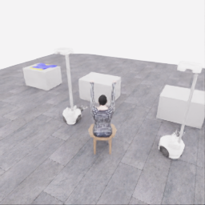
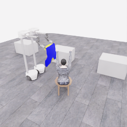
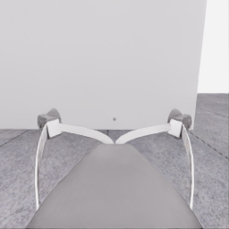
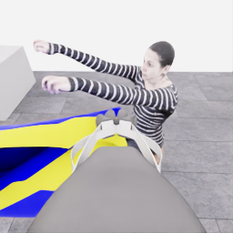
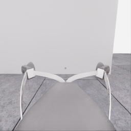
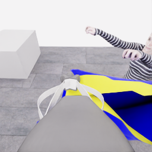
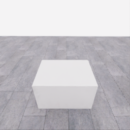
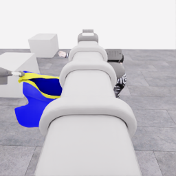
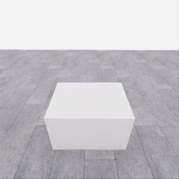
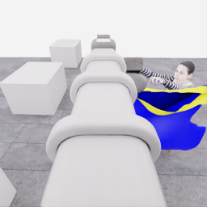

# 자동 시연 수집 시도 · 20261107-astra-probe787-named-001

[전체 수집 기록](../../README.ko.md) · [구조화 요약](manifest.json) · [전체 행동 기록](decisions.jsonl) · [사용한 기본 프롬프트](prompt.txt)

실행 상태는 **completed**, 원본 출처는 `gpt`입니다. 완료 상태와 과제 성공은 아래에서 따로 기록합니다.

## 실행 조건과 시간

| 항목 | 기록 |
|---|---|
| 기록 시작 UTC | 2026-11-07T03:01:21Z |
| 기록 종료 UTC | 2026-11-07T03:18:34Z |
| 이전 시도 | 20261106-astra-guide470-depth-001 |
| 재시도 사유 | bounded_entry_probe_after_two_occluded_lowering_sequences |
| 출처 그룹 | 20261106-coordinated-demo-methods |
| 요청 모델 / 추론 설정 | gpt-6-astra / ultra |
| 전체 실제 경과 시간 (초) | 1032.883 |
| Actor 호출 합계 (초) | 294.326 |
| 환경 요청·응답 합계 (초) | 694.749 |
| 시뮬레이션 시간 (초) | 40.650 |
| 저장 전이 수 | 813.000 |
| 응답 확인 전이 수 | 813.000 |
| 모델 호출 시도 수 | 5.000 |
| 완료한 결정 구간 수 | 4.000 |
| 파일 완료 상태 | true |
| 데이터 정합성 검사 | true |
| 학습 데이터 승인 | unreviewed |
| Actor 호출 방식 | exec |
| 한 호출의 최대 계획 구간 수 | 1.000 |
| 한 계획의 최대 제어 step 수 | 20.000 |
| 제어기 정착 대기 설정 | true |
| 정착 대기 요청 step 수 | 6.000 |
| 완료한 제어기 정착 구간 수 | 2.000 |
| 제어기 정착 전이 수 | 12.000 |
| 제어기 정착 환경 요청·응답 (초) | 10.709 |
| 전이 예산으로 단축한 정착 구간 수 | 0.000 |
| 전이 예산으로 건너뛴 정착 구간 수 | 0.000 |

Actor 호출 시간은 공개 입력 저장·요청 전송·응답 처리 등 호출 경로를 측정합니다. 방식에 따라 Docker/CLI 시작이 호출 안에 들어가거나 상주 서버 준비 시간으로 분리됩니다. 내부 모델 추론 시간만 별도로 측정한 값은 아닙니다. 모델이 판단하는 동안 물리 시간은 멈추며 실제 경과 시간과 시뮬레이션 시간은 다릅니다. 세부 요청 프로세스 시간에도 CLI 처리·네트워크·서버 대기·생성이 함께 포함됩니다.

## 토큰 사용량의 범위

`actor_usage`는 thread별 관측 누계를 합친 값입니다. 결정의 `usage`는 원본 CLI 누계이며, 호출별 증가량은 `usage_accounting.incremental_usage`입니다. 캐시 입력은 입력의 부분집합이고 추론 출력은 출력의 부분집합이므로 열들을 다시 합산하지 않습니다.

전체 호출 사용량 확정: **true** · 기록한 호출 수: 5.

| 입력 | 캐시 입력 | 캐시 쓰기 입력 | 출력 | 추론 출력 |
|---:|---:|---:|---:|---:|
| 246270 | 134784 | 0 | 8445 | 7188 |

중복 누계는 추가 사용량 0으로 처리하고, 역행한 누계는 미확정으로 보존합니다. 새 thread는 별도로 집계합니다. 토큰 기록은 화폐 비용이나 청구서가 아닙니다.

## 리뷰 정지 조건

목표 누적 점수 10.000 · 감시 상태 `collector_ended_before_gate` · 수집기 상태 `completed`.

마지막 관측 점수 5.000 · 응답 확인 step 813.

`review_ready`는 정지 조건에 따라 실행을 마치고 리뷰할 준비가 된 상태입니다. 50점·착의 성공이나 학습 데이터 승인을 뜻하지 않습니다. 공식 점수와 success는 아래 평가 결과로 확인합니다.

## 공식 평가 결과

평가 유효성 `true` · 누적 점수 **5.000 / 50** · 착의 success **false** · rate 상태 `no_contact` · 최종 rate 미측정/해당 없음 points/s.

누적 50점, 착의 success, 정상 파일 종료와 데이터 정합성은 서로 다른 상태입니다. 접촉 전 `no_contact`의 rate는 0점/초로 바꾸지 않습니다.

| 단계 | 획득 점수 / 최대 | 획득 시각 (episode 초) |
|---|---:|---:|
| 파지·들기 | 5.000 / 5 | 27.150 |
| 첫 소매 | 0.000 / 5 | 미측정/해당 없음 |
| 반대 어깨 | 0.000 / 5 | 미측정/해당 없음 |
| 두 번째 소매 | 0.000 / 5 | 미측정/해당 없음 |
| 왼쪽 위팔 | 0.000 / 5 | 미측정/해당 없음 |
| 오른쪽 위팔 | 0.000 / 5 | 미측정/해당 없음 |
| 목 통과 | 0.000 / 10 | 미측정/해당 없음 |
| 앞면 방향 | 0.000 / 10 | 미측정/해당 없음 |

## 단계 획득 경로

점수 획득은 [평가 이벤트](score-events.jsonl)에서 같은 physics tick끼리 묶었습니다. 같은 시각에 인정된 항목의 내부 순서는 추정하지 않습니다. 착의 success는 점수 획득과 별도로 기록합니다.

| 순서 | episode 시간 (초) | 전이 경계 step | 누적 점수 변화 | 같은 시각의 항목 변화 |
|---:|---:|---:|---:|---|
| 0 | 27.150 | 543 | 0.000→5.000 | 파지·들기 0.000→5.000 |

평가 clock 0초에 대응하는 공개 simulation clock은 1.525초입니다. 두 시계를 같은 절대 시각으로 혼동하지 않습니다.

별도 success 이벤트 수: **0**. 평가 유효성: `true`.


## 원본 관측 화면

지정된 공개 카메라의 저장 RGB 픽셀입니다. 시작은 첫 `obs`, 종료는 마지막 `next_obs`입니다. 이미지 합성이나 내부 상태 기반 장면 재구성 없이 원본 픽셀로 PNG를 저장했습니다.

| 카메라 | 시작 | 종료 |
|---|---|---|
| `overview` | [](images/initial-overview.png) | [](images/final-overview.png) |
| `robot_0_wrist` | [](images/initial-robot_0_wrist.png) | [](images/final-robot_0_wrist.png) |
| `robot_1_wrist` | [](images/initial-robot_1_wrist.png) | [](images/final-robot_1_wrist.png) |
| `robot_0_head` | [](images/initial-robot_0_head.png) | [](images/final-robot_0_head.png) |
| `robot_1_head` | [](images/initial-robot_1_head.png) | [](images/final-robot_1_head.png) |

시작 관측 시각 1.525초 · 종료 관측 시각 42.175초 (공개 simulation clock).

[▶ overview 관측 영상 보기](overview.mp4)

저장된 20 Hz `obs` 중 813프레임을 순서대로 사용했습니다. 재생은 **1배 느리게** (20.000 fps), 실제 대기 시간·모델 호출 지연은 영상에 들어가지 않습니다. 종료 `next_obs`는 위 PNG에서 확인합니다.

## 결정과 실행 순서

아래 근거는 모델 최종 JSON의 짧은 행동 설명입니다. 시각적 평가는 행동 전 관측에 대한 판단이며, 그 행동의 실행 후 성공 라벨로 사용하지 않습니다. 공식 점수는 별도의 평가 결과입니다.

행동의 각 행은 로봇 0·1 순서이며 열은 `전진, 왼쪽 이동, 반시계 회전, 리프트, 팔 신장, 손목 yaw, pitch, roll, gripper`입니다. 앞 8개는 정규화 속도이고 gripper는 닫기 `+1`, 열기 `-1`, 의도 유지 `0`입니다.

제어기 정착 대기는 앞선 모델 결정에 연결된 별도 중립 행동입니다. 추가 모델 호출이나 모델 결정으로 집계하지 않으며, 실제 전이와 환경 요청·응답 시간은 전체 합계에 포함됩니다. 중립 행동은 두 로봇의 속도와 gripper 명령을 모두 0으로 보내 기존 gripper 의도를 유지합니다. 대기를 실행했다는 기록이 옷의 정착이나 과제 개선을 확인했다는 뜻은 아닙니다.

### 기록된 행동의 재실행 구간

원본 `20261106-astra-guide470-depth-001`의 행동 787전이를 새 환경에서 다시 실행했습니다. 이 구간에는 새 모델 호출이 없고 관측·평가를 새로 기록했습니다. 정확한 물리 상태 복원이나 독립적인 새 시연으로 집계하지 않습니다. 원본 step 대응과 실제 행동은 `decisions.jsonl`의 `replayed_segment`에 있습니다.

### 별도 모델 호출 0 · `initial`

실행 결정 인덱스 0의 고정 관측을 사용했습니다. 호출 경과 63.528초. 같은 call index의 행동 기록과 사용량을 중복 합산하지 않습니다.

공개 입력 저장 0.223초 · 요청 프로세스 63.304초 · 결과 해석 0.000초.

### 공개 픽셀 depth 조회 · 결정 0

물리 전이 없이 같은 카메라·시각의 원본 값을 조회했습니다. 무효 값은 null이며 접촉·입구 통과 판단이 아닙니다.

```json
{
  "request": {
    "kind": "depth_query",
    "observation_id": "29651b9a24bf0002e3887e792270188e428e55106394f4ea29732d95264e564f",
    "camera": "robot_0_wrist",
    "pixels_uv": [
      [
        55,
        77
      ],
      [
        66,
        79
      ],
      [
        56,
        137
      ],
      [
        80,
        150
      ],
      [
        35,
        174
      ],
      [
        43,
        193
      ],
      [
        110,
        121
      ]
    ],
    "include_camera_geometry": true
  },
  "response": {
    "kind": "depth_query_result",
    "observation_id": "29651b9a24bf0002e3887e792270188e428e55106394f4ea29732d95264e564f",
    "camera": "robot_0_wrist",
    "camera_index": 1,
    "simulation_time_s": 40.87500213179737,
    "intrinsics_sha256": "3dd91a2df5cb0a47b6f5ceb86d60d41e1f5d6753d2a11a034ac0b52bc385cd23",
    "request_sha256": "240f973375c84fc48fa924d46a398b387504444725018d7a6d1d9b9059ebbc34",
    "depth_semantics": "optical_Z_metres_not_ray_range",
    "geometry_semantics": "camera_X_right_Y_down_Z_forward",
    "rgb_image_order": [
      "overview",
      "robot_0_wrist",
      "robot_1_wrist",
      "robot_0_head",
      "robot_1_head"
    ],
    "resolution_wh": [
      256,
      256
    ],
    "neighbor_depth_substituted": false,
    "hidden_surfaces_estimated": false,
    "object_pose_or_contact_inferred": false,
    "source_sha256": {
      "observation_json": "c60628db3fafda740bf9fa1de5051969b1d46852a2f227e61b688d1e344aebb6",
      "public_depth_npz": "7b4bbacc661fef0675c2b7dbfa01b11816482787bda0a5d851a5b12ab8352295",
      "overview_rgb": "91120de5c860647c8c561c1670394c4fb40a1586b94c8bd58901225938f3804c",
      "robot_0_wrist_rgb": "579b8e657683329c7604281f375f550941a9d7c3bfb92b2ce96f6c5e5f25575f",
      "robot_1_wrist_rgb": "4a51ff0a12ffec970b53612ef103da75be41f634b4b9c872126db12845ecc5b3",
      "robot_0_head_rgb": "75abacb0e4b752c8e2a82c702512128aaa426211d760f491e93fa4194b873bc7",
      "robot_1_head_rgb": "a2b933383a6f440514c99e7e21b136209390c51d900c10965c5326e1238039c2"
    },
    "results": [
      {
        "pixel_uv": [
          55,
          77
        ],
        "status": "valid",
        "optical_z_m": 0.4602642357349396,
        "camera_xyz_m": [
          -0.18380059048738512,
          -0.12840863171036493,
          0.4602642357349396
        ],
        "camera_range_m": 0.5119712887046574,
        "invalid_reasons": []
      },
      {
        "pixel_uv": [
          66,
          79
        ],
        "status": "valid",
        "optical_z_m": 0.46775928139686584,
        "camera_xyz_m": [
          -0.15864665346798298,
          -0.12538203257953492,
          0.46775928139686584
        ],
        "camera_range_m": 0.5095960754198153,
        "invalid_reasons": []
      },
      {
        "pixel_uv": [
          56,
          137
        ],
        "status": "valid",
        "optical_z_m": 0.24766048789024353,
        "camera_xyz_m": [
          -0.09754522905231171,
          0.012193153631538963,
          0.24766048789024353
        ],
        "camera_range_m": 0.26645724228923434,
        "invalid_reasons": []
      },
      {
        "pixel_uv": [
          80,
          150
        ],
        "status": "valid",
        "optical_z_m": 0.24155458807945251,
        "camera_xyz_m": [
          -0.06342687879839023,
          0.029070652782595522,
          0.24155458807945251
        ],
        "camera_range_m": 0.2514292958856344,
        "invalid_reasons": []
      },
      {
        "pixel_uv": [
          35,
          174
        ],
        "status": "valid",
        "optical_z_m": 0.25220629572868347,
        "camera_xyz_m": [
          -0.12830857577456992,
          0.06346445683473351,
          0.25220629572868347
        ],
        "camera_range_m": 0.2899980060341975,
        "invalid_reasons": []
      },
      {
        "pixel_uv": [
          43,
          193
        ],
        "status": "valid",
        "optical_z_m": 0.22735658288002014,
        "camera_xyz_m": [
          -0.10571662048051729,
          0.08084212154392499,
          0.22735658288002014
        ],
        "camera_range_m": 0.26344348206099905,
        "invalid_reasons": []
      },
      {
        "pixel_uv": [
          110,
          121
        ],
        "status": "valid",
        "optical_z_m": 0.2701943814754486,
        "camera_xyz_m": [
          -0.026605145065924554,
          -0.010346445303415105,
          0.2701943814754486
        ],
        "camera_range_m": 0.2716981532055301,
        "invalid_reasons": []
      }
    ]
  }
}
```

### 별도 모델 호출 1 · `action_after_query`

실행 결정 인덱스 0의 고정 관측을 사용했습니다. 호출 경과 73.791초. 같은 call index의 행동 기록과 사용량을 중복 합산하지 않습니다.

공개 입력 저장 0.226초 · 요청 프로세스 73.565초 · 결과 해석 0.000초.

### 결정 0 · 접근 · `act`

입력 관측 40.875초 · Actor 호출 73.791초 · 시각적 판단 `uncertain`.

계획 `20261107-astra-probe787-named-001:call-00001` · 모델 호출 인덱스 1 · 계획 구간 1/1 · 이 구간에서 모델 호출 `true`.

실행 직전 최신 관측 40.875초.

공개 입력 저장 0.226초 · 요청 프로세스 73.565초 · 결과 해석 0.000초.

호출 사용량 상태 `observed` · 이번 증가량 입력 39697 / 출력 2223 토큰.

최종 응답의 행동 설명: Robot 0 and robot 1 appear to retain opposite rim supports. The tracked hand is deeper than sampled rim surfaces; entry is unconfirmed. With lifts near target and approximately 7 mm residual arm retraction, preserve joint targets and probe forward together about 15 mm. Expect reduced hand-rim separation while preserving the opening. Any overlap could indicate rim crossing or exterior-panel coverage; inspect after settling before another probe.

요청 행동:

```json
[[0.12, 0, 0, 0, 0, 0, 0, 0, 0], [0.12, 0, 0, 0, 0, 0, 0, 0, 0]]
```

실행 구간 step **[787, 791)** · 요청 4 step / 실제 4 step · 환경 요청·응답 3.802초.

실제 적용 행동:

```json
[[0.11999999731779099, 0.0, 0.0, 0.0, 0.0, 0.0, 0.0, 0.0, 0.0], [0.11999999731779099, 0.0, 0.0, 0.0, 0.0, 0.0, 0.0, 0.0, 0.0]]
```

### 제어기 정착 대기 · 연결 결정 0

구간 `20261107-astra-probe787-named-001:settle-00000` · 출처 `controller_settle` · 이 구간에서 모델 호출 `false`.

앞선 모델 호출 인덱스 1에 연결됩니다. 추가 호출은 없습니다.

실행 구간 step **[791, 797)** · 요청 6 step / 실제 6 step · 환경 요청·응답 5.260초.

공개 simulation clock 41.075→41.375초 · 실행 전 관측 41.075초.

실제 적용 중립 행동:

```json
[[0.0, 0.0, 0.0, 0.0, 0.0, 0.0, 0.0, 0.0, 0.0], [0.0, 0.0, 0.0, 0.0, 0.0, 0.0, 0.0, 0.0, 0.0]]
```

### 별도 모델 호출 2 · `initial`

실행 결정 인덱스 1의 고정 관측을 사용했습니다. 호출 경과 51.966초. 같은 call index의 행동 기록과 사용량을 중복 합산하지 않습니다.

공개 입력 저장 0.081초 · 요청 프로세스 51.885초 · 결과 해석 0.000초.

### 결정 1 · 방향 · `act`

입력 관측 41.375초 · Actor 호출 51.966초 · 시각적 판단 `uncertain`.

계획 `20261107-astra-probe787-named-001:call-00002` · 모델 호출 인덱스 2 · 계획 구간 1/1 · 이 구간에서 모델 호출 `true`.

실행 직전 최신 관측 41.375초.

공개 입력 저장 0.081초 · 요청 프로세스 51.885초 · 결과 해석 0.000초.

호출 사용량 상태 `observed` · 이번 증가량 입력 51166 / 출력 1550 토큰.

최종 응답의 행동 설명: Robot 0 and robot 1 still show cloth following their respective pinches. Each base advanced about 14.5 mm, partly offset by 6.2 mm residual arm retraction; no new hand-rim relationship emerged. Tilt both wrists upward about 4 degrees to test whether rim boundaries separate more clearly from the blue panel. Preserve both grips and inspect before further approach; hand crossing and exterior-panel coverage remain distinct hypotheses.

요청 행동:

```json
[[0, 0, 0, 0, 0, 0, -0.06, 0, 0], [0, 0, 0, 0, 0, 0, -0.06, 0, 0]]
```

실행 구간 step **[797, 801)** · 요청 4 step / 실제 4 step · 환경 요청·응답 3.723초.

실제 적용 행동:

```json
[[0.0, 0.0, 0.0, 0.0, 0.0, 0.0, -0.05999999865889549, 0.0, 0.0], [0.0, 0.0, 0.0, 0.0, 0.0, 0.0, -0.05999999865889549, 0.0, 0.0]]
```

### 제어기 정착 대기 · 연결 결정 1

구간 `20261107-astra-probe787-named-001:settle-00001` · 출처 `controller_settle` · 이 구간에서 모델 호출 `false`.

앞선 모델 호출 인덱스 2에 연결됩니다. 추가 호출은 없습니다.

실행 구간 step **[801, 807)** · 요청 6 step / 실제 6 step · 환경 요청·응답 5.449초.

공개 simulation clock 41.575→41.875초 · 실행 전 관측 41.575초.

실제 적용 중립 행동:

```json
[[0.0, 0.0, 0.0, 0.0, 0.0, 0.0, 0.0, 0.0, 0.0], [0.0, 0.0, 0.0, 0.0, 0.0, 0.0, 0.0, 0.0, 0.0]]
```

### 별도 모델 호출 3 · `initial`

실행 결정 인덱스 2의 고정 관측을 사용했습니다. 호출 경과 29.537초. 같은 call index의 행동 기록과 사용량을 중복 합산하지 않습니다.

공개 입력 저장 0.080초 · 요청 프로세스 29.458초 · 결과 해석 0.000초.

### 결정 2 · 방향 · `act`

입력 관측 41.875초 · Actor 호출 29.537초 · 시각적 판단 `uncertain`.

계획 `20261107-astra-probe787-named-001:call-00003` · 모델 호출 인덱스 3 · 계획 구간 1/1 · 이 구간에서 모델 호출 `true`.

실행 직전 최신 관측 41.875초.

공개 입력 저장 0.080초 · 요청 프로세스 29.458초 · 결과 해석 0.000초.

호출 사용량 상태 `observed` · 이번 증가량 입력 61758 / 출력 697 토큰.

최종 응답의 행동 설명: Robot 0 and robot 1 appear to preserve opposite rim supports. Both wrists rotated about 0.057 rad but remain 0.014 rad short of target. The hand&#x27;s image shift accompanies camera rotation; clearer entry geometry has not emerged. Hold existing targets briefly to distinguish residual motion from cloth relaxation. Hand crossing versus exterior-panel coverage remains unresolved; this wait does not establish settling or passage.

요청 행동:

```json
[[0, 0, 0, 0, 0, 0, 0, 0, 0], [0, 0, 0, 0, 0, 0, 0, 0, 0]]
```

실행 구간 step **[807, 813)** · 요청 6 step / 실제 6 step · 환경 요청·응답 5.296초.

실제 적용 행동:

```json
[[0.0, 0.0, 0.0, 0.0, 0.0, 0.0, 0.0, 0.0, 0.0], [0.0, 0.0, 0.0, 0.0, 0.0, 0.0, 0.0, 0.0, 0.0]]
```

### 별도 모델 호출 4 · `initial`

실행 결정 인덱스 3의 고정 관측을 사용했습니다. 호출 경과 75.503초. 같은 call index의 행동 기록과 사용량을 중복 합산하지 않습니다.

공개 입력 저장 0.078초 · 요청 프로세스 75.425초 · 결과 해석 0.000초.

### 결정 3 · 최종 확인 · `finish_episode`

입력 관측 42.175초 · Actor 호출 75.503초 · 시각적 판단 `blocked`.

계획 `20261107-astra-probe787-named-001:call-00004` · 모델 호출 인덱스 4 · 계획 구간 1/1 · 이 구간에서 모델 호출 `true`.

실행 직전 최신 관측 42.175초.

공개 입력 저장 0.078초 · 요청 프로세스 75.425초 · 결과 해석 0.000초.

호출 사용량 상태 `observed` · 이번 증가량 입력 71517 / 출력 2127 토큰.

최종 응답의 행동 설명: Robot 0 and robot 1 still appear to support opposite rim ends. Settling added approximately 0.007 rad of wrist rotation without revealing a clearer entry route. The advance and orientation test supplied no new basis for distinguishing rim crossing from exterior-panel coverage. With regrasp prohibited, preserve both supports and finish incomplete rather than repeat an unresolved probe.

요청 행동:

```json
[[0, 0, 0, 0, 0, 0, 0, 0, 0], [0, 0, 0, 0, 0, 0, 0, 0, 0]]
```

실행 구간 step **[813, 813)** · 요청 0 step / 실제 0 step · 환경 요청·응답 0.008초.

실제 적용 행동:

```json
[[0.0, 0.0, 0.0, 0.0, 0.0, 0.0, 0.0, 0.0, 0.0], [0.0, 0.0, 0.0, 0.0, 0.0, 0.0, 0.0, 0.0, 0.0]]
```

## 검수와 후속 판단

현재 데이터 승인은 `unreviewed`입니다. 형식과 시간 정합성 검사를 통과해도 시연의 유용성이나 착의 성공을 보장하지 않습니다.

이 페이지의 원본 파일 SHA256과 생성 파일 SHA256은 [manifest.json](manifest.json)에 있습니다. 실행 실패도 같은 run ID와 부모 시도 관계로 보존합니다. 공개 범위는 카메라, 최종 행동 응답, 시간, 평가 요약입니다.

[개발 피드백과 변경 근거](../../feedback/2026-11-07.jsonl)
