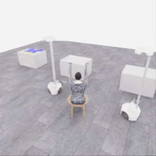
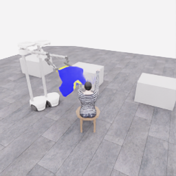
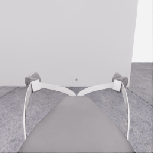
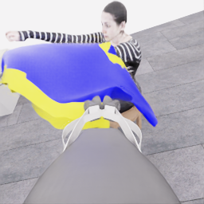
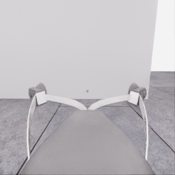
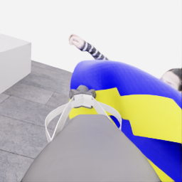
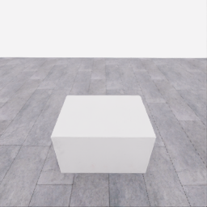
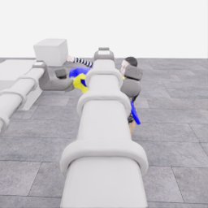
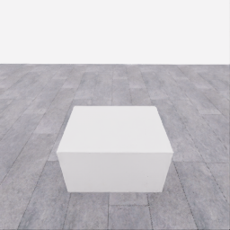
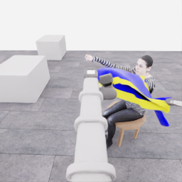

# 자동 시연 수집 시도 · 20261107-astra-progress1179-named-001

[전체 수집 기록](../../README.ko.md) · [구조화 요약](manifest.json) · [전체 행동 기록](decisions.jsonl) · [사용한 기본 프롬프트](prompt.txt)

실행 상태는 **interrupted**, 원본 출처는 `gpt`입니다. 완료 상태와 과제 성공은 아래에서 따로 기록합니다.

## 실행 조건과 시간

| 항목 | 기록 |
|---|---|
| 기록 시작 UTC | 2026-11-07T04:11:53Z |
| 기록 종료 UTC | 2026-11-07T05:02:19Z |
| 이전 시도 | 20261107-astra-progress787-named-001 |
| 재시도 사유 | continue_new_arm_garment_relation_after_decision_budget |
| 출처 그룹 | 20261106-coordinated-demo-methods |
| 요청 모델 / 추론 설정 | gpt-6-astra / ultra |
| 전체 실제 경과 시간 (초) | 3025.996 |
| Actor 호출 합계 (초) | 1443.976 |
| 환경 요청·응답 합계 (초) | 1523.852 |
| 시뮬레이션 시간 (초) | 80.500 |
| 저장 전이 수 | 1610.000 |
| 응답 확인 전이 수 | 1610.000 |
| 모델 호출 시도 수 | 26.000 |
| 완료한 결정 구간 수 | 22.000 |
| 파일 완료 상태 | true |
| 데이터 정합성 검사 | true |
| 학습 데이터 승인 | unreviewed |
| Actor 호출 방식 | exec |
| 한 호출의 최대 계획 구간 수 | 1.000 |
| 한 계획의 최대 제어 step 수 | 20.000 |
| 제어기 정착 대기 설정 | true |
| 정착 대기 요청 step 수 | 6.000 |
| 완료한 제어기 정착 구간 수 | 21.000 |
| 제어기 정착 전이 수 | 126.000 |
| 제어기 정착 환경 요청·응답 (초) | 145.496 |
| 전이 예산으로 단축한 정착 구간 수 | 0.000 |
| 전이 예산으로 건너뛴 정착 구간 수 | 0.000 |

Actor 호출 시간은 공개 입력 저장·요청 전송·응답 처리 등 호출 경로를 측정합니다. 방식에 따라 Docker/CLI 시작이 호출 안에 들어가거나 상주 서버 준비 시간으로 분리됩니다. 내부 모델 추론 시간만 별도로 측정한 값은 아닙니다. 모델이 판단하는 동안 물리 시간은 멈추며 실제 경과 시간과 시뮬레이션 시간은 다릅니다. 세부 요청 프로세스 시간에도 CLI 처리·네트워크·서버 대기·생성이 함께 포함됩니다.

## 토큰 사용량의 범위

`actor_usage`는 thread별 관측 누계를 합친 값입니다. 결정의 `usage`는 원본 CLI 누계이며, 호출별 증가량은 `usage_accounting.incremental_usage`입니다. 캐시 입력은 입력의 부분집합이고 추론 출력은 출력의 부분집합이므로 열들을 다시 합산하지 않습니다.

전체 호출 사용량 확정: **true** · 기록한 호출 수: 26.

| 입력 | 캐시 입력 | 캐시 쓰기 입력 | 출력 | 추론 출력 |
|---:|---:|---:|---:|---:|
| 3315562 | 2717056 | 0 | 40001 | 33645 |

중복 누계는 추가 사용량 0으로 처리하고, 역행한 누계는 미확정으로 보존합니다. 새 thread는 별도로 집계합니다. 토큰 기록은 화폐 비용이나 청구서가 아닙니다.

## 리뷰 정지 조건

목표 누적 점수 10.000 · 감시 상태 `collector_ended_before_gate` · 수집기 상태 `interrupted`.

마지막 관측 점수 5.000 · 응답 확인 step 1609.

`review_ready`는 정지 조건에 따라 실행을 마치고 리뷰할 준비가 된 상태입니다. 50점·착의 성공이나 학습 데이터 승인을 뜻하지 않습니다. 공식 점수와 success는 아래 평가 결과로 확인합니다.

## 공식 평가 결과

평가 유효성 `true` · 누적 점수 **5.000 / 50** · 착의 success **false** · rate 상태 `no_dressing_points` · 최종 rate 0.000 points/s.

누적 50점, 착의 success, 정상 파일 종료와 데이터 정합성은 서로 다른 상태입니다. 접촉 전 `no_contact`의 rate는 0점/초로 바꾸지 않습니다.

| 단계 | 획득 점수 / 최대 | 획득 시각 (episode 초) |
|---|---:|---:|
| 파지·들기 | 5.000 / 5 | 27.150 |
| 첫 소매 | 0.000 / 5 | 미측정/해당 없음 |
| 반대 어깨 | 0.000 / 5 | 미측정/해당 없음 |
| 두 번째 소매 | 0.000 / 5 | 미측정/해당 없음 |
| 왼쪽 위팔 | 0.000 / 5 | 미측정/해당 없음 |
| 오른쪽 위팔 | 0.000 / 5 | 미측정/해당 없음 |
| 목 통과 | 0.000 / 10 | 미측정/해당 없음 |
| 앞면 방향 | 0.000 / 10 | 미측정/해당 없음 |

## 단계 획득 경로

점수 획득은 [평가 이벤트](score-events.jsonl)에서 같은 physics tick끼리 묶었습니다. 같은 시각에 인정된 항목의 내부 순서는 추정하지 않습니다. 착의 success는 점수 획득과 별도로 기록합니다.

| 순서 | episode 시간 (초) | 전이 경계 step | 누적 점수 변화 | 같은 시각의 항목 변화 |
|---:|---:|---:|---:|---|
| 0 | 27.150 | 543 | 0.000→5.000 | 파지·들기 0.000→5.000 |

평가 clock 0초에 대응하는 공개 simulation clock은 1.525초입니다. 두 시계를 같은 절대 시각으로 혼동하지 않습니다.

별도 success 이벤트 수: **0**. 평가 유효성: `true`.


## 원본 관측 화면

지정된 공개 카메라의 저장 RGB 픽셀입니다. 시작은 첫 `obs`, 종료는 마지막 `next_obs`입니다. 이미지 합성이나 내부 상태 기반 장면 재구성 없이 원본 픽셀로 PNG를 저장했습니다.

| 카메라 | 시작 | 종료 |
|---|---|---|
| `overview` | [](images/initial-overview.png) | [](images/final-overview.png) |
| `robot_0_wrist` | [](images/initial-robot_0_wrist.png) | [](images/final-robot_0_wrist.png) |
| `robot_1_wrist` | [](images/initial-robot_1_wrist.png) | [](images/final-robot_1_wrist.png) |
| `robot_0_head` | [](images/initial-robot_0_head.png) | [](images/final-robot_0_head.png) |
| `robot_1_head` | [](images/initial-robot_1_head.png) | [](images/final-robot_1_head.png) |

시작 관측 시각 1.525초 · 종료 관측 시각 82.025초 (공개 simulation clock).

[▶ overview 관측 영상 보기](overview.mp4)

저장된 20 Hz `obs` 중 1610프레임을 순서대로 사용했습니다. 재생은 **1배 느리게** (20.000 fps), 실제 대기 시간·모델 호출 지연은 영상에 들어가지 않습니다. 종료 `next_obs`는 위 PNG에서 확인합니다.

## 결정과 실행 순서

아래 근거는 모델 최종 JSON의 짧은 행동 설명입니다. 시각적 평가는 행동 전 관측에 대한 판단이며, 그 행동의 실행 후 성공 라벨로 사용하지 않습니다. 공식 점수는 별도의 평가 결과입니다.

행동의 각 행은 로봇 0·1 순서이며 열은 `전진, 왼쪽 이동, 반시계 회전, 리프트, 팔 신장, 손목 yaw, pitch, roll, gripper`입니다. 앞 8개는 정규화 속도이고 gripper는 닫기 `+1`, 열기 `-1`, 의도 유지 `0`입니다.

제어기 정착 대기는 앞선 모델 결정에 연결된 별도 중립 행동입니다. 추가 모델 호출이나 모델 결정으로 집계하지 않으며, 실제 전이와 환경 요청·응답 시간은 전체 합계에 포함됩니다. 중립 행동은 두 로봇의 속도와 gripper 명령을 모두 0으로 보내 기존 gripper 의도를 유지합니다. 대기를 실행했다는 기록이 옷의 정착이나 과제 개선을 확인했다는 뜻은 아닙니다.

### 기록된 행동의 재실행 구간

원본 `20261107-astra-progress787-named-001`의 행동 1179전이를 새 환경에서 다시 실행했습니다. 이 구간에는 새 모델 호출이 없고 관측·평가를 새로 기록했습니다. 정확한 물리 상태 복원이나 독립적인 새 시연으로 집계하지 않습니다. 원본 step 대응과 실제 행동은 `decisions.jsonl`의 `replayed_segment`에 있습니다.

### 별도 모델 호출 0 · `initial`

실행 결정 인덱스 0의 고정 관측을 사용했습니다. 호출 경과 61.099초. 같은 call index의 행동 기록과 사용량을 중복 합산하지 않습니다.

공개 입력 저장 0.251초 · 요청 프로세스 60.848초 · 결과 해석 0.000초.

### 결정 0 · 첫 소매 · `act`

입력 관측 60.475초 · Actor 호출 61.099초 · 시각적 판단 `uncertain`.

계획 `20261107-astra-progress1179-named-001:call-00000` · 모델 호출 인덱스 0 · 계획 구간 1/1 · 이 구간에서 모델 호출 `true`.

실행 직전 최신 관측 60.475초.

공개 입력 저장 0.251초 · 요청 프로세스 60.848초 · 결과 해석 0.000초.

호출 사용량 상태 `observed` · 이번 증가량 입력 22207 / 출력 1787 토큰.

최종 응답의 행동 설명: Robot 0 and robot 1 appear to retain separated yellow-edged supports. The supported rim remains above the striped forearms. Command both approximately 6 cm torso-ward along local -Y and 7 cm downward, preserving grips and existing wrist targets. Test whether cloth advances along the arms; opening identity and sleeve entry remain uncertain.

요청 행동:

```json
[[0, -0.12, 0, -0.06, 0, 0, 0, 0, 0], [0, -0.12, 0, -0.06, 0, 0, 0, 0, 0]]
```

실행 구간 step **[1179, 1195)** · 요청 16 step / 실제 16 step · 환경 요청·응답 17.538초.

실제 적용 행동:

```json
[[0.0, -0.11999999731779099, 0.0, -0.05999999865889549, 0.0, 0.0, 0.0, 0.0, 0.0], [0.0, -0.11999999731779099, 0.0, -0.05999999865889549, 0.0, 0.0, 0.0, 0.0, 0.0]]
```

### 제어기 정착 대기 · 연결 결정 0

구간 `20261107-astra-progress1179-named-001:settle-00000` · 출처 `controller_settle` · 이 구간에서 모델 호출 `false`.

앞선 모델 호출 인덱스 0에 연결됩니다. 추가 호출은 없습니다.

실행 구간 step **[1195, 1201)** · 요청 6 step / 실제 6 step · 환경 요청·응답 6.821초.

공개 simulation clock 61.275→61.575초 · 실행 전 관측 61.275초.

실제 적용 중립 행동:

```json
[[0.0, 0.0, 0.0, 0.0, 0.0, 0.0, 0.0, 0.0, 0.0], [0.0, 0.0, 0.0, 0.0, 0.0, 0.0, 0.0, 0.0, 0.0]]
```

### 별도 모델 호출 1 · `initial`

실행 결정 인덱스 1의 고정 관측을 사용했습니다. 호출 경과 58.437초. 같은 call index의 행동 기록과 사용량을 중복 합산하지 않습니다.

공개 입력 저장 0.094초 · 요청 프로세스 58.343초 · 결과 해석 0.000초.

### 결정 1 · 첫 소매 · `act`

입력 관측 61.575초 · Actor 호출 58.437초 · 시각적 판단 `progressing`.

계획 `20261107-astra-progress1179-named-001:call-00001` · 모델 호출 인덱스 1 · 계획 구간 1/1 · 이 구간에서 모델 호출 `true`.

실행 직전 최신 관측 61.575초.

공개 입력 저장 0.094초 · 요청 프로세스 58.343초 · 결과 해석 0.000초.

호출 사용량 상태 `observed` · 이번 증가량 입력 33130 / 출력 1760 토큰.

최종 응답의 행동 설명: Robot 0 and robot 1 appear to retain opposite rim supports. Measured lowering was about 7 cm, and the cloth rim moved nearer forearm height; sleeve passage remains unconfirmed. Targets are nearly reached. Command approximately 8 cm farther torso-ward along local -Y and 3 cm downward to advance the supported garment along the arms.

요청 행동:

```json
[[0, -0.16, 0, -0.025, 0, 0, 0, 0, 0], [0, -0.16, 0, -0.025, 0, 0, 0, 0, 0]]
```

실행 구간 step **[1201, 1217)** · 요청 16 step / 실제 16 step · 환경 요청·응답 17.231초.

실제 적용 행동:

```json
[[0.0, -0.1599999964237213, 0.0, -0.02500000037252903, 0.0, 0.0, 0.0, 0.0, 0.0], [0.0, -0.1599999964237213, 0.0, -0.02500000037252903, 0.0, 0.0, 0.0, 0.0, 0.0]]
```

### 제어기 정착 대기 · 연결 결정 1

구간 `20261107-astra-progress1179-named-001:settle-00001` · 출처 `controller_settle` · 이 구간에서 모델 호출 `false`.

앞선 모델 호출 인덱스 1에 연결됩니다. 추가 호출은 없습니다.

실행 구간 step **[1217, 1223)** · 요청 6 step / 실제 6 step · 환경 요청·응답 6.696초.

공개 simulation clock 62.375→62.675초 · 실행 전 관측 62.375초.

실제 적용 중립 행동:

```json
[[0.0, 0.0, 0.0, 0.0, 0.0, 0.0, 0.0, 0.0, 0.0], [0.0, 0.0, 0.0, 0.0, 0.0, 0.0, 0.0, 0.0, 0.0]]
```

### 별도 모델 호출 2 · `initial`

실행 결정 인덱스 2의 고정 관측을 사용했습니다. 호출 경과 47.079초. 같은 call index의 행동 기록과 사용량을 중복 합산하지 않습니다.

공개 입력 저장 0.099초 · 요청 프로세스 46.980초 · 결과 해석 0.000초.

### 결정 2 · 방향 · `act`

입력 관측 62.675초 · Actor 호출 47.079초 · 시각적 판단 `recovering`.

계획 `20261107-astra-progress1179-named-001:call-00002` · 모델 호출 인덱스 2 · 계획 구간 1/1 · 이 구간에서 모델 호출 `true`.

실행 직전 최신 관측 62.675초.

공개 입력 저장 0.099초 · 요청 프로세스 46.980초 · 결과 해석 0.000초.

호출 사용량 상태 `observed` · 이번 증가량 입력 44103 / 출력 1273 토큰.

최종 응답의 행동 설명: Robot 0 retains apparent opposite-edge support; robot 1&#x27;s panel has folded toward its wrist, and its extension is approximately 3 cm below target. Reduce robot 1&#x27;s extension target to near its measured position and pitch both wrists upward approximately 0.23 rad. This tests whether reorienting the supported rim relaxes the fold beside the forearm; passage remains unconfirmed.

요청 행동:

```json
[[0, 0, 0, 0, 0, 0, -0.07, 0, 0], [0, 0, 0, 0, -0.04, 0, -0.07, 0, 0]]
```

실행 구간 step **[1223, 1235)** · 요청 12 step / 실제 12 step · 환경 요청·응답 12.081초.

실제 적용 행동:

```json
[[0.0, 0.0, 0.0, 0.0, 0.0, 0.0, -0.07000000029802322, 0.0, 0.0], [0.0, 0.0, 0.0, 0.0, -0.03999999910593033, 0.0, -0.07000000029802322, 0.0, 0.0]]
```

### 제어기 정착 대기 · 연결 결정 2

구간 `20261107-astra-progress1179-named-001:settle-00002` · 출처 `controller_settle` · 이 구간에서 모델 호출 `false`.

앞선 모델 호출 인덱스 2에 연결됩니다. 추가 호출은 없습니다.

실행 구간 step **[1235, 1241)** · 요청 6 step / 실제 6 step · 환경 요청·응답 6.450초.

공개 simulation clock 63.275→63.575초 · 실행 전 관측 63.275초.

실제 적용 중립 행동:

```json
[[0.0, 0.0, 0.0, 0.0, 0.0, 0.0, 0.0, 0.0, 0.0], [0.0, 0.0, 0.0, 0.0, 0.0, 0.0, 0.0, 0.0, 0.0]]
```

### 별도 모델 호출 3 · `initial`

실행 결정 인덱스 3의 고정 관측을 사용했습니다. 호출 경과 53.724초. 같은 call index의 행동 기록과 사용량을 중복 합산하지 않습니다.

공개 입력 저장 0.086초 · 요청 프로세스 53.638초 · 결과 해석 0.000초.

### 결정 3 · 첫 소매 · `act`

입력 관측 63.575초 · Actor 호출 53.724초 · 시각적 판단 `uncertain`.

계획 `20261107-astra-progress1179-named-001:call-00003` · 모델 호출 인덱스 3 · 계획 구간 1/1 · 이 구간에서 모델 호출 `true`.

실행 직전 최신 관측 63.575초.

공개 입력 저장 0.086초 · 요청 프로세스 53.638초 · 결과 해석 0.000초.

호출 사용량 상태 `observed` · 이번 증가량 입력 54297 / 출력 1680 토큰.

최종 응답의 행동 설명: Robot 0 appears to retain opposite-edge support; robot 1&#x27;s supported rim remains above and torso-side of the lower visible hand. Wrist rotation occurred, but passage remains unconfirmed. Change approach: command both approximately 10 cm along local +Y and 7 cm downward to bring the candidate body opening toward that hand, retaining grips and allowing residual joint motion to settle.

요청 행동:

```json
[[0, 0.2, 0, -0.06, 0, 0, 0, 0, 0], [0, 0.2, 0, -0.06, 0, 0, 0, 0, 0]]
```

실행 구간 step **[1241, 1257)** · 요청 16 step / 실제 16 step · 환경 요청·응답 16.389초.

실제 적용 행동:

```json
[[0.0, 0.20000000298023224, 0.0, -0.05999999865889549, 0.0, 0.0, 0.0, 0.0, 0.0], [0.0, 0.20000000298023224, 0.0, -0.05999999865889549, 0.0, 0.0, 0.0, 0.0, 0.0]]
```

### 제어기 정착 대기 · 연결 결정 3

구간 `20261107-astra-progress1179-named-001:settle-00003` · 출처 `controller_settle` · 이 구간에서 모델 호출 `false`.

앞선 모델 호출 인덱스 3에 연결됩니다. 추가 호출은 없습니다.

실행 구간 step **[1257, 1263)** · 요청 6 step / 실제 6 step · 환경 요청·응답 6.620초.

공개 simulation clock 64.375→64.675초 · 실행 전 관측 64.375초.

실제 적용 중립 행동:

```json
[[0.0, 0.0, 0.0, 0.0, 0.0, 0.0, 0.0, 0.0, 0.0], [0.0, 0.0, 0.0, 0.0, 0.0, 0.0, 0.0, 0.0, 0.0]]
```

### 별도 모델 호출 4 · `initial`

실행 결정 인덱스 4의 고정 관측을 사용했습니다. 호출 경과 41.312초. 같은 call index의 행동 기록과 사용량을 중복 합산하지 않습니다.

공개 입력 저장 0.089초 · 요청 프로세스 41.223초 · 결과 해석 0.000초.

### 결정 4 · 첫 소매 · `act`

입력 관측 64.675초 · Actor 호출 41.312초 · 시각적 판단 `progressing`.

계획 `20261107-astra-progress1179-named-001:call-00004` · 모델 호출 인덱스 4 · 계획 구간 1/1 · 이 구간에서 모델 호출 `true`.

실행 직전 최신 관측 64.675초.

공개 입력 저장 0.089초 · 요청 프로세스 41.223초 · 결과 해석 0.000초.

호출 사용량 상태 `observed` · 이번 증가량 입력 64997 / 출력 1213 토큰.

최종 응답의 행동 설명: Robot 0 maintains apparent opposite-edge support; robot 1&#x27;s supported rim is visibly closer to the tracked lower hand, and its extension has nearly reached target. The rim remains above and torso-side of that hand. Command both about 9 cm along local +Y, 6 cm downward and 4 cm arm retraction to bring the candidate body opening toward it. Entry remains unconfirmed.

요청 행동:

```json
[[0, 0.18, 0, -0.05, -0.04, 0, 0, 0, 0], [0, 0.18, 0, -0.05, -0.04, 0, 0, 0, 0]]
```

실행 구간 step **[1263, 1279)** · 요청 16 step / 실제 16 step · 환경 요청·응답 18.578초.

실제 적용 행동:

```json
[[0.0, 0.18000000715255737, 0.0, -0.05000000074505806, -0.03999999910593033, 0.0, 0.0, 0.0, 0.0], [0.0, 0.18000000715255737, 0.0, -0.05000000074505806, -0.03999999910593033, 0.0, 0.0, 0.0, 0.0]]
```

### 제어기 정착 대기 · 연결 결정 4

구간 `20261107-astra-progress1179-named-001:settle-00004` · 출처 `controller_settle` · 이 구간에서 모델 호출 `false`.

앞선 모델 호출 인덱스 4에 연결됩니다. 추가 호출은 없습니다.

실행 구간 step **[1279, 1285)** · 요청 6 step / 실제 6 step · 환경 요청·응답 8.306초.

공개 simulation clock 65.475→65.775초 · 실행 전 관측 65.475초.

실제 적용 중립 행동:

```json
[[0.0, 0.0, 0.0, 0.0, 0.0, 0.0, 0.0, 0.0, 0.0], [0.0, 0.0, 0.0, 0.0, 0.0, 0.0, 0.0, 0.0, 0.0]]
```

### 별도 모델 호출 5 · `initial`

실행 결정 인덱스 5의 고정 관측을 사용했습니다. 호출 경과 42.219초. 같은 call index의 행동 기록과 사용량을 중복 합산하지 않습니다.

공개 입력 저장 0.094초 · 요청 프로세스 42.125초 · 결과 해석 0.000초.

### 결정 5 · 복구 · `act`

입력 관측 65.775초 · Actor 호출 42.219초 · 시각적 판단 `uncertain`.

계획 `20261107-astra-progress1179-named-001:call-00005` · 모델 호출 인덱스 5 · 계획 구간 1/1 · 이 구간에서 모델 호출 `true`.

실행 직전 최신 관측 65.775초.

공개 입력 저장 0.094초 · 요청 프로세스 42.125초 · 결과 해석 0.000초.

호출 사용량 상태 `observed` · 이번 증가량 입력 75271 / 출력 1258 토큰.

최종 응답의 행동 설명: Both edges still appear supported. Robot 0 retracted as commanded, but robot 1 extended approximately 7 cm instead, leaving a 10 cm extension target error. Apply neutral commands for 0.5 seconds, preserving grips and existing targets, to distinguish continuing target-following from persistent obstruction before another approach. The exposed head does not establish passage.

요청 행동:

```json
[[0, 0, 0, 0, 0, 0, 0, 0, 0], [0, 0, 0, 0, 0, 0, 0, 0, 0]]
```

실행 구간 step **[1285, 1295)** · 요청 10 step / 실제 10 step · 환경 요청·응답 13.755초.

실제 적용 행동:

```json
[[0.0, 0.0, 0.0, 0.0, 0.0, 0.0, 0.0, 0.0, 0.0], [0.0, 0.0, 0.0, 0.0, 0.0, 0.0, 0.0, 0.0, 0.0]]
```

### 별도 모델 호출 6 · `initial`

실행 결정 인덱스 6의 고정 관측을 사용했습니다. 호출 경과 56.783초. 같은 call index의 행동 기록과 사용량을 중복 합산하지 않습니다.

공개 입력 저장 0.089초 · 요청 프로세스 56.694초 · 결과 해석 0.000초.

### 결정 6 · 복구 · `act`

입력 관측 66.275초 · Actor 호출 56.783초 · 시각적 판단 `recovering`.

계획 `20261107-astra-progress1179-named-001:call-00006` · 모델 호출 인덱스 6 · 계획 구간 1/1 · 이 구간에서 모델 호출 `true`.

실행 직전 최신 관측 66.275초.

공개 입력 저장 0.089초 · 요청 프로세스 56.694초 · 결과 해석 0.000초.

호출 사용량 상태 `observed` · 이번 증가량 입력 85592 / 출력 1679 토큰.

최종 응답의 행동 설명: Robot 0 retains apparent support; robot 1 retracted only 7 mm during settling, leaving about 10 cm target error and little cloth-to-hand change. Raise both lifts about 5.5 cm and pitch downward 0.22 rad, compensating extension to approximately preserve rim position. Robot 1&#x27;s extension command chiefly cancels its accumulated retraction demand. Test whether this posture relieves suspected forearm interference while retaining both grips.

요청 행동:

```json
[[0, 0, 0, 0.045, 0.03, 0, 0.05, 0, 0], [0, 0, 0, 0.045, 0.13, 0, 0.05, 0, 0]]
```

실행 구간 step **[1295, 1311)** · 요청 16 step / 실제 16 step · 환경 요청·응답 20.610초.

실제 적용 행동:

```json
[[0.0, 0.0, 0.0, 0.04500000178813934, 0.029999999329447746, 0.0, 0.05000000074505806, 0.0, 0.0], [0.0, 0.0, 0.0, 0.04500000178813934, 0.12999999523162842, 0.0, 0.05000000074505806, 0.0, 0.0]]
```

### 제어기 정착 대기 · 연결 결정 6

구간 `20261107-astra-progress1179-named-001:settle-00006` · 출처 `controller_settle` · 이 구간에서 모델 호출 `false`.

앞선 모델 호출 인덱스 6에 연결됩니다. 추가 호출은 없습니다.

실행 구간 step **[1311, 1317)** · 요청 6 step / 실제 6 step · 환경 요청·응답 7.442초.

공개 simulation clock 67.075→67.375초 · 실행 전 관측 67.075초.

실제 적용 중립 행동:

```json
[[0.0, 0.0, 0.0, 0.0, 0.0, 0.0, 0.0, 0.0, 0.0], [0.0, 0.0, 0.0, 0.0, 0.0, 0.0, 0.0, 0.0, 0.0]]
```

### 별도 모델 호출 7 · `initial`

실행 결정 인덱스 7의 고정 관측을 사용했습니다. 호출 경과 40.669초. 같은 call index의 행동 기록과 사용량을 중복 합산하지 않습니다.

공개 입력 저장 0.099초 · 요청 프로세스 40.570초 · 결과 해석 0.000초.

### 공개 픽셀 depth 조회 · 결정 7

물리 전이 없이 같은 카메라·시각의 원본 값을 조회했습니다. 무효 값은 null이며 접촉·입구 통과 판단이 아닙니다.

```json
{
  "request": {
    "kind": "depth_query",
    "observation_id": "446ba28cebfe48e222fa920bcf632cb188904cd7699aba66f12ae03043cff438",
    "camera": "robot_1_head",
    "pixels_uv": [
      [
        96,
        204
      ],
      [
        161,
        190
      ],
      [
        175,
        160
      ],
      [
        231,
        192
      ],
      [
        154,
        129
      ],
      [
        142,
        154
      ]
    ],
    "include_camera_geometry": true
  },
  "response": {
    "kind": "depth_query_result",
    "observation_id": "446ba28cebfe48e222fa920bcf632cb188904cd7699aba66f12ae03043cff438",
    "camera": "robot_1_head",
    "camera_index": 4,
    "simulation_time_s": 67.37500351388007,
    "intrinsics_sha256": "3dd91a2df5cb0a47b6f5ceb86d60d41e1f5d6753d2a11a034ac0b52bc385cd23",
    "request_sha256": "28bdafb6ebc1922718770b9f197c5b3fddfcea810a4cebe9cb3aadc0ec08425e",
    "depth_semantics": "optical_Z_metres_not_ray_range",
    "geometry_semantics": "camera_X_right_Y_down_Z_forward",
    "rgb_image_order": [
      "overview",
      "robot_0_wrist",
      "robot_1_wrist",
      "robot_0_head",
      "robot_1_head"
    ],
    "resolution_wh": [
      256,
      256
    ],
    "neighbor_depth_substituted": false,
    "hidden_surfaces_estimated": false,
    "object_pose_or_contact_inferred": false,
    "source_sha256": {
      "observation_json": "1ea4f0fe34023321bac899361844bca7586552675783d51763d9e58fb224146d",
      "public_depth_npz": "de6134d2818d85cf27429d0bcc39efdaf56f28f220705ac190c613fcae3a9514",
      "overview_rgb": "55816b85ef632ad68b70e76eeca9a78840c9dc4c361bcfbaa98f398403f1613f",
      "robot_0_wrist_rgb": "56e7d7e07c00189d8ca4cb14ce69155470b1f2096f85f47419397dc63b1ac5d5",
      "robot_1_wrist_rgb": "739f58b13886ce7f27bc233a427c84f853257ff8540f03c4b3d6e960e74105e5",
      "robot_0_head_rgb": "f1acd8bd589812c1851adc4b5dd0b87ff4d0cad20b7ddf08e657269080ac091b",
      "robot_1_head_rgb": "190451af59fde4481165db61aae8c5f584e1d497bdf99c01a9182b7f138a3b2a"
    },
    "results": [
      {
        "pixel_uv": [
          96,
          204
        ],
        "status": "valid",
        "optical_z_m": 0.44447630643844604,
        "camera_xyz_m": [
          -0.07780641508095221,
          0.1847902358172615,
          0.44447630643844604
        ],
        "camera_range_m": 0.48760686671365894,
        "invalid_reasons": []
      },
      {
        "pixel_uv": [
          161,
          190
        ],
        "status": "valid",
        "optical_z_m": 0.5886945724487305,
        "camera_xyz_m": [
          0.10627247228084004,
          0.1996634327700631,
          0.5886945724487305
        ],
        "camera_range_m": 0.6306509528897907,
        "invalid_reasons": []
      },
      {
        "pixel_uv": [
          175,
          160
        ],
        "status": "valid",
        "optical_z_m": 0.7855692505836487,
        "camera_xyz_m": [
          0.20197571108662415,
          0.1375153777611058,
          0.7855692505836487
        ],
        "camera_range_m": 0.822692964873459,
        "invalid_reasons": []
      },
      {
        "pixel_uv": [
          231,
          192
        ],
        "status": "valid",
        "optical_z_m": 0.6845071315765381,
        "camera_xyz_m": [
          0.38568434772878396,
          0.23964852674409878,
          0.6845071315765381
        ],
        "camera_range_m": 0.821421843897966,
        "invalid_reasons": []
      },
      {
        "pixel_uv": [
          154,
          129
        ],
        "status": "valid",
        "optical_z_m": 0.8446750640869141,
        "camera_xyz_m": [
          0.12013784396482108,
          0.004620686306339272,
          0.8446750640869141
        ],
        "camera_range_m": 0.8531883825889155,
        "invalid_reasons": []
      },
      {
        "pixel_uv": [
          142,
          154
        ],
        "status": "valid",
        "optical_z_m": 0.5687844157218933,
        "camera_xyz_m": [
          0.043560467945823834,
          0.08089801189938711,
          0.5687844157218933
        ],
        "camera_range_m": 0.5761577164848424,
        "invalid_reasons": []
      }
    ]
  }
}
```

### 별도 모델 호출 8 · `action_after_query`

실행 결정 인덱스 7의 고정 관측을 사용했습니다. 호출 경과 61.199초. 같은 call index의 행동 기록과 사용량을 중복 합산하지 않습니다.

공개 입력 저장 0.103초 · 요청 프로세스 61.096초 · 결과 해석 0.000초.

### 결정 7 · 첫 소매 · `act`

입력 관측 67.375초 · Actor 호출 61.199초 · 시각적 판단 `uncertain`.

계획 `20261107-astra-progress1179-named-001:call-00008` · 모델 호출 인덱스 8 · 계획 구간 1/1 · 이 구간에서 모델 호출 `true`.

실행 직전 최신 관측 67.375초.

공개 입력 저장 0.103초 · 요청 프로세스 61.096초 · 결과 해석 0.000초.

호출 사용량 상태 `observed` · 이번 증가량 입력 108003 / 출력 1867 토큰.

최종 응답의 행동 설명: Robot 0 supports the opposite edge; robot 1 retains apparent support near the tracked hand. Queried depths place the yellow-rim candidate farther away and right of that hand. Move both bases approximately 9 cm backward and 9 cm along local +Y, lowering 2.5 cm, to reduce this gap while preserving arm and wrist targets. Opening identity and entry remain uncertain.

요청 행동:

```json
[[-0.18, 0.18, 0, -0.02, 0, 0, 0, 0, 0], [-0.18, 0.18, 0, -0.02, 0, 0, 0, 0, 0]]
```

실행 구간 step **[1317, 1333)** · 요청 16 step / 실제 16 step · 환경 요청·응답 18.405초.

실제 적용 행동:

```json
[[-0.18000000715255737, 0.18000000715255737, 0.0, -0.019999999552965164, 0.0, 0.0, 0.0, 0.0, 0.0], [-0.18000000715255737, 0.18000000715255737, 0.0, -0.019999999552965164, 0.0, 0.0, 0.0, 0.0, 0.0]]
```

### 제어기 정착 대기 · 연결 결정 7

구간 `20261107-astra-progress1179-named-001:settle-00007` · 출처 `controller_settle` · 이 구간에서 모델 호출 `false`.

앞선 모델 호출 인덱스 8에 연결됩니다. 추가 호출은 없습니다.

실행 구간 step **[1333, 1339)** · 요청 6 step / 실제 6 step · 환경 요청·응답 7.394초.

공개 simulation clock 68.175→68.475초 · 실행 전 관측 68.175초.

실제 적용 중립 행동:

```json
[[0.0, 0.0, 0.0, 0.0, 0.0, 0.0, 0.0, 0.0, 0.0], [0.0, 0.0, 0.0, 0.0, 0.0, 0.0, 0.0, 0.0, 0.0]]
```

### 별도 모델 호출 9 · `initial`

실행 결정 인덱스 8의 고정 관측을 사용했습니다. 호출 경과 86.130초. 같은 call index의 행동 기록과 사용량을 중복 합산하지 않습니다.

공개 입력 저장 0.095초 · 요청 프로세스 86.034초 · 결과 해석 0.000초.

### 결정 8 · 첫 소매 · `act`

입력 관측 68.475초 · Actor 호출 86.130초 · 시각적 판단 `progressing`.

계획 `20261107-astra-progress1179-named-001:call-00009` · 모델 호출 인덱스 9 · 계획 구간 1/1 · 이 구간에서 모델 호출 `true`.

실행 직전 최신 관측 68.475초.

공개 입력 저장 0.095초 · 요청 프로세스 86.034초 · 결과 해석 0.000초.

호출 사용량 상태 `observed` · 이번 증가량 입력 119245 / 출력 2544 토큰.

최종 응답의 행동 설명: Robot 0 retains apparent opposite-edge support and robot 1 the hand-side support. Cloth followed the withdrawal, and the tracked lower hand is closer to the yellow rim in robot 0&#x27;s head view. Robot 1&#x27;s extra extension partly offset retreat. Keep joint targets unchanged and move both bases about 8 cm backward and 9 cm along local +Y to further reduce the hand-to-opening gap; entry remains unconfirmed.

요청 행동:

```json
[[-0.16, 0.18, 0, 0, 0, 0, 0, 0, 0], [-0.16, 0.18, 0, 0, 0, 0, 0, 0, 0]]
```

실행 구간 step **[1339, 1355)** · 요청 16 step / 실제 16 step · 환경 요청·응답 18.469초.

실제 적용 행동:

```json
[[-0.1599999964237213, 0.18000000715255737, 0.0, 0.0, 0.0, 0.0, 0.0, 0.0, 0.0], [-0.1599999964237213, 0.18000000715255737, 0.0, 0.0, 0.0, 0.0, 0.0, 0.0, 0.0]]
```

### 제어기 정착 대기 · 연결 결정 8

구간 `20261107-astra-progress1179-named-001:settle-00008` · 출처 `controller_settle` · 이 구간에서 모델 호출 `false`.

앞선 모델 호출 인덱스 9에 연결됩니다. 추가 호출은 없습니다.

실행 구간 step **[1355, 1361)** · 요청 6 step / 실제 6 step · 환경 요청·응답 7.541초.

공개 simulation clock 69.275→69.575초 · 실행 전 관측 69.275초.

실제 적용 중립 행동:

```json
[[0.0, 0.0, 0.0, 0.0, 0.0, 0.0, 0.0, 0.0, 0.0], [0.0, 0.0, 0.0, 0.0, 0.0, 0.0, 0.0, 0.0, 0.0]]
```

### 별도 모델 호출 10 · `initial`

실행 결정 인덱스 9의 고정 관측을 사용했습니다. 호출 경과 43.882초. 같은 call index의 행동 기록과 사용량을 중복 합산하지 않습니다.

공개 입력 저장 0.107초 · 요청 프로세스 43.774초 · 결과 해석 0.000초.

### 결정 9 · 방향 · `act`

입력 관측 69.575초 · Actor 호출 43.882초 · 시각적 판단 `recovering`.

계획 `20261107-astra-progress1179-named-001:call-00010` · 모델 호출 인덱스 10 · 계획 구간 1/1 · 이 구간에서 모델 호출 `true`.

실행 직전 최신 관측 69.575초.

공개 입력 저장 0.107초 · 요청 프로세스 43.774초 · 결과 해석 0.000초.

호출 사용량 상태 `observed` · 이번 증가량 입력 131073 / 출력 1145 토큰.

최종 응답의 행동 설명: Robot 0 retains opposite-edge support; robot 1 supports the rim beside the now-visible tracked hand. Withdrawal brought them closer, but robot 1 extended another 4 cm against its unchanged target. Stop base motion, bring extension targets near measured lengths, and counter-roll both wrists about 15 degrees to turn the candidate folded opening toward the hand. Check for rim separation; entry remains uncertain.

요청 행동:

```json
[[0, 0, 0, 0, 0.014, 0, 0, 0.08, 0], [0, 0, 0, 0, 0.088, 0, 0, -0.08, 0]]
```

실행 구간 step **[1361, 1373)** · 요청 12 step / 실제 12 step · 환경 요청·응답 13.975초.

실제 적용 행동:

```json
[[0.0, 0.0, 0.0, 0.0, 0.014000000432133675, 0.0, 0.0, 0.07999999821186066, 0.0], [0.0, 0.0, 0.0, 0.0, 0.08799999952316284, 0.0, 0.0, -0.07999999821186066, 0.0]]
```

### 제어기 정착 대기 · 연결 결정 9

구간 `20261107-astra-progress1179-named-001:settle-00009` · 출처 `controller_settle` · 이 구간에서 모델 호출 `false`.

앞선 모델 호출 인덱스 10에 연결됩니다. 추가 호출은 없습니다.

실행 구간 step **[1373, 1379)** · 요청 6 step / 실제 6 step · 환경 요청·응답 7.191초.

공개 simulation clock 70.175→70.475초 · 실행 전 관측 70.175초.

실제 적용 중립 행동:

```json
[[0.0, 0.0, 0.0, 0.0, 0.0, 0.0, 0.0, 0.0, 0.0], [0.0, 0.0, 0.0, 0.0, 0.0, 0.0, 0.0, 0.0, 0.0]]
```

### 별도 모델 호출 11 · `initial`

실행 결정 인덱스 10의 고정 관측을 사용했습니다. 호출 경과 40.525초. 같은 call index의 행동 기록과 사용량을 중복 합산하지 않습니다.

공개 입력 저장 0.104초 · 요청 프로세스 40.420초 · 결과 해석 0.000초.

### 결정 10 · 방향 · `act`

입력 관측 70.475초 · Actor 호출 40.525초 · 시각적 판단 `uncertain`.

계획 `20261107-astra-progress1179-named-001:call-00011` · 모델 호출 인덱스 11 · 계획 구간 1/1 · 이 구간에서 모델 호출 `true`.

실행 직전 최신 관측 70.475초.

공개 입력 저장 0.104초 · 요청 프로세스 40.420초 · 결과 해석 0.000초.

호출 사용량 상태 `observed` · 이번 증가량 입력 141506 / 출력 1267 토큰.

최종 응답의 행동 설명: Both supports appear retained. The wrist rolls executed and robot 1 reached its extension target, but the rim-to-hand relationship changed little. Raise robot 0&#x27;s opposite edge about 4.6 cm and lower robot 1&#x27;s hand-side edge equally, tilting the candidate body opening across the tracked hand. Test whether the near lip moves below the hand while the opposite support remains above; entry is unconfirmed.

요청 행동:

```json
[[0, 0, 0, 0.05, 0, 0, 0, 0, 0], [0, 0, 0, -0.05, 0, 0, 0, 0, 0]]
```

실행 구간 step **[1379, 1391)** · 요청 12 step / 실제 12 step · 환경 요청·응답 13.900초.

실제 적용 행동:

```json
[[0.0, 0.0, 0.0, 0.05000000074505806, 0.0, 0.0, 0.0, 0.0, 0.0], [0.0, 0.0, 0.0, -0.05000000074505806, 0.0, 0.0, 0.0, 0.0, 0.0]]
```

### 제어기 정착 대기 · 연결 결정 10

구간 `20261107-astra-progress1179-named-001:settle-00010` · 출처 `controller_settle` · 이 구간에서 모델 호출 `false`.

앞선 모델 호출 인덱스 11에 연결됩니다. 추가 호출은 없습니다.

실행 구간 step **[1391, 1397)** · 요청 6 step / 실제 6 step · 환경 요청·응답 7.546초.

공개 simulation clock 71.075→71.375초 · 실행 전 관측 71.075초.

실제 적용 중립 행동:

```json
[[0.0, 0.0, 0.0, 0.0, 0.0, 0.0, 0.0, 0.0, 0.0], [0.0, 0.0, 0.0, 0.0, 0.0, 0.0, 0.0, 0.0, 0.0]]
```

### 별도 모델 호출 12 · `initial`

실행 결정 인덱스 11의 고정 관측을 사용했습니다. 호출 경과 41.965초. 같은 call index의 행동 기록과 사용량을 중복 합산하지 않습니다.

공개 입력 저장 0.095초 · 요청 프로세스 41.870초 · 결과 해석 0.000초.

### 결정 11 · 첫 소매 · `act`

입력 관측 71.375초 · Actor 호출 41.965초 · 시각적 판단 `progressing`.

계획 `20261107-astra-progress1179-named-001:call-00012` · 모델 호출 인덱스 12 · 계획 구간 1/1 · 이 구간에서 모델 호출 `true`.

실행 직전 최신 관측 71.375초.

공개 입력 저장 0.095초 · 요청 프로세스 41.870초 · 결과 해석 0.000초.

호출 사용량 상태 `observed` · 이번 증가량 입력 152022 / 출력 1191 토큰.

최종 응답의 행동 설명: Robot 0 keeps the opposite edge elevated; robot 1&#x27;s lowered rim is now visibly below the forearm in its wrist view, with both supports apparently retained. Preserve this tilt and move both bases about 5 cm backward and 7 cm along local +Y, bringing the candidate body opening toward the same tracked hand. Small remaining joint lag may contribute motion; entry remains unconfirmed.

요청 행동:

```json
[[-0.12, 0.16, 0, 0, 0, 0, 0, 0, 0], [-0.12, 0.16, 0, 0, 0, 0, 0, 0, 0]]
```

실행 구간 step **[1397, 1411)** · 요청 14 step / 실제 14 step · 환경 요청·응답 15.706초.

실제 적용 행동:

```json
[[-0.11999999731779099, 0.1599999964237213, 0.0, 0.0, 0.0, 0.0, 0.0, 0.0, 0.0], [-0.11999999731779099, 0.1599999964237213, 0.0, 0.0, 0.0, 0.0, 0.0, 0.0, 0.0]]
```

### 제어기 정착 대기 · 연결 결정 11

구간 `20261107-astra-progress1179-named-001:settle-00011` · 출처 `controller_settle` · 이 구간에서 모델 호출 `false`.

앞선 모델 호출 인덱스 12에 연결됩니다. 추가 호출은 없습니다.

실행 구간 step **[1411, 1417)** · 요청 6 step / 실제 6 step · 환경 요청·응답 6.630초.

공개 simulation clock 72.075→72.375초 · 실행 전 관측 72.075초.

실제 적용 중립 행동:

```json
[[0.0, 0.0, 0.0, 0.0, 0.0, 0.0, 0.0, 0.0, 0.0], [0.0, 0.0, 0.0, 0.0, 0.0, 0.0, 0.0, 0.0, 0.0]]
```

### 별도 모델 호출 13 · `initial`

실행 결정 인덱스 12의 고정 관측을 사용했습니다. 호출 경과 64.906초. 같은 call index의 행동 기록과 사용량을 중복 합산하지 않습니다.

공개 입력 저장 0.105초 · 요청 프로세스 64.800초 · 결과 해석 0.000초.

### 공개 픽셀 depth 조회 · 결정 12

물리 전이 없이 같은 카메라·시각의 원본 값을 조회했습니다. 무효 값은 null이며 접촉·입구 통과 판단이 아닙니다.

```json
{
  "request": {
    "kind": "depth_query",
    "observation_id": "deb5a63bcfbdc1c864a305e09c65faafad3d003ed0a2b011918e64f840a1a6fc",
    "camera": "robot_1_head",
    "pixels_uv": [
      [
        174,
        150
      ],
      [
        157,
        145
      ],
      [
        196,
        151
      ],
      [
        233,
        184
      ]
    ],
    "include_camera_geometry": true
  },
  "response": {
    "kind": "depth_query_result",
    "observation_id": "deb5a63bcfbdc1c864a305e09c65faafad3d003ed0a2b011918e64f840a1a6fc",
    "camera": "robot_1_head",
    "camera_index": 4,
    "simulation_time_s": 72.3750037746504,
    "intrinsics_sha256": "3dd91a2df5cb0a47b6f5ceb86d60d41e1f5d6753d2a11a034ac0b52bc385cd23",
    "request_sha256": "affd9e925b3e117c51406c9a209f00a6cd3252b3c390aaa9aeffedda17aa5815",
    "depth_semantics": "optical_Z_metres_not_ray_range",
    "geometry_semantics": "camera_X_right_Y_down_Z_forward",
    "rgb_image_order": [
      "overview",
      "robot_0_wrist",
      "robot_1_wrist",
      "robot_0_head",
      "robot_1_head"
    ],
    "resolution_wh": [
      256,
      256
    ],
    "neighbor_depth_substituted": false,
    "hidden_surfaces_estimated": false,
    "object_pose_or_contact_inferred": false,
    "source_sha256": {
      "observation_json": "72420e5b79a166eb417c8a12a11167ae38219d04dc6b91aee28b299d0e0af67e",
      "public_depth_npz": "c3a0e6071ada283dac9bd1479acddb80188a53f4fb7d0ca1b7bd330aff55199c",
      "overview_rgb": "6fbd71beab9dd675a2a8be04ce30d7795ebad93569e7c019e858ea49d6a6f589",
      "robot_0_wrist_rgb": "f365b329006deafb4718675414c515069f0c1666118fc6ec0337f65bb1152dcc",
      "robot_1_wrist_rgb": "a61e37fe5c9bd3dfb4d6f6aa9ad604b25b9d419127aa16176e4d979b31913a97",
      "robot_0_head_rgb": "f84709388e7c16b7b4a93a73334066b9683fd959ac65b7afa151f82899a53631",
      "robot_1_head_rgb": "370006cbdff994b30c2304951c49258ffc496eecb9b49cbe1a0c16c4efb26dd0"
    },
    "results": [
      {
        "pixel_uv": [
          174,
          150
        ],
        "status": "valid",
        "optical_z_m": 0.6074966192245483,
        "camera_xyz_m": [
          0.15286867782832306,
          0.07311110678745886,
          0.6074966192245483
        ],
        "camera_range_m": 0.6306870927535482,
        "invalid_reasons": []
      },
      {
        "pixel_uv": [
          157,
          145
        ],
        "status": "valid",
        "optical_z_m": 0.9260029792785645,
        "camera_xyz_m": [
          0.14690182600288684,
          0.08611486351893366,
          0.9260029792785645
        ],
        "camera_range_m": 0.941529305882002,
        "invalid_reasons": []
      },
      {
        "pixel_uv": [
          196,
          151
        ],
        "status": "valid",
        "optical_z_m": 0.6914107799530029,
        "camera_xyz_m": [
          0.2571946150651034,
          0.08699229627202026,
          0.6914107799530029
        ],
        "camera_range_m": 0.7428092596786778,
        "invalid_reasons": []
      },
      {
        "pixel_uv": [
          233,
          184
        ],
        "status": "valid",
        "optical_z_m": 0.6718264818191528,
        "camera_xyz_m": [
          0.38588973850438535,
          0.2058078605356722,
          0.6718264818191528
        ],
        "camera_range_m": 0.8016349464779802,
        "invalid_reasons": []
      }
    ]
  }
}
```

### 별도 모델 호출 14 · `action_after_query`

실행 결정 인덱스 12의 고정 관측을 사용했습니다. 호출 경과 47.077초. 같은 call index의 행동 기록과 사용량을 중복 합산하지 않습니다.

공개 입력 저장 0.100초 · 요청 프로세스 46.977초 · 결과 해석 0.000초.

### 결정 12 · 첫 소매 · `act`

입력 관측 72.375초 · Actor 호출 47.077초 · 시각적 판단 `uncertain`.

계획 `20261107-astra-progress1179-named-001:call-00014` · 모델 호출 인덱스 14 · 계획 구간 1/1 · 이 구간에서 모델 호출 `true`.

실행 직전 최신 관측 72.375초.

공개 입력 저장 0.100초 · 요청 프로세스 46.977초 · 결과 해석 0.000초.

호출 사용량 상태 `observed` · 이번 증가량 입력 174480 / 출력 1261 토큰.

최종 응답의 행동 설명: Robot 0 maintains elevated support and robot 1 lowered support. The queried near-trim candidate is approximately 32 cm farther than the palm, despite similar lateral position and height. Move both bases backward about 11 cm, preserving the opening tilt, to reduce that depth gap and present the candidate body opening to the hand. Residual arm motion remains possible; image overlap does not establish entry.

요청 행동:

```json
[[-0.18, 0, 0, 0, 0, 0, 0, 0, 0], [-0.18, 0, 0, 0, 0, 0, 0, 0, 0]]
```

실행 구간 step **[1417, 1437)** · 요청 20 step / 실제 20 step · 환경 요청·응답 20.716초.

실제 적용 행동:

```json
[[-0.18000000715255737, 0.0, 0.0, 0.0, 0.0, 0.0, 0.0, 0.0, 0.0], [-0.18000000715255737, 0.0, 0.0, 0.0, 0.0, 0.0, 0.0, 0.0, 0.0]]
```

### 제어기 정착 대기 · 연결 결정 12

구간 `20261107-astra-progress1179-named-001:settle-00012` · 출처 `controller_settle` · 이 구간에서 모델 호출 `false`.

앞선 모델 호출 인덱스 14에 연결됩니다. 추가 호출은 없습니다.

실행 구간 step **[1437, 1443)** · 요청 6 step / 실제 6 step · 환경 요청·응답 6.639초.

공개 simulation clock 73.375→73.675초 · 실행 전 관측 73.375초.

실제 적용 중립 행동:

```json
[[0.0, 0.0, 0.0, 0.0, 0.0, 0.0, 0.0, 0.0, 0.0], [0.0, 0.0, 0.0, 0.0, 0.0, 0.0, 0.0, 0.0, 0.0]]
```

### 별도 모델 호출 15 · `initial`

실행 결정 인덱스 13의 고정 관측을 사용했습니다. 호출 경과 45.626초. 같은 call index의 행동 기록과 사용량을 중복 합산하지 않습니다.

공개 입력 저장 0.097초 · 요청 프로세스 45.528초 · 결과 해석 0.000초.

### 결정 13 · 첫 소매 · `act`

입력 관측 73.675초 · Actor 호출 45.626초 · 시각적 판단 `progressing`.

계획 `20261107-astra-progress1179-named-001:call-00015` · 모델 호출 인덱스 15 · 계획 구간 1/1 · 이 구간에서 모델 호출 `true`.

실행 직전 최신 관측 73.675초.

공개 입력 저장 0.097초 · 요청 프로세스 45.528초 · 결과 해석 0.000초.

호출 사용량 상태 `observed` · 이번 증가량 입력 185125 / 출력 1273 토큰.

최종 응답의 행동 설명: Robot 0 retains elevated support and robot 1 the lower edge. Both bases retreated about 11 cm; cloth followed, and the yellow-edged layers are now separated below the visible hand. The palm still appears nearer than the candidate opening. Move both bases backward about 8 cm while preserving the tilt, then check whether the rim approaches the hand without increased folding or arm displacement.

요청 행동:

```json
[[-0.16, 0, 0, 0, 0, 0, 0, 0, 0], [-0.16, 0, 0, 0, 0, 0, 0, 0, 0]]
```

실행 구간 step **[1443, 1459)** · 요청 16 step / 실제 16 step · 환경 요청·응답 17.297초.

실제 적용 행동:

```json
[[-0.1599999964237213, 0.0, 0.0, 0.0, 0.0, 0.0, 0.0, 0.0, 0.0], [-0.1599999964237213, 0.0, 0.0, 0.0, 0.0, 0.0, 0.0, 0.0, 0.0]]
```

### 제어기 정착 대기 · 연결 결정 13

구간 `20261107-astra-progress1179-named-001:settle-00013` · 출처 `controller_settle` · 이 구간에서 모델 호출 `false`.

앞선 모델 호출 인덱스 15에 연결됩니다. 추가 호출은 없습니다.

실행 구간 step **[1459, 1465)** · 요청 6 step / 실제 6 step · 환경 요청·응답 7.219초.

공개 simulation clock 74.475→74.775초 · 실행 전 관측 74.475초.

실제 적용 중립 행동:

```json
[[0.0, 0.0, 0.0, 0.0, 0.0, 0.0, 0.0, 0.0, 0.0], [0.0, 0.0, 0.0, 0.0, 0.0, 0.0, 0.0, 0.0, 0.0]]
```

### 별도 모델 호출 16 · `initial`

실행 결정 인덱스 14의 고정 관측을 사용했습니다. 호출 경과 67.149초. 같은 call index의 행동 기록과 사용량을 중복 합산하지 않습니다.

공개 입력 저장 0.095초 · 요청 프로세스 67.054초 · 결과 해석 0.000초.

### 결정 14 · 첫 소매 · `act`

입력 관측 74.775초 · Actor 호출 67.149초 · 시각적 판단 `progressing`.

계획 `20261107-astra-progress1179-named-001:call-00016` · 모델 호출 인덱스 16 · 계획 구간 1/1 · 이 구간에서 모델 호출 `true`.

실행 직전 최신 관측 74.775초.

공개 입력 저장 0.095초 · 요청 프로세스 67.054초 · 결과 해석 0.000초.

호출 사용량 상태 `observed` · 이번 증가량 입력 195693 / 출력 1921 토큰.

최종 응답의 행동 설명: Robot 0 retains elevated support with its arm about 3 cm beyond target; robot 1 retains the lower edge near its target. Cloth followed the retreat, and the separated yellow edges angle toward the palm. Move both bases backward about 6 cm while bringing robot 0&#x27;s extension target near its measured length. Preserve the tilt and check for reduced hand-to-opening separation; entry remains unconfirmed.

요청 행동:

```json
[[-0.16, 0, 0, 0, 0.04, 0, 0, 0, 0], [-0.16, 0, 0, 0, 0, 0, 0, 0, 0]]
```

실행 구간 step **[1465, 1477)** · 요청 12 step / 실제 12 step · 환경 요청·응답 13.672초.

실제 적용 행동:

```json
[[-0.1599999964237213, 0.0, 0.0, 0.0, 0.03999999910593033, 0.0, 0.0, 0.0, 0.0], [-0.1599999964237213, 0.0, 0.0, 0.0, 0.0, 0.0, 0.0, 0.0, 0.0]]
```

### 제어기 정착 대기 · 연결 결정 14

구간 `20261107-astra-progress1179-named-001:settle-00014` · 출처 `controller_settle` · 이 구간에서 모델 호출 `false`.

앞선 모델 호출 인덱스 16에 연결됩니다. 추가 호출은 없습니다.

실행 구간 step **[1477, 1483)** · 요청 6 step / 실제 6 step · 환경 요청·응답 7.278초.

공개 simulation clock 75.375→75.675초 · 실행 전 관측 75.375초.

실제 적용 중립 행동:

```json
[[0.0, 0.0, 0.0, 0.0, 0.0, 0.0, 0.0, 0.0, 0.0], [0.0, 0.0, 0.0, 0.0, 0.0, 0.0, 0.0, 0.0, 0.0]]
```

### 별도 모델 호출 17 · `initial`

실행 결정 인덱스 15의 고정 관측을 사용했습니다. 호출 경과 61.045초. 같은 call index의 행동 기록과 사용량을 중복 합산하지 않습니다.

공개 입력 저장 0.099초 · 요청 프로세스 60.946초 · 결과 해석 0.000초.

### 결정 15 · 첫 소매 · `act`

입력 관측 75.675초 · Actor 호출 61.045초 · 시각적 판단 `uncertain`.

계획 `20261107-astra-progress1179-named-001:call-00017` · 모델 호출 인덱스 17 · 계획 구간 1/1 · 이 구간에서 모델 호출 `true`.

실행 직전 최신 관측 75.675초.

공개 입력 저장 0.099초 · 요청 프로세스 60.946초 · 결과 해석 0.000초.

호출 사용량 상태 `observed` · 이번 증가량 입력 206912 / 출력 1790 토큰.

최종 응답의 행동 설명: Robot 0 retains elevated support, but its extension absorbed much of the last withdrawal; robot 1 still supports the lower lip. The tracked hand remains above the candidate mouth without confirmed entry. Change approach: hold both bases fixed and lift both supports about 5.5 cm, preserving their height separation, to bring the body-opening candidate around that hand. Check for entry versus exterior-panel folding.

요청 행동:

```json
[[0, 0, 0, 0.06, 0, 0, 0, 0, 0], [0, 0, 0, 0.06, 0, 0, 0, 0, 0]]
```

실행 구간 step **[1483, 1495)** · 요청 12 step / 실제 12 step · 환경 요청·응답 13.795초.

실제 적용 행동:

```json
[[0.0, 0.0, 0.0, 0.05999999865889549, 0.0, 0.0, 0.0, 0.0, 0.0], [0.0, 0.0, 0.0, 0.05999999865889549, 0.0, 0.0, 0.0, 0.0, 0.0]]
```

### 제어기 정착 대기 · 연결 결정 15

구간 `20261107-astra-progress1179-named-001:settle-00015` · 출처 `controller_settle` · 이 구간에서 모델 호출 `false`.

앞선 모델 호출 인덱스 17에 연결됩니다. 추가 호출은 없습니다.

실행 구간 step **[1495, 1501)** · 요청 6 step / 실제 6 step · 환경 요청·응답 6.699초.

공개 simulation clock 76.275→76.575초 · 실행 전 관측 76.275초.

실제 적용 중립 행동:

```json
[[0.0, 0.0, 0.0, 0.0, 0.0, 0.0, 0.0, 0.0, 0.0], [0.0, 0.0, 0.0, 0.0, 0.0, 0.0, 0.0, 0.0, 0.0]]
```

### 별도 모델 호출 18 · `initial`

실행 결정 인덱스 16의 고정 관측을 사용했습니다. 호출 경과 60.743초. 같은 call index의 행동 기록과 사용량을 중복 합산하지 않습니다.

공개 입력 저장 0.095초 · 요청 프로세스 60.648초 · 결과 해석 0.000초.

### 결정 16 · 첫 소매 · `act`

입력 관측 76.575초 · Actor 호출 60.743초 · 시각적 판단 `progressing`.

계획 `20261107-astra-progress1179-named-001:call-00018` · 모델 호출 인덱스 18 · 계획 구간 1/1 · 이 구간에서 모델 호출 `true`.

실행 직전 최신 관측 76.575초.

공개 입력 저장 0.095초 · 요청 프로세스 60.648초 · 결과 해석 0.000초.

호출 사용량 상태 `observed` · 이번 증가량 입력 217946 / 출력 1800 토큰.

최종 응답의 행동 설명: Robot 0 retains elevated support and robot 1 the lower lip. Both lifts rose about 5 cm, bringing the yellow rim beside the tracked hand, now visible in robot 1&#x27;s wrist view. The palm still appears on the near side. Move both backward about 3 cm and add 1.5 cm lift, accounting for remaining lift lag, to approach around the hand; entry remains unconfirmed.

요청 행동:

```json
[[-0.1, 0, 0, 0.02, 0, 0, 0, 0, 0], [-0.1, 0, 0, 0.02, 0, 0, 0, 0, 0]]
```

실행 구간 step **[1501, 1511)** · 요청 10 step / 실제 10 step · 환경 요청·응답 10.754초.

실제 적용 행동:

```json
[[-0.10000000149011612, 0.0, 0.0, 0.019999999552965164, 0.0, 0.0, 0.0, 0.0, 0.0], [-0.10000000149011612, 0.0, 0.0, 0.019999999552965164, 0.0, 0.0, 0.0, 0.0, 0.0]]
```

### 제어기 정착 대기 · 연결 결정 16

구간 `20261107-astra-progress1179-named-001:settle-00016` · 출처 `controller_settle` · 이 구간에서 모델 호출 `false`.

앞선 모델 호출 인덱스 18에 연결됩니다. 추가 호출은 없습니다.

실행 구간 step **[1511, 1517)** · 요청 6 step / 실제 6 step · 환경 요청·응답 6.728초.

공개 simulation clock 77.075→77.375초 · 실행 전 관측 77.075초.

실제 적용 중립 행동:

```json
[[0.0, 0.0, 0.0, 0.0, 0.0, 0.0, 0.0, 0.0, 0.0], [0.0, 0.0, 0.0, 0.0, 0.0, 0.0, 0.0, 0.0, 0.0]]
```

### 별도 모델 호출 19 · `initial`

실행 결정 인덱스 17의 고정 관측을 사용했습니다. 호출 경과 33.567초. 같은 call index의 행동 기록과 사용량을 중복 합산하지 않습니다.

공개 입력 저장 0.105초 · 요청 프로세스 33.461초 · 결과 해석 0.000초.

### 결정 17 · 첫 소매 · `act`

입력 관측 77.375초 · Actor 호출 33.567초 · 시각적 판단 `uncertain`.

계획 `20261107-astra-progress1179-named-001:call-00019` · 모델 호출 인덱스 19 · 계획 구간 1/1 · 이 구간에서 모델 호출 `true`.

실행 직전 최신 관측 77.375초.

공개 입력 저장 0.105초 · 요청 프로세스 33.461초 · 결과 해석 0.000초.

호출 사용량 상태 `observed` · 이번 증가량 입력 229002 / 출력 1071 토큰.

최종 응답의 행동 설명: Robot 0 retains elevated support and robot 1 the lower lip. The tracked fingers now overlap the upper yellow rim in robot 1&#x27;s wrist view, without confirmed entry. Test body-opening entry by moving both about 4 cm forward and 3 cm along local -Y, lowering about 2 cm toward the torso along the observed forearm direction. Check rim advance versus exterior-panel folding.

요청 행동:

```json
[[0.1, -0.08, 0, -0.02, 0, 0, 0, 0, 0], [0.1, -0.08, 0, -0.02, 0, 0, 0, 0, 0]]
```

실행 구간 step **[1517, 1529)** · 요청 12 step / 실제 12 step · 환경 요청·응답 12.726초.

실제 적용 행동:

```json
[[0.10000000149011612, -0.07999999821186066, 0.0, -0.019999999552965164, 0.0, 0.0, 0.0, 0.0, 0.0], [0.10000000149011612, -0.07999999821186066, 0.0, -0.019999999552965164, 0.0, 0.0, 0.0, 0.0, 0.0]]
```

### 제어기 정착 대기 · 연결 결정 17

구간 `20261107-astra-progress1179-named-001:settle-00017` · 출처 `controller_settle` · 이 구간에서 모델 호출 `false`.

앞선 모델 호출 인덱스 19에 연결됩니다. 추가 호출은 없습니다.

실행 구간 step **[1529, 1535)** · 요청 6 step / 실제 6 step · 환경 요청·응답 6.306초.

공개 simulation clock 77.975→78.275초 · 실행 전 관측 77.975초.

실제 적용 중립 행동:

```json
[[0.0, 0.0, 0.0, 0.0, 0.0, 0.0, 0.0, 0.0, 0.0], [0.0, 0.0, 0.0, 0.0, 0.0, 0.0, 0.0, 0.0, 0.0]]
```

### 별도 모델 호출 20 · `initial`

실행 결정 인덱스 18의 고정 관측을 사용했습니다. 호출 경과 54.483초. 같은 call index의 행동 기록과 사용량을 중복 합산하지 않습니다.

공개 입력 저장 0.095초 · 요청 프로세스 54.387초 · 결과 해석 0.000초.

### 결정 18 · 복구 · `act`

입력 관측 78.275초 · Actor 호출 54.483초 · 시각적 판단 `recovering`.

계획 `20261107-astra-progress1179-named-001:call-00020` · 모델 호출 인덱스 20 · 계획 구간 1/1 · 이 구간에서 모델 호출 `true`.

실행 직전 최신 관측 78.275초.

공개 입력 저장 0.095초 · 요청 프로세스 54.387초 · 결과 해석 0.000초.

호출 사용량 상태 `observed` · 이번 증가량 입력 239360 / 출력 1542 토큰.

최종 응답의 행동 설명: Robot 0 and robot 1 appear to retain their supports. The torso-directed movement executed, but the blue panel folded toward robot 1&#x27;s camera and obscured the tracked hand; this does not establish entry. Back both bases approximately 4 cm and shift 3 cm along local +Y, preserving heights and grips, to restore the observable rim-to-hand relationship before changing the opening orientation.

요청 행동:

```json
[[-0.1, 0.08, 0, 0, 0, 0, 0, 0, 0], [-0.1, 0.08, 0, 0, 0, 0, 0, 0, 0]]
```

실행 구간 step **[1535, 1547)** · 요청 12 step / 실제 12 step · 환경 요청·응답 12.051초.

실제 적용 행동:

```json
[[-0.10000000149011612, 0.07999999821186066, 0.0, 0.0, 0.0, 0.0, 0.0, 0.0, 0.0], [-0.10000000149011612, 0.07999999821186066, 0.0, 0.0, 0.0, 0.0, 0.0, 0.0, 0.0]]
```

### 제어기 정착 대기 · 연결 결정 18

구간 `20261107-astra-progress1179-named-001:settle-00018` · 출처 `controller_settle` · 이 구간에서 모델 호출 `false`.

앞선 모델 호출 인덱스 20에 연결됩니다. 추가 호출은 없습니다.

실행 구간 step **[1547, 1553)** · 요청 6 step / 실제 6 step · 환경 요청·응답 6.486초.

공개 simulation clock 78.875→79.175초 · 실행 전 관측 78.875초.

실제 적용 중립 행동:

```json
[[0.0, 0.0, 0.0, 0.0, 0.0, 0.0, 0.0, 0.0, 0.0], [0.0, 0.0, 0.0, 0.0, 0.0, 0.0, 0.0, 0.0, 0.0]]
```

### 별도 모델 호출 21 · `initial`

실행 결정 인덱스 19의 고정 관측을 사용했습니다. 호출 경과 56.689초. 같은 call index의 행동 기록과 사용량을 중복 합산하지 않습니다.

공개 입력 저장 0.096초 · 요청 프로세스 56.593초 · 결과 해석 0.000초.

### 결정 19 · 방향 · `act`

입력 관측 79.175초 · Actor 호출 56.689초 · 시각적 판단 `recovering`.

계획 `20261107-astra-progress1179-named-001:call-00021` · 모델 호출 인덱스 21 · 계획 구간 1/1 · 이 구간에서 모델 호출 `true`.

실행 직전 최신 관측 79.175초.

공개 입력 저장 0.096초 · 요청 프로세스 56.593초 · 결과 해석 0.000초.

호출 사용량 상태 `observed` · 이번 증가량 입력 250188 / 출력 1606 토큰.

최종 응답의 행동 설명: Both supports appear retained. The backward movement executed, but the panel still obscures the tracked hand and rim despite nearly reached targets. Change the opening tilt: raise robot 0&#x27;s opposite edge about 3 cm and lower robot 1&#x27;s near edge about 6 cm. Test whether this separates the folded layers beside the forearm and exposes their relationship without releasing either grip.

요청 행동:

```json
[[0, 0, 0, 0.03, 0, 0, 0, 0, 0], [0, 0, 0, -0.07, 0, 0, 0, 0, 0]]
```

실행 구간 step **[1553, 1565)** · 요청 12 step / 실제 12 step · 환경 요청·응답 12.395초.

실제 적용 행동:

```json
[[0.0, 0.0, 0.0, 0.029999999329447746, 0.0, 0.0, 0.0, 0.0, 0.0], [0.0, 0.0, 0.0, -0.07000000029802322, 0.0, 0.0, 0.0, 0.0, 0.0]]
```

### 제어기 정착 대기 · 연결 결정 19

구간 `20261107-astra-progress1179-named-001:settle-00019` · 출처 `controller_settle` · 이 구간에서 모델 호출 `false`.

앞선 모델 호출 인덱스 21에 연결됩니다. 추가 호출은 없습니다.

실행 구간 step **[1565, 1571)** · 요청 6 step / 실제 6 step · 환경 요청·응답 6.418초.

공개 simulation clock 79.775→80.075초 · 실행 전 관측 79.775초.

실제 적용 중립 행동:

```json
[[0.0, 0.0, 0.0, 0.0, 0.0, 0.0, 0.0, 0.0, 0.0], [0.0, 0.0, 0.0, 0.0, 0.0, 0.0, 0.0, 0.0, 0.0]]
```

### 별도 모델 호출 22 · `initial`

실행 결정 인덱스 20의 고정 관측을 사용했습니다. 호출 경과 130.539초. 같은 call index의 행동 기록과 사용량을 중복 합산하지 않습니다.

공개 입력 저장 0.096초 · 요청 프로세스 130.443초 · 결과 해석 0.000초.

### 결정 20 · 방향 · `act`

입력 관측 80.075초 · Actor 호출 130.539초 · 시각적 판단 `recovering`.

계획 `20261107-astra-progress1179-named-001:call-00022` · 모델 호출 인덱스 22 · 계획 구간 1/1 · 이 구간에서 모델 호출 `true`.

실행 직전 최신 관측 80.075초.

공개 입력 저장 0.096초 · 요청 프로세스 130.443초 · 결과 해석 0.000초.

호출 사용량 상태 `observed` · 이번 증가량 입력 65409 / 출력 1465 토큰.

최종 응답의 행동 설명: The differential lift executed, but the panel still obscures the near hand. Hold robot 0 as the upper anchor and tilt robot 1&#x27;s held rim upward, compensating with lowering and retraction to limit tip displacement. Test whether this opens the fold; sleeve entry remains unverified.

요청 행동:

```json
[[0, 0, 0, 0, 0, 0, 0, 0, 0], [0, 0, 0, -0.075, -0.05, 0, -0.1, 0, 0]]
```

실행 구간 step **[1571, 1581)** · 요청 10 step / 실제 10 step · 환경 요청·응답 10.239초.

실제 적용 행동:

```json
[[0.0, 0.0, 0.0, 0.0, 0.0, 0.0, 0.0, 0.0, 0.0], [0.0, 0.0, 0.0, -0.07500000298023224, -0.05000000074505806, 0.0, -0.10000000149011612, 0.0, 0.0]]
```

### 제어기 정착 대기 · 연결 결정 20

구간 `20261107-astra-progress1179-named-001:settle-00020` · 출처 `controller_settle` · 이 구간에서 모델 호출 `false`.

앞선 모델 호출 인덱스 22에 연결됩니다. 추가 호출은 없습니다.

실행 구간 step **[1581, 1587)** · 요청 6 step / 실제 6 step · 환경 요청·응답 6.400초.

공개 simulation clock 80.575→80.875초 · 실행 전 관측 80.575초.

실제 적용 중립 행동:

```json
[[0.0, 0.0, 0.0, 0.0, 0.0, 0.0, 0.0, 0.0, 0.0], [0.0, 0.0, 0.0, 0.0, 0.0, 0.0, 0.0, 0.0, 0.0]]
```

### 별도 모델 호출 23 · `initial`

실행 결정 인덱스 21의 고정 관측을 사용했습니다. 호출 경과 58.603초. 같은 call index의 행동 기록과 사용량을 중복 합산하지 않습니다.

공개 입력 저장 0.109초 · 요청 프로세스 58.494초 · 결과 해석 0.000초.

### 결정 21 · 복구 · `act`

입력 관측 80.875초 · Actor 호출 58.603초 · 시각적 판단 `recovering`.

계획 `20261107-astra-progress1179-named-001:call-00023` · 모델 호출 인덱스 23 · 계획 구간 1/1 · 이 구간에서 모델 호출 `true`.

실행 직전 최신 관측 80.875초.

공개 입력 저장 0.109초 · 요청 프로세스 58.494초 · 결과 해석 0.000초.

호출 사용량 상태 `observed` · 이번 증가량 입력 76146 / 출력 1669 토큰.

최종 응답의 행동 설명: The wrist tilt executed without visibly reopening the fold. Withdraw both supports about 7 cm and raise the held hem toward hand height, raising robot 1 farther to reduce the height skew. Preserve both grips; hand entry and sleeve passage remain unconfirmed.

요청 행동:

```json
[[-0.15, 0, 0, 0.08, 0, 0, 0, 0, 0], [-0.15, 0, 0, 0.18, 0, 0, 0, 0, 0]]
```

실행 구간 step **[1587, 1603)** · 요청 16 step / 실제 16 step · 환경 요청·응답 16.289초.

실제 적용 행동:

```json
[[-0.15000000596046448, 0.0, 0.0, 0.07999999821186066, 0.0, 0.0, 0.0, 0.0, 0.0], [-0.15000000596046448, 0.0, 0.0, 0.18000000715255737, 0.0, 0.0, 0.0, 0.0, 0.0]]
```

### 제어기 정착 대기 · 연결 결정 21

구간 `20261107-astra-progress1179-named-001:settle-00021` · 출처 `controller_settle` · 이 구간에서 모델 호출 `false`.

앞선 모델 호출 인덱스 23에 연결됩니다. 추가 호출은 없습니다.

실행 구간 step **[1603, 1609)** · 요청 6 step / 실제 6 step · 환경 요청·응답 6.683초.

공개 simulation clock 81.675→81.975초 · 실행 전 관측 81.675초.

실제 적용 중립 행동:

```json
[[0.0, 0.0, 0.0, 0.0, 0.0, 0.0, 0.0, 0.0, 0.0], [0.0, 0.0, 0.0, 0.0, 0.0, 0.0, 0.0, 0.0, 0.0]]
```

### 별도 모델 호출 24 · `initial`

실행 결정 인덱스 22의 고정 관측을 사용했습니다. 호출 경과 34.347초. 같은 call index의 행동 기록과 사용량을 중복 합산하지 않습니다.

공개 입력 저장 0.086초 · 요청 프로세스 34.261초 · 결과 해석 0.000초.

### 공개 픽셀 depth 조회 · 결정 22

물리 전이 없이 같은 카메라·시각의 원본 값을 조회했습니다. 무효 값은 null이며 접촉·입구 통과 판단이 아닙니다.

```json
{
  "request": {
    "kind": "depth_query",
    "observation_id": "d79027f4923aafe9e36e172b2676f45afbafb93ec4ed43e8807fefda0ed2fb79",
    "camera": "robot_1_head",
    "pixels_uv": [
      [
        124,
        81
      ],
      [
        152,
        90
      ],
      [
        164,
        115
      ],
      [
        166,
        131
      ],
      [
        226,
        149
      ],
      [
        203,
        119
      ]
    ],
    "include_camera_geometry": true
  },
  "response": {
    "kind": "depth_query_result",
    "observation_id": "d79027f4923aafe9e36e172b2676f45afbafb93ec4ed43e8807fefda0ed2fb79",
    "camera": "robot_1_head",
    "camera_index": 4,
    "simulation_time_s": 81.97500427532941,
    "intrinsics_sha256": "3dd91a2df5cb0a47b6f5ceb86d60d41e1f5d6753d2a11a034ac0b52bc385cd23",
    "request_sha256": "4a60212376b7be74cb56b8b5a88674cbcfaccbbef23905e455dbf4a2477b8b25",
    "depth_semantics": "optical_Z_metres_not_ray_range",
    "geometry_semantics": "camera_X_right_Y_down_Z_forward",
    "rgb_image_order": [
      "overview",
      "robot_0_wrist",
      "robot_1_wrist",
      "robot_0_head",
      "robot_1_head"
    ],
    "resolution_wh": [
      256,
      256
    ],
    "neighbor_depth_substituted": false,
    "hidden_surfaces_estimated": false,
    "object_pose_or_contact_inferred": false,
    "source_sha256": {
      "observation_json": "99ab0adaa4438b118c12bc2779ee38f13d4d040e390b70aec5366f6612e6e6b0",
      "public_depth_npz": "b6336ab7660716e108698025435a5b86eddacea4e3ebef85258c28a5c1f426a4",
      "overview_rgb": "306f7932d3ab31c198ba12c73af6a7a7d51cd035b2d8885f920325ec2b2d5c01",
      "robot_0_wrist_rgb": "76c2648c720083280a361450963f61c855d008e6965a2c8108ad617f67673763",
      "robot_1_wrist_rgb": "9d338ebde0e2e3ad6e741b39bd31502ab2fb29cc94d82d7ccf052595c10fe07e",
      "robot_0_head_rgb": "135461683212dca3c16fd29e596259ec7be2aaddb509015c5004eefff8141d75",
      "robot_1_head_rgb": "2c7b973a7986a8663f8d0f935578d680bbbed21c393f1468dec227235582f5fe"
    },
    "results": [
      {
        "pixel_uv": [
          124,
          81
        ],
        "status": "valid",
        "optical_z_m": 1.1911181211471558,
        "camera_xyz_m": [
          -0.026063433978919522,
          -0.3062453492523044,
          1.1911181211471558
        ],
        "camera_range_m": 1.2301332834512566,
        "invalid_reasons": []
      },
      {
        "pixel_uv": [
          152,
          90
        ],
        "status": "valid",
        "optical_z_m": 1.3006631135940552,
        "camera_xyz_m": [
          0.17076264690185053,
          -0.27037419092792997,
          1.3006631135940552
        ],
        "camera_range_m": 1.3393978571585967,
        "invalid_reasons": []
      },
      {
        "pixel_uv": [
          164,
          115
        ],
        "status": "valid",
        "optical_z_m": 0.75635826587677,
        "camera_xyz_m": [
          0.14895218231835136,
          -0.05378828805940466,
          0.75635826587677
        ],
        "camera_range_m": 0.7727598326193434,
        "invalid_reasons": []
      },
      {
        "pixel_uv": [
          166,
          131
        ],
        "status": "valid",
        "optical_z_m": 0.8058472275733948,
        "camera_xyz_m": [
          0.16751477756958505,
          0.013224850860756716,
          0.8058472275733948
        ],
        "camera_range_m": 0.8231803274934378,
        "invalid_reasons": []
      },
      {
        "pixel_uv": [
          226,
          149
        ],
        "status": "valid",
        "optical_z_m": 0.6522956490516663,
        "camera_xyz_m": [
          0.3496933468712692,
          0.07493428861527197,
          0.6522956490516663
        ],
        "camera_range_m": 0.7439020084850163,
        "invalid_reasons": []
      },
      {
        "pixel_uv": [
          203,
          119
        ],
        "status": "valid",
        "optical_z_m": 1.0612778663635254,
        "camera_xyz_m": [
          0.43541880595479926,
          -0.05225025671457591,
          1.0612778663635254
        ],
        "camera_range_m": 1.1483163046560643,
        "invalid_reasons": []
      }
    ]
  }
}
```

### 별도 모델 호출 25 · `action_after_query`

실행 결정 인덱스 22의 고정 관측을 사용했습니다. 호출 경과 54.179초. 같은 call index의 행동 기록과 사용량을 중복 합산하지 않습니다.

공개 입력 저장 0.090초 · 요청 프로세스 54.089초 · 결과 해석 0.000초.

픽셀 질의 판단 중단 · 결정 22 · `KeyboardInterrupt`. 이 사건은 실행 행동이 아니며 종료 정리는 별도로 기록합니다.

수집기 정지: `interrupted` · 중립 명령 1 step.

## 종료 오류

`KeyboardInterrupt`: SIGINT

## 검수와 후속 판단

현재 데이터 승인은 `unreviewed`입니다. 형식과 시간 정합성 검사를 통과해도 시연의 유용성이나 착의 성공을 보장하지 않습니다.

이 페이지의 원본 파일 SHA256과 생성 파일 SHA256은 [manifest.json](manifest.json)에 있습니다. 실행 실패도 같은 run ID와 부모 시도 관계로 보존합니다. 공개 범위는 카메라, 최종 행동 응답, 시간, 평가 요약입니다.

[개발 피드백과 변경 근거](../../feedback/2026-11-07.jsonl)
